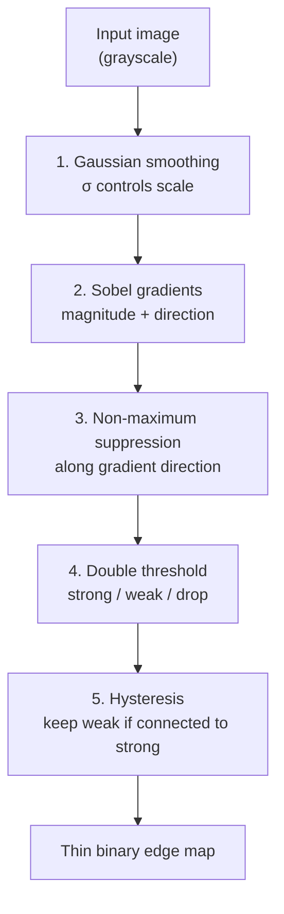
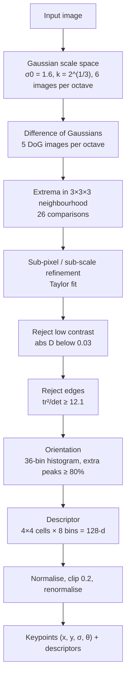
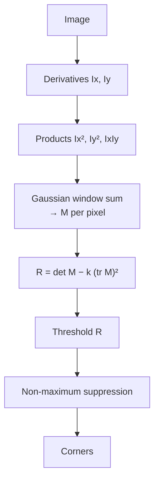
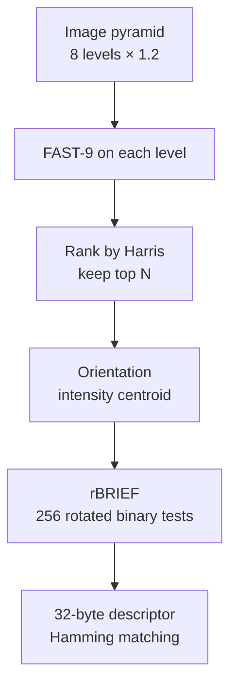

# Session 01 — Course Structure, Image Processing & Features

> **Syllabus:**
> - Course structure (where classical features sit in the course)
> - Image representation
> - Filtering & convolution
> - Edge detection / Canny
> - Harris corners
> - Keypoints and descriptors
> - SIFT, SURF, ORB
>
> **Related:** [Session 02 — Feature matching, RANSAC, homography, panoramas](02_feature_matching_classical.md) · [Session 03 — CNNs (convolution as a learned filter)](03_cnns_under_the_hood.md) · [Session 12 — Optical flow uses the same matrix as Harris](12_3d_vision_motion.md) · [Formula sheet](../00_formula_sheet.md) · [Comparison tables](../00_comparison_tables.md) · [Code: Canny + Harris demo](../code/canny_harris_demo.py) · [Numericals drill](../practice/numericals_drill.md)
>
> **Practice:** [Questions](../practice/01_questions.md) · [Solutions](../practice/01_solutions.md)

---

## 1. Big picture

A digital image is just a 2-D array of numbers; computer vision is about turning those numbers into **structure** (edges, corners, blobs) and then into **meaning** (objects, geometry, 3-D). This session builds the classical toolbox: **filtering** (convolution) to denoise and differentiate, **edge detection** (Canny) to find boundaries, **corner detection** (Harris) to find points that can be localised in 2-D, and **local features** (SIFT, SURF, ORB) = keypoint + descriptor that survive rotation, scale and lighting changes. Session 02 uses these features to **match** images, fit geometry with **RANSAC** and build **panoramas**; Session 03 shows that a CNN layer is the *same* convolution operation with **learned** kernels. Almost every later topic (CNNs, optical flow, stereo, SfM) reuses an idea introduced here.

---

## 2. Core concepts

### Course structure and where this session fits

| Block | Sessions | Core idea | Typical exam material |
|---|---|---|---|
| Classical CV | 01–02 | Hand-designed filters, features, geometry | Convolution arithmetic, Harris R, SIFT pipeline, RANSAC N, homography |
| Deep learning for vision | 03–05 | Learned filters, transfer learning, embeddings | Conv output size, params, receptive field, losses |
| Detection | 06–08 | Two-stage, one-stage, DETR | IoU, NMS, AP/mAP, anchors |
| Segmentation | 10 | Pixel-level labels | IoU/Dice, FCN/U-Net/Mask R-CNN |
| Geometry & 3-D | 11–12 | Camera model, stereo, flow, SfM | Projection, $Z=fB/d$, epipolar constraint |
| Foundation & generative | 13–15 | CLIP, DINO, SAM, diffusion | Zero-shot pipelines, losses |

- Classical methods are still examined because they are **interpretable**, need **no training data**, run on a CPU, and they are the building blocks of geometry (Sessions 11–12).
- Assumed exam format: 3 h, 100 marks — 20 MCQ, 6 numericals × 5, 5-of-6 short × 4, 3-of-4 long × 10.

### Image representation

- **Image as a function:** a continuous image is $I:\mathbb R^2\to\mathbb R$ (grayscale) or $\mathbb R^2\to\mathbb R^C$ (colour). $I(x,y)$ is the intensity at column $x$, row $y$. Origin is the **top-left**, $x$ grows right, **$y$ grows down**.
- **Image as an array:** after digitisation it is a matrix of shape $H\times W$ (grayscale) or $H\times W\times C$. In NumPy/OpenCV you index `img[y, x]` = `img[row, col]` — a very common bug is swapping them.
- **Sampling** (spatial discretisation) decides **resolution** $W\times H$. If the sampling rate is below twice the highest spatial frequency (**Nyquist**), high frequencies fold into false low frequencies → **aliasing** (moiré, jagged edges). Fix: **low-pass (Gaussian) blur before downsampling** — this is why image pyramids blur then subsample.
- **Quantisation** (intensity discretisation) decides **bit depth** $b$: $2^b$ grey levels. 8-bit → 256 levels (0–255); 10/12-bit for RAW/HDR video; 16-bit for medical/depth; float32 for processing. Too few levels → **false contouring** (visible bands).
- **Memory:** bytes $=W\cdot H\cdot C\cdot b/8$. A 1920×1080 RGB 8-bit frame = 6,220,800 B ≈ 6.2 MB.
- **Colour spaces (brief):**

| Space | Channels | Why use it | Notes |
|---|---|---|---|
| Grayscale | 1 | Most feature detectors work on intensity | OpenCV: $Y=0.299R+0.587G+0.114B$ |
| RGB | R, G, B | Native sensor/display format | **OpenCV loads BGR order** |
| HSV | Hue, Saturation, Value | Separates colour (H) from brightness (V) → simple colour segmentation robust to shading | OpenCV 8-bit stores H in 0–179 (degrees/2); hue is circular |
| Lab (CIE L\*a\*b\*) | Lightness, green–red, blue–yellow | Approximately **perceptually uniform** → Euclidean distance ≈ perceived colour difference | Used for colour transfer, colour distance |

### Filtering and convolution

**Why filter?** To remove noise (smoothing), to enhance or measure structure (derivatives, edges), and as the basic operation of CNNs.

**Correlation vs convolution.** For a kernel $K$ of size $(2k+1)\times(2k+1)$:

- **Cross-correlation:** $G(x,y)=\sum_{u=-k}^{k}\sum_{v=-k}^{k}K(u,v)\,I(x+u,y+v)$ — slide the kernel as is.
- **Convolution:** $G(x,y)=\sum_{u,v}K(u,v)\,I(x-u,y-v)$ — equivalent to correlation with the kernel **flipped by 180°** (both axes).
- They are identical for kernels that are symmetric under 180° rotation (box, Gaussian, Laplacian). For Sobel (antisymmetric) the flip only changes the **sign**.
- **CNN layers and `cv2.filter2D` actually compute correlation**; since kernels are learned, the flip is irrelevant there (see [Session 03](03_cnns_under_the_hood.md)).
- Convolution is **commutative, associative, distributive** — so filters can be pre-combined ($\partial(G*I)=(\partial G)*I$: "derivative of Gaussian"). Correlation is not associative in general.

**Linear shift-invariance (LSI).** A filter $\mathcal F$ is **linear** if $\mathcal F(aI_1+bI_2)=a\mathcal F(I_1)+b\mathcal F(I_2)$ and **shift-invariant** if shifting the input shifts the output identically. **Every LSI operator is a convolution** with its impulse response, and by the **convolution theorem** $\mathcal F\{f*g\}=\mathcal F\{f\}\cdot\mathcal F\{g\}$ (large kernels can be applied via FFT). Median and bilateral filters are **not** linear.

**Padding / border modes** (what to do when the kernel hangs off the image):

| Mode (OpenCV) | Pattern for row `abcdefgh` | Effect |
|---|---|---|
| `BORDER_CONSTANT` (zero) | `000 ‖ abcdefgh ‖ 000` | Dark halo after blurring |
| `BORDER_REPLICATE` | `aaa ‖ abcdefgh ‖ hhh` | Repeats edge pixel |
| `BORDER_REFLECT` | `cba ‖ abcdefgh ‖ hgf` | Mirror incl. edge pixel |
| `BORDER_REFLECT_101` (**OpenCV default**) | `dcb ‖ abcdefgh ‖ gfe` | Mirror excl. edge pixel |
| `BORDER_WRAP` | `fgh ‖ abcdefgh ‖ abc` | Periodic (matches DFT assumption) |

Output size (stride 1, no padding) shrinks by $K-1$: $W_{out}=\left\lfloor\frac{W-K+2P}{S}\right\rfloor+1$; "same" output needs $P=(K-1)/2$.

**Smoothing filters:**

- **Box (mean) filter:** all weights $1/K^2$. Cheap (O(1) per pixel with an **integral image** or running sums), but not isotropic and its frequency response is a sinc → **ringing**/blocky artefacts.
- **Gaussian filter:** $G_\sigma(x,y)=\frac{1}{2\pi\sigma^2}e^{-(x^2+y^2)/2\sigma^2}$. Smooth, isotropic, no ringing; the only kernel that is both separable and rotationally symmetric. **Larger $\sigma$ = more blur = bigger kernel = more cost.** Rule of thumb: kernel width $\approx 6\sigma$ (±3σ holds 99.7% of the mass), e.g. $K=2\lceil3\sigma\rceil+1$.
  - **Separable:** $G(x,y)=g(x)\,g(y)$ → a 1-D pass along rows then columns: **$2K$ instead of $K^2$ multiplications per pixel**.
  - **Cascade:** blurring with $\sigma_1$ then $\sigma_2$ = one blur with $\sqrt{\sigma_1^2+\sigma_2^2}$ (used to build SIFT's scale space incrementally).
- **Median filter:** output = median of the neighbourhood. **Non-linear**, excellent for **salt-and-pepper (impulse) noise** because an outlier never becomes the median, and it keeps step edges sharp. Large windows erase thin lines and round corners.
- **Bilateral filter:** weights = spatial Gaussian × **range Gaussian on intensity difference**. Neighbours across an edge have very different intensity → tiny weight → **edge-preserving smoothing**. Non-linear, not separable, slower; large $\sigma_r$ → behaves like plain Gaussian; can give a "cartoon"/staircase look.

**Which smoother?** Gaussian noise → Gaussian (or box for speed); impulse noise → **median**; need to keep edges sharp (denoising, skin smoothing) → **bilateral**.

**Derivative filters.** Edges are large intensity changes, so we differentiate. Differentiation **amplifies noise** (it is a high-pass operation), so every practical derivative filter smooths in the perpendicular direction:

- **Prewitt:** $K_x=\begin{bmatrix}-1&0&1\\-1&0&1\\-1&0&1\end{bmatrix}$ — box smoothing × central difference.
- **Sobel:** $K_x=\begin{bmatrix}-1&0&1\\-2&0&2\\-1&0&1\end{bmatrix}=\begin{bmatrix}1\\2\\1\end{bmatrix}\begin{bmatrix}-1&0&1\end{bmatrix}$ — Gaussian-like smoothing × difference (separable); $K_y=K_x^\top$ (positive = intensity increases **downwards**).
- **Gradient** $\nabla I=(I_x,I_y)$: magnitude $\Vert\nabla I\Vert=\sqrt{I_x^2+I_y^2}$ (or the cheaper L1 $\lvert I_x\rvert+\lvert I_y\rvert$), direction $\theta=\operatorname{atan2}(I_y,I_x)$. The gradient points across the edge (dark → bright); the **edge runs perpendicular** to it.
- **Laplacian** $\nabla^2 I=I_{xx}+I_{yy}$, kernel $\begin{bmatrix}0&1&0\\1&-4&1\\0&1&0\end{bmatrix}$: isotropic second derivative; edges = **zero-crossings**. Very noise-sensitive and gives no direction.
- **LoG (Laplacian of Gaussian, Marr–Hildreth):** smooth with $G_\sigma$ then Laplacian = convolve with $\nabla^2G_\sigma$ ("Mexican hat"). Zero-crossings = edges; **extrema of the scale-normalised LoG $\sigma^2\nabla^2G$** = **blobs** (a disc of radius $r$ responds most at $\sigma=r/\sqrt2$). SIFT approximates it with a **Difference of Gaussians (DoG)**.

### Edge detection and Canny

**What causes edges:** depth discontinuities, surface-orientation discontinuities, reflectance (albedo) changes, illumination changes (shadows). Edge profiles: step, ramp, roof, line. First derivative → **peak**; second derivative → **zero-crossing**.

**Canny's three criteria (1986)** for an optimal edge detector:

1. **Good detection** — low probability of missing true edges and of marking false ones (maximise signal-to-noise ratio).
2. **Good localisation** — marked edge points as close as possible to the true edge.
3. **Single response** — only one response per edge (no multiple maxima).

For a step edge in Gaussian noise the optimal filter is well approximated by the **first derivative of a Gaussian**. Criteria 1 and 2 conflict: more smoothing (larger $\sigma$) improves detection but worsens localisation.

**The five Canny steps** (details in §4):

1. **Gaussian smoothing** with $\sigma$ (noise suppression).
2. **Gradient** magnitude and direction (Sobel).
3. **Non-maximum suppression (NMS)** — thin ridges to 1-pixel width by keeping a pixel only if its magnitude is ≥ both neighbours **along the gradient direction** (quantised to 0°, 45°, 90°, 135°). This implements criterion 3.
4. **Double threshold** — strong ($\ge T_{high}$), weak ($T_{low}\le\cdot<T_{high}$), discarded ($<T_{low}$). Canny recommends $T_{high}:T_{low}$ between **2:1 and 3:1**.
5. **Hysteresis edge tracking** — keep weak pixels only if they are **connected** (8-connectivity) to a strong pixel. Gives long continuous contours while rejecting isolated noise.

**Effect of $\sigma$:** small $\sigma$ → fine detail, many noisy/texture edges, accurate position. Large $\sigma$ → only large-scale, robust edges, but corners rounded, nearby edges merged, positions shifted.

**Practical:** `cv2.Canny(img, T_low, T_high, apertureSize=3, L2gradient=False)` does **not** blur for you — call `cv2.GaussianBlur` first; by default it uses the L1 magnitude $\lvert I_x\rvert+\lvert I_y\rvert$. See [canny_harris_demo.py](../code/canny_harris_demo.py).

### Harris corners

**Why corners?** On a flat region a small window can move anywhere without change (no information); on an edge it can slide **along** the edge without change (**aperture problem**); at a **corner** any shift changes the content → the point is localisable in 2-D. Corners are therefore good for tracking and matching.

**Derivation (sum of squared differences).** Shift a window $\mathcal W$ by $(u,v)$:

$$
E(u,v)=\sum_{(x,y)\in\mathcal W}w(x,y)\,[I(x+u,y+v)-I(x,y)]^2\approx\begin{bmatrix}u & v\end{bmatrix}M\begin{bmatrix}u\\v\end{bmatrix}
$$

using the first-order Taylor expansion $I(x+u,y+v)\approx I+I_xu+I_yv$, with the **structure tensor (second-moment matrix)**

$$
M=\sum_{(x,y)\in\mathcal W}w(x,y)\begin{bmatrix}I_x^2 & I_xI_y\\ I_xI_y & I_y^2\end{bmatrix}.
$$

$E(u,v)=\text{const}$ is an **ellipse**; eigenvectors of $M$ give the directions of fastest/slowest change and the eigenvalues $\lambda_1\ge\lambda_2\ge0$ their amounts (axis lengths $\propto\lambda^{-1/2}$).

**Eigenvalue interpretation** (the $\lambda_1$–$\lambda_2$ plane):

```
 λ2 ↑
    │ EDGE           CORNER
    │ (λ2 ≫ λ1)      (both large,
    │ R < 0           R ≫ 0)
    │
    │ FLAT           EDGE
    │ (both small,   (λ1 ≫ λ2)
    │  |R| small)     R < 0
    └──────────────────────→ λ1
```

- **Flat:** both small → $\lvert R\rvert$ small. **Edge:** one large, one ≈ 0 → $R\approx-k\lambda_1^2<0$. **Corner:** both large and comparable → $R\gg0$.

**Harris response** (avoids computing eigenvalues explicitly):

$$
R=\det M-k\,(\operatorname{tr}M)^2=\lambda_1\lambda_2-k(\lambda_1+\lambda_2)^2,\qquad k\in[0.04,0.06].
$$

**Shi–Tomasi ("Good Features to Track", 1994):** $R=\min(\lambda_1,\lambda_2)$ — directly asks that the *weaker* direction is still strong; better for tracking. OpenCV: `cv2.goodFeaturesToTrack`. The same $M$ appears in **Lucas–Kanade optical flow** (it must be well-conditioned to solve for flow) — see [Session 12](12_3d_vision_motion.md).

**Invariances of Harris:**

| Change | Invariant? | Why |
|---|---|---|
| Translation | Yes | Computed locally |
| Rotation | **Yes** | Ellipse rotates, eigenvalues unchanged |
| Additive intensity $I\to I+b$ | **Yes** | Derivatives unchanged |
| Intensity scaling $I\to aI$ | **Partial** | $M\to a^2M$, $R\to a^4R$ → fixed threshold selects different corners |
| **Scale (zoom)** | **No** | A corner viewed close up through the same window looks like an edge (or flat) |
| Affine / viewpoint | No | Extensions (Harris–Laplace, Harris–Affine) add scale/affine adaptation |

Harris's lack of scale invariance is what motivates **scale-space** detectors (LoG/DoG, SIFT).

### Keypoints and descriptors

- A **local feature** = **keypoint (detector)** + **descriptor**.
  - **Detector** answers *where*: location $(x,y)$, often scale $\sigma$ and orientation $\theta$ (Harris, Shi–Tomasi, FAST, DoG, Fast-Hessian).
  - **Descriptor** answers *what it looks like*: a vector computed from the patch normalised by that scale/orientation (SIFT, SURF, BRIEF, ORB). Detectors and descriptors can be mixed (FAST + BRIEF, DoG + RootSIFT).
- **Why local (not global) features?** Robust to **occlusion and clutter** (some features survive), no segmentation needed, many features per image → geometry can be estimated robustly (Session 02).
- **Properties of a good feature:**
  - **Repeatability** — the same physical point is detected again under a change of viewpoint/lighting (measured as % of re-detected features). Detector property.
  - **Distinctiveness** — descriptors of different points differ, so the correct match can be found among thousands. Descriptor property.
  - **Invariance / robustness** — geometric (translation, rotation, scale, affine/viewpoint) and photometric (brightness offset, contrast gain, mild non-linear changes).
  - **Locality** (small support → robust to occlusion), **quantity**, **accuracy** of localisation, **efficiency** (real-time?).
- **Invariance vs distinctiveness trade-off:** every invariance throws away information. If you know the camera never rotates, an *upright* descriptor (U-SURF, no orientation) is more distinctive and faster.
- **Float vs binary descriptors:** float (SIFT 128-d, SURF 64-d) matched with **L2**; binary (BRIEF, ORB, BRISK) matched with **Hamming** distance = XOR + popcount — very fast and compact.
- **Matching** is done by nearest neighbour in descriptor space plus **Lowe's ratio test** $d_1/d_2<\tau$, $\tau\approx0.7$–$0.8$ — details in [Session 02 — Feature matching](02_feature_matching_classical.md#feature-matching).

### SIFT

**Scale-Invariant Feature Transform** (Lowe 1999/2004). Goal: features invariant to **translation, rotation, scale**, robust to illumination and moderate viewpoint change.

1. **Scale-space extrema detection.** Build a Gaussian scale space $L(x,y,\sigma)=G_\sigma*I$. Per octave use $s=3$ intervals, $k=2^{1/s}$, starting $\sigma_0=1.6$, so $s+3=6$ Gaussian images ($\sigma_0,k\sigma_0,\dots,k^5\sigma_0$) and $s+2=5$ **DoG** images $D=L(k\sigma)-L(\sigma)$. Next octave: take the image with $\sigma=2\sigma_0$, downsample by 2, repeat (Lowe also doubles the input image first to get more keypoints). **DoG approximates the scale-normalised LoG**: $D\approx(k-1)\sigma^2\nabla^2G$, so its extrema are blob centres at their characteristic scale. A pixel is a candidate if it is larger or smaller than all **26 neighbours** in the **3×3×3** neighbourhood (8 at its own scale, 9 above, 9 below). Extrema are searched in the middle $s=3$ DoG levels.
2. **Keypoint localisation.** Fit a 3-D quadratic (Taylor expansion of $D$) to get **sub-pixel, sub-scale** position $\hat{\mathbf x}$. Reject **low contrast** points ($\lvert D(\hat{\mathbf x})\rvert<0.03$, image in [0,1]) and **edge responses** using the 2×2 Hessian of $D$: keep only if $\frac{\operatorname{tr}(H)^2}{\det H}<\frac{(r+1)^2}{r}=12.1$ for $r=10$ (DoG responds strongly along edges, but those points are poorly localised along the edge — same idea as Harris).
3. **Orientation assignment.** In a Gaussian-weighted window (σ = 1.5 × keypoint scale) build a **36-bin** (10° each) histogram of gradient directions weighted by magnitude. Dominant peak = orientation; any other peak ≥ **80%** of the max creates an **extra keypoint** with that orientation. All later computations are relative to this angle → **rotation invariance**.
4. **Descriptor.** Take a **16×16** sample window around the keypoint, rotated to its orientation and at its scale; split into **4×4 cells**, each an **8-bin** orientation histogram → **4×4×8 = 128-d**. Gaussian weighting and trilinear interpolation avoid boundary effects. **Normalise to unit length** (contrast invariance) → **clip at 0.2** (reduce influence of large gradients from non-linear illumination/saturation) → **renormalise**.

**Why each step:** DoG → scale invariance cheaply (just subtract blurred images you already have); sub-pixel → accuracy & stability; contrast/edge rejection → only stable, well-localised points; orientation → rotation invariance; gradient histograms → tolerant to small shifts/deformations and illumination (gradients ignore additive offsets, normalisation removes gain).

**Licensing:** SIFT's US patent **expired in March 2020**; since OpenCV 4.4 it is in the main module: `cv2.SIFT_create()` (defaults: `nOctaveLayers=3`, `contrastThreshold=0.04`, `edgeThreshold=10`, `sigma=1.6` — OpenCV scales its contrast threshold internally, so the number differs from Lowe's 0.03).

### SURF

**Speeded-Up Robust Features** (Bay et al. 2006). Same goals as SIFT, engineered for speed:

- **Integral image** $ii(x,y)=\sum_{x'\le x,\,y'\le y}I(x',y')$: any rectangle sum in **4 lookups**, independent of size.
- **Fast-Hessian detector:** approximate the Gaussian second derivatives $L_{xx},L_{yy},L_{xy}$ with **box filters** $D_{xx},D_{yy},D_{xy}$ (the 9×9 filter ≈ $\sigma=1.2$) and use the **determinant of the Hessian** as blob response: $\det(H_{approx})=D_{xx}D_{yy}-(0.9D_{xy})^2$ (0.9 corrects the box approximation).
- **Scale space by enlarging the filter** (9, 15, 21, 27, … in the first octave), **not** by shrinking the image — cost is constant per filter thanks to the integral image. Maxima via 3×3×3 NMS and interpolation.
- **Orientation:** Haar-wavelet responses $d_x,d_y$ in a circular neighbourhood (radius $6s$); a sliding window of $\pi/3$ picks the dominant direction. (U-SURF skips this.)
- **Descriptor:** oriented $20s\times20s$ square → **4×4 subregions**, each $(\sum d_x,\sum d_y,\sum\lvert d_x\rvert,\sum\lvert d_y\rvert)$ → **64-d**, normalised to unit length. Matched with L2; the sign of the Laplacian (trace) gives a free pre-filter for matching.
- **Licensing:** **patented / non-free** — in OpenCV only in `opencv_contrib` (`cv2.xfeatures2d.SURF_create`) when built with the non-free option.

### ORB

**Oriented FAST and Rotated BRIEF** (Rublee et al. 2011): a **free (BSD), very fast, binary** alternative to SIFT/SURF; the workhorse of real-time SLAM (e.g. ORB-SLAM).

- **FAST detector (segment test):** for a candidate pixel $p$ with intensity $I_p$ and threshold $t$, look at the **16 pixels on a Bresenham circle of radius 3**. $p$ is a corner if at least $n$ **contiguous** circle pixels are all brighter than $I_p+t$ or all darker than $I_p-t$. ORB uses **FAST-9** ($n=9$). Very cheap (a quick rejection test on 4 compass pixels), but has **no orientation, no scale, and no good corner score**.
- **oFAST** = FAST-9 + **Harris measure to rank** and keep the best $N$ + **image pyramid** (OpenCV default 8 levels, factor 1.2) for scale + **intensity-centroid orientation**: moments $m_{pq}=\sum x^py^qI(x,y)$ over a circular patch, $\theta=\operatorname{atan2}(m_{01},m_{10})$ (vector from the corner to the patch's intensity centroid).
- **BRIEF descriptor:** on a smoothed patch, perform $n_d$ binary tests $\tau(\mathbf p;\mathbf a,\mathbf b)=1$ if $I(\mathbf a)<I(\mathbf b)$ else 0. Plain BRIEF is **not rotation-invariant**.
- **rBRIEF:** **steer** the test locations by $\theta$ (lookup table of rotated patterns in 12° steps) and use **256 learned tests** chosen for high variance and low correlation → **256 bits = 32 bytes**.
- **Matching:** **Hamming distance** (XOR + popcount), `cv2.BFMatcher(cv2.NORM_HAMMING)` (`NORM_HAMMING2` if `WTA_K` = 3 or 4). OpenCV: `cv2.ORB_create(nfeatures=500)` (default 500).
- **Weaknesses:** scale handled only by a coarse pyramid, less distinctive than SIFT, degrades faster with large viewpoint/scale changes; features cluster on high-contrast corners.

---

## 3. Key formulas

### Image memory

$$
\text{bytes}=W\cdot H\cdot C\cdot\frac{b}{8}
$$

$W,H$ = width/height in pixels, $C$ = channels, $b$ = bits per channel; levels $=2^b$.
*Example:* 1920×1080, $C=3$, $b=8$ → $1920\cdot1080\cdot3=6{,}220{,}800$ B ≈ 6.22 MB (5.93 MiB).

### Correlation, convolution, output size

$$
\begin{aligned}
(K\otimes I)(x,y)&=\sum_{u=-k}^{k}\sum_{v=-k}^{k}K(u,v)\,I(x+u,y+v) &&\text{(correlation)}\\
(K* I)(x,y)&=\sum_{u=-k}^{k}\sum_{v=-k}^{k}K(u,v)\,I(x-u,y-v) &&\text{(convolution = correlation with } K \text{ rotated } 180^\circ)\\
W_{out}&=\left\lfloor\frac{W-K+2P}{S}\right\rfloor+1
\end{aligned}
$$

$(u,v)$ = kernel offsets (column, row), $k$ = kernel radius, $K$ = kernel size, $P$ = padding, $S$ = stride.
*Example (shift kernel):* $I=\begin{bmatrix}1&2&3\\4&5&6\\7&8&9\end{bmatrix}$, $K=\begin{bmatrix}0&0&0\\0&0&1\\0&0&0\end{bmatrix}$. Correlation at the centre picks the **right** neighbour = **6**; convolution picks the **left** neighbour = **4**. Output size for $W=512$, $K=5$, $P=0$, $S=1$: $508$; with $P=2$: $512$.

### Gaussian kernel, size, separability, cascade

$$
G_\sigma(x,y)=\frac{1}{2\pi\sigma^2}\exp\!\left(-\frac{x^2+y^2}{2\sigma^2}\right)=g_\sigma(x)\,g_\sigma(y),\qquad K\approx 6\sigma\ \ (K=2\lceil3\sigma\rceil+1)
$$

$$
\text{cost per pixel: } K^2 \text{ (2-D) vs } 2K \text{ (separable)};\qquad G_{\sigma_1}*G_{\sigma_2}=G_{\sqrt{\sigma_1^2+\sigma_2^2}}
$$

$\sigma$ = standard deviation (pixels), $g_\sigma$ = 1-D Gaussian.
*Example:* $\sigma=2$ → $K=13$: 169 vs 26 multiplications per pixel (6.5× faster). Blurring with $\sigma=3$ then $\sigma=4$ = one blur with $\sigma=5$.

### Bilateral filter

$$
BF[I](\mathbf p)=\frac{1}{W_{\mathbf p}}\sum_{\mathbf q\in\mathcal N(\mathbf p)}G_{\sigma_s}(\Vert\mathbf p-\mathbf q\Vert)\,G_{\sigma_r}(\lvert I(\mathbf p)-I(\mathbf q)\rvert)\,I(\mathbf q)
$$

$\sigma_s$ = spatial width, $\sigma_r$ = range (intensity) width, $W_{\mathbf p}$ = sum of the weights (normalisation), $\mathcal N(\mathbf p)$ = neighbourhood.
*Example:* $\sigma_s=2$, $\sigma_r=25$, neighbour 1 px away: same intensity → weight $e^{-1/8}=0.88$; intensity 50 higher (across an edge) → $0.88\cdot e^{-2}=0.12$, i.e. ~7× less influence.

### Image gradient

$$
I_x=K_x\otimes I,\quad I_y=K_y\otimes I,\quad \Vert\nabla I\Vert=\sqrt{I_x^2+I_y^2},\quad \theta=\operatorname{atan2}(I_y,I_x)
$$

$K_x$ = Sobel x-kernel, $K_y=K_x^\top$ ($y$ down).
*Example:* vertical step $\begin{bmatrix}10&10&100\\10&10&100\\10&10&100\end{bmatrix}$ → $I_x=(100-10)(1+2+1)=360$, $I_y=0$, $\theta=0^\circ$ (gradient points right; the edge is vertical).

### Laplacian, LoG and DoG

$$
\nabla^2I=I_{xx}+I_{yy},\qquad \nabla^2G_\sigma=\frac{x^2+y^2-2\sigma^2}{\sigma^4}\,G_\sigma(x,y),\qquad G_{k\sigma}-G_\sigma\approx(k-1)\,\sigma^2\nabla^2G_\sigma
$$

$\sigma^2\nabla^2G$ = **scale-normalised** LoG (comparable across scales); $k$ = scale ratio between adjacent levels.
*Example:* SIFT $k=2^{1/3}=1.26$, so DoG ≈ $0.26\times$ scale-normalised LoG — the constant factor does not move the extrema. A disc of radius $r=10$ px gives the strongest LoG response at $\sigma=r/\sqrt2\approx7.07$.

### Harris and Shi–Tomasi

$$
M=\sum_{(x,y)\in\mathcal W}w(x,y)\begin{bmatrix}I_x^2 & I_xI_y\\ I_xI_y & I_y^2\end{bmatrix},\qquad R=\det M-k\,(\operatorname{tr}M)^2=\lambda_1\lambda_2-k(\lambda_1+\lambda_2)^2,\qquad R_{ST}=\min(\lambda_1,\lambda_2)
$$

$w$ = window weights (box or Gaussian), $\mathcal W$ = window, $I_x,I_y$ = image derivatives, $\lambda_{1,2}$ = eigenvalues of $M$, $k\in[0.04,0.06]$.
*Example ($k=0.05$):* $M=\begin{bmatrix}50&5\\5&40\end{bmatrix}$: $\det=1975$, $\operatorname{tr}=90$, $R=1975-0.05\cdot8100=1570>0$ → **corner** ($\lambda=37.9,\ 52.1$). $M=\begin{bmatrix}50&0\\0&2\end{bmatrix}$: $R=100-0.05\cdot2704=-35.2<0$ → **edge**.
*Intensity scaling:* $I\to aI$ gives $R\to a^4R$ (doubling brightness → $R\times16$).

### Integral image (SURF, box filters, Viola–Jones)

$$
ii(x,y)=\sum_{x'\le x}\sum_{y'\le y}I(x',y'),\qquad \sum_{x=x_0}^{x_1}\sum_{y=y_0}^{y_1}I(x,y)=ii(x_1,y_1)-ii(x_0-1,y_1)-ii(x_1,y_0-1)+ii(x_0-1,y_0-1)
$$

Computed in one pass: $ii(x,y)=I(x,y)+ii(x-1,y)+ii(x,y-1)-ii(x-1,y-1)$.
*Example:* $I=\begin{bmatrix}3&1&4&1\\5&9&2&6\\5&3&5&8\\9&7&9&3\end{bmatrix}$; sum of rows 1–2, columns 1–3 (0-indexed) $=52-13-9+3=33$ $(=9+2+6+3+5+8)$.

### SIFT formulas

$$
\begin{aligned}
L(x,y,\sigma)&=G_\sigma*I,\qquad D(x,y,\sigma)=L(x,y,k\sigma)-L(x,y,\sigma),\qquad k=2^{1/s}\\
\hat{\mathbf x}&=-\left(\frac{\partial^2D}{\partial\mathbf x^2}\right)^{-1}\frac{\partial D}{\partial\mathbf x},\qquad D(\hat{\mathbf x})=D+\tfrac12\frac{\partial D}{\partial\mathbf x}^{\top}\hat{\mathbf x}\quad(\text{reject if }\lvert D(\hat{\mathbf x})\rvert<0.03)\\
\frac{\operatorname{tr}(H)^2}{\det H}&<\frac{(r+1)^2}{r},\quad H=\begin{bmatrix}D_{xx}&D_{xy}\\D_{xy}&D_{yy}\end{bmatrix},\ r=10\Rightarrow 12.1
\end{aligned}
$$

$\mathbf x=(x,y,\sigma)^\top$ (offset from the sample point; if any component > 0.5 move to the neighbouring sample), $s$ = intervals per octave, $r$ = max allowed ratio of principal curvatures.
*Examples:* σ sequence for one octave ($\sigma_0=1.6$, $s=3$): **1.6, 2.016, 2.540, 3.2, 4.032, 5.080**. Edge test: $D_{xx}=4,D_{yy}=3,D_{xy}=1$ → $49/11=4.45<12.1$ keep; $D_{xx}=20,D_{yy}=1,D_{xy}=0$ → $441/20=22.05>12.1$ **reject** (edge-like).

### SURF Hessian

$$
\det(H_{approx})=D_{xx}D_{yy}-(0.9\,D_{xy})^2
$$

$D_{xx},D_{yy},D_{xy}$ = box-filter responses (via integral image) approximating Gaussian second derivatives.

### ORB orientation and Hamming distance

$$
m_{pq}=\sum_{x,y}x^py^qI(x,y),\quad \theta=\operatorname{atan2}(m_{01},m_{10}),\qquad d_H(\mathbf a,\mathbf b)=\operatorname{popcount}(\mathbf a\oplus\mathbf b)
$$

$(x,y)$ relative to the keypoint, $\oplus$ = bitwise XOR, popcount = number of 1-bits.
*Example:* patch (centre at 0) $\begin{bmatrix}0&0&0\\0&10&20\\0&20&40\end{bmatrix}$: $m_{10}=20+40=60$, $m_{01}=20+40=60$ → $\theta=45^\circ$ (pointing right-and-down, since $y$ is down). Hamming: `10110100` ⊕ `10011101` = `00101001` → $d_H=3$.

### Lowe's ratio test (used in Session 02)

$$
\text{accept match if } \frac{d_1}{d_2}<\tau,\quad \tau\approx0.7\text{–}0.8
$$

$d_1,d_2$ = distances to the nearest and second-nearest descriptor. Lowe: $\tau=0.8$ removes ~90% of false matches while losing <5% of correct ones.

---

## 4. Algorithms step by step

### A1. 2-D filtering (direct)

1. Choose kernel $K$ ($(2k+1)\times(2k+1)$) and border mode; pad the image by $k$ on every side.
2. For convolution, rotate $K$ by 180° (skip for correlation or symmetric kernels).
3. For every output pixel $(x,y)$: multiply the kernel element-wise with the neighbourhood centred at $(x,y)$ and sum.
4. Optionally normalise (divide by $\sum K$ for smoothing kernels) and clip/convert to the output type.
5. If $K$ is separable ($K=\mathbf c\,\mathbf r^\top$), instead filter rows with $\mathbf r$ then columns with $\mathbf c$ ($2K$ instead of $K^2$ operations).

### A2. Canny edge detector

1. Convert to grayscale; **smooth** with Gaussian $G_\sigma$.
2. Compute $I_x$, $I_y$ (Sobel) → magnitude $\Vert\nabla I\Vert$ and direction $\theta$.
3. **Quantise** $\theta$ to 0°, 45°, 90°, 135° (mod 180°).
4. **NMS:** compare each pixel's magnitude with its two neighbours along the quantised gradient direction (0° → left/right; 90° → up/down; diagonals → the two diagonal neighbours); set to 0 unless it is the maximum.
5. **Double threshold:** magnitude $\ge T_{high}$ → strong; $T_{low}\le$ magnitude $<T_{high}$ → weak; below $T_{low}$ → 0. Typical $T_{high}=2$–$3\times T_{low}$.
6. **Hysteresis:** start from every strong pixel and flood-fill (8-connected) through weak pixels; weak pixels never reached are discarded.
7. Output a binary, 1-pixel-wide edge map.

### A3. Harris corner detector

1. Compute derivatives $I_x$, $I_y$ (Sobel, usually after slight Gaussian smoothing).
2. Compute products $I_x^2$, $I_y^2$, $I_xI_y$ at every pixel.
3. Sum the products over a window with weights $w$ (Gaussian, $\sigma_I$) → $M$ at every pixel.
4. Compute $R=\det M-k(\operatorname{tr}M)^2$ ($k\approx0.04$–$0.06$). (Shi–Tomasi: $R=\min(\lambda_1,\lambda_2)$.)
5. Threshold $R$ (e.g. $R>0.01\,R_{max}$).
6. **Non-maximum suppression** in a local window (e.g. 3×3) → keep local maxima as corners.
OpenCV: `cv2.cornerHarris(np.float32(gray), blockSize=2, ksize=3, k=0.04)`.

### A4. Integral image and box sum

1. Create $ii$ the same size as $I$ (or padded by a zero row/column).
2. Single raster pass: $ii(x,y)=I(x,y)+ii(x-1,y)+ii(x,y-1)-ii(x-1,y-1)$ (treat out-of-range as 0).
3. Any rectangle $[x_0,x_1]\times[y_0,y_1]$: sum $=ii(x_1,y_1)-ii(x_0-1,y_1)-ii(x_1,y_0-1)+ii(x_0-1,y_0-1)$ — **4 lookups**, independent of rectangle size.
4. Box filter / SURF box approximations / Viola–Jones Haar features = weighted combinations of such rectangle sums.

### A5. FAST segment test

1. For pixel $p$, read $I_p$ and choose threshold $t$.
2. Take the 16 pixels on a radius-3 Bresenham circle.
3. **Quick rejection:** check the 4 compass pixels (1, 5, 9, 13); if too few of them are all brighter than $I_p+t$ or all darker than $I_p-t$, $p$ cannot be a corner — reject.
4. Full test: $p$ is a corner if ≥ $n$ contiguous circle pixels ($n=9$ for FAST-9) are all brighter than $I_p+t$ or all darker than $I_p-t$.
5. Compute a corner score for detected pixels and apply **NMS** (ORB ranks with the Harris measure instead).

### A6. SIFT pipeline

1. (Lowe) Double the input image; blur to $\sigma_0=1.6$.
2. **Gaussian scale space:** per octave, $s+3=6$ images with $\sigma=\sigma_0k^i$, $k=2^{1/3}$; next octave = image at $2\sigma_0$ downsampled by 2.
3. **DoG:** subtract adjacent Gaussians → $s+2=5$ DoG images per octave.
4. **Extrema:** in the middle 3 DoG levels, keep pixels that are max/min over their **26** neighbours (3×3×3).
5. **Refine** with a quadratic fit → sub-pixel $(x,y)$ and sub-scale $\sigma$.
6. **Reject** low contrast ($\lvert D(\hat{\mathbf x})\rvert<0.03$) and edge-like points ($\operatorname{tr}^2/\det\ge12.1$ or $\det\le0$).
7. **Orientation:** 36-bin gradient histogram in a Gaussian window (1.5σ); peak = orientation; peaks ≥ 80% → extra keypoints; parabola fit for accuracy.
8. **Descriptor:** 16×16 window rotated to $\theta$ → 4×4 cells × 8 bins = 128-d; normalise → clip 0.2 → renormalise.
9. Output keypoints $(x,y,\sigma,\theta)$ + 128-d descriptors; match with L2 + ratio test ([Session 02](02_feature_matching_classical.md)).

### A7. SURF (outline)

1. Compute integral image.
2. Apply box-filter approximations of $L_{xx},L_{yy},L_{xy}$ at increasing filter sizes (9, 15, 21, 27, …); response $\det(H_{approx})=D_{xx}D_{yy}-(0.9D_{xy})^2$.
3. 3×3×3 non-maximum suppression across space and scale; interpolate; threshold on the Hessian response.
4. Orientation from Haar-wavelet responses (sliding $\pi/3$ window).
5. 4×4 subregions × $(\sum d_x,\sum d_y,\sum\lvert d_x\rvert,\sum\lvert d_y\rvert)$ → 64-d, normalise.

### A8. ORB

1. Build an image pyramid (e.g. 8 levels, factor 1.2).
2. On each level run **FAST-9**; rank candidates by **Harris** response and keep the top $N$.
3. Compute orientation $\theta=\operatorname{atan2}(m_{01},m_{10})$ from the intensity centroid of a circular patch.
4. Smooth the patch; evaluate the **256 learned binary tests**, rotated by $\theta$ (**rBRIEF**) → 32-byte descriptor.
5. Match with Hamming distance (brute force or LSH) + ratio test / cross-check.

---

## 5. Diagrams

**Canny pipeline**



**SIFT pipeline**



**Harris detector**



**ORB pipeline**



---

## 6. Comparison tables

### Correlation vs convolution

| | Correlation | Convolution |
|---|---|---|
| Formula | $\sum K(u,v)I(x+u,y+v)$ | $\sum K(u,v)I(x-u,y-v)$ |
| Kernel | Used as is | Flipped 180° |
| Commutative / associative | No (in general) | Yes |
| Used by | Template matching, `cv2.filter2D`, **CNN layers** | Signal-processing theory, LSI systems, `scipy.ndimage.convolve` |
| Same result when | Kernel is symmetric under 180° rotation (Gaussian, box, Laplacian) | ← same |

### Smoothing filters

| Filter | Linear? | Edge-preserving? | Best for | Cost | Weakness |
|---|---|---|---|---|---|
| Box / mean | Yes | No | Fast blur, integral-image tricks | O(1)/px with integral image | Ringing, anisotropic |
| Gaussian | Yes | No | Gaussian noise, pre-smoothing, scale space | $2K$/px (separable) | Blurs edges |
| Median | **No** | Mostly (steps) | **Salt-and-pepper** | Sort per pixel | Removes thin lines, rounds corners |
| Bilateral | **No** | **Yes** | Denoise while keeping edges | Expensive, not separable | Staircase/cartoon effect, two parameters |

### Edge operators

| Operator | Order | Output | Noise robustness | Notes |
|---|---|---|---|---|
| Prewitt | 1st | $I_x,I_y$ | Low–medium | Box smoothing |
| Sobel | 1st | $I_x,I_y$ | Medium | [1,2,1] smoothing, separable |
| Laplacian | 2nd | Zero-crossings | Very low | Isotropic, no direction, double edges |
| LoG | 2nd | Zero-crossings / blobs | Good (σ) | Marr–Hildreth; blob detector at $\sigma=r/\sqrt2$ |
| DoG | ≈2nd | Blobs | Good | Fast approximation of scale-normalised LoG (SIFT) |
| Canny | 1st + logic | Thin connected edges | Best | NMS + hysteresis; 2 thresholds + σ |

### Corner / interest-point detectors

| Detector | Response | Rotation inv. | Scale inv. | Speed | Typical use |
|---|---|---|---|---|---|
| Harris | $\det M-k(\operatorname{tr}M)^2$ | Yes | **No** | Fast | Corners for calibration, tracking |
| Shi–Tomasi | $\min(\lambda_1,\lambda_2)$ | Yes | No | Fast | KLT tracking (`goodFeaturesToTrack`) |
| FAST | Segment test on 16-px circle | Partly (no orientation) | No | **Fastest** | Real-time SLAM (inside ORB) |
| DoG (SIFT) | Scale-space extrema of DoG | Yes (with orientation) | **Yes** | Slow | SIFT keypoints |
| Fast-Hessian (SURF) | $\det(H_{approx})$ via box filters | Yes | Yes | Medium | SURF keypoints |

### SIFT vs SURF vs ORB

| | SIFT | SURF | ORB |
|---|---|---|---|
| Year / authors | 1999/2004, Lowe | 2006, Bay et al. | 2011, Rublee et al. |
| Detector | DoG extrema in scale space | Fast-Hessian (box filters, integral image) | oFAST: FAST-9 + Harris ranking + pyramid |
| Orientation | 36-bin gradient histogram | Haar wavelets, $\pi/3$ window | Intensity centroid |
| Descriptor type | Float, gradient-orientation histograms | Float, Haar-wavelet sums | **Binary**, rBRIEF tests |
| Dimension | **128** (512 B as float32) | **64** (256 B) | **256 bits = 32 B** |
| Match metric | **L2** | **L2** | **Hamming** (XOR + popcount) |
| Speed | Slowest | Several × faster than SIFT | Fastest (real-time on CPU/mobile) |
| Scale invariance | Strong (continuous scale space) | Strong | Moderate (8-level pyramid) |
| Rotation invariance | Yes | Yes (U-SURF: no) | Yes |
| Illumination | Robust (gradients, normalise + clip) | Robust (normalised) | Moderate (binary comparisons are invariant to monotonic changes locally) |
| Distinctiveness | Highest | High | Lower |
| Licensing | Patent **expired 2020** → main OpenCV (`cv2.SIFT_create`) | **Patented / non-free** (`opencv_contrib`, non-free build) | Free (BSD) (`cv2.ORB_create`) |
| Typical use | SfM, offline matching, accuracy | Legacy speed-accuracy compromise | SLAM, mobile AR, embedded |

### Float vs binary descriptors

| | Float (SIFT, SURF) | Binary (BRIEF, ORB, BRISK) |
|---|---|---|
| Distance | L2 (or L1) | Hamming |
| Memory | 256–512 B | 32–64 B |
| Matching speed | Slower (floating-point) | Very fast (XOR + popcount) |
| ANN index | KD-tree (FLANN) | LSH |
| Robustness | Higher | Lower under large changes |

---

## 7. Common exam traps & misconceptions

- ❌ "Convolution and correlation are the same operation." → ✅ Convolution **flips the kernel by 180°**; they coincide only for 180°-symmetric kernels. **CNNs actually compute correlation** (and call it convolution) — harmless because the kernel is learned.
- ❌ "The median filter is linear because it is a sliding-window filter." → ✅ It is **non-linear**: e.g. median([0,0,5]) = 0 and median([5,0,0]) = 0 but median of their sum [5,0,5] = 5. So it is not a convolution and has no frequency response.
- ❌ "A Gaussian with larger σ is cheaper because it is smoother." → ✅ Larger σ → **larger kernel** ($\approx6\sigma$) → **more** computation; it blurs more. (Use separability, pyramids or recursive filters to save time.)
- ❌ "Separable filtering changes the result." → ✅ It gives the **same** result for a separable kernel ($K=\mathbf c\mathbf r^\top$), only cheaper: $2K$ vs $K^2$ multiplications per pixel.
- ❌ "Blurring twice with σ = 2 equals blurring once with σ = 4." → ✅ Variances add: $\sqrt{2^2+2^2}=2.83$.
- ❌ "Harris is scale-invariant because it is rotation-invariant." → ✅ Harris is **rotation-invariant but NOT scale-invariant** (a corner at one zoom level looks like an edge at another). Scale invariance needs a scale-space search (LoG/DoG, Harris–Laplace).
- ❌ "Harris R < 0 means flat region." → ✅ **R < 0 = edge** (one large eigenvalue); flat = $\lvert R\rvert$ small; corner = R large positive.
- ❌ "Harris is fully invariant to illumination." → ✅ Invariant to **additive** shifts only; scaling intensity by $a$ scales $R$ by $a^4$, so a fixed threshold changes which corners are kept (partial invariance).
- ❌ "Canny's NMS removes pixels below the low threshold." → ✅ NMS thins edges by comparing with neighbours **along the gradient direction**; thresholds come afterwards (double threshold + hysteresis).
- ❌ "Hysteresis keeps all weak edges." → ✅ Only weak pixels **connected** to strong pixels survive.
- ❌ "`cv2.Canny` smooths the image with a Gaussian internally." → ✅ It does not; blur first with `cv2.GaussianBlur`.
- ❌ "The gradient direction is the edge direction." → ✅ The gradient is **perpendicular** to the edge.
- ❌ "DoG = derivative of Gaussian." → ✅ In SIFT, DoG = **Difference of Gaussians**, which **approximates the scale-normalised LoG** $\sigma^2\nabla^2G$ (times $k-1$). "Derivative of Gaussian" is the Canny-style first-derivative filter.
- ❌ "SIFT descriptor = 128 because it uses 128 keypoints / 128 pixels." → ✅ $4\times4$ cells × 8 orientation bins = 128.
- ❌ "SIFT extrema are found in a 3×3 window." → ✅ In a **3×3×3** space-scale neighbourhood (26 neighbours).
- ❌ "SIFT's edge test removes points on corners." → ✅ It removes points with a **large ratio of principal curvatures** (edge-like), keeping $\operatorname{tr}^2/\det<12.1$.
- ❌ "SURF builds its pyramid by downsampling the image." → ✅ SURF **enlarges the box filter**; the integral image makes cost independent of filter size.
- ❌ "ORB descriptors should be matched with Euclidean distance." → ✅ ORB is **binary** → **Hamming** distance (`NORM_HAMMING`). Using L2 on the packed bytes is meaningless.
- ❌ "SIFT is still patented, so you must use ORB." → ✅ SIFT's patent **expired in 2020**; it is in main OpenCV. **SURF** is the one still in non-free.
- ❌ "FAST gives oriented, scale-invariant keypoints." → ✅ Plain FAST has **no orientation and no scale**; ORB adds the pyramid and intensity-centroid orientation.

---

## 8. 10-line cheat summary

1. Image = $H\times W\times C$ array; memory $=WHC\,b/8$ bytes; blur before downsampling to avoid aliasing.
2. Convolution = correlation with a 180°-flipped kernel; CNNs and `filter2D` compute correlation; LSI ⇔ convolution.
3. Gaussian: kernel ≈ 6σ, separable ($2K$ vs $K^2$), variances add; median = non-linear, best for salt-and-pepper; bilateral = edge-preserving.
4. Sobel = [1,2,1] smoothing × [−1,0,1] difference; $\Vert\nabla I\Vert=\sqrt{I_x^2+I_y^2}$, $\theta=\operatorname{atan2}(I_y,I_x)$, edge ⟂ gradient.
5. Canny: good detection, good localisation, single response → Gaussian, gradient, NMS along gradient, double threshold (2:1–3:1), hysteresis.
6. Harris: $M$ from $I_x^2,I_xI_y,I_y^2$; $R=\det M-k(\operatorname{tr}M)^2$; corner R ≫ 0, edge R < 0, flat |R| small; Shi–Tomasi = min(λ₁, λ₂).
7. Harris is invariant to rotation and additive intensity, partially to intensity scale ($R\to a^4R$), **not** to scale.
8. Feature = detector (where: x, y, σ, θ) + descriptor (what); want repeatability, distinctiveness, invariance, efficiency.
9. SIFT: DoG (≈ scale-normalised LoG) extrema in 3×3×3, sub-pixel fit, reject |D|<0.03 and tr²/det ≥ 12.1, 36-bin orientation, 4×4×8 = 128-d, clip 0.2.
10. SURF = integral image + box-filter Hessian, 64-d, non-free; ORB = FAST-9 + Harris + pyramid + centroid + rBRIEF 256 bits, Hamming, free; match with ratio test $d_1/d_2<0.7$–$0.8$.
