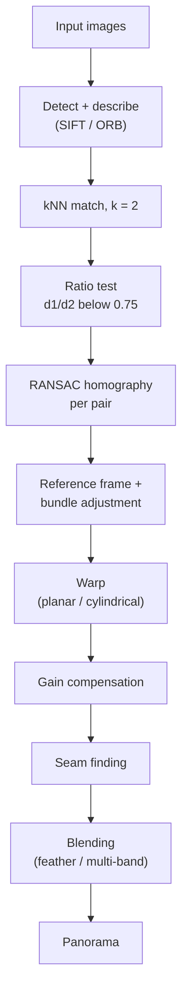
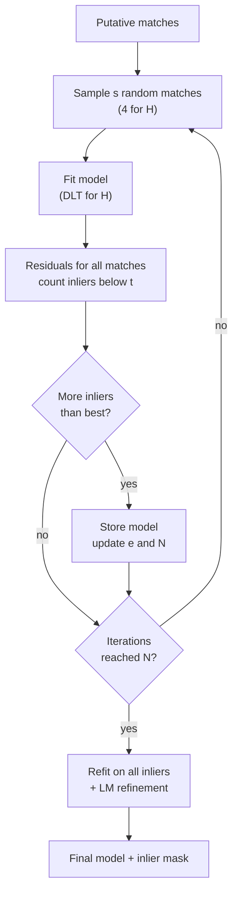
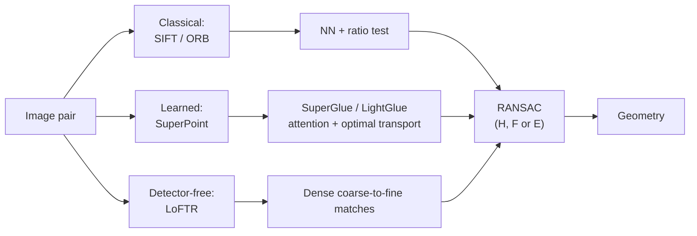

# Session 02 — Feature Matching & Classical CV

> **Syllabus:**
> - Feature matching
> - Distance metrics
> - RANSAC
> - Homography
> - Panorama stitching
> - Where classical CV works / fails
> - Practical: SIFT/ORB matching + panorama
>
> **Related:** [Session 01 — keypoints, SIFT/SURF/ORB](01_image_processing_features.md) · [Session 05 — embeddings & similarity metrics](05_embeddings_similarity.md) · [Session 11 — Homography revisited](11_camera_geometry.md) · [Session 12 — RANSAC for the fundamental matrix, SfM](12_3d_vision_motion.md) · [Formula sheet](../00_formula_sheet.md) · [Comparison tables](../00_comparison_tables.md) · [Code: SIFT/ORB matching + panorama](../code/sift_orb_matching_panorama.py) · [Numericals drill](../practice/numericals_drill.md)
>
> **Practice:** [Questions](../practice/02_questions.md) · [Solutions](../practice/02_solutions.md)

---

## 1. Big picture

Session 01 produced **local features** (keypoint + descriptor). This session turns them into **correspondences** between images and then into **geometry**: (1) **match** descriptors with a suitable distance and filter ambiguous matches (Lowe's ratio test, cross-check); (2) the surviving matches still contain outliers, so fit a geometric model robustly with **RANSAC**; (3) the most common model between two views is the **homography**, valid for planar scenes or a purely rotating camera; (4) chaining these steps and warping/blending images gives **panorama stitching**. The same "detect → describe → match → RANSAC → model" recipe reappears for the fundamental/essential matrix, SfM and SLAM ([Session 12](12_3d_vision_motion.md)), and its failure modes explain why learned matchers (SuperPoint, SuperGlue, LoFTR) were developed.

---

## 2. Core concepts

### Feature matching

**Problem:** given descriptor sets $\{\mathbf d_i\}$ from image 1 (query) and $\{\mathbf d'_j\}$ from image 2 (train), find pairs $(i,j)$ that are the **same physical point**. Matching only uses appearance; geometry is checked later (RANSAC).

- **Brute force (BF):** compare every query with every train descriptor and keep the nearest. Exact, simple, cost $O(N_1N_2D)$ (e.g. 2000 × 2000 SIFT × 128 ≈ 5×10⁸ multiply-adds). Fine for two images with a few thousand features. OpenCV: `cv2.BFMatcher(normType)`.
- **k-nearest neighbours (kNN):** return the $k$ best train descriptors per query; $k=2$ is needed for the **ratio test**. `matcher.knnMatch(des1, des2, k=2)`.
- **FLANN (Fast Library for Approximate Nearest Neighbours):** approximate NN search, much faster for large sets/databases, small loss of accuracy.
  - **Randomised KD-trees** for **float** descriptors (SIFT/SURF): `algorithm=FLANN_INDEX_KDTREE (1), trees=5`, search `checks=50` (more checks = more accurate, slower).
  - **LSH (locality-sensitive hashing)** for **binary** descriptors (ORB/BRIEF/BRISK): hash tables keyed on random subsets of bits, `algorithm=FLANN_INDEX_LSH (6), table_number=6, key_size=12, multi_probe_level=1`. KD-trees do not suit Hamming space.
- **Cross-check (mutual nearest neighbour):** keep $(i,j)$ only if $j$ is $i$'s nearest neighbour **and** $i$ is $j$'s nearest neighbour. Removes many-to-one matches. In OpenCV `BFMatcher(norm, crossCheck=True)` works **only with $k=1$** (`match()`); `knnMatch(k=2)` with cross-check fails an assertion — so combine ratio test and mutual check manually.
- **Lowe's ratio test:** with $d_1,d_2$ the distances to the nearest and second-nearest train descriptor, accept if

  $$
  \frac{d_1}{d_2}<\tau,\qquad \tau\approx0.7\text{–}0.8
  $$

  (Lowe 0.8; OpenCV tutorials 0.75).
  - **Why it works:** a correct match should be **much closer than the best wrong candidate**. For a wrong match, $d_1$ and $d_2$ are both "random" distances to unrelated descriptors and, in a high-dimensional space, are similar → ratio near 1. An **absolute** threshold on $d_1$ fails because distinctiveness varies: some correct matches have large $d_1$ (blur, viewpoint change), some wrong ones have small $d_1$ (bland or repetitive patches).
  - It measures **ambiguity**: if two candidates are almost equally good the match is unreliable, even if $d_1$ is small.
  - Lowe: $\tau=0.8$ removes ~90% of false matches while discarding <5% of correct ones.
  - **Side effect:** on **repetitive structures** (windows, tiles) the true match has a near-identical twin → ratio ≈ 1 → rejected; you lose matches but avoid confusing ones.
- **Symmetric matching:** run matching (with ratio test) in both directions 1→2 and 2→1 and keep pairs that agree. Stricter than either alone; typical in SfM pipelines.
- **One-to-one constraint:** several queries may pick the same train point; cross-check or symmetric matching resolves this.
- **Output:** a list of `DMatch(queryIdx, trainIdx, distance)` — **putative correspondences**, typically still 10–60% outliers → **geometric verification** with RANSAC.

### Distance metrics

| Metric | Formula | Use with | Notes |
|---|---|---|---|
| **L1** (Manhattan) | $\sum_i\lvert a_i-b_i\rvert$ | Histograms, robust alternative to L2 | Less sensitive to a single large difference |
| **L2** (Euclidean) | $\sqrt{\sum_i(a_i-b_i)^2}$ | **SIFT, SURF** (float) | `NORM_L2`; KD-tree indexable |
| **Cosine** | $1-\frac{\mathbf a\cdot\mathbf b}{\Vert\mathbf a\Vert\Vert\mathbf b\Vert}$ | Learned embeddings (CNN/CLIP, [Session 05](05_embeddings_similarity.md)) | Ignores vector length; for unit vectors ranks identically to L2 |
| **Hamming** | $\operatorname{popcount}(\mathbf a\oplus\mathbf b)$ | **ORB, BRIEF, BRISK, AKAZE** (binary) | `NORM_HAMMING`; XOR + popcount = a few CPU instructions |
| **χ²** | $\tfrac12\sum_i\frac{(h_i-g_i)^2}{h_i+g_i}$ | Histograms (colour, LBP, bag-of-words) | Normalises by bin size: differences in small bins count more |

- **Why Hamming for binary descriptors:** each bit is a comparison result; the number of differing bits is the natural dissimilarity. Computing it on 256 bits = 4 × (64-bit XOR + `POPCNT`), far cheaper than 128 float subtractions and squares. L2 on the packed bytes is meaningless.
- **L2 vs cosine:** for unit-normalised vectors $\Vert\mathbf a-\mathbf b\Vert^2=2-2\cos(\mathbf a,\mathbf b)$, so nearest neighbours are identical. SIFT descriptors are already unit-normalised.
- **RootSIFT** (Arandjelović & Zisserman): L1-normalise SIFT, take element-wise square root, then use L2 — equivalent to the **Hellinger kernel** on the original histograms; usually improves matching/retrieval for free.
- **χ²** suits histograms because a difference of 0.05 matters more in a bin of mass 0.1 than in a bin of mass 0.6.

### RANSAC

**Why:** least squares assumes all data are inliers with small Gaussian noise; a single gross outlier (wrong match) can drag the fitted homography arbitrarily far. Matches after the ratio test still contain many outliers, so we need a **robust estimator**.

**RANdom SAmple Consensus** (Fischler & Bolles 1981):

1. Randomly sample the **minimal set** of $s$ correspondences (line 2, similarity 2, affine 3, homography 4, fundamental 8 (7 minimal), essential 5).
2. **Fit** the model to the sample.
3. **Score:** count **inliers** = data whose residual is below threshold $t$ (for a homography: transfer/reprojection error in pixels).
4. Keep the model with the **largest consensus set**.
5. Repeat $N$ times, then **refit on all inliers** of the best model (least squares, then non-linear refinement).

**Number of iterations.** Let $e$ = outlier ratio, $p$ = desired probability of drawing at least one all-inlier sample:

- P(one sample is all inliers) $=(1-e)^s$
- P(one sample is contaminated) $=1-(1-e)^s$
- P(all $N$ samples contaminated) $=\left(1-(1-e)^s\right)^N$ — set equal to $1-p$:

$$
N=\left\lceil\frac{\log(1-p)}{\log\left(1-(1-e)^s\right)}\right\rceil
$$

- $N$ is **independent of the number of data points** and grows **exponentially with $s$** and very fast with $e$ → prefer minimal parameterisations (e.g. 5-point essential over 8-point fundamental; 2-point rotation-only panorama model over 4-point homography). Always round **up**.

**Threshold $t$:** choose from the expected noise $\sigma$. If residuals are Gaussian, $d^2/\sigma^2\sim\chi^2_m$ ($m$ = codimension): $t^2=3.84\,\sigma^2$ for a 1-D distance (point–line, epipolar distance for $F$), $t^2=5.99\,\sigma^2$ for a 2-D distance (homography transfer error) at 95% → $t\approx2.45\sigma$. In practice 1–10 px (`findHomography` default 3, tutorials use 5). Too small → true inliers rejected; too large → outliers accepted and the model is biased.

**Adaptive N:** $e$ is unknown in advance. Start with $N=\infty$ (or a worst case); every time a better model is found, set $e=1-\frac{\#\text{inliers}}{\#\text{data}}$ and recompute $N$; stop when the iteration count exceeds $N$.

**Limitations:**
- $N$ explodes for high outlier ratios ($e>0.7$–$0.8$) or large $s$.
- Needs a threshold $t$ (scene/noise dependent); non-deterministic (different runs, different results).
- Finds **one** model; multiple motions/planes need sequential RANSAC or multi-model methods.
- **Degenerate samples** (e.g. 3 collinear points for $H$, all points on a plane for $F$) give wrong models with many "inliers".
- Inlier counting ignores how well inliers fit (all residuals below $t$ count equally).

**Variants (brief):**
- **MSAC** — score with a truncated quadratic loss $\sum\min(r^2,t^2)$ instead of counting → better model selection.
- **PROSAC** — sample from the **best-ranked** matches first (e.g. by ratio score) → often far fewer iterations.
- **LO-RANSAC** — when a new best model appears, run a **local optimisation** (re-fit on its inliers, iterate) → more accurate, more stable.
- **MLESAC / MAGSAC++** — likelihood-based scoring; MAGSAC++ marginalises over the threshold (`cv2.USAC_MAGSAC` in OpenCV).

**Where RANSAC is used:** homographies (this session), fundamental/essential matrices and PnP ([Session 12](12_3d_vision_motion.md)), line/plane fitting in point clouds, model fitting for robust edges ([Session 01](01_image_processing_features.md)).

### Homography

A **homography** (projective transformation) is a $3\times3$ matrix $H$ mapping homogeneous image points:

$$
\tilde{\mathbf x}'\sim H\tilde{\mathbf x}\quad\Longleftrightarrow\quad x'=\frac{h_{11}x+h_{12}y+h_{13}}{h_{31}x+h_{32}y+h_{33}},\qquad y'=\frac{h_{21}x+h_{22}y+h_{23}}{h_{31}x+h_{32}y+h_{33}}
$$

- $\sim$ = equal **up to scale** → $H$ and $\lambda H$ are the same map → $9-1=$ **8 DOF**.
- Apply it by multiplying and then **dividing by the third (homogeneous) coordinate** — forgetting this division is the classic mistake.
- Maps straight lines to straight lines; does **not** preserve parallelism, lengths or angles. Inverse = $H^{-1}$; composition $H_{1\to3}=H_{2\to3}H_{1\to2}$.

**When is a single homography exact?** Two images are related by a homography if:

1. **The scene is planar** (any camera motion). With $X_2=RX_1+\mathbf t$ and plane $\mathbf n^\top X_1=d$ in camera-1 coordinates:

   $$
   H=K_2\left(R+\frac{\mathbf t\,\mathbf n^\top}{d}\right)K_1^{-1}
   $$

2. **The camera only rotates** about its optical centre (any scene, $\mathbf t=0$): $H=KRK^{-1}$ (or $K_2RK_1^{-1}$ if zoom changes). This is the **panorama** case.
3. Approximately, when the scene is **very far** relative to the camera translation (depth variation and baseline negligible).

Otherwise (camera **translation** + **depth variation**) points at different depths shift by different amounts — **parallax** — and no single $H$ fits; the correct two-view model is the fundamental matrix ([Session 12](12_3d_vision_motion.md)).

**Direct Linear Transform (DLT).** Cross-multiplying the two equations above, each correspondence $(x,y)\leftrightarrow(x',y')$ gives **2 linear equations** in $\mathbf h=(h_{11},\dots,h_{33})^\top$:

$$
\begin{bmatrix}
x & y & 1 & 0 & 0 & 0 & -x'x & -x'y & -x'\\
0 & 0 & 0 & x & y & 1 & -y'x & -y'y & -y'
\end{bmatrix}\mathbf h=\mathbf 0
$$

- Stack $n$ correspondences → $A$ is **$2n\times9$**; solve $A\mathbf h=\mathbf 0$ subject to $\Vert\mathbf h\Vert=1$: $\mathbf h$ = **right singular vector of $A$ for the smallest singular value** (last row of $V^\top$ in $A=U\Sigma V^\top$).
- **Minimum 4 correspondences** (8 equations for 8 DOF), **no 3 collinear**. With 3 collinear points the system is degenerate (either a family of solutions or a singular $H$).
- $n>4$: least squares in **algebraic error**; then refine by minimising **geometric (reprojection/transfer) error** with Levenberg–Marquardt (OpenCV `findHomography` does this on the inliers).
- **Hartley normalisation** (essential for accuracy): translate points so the centroid is at the origin and scale so the **mean distance from the origin is $\sqrt2$** (separately per image, matrices $T,T'$); run DLT on normalised points to get $\tilde H$; **denormalise** $H=T'^{-1}\tilde HT$. Without it, pixel coordinates (~$10^3$) and the constant 1 differ by orders of magnitude and $A$ is badly conditioned.

**Hierarchy of 2-D transforms:**

| Transform | Matrix (homogeneous) | DOF | Min. correspondences | Preserves | OpenCV |
|---|---|---|---|---|---|
| Translation | $\begin{bmatrix}I & \mathbf t\\ \mathbf 0^\top & 1\end{bmatrix}$ | 2 | 1 | Everything but position | — |
| Euclidean (rigid) | $\begin{bmatrix}R & \mathbf t\\ \mathbf 0^\top & 1\end{bmatrix}$ | 3 | 2 | Lengths, angles, areas | — |
| Similarity | $\begin{bmatrix}sR & \mathbf t\\ \mathbf 0^\top & 1\end{bmatrix}$ | 4 | 2 | Angles, length ratios (shape) | `estimateAffinePartial2D` |
| Affine | $\begin{bmatrix}A & \mathbf t\\ \mathbf 0^\top & 1\end{bmatrix}$ | 6 | 3 (non-collinear) | Parallelism, area ratios, length ratios on parallel lines | `estimateAffine2D`, `getAffineTransform` |
| Projective (homography) | $H$ ($3\times3$, up to scale) | **8** | **4** (no 3 collinear) | Collinearity, incidence, cross-ratio | `findHomography`, `getPerspectiveTransform` |

Each level contains the ones above it. Minimum correspondences $=\lceil\text{DOF}/2\rceil$ because each point gives 2 equations. See also [Session 11 — homography revisited](11_camera_geometry.md) (planar calibration targets, $H=K[\mathbf r_1\ \mathbf r_2\ \mathbf t]$).

### Panorama stitching

**Goal:** combine overlapping photos into one wide image. Assumption: camera **rotates about its optical centre** (or the scene is far/planar) so pairs are related by homographies.

**Pipeline:**

1. **Detect & describe** features in every image (SIFT is the classic choice; ORB for speed).
2. **Match** pairs with kNN ($k=2$) + **ratio test**.
3. **RANSAC homography** per overlapping pair; the inlier count verifies that the images really overlap (Brown & Lowe use it to build an image graph and reject unrelated images).
4. **Choose a reference** image (usually the central one) and **compose** homographies to map all images into its frame: $H_{i\to ref}=H_{i+1\to ref}H_{i\to i+1}$.
5. **Bundle adjustment** (multi-image): jointly refine all camera rotations (and focal lengths) by minimising reprojection error over all matches — removes accumulated drift from chaining pairwise estimates (e.g. a 360° panorama must close).
6. **Projection surface:**
   - **Planar** (`warpPerspective` into the reference plane) — fine for narrow fields of view; stretching grows towards the edges and a 180° FOV is impossible ($x=f\tan\theta\to\infty$).
   - **Cylindrical / spherical** for wide or 360° panoramas: $x'=f\theta$, so stretching stays bounded; under pure horizontal rotation, cylindrical images differ only by a **translation**.
7. **Warp** each image (inverse mapping + bilinear interpolation). Compute the output canvas by warping the image corners and adding a translation offset so no coordinates are negative.
8. **Exposure/gain compensation** — cameras change exposure and lenses vignette; estimate per-image gains so overlaps agree.
9. **Seam finding** — choose where each image "owns" the overlap (Voronoi, dynamic programming, **graph cut**), routing seams through low-difference regions and around moving objects.
10. **Blending:**
    - **Feathering (alpha blending):** weight each image by distance to its border, $I=\sum_iw_iI_i/\sum_iw_i$. Simple; blurs/ghosts if misaligned.
    - **Multi-band (Laplacian pyramid) blending** (Burt & Adelson): blend **low frequencies over a wide transition** and **high frequencies over a narrow one** → no visible seam and no blurred detail. Used by AutoStitch/OpenCV `Stitcher`.
11. **Crop / straighten** (wave correction) and output.

**Problems and causes:**

| Artefact | Cause | Remedy |
|---|---|---|
| **Ghosting** (double/transparent objects) | Moving objects; **parallax** from camera translation | Rotate about the **no-parallax point** (entrance pupil); seam cutting around movers; local warps |
| Visible seams / brightness steps | Exposure differences, vignetting | Gain compensation, multi-band blending |
| Misalignment/drift | Error accumulation along a chain, lens distortion | Bundle adjustment, undistort first |
| Extreme stretching at edges | Planar projection of wide FOV | Cylindrical/spherical projection |
| Failed registration | Too little overlap, textureless sky/water, repetitive facades | More overlap (roughly a third), better features, manual control points |

High-level OpenCV: `cv2.Stitcher_create(cv2.Stitcher_PANORAMA)` implements this whole Brown & Lowe pipeline (features, matching, bundle adjustment, wave correction, exposure compensation, seam finding, multi-band blending).

### Where classical CV works and fails

**Works well when** the task is **geometric** and the scene is **textured, rigid and static**:

- Image stitching, mosaicking, document rectification (planar).
- Visual odometry / SLAM (ORB-SLAM), SfM / photogrammetry (SIFT + RANSAC + bundle adjustment).
- **Instance** recognition of a *specific* textured object (book cover, logo, AR marker/poster).
- Calibration, metrology, industrial inspection in controlled lighting.
- Advantages: no training data, interpretable, precise sub-pixel geometry, runs on CPU/embedded, predictable failure modes.

**Fails when:**

| Situation | Why classical features fail |
|---|---|
| **Textureless** surfaces (white walls, sky, water) | No corners/blobs → too few keypoints |
| **Repetitive** patterns (windows, tiles, fences) | Descriptors ambiguous → ratio test rejects or wrong matches |
| **Non-rigid** objects (people, cloth, animals) | No single geometric model (H/F) explains the motion |
| **Large illumination change** (day ↔ night, seasons) | Gradient patterns change beyond normalisation |
| **Large viewpoint/scale change**, wide baseline | Descriptors are only invariant to similarity + mild affine change |
| Motion blur, low light, specular/transparent surfaces | Unstable or spurious gradients |
| **Semantic / category-level tasks** ("is this a dog?") | Local descriptors capture appearance of *instances*, not category meaning → needs learning (CNNs, Sessions 03–08) |

**Learned matchers (brief):**

- **SuperPoint** (2018): CNN that outputs keypoints + descriptors in one pass; self-supervised via synthetic shapes and **homographic adaptation**.
- **SuperGlue** (2020): graph neural network with self- and cross-attention over two keypoint sets, then **optimal transport (Sinkhorn)** with a "dustbin" for unmatched points — matching uses context, not just nearest neighbours.
- **LightGlue** (2023): faster, adaptive successor of SuperGlue (stops early on easy pairs).
- **LoFTR** (2021): **detector-free**: transformer on coarse feature maps produces dense matches, refined at fine level — works on low-texture regions where detectors find nothing.
- They are far more robust to illumination/viewpoint change and texture-poor scenes, but need GPUs and training data, and their output **still goes through RANSAC** for the geometric model.

### Practical SIFT and ORB matching with panorama in OpenCV

The code below was run on a synthetic image pair (OpenCV 5.0; same API since 4.4): SIFT found ~3000 keypoints, ~1100 survived the ratio test, ~1080 were RANSAC inliers, and the recovered $H$ closely matched the ground-truth homography (translation entries within 0.1 px). Full script: [sift_orb_matching_panorama.py](../code/sift_orb_matching_panorama.py).

```python
import cv2
import numpy as np

img1 = cv2.imread("left.jpg")                      # reference (BGR)
img2 = cv2.imread("right.jpg")                     # to be warped into img1's frame
g1, g2 = (cv2.cvtColor(im, cv2.COLOR_BGR2GRAY) for im in (img1, img2))

# 1. detect + describe
sift = cv2.SIFT_create()                           # float32, 128-d
kp1, des1 = sift.detectAndCompute(g1, None)
kp2, des2 = sift.detectAndCompute(g2, None)

# 2. kNN matching (k=2) + Lowe's ratio test
bf = cv2.BFMatcher(cv2.NORM_L2)                    # ORB -> cv2.NORM_HAMMING
knn = bf.knnMatch(des1, des2, k=2)
good = [p[0] for p in knn if len(p) == 2 and p[0].distance < 0.75 * p[1].distance]
if len(good) < 10:
    raise RuntimeError("not enough matches")

# 3. RANSAC homography mapping img2 -> img1
src = np.float32([kp2[m.trainIdx].pt for m in good]).reshape(-1, 1, 2)
dst = np.float32([kp1[m.queryIdx].pt for m in good]).reshape(-1, 1, 2)
H, mask = cv2.findHomography(src, dst, cv2.RANSAC, 5.0)   # 5 px reprojection threshold
print("inliers:", int(mask.sum()), "/", len(good))

# 4. warp img2 into img1's frame and paste img1 (no blending)
h1, w1 = img1.shape[:2]
h2, w2 = img2.shape[:2]
pano = cv2.warpPerspective(img2, H, (w1 + w2, max(h1, h2)))
pano[0:h1, 0:w1] = img1
cv2.imwrite("pano.jpg", pano)

# ORB variant: binary 32-byte descriptors, Hamming distance
orb = cv2.ORB_create(nfeatures=2000)
k1, d1 = orb.detectAndCompute(g1, None)
k2, d2 = orb.detectAndCompute(g2, None)
knn_orb = cv2.BFMatcher(cv2.NORM_HAMMING).knnMatch(d1, d2, k=2)

# FLANN alternatives
flann_sift = cv2.FlannBasedMatcher(dict(algorithm=1, trees=5), dict(checks=50))   # KD-tree
flann_orb = cv2.FlannBasedMatcher(dict(algorithm=6, table_number=6, key_size=12,
                                       multi_probe_level=1), dict(checks=50))      # LSH
```

**Practical notes:**
- `findHomography(src, dst, ...)` returns $H$ mapping **src → dst** plus an inlier `mask`; it needs ≥ 4 matches (in practice require ≥ 10).
- `warpPerspective(img, H, (w, h))` uses **inverse mapping** ($\text{dst}(\mathbf x)=\text{src}(H^{-1}\mathbf x)$) with interpolation — no holes. The simple paste above leaves visible seams; real stitchers blend.
- If the warped image would land at negative coordinates (e.g. the reference is on the right), pre-multiply by a translation $T=\begin{bmatrix}1&0&t_x\\0&1&t_y\\0&0&1\end{bmatrix}$ computed from the warped corners (`cv2.perspectiveTransform`).
- `knnMatch` can return fewer than 2 neighbours for some queries — always check `len(p) == 2`.
- Visualise with `cv2.drawMatches(img1, kp1, img2, kp2, good, None, matchesMask=mask.ravel().tolist())`.

---

## 3. Key formulas

### Descriptor distances

$$
d_{L1}=\sum_i\lvert a_i-b_i\rvert,\quad d_{L2}=\sqrt{\sum_i(a_i-b_i)^2},\quad d_{\cos}=1-\frac{\mathbf a\cdot\mathbf b}{\Vert\mathbf a\Vert\,\Vert\mathbf b\Vert},\quad d_H=\operatorname{popcount}(\mathbf a\oplus\mathbf b),\quad \chi^2=\frac12\sum_i\frac{(h_i-g_i)^2}{h_i+g_i}
$$

$\mathbf a,\mathbf b$ = descriptor vectors; $h,g$ = normalised histograms; $\oplus$ = XOR. For unit vectors: $\Vert\mathbf a-\mathbf b\Vert^2=2-2\cos(\mathbf a,\mathbf b)$.
*Example:* $\mathbf a=(1,2,0,3)$, $\mathbf b=(2,0,1,3)$: $L1=1+2+1+0=4$; $L2=\sqrt{1+4+1}=\sqrt6=2.449$; $\mathbf a\cdot\mathbf b=11$, $\Vert\mathbf a\Vert=\Vert\mathbf b\Vert=\sqrt{14}$ → $\cos=11/14=0.786$, $d_{\cos}=0.214$. Check: $\Vert\mathbf a-\mathbf b\Vert^2=14+14-2\cdot11=6$ ✓. Histograms $h=(0.2,0.5,0.3)$, $g=(0.3,0.3,0.4)$: $\chi^2=\tfrac12(0.02+0.05+0.0143)=0.0421$.

### Ratio test

$$
\text{accept } (i,j_1)\ \text{ if }\ \frac{d_1}{d_2}<\tau,\qquad \tau\approx0.7\text{–}0.8
$$

$d_1,d_2$ = distances from query $i$ to its nearest ($j_1$) and second-nearest train descriptors.
*Example ($\tau=0.75$):* $d_1=120,d_2=300$ → 0.40 accept; $d_1=90,d_2=95$ → 0.947 reject (ambiguous, although $d_1$ is the smallest of all!); $d_1=150,d_2=190$ → 0.789 reject at 0.75 but accept at 0.8.

### RANSAC iterations

$$
N=\left\lceil\frac{\log(1-p)}{\log\left(1-(1-e)^s\right)}\right\rceil
$$

$p$ = desired probability that at least one sample is outlier-free (typically 0.99), $e$ = outlier ratio, $s$ = minimal sample size.
*Example:* homography $s=4$, $e=0.5$, $p=0.99$: $(1-e)^s=0.0625$ → $N=\lceil\log0.01/\log0.9375\rceil=\lceil71.36\rceil=$ **72**. Fundamental (8-point) with the same $e$: $(0.5)^8=1/256$ → **1177**.

$N$ for $p=0.99$:

| $s$ \ $e$ | 0.1 | 0.2 | 0.3 | 0.4 | 0.5 | 0.6 | 0.7 |
|---|---|---|---|---|---|---|---|
| 2 (line, similarity) | 3 | 5 | 7 | 11 | 17 | 27 | 49 |
| 3 (affine) | 4 | 7 | 11 | 19 | 35 | 70 | 169 |
| 4 (homography) | 5 | 9 | 17 | 34 | **72** | 178 | 567 |
| 5 (essential) | 6 | 12 | 26 | 57 | 146 | 448 | 1893 |
| 7 (fundamental, 7-pt) | 8 | 20 | 54 | 163 | 588 | 2809 | 21055 |
| 8 (fundamental, 8-pt) | 9 | 26 | 78 | 272 | 1177 | 7025 | 70188 |

### RANSAC inlier threshold

$$
t^2=\chi^2_{m,\alpha}\,\sigma^2:\qquad t^2=3.84\,\sigma^2\ (m=1),\qquad t^2=5.99\,\sigma^2\ (m=2),\ \ \alpha=0.95
$$

$\sigma$ = localisation noise (px), $m$ = codimension of the model (1 for point–line or epipolar distance, 2 for homography transfer error).
*Example:* $\sigma=1$ px → homography $t=\sqrt{5.99}=2.45$ px; fundamental (epipolar distance) $t=1.96$ px.

### Applying a homography

$$
\begin{bmatrix}u\\v\\w\end{bmatrix}=H\begin{bmatrix}x\\y\\1\end{bmatrix},\qquad (x',y')=\left(\frac uw,\frac vw\right)
$$

*Example:* $H=\begin{bmatrix}2&0&0\\0&2&0\\0.001&0&1\end{bmatrix}$, $(x,y)=(100,200)$ → $(u,v,w)=(200,400,1.1)$ → $(x',y')=(181.8,\ 363.6)$. Scaling $H$ by any $\lambda\neq0$ gives the same point (8 DOF).

### Transfer error (RANSAC residual for H)

$$
r_i=\left\Vert\mathbf x'_i-\pi(H\tilde{\mathbf x}_i)\right\Vert_2,\qquad \text{inlier if } r_i<t
$$

$\pi(\cdot)$ = division by the third coordinate. (Symmetric transfer error adds $\Vert\mathbf x_i-\pi(H^{-1}\tilde{\mathbf x}'_i)\Vert$.)

### DLT system

$$
A=\begin{bmatrix}\mathbf a_{x,1}^\top\\ \mathbf a_{y,1}^\top\\ \vdots\\ \mathbf a_{y,n}^\top\end{bmatrix}\in\mathbb R^{2n\times9},\quad A\mathbf h=\mathbf 0,\quad \Vert\mathbf h\Vert=1,\quad A=U\Sigma V^\top\Rightarrow\mathbf h=\mathbf v_9
$$

$\mathbf a_x=(x,y,1,0,0,0,-x'x,-x'y,-x')$, $\mathbf a_y=(0,0,0,x,y,1,-y'x,-y'y,-y')$; $\mathbf v_9$ = right singular vector of the smallest singular value.
*Example:* $(2,3)\leftrightarrow(5,7)$ gives rows $(2,3,1,0,0,0,-10,-15,-5)$ and $(0,0,0,2,3,1,-14,-21,-7)$. With 4 points $A$ is $8\times9$ (rank 8, 1-D null space → unique $H$ up to scale); with 50 points $A$ is $100\times9$. (Checked: DLT via SVD on 4 points reproduces `cv2.getPerspectiveTransform` exactly.)

### Hartley normalisation

$$
T=\begin{bmatrix}s&0&-s\,\bar x\\0&s&-s\,\bar y\\0&0&1\end{bmatrix},\quad s=\frac{\sqrt2}{\frac1n\sum_i\Vert\mathbf x_i-\bar{\mathbf x}\Vert},\qquad H=T'^{-1}\tilde H\,T
$$

$(\bar x,\bar y)$ = centroid, $\tilde H$ = DLT result on normalised points, $T'$ = same construction for the second image.
*Example:* square corners (100,100), (300,100), (300,300), (100,300): centroid (200,200), mean distance 141.42 → $s=0.01$ → normalised points $(\pm1,\pm1)$, mean distance $\sqrt2$ ✓.

### Homographies from geometry

$$
H_{plane}=K_2\left(R+\frac{\mathbf t\,\mathbf n^\top}{d}\right)K_1^{-1}\quad(\mathbf n^\top X_1=d),\qquad H_{rot}=KRK^{-1}\quad(\mathbf t=\mathbf 0)
$$

$K_1,K_2$ = intrinsics, $R,\mathbf t$ = motion from camera 1 to 2 ($X_2=RX_1+\mathbf t$), $\mathbf n,d$ = plane normal and distance. $H_{rot}$ has only 3 DOF if $K$ is known (2 correspondences suffice; $N=17$ RANSAC iterations at $e=0.5$ instead of 72).

### Cylindrical warp

$$
\theta=\arctan\frac{x}{f},\qquad h=\frac{y}{\sqrt{x^2+f^2}},\qquad x'=f\theta,\quad y'=fh
$$

$(x,y)$ = pixel coordinates relative to the principal point, $f$ = focal length in pixels.
*Example:* $f=500$, $x=500$ → $\theta=45^\circ=0.785$ rad → $x'=392.7$ (planar would keep 500 and explode as $\theta\to90^\circ$).

### Blending

$$
I(\mathbf x)=\frac{\sum_iw_i(\mathbf x)I_i(\mathbf x)}{\sum_iw_i(\mathbf x)}\ \ (\text{feathering}),\qquad L^{blend}_k=G_k(M)\,L_k(A)+\big(1-G_k(M)\big)L_k(B)\ \ (\text{multi-band})
$$

$w_i$ = weight (e.g. distance to image border), $L_k$ = level $k$ of a Laplacian pyramid ($L_k=G_k-\operatorname{up}(G_{k+1})$), $G_k(M)$ = level $k$ of the Gaussian pyramid of the blend mask $M$; collapse the blended pyramid to get the result.

---

## 4. Algorithms step by step

### A1. Ratio-test matching (with optional symmetric check)

1. Compute descriptors for both images; choose the norm (L2 for SIFT/SURF, Hamming for ORB/BRIEF).
2. For each query descriptor find its **2 nearest** train descriptors (brute force or FLANN: KD-tree for float, LSH for binary).
3. Accept the nearest if $d_1/d_2<\tau$ ($\tau=0.7$–$0.8$).
4. (Symmetric) repeat 2–3 from image 2 to image 1; keep pairs found in both directions (mutual).
5. Remove remaining many-to-one duplicates (keep the smallest $d_1$).
6. Pass putative matches to RANSAC for geometric verification.

### A2. RANSAC (generic, adaptive)

1. Inputs: data (correspondences), model with minimal sample size $s$, threshold $t$, confidence $p$.
2. Set $N=\infty$ (or a cap), best = none, $i=0$.
3. While $i<N$:
   1. Randomly draw $s$ data points (skip degenerate samples).
   2. Fit the model to them.
   3. Compute residuals for all data; inliers = residual $<t$.
   4. If more inliers than best: store model and inliers; update $e=1-\frac{\#\text{inliers}}{\#\text{data}}$ and $N=\left\lceil\frac{\log(1-p)}{\log(1-(1-e)^s)}\right\rceil$.
   5. $i\leftarrow i+1$.
4. Refit the model on **all inliers** of the best model (least squares → non-linear refinement); optionally recompute inliers and repeat once.
5. Return model + inlier mask (fail if too few inliers).

### A3. RANSAC for a homography

1. Putative matches $\{(\mathbf x_i,\mathbf x'_i)\}$ after the ratio test; threshold $t$ (e.g. 3–5 px), $p=0.99$.
2. Sample **4** correspondences; reject the sample if any 3 points are (nearly) collinear in either image.
3. Compute $H$ by (normalised) DLT from the 4 pairs ($A$ is $8\times9$).
4. For every match compute the transfer error $\Vert\mathbf x'_i-\pi(H\tilde{\mathbf x}_i)\Vert$ (or symmetric error); count inliers $<t$.
5. Keep the best $H$, update $N$ adaptively (e.g. $e=0.5$ → 72 iterations).
6. Re-estimate $H$ from all inliers with normalised DLT ($A$ is $2n_{in}\times9$), then refine with Levenberg–Marquardt on reprojection error.
7. Accept the pair as overlapping only if #inliers is large enough (absolute count and ratio).

### A4. Normalised DLT for H

1. Compute normalising similarity transforms $T$ (image 1) and $T'$ (image 2): centroid → origin, mean distance → $\sqrt2$.
2. Normalise: $\hat{\mathbf x}_i=T\tilde{\mathbf x}_i$, $\hat{\mathbf x}'_i=T'\tilde{\mathbf x}'_i$.
3. For each pair add the 2 rows $\mathbf a_x,\mathbf a_y$ to $A$ ($2n\times9$).
4. SVD $A=U\Sigma V^\top$; $\hat{\mathbf h}$ = last column of $V$; reshape to $3\times3$ → $\tilde H$.
5. Denormalise $H=T'^{-1}\tilde HT$; divide by $h_{33}$ (if non-zero) for a canonical form.
6. (Optional) refine by minimising geometric error.

### A5. Panorama stitching

1. Load images; (optionally) undistort and resize for feature extraction.
2. Detect & describe features (SIFT/ORB) in every image.
3. For each candidate pair: kNN match + ratio test → RANSAC homography; keep pairs with enough inliers (image graph).
4. Pick a reference image (centre of the graph); chain homographies to map every image into the reference frame.
5. Bundle-adjust rotations and focal lengths over all matches (multi-image).
6. Choose the projection (planar for narrow FOV; cylindrical/spherical for wide) and compute the output canvas from the warped corners (+ translation offset).
7. Warp each image (`warpPerspective` / remap; inverse mapping, bilinear interpolation).
8. Gain/exposure compensation.
9. Seam finding in overlaps (graph cut / Voronoi).
10. Blend (feathering or multi-band), crop, save.

### A6. Multi-band (Laplacian pyramid) blending of A and B

1. Build Laplacian pyramids $L(A)$, $L(B)$ ($L_k=G_k-\operatorname{up}(G_{k+1})$, last level = coarsest Gaussian).
2. Build a Gaussian pyramid $G(M)$ of the binary seam mask $M$ (1 where A should be used).
3. At every level: $L^{blend}_k=G_k(M)L_k(A)+(1-G_k(M))L_k(B)$ — the mask is blurrier at coarse levels, so low frequencies blend over wide regions and fine detail over narrow ones.
4. Collapse: start at the coarsest level, upsample and add the next level until full resolution.

---

## 5. Diagrams

**Panorama pipeline**



**RANSAC loop**



**Matching front-end: classical vs learned**



---

## 6. Comparison tables

### Matchers

| | Brute force | FLANN KD-tree | FLANN LSH |
|---|---|---|---|
| Exact? | Yes | Approximate | Approximate |
| Descriptors | Any (choose norm) | **Float** (SIFT, SURF) | **Binary** (ORB, BRIEF, BRISK) |
| Cost | $O(N_1N_2D)$ | ~logarithmic per query | ~constant per query (hash lookups) |
| Best for | Two images, ≤ a few thousand features | Large sets, databases | Large sets of binary features |
| OpenCV | `BFMatcher(NORM_L2 / NORM_HAMMING)` | `FlannBasedMatcher(algorithm=1)` | `FlannBasedMatcher(algorithm=6)` |

### Match filtering strategies

| Strategy | Rule | Removes | Cost / caveat |
|---|---|---|---|
| Absolute threshold | $d_1<T$ | Very poor matches | Threshold not transferable; keeps ambiguous matches |
| **Ratio test** | $d_1/d_2<\tau$ | **Ambiguous** matches | Needs $k=2$; discards true matches on repetitive structure |
| Cross-check (mutual NN) | $j=NN(i)$ and $i=NN(j)$ | Many-to-one, asymmetric matches | Needs matching both ways; in OpenCV only with $k=1$ |
| Symmetric ratio test | Ratio test both directions + mutual | Both of the above | Strictest, fewer matches |
| Geometric verification | RANSAC inliers | Anything inconsistent with the model | Needs a valid global model (H/F) |

### Distance metrics — when to use

| Descriptor / data | Metric | OpenCV norm |
|---|---|---|
| SIFT, SURF, RootSIFT | L2 | `NORM_L2` |
| ORB (WTA_K = 2), BRIEF, BRISK, AKAZE | Hamming | `NORM_HAMMING` |
| ORB with WTA_K = 3 or 4 | Hamming on 2-bit cells | `NORM_HAMMING2` |
| Colour / LBP / BoW histograms | χ², histogram intersection, L1 | `cv2.compareHist` (`HISTCMP_CHISQR` / `HISTCMP_CHISQR_ALT` — χ² conventions differ by constant factors and symmetry) |
| Deep embeddings (CNN, CLIP) | Cosine (or L2 on normalised) | — |

### RANSAC variants

| Variant | Key change | Benefit |
|---|---|---|
| RANSAC | Count inliers below $t$ | Simple, robust |
| MSAC | Truncated quadratic score | Better model ranking |
| PROSAC | Sample best-quality matches first | Much faster when match scores are informative |
| LO-RANSAC | Local optimisation of new best models | More accurate, fewer iterations |
| MLESAC / MAGSAC++ | Likelihood / threshold-marginalised scoring | Less sensitive to the choice of $t$ |

### Model choice for two views

| Model | DOF | Min. pts | RANSAC $N$ ($e=0.5$, $p=0.99$) | Valid when |
|---|---|---|---|---|
| Similarity | 4 | 2 | 17 | In-plane rotation/scale/translation (e.g. overhead camera) |
| Affine | 6 | 3 | 35 | Weak perspective, small/far planar patches |
| Homography | 8 | 4 | 72 | Planar scene or pure rotation |
| Essential matrix | 5 | 5 | 146 | General 3-D scene, calibrated |
| Fundamental (7-pt / 8-pt) | 7 | 7 / 8 | 588 / 1177 | General 3-D scene, uncalibrated |

### Panorama projections and blending

| Choice | Pros | Cons |
|---|---|---|
| Planar projection | Straight lines stay straight; simple (`warpPerspective`) | Extreme stretching for wide FOV; cannot reach 180° |
| Cylindrical | Wide horizontal FOV, 360° possible; rotation → translation | Needs focal length; curves straight lines; limited vertical FOV |
| Spherical | Full 360° × 180° | Strong distortion of straight lines |
| Feathering | Simple, fast | Ghosting/blur if misaligned; seams with exposure differences |
| Multi-band | Seamless and sharp | More computation; still cannot fix parallax |

### Classical vs learned matching

| | Classical (SIFT/ORB + NN + ratio) | Learned (SuperPoint + SuperGlue/LightGlue, LoFTR) |
|---|---|---|
| Training data | None | Large datasets (synthetic + real) |
| Hardware | CPU, embedded | GPU preferred |
| Textureless / repetitive scenes | Poor | Better (context, dense matching) |
| Large illumination/viewpoint change | Degrades | Much more robust |
| Interpretability / predictability | High | Lower |
| Geometric precision | Excellent with RANSAC + BA | Excellent with RANSAC; LoFTR refines sub-pixel |

---

## 7. Common exam traps & misconceptions

- ❌ "Use L2 distance for ORB descriptors." → ✅ ORB/BRIEF are **binary** → **Hamming** (`NORM_HAMMING`); L2 is for SIFT/SURF.
- ❌ "The ratio test rejects matches whose distance is large." → ✅ It rejects matches that are **ambiguous**: $d_1/d_2$ close to 1. A match with small $d_1$ can be rejected (repetitive texture) and one with large $d_1$ accepted.
- ❌ "A smaller ratio threshold τ gives more matches." → ✅ Smaller τ is **stricter** → fewer, cleaner matches.
- ❌ "Cross-check and the ratio test can be combined in `BFMatcher(crossCheck=True).knnMatch(k=2)`." → ✅ OpenCV's cross-check works only with $k=1$; implement the mutual check yourself.
- ❌ "KD-trees are the best index for ORB." → ✅ KD-trees suit float vectors; binary descriptors use **LSH** (or brute-force Hamming).
- ❌ "RANSAC iterations depend on the number of matches." → ✅ $N$ depends only on $p$, $e$ and $s$ — not on the data size (scoring each hypothesis does).
- ❌ "Round $N$ to the nearest integer." → ✅ Always round **up** (71.36 → 72), otherwise the success probability drops below $p$.
- ❌ "RANSAC returns the model fitted to the best minimal sample." → ✅ It **refits on all inliers** of the best sample (and usually refines non-linearly).
- ❌ "A homography has 9 DOF because it has 9 entries." → ✅ **8 DOF** — it is defined up to scale; hence **4 points** minimum (2 equations each).
- ❌ "Any 4 correspondences determine $H$." → ✅ **No 3 may be collinear**; otherwise the system is degenerate.
- ❌ "$\mathbf x'=H\mathbf x$ gives pixel coordinates directly." → ✅ Divide by the third coordinate: $(u/w,\ v/w)$.
- ❌ "A homography relates any two views of any scene." → ✅ Only for a **planar scene** or **pure camera rotation** (or a very distant scene). Camera translation + depth variation → **parallax** → use $F$/$E$.
- ❌ "Affine and homography differ only by translation." → ✅ Affine has last row $(0,0,1)$ and preserves **parallelism**; a homography's last row $(h_{31},h_{32})\neq0$ creates perspective foreshortening/vanishing points.
- ❌ "Hartley normalisation is optional cosmetics." → ✅ Without it the DLT matrix is ill-conditioned and $H$ can be badly wrong with noisy data.
- ❌ "Feathering/multi-band blending removes ghosting." → ✅ Blending hides **seams/exposure** steps; ghosting from **parallax or moving objects** must be fixed by capture (rotate about the no-parallax point), seam cutting or local warps.
- ❌ "Planar panoramas can cover any field of view." → ✅ Planar projection stretches without bound and cannot reach 180°; use **cylindrical/spherical**.
- ❌ "Chaining pairwise homographies is enough for many images." → ✅ Errors accumulate (drift) → **bundle adjustment** over all images.
- ❌ "SIFT can recognise any dog because it's scale/rotation invariant." → ✅ Local features match **instances** (the same textured object), not **categories**; semantic recognition needs learned models.
- ❌ "Learned matchers make RANSAC unnecessary." → ✅ SuperGlue/LoFTR outputs still contain outliers; geometry is still estimated with RANSAC.

---

## 8. 10-line cheat summary

1. Matching = NN in descriptor space: brute force (exact) or FLANN (KD-tree for float, LSH for binary); kNN with $k=2$ for the ratio test.
2. Lowe's ratio test $d_1/d_2<0.7$–$0.8$ removes **ambiguous** matches (Lowe 0.8: −90% false, −<5% true); cross-check = mutual NN.
3. Metrics: L2 for SIFT/SURF, **Hamming (XOR + popcount)** for ORB/BRIEF, cosine for embeddings, χ² for histograms; unit vectors: $\Vert a-b\Vert^2=2-2\cos$.
4. RANSAC: sample minimal $s$ → fit → count inliers ($r<t$) → keep best → refit on all inliers; $t\approx2.45\sigma$ for H.
5. $N=\lceil\log(1-p)/\log(1-(1-e)^s)\rceil$: $e=0.5,p=0.99$ → line 17, H 72, F(8) 1177 — independent of data size; round up.
6. Homography: $\tilde{\mathbf x}'\sim H\tilde{\mathbf x}$, divide by $w$; **8 DOF**, ≥ 4 points, no 3 collinear; exact for **planar scenes** or **pure rotation** ($H=KRK^{-1}$).
7. DLT: 2 rows per match → $A$ is $2n\times9$; $\mathbf h$ = right singular vector of the smallest singular value; Hartley-normalise (centroid 0, mean dist √2), then denormalise $H=T'^{-1}\tilde HT$.
8. DOF ladder: translation 2, rigid 3, similarity 4, affine 6, projective 8 → min points 1, 2, 2, 3, 4.
9. Panorama: features → ratio test → RANSAC H → reference + bundle adjustment → warp (planar / cylindrical) → gain comp → seams → feather / multi-band blending; parallax & moving objects → ghosting.
10. Classical CV wins on textured, rigid, geometric problems with no training data; fails on textureless, repetitive, non-rigid, big illumination/viewpoint changes and semantic tasks → SuperPoint, SuperGlue/LightGlue, LoFTR (+ RANSAC).
