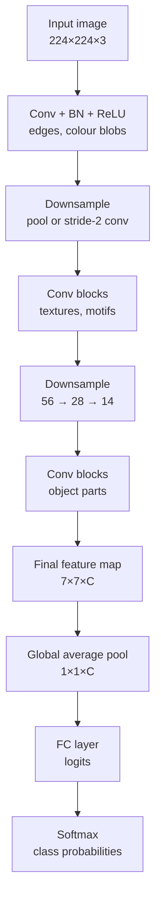
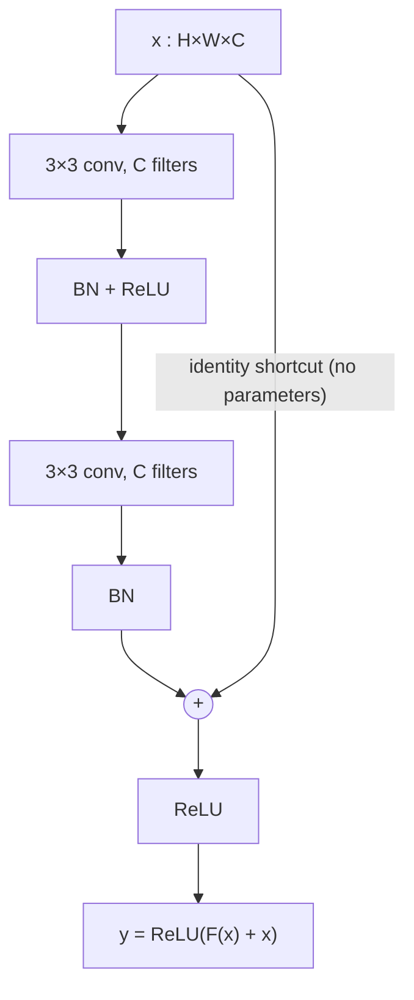
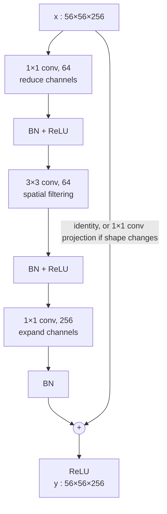
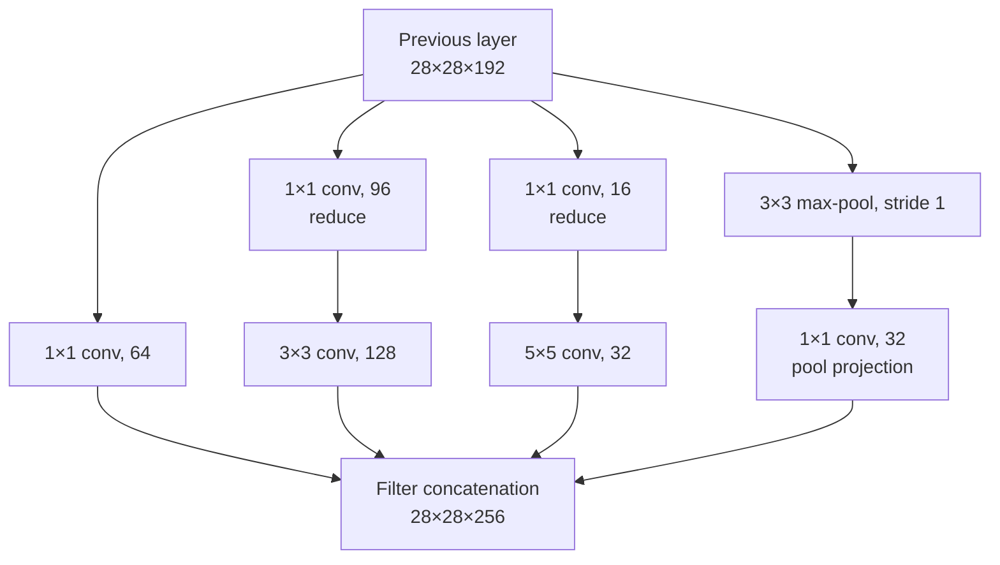
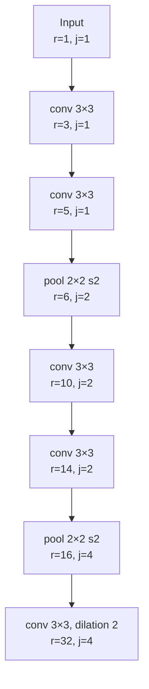
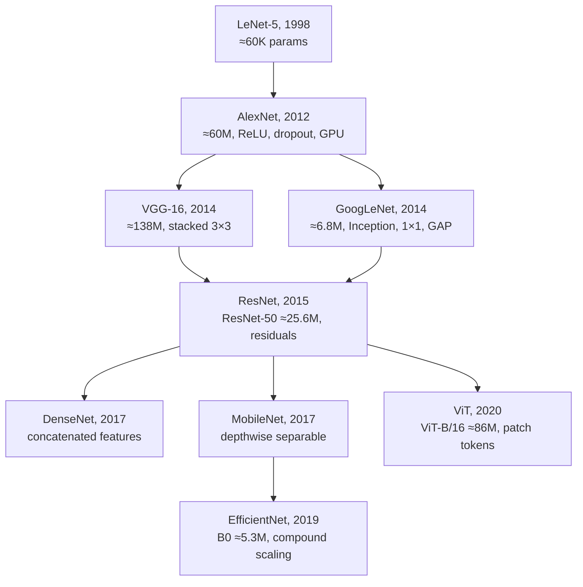
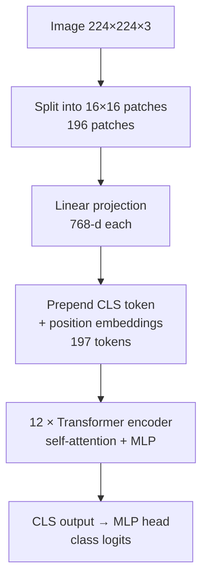

# Session 03 — CNNs Under the Hood

> **Syllabus:**
> - Why CNNs?
> - Convolution & feature maps
> - Receptive field & pooling
> - Hierarchical features
> - CNN architecture evolution
> - ResNet intuition
>
> **Related:** [Session 01 — filtering & convolution](01_image_processing_features.md) · [Session 04 — training & transfer learning](04_training_transfer_learning.md) · [Session 05 — embeddings](05_embeddings_similarity.md) · [Session 10 — segmentation (FCN, dilated conv, transposed conv)](10_image_segmentation.md) · [Session 13 — foundation models (ViT backbones)](13_vision_foundation_models.md) · [Formula sheet](../00_formula_sheet.md) · [Comparison tables](../00_comparison_tables.md) · [Code: output size & receptive field calculator](../code/conv_output_and_receptive_field_calc.py) · [Numericals drill](../practice/numericals_drill.md)
>
> **Practice:** [Questions](../practice/03_questions.md) · [Solutions](../practice/03_solutions.md)

---

## 1. Big picture

Classical CV (Sessions 01–02) used **hand-designed** filters and descriptors (Sobel, Harris, SIFT). A **Convolutional Neural Network (CNN)** keeps the same core operation — sliding a small filter over the image — but **learns the filter weights from data** and stacks many such layers so that simple edge detectors compose into texture, part and object detectors. Three architectural assumptions (**local connectivity, weight sharing, hierarchy**) make CNNs far more parameter- and data-efficient than fully connected networks on images. This session explains the mechanics you must be able to compute in an exam (output sizes, parameter counts, MACs, receptive fields), why depth helps, how architectures evolved from LeNet-5 to ViT, and why **residual connections** made 100+ layer networks trainable. Everything later in the course — transfer learning (S04), embeddings (S05), detectors (S06–S08), segmentation (S10), foundation models (S13) — uses these networks as **backbones**.

---

## 2. Core concepts

### Why CNNs?

**Problem with fully connected (FC / MLP) layers on images.** Flattening an image destroys its 2-D structure and makes every hidden unit connect to every pixel.

- **Parameter explosion — worked example.** A $224\times224\times3$ image has $224\cdot224\cdot3 = 150{,}528$ inputs. One FC layer to just **1000 hidden units** needs
  $150{,}528 \times 1000 = 150{,}528{,}000$ weights $+ 1000$ biases $= \mathbf{150{,}529{,}000 \approx 150.5\text{M}}$ parameters — more than the **whole** of VGG-16 (≈138M).
  A $3\times3$ conv layer producing 64 feature maps from the same image needs only $(3\cdot3\cdot3+1)\cdot64 = \mathbf{1{,}792}$ parameters.
- Huge parameter counts → **overfitting**, huge memory, slow training, and the model must learn the same "edge detector" separately at every location.
- An MLP has **no notion of neighbourhood**: permuting the pixels (consistently for all images) gives an equivalent learning problem — so the spatial structure is wasted.

**The three ideas CNNs exploit** (often listed as sparse interactions, parameter sharing, equivariant representations):

1. **Local connectivity (sparse interactions).** Each output unit looks only at a small $K\times K$ window (its **receptive field** in the previous layer). Rationale: nearby pixels are strongly correlated; useful low-level patterns (edges, corners) are local.
2. **Weight sharing.** The **same** filter is applied at every spatial position. Rationale: **stationarity** — a pattern (e.g., a vertical edge) is meaningful wherever it appears. Parameters therefore depend on $K$, $C_{in}$, $C_{out}$ but **not** on image size.
3. **Translation equivariance.** If the input shifts, the feature map shifts by the same amount.

**Equivariance vs invariance** (classic exam distinction). Let $T_t$ translate an image by $t$ pixels.

- $f$ is **equivariant** to translation if $f(T_t I) = T_t f(I)$ — the output *moves with* the input. A **stride-1 convolution** is translation-equivariant (ignoring border/padding effects): "the cat's-ear detector fires 10 px to the right if the cat moves 10 px to the right".
- $g$ is **invariant** if $g(T_t I) = g(I)$ — the output *does not change*. **Max/average pooling** gives **local** (small-shift) invariance; **global average/max pooling** at the end gives (approximate) **global** translation invariance — what a classifier wants ("cat" regardless of where).
- So a CNN classifier = **equivariant feature extractor + invariant aggregation**.
- **Limitations:** (i) striding/pooling makes the network exactly equivariant only to shifts that are multiples of the total stride — small shifts can change outputs (aliasing); (ii) zero padding lets the network learn **absolute position** near borders; (iii) CNNs are **not** built to be rotation- or scale-equivariant — those are learned via **data augmentation** ([Session 04](04_training_transfer_learning.md)) or multi-scale designs (feature pyramids, Session 07).

**Inductive bias.** The assumptions an architecture builds in before seeing data. CNN biases: **locality**, **weight sharing / translation equivariance**, and **hierarchical composition** (objects are made of parts made of edges).
- *Benefit:* far fewer parameters, better **sample efficiency** — good accuracy from thousands rather than hundreds of millions of images.
- *Cost:* long-range relationships need many layers; the bias can be wrong for some data. **Vision Transformers (ViT)** have a *weaker* inductive bias (global self-attention from layer 1), so they need much more data (or strong augmentation/distillation) to beat CNNs — see [architecture evolution](#cnn-architecture-evolution).

---

### Convolution and feature maps

**Deep-learning "convolution" is cross-correlation.** Libraries do not flip the kernel (unlike the signal-processing convolution in [Session 01](01_image_processing_features.md)). Since kernels are learned, flipping is irrelevant.

**Multi-channel convolution.** Input tensor $C_{in}\times H\times W$ (e.g., RGB: $C_{in}=3$).

- Each **filter** has shape $C_{in}\times K\times K$ — the **kernel depth always equals $C_{in}$**; you do **not** choose it. You choose $K$ (spatial size), $S$, $P$, $D$, and the **number of filters $C_{out}$**.
- One filter → a dot product over the full depth at each position (+ one bias) → **one 2-D feature map**. $C_{out}$ filters → $C_{out}$ stacked feature maps = output tensor $C_{out}\times H_{out}\times W_{out}$.
- PyTorch weight tensor shape: `(C_out, C_in, K, K)`; bias shape: `(C_out,)`.

Output value at output channel $o$, row $i$, column $j$ (input zero-padded by $P$):

$$
Y[o,i,j] = b_o + \sum_{c=1}^{C_{in}} \sum_{u=0}^{K-1}\sum_{v=0}^{K-1} w[o,c,u,v]\; X[c,\; S\,i + D\,u - P,\; S\,j + D\,v - P]
$$

where $w$ = weights, $b_o$ = bias of filter $o$, $S$ = stride, $D$ = dilation, $P$ = padding (out-of-range indices of $X$ are 0).

**Output size.** For input width $W$, kernel $K$, padding $P$, stride $S$:

$$
W_{out} = \left\lfloor \frac{W - K + 2P}{S} \right\rfloor + 1
$$

(same formula for height; with dilation replace $K$ by $K_{eff} = D(K-1)+1$). Use **floor**: if the window does not fit at the right edge, those border pixels are simply never visited.

- **Valid** padding: $P=0$ → output shrinks by $K-1$ (stride 1).
- **Same** padding (stride 1, odd $K$): $P=(K-1)/2$ → $W_{out}=W$ (e.g., $3\times3$ with $P=1$, $5\times5$ with $P=2$). With dilation: $P = D(K-1)/2$.
- **Stride** $S>1$ → downsampling by ≈ $S$ per dimension (≈ $S^2$ fewer positions, so ≈ $S^2$ fewer MACs).
- Padding keeps border information and lets you build deep nets without the map vanishing; zero padding also leaks absolute-position information.

**Dilation (atrous convolution).** Insert $D-1$ gaps between kernel taps: a $3\times3$ kernel with $D=2$ covers a $5\times5$ area ($K_{eff}=5$) with still only 9 weights per channel. Enlarges the receptive field **without extra parameters and without downsampling** — widely used in segmentation (DeepLab; see [Session 10](10_image_segmentation.md)). Drawback: "gridding" (sparse sampling) if dilations are stacked naively.

**$1\times1$ convolution.** A per-pixel fully connected layer across channels: params $(C_{in}+1)C_{out}$; spatial size unchanged.
- **Channel reduction (bottleneck)** before expensive $3\times3$/$5\times5$ convs (Inception, ResNet-50).
- **Channel expansion / projection** (ResNet bottleneck exit, projection shortcuts, MobileNet pointwise).
- **Cross-channel mixing + extra non-linearity** at negligible cost (introduced in *Network in Network*, 2013).

**Parameter count** (with bias):

$$
\text{Params} = (K_h K_w C_{in} + 1)\,C_{out}
$$

- Does **not** depend on input height/width (weight sharing). The same conv layer works on $224\times224$ or $512\times512$ images.
- If a BatchNorm follows, the conv bias is redundant (BN's $\beta$ absorbs it), so practical nets use `bias=False` and BN adds $2C_{out}$ learnable params ($\gamma,\beta$).
- Example: $3\times3$, $64\to128$: $(9\cdot64+1)\cdot128 = \mathbf{73{,}856}$ (73,728 weights + 128 biases).

**Compute (MACs = multiply–accumulates):**

$$
\text{MACs} = H_{out}\,W_{out}\,K_h K_w\,C_{in}\,C_{out}
$$

- **Does** depend on spatial size: doubling image side ⇒ 4× MACs, same params.
- FLOPs ≈ $2\times$ MACs (one multiply + one add).
- Example: the layer above on a $56\times56$ output: $56\cdot56\cdot9\cdot64\cdot128 = 231{,}211{,}008 \approx 231$M MACs.

**Feature / activation maps.** Each output channel is a **feature map**: a spatial map of "how strongly filter $o$ responds at each location". After the non-linearity (ReLU) it is often called an **activation map**. Typical CNNs shrink the spatial size and grow the channels: e.g., $112\times112\times64 \to 56\times56\times256 \to 7\times7\times2048$ (ResNet-50). Activations ($H_{out}W_{out}C_{out}$ values per image per layer) must be stored for backprop, so **early high-resolution layers dominate training memory**, while **late layers dominate parameters**.

**Depthwise-separable convolution** (MobileNet). Factor a standard conv into (i) a **depthwise** $K\times K$ conv applied to each channel separately (`groups = C_in`) and (ii) a **pointwise** $1\times1$ conv mixing channels:
params $K^2C_{in} + C_{in}C_{out}$ (+ biases) vs $K^2C_{in}C_{out}$; ratio $\frac{1}{C_{out}}+\frac{1}{K^2}$ ≈ 8–9× cheaper for $3\times3$.
**Grouped convolution** (groups $g$) is the in-between case: params $K^2\frac{C_{in}}{g}C_{out}$ (AlexNet used $g=2$ to split across two GPUs).

**Transposed convolution** (learnable upsampling, used in decoders): $W_{out}=(W-1)S-2P+K$ (+output_padding) — details in [Session 10](10_image_segmentation.md).

---

### Receptive field and pooling

**Receptive field (RF)** of a unit = the region of the **input image** that can influence its value. Deeper units "see" more context; a classifier's final features must see (most of) the object.

**Recurrence** (layers $l=1..L$, **pooling counts as a layer**, $j$ = jump = distance in input pixels between adjacent units of layer $l$):

$$
r_0 = 1,\quad j_0 = 1,\qquad r_l = r_{l-1} + (K_l - 1)\,j_{l-1},\qquad j_l = j_{l-1}\,S_l
$$

(use $K_{eff}=D(K-1)+1$ for dilated layers). Note: the RF growth of layer $l$ uses the jump **before** that layer; padding does **not** change the RF.

**Worked example** — conv3 → conv3 → pool2/s2 → conv3 → conv3 → pool2/s2 → conv3 (dilation 2), all convs stride 1:

| $l$ | Layer | $K$ ($K_{eff}$) | $S$ | $r_l = r_{l-1}+(K_{eff}-1)j_{l-1}$ | $j_l$ |
|---|---|---|---|---|---|
| 0 | input | – | – | 1 | 1 |
| 1 | conv $3\times3$ | 3 | 1 | $1+2\cdot1=3$ | 1 |
| 2 | conv $3\times3$ | 3 | 1 | $3+2\cdot1=5$ | 1 |
| 3 | max-pool $2\times2$ | 2 | 2 | $5+1\cdot1=6$ | 2 |
| 4 | conv $3\times3$ | 3 | 1 | $6+2\cdot2=10$ | 2 |
| 5 | conv $3\times3$ | 3 | 1 | $10+2\cdot2=14$ | 2 |
| 6 | max-pool $2\times2$ | 2 | 2 | $14+1\cdot2=16$ | 4 |
| 7 | conv $3\times3$, $D=2$ | 3 (5) | 1 | $16+4\cdot4=\mathbf{32}$ | 4 |

So each final unit sees a $32\times32$ input patch, and neighbouring final units are 4 input pixels apart. (Verified empirically in PyTorch by back-propagating from one output unit and measuring the non-zero gradient footprint.)

**VGG-16 RF** (13 conv $3\times3$ s1 + 5 max-pool $2\times2$ s2): conv1_2 = 5, pool1 = 6, conv2_2 = 14, pool2 = 16, conv3_3 = 40, pool3 = 44, conv4_3 = 92, pool4 = 100, **conv5_3 = 196**, **pool5 = 212**.

**Ways to grow the RF:**

| Mechanism | Effect on RF | Cost |
|---|---|---|
| More layers (depth) | +$(K-1)j$ per layer — linear | more params, compute |
| Stride / pooling | multiplies the jump $j$ → every *later* layer grows the RF faster | loses spatial resolution |
| Dilation | $K_{eff}=D(K-1)+1$ with same params | gridding artefacts |
| Larger kernels | +$(K-1)j$ | params grow as $K^2$ |
| Global pooling / self-attention | whole image at once | loses location (GAP) / quadratic cost (attention) |

**Theoretical vs effective receptive field.** The recurrence gives the **theoretical RF (TRF)** — every pixel that *can* influence the unit. The **effective RF (ERF)** — the pixels that *substantially* influence it (measured by gradient magnitude) — is roughly **Gaussian-shaped and much smaller** than the TRF: central pixels have many more paths to the output than border pixels (Luo et al., 2016). The ERF grows roughly with $\sqrt{\text{depth}}$, so it occupies a shrinking *fraction* of the TRF in deep plain stacks; training, downsampling and dilation enlarge it. Exam point: "TRF = 196 px" does **not** mean the unit uses all 196 px equally.

**Pooling.** A fixed (non-learned) operation over a $K\times K$ window with stride $S$, applied **per channel**:

- **Max pooling** — keeps the strongest response ("is the feature present anywhere in this window?"); gives small-shift invariance; backprop routes the gradient only to the arg-max position.
- **Average pooling** — mean of the window; smoother; gradient shared equally.
- **Global average pooling (GAP)** — average over the whole $H\times W$ map: $H\times W\times C \to 1\times1\times C$. Replaces flatten + big FC layers (Network in Network, GoogLeNet, ResNet): drastically fewer parameters, works for any input size, and enables **Class Activation Maps**.
- **Parameters: 0** for all of these. Hyperparameters only ($K$, $S$, type). Output size uses the same $\lfloor (W-K+2P)/S\rfloor+1$ formula; **channel count is unchanged**.
- Typical: $2\times2$, $S=2$ (halves $H$ and $W$, quarters the activations). **Overlapping pooling** ($K>S$, e.g., $3\times3$/s2 in AlexNet and the ResNet stem).

**Stride-2 convolution vs pooling for downsampling.** A stride-2 conv *learns* how to downsample (has parameters, can mix channels); pooling is a fixed, parameter-free summary. Modern nets (ResNet stages, "All-Convolutional Net") downsample mainly with strided convs; many still keep one max-pool in the stem. Both reduce resolution and multiply the RF jump; both can alias.

---

### Hierarchical features

**What the layers learn** — Zeiler & Fergus (2014) projected activations back to pixel space with a **deconvnet** and found a clear hierarchy in an AlexNet-style network:

| Layer | Typical learned patterns |
|---|---|
| Layer 1 | Oriented **edges**, colour blobs, Gabor-like filters (very similar to hand-designed filters of Session 01) |
| Layer 2 | Corners, edge/colour **conjunctions**, simple **textures** |
| Layer 3 | More complex textures and repeated patterns (meshes, grids, text-like patterns) |
| Layer 4 | Class-specific **parts** (dog faces, bird legs, wheels) |
| Layer 5 | Whole **objects** with significant pose variation |

Their visualisations also diagnosed problems in AlexNet's first layer (aliasing from the $11\times11$/stride-4 conv) — replacing it with $7\times7$/stride 2 gave **ZFNet**, the basis of the winning ILSVRC-2013 classification entry (Clarifai). Other visualisation tools: activation maximisation, saliency maps, **Grad-CAM** (class-specific heat-maps).

**Why depth helps:**
1. **Compositionality** — each layer builds features from the previous layer's features (edges → textures → parts → objects); many real-world concepts are naturally hierarchical.
2. **Efficiency** — a deep stack of small kernels reaches a large RF with fewer parameters and more non-linearities than a shallow wide net (see [3×3 stacking](#3-key-formulas)); deep nets can represent some functions with exponentially fewer units than shallow ones.
3. **Growing RF + invariance** — deeper units see more context and, through pooling, are more tolerant to small deformations.
4. **Feature reuse / transfer** — early generic layers transfer across tasks; late layers are task-specific ([Session 04](04_training_transfer_learning.md)).

**Why depth alone was not enough:** deeper *plain* nets became harder to optimise — vanishing/exploding gradients (largely addressed by good initialisation and **BatchNorm**) and the **degradation problem** (addressed by **ResNet**, below).

---

### CNN architecture evolution

**ILSVRC context.** The ImageNet Large Scale Visual Recognition Challenge (2010–2017) classification task: ≈1.2M training images, **1000 classes**, ranked by **top-5 error** (correct if the true label is among the 5 highest-scoring classes). AlexNet's 2012 win (top-5 ≈ 15.3% vs ≈ 26.2% for the best non-deep entry) started the deep-learning era; within three years ResNet reached ≈ 3.6%, below the often-quoted ≈ 5.1% human estimate.

| Model | Year | Key idea(s) | Depth | Params (approx.) | ILSVRC note |
|---|---|---|---|---|---|
| **LeNet-5** | 1998 | conv → subsample (avg-pool) → conv → subsample → FC; tanh; digits ($32\times32$ grey) | 7 layers | **≈ 60K** | pre-ImageNet (bank cheques, MNIST) |
| **AlexNet** | 2012 | **ReLU**, **dropout**, data augmentation, **GPU** training (2 GPUs, grouped convs), LRN, **overlapping max-pool**; 5 conv + 3 FC | 8 | **≈ 60M** | 2012 winner |
| ZFNet | 2013 | AlexNet tuned with visualisation ($7\times7$/s2 first layer) | 8 | ≈ AlexNet | 2013 winner (as Clarifai) |
| **VGG-16/19** | 2014 | **only $3\times3$ convs** + $2\times2$ max-pool, uniform deep design | 16/19 | **≈ 138M** (VGG-16; ≈ 124M in the 3 FC layers) | 2014 runner-up (classification) |
| **GoogLeNet / Inception-v1** | 2014 | **Inception module** (parallel $1\times1$, $3\times3$, $5\times5$, pool), **$1\times1$ bottlenecks**, **GAP** instead of big FC, auxiliary classifiers | 22 | **≈ 6.8M** (often quoted 5–7M) | 2014 winner |
| **ResNet** | 2015 | **residual connections** $y=F(x)+x$, BatchNorm, bottleneck blocks; solves **degradation** | 18–152 | **ResNet-50 ≈ 25.6M** | 2015 winner (152 layers) |
| DenseNet | 2017 | each layer receives the **concatenation** of all previous maps in a block (feature reuse) | 121+ | DenseNet-121 ≈ 8.0M | – |
| MobileNet (v1/v2) | 2017/18 | **depthwise-separable** convs, width multiplier; v2: inverted residuals + linear bottlenecks | – | v2 ≈ 3.5M | – (mobile) |
| **EfficientNet** | 2019 | **compound scaling** of depth, width, resolution; NAS-designed B0 with MBConv + squeeze-and-excitation | – | **B0 ≈ 5.3M** | – |
| **ViT** | 2020 | image → **$16\times16$ patches** as tokens + Transformer encoder; weak inductive bias, needs large-scale pretraining | 12 (Base) | **ViT-B/16 ≈ 86M** | – |

Key ideas in a sentence each:

- **LeNet-5:** proved the conv–pool–FC template with backprop-learned filters on digits.
- **AlexNet:** scaled CNNs to ImageNet; **ReLU** (no saturation → faster training), **dropout** in the FC layers, augmentation (random crops, flips, colour), trained on GPUs. Conv1: $227\times227\times3$ input, 96 filters $11\times11$, stride 4 → $55\times55\times96$, **34,944 params** (the paper says 224, but 227 makes the arithmetic work).
- **VGG:** "depth with the simplest building block": stacks of $3\times3$ convs (two = $5\times5$ RF, three = $7\times7$ RF) with fewer params and more ReLUs. Downside: **138M params, mostly in FC layers** (fc6 alone: $7\cdot7\cdot512\cdot4096+4096 \approx 102.8$M), heavy compute.
- **GoogLeNet/Inception:** let the network choose the scale — parallel $1\times1/3\times3/5\times5$/pool branches concatenated along channels; **$1\times1$ reductions** before the expensive convs cut compute ≈ 10× (see §3); GAP head; roughly **an order of magnitude fewer params than AlexNet** (≈ 6.8M vs ≈ 60M) while being much deeper. Later versions (v2/v3) added BN, factorised convs ($n\times1$ + $1\times n$) and label smoothing.
- **ResNet:** identity shortcuts make very deep nets **optimisable** (next subsection). Became the default backbone for detection/segmentation.
- **DenseNet:** $x_l = H_l([x_0,x_1,\dots,x_{l-1}])$ (concatenation, growth rate $k$ new channels per layer) — strong gradient flow, feature reuse, parameter-efficient; memory-hungry.
- **MobileNet:** depthwise-separable convs for phones; v2 inverted residual block ($1\times1$ expand → $3\times3$ depthwise → $1\times1$ linear project, shortcut between thin bottlenecks).
- **EfficientNet:** instead of scaling one dimension, scale **depth** $d=\alpha^\phi$, **width** $w=\beta^\phi$, **resolution** $r=\gamma^\phi$ together, with $\alpha\beta^2\gamma^2\approx2$ (FLOPs ≈ ×2 per unit of $\phi$); $\alpha=1.2,\ \beta=1.1,\ \gamma=1.15$ from a small grid search; B0 → B7.
- **ViT:** $224\times224$ image, patch $p=16$ → $(224/16)^2 = 196$ patches, each flattened ($16\cdot16\cdot3 = 768$ values) and linearly projected to $D=768$; prepend a learnable **[CLS]** token → **197 tokens**; add learned position embeddings; 12 Transformer encoder layers; classify from the [CLS] output. Self-attention gives a **global receptive field in every layer** but no built-in locality/translation equivariance → underperforms ResNets when trained on ImageNet-1k alone, outperforms them after pretraining on very large datasets (ImageNet-21k, JFT-300M); DeiT showed strong augmentation + distillation can close the gap on ImageNet-1k. ViTs are the backbone of DINO, CLIP, SAM ([Session 13](13_vision_foundation_models.md)) and DETR-style detectors use Transformers too ([Session 08](08_detection_transformers.md)).

**Trends:** deeper → better optimisation tricks (ReLU, BN, residuals); fewer FC params (GAP); cheaper convs ($1\times1$ bottlenecks, depthwise-separable); principled scaling (EfficientNet); finally weaker inductive bias + more data (ViT).

---

### ResNet intuition

**1. The degradation problem.** He et al. (2015) observed that simply stacking more layers onto a plain CNN (with BatchNorm) made it **worse — on the training set**: a 56-layer plain net had **higher training and test error** than a 20-layer one on CIFAR-10 (likewise plain-34 vs plain-18 on ImageNet).
- It is **not overfitting** — overfitting means low training error but high test error; here *training* error itself is higher.
- It is **not mainly vanishing gradients** — the plain nets used BN, and the authors checked that forward signals and backward gradients had healthy norms.
- It is an **optimisation difficulty**. Construction argument: a deeper net *could* copy the shallower net and set the extra layers to the **identity**, so its training error should be no higher. SGD fails to find that solution — learning an identity mapping through a stack of non-linear layers is surprisingly hard.

**2. Residual learning.** Let $H(x)$ be the desired mapping of a few stacked layers. Instead of learning $H$ directly, let the layers learn the **residual**

$$
F(x) = H(x) - x \quad\Longrightarrow\quad y = F(x) + x
$$

- If the identity is (near-)optimal, the solver only needs to drive $F$'s weights toward **zero** — easy (weight decay and small initialisation already push that way).
- If the optimum is close to identity, the block learns a **small correction** ("perturbation") rather than a whole new transformation.

**3. Identity shortcut.** The "+ x" path is **parameter-free** and costs one element-wise addition. In the original block the ReLU is applied **after** the addition: $y=\mathrm{ReLU}(F(x)+x)$.

**4. Gradient flow.** For $y = x + F(x)$:

$$
\frac{\partial y}{\partial x} = I + \frac{\partial F}{\partial x}
\qquad\Longrightarrow\qquad
\frac{\partial \mathcal L}{\partial x} = \frac{\partial \mathcal L}{\partial y}\left(I + \frac{\partial F}{\partial x}\right)
$$

The identity term passes the upstream gradient **unchanged**, so even if $\partial F/\partial x$ is small the gradient does not vanish. With pre-activation blocks (He et al., 2016), $x_L = x_l + \sum_{i=l}^{L-1}F(x_i)$, so the gradient at any shallow block contains the term $\partial\mathcal L/\partial x_L$ directly — a "gradient highway" from loss to every layer. (In a plain net the gradient is a **product** of $L$ Jacobians, which can shrink/explode exponentially; in a ResNet it is a **sum** that always contains a direct term.)

**5. Basic vs bottleneck blocks.**
- **Basic block** (ResNet-18/34): $3\times3$ conv → BN → ReLU → $3\times3$ conv → BN → add → ReLU.
- **Bottleneck block** (ResNet-50/101/152): **$1\times1$ reduce** (256→64) → **$3\times3$** (64→64) → **$1\times1$ expand** (64→256). Weights: $256\cdot64 + 9\cdot64\cdot64 + 64\cdot256 = 69{,}632$ vs $2\cdot9\cdot256\cdot256 = 1{,}179{,}648$ for two $3\times3$ convs at 256 channels (≈ 17× fewer) — so you can afford many more blocks.

**6. Projection shortcut.** Addition needs $F(x)$ and $x$ to have the **same shape**. At stage transitions the block halves $H,W$ (stride 2) and doubles channels, so the shortcut becomes a **$1\times1$ conv with stride 2** (+ BN): $y = F(x) + W_s x$. ResNet's default ("option B") uses projections only where shapes change; identities elsewhere (projections everywhere gave only marginal gains at extra cost).

**7. BatchNorm** after every conv (before ReLU) stabilises activations and allows higher learning rates; ResNets use **no dropout** and **GAP + one FC** as the head.

**8. ResNet-50 layout.** Stem: $7\times7$/64, s2 ($224\to112$) → $3\times3$ max-pool s2 ($\to56$) → 4 stages of bottleneck blocks **[3, 4, 6, 3]** with output channels 256, 512, 1024, 2048 at $56, 28, 14, 7$ px → GAP → FC-1000. ≈ **25.6M params**; 50 = 1 (stem) + 3·(3+4+6+3) + 1 (FC).

**9. Evidence and other views.**
- ResNet-34 beats ResNet-18 (deeper is now better); 152-layer ResNet won ILSVRC 2015; a **1202-layer** CIFAR ResNet trained to near-zero training error but tested *worse* than the 110-layer one — **residuals fix optimisation, not overfitting**.
- ResNets behave somewhat like **ensembles of many shallower paths** (Veit et al., 2016) and have **smoother loss landscapes** than plain nets (Li et al., 2018).
- Residual connections are now everywhere: DenseNet, MobileNetV2, EfficientNet, U-Net variants, and every Transformer block (ViT, DETR).

---

## 3. Key formulas

**(1) Convolution / pooling output size**

$$
W_{out} = \left\lfloor \frac{W - K + 2P}{S} \right\rfloor + 1
$$

$W$ input width (or height), $K$ kernel size (use $K_{eff}$ if dilated), $P$ padding per side, $S$ stride.
*Example:* AlexNet conv1 $W=227, K=11, P=0, S=4$: $\lfloor 216/4\rfloor+1 = 55$. ResNet stem $224, K=7, P=3, S=2$: $\lfloor223/2\rfloor+1=112$; then max-pool $K=3,P=1,S=2$: $\lfloor111/2\rfloor+1 = 56$. Floor case: $W=32,K=3,P=0,S=2$: $\lfloor29/2\rfloor+1 = 15$.

**(2) Dilated (effective) kernel**

$$
K_{eff} = D(K-1)+1
$$

$D$ dilation rate. *Example:* $K=3, D=2 \Rightarrow K_{eff}=5$; $D=4 \Rightarrow 9$. "Same" padding at stride 1: $P = D(K-1)/2$.

**(3) Conv parameters**

$$
\text{Params} = (K_h K_w C_{in} + 1)\,C_{out}
$$

$K_h,K_w$ kernel height/width, $C_{in}$ input channels (= kernel depth), $C_{out}$ number of filters, $+1$ = bias per filter.
*Example:* AlexNet conv1: $(11\cdot11\cdot3+1)\cdot96 = 364\cdot96 = 34{,}944$.

**(4) FC parameters**

$$
\text{Params}_{FC} = (N_{in}+1)\,N_{out}
$$

*Example:* flatten $224\cdot224\cdot3=150{,}528 \to 1000$: $150{,}529{,}000$. Flatten $30\times30\times64 = 57{,}600 \to 10$: $576{,}010$; after GAP ($64\to10$): $650$.

**(5) MACs of a conv layer**

$$
\text{MACs} = H_{out}\,W_{out}\,K_h K_w\,C_{in}\,C_{out}
$$

*Example:* AlexNet conv1: $55\cdot55\cdot11\cdot11\cdot3\cdot96 = 105{,}415{,}200 \approx 105$M MACs (≈ 211M FLOPs).

**(6) Depthwise-separable conv**

$$
\text{Params}_{DS} = K^2C_{in} + C_{in}C_{out}\ (+C_{in}+C_{out}\text{ biases}),\qquad
\frac{\text{Params}_{DS}}{\text{Params}_{std}} = \frac{1}{C_{out}} + \frac{1}{K^2}
$$

*Example:* $3\times3$, $64\to128$ (no bias): $576 + 8192 = 8{,}768$ vs $73{,}728$ → ratio $0.119$ ($=1/128+1/9$).

**(7) Receptive-field recurrence**

$$
r_0 = 1,\ j_0=1;\qquad r_l = r_{l-1} + (K_l-1)\,j_{l-1},\qquad j_l = j_{l-1}S_l
$$

$r_l$ RF (input pixels) of layer $l$, $j_l$ jump (input-pixel spacing between adjacent units), $K_l$, $S_l$ kernel and stride of layer $l$ (pooling counts; dilated: use $K_{eff}$).
*Example:* conv3 → conv3 → pool2/s2 → conv3: $r = 3, 5, 6, 10$.
For $n$ stacked stride-1 $K\times K$ convs: $r = n(K-1)+1$.

**(8) Stacking small kernels** ($C$ channels in and out, ignoring biases)

$$
\underbrace{2\times(3\cdot3\cdot C\cdot C)}_{\text{two }3\times3:\ RF\,5} = 18C^2 \;<\; \underbrace{25C^2}_{\text{one }5\times5},
\qquad
\underbrace{3\times 9C^2}_{\text{three }3\times3:\ RF\,7} = 27C^2 \;<\; \underbrace{49C^2}_{\text{one }7\times7}
$$

Savings: $1-18/25 = 28\%$ and $1-27/49 \approx 45\%$, plus 2 (or 3) ReLUs instead of 1. *Example* $C=256$: $1{,}179{,}648$ vs $1{,}638{,}400$.

**(9) Residual block**

$$
y = F(x,\{W_i\}) + x,\qquad y = F(x,\{W_i\}) + W_s x\ \ (\text{projection, }W_s = 1\times1\text{ conv}),\qquad
\frac{\partial y}{\partial x} = I + \frac{\partial F}{\partial x}
$$

$x$ block input, $F$ residual branch (2 or 3 conv layers with BN/ReLU), $W_s$ projection used when shapes differ, $I$ identity matrix.
*Example:* bottleneck $256\to64\to64\to256$: $16{,}384+36{,}864+16{,}384 = 69{,}632$ weights (+ BN params: torchvision's block = 70,400).

**(10) Inception $1\times1$ reduction (compute)**
*Example:* input $28\times28\times192$, "same" $5\times5$ conv to 32 maps:
naive $28\cdot28\cdot25\cdot192\cdot32 = 120{,}422{,}400$ MACs; with a $1\times1$ reduction to 16 first: $28\cdot28\cdot192\cdot16 + 28\cdot28\cdot25\cdot16\cdot32 = 2{,}408{,}448 + 10{,}035{,}200 = 12{,}443{,}648$ → **≈ 9.7× cheaper**.

**(11) ViT tokens**

$$
N = \frac{H}{p}\cdot\frac{W}{p}\ \ (+1\ \text{[CLS]})
$$

$p$ patch size. *Example:* ViT-B/16 @224: $14\cdot14 = 196$, $+1 = 197$ tokens; patch-embedding params $16\cdot16\cdot3\cdot768+768 = 590{,}592$. ViT-B/32 @224: $49+1 = 50$.

**(12) EfficientNet compound scaling**

$$
d=\alpha^{\phi},\quad w=\beta^{\phi},\quad r=\gamma^{\phi},\quad \text{s.t. } \alpha\,\beta^2\gamma^2\approx 2
$$

$d,w,r$ depth, width, resolution multipliers; $\phi$ user-chosen compound coefficient; FLOPs scale ≈ $d\,w^2r^2 \approx 2^{\phi}$.

---

## 4. Algorithms step by step

**A. Forward pass of one conv layer**
1. Zero-pad the $C_{in}\times H\times W$ input by $P$ on every side.
2. For each filter $o = 1..C_{out}$ (shape $C_{in}\times K\times K$):
3. Place the filter at the top-left valid position; compute the dot product over all $C_{in}K^2$ overlapping values, add bias $b_o$.
4. Slide by $S$ (columns, then rows) and repeat → one $H_{out}\times W_{out}$ feature map.
5. Stack the $C_{out}$ maps → output tensor; apply the non-linearity (ReLU) element-wise.

**B. Shape / parameter bookkeeping for a stack** (exam procedure)
1. Write the input shape $H\times W\times C$.
2. For each conv/pool layer apply $\lfloor (W-K+2P)/S\rfloor+1$ to $H$ and $W$; channels = $C_{out}$ for conv, unchanged for pooling.
3. Params: conv $(K^2C_{in}+1)C_{out}$, pooling/ReLU 0, BN $2C$, FC $(N_{in}+1)N_{out}$, GAP 0.
4. Flatten size = $H\cdot W\cdot C$ of the last map (or $C$ after GAP).
5. Sum parameters; optionally MACs per conv $=H_{out}W_{out}K^2C_{in}C_{out}$.

**C. Receptive-field computation**
1. Initialise $r=1$, $j=1$.
2. For each layer in order (conv **and** pooling): if dilated, $K\leftarrow D(K-1)+1$.
3. Update $r \leftarrow r + (K-1)\,j$ (using the *current* $j$).
4. Update $j \leftarrow j\cdot S$.
5. After the last layer, $r$ is the theoretical RF (side length in input pixels); $j$ is the input stride between adjacent output units. (Padding is ignored; the ERF will be smaller.)

**D. Residual (bottleneck) block forward pass**
1. Keep a copy of the input $x$ (shortcut).
2. $1\times1$ conv (reduce channels) → BN → ReLU.
3. $3\times3$ conv (stride 1, or 2 at a stage's first block) → BN → ReLU.
4. $1\times1$ conv (expand channels ×4) → BN (no ReLU yet).
5. If shape changed, shortcut $= $ BN($1\times1$ conv, stride $s$)$(x)$; else shortcut $= x$.
6. Add: $F(x) + \text{shortcut}$; apply ReLU → $y$.

**E. Inception module forward pass**
1. Feed the same input to 4 parallel branches: $1\times1$; $1\times1\to3\times3$; $1\times1\to5\times5$; $3\times3$ max-pool (stride 1) $\to1\times1$.
2. All branches use "same" padding so spatial sizes match.
3. Concatenate along the channel axis (e.g., $64+128+32+32 = 256$ channels in Inception-3a).

**F. ViT forward pass**
1. Split the $H\times W\times C$ image into $N = HW/p^2$ non-overlapping $p\times p$ patches.
2. Flatten each patch ($p^2C$ values) and project linearly to dimension $D$ (equivalently a $p\times p$ conv with stride $p$).
3. Prepend a learnable [CLS] token; add learnable position embeddings → $(N+1)\times D$.
4. Pass through $L$ Transformer encoder layers (LayerNorm → multi-head self-attention → residual; LayerNorm → MLP → residual).
5. Feed the final [CLS] embedding to an MLP head → class logits.

---

## 5. Diagrams

**Generic CNN classification pipeline**

**Residual (basic) block — ResNet-18/34**

**Bottleneck block — ResNet-50/101/152**

**Inception module (GoogLeNet inception-3a)**

**Receptive field growth through a stack**

**Architecture timeline**

**ViT pipeline**

---

## 6. Comparison tables

**FC layer vs conv layer on images**

| Aspect | Fully connected | Convolutional |
|---|---|---|
| Connectivity | every input to every output | local $K\times K\times C_{in}$ window |
| Weight sharing | none | same filter at all positions |
| Params | $(N_{in}+1)N_{out}$ — grows with image size | $(K^2C_{in}+1)C_{out}$ — independent of image size |
| Spatial structure | destroyed by flattening | preserved (feature maps) |
| Translation | no built-in property | **equivariant** (stride 1) |
| Input size | fixed | any (fully convolutional) |
| $224\times224\times3$ example | $\to1000$ units: 150.5M params | $3\times3$, 64 filters: 1,792 params |

**Equivariance vs invariance**

| | Equivariance | Invariance |
|---|---|---|
| Definition | $f(T_tI)=T_tf(I)$ — output shifts with input | $g(T_tI)=g(I)$ — output unchanged |
| Provided by | stride-1 convolution (and ReLU, BN) | max/avg pooling (local), **global** pooling (global) |
| Needed for | detection, segmentation (where?) | classification (what?) |
| Caveat | broken by striding/aliasing and borders | only approximate in practice |

**Downsampling / aggregation operators**

| Operator | Learnable params | What it keeps | Typical use |
|---|---|---|---|
| Max-pool $2\times2$/s2 | 0 | strongest response per window | VGG (AlexNet and the ResNet stem use overlapping $3\times3$/s2 max-pool) |
| Avg-pool $2\times2$/s2 | 0 | mean response | LeNet ("subsampling"), DenseNet transitions |
| Global average pool | 0 | per-channel mean over whole map | GoogLeNet, ResNet, EfficientNet heads |
| Stride-2 conv | $(K^2C_{in}+1)C_{out}$ | learned summary, can change channels | ResNet stages, All-Conv Net |
| Dilated conv | same as undilated | full resolution, larger RF | segmentation (DeepLab) |

**Kernel design choices** ($C$ channels in/out, no bias)

| Option | RF | Weights | Non-linearities |
|---|---|---|---|
| one $5\times5$ | 5 | $25C^2$ | 1 |
| two $3\times3$ | 5 | $18C^2$ (−28%) | 2 |
| one $7\times7$ | 7 | $49C^2$ | 1 |
| three $3\times3$ | 7 | $27C^2$ (−45%) | 3 |
| $3\times3$, $D=2$ | 5 | $9C^2$ | 1 (sparse sampling) |
| depthwise-sep $3\times3$ | 3 | $9C + C^2$ | – |

**Plain vs residual network**

| | Plain deep net | ResNet |
|---|---|---|
| Block output | $H(x)$ | $F(x)+x$ |
| Identity mapping | must be learned by non-linear layers (hard) | $F\to0$ (easy) |
| Backward Jacobian | product of layer Jacobians | $I+\partial F/\partial x$ (direct path) |
| Depth behaviour | degradation: deeper → higher **training** error | deeper → lower error (up to overfitting) |
| Extra params | – | 0 for identity shortcuts; $1\times1$ conv for projections |

**Basic vs bottleneck block**

| | Basic | Bottleneck |
|---|---|---|
| Layers | $3\times3 \to 3\times3$ | $1\times1$ (reduce) → $3\times3$ → $1\times1$ (expand) |
| Used in | ResNet-18/34 | ResNet-50/101/152 |
| Weights at 256 ch | $2\cdot9\cdot256^2 = 1{,}179{,}648$ | $69{,}632$ |
| Purpose | simple | deeper nets at similar cost |

**CNN vs ViT**

| | CNN (e.g., ResNet-50) | ViT-B/16 |
|---|---|---|
| Basic op | local convolution | global self-attention over patch tokens |
| Inductive bias | strong (locality, equivariance, hierarchy) | weak (only patching + position embeddings) |
| Receptive field | grows with depth | global from the first layer |
| Data needs | works on ImageNet-1k / smaller | needs large pretraining or strong augmentation |
| Params | ≈ 25.6M | ≈ 86M |
| Cost vs resolution | linear in pixels | quadratic in #tokens |

---

## 7. Common exam traps & misconceptions

- ❌ "ResNet was invented to stop overfitting in deep nets." → ✅ It solves the **degradation problem** — deeper plain nets had higher **training** error (an optimisation problem). A 1202-layer ResNet still *overfit* CIFAR-10.
- ❌ "Degradation = vanishing gradients." → ✅ The ResNet paper's plain nets used BN and had healthy gradient norms; the issue is that solvers struggle to fit identity-like mappings. Shortcuts *also* improve gradient flow, which is a valid supporting argument.
- ❌ "Pooling layers have learnable weights." → ✅ Max/avg/global pooling have **0 parameters**; only $K$, $S$ are (fixed) hyperparameters.
- ❌ "Convolution makes a CNN translation invariant." → ✅ Convolution is **equivariant**; **invariance** comes from pooling, especially **global** pooling at the end — and it is only approximate (stride/aliasing, padding).
- ❌ "I'll pick a kernel depth of 16 for this layer." → ✅ Kernel depth is **not a hyperparameter** — it always equals $C_{in}$. You choose $K$, $S$, $P$, $D$, and $C_{out}$.
- ❌ "A bigger input image means more conv parameters." → ✅ Conv params depend only on $K, C_{in}, C_{out}$. **MACs and activation memory** scale with $H_{out}W_{out}$. (FC layers after flatten *do* depend on input size — one reason to use GAP.)
- ❌ "TRF = 196 px, so the unit uses a 196×196 region uniformly." → ✅ The **effective RF** is Gaussian-like and much smaller than the theoretical RF.
- ❌ "Padding increases the receptive field." → ✅ Padding changes output size, not RF. Depth, stride/pooling (via the jump), dilation and kernel size change RF.
- ❌ Forgetting the jump in the RF recurrence (adding $K-1$ after a stride-2 layer). → ✅ After a stride-2 layer every later $3\times3$ adds $2\cdot j = 4$ (not 2).
- ❌ Forgetting $C_{in}$ or the bias in param counts ($3\times3$, $64\to128$ is **not** $(9+1)\cdot128 = 1{,}280$). → ✅ $(9\cdot64+1)\cdot128 = 73{,}856$.
- ❌ Using ceil or forgetting the "+1" in the output-size formula. → ✅ $\lfloor (W-K+2P)/S\rfloor + 1$ (PyTorch default `ceil_mode=False`).
- ❌ "A $1\times1$ conv does nothing." → ✅ It mixes channels, changes the channel count (bottleneck/expansion) and adds a non-linearity — core to Inception, ResNet-50, MobileNet.
- ❌ "Pooling changes the number of channels." → ✅ Pooling acts per channel; channels are unchanged.
- ❌ "Dilation adds parameters." → ✅ A dilated $3\times3$ still has $9C_{in}$ weights per filter; only the coverage grows.
- ❌ "Deeper/bigger always means more parameters." → ✅ GoogLeNet (22 layers, ≈ 6.8M) has roughly an order of magnitude fewer params than AlexNet (8 layers, ≈ 60M); most of VGG-16's 138M sit in its FC layers.
- ❌ "MACs = FLOPs." → ✅ FLOPs ≈ 2 × MACs (multiply + add) — state which you are reporting.
- ❌ "Deep-learning convolution flips the kernel." → ✅ Frameworks implement **cross-correlation**; with learned kernels it makes no difference.
- ❌ "ViT is always better than CNNs." → ✅ ViT's weak inductive bias needs large-scale pretraining or heavy augmentation; on small datasets CNNs (or pretrained ViTs) are safer.
- ❌ "You can always add $x$ to $F(x)$." → ✅ Shapes must match; when stride/channels change use a **$1\times1$ projection shortcut**.

---

## 8. 10-line cheat summary

1. CNNs = local connectivity + weight sharing + hierarchy → far fewer params than FC (150.5M for one $224^2\times3\to1000$ FC layer vs 1,792 for a 64-filter $3\times3$ conv).
2. Output size $\lfloor (W-K+2P)/S\rfloor+1$; "same" padding $P=(K-1)/2$; dilation $K_{eff}=D(K-1)+1$.
3. Params $(K^2C_{in}+1)C_{out}$ — independent of image size; MACs $H_{out}W_{out}K^2C_{in}C_{out}$ — scale with it.
4. Kernel depth = $C_{in}$ (not chosen); #filters = $C_{out}$; $1\times1$ conv = channel mixer / bottleneck.
5. RF: $r_l=r_{l-1}+(K_l-1)j_{l-1}$, $j_l=j_{l-1}S_l$, pooling counts; effective RF ≪ theoretical RF.
6. Conv is translation **equivariant**; pooling (esp. GAP) gives **invariance**; pooling has **0 params**.
7. Layers learn edges → textures → parts → objects (Zeiler & Fergus); depth = composition + bigger RF + more non-linearity.
8. Two $3\times3$ = one $5\times5$ RF with $18C^2$ vs $25C^2$; three $3\times3$ = $7\times7$ with $27C^2$ vs $49C^2$.
9. LeNet-5 60K → AlexNet 60M (ReLU, dropout, GPU) → VGG-16 138M (3×3) → GoogLeNet 6.8M (Inception, 1×1, GAP) → ResNet-50 25.6M → EfficientNet-B0 5.3M (compound scaling) → ViT-B/16 86M (197 tokens).
10. ResNet: $y=F(x)+x$ fixes **degradation** (training error), $\partial y/\partial x = I+\partial F/\partial x$, bottleneck $1\times1$–$3\times3$–$1\times1$, $1\times1$ projection when shapes change.
