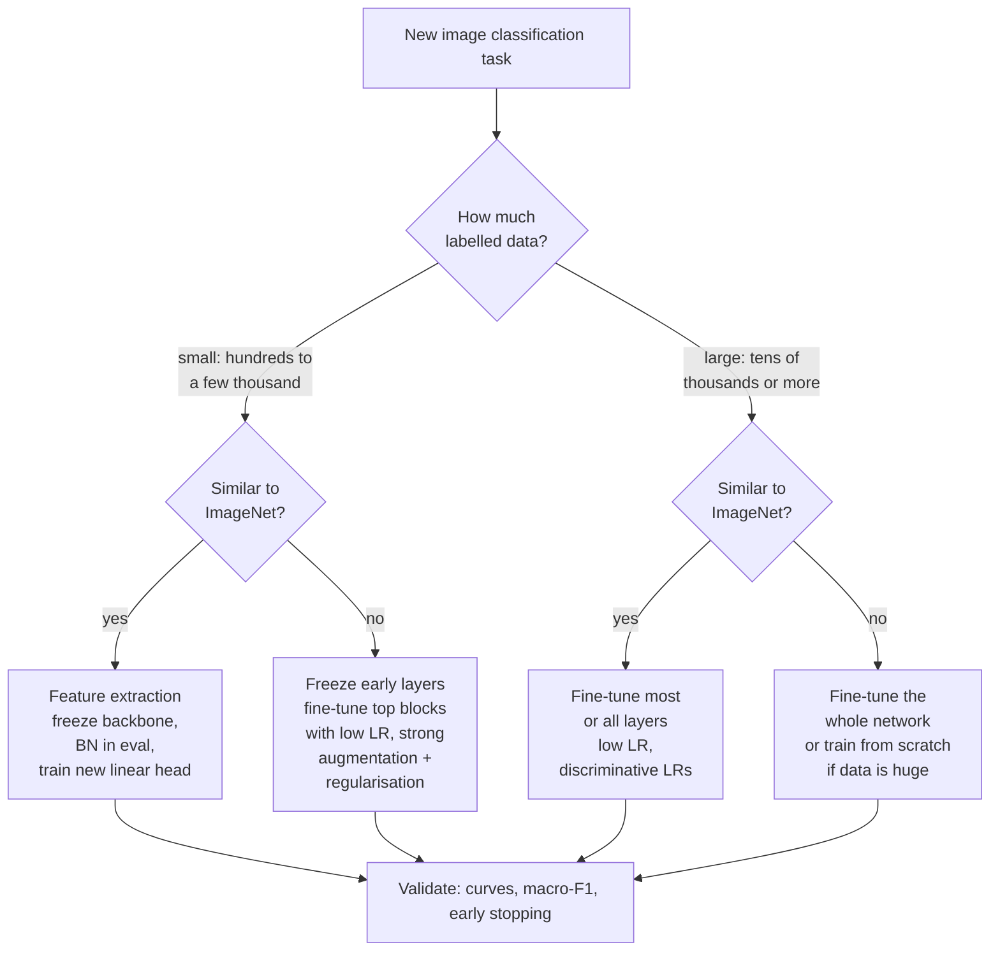
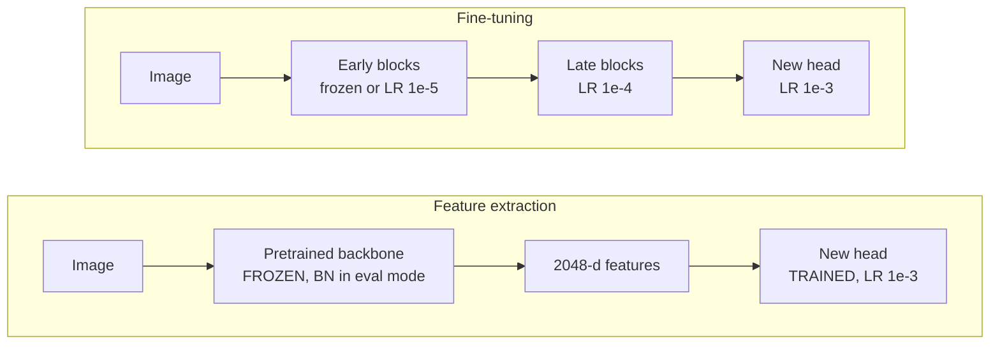
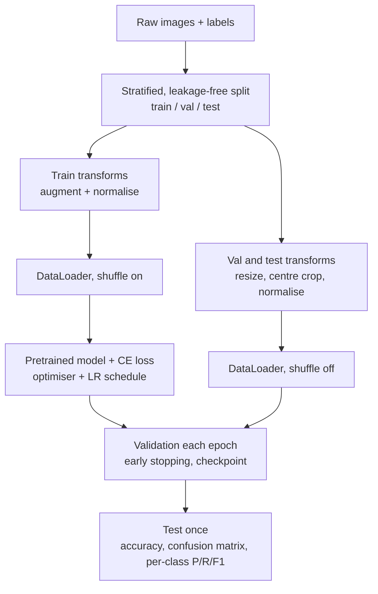
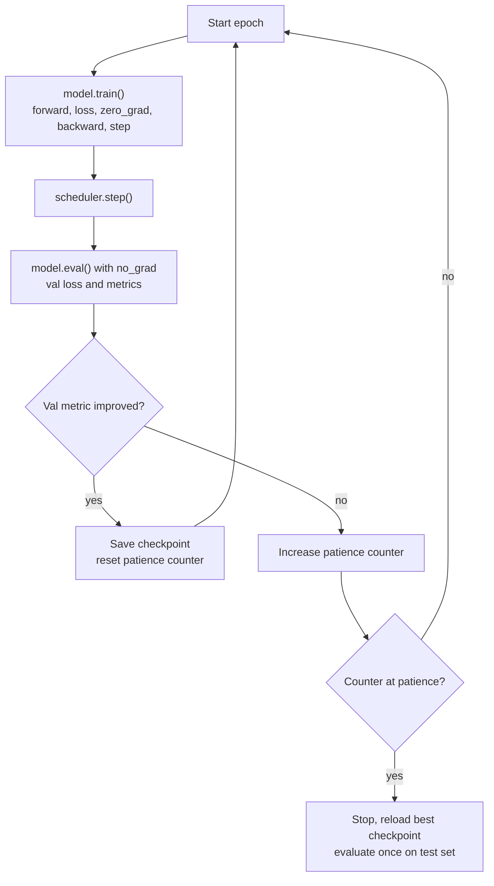
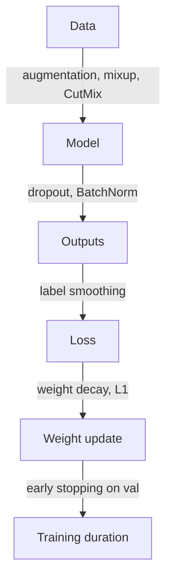

# Session 04 — Training CNNs & Transfer Learning

> **Syllabus:**
> - Overfitting & regularization
> - Data augmentation
> - Pretrained models
> - Feature extraction vs fine-tuning
> - Practical image classification
>
> **Related:** [Session 03 — CNN architectures](03_cnns_under_the_hood.md) · [Session 05 — embeddings (pretrained features as embeddings)](05_embeddings_similarity.md) · [Session 07 — precision/recall, focal loss](07_detection_one_stage.md) · [Session 09+16 — practicals & revision](09_revision_practicals.md) · [Session 13 — foundation-model backbones](13_vision_foundation_models.md) · [Formula sheet](../00_formula_sheet.md) · [Comparison tables](../00_comparison_tables.md) · [Code: transfer-learning skeleton](../code/transfer_learning_skeleton.py) · [Numericals drill](../practice/numericals_drill.md)
>
> **Practice:** [Questions](../practice/04_questions.md) · [Solutions](../practice/04_solutions.md)

---

## 1. Big picture

Session 03 explained *what* a CNN computes; this session is about *training one that generalises*. Modern CNNs have millions of parameters, so with the few thousand labelled images a typical project has, they **overfit** unless we (i) **regularise** (weight decay, dropout, BatchNorm, early stopping, label smoothing), (ii) **augment** the data, and above all (iii) **transfer** knowledge from a network **pretrained** on a large dataset such as ImageNet — either as a frozen **feature extractor** or by **fine-tuning** it with a small learning rate. The session ends with the practical pipeline used in every lab and project: splits → transforms → DataLoader → model → cross-entropy → optimiser + LR schedule → validation metrics → early stopping → one final test. Exam questions typically ask you to *diagnose* learning curves, *compute* softmax/CE/BN/dropout/metric values, and *design* a training strategy for a small dataset.

---

## 2. Core concepts

### Overfitting and regularisation

**Generalisation gap** = validation (or test) error − training error. A model **overfits** when it fits noise/idiosyncrasies of the training set (low training error, much higher validation error); it **underfits** when it cannot even fit the training data.

**Bias–variance view** (squared loss): expected test error $=$ bias$^2$ $+$ variance $+$ irreducible noise.
- **High bias** (underfitting): model too simple / too regularised / undertrained — train and val errors both high and close together.
- **High variance** (overfitting): model too flexible for the amount of data — train error low, val error high.
- Regularisation trades a little bias for a large reduction in variance. **More (or augmented) data reduces variance without adding bias** — the best regulariser.

**Reading train/val curves** (classic exam diagram):

| Pattern | Diagnosis | Remedies |
|---|---|---|
| Train loss ↓ steadily; val loss ↓ then **↑**; gap widening | **Overfitting** (after the val minimum) | early stopping at the val minimum, augmentation, weight decay, dropout, more data, pretrained model, smaller model |
| Train and val loss both high, close, plateaued | **Underfitting** | bigger/deeper model, train longer, higher LR or better schedule, less regularisation, better features (pretrained) |
| Both low, small stable gap | Good fit | stop; evaluate on test once |
| Loss oscillates wildly, explodes, or becomes NaN | LR too high (or bad data/normalisation) | lower LR, warm-up, gradient clipping, check inputs |
| Loss decreases extremely slowly | LR too low / poor init | raise LR, LR range test |
| Val accuracy slightly **above** train accuracy | Usually fine: dropout/augmentation are active only in training | check for leakage if the gap is large |
| Loss stuck exactly at $\ln K$ | Model outputs uniform probabilities — nothing is learning | check `optimizer.step()`, frozen params, LR = 0, label/data pipeline |

**L2 regularisation / weight decay.** Add $\frac{\lambda_{wd}}{2}\Vert\theta\Vert_2^2$ to the loss. The gradient gains a term $\lambda_{wd}\theta$, so each SGD step shrinks ("decays") every weight by a factor $(1-\eta\lambda_{wd})$ before the data-gradient update. Small weights → smoother functions, less sensitivity to individual inputs. Typical: $10^{-4}$ (SGD, ImageNet ResNets), $5\times10^{-4}$ (CIFAR), $0.01$–$0.05$ (AdamW). Commonly **not** applied to biases and BN parameters.

**AdamW (decoupled weight decay).** For **plain SGD**, "L2 in the loss" and "weight decay in the update" are equivalent (up to rescaling $\lambda_{wd}$). For **Adam** they are **not**: an L2 gradient $\lambda_{wd}\theta$ is divided by $\sqrt{\hat v}$, so weights with large historical gradients are regularised *less*. **AdamW** (Loshchilov & Hutter, 2019) applies the decay **directly to the weights, outside the adaptive step**: $\theta \leftarrow \theta - \eta\left(\frac{\hat m}{\sqrt{\hat v}+\epsilon} + \lambda_{wd}\theta\right)$. AdamW is the standard optimiser for fine-tuning and for Transformers/ViTs.

**L1 regularisation.** Add $\lambda_{wd}\sum_i\lvert\theta_i\rvert$: gradient $\lambda_{wd}\,\mathrm{sign}(\theta)$ pushes small weights **exactly to zero** → **sparsity** (feature selection, pruning). Rarely used for CNN weights; L2 is the default.

**Dropout** (Srivastava et al., 2014). During training each activation is set to 0 with probability $p$ (independently, re-sampled every forward pass).
- **Why it works:** units cannot co-adapt (rely on specific partners); training samples a different "thinned" sub-network each step → an implicit **ensemble** of exponentially many networks sharing weights.
- **Inverted dropout** (PyTorch, all modern libraries): kept activations are **scaled by $\frac{1}{1-p}$ during training**, so the expected activation is unchanged: $\mathbb E[\tilde y] = (1-p)\cdot\frac{y}{1-p} = y$. At **test time dropout is switched off** (`model.eval()`) and **no scaling is needed** — the layer is the identity.
- (Original formulation: no scaling during training, multiply weights by the keep probability $1-p$ at test time. Same expectation; inverted dropout keeps inference untouched.)
- In PyTorch `nn.Dropout(p)` — $p$ is the **drop** probability (the original paper's $p$ was the *retain* probability — watch the convention).
- Typical: $p=0.5$ in large FC layers (AlexNet, VGG); $p=0.2$ before the classifier (EfficientNet-B0). Less useful inside conv layers (neighbouring activations are correlated → use spatial dropout/DropBlock) and often unnecessary with BN.

**Batch Normalisation** (Ioffe & Szegedy, 2015). For each channel, normalise activations using the **mini-batch** mean and variance, then re-scale with learnable $\gamma$ (scale) and $\beta$ (shift):

$$
\mu_B=\frac1m\sum_{i=1}^m x_i,\qquad \sigma_B^2=\frac1m\sum_{i=1}^m (x_i-\mu_B)^2,\qquad \hat x_i=\frac{x_i-\mu_B}{\sqrt{\sigma_B^2+\epsilon}},\qquad y_i=\gamma\hat x_i+\beta
$$

- For conv layers the statistics are computed **per channel over $N\times H\times W$** values ($m=NHW$); parameters: $2C$ learnable ($\gamma,\beta$) + $2C$ buffers (running mean/var).
- **Train mode:** uses batch statistics and updates the running estimates $\hat\mu \leftarrow (1-\rho)\hat\mu + \rho\,\mu_B$ (PyTorch `momentum` $\rho=0.1$; the running variance uses the unbiased batch variance $\frac{m}{m-1}\sigma_B^2$).
- **Eval mode:** uses the **running** mean/variance — output is a fixed affine function of the input (deterministic, independent of other images; can be folded into the preceding conv).
- **Benefits:** stable activation scales → **higher learning rates**, faster convergence, less sensitivity to initialisation; smoother loss landscape (Santurkar et al., 2018 — the original "internal covariate shift" explanation is disputed). **Mild regularising effect:** each example's normalisation depends on the random batch it lands in → noise.
- **Pitfalls:** small batches (≤ 8) give noisy statistics → GroupNorm/LayerNorm or frozen BN; forgetting `model.eval()` at test time; **frozen BN during fine-tuning still updates running stats in train mode** (see below).

**Early stopping.** Monitor a **validation** metric each epoch; keep the best checkpoint; stop after `patience` epochs without improvement; reload the best weights. Limits how far the weights travel from initialisation — behaves like an implicit L2 penalty — and saves compute. Uses the validation set (never the test set).

**Label smoothing** (Szegedy et al., 2016, Inception-v3). Replace the one-hot target $y$ by $q=(1-\varepsilon)y+\varepsilon/K$ (e.g., $\varepsilon=0.1$). The model is no longer rewarded for pushing logits to $\pm\infty$ → less over-confidence, better calibration, small but consistent accuracy gains; some robustness to label noise. Built into `nn.CrossEntropyLoss(label_smoothing=0.1)`.

**More data and other regularisers.** Collect/label more data, use augmentation (next), use **pretrained** weights (strong prior), reduce model size, stochastic depth, ensembling. Regularisers are complementary but interact (e.g., heavy augmentation + strong dropout can cause underfitting).

---

### Data augmentation

**Idea:** apply random, **label-preserving** transformations to training images on the fly (a different version every epoch). This enlarges the effective dataset, encodes the **invariances** we want (to position, scale, lighting, viewpoint), and is one of the strongest regularisers for CNNs.

**Geometric:**
- **Horizontal flip** (most natural images), **random crop / `RandomResizedCrop`** (random area 8–100% and aspect ratio 3/4–4/3, then resize to 224 — the standard ImageNet recipe), **translation**, **scaling**, **rotation** (small angles for natural images; any angle for satellite/microscopy), affine/perspective, elastic deformation (medical, handwriting).

**Photometric:**
- **Colour jitter** (brightness, contrast, saturation, hue), grayscale conversion, Gaussian blur, noise, AlexNet's PCA lighting. Builds robustness to illumination and camera differences.

**Occlusion-style:**
- **Cutout** — zero a random square; **Random Erasing** — fill a random rectangle with noise. Force the network to use several cues rather than one discriminative patch; robustness to occlusion.

**Mixing (images AND labels):**
- **Mixup** (Zhang et al., 2018): $\tilde x=\lambda x_i+(1-\lambda)x_j$, $\tilde y=\lambda y_i+(1-\lambda)y_j$ with $\lambda\sim\mathrm{Beta}(\alpha,\alpha)$ ($\alpha\approx0.2$ for ImageNet). Encourages linear behaviour between training examples, smoother decision boundaries, better calibration. The **labels must be mixed too** — otherwise the target is wrong.
- **CutMix** (Yun et al., 2019): paste a random box from $x_j$ into $x_i$; $\lambda = 1-\frac{\text{box area}}{\text{image area}}$; labels mixed by **area**. Images stay locally natural (better than mixup for localisation); combines Cutout's occlusion with label mixing.

**Learned/random policies:**
- **AutoAugment** (Cubuk et al., 2019) searches an augmentation policy with reinforcement learning on a proxy task — effective but very expensive to search.
- **RandAugment** (2020) drops the search: apply $N$ random ops from a fixed list, all at a global magnitude $M$ — only **2 hyperparameters**. (TrivialAugment: one random op at random magnitude.)

**Label-preservation caveats** — an augmentation is valid only if the label is unchanged:
- **Digits:** 180° rotation turns 6 ↔ 9; flips change asymmetric digits/letters.
- **Text / characters / road signs:** mirror images of text are not text; a horizontally flipped "turn left" sign means "turn right".
- **Medical laterality:** chest X-rays have the heart on the patient's left and burned-in L/R markers; flipping creates anatomically implausible images (and may teach the network the marker). Colour/hue jitter can change the label when colour is diagnostic (skin lesions, fruit ripeness, histology stains).
- **Small objects:** aggressive `RandomResizedCrop` can crop the object out entirely.
- **Detection/segmentation:** geometric transforms must be applied to **boxes/masks too**.

**Apply augmentation to the training set only.** Validation and test use a **deterministic** pipeline (e.g., `Resize(256)` → `CenterCrop(224)` → normalise) so that metrics measure real-world performance and are comparable across epochs and models.

**Test-time augmentation (TTA):** at inference, predict on several augmented copies (flip, crops, scales) and **average** the probabilities — small accuracy gains at $n\times$ inference cost (AlexNet averaged 10 crops: 4 corners + centre, each with its flip). TTA is a deliberate inference choice — it does not mean augmenting the validation set during model selection.

---

### Pretrained models

**ImageNet pretraining.** ImageNet-1k: ≈ 1.28M training images, 1000 classes. A network trained on it (ResNet, EfficientNet, ViT…) learns a general visual "vocabulary"; its weights are the starting point for almost every downstream vision task (classification, detection backbones, segmentation encoders). Newer sources: ImageNet-21k, self-supervised (DINOv2) and image–text (CLIP) backbones — see [Session 13](13_vision_foundation_models.md).

**Why features transfer** (Yosinski et al., 2014):
- **Early layers are generic** — edges, colour blobs, Gabor-like and texture detectors appear in almost any network trained on natural images (Session 03, Zeiler & Fergus).
- **Later layers are task-specific** — tuned to ImageNet's classes; transferability decreases as layers get deeper and as the target task gets more distant from the source.
- Even features transferred from a fairly distant task beat random initialisation, and **fine-tuning** them gives a further boost.

**Benefits:** much less labelled data needed, faster convergence, higher accuracy (especially for small datasets), better robustness. **Caveats:** large **domain gap** (X-ray, satellite multispectral, depth, SAR) reduces benefit; input conventions must match; licences/biases of the source data carry over.

**Using torchvision weights:**
- `model = torchvision.models.resnet50(weights=ResNet50_Weights.IMAGENET1K_V2)` (V2 = newer training recipe, ≈ 80.9% top-1 vs ≈ 76.1% for V1); `weights.transforms()` returns the matching preprocessing. (`pretrained=True` is the deprecated old API.)
- Pretrained heads output 1000 ImageNet logits → **replace the head** (`model.fc` for ResNet, `model.classifier[-1]` for VGG/EfficientNet, `model.heads.head` for ViT).
- **Preprocessing must match pretraining:** RGB, scale to $[0,1]$ (`ToTensor`), then per-channel **ImageNet normalisation**

$$
x' = \frac{x - \text{mean}_c}{\text{std}_c},\qquad \text{mean}=[0.485,\,0.456,\,0.406],\quad \text{std}=[0.229,\,0.224,\,0.225]
$$

  (the mean is ≈ RGB $(124, 116, 104)$ on the 0–255 scale). Typical eval input: `Resize(256)` → `CenterCrop(224)`. Grayscale images (X-rays) → replicate to 3 channels (or average the first conv's weights over RGB).

---

### Feature extraction vs fine-tuning

**Feature extraction (frozen backbone).**
1. Load the pretrained network; set `requires_grad=False` for all backbone parameters.
2. Replace the head with a new layer for $K$ classes, e.g., `nn.Linear(2048, K)` for ResNet-50 — the **only trainable part** (e.g., $2048\cdot10+10 = 20{,}490$ params for $K=10$, ≈ 0.09% of the network).
3. Train with a normal LR (e.g., $10^{-3}$); keep the backbone's **BatchNorm layers in eval mode**.
- Variant: run the frozen backbone once, cache the 2048-d features and fit a logistic regression/SVM/k-NN (the features are **embeddings** — [Session 05](05_embeddings_similarity.md)).
- **Pros:** fast, cheap, works with very little data, low overfitting risk. **Cons:** features cannot adapt to a new domain.

**Fine-tuning.** Start from the pretrained weights and update some or all of them on the new task.
- **Partial** (unfreeze the last block(s), e.g., ResNet `layer4` + head) or **full** fine-tuning.
- **Use a small learning rate** — typically **10–100× smaller** than training from scratch (e.g., SGD $10^{-3}$–$10^{-4}$, AdamW $10^{-4}$–$10^{-5}$ for the backbone). A large LR makes big updates that **destroy the pretrained features** in the first few iterations.
- **Head warm-up first:** train the randomly initialised head with the backbone frozen for a few epochs; otherwise its large, random gradients flow into the backbone and corrupt it.
- **Discriminative (layer-wise) learning rates:** smaller LR for early (generic) layers, larger for late layers and the head — via optimiser **parameter groups**.
- **Gradual unfreezing:** unfreeze from the top down (head → last block → … ), training a bit after each step (popularised by ULMFiT, 2018).
- **Catastrophic forgetting:** fine-tuning overwrites knowledge useful for generalisation; mitigated by low LR, few epochs, freezing early layers, discriminative LRs, or penalising distance from the pretrained weights (L2-SP).

**BatchNorm when freezing — the classic bug.** `requires_grad=False` stops $\gamma,\beta$ from being *trained*, but if the module is in **train mode** BN still (i) normalises with the current batch's statistics and (ii) **updates its running mean/variance**. With a small or domain-shifted batch this silently changes the "frozen" features. Fix: after `model.train()`, call `.eval()` on the frozen backbone/BN modules (or replace BN by frozen BN). (Verified in PyTorch: one train-mode forward pass changes `running_mean` of a fully frozen ResNet-50.)

**Decision matrix** (dataset size × similarity to the pretraining domain):

| | **Similar to ImageNet** (e.g., dog breeds, products) | **Different domain** (e.g., X-ray, satellite, microscopy) |
|---|---|---|
| **Small data** (hundreds–few thousand) | **Feature extraction**: freeze backbone, train a linear head. Fine-tuning risks overfitting. | Hardest case. Freeze early layers, **fine-tune top blocks** with low LR + strong augmentation + regularisation; or use features from **earlier** (more generic) layers; consider domain-specific pretrained weights. |
| **Large data** (tens of thousands+) | **Fine-tune** most/all layers with a low LR (fast convergence, best accuracy). | **Fine-tune the whole network** (pretrained init still speeds convergence); with very large data, training from scratch becomes viable. |

---

### Practical image classification pipeline

1. **Data splits.** Train / validation / test, e.g., 70/15/15 or 80/10/10, **stratified** by class. Split at the right **group level** to avoid **leakage** (all images of one patient, one product or one video in the *same* split; remove near-duplicates). Validation → model selection and early stopping; **test → used once** at the end. With tiny datasets use **k-fold cross-validation**.
2. **Transforms.** Train: augmentation + `ToTensor` + `Normalize`; val/test: deterministic resize/crop + `ToTensor` + `Normalize` (same statistics as pretraining).
3. **Dataset / DataLoader.** `ImageFolder` (one folder per class; check `class_to_idx`), `DataLoader(batch_size, shuffle=True)` for train, `shuffle=False` for val/test, `num_workers` for parallel loading, `pin_memory` on GPU.
4. **Model.** Pretrained backbone + new head (feature extraction or fine-tuning as above).
5. **Loss.** **Cross-entropy** on **raw logits** — `nn.CrossEntropyLoss` applies log-softmax internally (never softmax first). Options: `label_smoothing=0.1`, `weight=` for class imbalance.
6. **Optimiser.** **SGD + momentum 0.9** (+ weight decay $10^{-4}$; LR 0.1 for batch 256 from scratch, scale LR linearly with batch size) — strong final accuracy, needs tuning; **Adam** (LR $10^{-3}$, $\beta_1=0.9,\beta_2=0.999$) — fast, robust default; **AdamW** — Adam with decoupled weight decay, standard for fine-tuning and ViTs.
7. **LR schedule.** **Step decay** (×0.1 every 30 epochs — classic ResNet), **cosine annealing** (smoothly to ~0), **linear warm-up** for the first few epochs (stabilises large LRs/batches, Transformers), `ReduceLROnPlateau` (decay when val loss stalls), one-cycle.
8. **Training loop.** `model.train()` → for each batch: forward, loss, `zero_grad`, `backward`, `step`; `scheduler.step()` per epoch (or per iteration for warm-up/one-cycle).
9. **Validation.** `model.eval()` + `torch.no_grad()`; compute val loss and metrics; checkpoint the best model; early stopping.
10. **Metrics.** **Accuracy** (misleading under imbalance), top-5; **confusion matrix** (rows = true class, columns = predicted — state the convention); **per-class precision, recall, F1**; **macro-F1** (unweighted mean over classes — treats rare classes equally), weighted-F1, **balanced accuracy** (= macro recall). Precision/recall definitions as in [Session 07](07_detection_one_stage.md).
11. **Class imbalance.** **Weighted cross-entropy** ($w_c = \frac{N}{K n_c}$), **oversampling** minority classes (`WeightedRandomSampler`) or undersampling majority, focal loss ([Session 07](07_detection_one_stage.md)), extra augmentation for rare classes, threshold tuning, and evaluation with macro-F1/per-class recall.
12. **Debugging checklist.** Initial loss ≈ $\ln K$ (2.303 for 10 classes) — otherwise init/labels are off; **overfit a single small batch first** (≈ 100% train accuracy, loss → 0 in a few hundred steps; if not, there is a bug in model/loss/labels/optimiser); visualise augmented batches with labels; check normalisation and channel order; check `train()`/`eval()` switching; watch gradient norms and NaNs; LR range test; fix seeds for reproducibility.

**Minimal PyTorch sketch** (feature extraction; full version in [the code skeleton](../code/transfer_learning_skeleton.py)):

```python
MEAN, STD = [0.485, 0.456, 0.406], [0.229, 0.224, 0.225]
train_tf = T.Compose([T.RandomResizedCrop(224), T.RandomHorizontalFlip(),
                      T.ColorJitter(0.2, 0.2, 0.2), T.ToTensor(), T.Normalize(MEAN, STD)])
val_tf   = T.Compose([T.Resize(256), T.CenterCrop(224), T.ToTensor(), T.Normalize(MEAN, STD)])

model = models.resnet50(weights=models.ResNet50_Weights.IMAGENET1K_V2)
for p in model.parameters():
    p.requires_grad = False                                  # freeze backbone
model.fc = nn.Linear(model.fc.in_features, num_classes)      # new trainable head
opt = torch.optim.AdamW(model.fc.parameters(), lr=1e-3, weight_decay=1e-2)
sched = torch.optim.lr_scheduler.CosineAnnealingLR(opt, T_max=epochs)
loss_fn = nn.CrossEntropyLoss(label_smoothing=0.1)           # takes raw logits

def set_bn_eval(m):
    if isinstance(m, nn.BatchNorm2d): m.eval()               # frozen BN keeps ImageNet stats

for epoch in range(epochs):
    model.train(); model.apply(set_bn_eval)
    for x, y in train_dl:
        opt.zero_grad(); loss = loss_fn(model(x), y); loss.backward(); opt.step()
    sched.step()
    model.eval()
    with torch.no_grad():
        ...  # val loss / accuracy / macro-F1 -> checkpoint + early stopping
```

For fine-tuning, unfreeze blocks and use parameter groups, e.g. `SGD([{"params": model.layer4.parameters(), "lr": 1e-4}, {"params": model.fc.parameters(), "lr": 1e-3}], momentum=0.9, weight_decay=1e-4)`.

---

## 3. Key formulas

**(1) Softmax**

$$
p_k = \frac{e^{z_k}}{\sum_{j=1}^{K} e^{z_j}}
$$

$z_k$ logit of class $k$, $K$ classes, $p_k$ predicted probability.
*Example:* $z=[2.0,\,1.0,\,0.1]$: $e^z=[7.389,\,2.718,\,1.105]$, sum $11.212$ → $p=[0.659,\,0.242,\,0.099]$.

**(2) Cross-entropy loss and its gradient**

$$
\mathcal L_{CE} = -\sum_{k=1}^{K} y_k\log p_k = -\log p_{c},\qquad \frac{\partial\mathcal L_{CE}}{\partial z_k} = p_k - y_k
$$

$y$ one-hot target, $c$ true class.
*Example:* true class 1 (first) → $\mathcal L = -\ln0.659 = 0.417$; gradient $=[-0.341,\ 0.242,\ 0.099]$. Uniform prediction over $K$ classes gives $\mathcal L=\ln K$ ($\ln10 = 2.303$).

**(3) Label-smoothed target**

$$
q_k = (1-\varepsilon)\,y_k + \frac{\varepsilon}{K},\qquad \mathcal L_{LS} = -\sum_k q_k\log p_k
$$

$\varepsilon$ smoothing factor. *Example:* $\varepsilon=0.1,K=3$: $q=[0.9333,\,0.0333,\,0.0333]$; with $p$ above, $\mathcal L_{LS} = 0.514$ (vs 0.417 un-smoothed — the loss now also penalises over-confidence).

**(4) L2 regularisation / weight decay (SGD)**

$$
J(\theta) = \mathcal L(\theta) + \frac{\lambda_{wd}}{2}\Vert\theta\Vert_2^2
\;\Rightarrow\;
\theta \leftarrow \theta - \eta\left(\nabla\mathcal L + \lambda_{wd}\theta\right) = (1-\eta\lambda_{wd})\,\theta - \eta\nabla\mathcal L
$$

$\eta$ learning rate, $\lambda_{wd}$ weight-decay coefficient.
*Example:* $\theta=1.0$, $\nabla\mathcal L=0.5$, $\eta=0.1$, $\lambda_{wd}=0.01$: $\theta \leftarrow 1 - 0.1(0.5+0.01) = 0.949$.

**(5) SGD with momentum** (PyTorch convention; weight decay folded into $g$)

$$
g_t = \nabla\mathcal L(\theta_t) + \lambda_{wd}\theta_t,\qquad v_{t+1} = \mu\,v_t + g_t,\qquad \theta_{t+1} = \theta_t - \eta\,v_{t+1}
$$

$\mu$ momentum (0.9), $v$ velocity (running sum of gradients), $v_0=0$.
*Example:* $\theta_0=1$, data gradients $0.5$ then $0.3$, $\eta=0.1,\mu=0.9,\lambda_{wd}=0.01$: $v_1=0.51$, $\theta_1=0.949$; $g_1=0.3+0.00949=0.30949$, $v_2=0.459+0.30949=0.76849$, $\theta_2=0.872151$.

**(6) Adam and AdamW**

$$
\begin{aligned}
m_t &= \beta_1 m_{t-1} + (1-\beta_1)g_t, \qquad v_t = \beta_2 v_{t-1} + (1-\beta_2)g_t^2,\\
\hat m_t &= \frac{m_t}{1-\beta_1^t},\qquad \hat v_t = \frac{v_t}{1-\beta_2^t},\\
\text{AdamW: }\ \theta_t &= \theta_{t-1} - \eta\left(\frac{\hat m_t}{\sqrt{\hat v_t}+\epsilon} + \lambda_{wd}\,\theta_{t-1}\right)
\end{aligned}
$$

$\beta_1=0.9,\ \beta_2=0.999,\ \epsilon=10^{-8}$; Adam-with-L2 would instead add $\lambda_{wd}\theta$ to $g_t$ (and get divided by $\sqrt{\hat v}$).
*Example (first step):* $\hat m_1/\sqrt{\hat v_1} = \mathrm{sign}(g_1)=1$, so with $\theta_0=1$, $\eta=10^{-3}$, $\lambda_{wd}=0.01$: $\theta_1 = 1 - 10^{-3}(1+0.01) = 0.99899$.

**(7) Inverted dropout**

$$
r_i \sim \mathrm{Bernoulli}(1-p),\qquad \tilde y_i = \frac{r_i\,y_i}{1-p}\ \ (\text{train}),\qquad \tilde y_i = y_i\ \ (\text{test}),\qquad \mathbb E[\tilde y_i] = y_i
$$

$p$ drop probability, $r_i$ keep mask.
*Example:* $p=0.2$ → scale $1/0.8 = 1.25$; activations $[-1.683,\,0.106,\,1.894,\,3.683]$ with mask $[1,0,1,1]$ → $[-2.104,\,0,\,2.368,\,4.604]$.

**(8) Batch normalisation** (per channel; batch of $m$ values)

$$
\mu_B=\frac1m\sum_i x_i,\quad \sigma_B^2=\frac1m\sum_i(x_i-\mu_B)^2,\quad \hat x_i=\frac{x_i-\mu_B}{\sqrt{\sigma_B^2+\epsilon}},\quad y_i=\gamma\hat x_i+\beta
$$

$$
\hat\mu \leftarrow (1-\rho)\,\hat\mu + \rho\,\mu_B,\qquad \hat\sigma^2 \leftarrow (1-\rho)\,\hat\sigma^2 + \rho\,\frac{m}{m-1}\sigma_B^2
$$

$\gamma,\beta$ learnable scale/shift, $\epsilon$ small constant ($10^{-5}$), $\rho$ BN momentum (0.1 in PyTorch), $\hat\mu,\hat\sigma^2$ running estimates used in eval mode.
*Example:* $x=[2,4,6,8]$, $\gamma=2,\beta=1$: $\mu_B=5$, $\sigma_B^2=5$, $\hat x=[-1.342,-0.447,0.447,1.342]$, $y=[-1.683,\,0.106,\,1.894,\,3.683]$; running stats from $(0,1)$: $\hat\mu=0.5$, $\hat\sigma^2=0.9+0.1\cdot6.667=1.567$.

**(9) Mixup and CutMix**

$$
\tilde x = \lambda x_i + (1-\lambda)x_j,\qquad \tilde y = \lambda y_i + (1-\lambda)y_j,\qquad \lambda\sim\mathrm{Beta}(\alpha,\alpha);\qquad \text{CutMix: } \lambda = 1-\frac{w_b h_b}{WH}
$$

$x_i,x_j$ two training images, $y_i,y_j$ their one-hot labels, $w_b,h_b$ pasted box size, $W,H$ image size.
*Example:* $\lambda=0.7$, cat (class 1 of 3) mixed with fox (class 3): $\tilde y=[0.7,\,0,\,0.3]$; with $p=[0.659,0.242,0.099]$ the loss is $-0.7\ln0.659-0.3\ln0.099 = 0.987$. CutMix: a $112\times112$ box in a $224\times224$ image → $\lambda = 1-0.25 = 0.75$.

**(10) Learning-rate schedules**

$$
\text{Step: }\eta_t = \eta_0\,\gamma^{\lfloor t/s\rfloor},\qquad
\text{Cosine: }\eta_t = \eta_{min} + \tfrac12(\eta_{max}-\eta_{min})\left(1+\cos\frac{\pi t}{T}\right),\qquad
\text{Warm-up: }\eta_t = \eta_{max}\frac{t}{T_w}\ (t\le T_w)
$$

$t$ epoch (from 0 for step/cosine, from 1 for warm-up), $s$ step size, $\gamma$ decay factor, $T$ total epochs, $T_w$ warm-up epochs.
*Examples:* step $\eta_0=0.1,\gamma=0.1,s=30$: epochs 29/30/65 → 0.1/0.01/0.001. Cosine $\eta_{max}=0.1,\eta_{min}=0,T=100$: $t=30$ → 0.0794, $t=50$ → 0.05, $t=75$ → 0.0146. Warm-up to 0.1 over 5 epochs: epoch 2 → 0.04.

**(11) Class weights for imbalance**

$$
w_c = \frac{N}{K\,n_c}
$$

$N$ total training samples, $K$ classes, $n_c$ samples of class $c$ (balanced data → all weights 1).
*Example:* counts $500/200/100$ ($N=800, K=3$): $w=[0.533,\ 1.333,\ 2.667]$.

**(12) Classification metrics** (per class $c$, from the confusion matrix)

$$
P_c = \frac{TP_c}{TP_c+FP_c},\qquad R_c=\frac{TP_c}{TP_c+FN_c},\qquad F1_c = \frac{2P_cR_c}{P_c+R_c},\qquad \text{Acc}=\frac{\sum_c TP_c}{N},\qquad \text{macro-F1} = \frac1K\sum_c F1_c
$$

$TP_c$ diagonal entry; $FP_c$ = column sum − $TP_c$; $FN_c$ = row sum − $TP_c$ (rows = true, columns = predicted).
*Example:* see [Practice Q12](../practice/04_solutions.md) (accuracy 79.2%, macro-F1 0.769).

**(13) Trainable parameters when freezing a backbone**

$$
\text{Trainable} = (d+1)\,K
$$

$d$ feature dimension at the head, $K$ classes. *Example:* ResNet-50 ($d=2048$), $K=10$: $20{,}490$ trainable out of $23{,}528{,}522$ (0.087%). VGG-16 last layer ($d=4096$): $40{,}970$.

**(14) Input normalisation**

$$
x'_c = \frac{x_c/255 - \text{mean}_c}{\text{std}_c}
$$

*Example:* pixel $(255,0,128)$ → $\left(\frac{1-0.485}{0.229},\ \frac{0-0.456}{0.224},\ \frac{0.502-0.406}{0.225}\right) = (2.249,\ -2.036,\ 0.426)$.

---

## 4. Algorithms step by step

**A. Training loop (one epoch)**
1. `model.train()` (dropout on, BN uses batch stats — except frozen BN set back to eval).
2. For each mini-batch $(x, y)$ from the shuffled training DataLoader (augmentations applied on the fly):
3. Move to device; forward pass → logits $z$.
4. Loss $\mathcal L = \mathrm{CE}(z, y)$ (+ label smoothing / class weights; mixup → mixed targets).
5. `optimizer.zero_grad()` → `loss.backward()` (compute $\nabla\mathcal L$) → optional gradient clipping → `optimizer.step()`.
6. Per-iteration schedulers (warm-up, one-cycle) step here; log running loss/accuracy.
7. After the epoch: `scheduler.step()` (per-epoch schedules), then validation (algorithm C).

**B. Fine-tuning recipe (pretrained backbone)**
1. Choose a backbone (ResNet-50 / EfficientNet / ViT) and load ImageNet (or domain) weights; use matching preprocessing.
2. Replace the classification head with a new layer for $K$ classes.
3. **Stage 1 — head only:** freeze the backbone (`requires_grad=False`, BN in eval mode); train the head with LR ≈ $10^{-3}$ for a few epochs until val loss plateaus.
4. **Stage 2 — unfreeze top blocks** (e.g., `layer4`, then `layer3`), keeping early layers frozen; use **discriminative LRs** (e.g., backbone $10^{-4}$–$10^{-5}$, head $10^{-3}$), warm-up + cosine schedule, weight decay.
5. Optionally unfreeze everything at an even lower LR if data are sufficient (decision matrix).
6. Monitor train vs val curves at each stage; keep the best checkpoint (early stopping).
7. Evaluate the best checkpoint **once** on the test set; report per-class metrics and the confusion matrix.

**C. Early stopping**
1. Choose a monitored metric (val loss, or val macro-F1/accuracy), a `patience` (e.g., 5–10 epochs) and `min_delta`.
2. Initialise `best = ∞` (for loss), `counter = 0`.
3. After each epoch compute the metric on the **validation** set in eval mode.
4. If it improved by more than `min_delta`: save the checkpoint, `best ← metric`, `counter ← 0`.
5. Else `counter ← counter + 1`; if `counter ≥ patience`, stop.
6. Reload the best checkpoint before testing/deploying.

**D. Overfit-a-batch sanity check**
1. Take one small batch (e.g., 8–32 images), **disable augmentation and regularisation**.
2. Train repeatedly on just that batch.
3. Expect loss → ≈ 0 and 100% accuracy within a few hundred steps.
4. If not: inspect labels, loss inputs (logits vs probabilities), `zero_grad`/`step`, frozen parameters, LR, data normalisation.

**E. Mixup / CutMix batch**
1. Sample $\lambda\sim\mathrm{Beta}(\alpha,\alpha)$ and a random permutation $\pi$ of the batch.
2. Mixup: $\tilde x = \lambda x + (1-\lambda)x_{\pi}$. CutMix: paste a random box of area $(1-\lambda)WH$ from $x_\pi$ into $x$; recompute $\lambda$ from the actual (clipped) box area.
3. Loss $= \lambda\,\mathrm{CE}(z, y) + (1-\lambda)\,\mathrm{CE}(z, y_\pi)$ (equivalent to CE with the mixed soft target).

---

## 5. Diagrams

**Transfer-learning decision flow**



**Frozen (feature extraction) vs fine-tuned network**



**Practical classification pipeline**



**Training loop with early stopping**



**Where each regulariser acts**



---

## 6. Comparison tables

**Regularisers at a glance**

| Technique | Mechanism | Train vs test behaviour | Key hyperparameter |
|---|---|---|---|
| L2 / weight decay | shrink weights each step | same | $\lambda_{wd}$ ($10^{-4}$ SGD, $10^{-2}$ AdamW) |
| L1 | push weights to exactly 0 (sparsity) | same | $\lambda_{wd}$ |
| Dropout | random zeroing → implicit ensemble | train: drop + scale $1/(1-p)$; test: **identity** | $p$ (0.2–0.5) |
| BatchNorm | normalise per channel; batch noise | train: batch stats + update running; test: **running stats** | momentum, $\epsilon$ |
| Early stopping | limit training time | – | patience |
| Label smoothing | soft targets, less over-confidence | targets only in training | $\varepsilon$ (0.1) |
| Data augmentation | more, varied data; encodes invariances | **train only** (optional TTA) | policy / magnitude |
| Mixup / CutMix | mix images and labels | train only | $\alpha$ |
| Transfer learning | strong prior from pretraining | – | what to freeze, LR |

**Feature extraction vs fine-tuning**

| | Feature extraction | Fine-tuning |
|---|---|---|
| Trainable | new head only (e.g., 20,490 params) | head + some/all backbone blocks |
| Learning rate | normal for head ($10^{-3}$) | low for backbone ($10^{-4}$–$10^{-5}$), discriminative |
| Data needed | very little | moderate to large |
| Compute | low (features can be cached) | higher (full backprop) |
| Domain adaptation | none | yes |
| Risks | underfitting on distant domains | overfitting, catastrophic forgetting, BN drift |
| Best when | small data, similar domain | more data and/or different domain |

**Mixing / occlusion augmentations**

| | Cutout / Random Erasing | Mixup | CutMix |
|---|---|---|---|
| Image | random region removed | global blend of two images | box from image $j$ pasted into $i$ |
| Label | unchanged | $\lambda y_i+(1-\lambda)y_j$ | mixed by area ratio |
| Image realism | partly occluded | ghosted overlay | locally natural |
| Main benefit | occlusion robustness | smoother boundaries, calibration | both + localisation |

**Optimisers**

| | SGD + momentum | Adam | AdamW |
|---|---|---|---|
| Step size | global LR | per-parameter adaptive | per-parameter adaptive |
| Weight decay | L2 ≡ weight decay | L2 gets rescaled by $1/\sqrt{\hat v}$ (weak) | **decoupled** (correct) |
| Typical LR | 0.1 (scratch, batch 256), $10^{-3}$–$10^{-2}$ fine-tune | $10^{-3}$ | $10^{-3}$–$10^{-5}$ |
| Strengths | best final accuracy for CNNs, well understood | fast, little tuning | standard for fine-tuning and Transformers |

**LR schedules**

| Schedule | Shape | Notes |
|---|---|---|
| Step decay | constant, then ×0.1 every $s$ epochs | classic ResNet (every 30 epochs) |
| Cosine annealing | smooth half-cosine from $\eta_{max}$ to $\eta_{min}$ | no step-time hyperparameters |
| Linear warm-up | ramps 0 → $\eta_{max}$ over first epochs | stabilises large LR/batch, Transformers; combined with cosine |
| ReduceLROnPlateau | decays when val metric stalls | adaptive, needs patience |

**Metrics under imbalance** (900 negatives, 100 positives; a model predicting all negative)

| Metric | Value | Lesson |
|---|---|---|
| Accuracy | 90% | looks good, is useless |
| Recall (positive class) | 0% | reveals failure |
| Macro-F1 | ≈ 0.47 | penalises ignoring the rare class |
| Balanced accuracy | 50% | chance level |

**BatchNorm modes**

| | `model.train()` | `model.eval()` |
|---|---|---|
| Statistics used | current mini-batch | running mean/var |
| Running stats updated? | **yes** (even if `requires_grad=False`) | no |
| Output depends on other images? | yes | no |
| Dropout | active (scaled) | off (identity) |

---

## 7. Common exam traps & misconceptions

- ❌ "Dropout is applied at test time (or test activations must be multiplied by $p$)." → ✅ With **inverted dropout** the scaling $1/(1-p)$ happens during training; at test time dropout is **off** and the layer is the identity. (`model.eval()` handles it.)
- ❌ "Augment the validation/test set too, to make it harder." → ✅ Augment **training data only**; val/test use a fixed deterministic pipeline so metrics are comparable and reflect deployment. (TTA is a separate, deliberate inference trick.)
- ❌ "Fine-tuning with the original high LR (e.g., 0.1) is fine." → ✅ Large updates **destroy pretrained features** (and random-head gradients amplify this). Use 10–100× smaller LR, head warm-up, discriminative LRs.
- ❌ "Setting `requires_grad=False` fully freezes BatchNorm." → ✅ In **train mode** BN still uses batch statistics and **updates running mean/var**. Put frozen BN layers in **eval mode**.
- ❌ "Adam + L2 in the loss = weight decay." → ✅ Not for adaptive optimisers — the L2 gradient is rescaled by $1/\sqrt{\hat v}$. Use **AdamW** (decoupled).
- ❌ "Mixup only blends images." → ✅ It blends **images and labels** with the same $\lambda$.
- ❌ "Horizontal flips are always safe." → ✅ Not for text, digits (and 180° rotations turn 6 ↔ 9), direction-dependent signs, or medical images with laterality.
- ❌ "Apply softmax before `nn.CrossEntropyLoss`." → ✅ It expects **raw logits** (log-softmax inside); double softmax flattens gradients and slows learning.
- ❌ "Overfitting = high training loss." → ✅ Overfitting = low training loss, rising **validation** loss (large gap). High training loss = underfitting (or degradation, Session 03).
- ❌ "Validation accuracy above training accuracy must be a bug." → ✅ Common when dropout/augmentation make training harder; only suspicious if large (leakage).
- ❌ "99% accuracy means a great model." → ✅ Not on imbalanced data — check the confusion matrix, per-class recall, macro-F1.
- ❌ "Tune hyperparameters / early-stop on the test set." → ✅ That leaks test information; use the **validation** set; test once.
- ❌ "Random image-level splits are fine for medical data." → ✅ Split by **patient** (group), or near-identical images leak across splits.
- ❌ "Normalise with any mean/std." → ✅ With a pretrained model use the **pretraining** statistics (ImageNet mean/std) and the same resolution/cropping; compute dataset stats on the **training** set only if training from scratch.
- ❌ "Early stopping should monitor training loss." → ✅ Monitor **validation** loss/metric; training loss keeps falling while overfitting.
- ❌ "L1 and L2 both produce sparse weights." → ✅ Only L1 drives weights exactly to zero; L2 shrinks them smoothly.
- ❌ "Feature extraction is always worse than fine-tuning." → ✅ With little data from a similar domain it is often better (less overfitting) and far cheaper.
- ❌ "Doubling the batch size needs no LR change." → ✅ Rule of thumb: scale the LR linearly with batch size, with warm-up.
- ❌ "BatchNorm works the same with batch size 2." → ✅ Statistics become very noisy; use GroupNorm/LayerNorm or frozen BN.

---

## 8. 10-line cheat summary

1. Overfitting = train loss ↓ while val loss ↑ (gap grows); underfitting = both high; fix with data, augmentation, regularisation, transfer learning, early stopping.
2. Weight decay: $\theta \leftarrow (1-\eta\lambda_{wd})\theta-\eta\nabla\mathcal L$; for Adam use **AdamW** (decoupled); L1 → sparsity.
3. Inverted dropout: train $\tilde y = r\,y/(1-p)$, test = identity; $\mathbb E[\tilde y]=y$.
4. BN: $\hat x=(x-\mu_B)/\sqrt{\sigma_B^2+\epsilon}$, $y=\gamma\hat x+\beta$; train → batch stats + running update (even when frozen!); eval → running stats.
5. Label smoothing $q=(1-\varepsilon)y+\varepsilon/K$; mixup $\tilde x=\lambda x_i+(1-\lambda)x_j$ **and** $\tilde y=\lambda y_i+(1-\lambda)y_j$; CutMix $\lambda$ = 1 − box-area fraction.
6. Augment **train only**; keep labels valid (no flips for text/laterality, no 180° for 6/9); TTA = average predictions at inference.
7. Pretrained ImageNet features: early generic, late specific; normalise with mean [0.485, 0.456, 0.406], std [0.229, 0.224, 0.225].
8. Small + similar → feature extraction (ResNet-50 → 10 classes: 20,490 trainable); large or different → fine-tune with 10–100× lower LR, discriminative LRs, gradual unfreezing.
9. Pipeline: stratified group-aware splits → transforms → DataLoader → model → CE on logits → SGD-momentum/AdamW → step/cosine + warm-up → val metrics → early stopping → test once.
10. Softmax $p_k=e^{z_k}/\sum e^{z_j}$, CE $=-\log p_c$ (init ≈ $\ln K$), $\partial\mathcal L/\partial z = p-y$; imbalance → weighted CE $w_c=N/(Kn_c)$, oversampling, macro-F1; debug by overfitting one batch.
