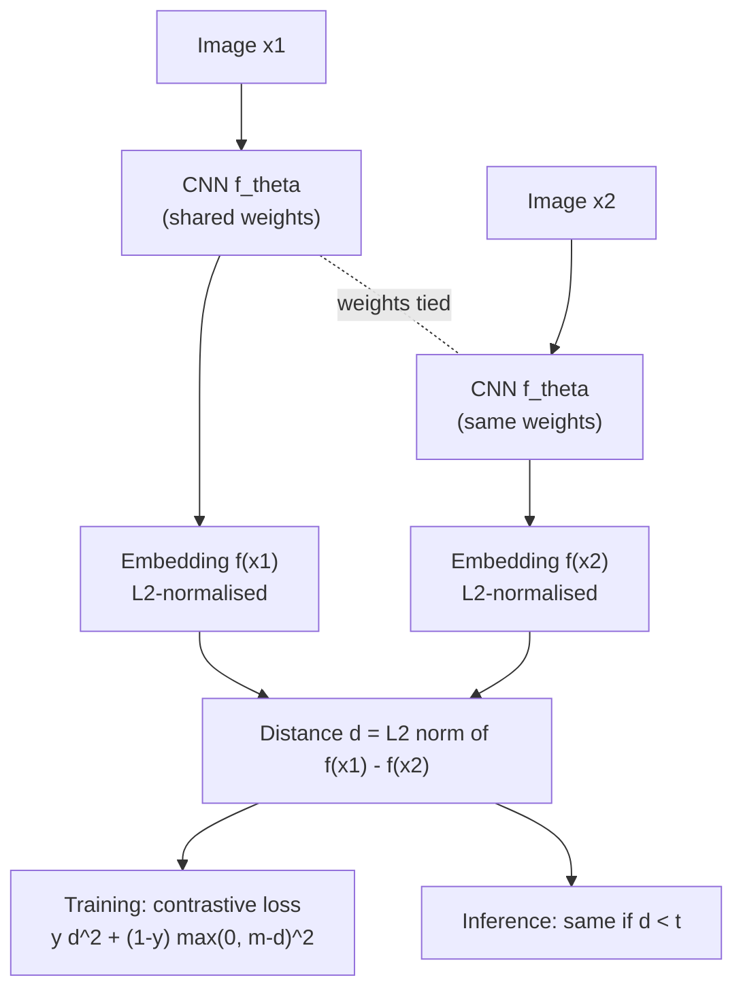
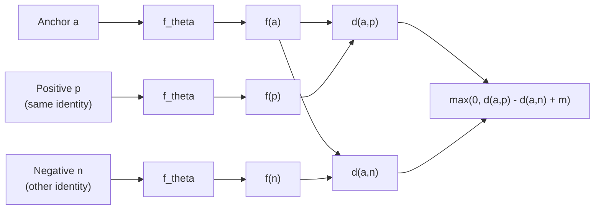
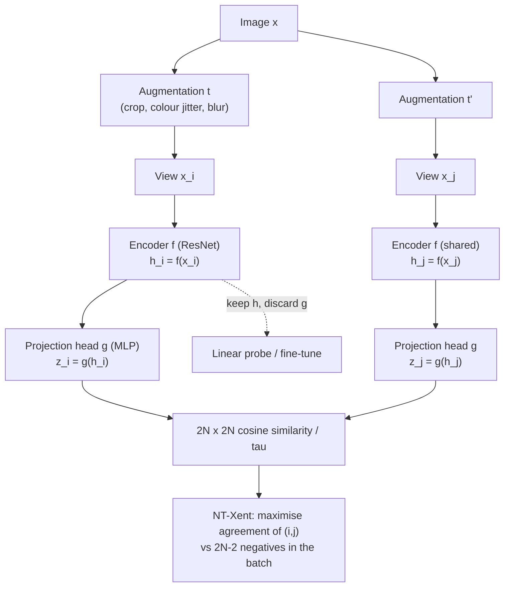
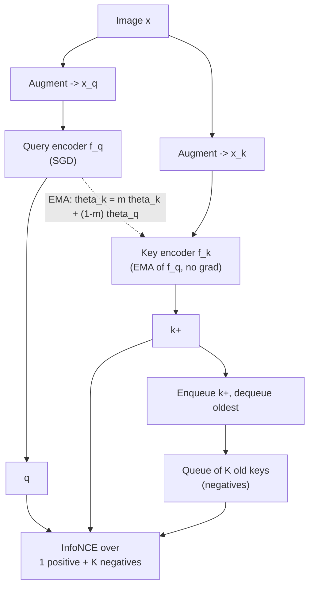
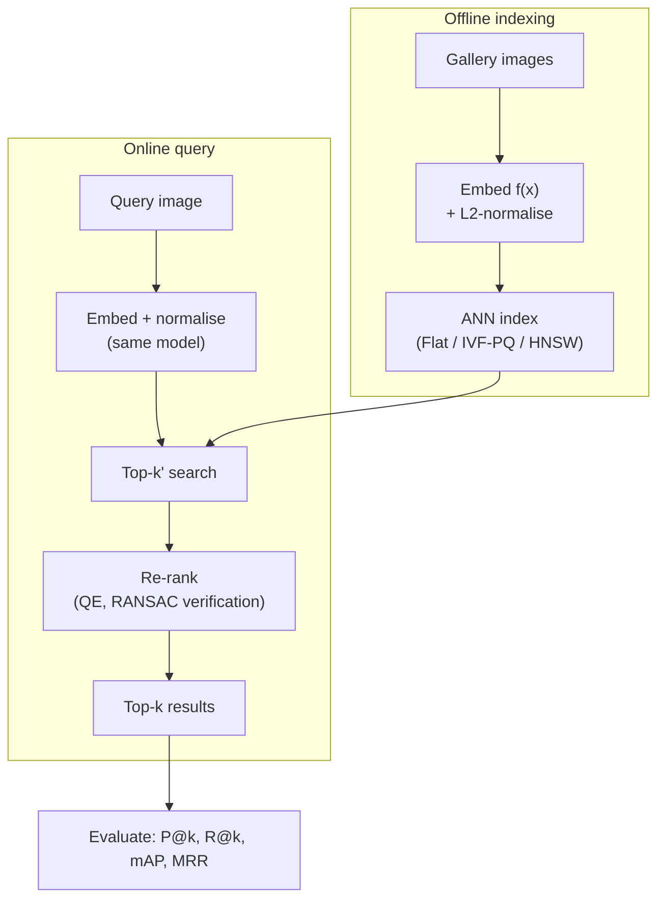

# Session 05 — Embeddings & Image Similarity

> **Syllabus:**
> - What is an embedding?
> - Learned representations
> - Similarity metrics & Image retrieval
> - Siamese networks
> - Contrastive learning
>
> **Related:** [01 Descriptors (SIFT/ORB — hand-crafted embeddings)](01_image_processing_features.md) · [02 Feature matching & distance metrics](02_feature_matching_classical.md) · [03 CNN features](03_cnns_under_the_hood.md) · [04 Transfer learning / feature extraction](04_training_transfer_learning.md) · [07 AP / mAP for detection](07_detection_one_stage.md) · [13 CLIP & DINO (foundation-model embeddings)](13_vision_foundation_models.md) · [14 Zero-shot vision](14_vision_plus_plus.md) · [09 Revision & practicals](09_revision_practicals.md) · [Formula sheet](../00_formula_sheet.md)
>
> **Practice:** [Questions](../practice/05_questions.md) · [Solutions](../practice/05_solutions.md)

---

## 1. Big picture

Classification answers "which of my fixed $C$ classes is this?". Many real problems instead ask **"how similar are these two images?"** — face verification, product search, duplicate detection, person re-identification, one-shot recognition of classes never seen in training. The answer is to learn an **embedding**: a function that maps every image to a vector so that **distance in the vector space ≈ semantic dissimilarity**. Once you have it, similarity search becomes nearest-neighbour search, and new classes need no retraining. This session goes from *what* an embedding is (hand-crafted SIFT descriptors in [Session 01](01_image_processing_features.md) were the first ones), to *how* to measure similarity and search millions of vectors, to *how to train* embeddings with **Siamese/triplet networks** (supervised metric learning) and **contrastive self-supervised learning** (SimCLR, MoCo, BYOL) — the same InfoNCE idea that powers **CLIP** in [Session 13](13_vision_foundation_models.md).

---

## 2. Core concepts

### What is an embedding?

- An **embedding** is a learned mapping $f_\theta:\mathcal X\to\mathbb R^D$ from an input (image, patch, face, text) to a **$D$-dimensional vector** $\mathbf z=f_\theta(x)$ such that **semantically similar inputs are close** and dissimilar inputs are far apart under a chosen metric (Euclidean or cosine).
- It is a **compressed, task-relevant representation**: a 224×224×3 image has 150,528 numbers; its embedding has e.g. 128–2048 numbers that discard nuisance factors (lighting, pose, background) and keep identity/semantics.
- **Why it matters:** comparing raw pixels fails — a 2-pixel shift or a lighting change produces a huge pixel distance while the content is unchanged. An embedding is built (or trained) to be **invariant** to such nuisances.
- **Dimensionality $D$** — a trade-off:
  - too small → cannot separate many concepts (underfits, collisions);
  - too large → more memory/compute for search, more noise dimensions, "distance concentration" (in very high-dimensional random data all pairwise distances become similar — the **curse of dimensionality**).
  - Typical sizes: FaceNet **128-d**, CLIP ViT-B/32 **512-d**, DINOv2 ViT-B **768-d**, ResNet-50 pooled features **2048-d**, SIFT **128-d**, ORB **256 bits**. PCA (often with whitening) is used to reduce $D$ after training.
- **L2-normalisation**: $\hat{\mathbf z}=\mathbf z/\Vert\mathbf z\Vert_2$ projects every embedding onto the **unit hypersphere**. Benefits:
  1. removes the effect of feature magnitude (which often encodes image contrast/"confidence", not identity);
  2. makes **Euclidean distance and cosine similarity equivalent for ranking** ($\Vert\hat a-\hat b\Vert^2=2-2\cos\theta$);
  3. bounds similarities in $[-1,1]$, which stabilises losses with a temperature/margin;
  4. lets you use fast **inner-product** search as cosine search.
- **Embedding space geometry:** a good space shows **alignment** (positives close) and **uniformity** (features spread over the whole hypersphere, so information is preserved). Contrastive losses optimise exactly these two properties (Wang & Isola, 2020).
- Embeddings are not just for images: words (word2vec), text (BERT/CLIP text encoder), audio — and **multimodal embeddings** (CLIP) put images and text in the **same** space so they can be compared directly ([Session 13](13_vision_foundation_models.md)).

### Learned representations

Where does a good embedding function come from? Four families, from most to least label-hungry (plus the classical baseline):

| Family | How it is trained | Embedding taken from | Notes |
|---|---|---|---|
| **Hand-crafted** (SIFT, HOG, colour histograms, Bag-of-Visual-Words) | Not trained — designed by hand | Descriptor / histogram | Local, invariant to some transforms; weak semantics ([01](01_image_processing_features.md)) |
| **Classification-trained CNN features** | Cross-entropy on labelled classes (e.g. ImageNet) | **Penultimate layer** (e.g. ResNet-50 global-average-pool **2048-d**, AlexNet/VGG fc7 **4096-d**) | "Off-the-shelf" features; surprisingly good for retrieval and transfer ([04](04_training_transfer_learning.md)) |
| **Metric learning** | Losses on **distances**: contrastive (pairs), triplet, proxy-based — needs "same/different" labels | Output of embedding head (often L2-normalised, 128–512-d) | Directly optimises what retrieval/verification needs; generalises to **unseen classes** |
| **Self-supervised (SSL)** | **No labels**: two augmented views of one image must agree — SimCLR, MoCo, BYOL, DINO | Backbone output $\mathbf h$ (before the projection head) | Uses unlimited unlabelled data; strong general features |
| **Language-supervised** | Contrastive image–text matching on web pairs — **CLIP** (400M pairs) | Image/text encoder outputs in a **shared** space | Enables **zero-shot** classification via text prompts ([13](13_vision_foundation_models.md), [14](14_vision_plus_plus.md)) |

**Penultimate-layer features — why they work and when they fail**
- A classifier's last layer is linear: logits $=W\mathbf h+\mathbf b$. To be linearly separable, the penultimate features $\mathbf h$ of the same class must cluster ⇒ $\mathbf h$ is a semantic embedding "for free".
- Deeper layers = more semantic, less spatial ([03 hierarchical features](03_cnns_under_the_hood.md)); earlier layers = more generic textures.
- **Limitations:** (1) cross-entropy only cares about the decision boundary, not about distances *within* a class or *between* non-neighbouring classes — it is not trained for ranking; (2) it learns what distinguishes the **training labels**, so it can ignore attributes your search needs (e.g. ImageNet "shoe" features may not separate two shoe styles); (3) domain shift (medical, satellite) degrades them.
- **Fix:** fine-tune the backbone with a metric-learning loss on your domain, or start from SSL/CLIP features which are more general.

**Metric learning vs SSL vs language supervision — the key difference is where "positive pairs" come from**
- **Metric learning:** positives = images with the **same label/identity** (two photos of the same person).
- **SSL:** positives = **two augmentations of the same image** (instance discrimination) — labels never used.
- **CLIP:** positives = **an image and its caption** — the "label" is free-form text scraped from the web.

### Similarity metrics

For embeddings $\mathbf a,\mathbf b\in\mathbb R^D$ with angle $\theta$ between them:

- **Euclidean (L2) distance** $d_2=\Vert\mathbf a-\mathbf b\Vert_2$ — a *distance* (0 = identical, larger = less similar). Sensitive to vector **magnitude**.
- **Cosine similarity** $\cos\theta=\frac{\mathbf a\cdot\mathbf b}{\Vert\mathbf a\Vert\Vert\mathbf b\Vert}\in[-1,1]$ — a *similarity* (1 = same direction). **Scale-invariant**: only direction matters. **Cosine distance** $=1-\cos\theta\in[0,2]$.
- **Dot product** $\mathbf a\cdot\mathbf b=\Vert\mathbf a\Vert\Vert\mathbf b\Vert\cos\theta$ — similarity that rewards **both** alignment and large norms. Used in recommendation ("popular" items get large norms) and as the fast primitive for cosine search after normalisation (**maximum inner-product search, MIPS**).
- **Key identity (memorise):** for **unit vectors**, $\Vert\hat{\mathbf a}-\hat{\mathbf b}\Vert^2=2-2\cos\theta$. Euclidean distance is a **monotonically decreasing** function of cosine ⇒ **ranking by L2 distance = ranking by cosine = ranking by dot product**. Without normalisation the rankings can disagree (see trap list and [practice Q9](../practice/05_questions.md)).
- Others: **L1/Manhattan** (robust to single large coordinate differences), **Hamming** distance for binary codes (ORB, hashing — XOR + popcount, very fast; [01](01_image_processing_features.md)), **Mahalanobis** $d_M=\sqrt{(\mathbf a-\mathbf b)^\top M(\mathbf a-\mathbf b)}$ with $M\succeq0$ — classical "metric learning" learned $M$ (equivalent to a linear embedding $L$ with $M=L^\top L$), **χ²** for histograms.
- Classical matching re-used: nearest-neighbour + **Lowe's ratio test** ($d_1/d_2<\tau\approx0.7$–$0.8$) from [Session 02](02_feature_matching_classical.md) is still a good way to reject ambiguous matches.

### Image retrieval

**Content-based image retrieval (CBIR)**: given a query image, return the most similar images from a gallery/database.

- **Pipeline:** embed every gallery image **once offline** → store in an **index** → at query time embed the query and find its **k nearest neighbours** (kNN).
- **Exact kNN (brute force / "Flat")**: compute $N$ distances, $O(ND)$ per query. Exact, fine up to ~$10^6$ vectors on a GPU, but memory = $N\times D\times4$ bytes for float32 — **1M × 512-d = 2.048 GB**.
- **Approximate nearest neighbour (ANN)** trades a little recall for big speed/memory gains. Know four ideas (all implemented in **FAISS**, Facebook AI Similarity Search):
  - **IVF (inverted file):** k-means the database into `nlist` cells (coarse centroids); at query time search only the `nprobe` closest cells ⇒ scan ≈ `nprobe/nlist` of the data. Misses neighbours that fall into unprobed cells.
  - **PQ (product quantisation):** split each $D$-vector into $m$ sub-vectors, quantise each with its own 256-centroid codebook ⇒ store **$m$ bytes per vector** (e.g. 512-d float32 = 2048 B → 64 B with $m=64$: **32× compression**). Distances are computed approximately via small lookup tables (asymmetric distance computation). Often combined: **IVF-PQ**.
  - **HNSW (Hierarchical Navigable Small World):** multi-layer proximity **graph**; greedy search from a coarse top layer down to the dense bottom layer. Very high recall and speed, but extra memory for the graph links and slower to build.
  - **LSH (locality-sensitive hashing):** random projections → binary codes, similar vectors collide in the same buckets. Simple, with theoretical guarantees, but usually beaten by the above in practice.
- **Retrieval evaluation** (for one query with $R$ relevant items in the database; $\text{rel}(k)\in\{0,1\}$ = relevance of the item at rank $k$):
  - **Precision@k** = fraction of the top-$k$ that are relevant; **Recall@k** = fraction of all $R$ relevant items found in the top-$k$.
  - **Average Precision (AP)** = mean of the precision values at the ranks where relevant items appear, divided by **$R$** (relevant items never retrieved contribute 0) — rewards putting relevant items **early**. **mAP** = mean AP over queries.
  - **MRR (mean reciprocal rank)** = mean over queries of $1/\text{rank of the first relevant result}$ — for "one right answer" tasks (e.g. re-ID, QA).
  - ⚠ In deep-metric-learning papers "**Recall@K**" usually means the **hit rate**: % of queries with **at least one** correct item in the top-$K$. State your definition.
  - Retrieval AP here is the **non-interpolated** mean of precisions at relevant ranks; detection AP ([07](07_detection_one_stage.md)) uses the interpolated precision envelope — conventions differ, so always state which.
- **Re-ranking** (refine the top-$k'$ shortlist, $k'>k$):
  - **Query expansion (QE):** average the query embedding with its top few results and search again (pulls in relevant items the original query missed).
  - **Geometric / spatial verification:** match local features (SIFT/ORB) between query and each candidate and count **RANSAC** inliers of a homography/affine model ([02](02_feature_matching_classical.md)) — great for landmarks and products.
  - **k-reciprocal neighbours:** keep candidates that also have the query among *their* nearest neighbours (person re-ID).
  - **Cross-encoder / heavier model:** score each (query, candidate) pair jointly — too slow for the whole DB, fine for 100 candidates.
- **Practical issues:** the same preprocessing for gallery and query; re-embed the whole gallery when the model changes (index versioning); near-duplicate removal; filtering by metadata.

### Siamese networks

- A **Siamese network** is **one** embedding network $f_\theta$ applied to **two inputs** with **shared weights** (drawn twice in diagrams, but it is the same set of parameters). It outputs $f_\theta(x_1)$ and $f_\theta(x_2)$; a distance $d=\Vert f_\theta(x_1)-f_\theta(x_2)\Vert$ decides "same or different".
- **Why shared weights:** (1) both inputs must live in the **same** embedding space, otherwise distances are meaningless; (2) the similarity becomes **symmetric** ($d(x_1,x_2)=d(x_2,x_1)$); (3) half the parameters ⇒ less overfitting.
- Origins: **signature verification** (Bromley et al., 1993), face verification with the **contrastive loss** (Chopra, Hadsell & LeCun, 2005–06).
- **Training data:** pairs $(x_1,x_2,y)$ with $y=1$ if same identity/class, $y=0$ otherwise. Loss: **contrastive loss** $\mathcal L=y\,d^2+(1-y)\max(0,m-d)^2$ — pull positive pairs together, push negative pairs apart **until they are at least margin $m$ away** (beyond $m$, no gradient).
- **Uses:**
  - **Verification (1:1)** — "are these two faces/signatures the same person?" → threshold the distance: same if $d<t$. $t$ is chosen on validation data (e.g. at the equal-error rate or a target false-accept rate).
  - **Identification (1:N)** — "who is this?" → nearest neighbour in an enrolled gallery.
  - **One-shot / few-shot learning** — recognise a **new class from a single example** by comparing embeddings (Koch et al., 2015 on Omniglot). New classes are added by **storing an embedding**, not by retraining — the network learned a *similarity function*, not a fixed list of classes.
  - Change detection, patch matching for stereo ([12](12_3d_vision_motion.md)), tracking (template matching in an embedding space).
- **Triplet networks (FaceNet, Schroff et al., 2015):** three shared-weight branches take an **anchor** $a$, a **positive** $p$ (same identity) and a **negative** $n$ (different identity). Loss $\mathcal L=\max(0,\ d(a,p)-d(a,n)+m)$ — the negative must be at least $m$ farther than the positive. FaceNet: **128-d L2-normalised** embeddings, squared L2 distances, margin $\alpha=0.2$.
  - **Relative** constraint (contrastive loss uses **absolute** thresholds) ⇒ allows each identity its own spread; usually works better for ranking.
- **Negative mining — the crux of triplet training.** With $N$ images there are $O(N^3)$ triplets and most are **easy** ($d(a,n)>d(a,p)+m$ ⇒ loss 0 ⇒ no gradient). Categories for a given $(a,p)$:
  - **Easy:** $d(a,n)>d(a,p)+m$ → zero loss, useless.
  - **Semi-hard:** $d(a,p)<d(a,n)<d(a,p)+m$ → negative is farther than the positive but inside the margin; positive loss, stable gradients — **FaceNet's choice**.
  - **Hard:** $d(a,n)<d(a,p)$ → most informative but noisy (mislabelled pairs, outliers) and, if used exclusively from the start, can cause **collapse** ($f(x)=$ const, all distances 0, loss stuck at $m$).
  - **Online mining:** pick triplets **inside each mini-batch** from the pairwise distance matrix (cheap, always uses current embeddings). "**Batch-hard**" (Hermans et al., 2017): sample $P$ identities × $K$ images; for each anchor take the farthest positive and nearest negative in the batch.
- **Limitations:** need identity labels; mining logic and margin are hyper-parameters; triplet/contrastive training converges slowly; threshold for verification must be recalibrated per domain.

### Contrastive learning

**Idea:** learn representations by **contrasting** — make embeddings of a **positive pair** similar and embeddings of **negative pairs** dissimilar. In **self-supervised** contrastive learning, the positive pair is **two random augmentations ("views") of the same image**, and negatives are **other images** in the batch/queue (**instance discrimination**: every image is its own class).

**The three losses (exact forms — see §3)**
1. **Contrastive (pairwise, margin) loss** $\mathcal L=y\,d^2+(1-y)\max(0,m-d)^2$ — one pair at a time, absolute margin.
2. **Triplet loss** $\mathcal L=\max(0,\ d(a,p)-d(a,n)+m)$ — one positive vs one negative, relative margin.
3. **InfoNCE / NT-Xent** $\mathcal L=-\log\frac{\exp(\mathrm{sim}(q,k^+)/\tau)}{\sum_{i=0}^{N}\exp(\mathrm{sim}(q,k_i)/\tau)}$ — one positive vs **many** negatives at once; it is a **softmax cross-entropy** whose "correct class" is the positive. **NT-Xent** (normalised-temperature cross-entropy) is SimCLR's name for InfoNCE with cosine similarity and temperature $\tau$. Minimising InfoNCE maximises a lower bound on the mutual information between the two views ($I\ge\log(N+1)-\mathcal L$, with $N+1$ candidates).

**SimCLR (Chen et al., 2020) — "A Simple framework for Contrastive Learning of visual Representations"**
- Take a batch of $N$ images; apply two random augmentations to each ⇒ **$2N$ views**.
- **Encoder** $f$ (ResNet-50) → representation $\mathbf h=f(\tilde x)$ (2048-d).
- **Projection head** $g$ (small MLP, 2048 → hidden → 128) → $\mathbf z=g(\mathbf h)$, then L2-normalise.
- **NT-Xent** over the $2N\times2N$ cosine-similarity matrix: for each view, its partner is the positive and the other **$2N-2$ views are negatives** (no memory bank needed).
- **Large batches** (up to 4096–8192, LARS optimiser) because more negatives ⇒ better estimate of the softmax denominator ⇒ better features.
- **Projection head is thrown away** after training: downstream tasks use $\mathbf h$. Reason: the contrastive loss makes $\mathbf z$ invariant to the augmentations and so discards information (colour, orientation) that downstream tasks may need; $\mathbf h$ keeps more of it.
- **Augmentations are the "supervision":** SimCLR found the composition of **random resized crop + colour distortion** essential (+ Gaussian blur, flip). Crops force global-to-local and part-to-whole prediction; colour distortion stops the network from cheating with colour histograms (two crops of one image share a colour histogram, so without colour jitter the task is trivially solvable).
- Evaluation: **linear probe** (freeze encoder, train a linear classifier on $\mathbf h$) and fine-tuning with few labels.

**MoCo (He et al., 2020) — Momentum Contrast**
- Problem with SimCLR: negatives = batch ⇒ needs huge batches/TPUs.
- **Queue (dictionary)** of keys from previous batches: $K=65{,}536$ negatives regardless of batch size (decouples #negatives from batch size).
- **Momentum (key) encoder:** keys are produced by $f_k$ whose weights are an **exponential moving average** of the query encoder: $\theta_k\leftarrow m\,\theta_k+(1-m)\,\theta_q$, $m=0.999$; no gradients flow into $f_k$. A slowly-changing key encoder keeps the queued keys **consistent** (old keys came from an almost identical encoder). Copying $\theta_q$ directly ($m=0$) fails.
- Loss: InfoNCE with 1 positive + $K$ queue negatives, $\tau=0.07$. MoCo v2 adds SimCLR's MLP head and stronger augmentation.

**Collapse and how methods avoid it**
- **Collapse** = the trivial solution where the encoder outputs (nearly) the **same vector for every input** (complete collapse) or uses only a few dimensions (dimensional collapse). Then every positive pair is perfectly "similar" — the alignment term is minimised — but the features carry no information.
- **Negatives prevent collapse:** the InfoNCE denominator pushes different images apart; a constant output gives loss $\log(\#\text{candidates})$, not 0 ⇒ collapse is not a minimum. This is the **uniformity** pressure.
- **Without negatives**, other tricks are needed:
  - **BYOL** (Grill et al., 2020): online network (encoder + projector + **predictor**) predicts the output of a **target network** that is an **EMA** of the online one, with **stop-gradient** on the target. Loss = MSE between normalised vectors ($=2-2\cos$). Asymmetry (predictor + stop-grad + EMA) avoids collapse empirically. **SimSiam** showed stop-gradient is the key ingredient (works even without EMA).
  - **DINO** (self-distillation, [13](13_vision_foundation_models.md)): student–teacher with EMA teacher, **centering + sharpening** of the teacher outputs.
  - **Barlow Twins / VICReg:** decorrelate embedding dimensions / keep per-dimension variance above a threshold.
- **Temperature $\tau$:** logits are $\mathrm{sim}/\tau$. **Lower $\tau$ ⇒ sharper** softmax ⇒ the loss concentrates on the **hardest negatives** (gradient on negative $k$ is $p_k/\tau$) and tolerates less spread within positives. Too low ⇒ unstable, over-penalises false negatives (same-class images treated as negatives); too high ⇒ all negatives weighted equally, weak learning signal. Typical $\tau\approx0.05$–$0.5$ (MoCo 0.07; CLIP *learns* $\tau$, initialised at 0.07).
- **Limitations of instance-discrimination SSL:** **false negatives** (two different photos of dogs in the batch are pushed apart even though they share a class); dependence on hand-designed augmentations (the invariances must suit the downstream task — e.g. colour jitter hurts flower-species recognition, rotation confuses 6/9); compute-heavy (big batches, long schedules).

---

## 3. Key formulas

**Notation:** $\mathbf a,\mathbf b\in\mathbb R^D$ embeddings, $\theta$ the angle between them, $\hat{\mathbf a}=\mathbf a/\Vert\mathbf a\Vert$ unit vector, $d(\cdot,\cdot)$ Euclidean distance, $m$ margin, $\tau$ temperature, $\mathrm{sim}$ = cosine similarity.

### 3.1 Similarity / distance

$$
d(\mathbf a,\mathbf b)=\Vert\mathbf a-\mathbf b\Vert_2=\sqrt{\sum_{j=1}^{D}(a_j-b_j)^2},\qquad
\mathrm{sim}(\mathbf a,\mathbf b)=\cos\theta=\frac{\mathbf a\cdot\mathbf b}{\Vert\mathbf a\Vert\,\Vert\mathbf b\Vert}
$$

*Worked example:* $\mathbf a=(1,2,2)$, $\mathbf b=(2,3,6)$. $\mathbf a\cdot\mathbf b=2+6+12=20$, $\Vert\mathbf a\Vert=3$, $\Vert\mathbf b\Vert=7$ ⇒ $\cos\theta=20/21=0.952$. $d=\sqrt{1^2+1^2+4^2}=\sqrt{18}=4.243$. Dot product $=20$.

### 3.2 Euclidean ↔ cosine for unit vectors

$$
\Vert\hat{\mathbf a}-\hat{\mathbf b}\Vert^2=\Vert\hat{\mathbf a}\Vert^2+\Vert\hat{\mathbf b}\Vert^2-2\,\hat{\mathbf a}\cdot\hat{\mathbf b}=2-2\cos\theta
\qquad\Longleftrightarrow\qquad
\cos\theta=1-\tfrac12\Vert\hat{\mathbf a}-\hat{\mathbf b}\Vert^2
$$

*Worked example:* for the vectors above, $\Vert\hat{\mathbf a}-\hat{\mathbf b}\Vert^2=2-2(20/21)=0.0952$ ⇒ $\Vert\hat{\mathbf a}-\hat{\mathbf b}\Vert=0.309$. Conversely, two unit embeddings at L2 distance $0.6$ have $\cos\theta=1-0.36/2=0.82$. Range: $d\in[0,2]$ ↔ $\cos\in[1,-1]$; orthogonal unit vectors have $d=\sqrt2$.

### 3.3 Contrastive (pairwise margin) loss

$$
\mathcal L_{\text{contr}}=y\,d^2+(1-y)\max(0,\ m-d)^2
$$

$y=1$ similar pair, $y=0$ dissimilar pair, $d=\Vert f(x_1)-f(x_2)\Vert$, $m>0$ margin.

*Worked example ($m=1$):* similar pair at $d=0.5$ ⇒ $0.25$. Dissimilar pair at $d=0.3$ ⇒ $(1-0.3)^2=0.49$. Dissimilar pair at $d=1.2$ ⇒ $0$ (already outside the margin — no gradient).

### 3.4 Triplet loss

$$
\mathcal L_{\text{trip}}=\max\big(0,\ d(a,p)-d(a,n)+m\big)
$$

$a$ anchor, $p$ positive (same class), $n$ negative (different class). (FaceNet uses squared distances $\Vert f(a)-f(p)\Vert^2$ and $m=\alpha=0.2$; state which you use.)

*Worked example ($m=0.2$, $d(a,p)=0.6$):* $d(a,n)=0.9$ ⇒ $\max(0,-0.1)=0$ (easy); $d(a,n)=0.7$ ⇒ $0.1$ (semi-hard); $d(a,n)=0.5$ ⇒ $0.3$ (hard).

Mining conditions: easy $d(a,n)>d(a,p)+m$; **semi-hard** $d(a,p)<d(a,n)<d(a,p)+m$; hard $d(a,n)<d(a,p)$.

### 3.5 InfoNCE / NT-Xent

$$
\mathcal L_{\text{InfoNCE}}=-\log\frac{\exp(\mathrm{sim}(q,k^+)/\tau)}{\sum_{i=0}^{N}\exp(\mathrm{sim}(q,k_i)/\tau)}
$$

$q$ query (anchor) embedding, $k_0=k^+$ its positive key, $k_1,\dots,k_N$ the $N$ negative keys, $\tau>0$ temperature. It equals cross-entropy over $N+1$ "classes" with the positive as the target; $p_i=\mathrm{softmax}_i(\mathrm{sim}(q,k_i)/\tau)$ and $\mathcal L=-\log p_0$.

*Worked example:* $\mathrm{sim}(q,k^+)=0.9$, negatives $0.5,\ 0.1$.
- $\tau=1$: $\frac{e^{0.9}}{e^{0.9}+e^{0.5}+e^{0.1}}=0.472$ ⇒ $\mathcal L=0.751$.
- $\tau=0.1$: logits $9,5,1$ ⇒ $p_0=0.982$ ⇒ $\mathcal L=0.0185$. **Lower $\tau$ ⇒ sharper distribution.**

**NT-Xent (SimCLR)** for a batch of $N$ images → $2N$ views $\mathbf z_1..\mathbf z_{2N}$, positive pair $(i,j)$:

$$
\ell_{i,j}=-\log\frac{\exp(\mathrm{sim}(\mathbf z_i,\mathbf z_j)/\tau)}{\sum_{k=1}^{2N}\mathbb 1_{[k\neq i]}\exp(\mathrm{sim}(\mathbf z_i,\mathbf z_k)/\tau)},\qquad
\mathcal L=\frac{1}{2N}\sum_{k=1}^{N}\big[\ell_{2k-1,2k}+\ell_{2k,2k-1}\big]
$$

$\mathbb 1_{[k\neq i]}$ excludes self-similarity; denominator has $2N-1$ terms = **1 positive + $(2N-2)$ negatives**. *Example:* $N=256$ ⇒ 512 views, 510 negatives per anchor, a 512×512 similarity matrix.

**Gradient intuition:** $\frac{\partial\mathcal L}{\partial s_k}=\frac{p_k}{\tau}$ for a negative with similarity $s_k$, and $\frac{\partial\mathcal L}{\partial s_0}=-\frac{1-p_0}{\tau}$ for the positive ⇒ negatives with high similarity (hard negatives) receive the largest push; smaller $\tau$ amplifies this.

**Collapse check:** if all embeddings are identical, every similarity is equal ⇒ $p_0=1/(N+1)$ ⇒ $\mathcal L=\log(N+1)$, **not** the minimum ⇒ negatives make collapse costly.

### 3.6 Momentum (EMA) update — MoCo / BYOL / DINO

$$
\theta_k\leftarrow m\,\theta_k+(1-m)\,\theta_q
$$

$\theta_k$ key/target encoder parameters, $\theta_q$ query/online encoder parameters, $m\in[0,1)$ momentum (MoCo $0.999$).

*Worked example:* $\theta_k=0.50$, $\theta_q=0.70$, $m=0.999$ ⇒ $0.999(0.50)+0.001(0.70)=0.5002$ — the key encoder moves only 0.1% of the way per step.

### 3.7 Retrieval metrics

For one query, ranked list, $\text{rel}(k)\in\{0,1\}$, $R$ = total relevant items in the database:

$$
P@k=\frac{1}{k}\sum_{i=1}^{k}\text{rel}(i),\qquad
R@k=\frac{1}{R}\sum_{i=1}^{k}\text{rel}(i),\qquad
\text{AP}=\frac{1}{R}\sum_{k=1}^{n}P@k\cdot\text{rel}(k)
$$

$$
\text{mAP}=\frac{1}{\lvert Q\rvert}\sum_{q\in Q}\text{AP}_q,\qquad
\text{MRR}=\frac{1}{\lvert Q\rvert}\sum_{q\in Q}\frac{1}{\text{rank}_q}
$$

$n$ = length of the returned list, $Q$ = set of queries, $\text{rank}_q$ = rank of the first relevant result for query $q$.

*Worked example:* ranked list R R N R N, $R=4$ relevant in DB. Precision at the relevant ranks: $1/1,\ 2/2,\ 3/4$ ⇒ $\text{AP}=(1+1+0.75)/4=0.6875$. $P@5=3/5=0.6$, $R@5=3/4=0.75$, reciprocal rank $=1$.

### 3.8 Index memory and search cost

$$
\text{Memory}_{\text{flat}}=N\cdot D\cdot b,\qquad \text{Memory}_{\text{PQ}}\approx N\cdot m\ \text{bytes (8-bit codes)},\qquad \text{Cost}_{\text{brute}}=N\cdot D\ \text{MACs/query}
$$

$N$ vectors, $D$ dimensions, $b$ bytes per number (float32 = 4, float16 = 2), $m$ PQ sub-quantisers.

*Worked example:* $10^6\times512\times4=2.048\times10^9$ B $=$ **2.048 GB** (≈1.91 GiB). PQ with $m=64$: $64$ MB (32× smaller). Brute force: $5.12\times10^8$ MACs per query.

---

## 4. Algorithms step by step

### 4.1 Building an image-retrieval system

**Offline (indexing):**
1. **Choose the embedding model** — off-the-shelf (ResNet penultimate, DINOv2, CLIP) or fine-tuned with a metric-learning loss on in-domain pairs.
2. **Preprocess** every gallery image exactly as the model expects (resize, centre-crop, normalise mean/std).
3. **Embed** each image: $\mathbf z_i=f(x_i)$ (batched on GPU).
4. **Post-process:** L2-normalise; optionally PCA-whiten / reduce $D$; re-normalise.
5. **Build the index:** Flat (exact) for small $N$; **IVF-PQ** (train k-means centroids + PQ codebooks on a sample) or **HNSW** for large $N$. Store the mapping index-id → image-id + metadata.

**Online (query):**
6. Embed and normalise the query with the **same** model and preprocessing.
7. **Search** the index for the top-$k'$ (e.g. $k'=100$) by inner product (= cosine on unit vectors).
8. **Re-rank** the shortlist: query expansion, spatial verification (local features + RANSAC inliers), or a heavier pairwise model; apply metadata filters.
9. **Return** the top-$k$ results with scores.

**Evaluate / maintain:**
10. On a labelled query set compute **P@k, R@k, mAP, MRR**; measure latency/QPS and memory; when the model is updated, **re-embed the whole gallery** (embeddings from different models are not comparable).

### 4.2 Siamese training for verification + one-shot inference

1. Build pairs $(x_1,x_2,y)$: positives from the same identity, negatives from different identities (balance them).
2. Pass both through the **same** network $f_\theta$; compute $d=\Vert f(x_1)-f(x_2)\Vert$.
3. Contrastive loss $y\,d^2+(1-y)\max(0,m-d)^2$; backprop through both branches (gradients are summed into the shared weights).
4. On a validation set, choose threshold $t$ (ROC curve: equal-error rate or a target false-accept rate).
5. **Verification:** accept "same" if $d<t$.
6. **One-shot classification:** enrol one example per new class (store its embedding); classify a query by its nearest enrolled embedding (reject as "unknown" if the distance $>t$). No retraining needed.

### 4.3 Online triplet mining (FaceNet-style)

1. Sample a batch with **$P$ identities × $K$ images** each (e.g. $P=32$, $K=4$ ⇒ 128 images) so every anchor has positives in the batch.
2. Embed and L2-normalise all images.
3. Compute the $B\times B$ pairwise distance matrix.
4. For each anchor $a$ and each positive $p$ (same label, $p\ne a$):
   - **Semi-hard:** choose a negative $n$ with $d(a,p)<d(a,n)<d(a,p)+m$ (e.g. the nearest such);
   - (Batch-hard variant: per anchor, take the **farthest** positive and the **nearest** negative.)
5. Loss = mean of $\max(0,d(a,p)-d(a,n)+m)$ over the selected triplets (often averaged over non-zero ones only).
6. Backprop, update, repeat. As the model improves, easy triplets dominate — mining keeps the gradient informative.
7. Curriculum: start with semi-hard (avoid early collapse from noisy hardest negatives), optionally move towards harder ones later.

### 4.4 One SimCLR training step

1. Sample a mini-batch of $N$ unlabelled images.
2. For each image draw two random augmentations $t,t'\sim\mathcal T$ (random resized crop + flip, colour jitter, random grayscale, Gaussian blur) ⇒ $2N$ views.
3. Encoder: $\mathbf h_i=f(\tilde x_i)$ (e.g. ResNet-50, 2048-d).
4. Projection head: $\mathbf z_i=g(\mathbf h_i)$ (MLP → 128-d); L2-normalise.
5. Similarity matrix $S_{ik}=\hat{\mathbf z}_i\cdot\hat{\mathbf z}_k$ ($2N\times2N$); divide by $\tau$; **mask the diagonal** (self-similarity).
6. For each row $i$ the target is its partner view $j$ ⇒ softmax cross-entropy over the remaining $2N-1$ entries = $\ell_{i,j}$ (1 positive, $2N-2$ negatives).
7. Average over all $2N$ rows ⇒ $\mathcal L$; backprop through $g$ and $f$; update (LARS for huge batches).
8. After pre-training: **discard $g$**, keep $f$; evaluate with a **linear probe** or fine-tune on labelled data.

### 4.5 One MoCo training step

1. Two augmentations of each image: $x^q$, $x^k$.
2. $\mathbf q=f_q(x^q)$, $\mathbf k=f_k(x^k)$ (**no gradient** for $f_k$); L2-normalise both.
3. Logits: positive $\mathbf q\cdot\mathbf k$ and negatives $\mathbf q\cdot\mathbf k_j$ for all $K$ keys in the queue ⇒ $K+1$ logits, divide by $\tau$.
4. Cross-entropy with the positive (index 0) as target (= InfoNCE).
5. SGD update of $\theta_q$; momentum update $\theta_k\leftarrow m\theta_k+(1-m)\theta_q$.
6. **Enqueue** the current batch's keys, **dequeue** the oldest batch.

---

## 5. Diagrams

### 5.1 Siamese network (verification)

### 5.2 Triplet network (FaceNet)

### 5.3 SimCLR

### 5.4 MoCo

### 5.5 Image retrieval system

---

## 6. Comparison tables

### 6.1 Euclidean vs cosine vs dot product

| | Euclidean $\Vert a-b\Vert$ | Cosine $\frac{a\cdot b}{\Vert a\Vert\Vert b\Vert}$ | Dot product $a\cdot b$ |
|---|---|---|---|
| Type | Distance (lower = more similar) | Similarity (higher = more similar) | Similarity |
| Range | $[0,\infty)$ ($[0,2]$ for unit vectors) | $[-1,1]$ | $(-\infty,\infty)$ |
| Sensitive to magnitude? | Yes | **No** (direction only) | Yes (rewards large norms) |
| Unit vectors | $\sqrt{2-2\cos\theta}$ | $\cos\theta$ | $=\cos\theta$ |
| Typical use | Triplet/contrastive losses, kNN | Embedding retrieval, CLIP, SSL losses | MIPS, recommendation, attention scores |

### 6.2 Contrastive vs triplet vs InfoNCE

| | Contrastive (pair) | Triplet | InfoNCE / NT-Xent |
|---|---|---|---|
| Unit | Pair $(x_1,x_2,y)$ | $(a,p,n)$ | Query + 1 positive + $N$ negatives |
| Constraint | Absolute: $d_{pos}\to0$, $d_{neg}\ge m$ | Relative: $d(a,n)\ge d(a,p)+m$ | Positive must win a softmax over all candidates |
| Hyper-parameter | Margin $m$ | Margin $m$ | Temperature $\tau$, #negatives |
| Negatives per step | 1 | 1 | Many (batch / queue) |
| Mining needed? | Helpful | **Essential** (semi-hard/batch-hard) | Implicit — softmax weights hard negatives automatically |
| Typical use | Siamese verification (signatures, faces) | FaceNet, re-ID, product search | SimCLR, MoCo, CLIP |

### 6.3 Self-supervised methods

| | SimCLR | MoCo | BYOL | DINO ([13](13_vision_foundation_models.md)) |
|---|---|---|---|---|
| Negatives | Yes — rest of the batch ($2N-2$) | Yes — queue ($K=65{,}536$) | **None** | **None** |
| Second branch | Same encoder (shared) | Momentum (EMA) key encoder | EMA target network | EMA teacher |
| Collapse prevented by | Negatives in InfoNCE | Negatives in InfoNCE | Predictor + stop-gradient + EMA | Centering + sharpening + EMA |
| Batch-size dependence | High (needs very large batches) | Low (queue) | Low | Low |
| Loss | NT-Xent | InfoNCE | MSE of normalised vectors ($2-2\cos$) | Cross-entropy student vs teacher distributions |

### 6.4 Sources of embeddings

| | Classification features | Metric learning | Self-supervised | Language-supervised (CLIP) |
|---|---|---|---|---|
| Labels needed | Class labels | Same/different pairs | **None** | Image–text pairs (web) |
| Positive pairs | — (implicit via classes) | Same class/identity | Two augmentations of one image | Image + its caption |
| Optimises distances? | No (decision boundaries) | **Yes** | Yes (instance level) | Yes (cross-modal) |
| Generalises to unseen classes | Moderately | Yes | Yes | **Yes, via text prompts (zero-shot)** |
| Weakness | Ignores within-class detail | Label cost, mining | False negatives, augmentation design | Web bias, weak fine-grained / counting |

### 6.5 Exact vs approximate nearest-neighbour search

| Method | Idea | Memory | Speed | Recall | Notes |
|---|---|---|---|---|---|
| Flat (brute force) | Compare with all $N$ | $N D\cdot4$ B | $O(ND)$ | **Exact** | Baseline, GPU-friendly |
| IVF | k-means cells, search `nprobe` of `nlist` | ≈ flat + centroids | ≈ `nprobe/nlist` of flat | High, tunable | Misses neighbours in unprobed cells |
| PQ / IVF-PQ | Compress sub-vectors to 1-byte codes | **$m$ B / vector** | Fast (table lookups) | Lower (quantisation error) | Billion-scale on one machine |
| HNSW | Layered proximity graph, greedy search | Flat + graph links | Very fast | **Very high** | Slow build, memory-hungry |
| LSH | Random-projection hashing | Small codes | Fast | Moderate | Simple, theoretical guarantees |

### 6.6 Verification vs identification vs retrieval

| | Verification | Identification | Retrieval |
|---|---|---|---|
| Question | "Is A the same as B?" (1:1) | "Who is A?" (1:N, closed set) | "Show me items like A" (ranked list) |
| Decision | $d<t$ threshold | Nearest neighbour in gallery (+ reject threshold) | Top-$k$ by similarity |
| Metric | ROC, TAR@FAR, EER | Rank-1 accuracy, CMC | P@k, R@k, mAP, MRR |

---

## 7. Common exam traps & misconceptions

- ❌ "Cosine similarity and Euclidean distance always give the same ranking." → ✅ **Only for L2-normalised vectors**, where $\Vert\hat a-\hat b\Vert^2=2-2\cos\theta$ is monotonic in $\cos\theta$. Unnormalised: a far-away vector pointing in the same direction is cosine-close but Euclidean-far.
- ❌ "A Siamese network is two different networks that are compared." → ✅ It is **one** network with **shared (tied) weights** applied to two inputs; otherwise the two embeddings would not be in the same space and similarity would not be symmetric.
- ❌ "Lower temperature $\tau$ gives a softer (more uniform) distribution." → ✅ Lower $\tau$ divides the similarities by a smaller number ⇒ **larger** logit gaps ⇒ **sharper** softmax that focuses on hard negatives. Higher $\tau$ ⇒ softer.
- ❌ "Dot product = cosine similarity." → ✅ Only when both vectors are unit-norm; otherwise the dot product also grows with the norms.
- ❌ "Higher cosine value = larger distance." → ✅ Cosine is a *similarity*; cosine **distance** is $1-\cos\theta$.
- ❌ "Contrastive loss pushes negative pairs infinitely far apart." → ✅ Only until they are **$m$** apart; beyond the margin the loss and gradient are zero.
- ❌ "Always train triplets with the hardest negatives." → ✅ Hardest negatives early in training are often label noise/outliers and can cause **collapse**; FaceNet used **semi-hard** negatives. Easy negatives give zero loss.
- ❌ "SimCLR needs labels to know which pairs are positive." → ✅ Positives are **two augmentations of the same image**; no labels at all.
- ❌ "The projection-head output $\mathbf z$ is the representation used downstream." → ✅ $\mathbf z$ is discarded with the head; downstream uses $\mathbf h$ (encoder output), which keeps more information.
- ❌ "In SimCLR a bigger batch only speeds things up." → ✅ It also gives **more negatives** ($2N-2$) and noticeably better features.
- ❌ "MoCo's queue keys are updated by back-propagation." → ✅ Keys come from the **momentum encoder** (EMA, no gradient); old keys are just stored.
- ❌ "BYOL/DINO use negatives." → ✅ They use **no negatives**; collapse is avoided by architectural asymmetry (predictor, stop-gradient, EMA teacher, centering/sharpening).
- ❌ "Any augmentation is fine for contrastive learning." → ✅ Augmentations define the **invariances** learned. Colour jitter makes features colour-blind (bad for flower species); large rotations confuse 6/9 or up/down in medical images.
- ❌ "Retrieval AP divides by the number of relevant items retrieved." → ✅ Standard AP divides by the **total number of relevant items $R$** in the database (unretrieved ones count as precision 0). State the convention.
- ❌ "Recall@K in metric-learning papers is the same as $R@k$." → ✅ Often it is the **hit rate** (any correct in top-$K$); state the definition.
- ❌ "ANN search returns the exact nearest neighbours." → ✅ It is **approximate**: IVF can miss cells, PQ adds quantisation error; you tune `nprobe` / `efSearch` for the recall–speed trade-off.
- ❌ "To add a new person to a Siamese face-verification system you must retrain." → ✅ Just **enrol** an embedding — the network learned a similarity function (one-shot learning).
- ❌ "Penultimate-layer features of a classifier are optimised for distance." → ✅ They are optimised for linear separability of the training classes; metric-learning fine-tuning usually improves retrieval.

---

## 8. 10-line cheat summary

1. **Embedding** $f_\theta:x\mapsto\mathbf z\in\mathbb R^D$ where distance ≈ semantic dissimilarity; L2-normalise onto the unit hypersphere.
2. **Unit vectors:** $\Vert\hat a-\hat b\Vert^2=2-2\cos\theta$ ⇒ L2, cosine and dot-product rankings coincide (not otherwise).
3. Representation sources: **classification penultimate layer** < **metric learning** (pairs/triplets) / **SSL** (augmented views) / **CLIP** (image–text, zero-shot).
4. **Retrieval** = embed gallery offline → index → kNN at query time → re-rank (QE, RANSAC) → evaluate with P@k, R@k, AP/mAP (÷ total relevant $R$), MRR.
5. **ANN:** IVF (search `nprobe` cells), PQ ($m$ bytes/vector, 32× smaller for 512-d with $m=64$), HNSW (graph); FAISS. 1M × 512 float32 = **2.048 GB**.
6. **Siamese** = one network, **shared weights**, two inputs → verification ($d<t$), one-shot learning by enrolment.
7. **Contrastive** $y\,d^2+(1-y)\max(0,m-d)^2$; **triplet** $\max(0,d(a,p)-d(a,n)+m)$ with **semi-hard** mining (FaceNet, 128-d, $m=0.2$).
8. **InfoNCE** $-\log\frac{e^{\mathrm{sim}(q,k^+)/\tau}}{\sum_i e^{\mathrm{sim}(q,k_i)/\tau}}$ = cross-entropy with the positive as the class; **lower τ = sharper**.
9. **SimCLR:** 2 views, encoder $f$ + projection head $g$ (discarded), NT-Xent with $2N-2$ negatives, big batch; **MoCo:** EMA key encoder ($m=0.999$) + queue of 65,536 negatives.
10. **Collapse** (constant embedding) is prevented by negatives (SimCLR/MoCo) or asymmetry (BYOL predictor + stop-grad + EMA; DINO centering + sharpening).
