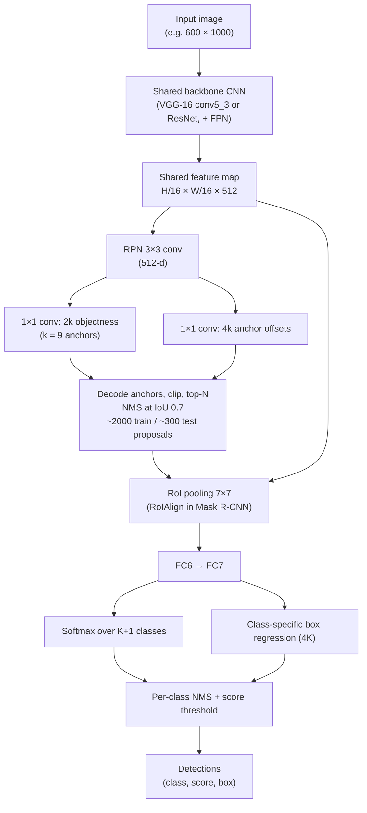
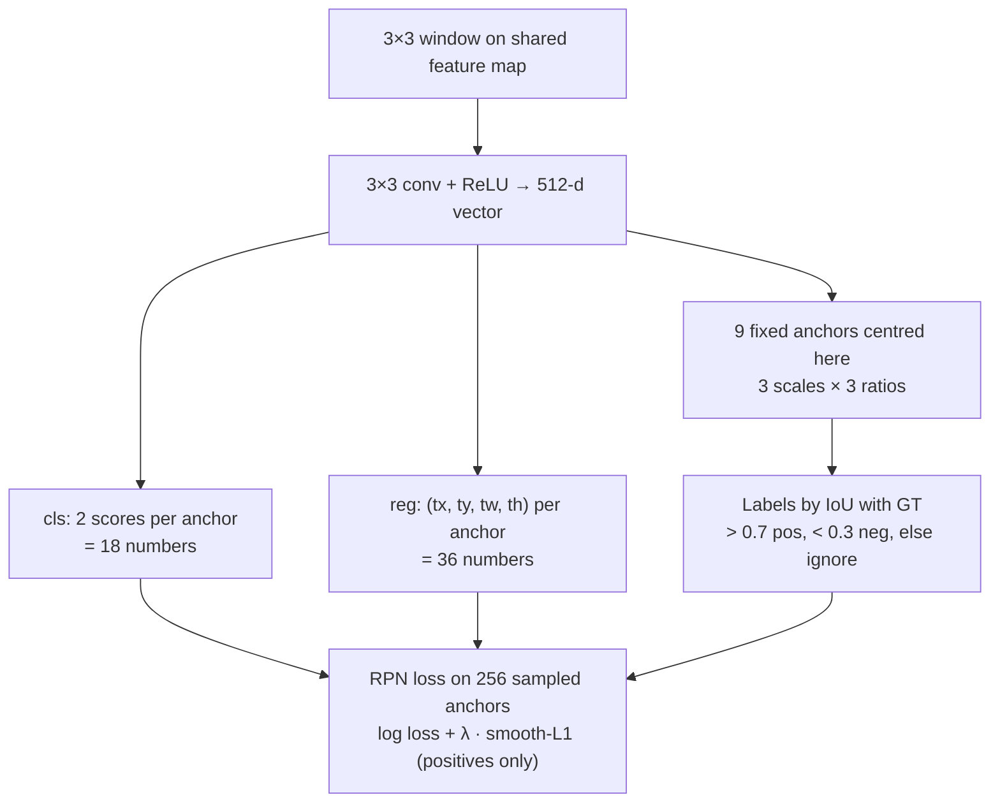
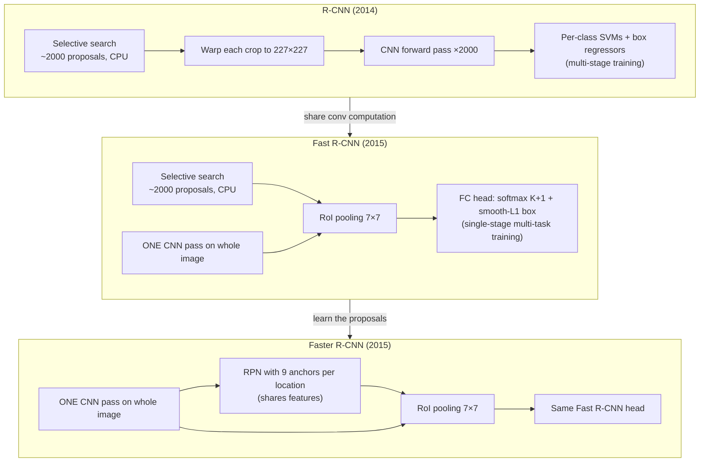
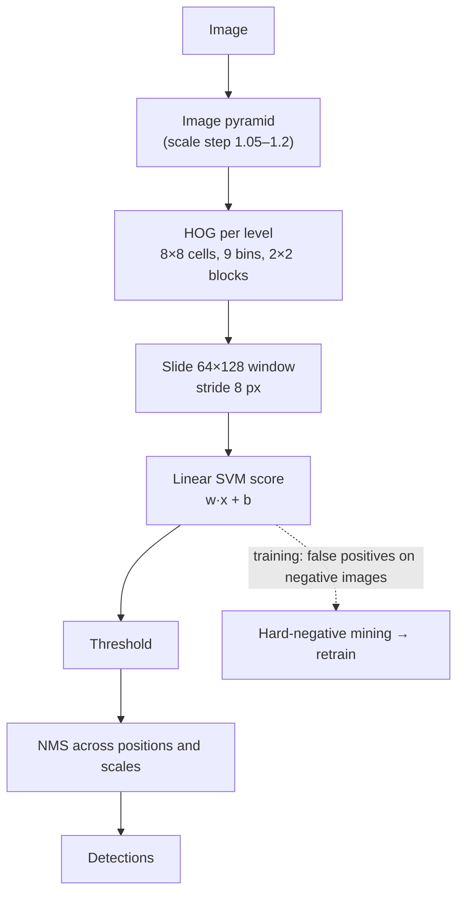

# Session 06 — Object Detection I: Classical & Two-Stage Detectors

> **Syllabus:**
> - Classification vs localisation vs detection
> - Sliding windows & HOG + classifier
> - Region proposals & R-CNN
> - Fast R-CNN & Faster R-CNN
> - Two-stage detector philosophy
>
> **Related:** [CNNs under the hood (receptive field, stride)](03_cnns_under_the_hood.md) · [Transfer learning (pre-trained backbones)](04_training_transfer_learning.md) · [One-stage detectors, IoU, NMS, AP/mAP](07_detection_one_stage.md) · [DETR / transformer detectors](08_detection_transformers.md) · [Segmentation, RoIAlign, Mask R-CNN](10_image_segmentation.md) · [Integral image (SURF)](01_image_processing_features.md) · [Comparison tables](../00_comparison_tables.md) · [Formula sheet](../00_formula_sheet.md) · [code: IoU / NMS / AP](../code/iou_nms_ap.py)
>
> **Practice:** [Questions](../practice/06_questions.md) · [Solutions](../practice/06_solutions.md)

---

## 1. Big picture

**Object detection** = find **every** instance of a set of classes in an image and return, for each one, a **class label, a bounding box and a confidence score**. Unlike classification, the number of outputs is **not fixed**, so a detector must (1) generate candidate locations, (2) score each candidate, (3) refine its box and (4) remove duplicates. Classical detectors did this with **sliding windows + hand-crafted features (HOG, Haar) + a linear classifier**; deep **two-stage** detectors (the **R-CNN family**) first **propose** a few thousand class-agnostic regions and then **classify and refine** each one with a CNN. The R-CNN → Fast R-CNN → Faster R-CNN story is the story of **sharing computation** and finally **learning the proposals** (RPN with **anchors**), and it sets up the vocabulary (IoU, anchors, box regression, NMS, mAP) used by one-stage detectors ([Session 07](07_detection_one_stage.md)), DETR ([Session 08](08_detection_transformers.md)) and Mask R-CNN ([Session 10](10_image_segmentation.md)).

---

## 2. Core concepts

### 2.1 Classification vs localisation vs detection

| Task | Question answered | Output | Typical loss |
|---|---|---|---|
| **Image classification** | *What* is in the image? | one class distribution per image ($K$ scores) | softmax cross-entropy |
| **Classification + localisation** | What, and *where* is **the** (single) object? | 1 class + **1 box** (4 numbers) — fixed-size output | CE + box regression (L2 / smooth-L1) |
| **Object detection** | Where are **all** objects of $K$ classes? | a **variable-size set** $\{(c_i, b_i, s_i)\}_{i=1}^{n}$, $n$ unknown | CE over $K{+}1$ classes (incl. **background**) + box regression, summed over matched candidates |
| **Segmentation** ([notes 10](10_image_segmentation.md)) | Which **pixels** belong to which class / instance? | per-pixel label map (semantic) or per-instance masks (instance / panoptic) | per-pixel CE, Dice |

**Why detection is fundamentally harder than localisation**

- **Variable number of objects** → a network with a fixed number of outputs cannot simply regress "the box". Solutions:
  1. **Dense candidates + classify each** (sliding windows, anchors, proposals) — most detectors in Sessions 06–07;
  2. **Set prediction** with a fixed budget of $N$ slots and a "no object" class — DETR ([Session 08](08_detection_transformers.md)).
- **Background class**: almost all candidate locations contain no object → detectors predict $K+1$ classes and face **extreme class imbalance** (handled by proposals / sampling here, by focal loss in [Session 07](07_detection_one_stage.md)).
- **Scale and aspect-ratio variation** (a person may be 20 px or 600 px tall) → image pyramids, multi-scale anchors, feature pyramids.
- **Duplicates**: neighbouring candidates fire on the same object → **non-maximum suppression (NMS)**.
- **Evaluation** needs a matching rule (IoU ≥ threshold) and ranked metrics (**AP / mAP**) — see [Session 07 §2.6](07_detection_one_stage.md).

**Localisation as regression.** For a single object, attach a second head to a CNN classifier that outputs $(x, y, w, h)$; train with classification loss + regression loss. OverFeat (2014) applied such a regressor densely at many positions/scales — a bridge from "localisation" to "detection".

**IoU (Intersection over Union)** is the overlap measure used everywhere below: $\text{IoU}(A,B)=\frac{|A\cap B|}{|A\cup B|}$. Full treatment and worked examples: [Session 07](07_detection_one_stage.md).

### 2.2 Sliding windows and HOG + classifier

#### The sliding-window paradigm

Turn detection into **many binary classification problems**: slide a fixed-size window (e.g. 64×128 for pedestrians) over the image with stride $s$, classify every window as object / background, then merge duplicates.

- **Scale**: the classifier sees a fixed window size, so the **image is rescaled** into an **image pyramid** (scale step typically 1.05–1.2; factor 2 in hand-worked examples) and the window is run on every level. A small window on a downscaled image = a large window on the original.
- **Aspect ratio**: one window shape per model; different shapes (e.g. side-view car vs. pedestrian) need separate models or several window shapes.
- **Cost**: #windows $=\sum_{\text{levels}} \text{positions} \times \text{shapes}$ — typically **$10^4$–$10^5$+ windows per image**, of which only a handful contain objects. Hence classifiers must be **cheap** (linear SVM, boosted cascades) and features must be **fast** (integral images, shared HOG cells).
- **Assumptions/limits**: rigid object with a roughly fixed aspect ratio, enough resolution, limited occlusion; one model per class/viewpoint; coarse box (box = window, no refinement unless a regressor is added).

#### HOG (Histogram of Oriented Gradients) — Dalal & Triggs (2005)

**Idea**: local object shape is well described by the **distribution of edge (gradient) directions**, pooled over small cells (tolerant to small shifts) and **contrast-normalised over larger blocks** (tolerant to illumination).

Standard pedestrian settings (know these numbers):

| Stage | Setting | Why |
|---|---|---|
| Gradient | centred $[-1,0,1]$ and $[-1,0,1]^\top$ filters, **no smoothing** | smoothing blurs fine edges; simplest filter worked best |
| Colour | per pixel, take the channel with the **largest gradient magnitude** | keeps strongest edge |
| Orientation | **unsigned**, 0–180° | a person's clothing/background contrast can flip polarity |
| Cell | **8×8 pixels**, **9 bins** of 20° | spatial pooling → small-shift invariance |
| Vote | weight = **gradient magnitude**, **bilinear** interpolation between the two nearest bin centres (and spatially between cells) | avoids aliasing at bin edges |
| Block | **2×2 cells** (16×16 px), **stride 1 cell** (8 px, 50 % overlap) | local contrast normalisation; each cell appears in up to 4 blocks with different normalisations |
| Normalisation | **L2-Hys**: L2-normalise → clip at **0.2** → L2-renormalise | illumination/contrast invariance; clipping limits dominance of a few strong edges |
| Window | **64×128** → 8×16 cells → **7×15 blocks** × 36 = **3780-d** | ≈16 px margin around the person helps |

#### Linear SVM, hard-negative mining, NMS (Dalal–Triggs pipeline)

- **Classifier**: **linear SVM** on the 3780-d HOG vector: score $f(\mathbf x)=\mathbf w^\top\mathbf x+b$. Linear ⇒ one dot product per window (and $\mathbf w$ can be visualised as a "HOG template").
- **Hard-negative mining** (bootstrapping): train on positives + random negatives → **scan person-free images exhaustively** → collect **false positives** ("hard negatives") → add them to the training set → **retrain**. *Why:* random negatives are mostly trivial (sky, road); the decision boundary is shaped by the hard ones, and there are far too many negatives to use them all.
- **NMS / merging**: one person triggers many overlapping windows at nearby positions and scales → keep local maxima of the score (greedy NMS in most implementations; Dalal–Triggs fused detections with a mean-shift mode search). Algorithm in [Session 07](07_detection_one_stage.md).
- **Limitations**: rigid template (poor with articulation, occlusion, viewpoint change); single aspect ratio; hand-crafted features plateau; many windows → still slow at fine scale steps.

#### Viola–Jones face detector (2001) — the fast classical detector

- **Haar-like features**: differences of sums over adjacent rectangles (2-, 3-, 4-rectangle). With an **integral image** $II(x,y)=\sum_{x'\le x,\,y'\le y} I(x',y')$ any rectangle sum costs **4 lookups** (2-rect feature 6, 3-rect 8, 4-rect 9 lookups) — constant time at any scale (same trick as SURF, [notes 01](01_image_processing_features.md)).
- **AdaBoost** selects a small number of discriminative features out of a huge pool (well over 100k in a 24×24 window); each **weak classifier** = one feature + threshold.
- **Attentional cascade**: a chain of increasingly complex boosted classifiers; a window is **rejected as soon as any stage says "no"**. Early stages use very few features and remove most background windows, so on average only a handful of features are evaluated per window (≈10 in the original paper). Overall rates multiply: $D=\prod_i d_i$, $F=\prod_i f_i$ (see §3).
- **Result**: real-time frontal-face detection on early-2000s CPUs. Limits: near-frontal, rigid objects; huge training-set mining effort.

#### DPM — Deformable Part Models (Felzenszwalb et al., 2008–2010), brief

- A **root filter** (coarse HOG template of the whole object) + several **part filters** at **twice the resolution** + **quadratic deformation costs** for part displacements (star model); **mixture components** for viewpoints/aspect ratios.
- Score = root score + $\sum_{\text{parts}}\max_{\text{placement}}$ (part score − deformation cost), computed efficiently with generalised distance transforms; trained with a **latent SVM** (part positions and component are latent) + hard-negative mining.
- The dominant pre-CNN detector on PASCAL VOC; R-CNN's big jump in mAP over DPM triggered the deep-detection era.

### 2.3 Region proposals and R-CNN

#### Region proposals: "where might *any* object be?"

**Region proposal** methods output a few hundred to a few thousand **class-agnostic** boxes with **high recall** — so an expensive classifier only needs to look at ~$10^3$ boxes instead of ~$10^5$+ sliding windows. They exploit the fact that objects have **closed boundaries** and are **visually coherent** regions.

- **Selective search** (Uijlings et al., 2013) — used by R-CNN and Fast R-CNN:
  1. Over-segment the image into **superpixels** (Felzenszwalb–Huttenlocher graph-based segmentation).
  2. **Hierarchically group** them bottom-up: repeatedly merge the **most similar pair of neighbouring regions**; similarity = weighted sum of **colour** (colour-histogram intersection), **texture** (gradient-orientation histograms), **size** (encourage small regions to merge first, so scales grow evenly), **fill** (how well two regions fit together inside their joint bounding box).
  3. Every region created at every level of the hierarchy contributes its **bounding box** → proposals at **all scales** naturally.
  4. **Diversify**: repeat with several colour spaces, starting thresholds and similarity combinations; merge and de-duplicate lists.
  - "Fast mode" ≈ **2000 proposals/image** with very high recall at IoU 0.5; but **CPU-bound, of the order of seconds per image** — becomes **the** bottleneck once the CNN part is fast (Fast R-CNN).
- **EdgeBoxes** (Zitnick & Dollár, 2014): score a box by the number of **edge contours wholly enclosed** by it minus those **straddling its boundary**; much faster (a fraction of a second per image), comparable recall.
- **Objectness** (Alexe et al.; BING): a generic score "how likely does this window contain *any* object" from cues such as multi-scale saliency, colour contrast, edge density and superpixel straddling; used to rank/prune windows.
- **RPN** (Faster R-CNN, §2.4): proposals **learned by a CNN** that shares features with the detector — replaced hand-crafted proposals.

#### R-CNN (Girshick et al., 2014): "Regions with CNN features"

**Inference** (per image):

1. **Selective search** → ~**2000** proposals.
2. **Warp** each proposal (with ~16 px of context padding) to a fixed **227×227** input — anisotropic scaling, ignores aspect ratio.
3. Run the **CNN** (AlexNet, ImageNet-pre-trained, fine-tuned for detection) **on each warped crop separately** → 4096-d **fc7 feature** per proposal.
4. Score each feature with **per-class linear SVMs** ($K$ binary SVMs).
5. **Class-specific bounding-box regression** (linear, on pool5 features) refines each box (parametrisation below).
6. **Per-class greedy NMS**.

**Training is multi-stage** (none of it end-to-end):

1. Supervised **pre-training** on ImageNet classification.
2. **Fine-tune** the CNN on warped proposals as a $(K{+}1)$-way classifier (proposal IoU ≥ 0.5 with a GT ⇒ that class, else background).
3. Train **per-class SVMs** on cached fc7 features: positives = GT boxes, negatives = proposals with IoU < 0.3, with **hard-negative mining**. (SVMs beat the fine-tuned softmax in R-CNN because fine-tuning used a looser positive definition to get more data.)
4. Train **box regressors** (ridge regression on pool5 features, proposals that overlap a GT strongly).

**Why it was slow:** ~**2000 CNN forward passes per image** with heavily overlapping computation → **tens of seconds per image** even on a GPU; features had to be cached on disk (hundreds of GB) for SVM training; three separately trained stages. **Why it mattered:** CNN features learned on ImageNet, transferred via fine-tuning ([notes 04](04_training_transfer_learning.md)), gave a large jump in mAP over HOG/DPM.

#### Bounding-box regression parametrisation (R-CNN family)

Predicting raw pixel coordinates is badly conditioned (scale-dependent). Instead regress **offsets relative to a reference box** — a proposal $P$ (R-CNN, Fast R-CNN) or an **anchor** $a$ (RPN) — in **centre–size form**:

- **Encoding** (target for GT box with centre $(x,y)$, size $(w,h)$; reference box centre $(x_a,y_a)$, size $(w_a,h_a)$):
  $t_x=\frac{x-x_a}{w_a},\ t_y=\frac{y-y_a}{h_a},\ t_w=\log\frac{w}{w_a},\ t_h=\log\frac{h}{h_a}$.
- **Decoding** (network outputs $\hat t$ → box): $\hat x = x_a+\hat t_x w_a,\ \hat y = y_a+\hat t_y h_a,\ \hat w = w_a e^{\hat t_w},\ \hat h = h_a e^{\hat t_h}$.
- **Why this form**: centre offsets normalised by the reference size → **scale-invariant**; log for sizes → **scale ratios become differences**, $w>0$ guaranteed after `exp`, symmetric for growing/shrinking.
- In practice targets are further normalised by fixed means/stds (e.g. std $(0.1,0.1,0.2,0.2)$) — an implementation detail.
- Regression is only trained on **foreground** candidates (it makes no sense to regress a background box), and it is **class-specific** in R-CNN/Fast/Faster R-CNN's second stage ($4K$ outputs) but class-agnostic in the RPN.

### 2.4 Fast R-CNN and Faster R-CNN

#### SPPnet (He et al., 2014) — the bridge

Compute the conv feature map **once per image**; for each proposal, pool its region of the feature map with **spatial pyramid pooling** into a fixed-length vector. Huge test speed-up over R-CNN, but training was still multi-stage and could not fine-tune the conv layers below the SPP layer.

#### Fast R-CNN (Girshick, 2015)

**Key ideas**: (1) **one CNN pass on the whole image**, shared by all proposals; (2) **RoI pooling** extracts a fixed-size feature for each proposal; (3) **single-stage training with a multi-task loss** (no SVMs, no disk cache).

- **Projection**: a proposal $(x_1,y_1,x_2,y_2)$ in image pixels maps to $(x_1,y_1,x_2,y_2)/S_f$ on a feature map with total stride $S_f$ (16 for VGG-16 conv5), quantised to integer cells.
- **RoI pooling**: divide the projected $h\times w$ RoI into an $H\times W$ grid (**7×7** for VGG-16) of sub-windows of size ≈ $h/H \times w/W$ and **max-pool** each → fixed $7\times7\times C$ tensor regardless of RoI size/aspect ratio → feeds the pre-trained FC layers. It is a single-level special case of SPP; gradients flow back through the argmax locations, so **conv layers are fine-tuned**.
- **Head**: FC6 → FC7 → two sibling outputs: **softmax over $K+1$** classes and **class-specific box regression** ($4K$ numbers).
- **Multi-task loss** per RoI: $L = L_{cls}(p,u) + \lambda\,[u\ge1]\,L_{loc}(t^u,v)$ with **cross-entropy** + **smooth-L1** (formulas §3). Smooth-L1 is **less sensitive to outliers** than L2 (gradient magnitude capped at 1), so no careful learning-rate tuning to avoid exploding gradients.
- **Mini-batch sampling**: 2 images × 64 RoIs = 128 RoIs, **25 % foreground** (IoU ≥ 0.5) and the rest background (IoU in [0.1, 0.5)) — a fixed **fg:bg ratio** controls class imbalance.
- **What is end-to-end?** Everything **except the proposals**: selective search is still an external, non-learned, CPU pre-processing step. Proposal coordinates are inputs, not learned outputs.
- **Speed**: roughly an order of magnitude faster training and two orders faster testing than R-CNN (excluding proposals), with higher mAP. Now **selective search (seconds/image) dominates** test time → motivates Faster R-CNN.

#### Faster R-CNN (Ren, He, Girshick, Sun, 2015) = RPN + Fast R-CNN

**Key idea**: replace selective search with a **Region Proposal Network (RPN)** that **shares the backbone's conv features** with the detection head, making proposals almost free (~10 ms) and **learned**.

**RPN design**

- A small fully-convolutional head slides over the shared feature map: **3×3 conv** (512 channels for VGG-16) + ReLU → two sibling **1×1 convs**:
  - **cls**: $2k$ objectness scores (object vs. not, softmax per anchor; equivalently $k$ sigmoid logits);
  - **reg**: $4k$ box offsets $(t_x,t_y,t_w,t_h)$, one set per anchor.
- **Anchors** = $k$ **fixed reference boxes** centred at every feature-map location: **3 scales** (box areas $128^2, 256^2, 512^2$ px) × **3 aspect ratios** (1:2, 1:1, 2:1) → **$k=9$**. For a feature map of $H_f\times W_f$ there are $H_f W_f k$ anchors (e.g. 40×60×9 = **21 600** ≈ "~20 000").
- **Anchors are NOT learned**: they are hand-designed **priors** (hyper-parameters). The network learns (i) whether each anchor contains an object and (ii) the **offsets** that move it onto the object.
- **Translation invariance**: the same 3×3 conv weights and anchor set are used at every location.
- **Multi-scale "pyramid of anchors"**: scales handled by anchor sizes on a **single-scale** feature map (no image pyramid, no filter pyramid) — cheap.
- **Receptive field**: the 3×3 window on conv5 corresponds to a large image region (≈200+ px for VGG-16), so the RPN can propose boxes larger than the window itself.

**RPN training-label assignment** (per image)

- **Positive**: anchor with **IoU > 0.7** with any GT box, **or** the anchor with the **highest IoU** for a given GT (guarantees every GT gets at least one positive, even small/odd-shaped ones).
- **Negative**: IoU **< 0.3** with **all** GT boxes.
- **Ignored**: everything else (0.3–0.7) and anchors crossing the image boundary (during training).
- **Sampling**: **256 anchors** per image, up to **1:1** positive:negative (if fewer than 128 positives, pad with negatives).
- **Loss**: $\frac{1}{N_{cls}}\sum_i L_{cls}(p_i,p_i^*) + \lambda\frac{1}{N_{reg}}\sum_i p_i^* L_{reg}(t_i,t_i^*)$ — regression only for positives ($p_i^*=1$), smooth-L1 (formula §3).

**Proposal generation** (inference): decode all anchors with predicted offsets → clip to image → remove tiny boxes → keep the top-scoring ones → **NMS at IoU 0.7** → keep the top **~2000 (training)** / **~300 (testing)** proposals → RoI pooling → Fast R-CNN head → per-class NMS. So **NMS is used twice**; Faster R-CNN does **not** remove NMS.

**Training**: the paper's **4-step alternating training** (train RPN → train Fast R-CNN on its proposals → re-init RPN from detector, freeze shared conv, fine-tune RPN layers → freeze shared conv, fine-tune detector layers) or **approximate joint training** (one network, sum of RPN + detector losses, gradients w.r.t. proposal coordinates ignored).

**Speed/accuracy**: about **5 fps with VGG-16** on a GPU (all steps), and better mAP than selective search + Fast R-CNN with only 300 proposals — learned proposals are fewer and better.

#### FPN — Feature Pyramid Network (Lin et al., 2017), brief

- A **top-down pathway with lateral connections** builds a pyramid $P_2$–$P_5$ (+$P_6$) where **every level has strong semantics** (256 channels), from a single-scale backbone.
- **Anchors**: one scale per level (areas $32^2$ to $512^2$ on $P_2$–$P_6$) × 3 ratios → 3 anchors/location.
- **RoI-to-level assignment**: $k=\lfloor k_0+\log_2(\sqrt{wh}/224)\rfloor$, $k_0=4$ → small RoIs pool from fine levels. Large gains on **small objects**; standard in modern two-stage (and one-stage) detectors.

#### RoIAlign and Mask R-CNN → [Session 10](10_image_segmentation.md)

RoI pooling **quantises twice** (RoI boundaries to integer cells, bin boundaries to integer cells) → misalignment of up to ~half a stride (8 px at stride 16). Harmless for classification, harmful for pixel-accurate masks. **RoIAlign** removes all rounding and **bilinearly samples** the feature map at regularly spaced points in each bin. **Mask R-CNN** = Faster R-CNN (+FPN) + RoIAlign + a small FCN **mask branch** per RoI.

### 2.5 Two-stage detector philosophy

**"Propose, then refine."**

1. **Stage 1 — proposals (class-agnostic, high recall, cheap)**: selective search / RPN reduces ~$10^4$–$10^5$ candidate boxes to ~$10^2$–$10^3$. This is where most of the **easy negatives** (sky, road, wall) are thrown away.
2. **Stage 2 — per-RoI classification + box refinement (class-specific, high precision)**: features are **re-pooled for each proposal** (RoI pooling/RoIAlign), so the head sees an aligned, fixed-size view of each candidate and applies a **second round of box regression** (anchor → proposal → final box).

**Why it is accurate**

- **Class imbalance is tamed**: the proposal stage removes most easy background; stage-2 mini-batches use a **fixed fg:bg ratio** (25 % fg in Fast R-CNN, ≤1:1 in RPN). Contrast: one-stage detectors must classify ~$10^5$ anchors directly and need **focal loss** ([Session 07](07_detection_one_stage.md)).
- **Feature alignment**: RoI-wise pooling gives each object its "own" feature tensor at the right scale.
- **Two-step regression**: coarse (anchor) then fine (proposal) localisation.
- **Extensible**: extra per-RoI heads (masks → Mask R-CNN, keypoints), cascades of heads with increasing IoU thresholds (Cascade R-CNN).

**The cost**

- **Speed/latency**: a per-RoI head runs hundreds of times per image; two sequential stages; more complex pipeline (anchors, two NMS steps, sampling hyper-parameters). Classic Faster R-CNN ≈ 5 fps (VGG-16) vs real-time one-stage detectors.
- **Hand-designed components**: anchor scales/ratios, IoU thresholds, NMS thresholds must be tuned per dataset.
- **Still NMS-dependent** (crowded scenes) — removed only by set-prediction detectors (DETR, [Session 08](08_detection_transformers.md)).

**When to choose a two-stage detector**: accuracy-critical, offline or server-side tasks, small or crowded objects, instance segmentation (Mask R-CNN), when latency is not the main constraint.

---

## 3. Key formulas

### 3.1 HOG gradient, orientation and bin voting

$$
I_x(x,y)=I(x{+}1,y)-I(x{-}1,y),\qquad I_y(x,y)=I(x,y{+}1)-I(x,y{-}1)
$$

$$
m=\sqrt{I_x^2+I_y^2},\qquad \theta=\operatorname{atan2}(I_y,I_x)\bmod 180^\circ
$$

- $I(x,y)$ = image intensity at column $x$, row $y$ ($y$ increases **downwards**); $m$ = gradient magnitude; $\theta$ = **unsigned** orientation in $[0^\circ,180^\circ)$.
- With 9 bins of width $20^\circ$ and bin centres $c_j=20j+10^\circ$ ($j=0,\dots,8$), a pixel with $c_j\le\theta<c_{j+1}$ votes $m\cdot\frac{c_{j+1}-\theta}{20}$ to bin $j$ and $m\cdot\frac{\theta-c_j}{20}$ to bin $j{+}1$ (bins wrap around: $170^\circ$ and $10^\circ$ are neighbours).

**Worked example.** Neighbours: left 50, right 80, up 120, down 60. $I_x=80-50=30$, $I_y=60-120=-60$; $m=\sqrt{900+3600}=67.08$; $\theta=\operatorname{atan2}(-60,30)=-63.43^\circ\to116.57^\circ$. Lies between centres $110^\circ$ and $130^\circ$: vote $67.08\times\frac{130-116.57}{20}=45.06$ to the $110^\circ$ bin and $67.08\times0.328=22.02$ to the $130^\circ$ bin.

### 3.2 Block normalisation (L2-Hys) and descriptor length

$$
\mathbf v\leftarrow\frac{\mathbf v}{\sqrt{\Vert\mathbf v\Vert_2^2+\epsilon^2}},\qquad v_i\leftarrow\min(v_i,0.2),\qquad \mathbf v\leftarrow\frac{\mathbf v}{\sqrt{\Vert\mathbf v\Vert_2^2+\epsilon^2}}
$$

- $\mathbf v$ = concatenated histograms of the $2\times2$ cells of one block (36 values); $\epsilon$ = small constant.
- Toy example: $\mathbf v=(3,4,0,0)\to(0.6,0.8,0,0)\to$ clip $(0.2,0.2,0,0)\to(0.707,0.707,0,0)$.

$$
N_{desc}=\left(n_x-b+1\right)\left(n_y-b+1\right)\cdot b^2\cdot n_{bins},\qquad n_x=\frac{W_{win}}{c},\ n_y=\frac{H_{win}}{c}
$$

- $W_{win},H_{win}$ = detection-window size (px); $c$ = cell size (8 px); $n_x,n_y$ = cells across/down; $b$ = block side in cells (2), block stride 1 cell; $n_{bins}=9$.
- **64×128**: $n_x=8,\ n_y=16$ → $7\times15=105$ blocks × $4\times9=36$ → $\mathbf{3780}$. **48×96**: $6\times12$ cells → $5\times11=55$ blocks × 36 = **1980**.

### 3.3 Sliding-window count

$$
N_{win}=\sum_{l}\left(\left\lfloor\frac{W_l-w}{s}\right\rfloor+1\right)\left(\left\lfloor\frac{H_l-h}{s}\right\rfloor+1\right)\times n_{shapes}
$$

- $W_l,H_l$ = image size at pyramid level $l$; $w,h$ = window size; $s$ = stride (px at that level); levels stop when $W_l<w$ or $H_l<h$; $n_{shapes}$ = number of window aspect ratios (assuming equal position counts).
- Example: 800×600, 64×128 window, $s=8$, pyramid factor 2: level 0 → $93\times60=5580$; 400×300 → $43\times22=946$; 200×150 → $18\times3=54$; 100×75 too small → **6580** windows (×3 shapes ≈ 19 740).

### 3.4 Cascade detection and false-positive rates

$$
D=\prod_{i=1}^{n} d_i,\qquad F=\prod_{i=1}^{n} f_i
$$

- $d_i$, $f_i$ = detection rate and false-positive rate of stage $i$; $D,F$ = overall rates; a window is accepted only if **all** $n$ stages accept it.
- Example: 10 stages, $d_i=0.99$, $f_i=0.3$ → $D=0.99^{10}=0.904$, $F=0.3^{10}=5.9\times10^{-6}$; on 6580 windows ⇒ ≈0.04 false positives per image.

### 3.5 Box regression (encode / decode)

$$
\begin{aligned}
t_x&=\frac{x-x_a}{w_a}, & t_y&=\frac{y-y_a}{h_a}, & t_w&=\log\frac{w}{w_a}, & t_h&=\log\frac{h}{h_a}\\
\hat x&=x_a+\hat t_x w_a, & \hat y&=y_a+\hat t_y h_a, & \hat w&=w_a e^{\hat t_w}, & \hat h&=h_a e^{\hat t_h}
\end{aligned}
$$

- $(x,y,w,h)$ = GT box centre and size; $(x_a,y_a,w_a,h_a)$ = reference box (anchor or proposal) centre and size; $t$ = regression target; $\hat t$ = network prediction; $(\hat x,\hat y,\hat w,\hat h)$ = decoded box; $\log$ = natural log.
- Corner ↔ centre: $x=\frac{x_1+x_2}{2},\ w=x_2-x_1$ (continuous coordinates, **no +1**).
- **Example (encode)**: anchor $(92,96,220,192)$ → centre $(156,144)$, size $128\times96$; GT $(100,100,220,180)$ → centre $(160,140)$, size $120\times80$. $t=(4/128,\,-4/96,\,\ln(120/128),\,\ln(80/96))=(0.031,\,-0.042,\,-0.065,\,-0.182)$.
- **Example (decode)**: same anchor, $\hat t=(0.05,-0.1,0.1,-0.2)$ → $\hat x=162.4$, $\hat y=134.4$, $\hat w=128e^{0.1}=141.46$, $\hat h=96e^{-0.2}=78.60$ → box $(91.67,\,95.10,\,233.13,\,173.70)$.

### 3.6 Smooth-L1 loss

$$
\operatorname{smooth}_{L_1}(z)=\begin{cases}0.5\,z^2 & \text{if } \lvert z\rvert<1\\ \lvert z\rvert-0.5 & \text{otherwise}\end{cases}
$$

- $z=\hat t_i-t_i$ = residual of one box coordinate. Quadratic near 0 (smooth gradient, precise convergence), linear for large errors (gradient bounded by 1 → robust to outliers). Continuous with continuous derivative at $\lvert z\rvert=1$.
- Example: residuals $(0.4,-0.2,1.5,-0.1)$ → $0.08+0.02+1.0+0.005=\mathbf{1.105}$ (L2 $0.5z^2$ would give 1.125 for the 1.5 term alone; for $z=3$: smooth-L1 2.5 vs L2 4.5).

### 3.7 Fast R-CNN multi-task loss

$$
L(p,u,t^u,v)=L_{cls}(p,u)+\lambda\,[u\ge1]\sum_{i\in\{x,y,w,h\}}\operatorname{smooth}_{L_1}\!\left(t^u_i-v_i\right),\qquad L_{cls}(p,u)=-\log p_u
$$

- $p=(p_0,\dots,p_K)$ = softmax over $K$ classes + background ($u=0$); $u$ = true class of the RoI; $t^u$ = predicted offsets for class $u$; $v$ = regression target; $[u\ge1]$ = Iverson bracket (1 for foreground, 0 for background → **no box loss for background RoIs**); $\lambda=1$.
- Example: foreground RoI with $p_u=0.8$ and residuals as in 3.6 → $0.223+1.105=\mathbf{1.328}$; background RoI with $p_0=0.9$ → $-\ln0.9=0.105$ only.

### 3.8 RPN loss

$$
L(\{p_i\},\{t_i\})=\frac{1}{N_{cls}}\sum_i L_{cls}(p_i,p_i^*)+\lambda\frac{1}{N_{reg}}\sum_i p_i^*\,L_{reg}(t_i,t_i^*)
$$

- $i$ = anchor index in the sampled mini-batch; $p_i$ = predicted objectness; $p_i^*\in\{0,1\}$ = anchor label; $t_i,t_i^*$ = predicted and target offsets (§3.5, w.r.t. the anchor); $L_{cls}$ = binary log loss; $L_{reg}$ = smooth-L1; $N_{cls}=256$ (mini-batch size), $N_{reg}\approx2400$ (number of anchor locations), $\lambda=10$ (balances the two terms).

### 3.9 Anchors: shapes, count and RPN head parameters

$$
w_a=\frac{s}{\sqrt r},\qquad h_a=s\sqrt r,\qquad N_{anchors}=H_f\,W_f\,k,\qquad H_f=\frac{H}{S_f},\ W_f=\frac{W}{S_f}
$$

- $s$ = anchor scale (side of the equal-area square: 128, 256, 512), $r=h/w$ aspect ratio (0.5, 1, 2) → area $w_ah_a=s^2$ preserved. Scale 128: $181\times91$, $128\times128$, $91\times181$.
- $H_f\times W_f$ = feature-map size, $S_f$ = backbone stride (16), $k$ = anchors per location (9). Image $640\times960$ → $40\times60\times9=\mathbf{21\,600}$ anchors. Anchor centre at feature cell (row $i$, column $j$): $\big(S_f(j+0.5),\,S_f(i+0.5)\big)$ (one common convention).
- RPN head params (VGG-16, $C=512$, with bias): 3×3 conv $(9\cdot512+1)\cdot512=2\,359\,808$; cls 1×1 $(512+1)\cdot18=9234$; reg 1×1 $(512+1)\cdot36=18\,468$; total **2 387 510** (the two output layers ≈ $2.8\times10^4$, i.e. $512\times(2+4)\times9$ without biases).

### 3.10 RoI projection and RoI-pool bins

$$
(x_1',y_1',x_2',y_2')=\operatorname{round}\!\left(\frac{(x_1,y_1,x_2,y_2)}{S_f}\right),\qquad \text{bin size}=\frac{w'}{W_p}\times\frac{h'}{H_p}
$$

- $S_f$ = feature stride; $w'=x_2'-x_1'$, $h'=y_2'-y_1'$ = RoI size in feature cells; $W_p\times H_p$ = output grid (7×7).
- Example: RoI $(64,80,400,304)$ at stride 16 → $(4,5,25,19)$ → $21\times14$ cells → each bin covers $3\times2$ cells. RoI $(50,70,370,290)$ → $(3.125,4.375,23.125,18.125)$ → rounded $(3,4,23,18)$: $20\times14$ cells → bin width $20/7=2.86$ (bins of 2 or 3 cells) — two quantisations ⇒ misalignment → **RoIAlign**.

### 3.11 FPN level assignment

$$
k=\left\lfloor k_0+\log_2\!\left(\frac{\sqrt{wh}}{224}\right)\right\rfloor,\qquad k_0=4,\ \ k\ \text{clipped to }[2,5]
$$

- $w,h$ = RoI size in input pixels; $k$ = pyramid level $P_k$ (stride $2^k$). Example: $112\times112$ → $k=3$; $224\times224$ → $P_4$; $448\times448$ → $P_5$.

---

## 4. Algorithms step by step

### 4.1 HOG descriptor computation (one 64×128 window)

1. (Optional) gamma/colour normalisation — small effect.
2. Compute $I_x$, $I_y$ with $[-1,0,1]$ filters (no smoothing); for colour, keep the channel with the largest magnitude per pixel.
3. Per pixel: magnitude $m$ and unsigned orientation $\theta\in[0^\circ,180^\circ)$.
4. Split the window into 8×8-pixel **cells** (8×16 cells).
5. Per cell: 9-bin orientation histogram; each pixel votes $m$, split bilinearly between the two nearest bin centres (and spatially between neighbouring cells).
6. Group cells into **2×2-cell blocks** with stride 1 cell (7×15 = 105 blocks).
7. Concatenate each block's 4 histograms (36-d) and apply **L2-Hys** (L2 → clip 0.2 → L2).
8. Concatenate all block vectors → **3780-d** descriptor.

### 4.2 Sliding-window detection with HOG + linear SVM

**Training**

1. Crop positives (64×128 people, + left-right flips) and sample random negative windows from person-free images.
2. Compute HOG; train a linear SVM.
3. **Hard-negative mining**: run the detector exhaustively (all positions and scales) over the negative images; collect all false positives.
4. Add the hard negatives to the training set; retrain the SVM (1–2 rounds).

**Detection**

1. Build an image pyramid (rescale by a factor, e.g. 1.05–1.2, until the image is smaller than the window).
2. At each level, compute HOG once for the whole image (cells/blocks are shared by overlapping windows).
3. Slide the window (stride = 1 cell = 8 px); score $f=\mathbf w^\top\mathbf x+b$.
4. Keep windows with $f>$ threshold; map their positions/sizes back to original-image coordinates.
5. Apply **NMS** (or mean-shift fusion) across positions and scales → final detections.

### 4.3 Greedy NMS (summary — full version and worked example in [Session 07](07_detection_one_stage.md))

1. Sort detections of one class by score.
2. Take the highest; output it; delete all remaining boxes with IoU > $\tau_{nms}$ with it.
3. Repeat until no boxes remain.

### 4.4 Viola–Jones cascade evaluation (per window)

1. Compute the integral image once per image (and squared integral image for variance normalisation).
2. For each window (all positions, scales by scaling the features — not the image):
3. Stage 1: evaluate its few Haar features (constant time each), sum weak-classifier votes; if below the stage threshold → **reject**, go to next window.
4. Otherwise continue to stage 2, 3, … ; a window that passes **all** stages is a detection.
5. Merge overlapping detections.

### 4.5 Selective search (high level)

1. Over-segment the image into initial regions (graph-based segmentation).
2. Compute similarities between all **neighbouring** region pairs (colour + texture + size + fill).
3. Merge the most similar pair into one region; remove its pair similarities; compute similarities of the new region to its neighbours.
4. Repeat until the whole image is one region; record the bounding box of **every** region ever formed.
5. Repeat with different colour spaces / parameters (diversification), merge lists, rank and de-duplicate → ~2000 proposals.

### 4.6 R-CNN inference

1. Run selective search → ~2000 proposals.
2. For each proposal: dilate by context padding, **warp** to 227×227, subtract mean.
3. Forward each crop through the CNN → 4096-d fc7 feature (≈2000 forward passes).
4. Score features with the $K$ class-specific linear SVMs → $2000\times K$ score matrix.
5. Apply class-specific box regression (from pool5 features) to refine each box.
6. For each class independently: greedy NMS; output boxes above a score threshold.

### 4.7 Fast R-CNN inference

1. Resize the image (e.g. shorter side 600 px) and run the backbone **once** → conv feature map (stride 16).
2. Get ~2000 selective-search proposals (external).
3. Project each proposal onto the feature map; **RoI-pool** to 7×7×512.
4. FC6 → FC7 (optionally compressed with truncated SVD for speed).
5. Softmax over $K+1$ classes + class-specific box deltas; decode each class's box.
6. Per-class NMS; threshold scores → detections.

### 4.8 Faster R-CNN inference

1. Resize image; backbone forward **once** → shared feature map $H_f\times W_f\times C$.
2. **RPN**: 3×3 conv → 1×1 cls ($2k$) and 1×1 reg ($4k$) at each of the $H_fW_f$ locations.
3. Generate the $H_fW_fk$ anchors; decode each with its predicted offsets → candidate boxes; clip to the image; remove tiny boxes.
4. Keep the top-$N$ by objectness (e.g. ~6000), apply **NMS at IoU 0.7**, keep top **~300** proposals.
5. **RoI pooling** (7×7) of each proposal on the **same** feature map.
6. Detection head: FC layers → softmax over $K+1$ classes + class-specific box regression (decoded relative to the **proposal**).
7. Per-class **NMS** (IoU ≈ 0.3–0.5) + score threshold → final (class, score, box) list.

### 4.9 RPN training-label assignment (per image)

1. Generate all anchors; discard anchors that cross the image boundary (training only).
2. Compute the IoU matrix between anchors and GT boxes.
3. For each anchor: if max IoU **< 0.3** → **negative** (label 0).
4. For each GT box: the anchor(s) with the **highest IoU** → **positive** (even if < 0.7).
5. For each anchor: if max IoU **> 0.7** → **positive** (label 1). (Positives override step 3.)
6. All others → **ignored** (label −1, no loss).
7. Regression target of each positive anchor = encoding (§3.5) of its **highest-IoU GT** w.r.t. the anchor.
8. Randomly sample **256** anchors: up to 128 positives, fill the rest with negatives; compute the RPN loss only on these.

### 4.10 Faster R-CNN 4-step alternating training

1. Train the RPN (backbone initialised from ImageNet).
2. Train a separate Fast R-CNN detector (also ImageNet-initialised) using step-1 proposals.
3. Initialise the RPN from the detector's backbone, **freeze shared conv layers**, fine-tune only RPN-specific layers.
4. Keeping shared conv layers frozen, fine-tune the detector-specific layers → the two networks now share one backbone.

(Alternative: **approximate joint training** — one network, losses summed, proposal coordinates treated as constants.)

---

## 5. Diagrams

### 5.1 Faster R-CNN architecture (required)

### 5.2 RPN head at one feature-map location

### 5.3 R-CNN → Fast R-CNN → Faster R-CNN progression

### 5.4 Classical sliding-window pipeline (HOG + SVM)

---

## 6. Comparison tables

### 6.1 Task outputs

| | Classification | Classification + localisation | Detection | Instance segmentation |
|---|---|---|---|---|
| # outputs | 1 label | 1 label + 1 box | variable set of (label, box, score) | variable set of (label, mask, score) |
| Background class needed? | no | no | **yes** ($K{+}1$) | yes |
| Duplicate removal | — | — | NMS (or set prediction) | NMS (or set prediction) |
| Metric | accuracy / top-5 | accuracy + IoU ≥ 0.5 | **AP / mAP** | mask AP |

### 6.2 R-CNN vs Fast R-CNN vs Faster R-CNN

| Aspect | R-CNN (2014) | Fast R-CNN (2015) | Faster R-CNN (2015) |
|---|---|---|---|
| Proposals | Selective search (~2000, CPU) | Selective search (~2000, CPU) | **RPN** (learned, ~300 at test, GPU, shares backbone) |
| CNN passes per image | **~2000** (one per warped crop) | **1** | **1** (shared by RPN + head) |
| Per-region features | warp crop → fc7 | **RoI pooling** 7×7 | RoI pooling 7×7 (RoIAlign later) |
| Classifier | per-class **linear SVMs** | softmax $K{+}1$ | softmax $K{+}1$ |
| Box refinement | separate linear regressors | joint smooth-L1 head | anchor → proposal (RPN) → final box (head) |
| Training | multi-stage, features cached on disk | single-stage multi-task (except proposals) | RPN + detector, alternating or approx. joint |
| End-to-end? | no | yes **except proposals** | (almost) fully, proposals learned |
| Bottleneck | 2000 CNN passes | selective search | per-RoI head / NMS / two stages |
| Speed (orders of magnitude) | tens of s / image | ~seconds (dominated by SS) | ~5 fps (VGG-16) |

### 6.3 Proposal / candidate-generation methods

| Method | Learned? | # boxes | Speed | Notes |
|---|---|---|---|---|
| Exhaustive sliding windows | no | $10^4$–$10^6$ | needs cheap classifier | fixed shapes, scale via pyramid |
| Selective search | no | ~2000 | seconds (CPU) | hierarchical grouping, very high recall |
| EdgeBoxes | no | ~$10^3$ | fraction of a second | edge contours enclosed vs straddling |
| Objectness / BING | partly (scored windows) | ~$10^3$ | fast | generic "is there an object" score |
| RPN | **yes** | ~300 (test) | ~10 ms (GPU, shared) | anchors + objectness + offsets |

### 6.4 Classical detectors

| | HOG + linear SVM (Dalal–Triggs) | Viola–Jones | DPM |
|---|---|---|---|
| Feature | HOG (3780-d for 64×128) | Haar-like rectangles via integral image | HOG (root + parts) |
| Classifier | linear SVM | boosted stumps in a cascade | latent SVM |
| Handles deformation | no (rigid template) | no | **yes** (parts + deformation cost) |
| Speed trick | shared HOG cells | cascade early rejection, 4-lookup rectangle sums | distance transforms, cascades |
| Typical use | pedestrians | faces (near-frontal) | general VOC classes |

### 6.5 RoI pooling vs RoIAlign (details in [notes 10](10_image_segmentation.md))

| | RoI pooling | RoIAlign |
|---|---|---|
| RoI boundary | rounded to feature-cell grid | kept continuous |
| Bin boundaries | rounded | continuous |
| Sampling | max over integer cells | bilinear interpolation at sample points, then max/avg |
| Misalignment | up to ~½ stride (8 px at stride 16) per edge | none (sub-pixel) |
| Used in | Fast / Faster R-CNN | Mask R-CNN and most modern two-stage detectors |

### 6.6 Two-stage vs one-stage (overview — full table in [Session 07](07_detection_one_stage.md))

| | Two-stage (Faster R-CNN) | One-stage (YOLO, SSD, RetinaNet) |
|---|---|---|
| Pipeline | propose → RoI-wise classify/refine | dense prediction in one pass |
| Class imbalance | proposals + fixed fg:bg sampling | hard-negative mining (SSD) / **focal loss** (RetinaNet) |
| Accuracy | historically higher, esp. small objects | close or equal in modern versions |
| Speed | slower | real-time |

---

## 7. Common exam traps & misconceptions

- ❌ "RoI pooling makes Fast R-CNN end-to-end, including the proposals." → ✅ Fast R-CNN is trained end-to-end **except proposals**: selective search is an external, non-learned CPU step. RoI pooling only makes the **feature extraction + classifier + regressor** trainable in one stage. Learned proposals arrive with **Faster R-CNN's RPN**.
- ❌ "Anchors are learned by the RPN." → ✅ Anchors are **fixed, hand-designed reference boxes** (scales/ratios are hyper-parameters). The RPN learns the **objectness** and the **offsets** $(t_x,t_y,t_w,t_h)$ relative to them.
- ❌ "Faster R-CNN removes NMS." → ✅ It uses NMS **twice**: on RPN proposals (IoU 0.7) and per class on final detections. NMS-free detection comes with set prediction (DETR, [Session 08](08_detection_transformers.md)).
- ❌ "R-CNN runs the CNN once per image." → ✅ Once **per proposal** (~2000 warped crops) — that is why it is so slow; Fast R-CNN shares one pass.
- ❌ "Fast R-CNN's speed-up comes from a faster proposal method." → ✅ Same selective search; the speed-up comes from **sharing the conv computation** and RoI pooling. Selective search then **becomes** the bottleneck.
- ❌ "R-CNN classifies with the fine-tuned softmax." → ✅ R-CNN uses **per-class linear SVMs** on fc7 features (softmax replaced them in Fast R-CNN).
- ❌ "An anchor with IoU 0.5 with a GT is always ignored." → ✅ If it is the **highest-IoU anchor for some GT**, it is **positive** (rule ensures every GT has a positive).
- ❌ "Negatives are anchors with IoU < 0.3 with *some* GT." → ✅ IoU < 0.3 with **all** GT boxes.
- ❌ "The box regressor predicts absolute coordinates." → ✅ It predicts **normalised offsets** $(t_x,t_y)$ and **log-scale** ratios $(t_w,t_h)$ relative to the anchor/proposal.
- ❌ "$t_w = (w-w_a)/w_a$." → ✅ $t_w=\log(w/w_a)$; decoding uses $w_a e^{t_w}$.
- ❌ "Box-regression loss is applied to all RoIs." → ✅ Only to **foreground** RoIs/anchors ($[u\ge1]$, $p_i^*$).
- ❌ "Smooth-L1 is used because it is differentiable everywhere while L1 isn't, nothing else." → ✅ Main reason: **robust to outliers** (linear for $\lvert z\rvert\ge1$, bounded gradient) while quadratic near 0.
- ❌ "HOG uses 18 signed bins over 0–360° for pedestrians." → ✅ **9 unsigned bins over 0–180°** worked best for people.
- ❌ "HOG blocks don't overlap, so the 64×128 descriptor is 4×8 blocks × 36 = 1152-d." → ✅ Blocks overlap (stride 1 cell) → 7×15 blocks → **3780-d**.
- ❌ "Hard-negative mining means mining hard positives." → ✅ It means mining **false positives on object-free images** and retraining.
- ❌ "The image pyramid is unnecessary because the SVM is scale-invariant." → ✅ The template has a fixed size; scale is handled only by rescaling the image (or the features).
- ❌ "Selective search is a learned CNN component." → ✅ It is a **hand-crafted, unsupervised hierarchical grouping** algorithm.
- ❌ "RoI pooling output size depends on the proposal size." → ✅ Output is **fixed** (7×7×C); only bin size varies.
- ❌ "k = 9 means the RPN outputs 9 numbers per location." → ✅ $2k=18$ objectness + $4k=36$ offsets = **54** outputs per location.
- ❌ "Two-stage detectors don't suffer class imbalance." → ✅ They do, but the **proposal stage + fixed fg:bg sampling** mitigate it.

---

## 8. 10-line cheat summary

1. Detection = variable-size set of (class, box, score); needs candidates + classification ($K{+}1$ incl. background) + box regression + NMS + AP evaluation.
2. Sliding windows: image pyramid × positions × shapes → $10^4$–$10^5$+ windows/image; requires cheap features and classifiers.
3. HOG: $[-1,0,1]$ gradients, 8×8 cells, 9 unsigned bins (0–180°), 2×2-cell blocks stride 1 cell, L2-Hys → 64×128 window = 7×15×36 = **3780-d**; + linear SVM + hard-negative mining + NMS.
4. Viola–Jones: Haar features via integral image (4 lookups per rectangle), AdaBoost, cascade ($D=\prod d_i$, $F=\prod f_i$); DPM: HOG root + parts + deformation, latent SVM.
5. Selective search: hierarchical grouping of superpixels by colour/texture/size/fill → ~2000 class-agnostic, high-recall proposals (seconds/image).
6. R-CNN: ~2000 warped 227×227 crops × CNN each → per-class SVMs + box regression; multi-stage; tens of seconds per image.
7. Fast R-CNN: one CNN pass + **RoI pooling 7×7** + softmax $K{+}1$ + smooth-L1 multi-task loss; end-to-end except proposals; selective search becomes the bottleneck.
8. Faster R-CNN: **RPN** shares backbone; 3×3 conv → $2k$ cls + $4k$ reg; $k=9$ fixed anchors (3 scales × 3 ratios); labels IoU > 0.7 pos / < 0.3 neg (+ best anchor per GT); 256 sampled ~1:1; NMS 0.7 → ~2000 train / ~300 test proposals; ~5 fps VGG-16.
9. Box regression: $t_x=(x-x_a)/w_a$, $t_y=(y-y_a)/h_a$, $t_w=\log(w/w_a)$, $t_h=\log(h/h_a)$; decode with $w_ae^{t_w}$; smooth-L1 = $0.5z^2$ if $\lvert z\rvert<1$ else $\lvert z\rvert-0.5$.
10. Two-stage philosophy: propose (filters easy negatives, high recall) then refine per RoI (high precision, aligned features) → accurate but slower; FPN for scale, RoIAlign/Mask R-CNN ([notes 10](10_image_segmentation.md)) for pixels.
