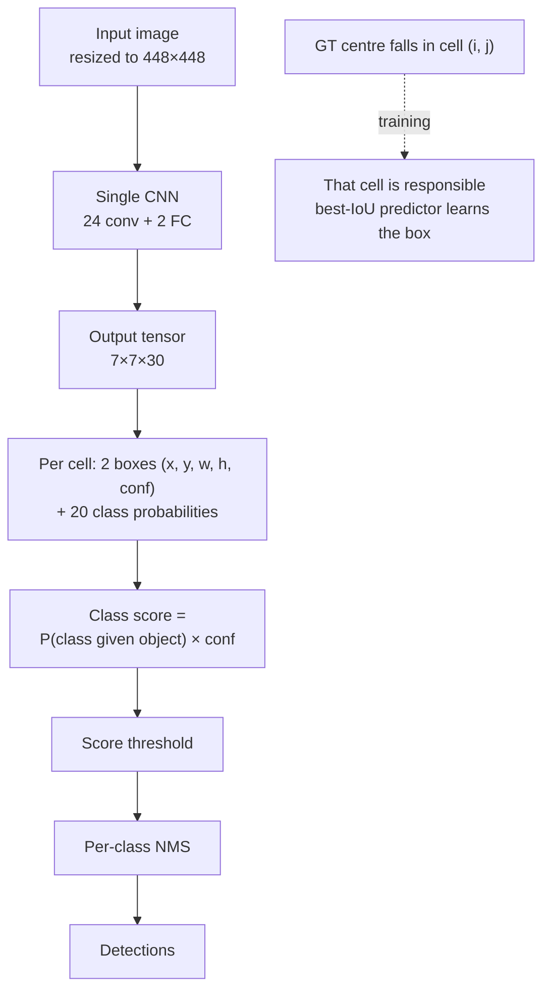
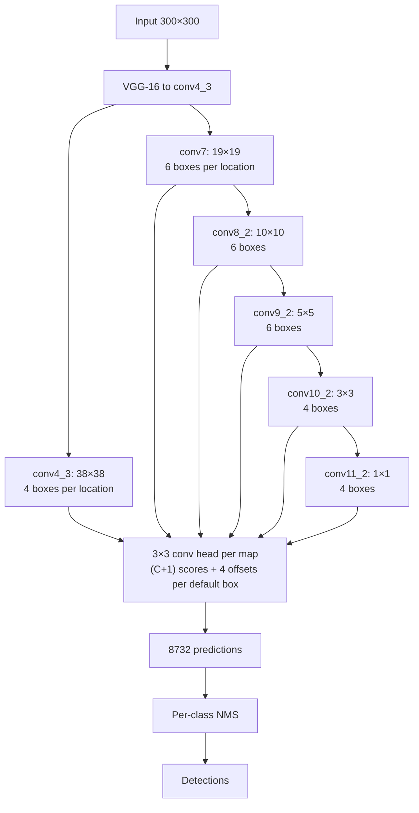
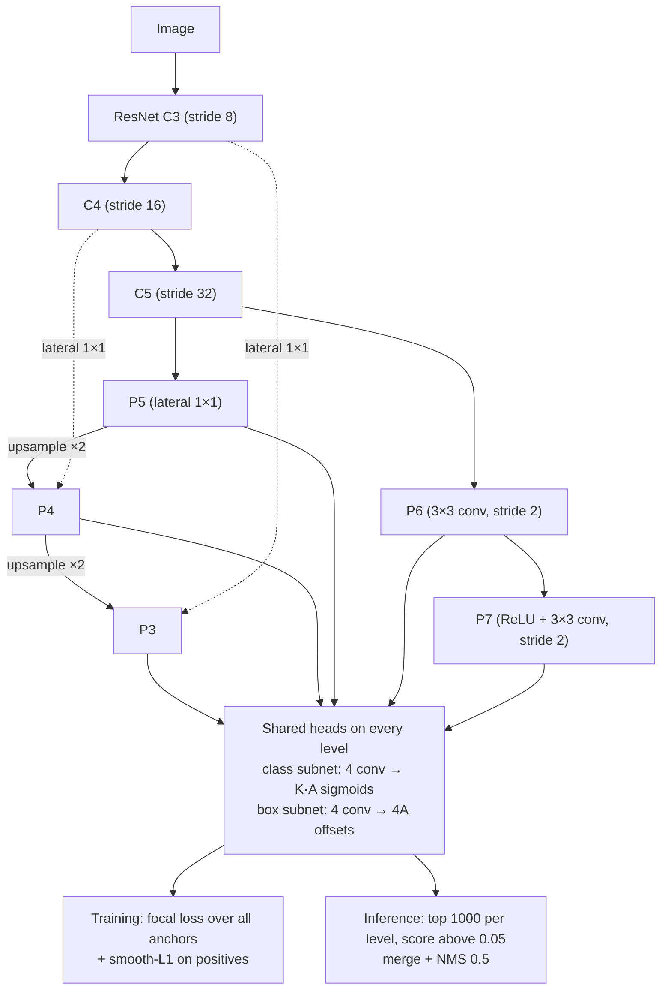
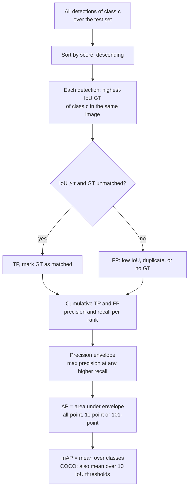
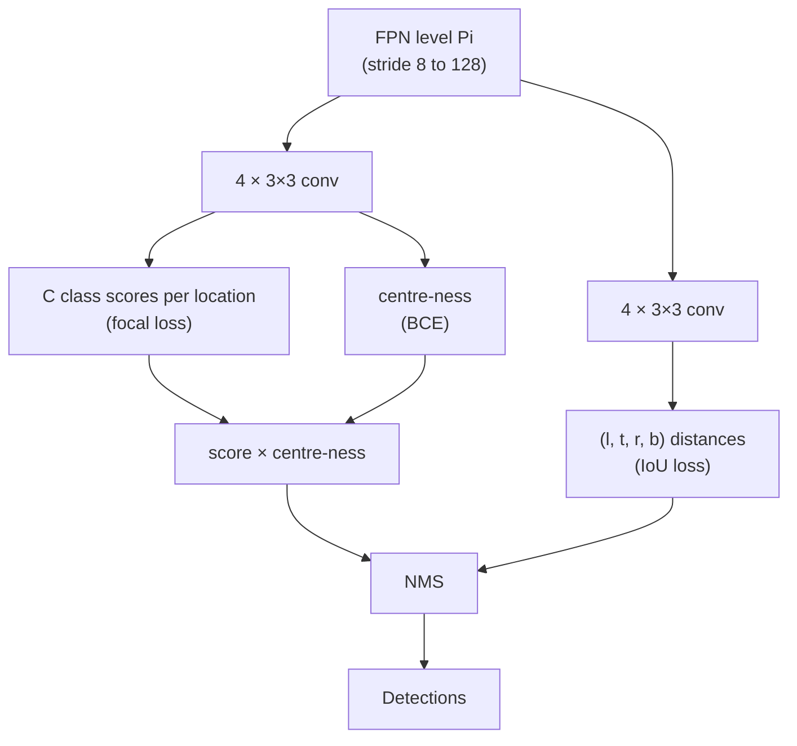

# Session 07 — Object Detection II: One-Stage Detectors, NMS & Evaluation

> **Syllabus:**
> - YOLO
> - SSD
> - Anchor boxes & anchor-free detection
> - NMS & IoU
> - Precision / Recall & AP / mAP
>
> **Related:** [Two-stage detectors, anchors, box regression](06_detection_two_stage.md) · [DETR & set prediction (no NMS)](08_detection_transformers.md) · [Segmentation metrics IoU / Dice](10_image_segmentation.md) · [CNN stride & receptive field](03_cnns_under_the_hood.md) · [Revision](09_revision_practicals.md) · [Comparison tables](../00_comparison_tables.md) · [Formula sheet](../00_formula_sheet.md) · [Numericals drill](../practice/numericals_drill.md) · [code: IoU / NMS / AP](../code/iou_nms_ap.py)
>
> **Practice:** [Questions](../practice/07_questions.md) · [Solutions](../practice/07_solutions.md)

---

## 1. Big picture

**One-stage (single-shot) detectors** skip the proposal stage of the R-CNN family ([Session 06](06_detection_two_stage.md)): a single fully-convolutional pass predicts class scores and box offsets **densely** at every location of one or more feature maps, which makes them fast enough for real time. YOLO (grid cells), SSD (multi-scale default boxes) and RetinaNet (FPN + **focal loss**) are the classic **anchor-based** designs; FCOS and CenterNet show that the hand-designed anchors can be dropped (**anchor-free**). Because every location is a candidate, one-stage detectors face an **extreme foreground–background imbalance** and produce many duplicates, so **focal loss / hard-negative mining** and **NMS** are central. Finally, all detectors are compared with the same ruler: **IoU**-based matching, **precision–recall** curves and **AP / mAP** (VOC mAP@0.5, COCO mAP@[.5:.95]).

---

## 2. Core concepts

### 2.1 YOLO

#### YOLOv1 (Redmon et al., 2016): detection as one regression problem

- **One network evaluation** on the whole image (resized to **448×448**) directly outputs all boxes and class probabilities → real time (≈45 fps in the paper; a smaller "Fast YOLO" was much faster still).
- **Grid**: the image is divided into an **$S\times S$** grid ($S=7$). A GT object is assigned to the **cell that contains its centre** ("**responsible cell**").
- **Each cell predicts**:
  - **$B$ boxes** ($B=2$), each with 5 numbers $(x,y,w,h,\text{conf})$:
    - $(x,y)$ = box centre as an **offset within the cell** (0–1),
    - $(w,h)$ = width/height **relative to the whole image** (0–1),
    - **confidence** $=\Pr(\text{Object})\times\text{IoU}^{\text{truth}}_{\text{pred}}$ — 0 if no object, otherwise the IoU of the predicted box with the GT;
  - **$C$ conditional class probabilities** $\Pr(\text{Class}_i\mid\text{Object})$ — **one set per cell**, shared by its $B$ boxes.
- **Output tensor**: $S\times S\times(5B+C)$ = **7×7×30** for PASCAL VOC ($C=20$) → **98 boxes** per image.
- **Responsible predictor**: inside the responsible cell, the one of the $B$ predictors whose current box has the **highest IoU** with the GT is responsible → predictors **specialise** in sizes/aspect ratios.
- **Test-time score**: class-specific confidence $=\Pr(\text{Class}_i\mid\text{Obj})\cdot\Pr(\text{Obj})\cdot\text{IoU}=\Pr(\text{Class}_i)\cdot\text{IoU}$ → threshold → per-class **NMS**.
- **Architecture**: GoogLeNet-inspired, 24 conv layers (with 1×1 reduction layers) + 2 FC layers; leaky ReLU; pre-trained on ImageNet.
- **Loss**: **sum-squared error** over all outputs with two weights (formula §3.3):
  - $\lambda_{coord}=5$ — up-weights box-coordinate errors (otherwise swamped by the many confidence terms);
  - $\lambda_{noobj}=0.5$ — down-weights confidence loss of the many boxes **without** objects (most cells are empty → their gradients would overpower the few object cells — an early form of the imbalance problem);
  - **$\sqrt w,\sqrt h$** instead of $w,h$ → the same absolute error costs more on a **small** box than on a large one;
  - class loss only for cells that contain an object; coordinate loss only for responsible predictors.
- **Strengths**: very fast; **global context** (sees the whole image) → fewer background false positives than Fast R-CNN; generalises better to new domains (e.g. artwork).
- **Limitations**:
  1. **Few objects per cell**: at most $B=2$ boxes and **one class per cell** → fails on **small objects in groups** (flocks of birds, crowds) and on nearby objects whose centres fall in the same cell;
  2. **Small objects**: coarse 7×7 output, features heavily down-sampled;
  3. **Unusual aspect ratios**: boxes are learned from data without priors;
  4. **Localisation errors** dominate (sum-squared error treats errors in large and small boxes too similarly, even with $\sqrt\cdot$); lower recall than proposal-based detectors.

#### Later YOLO versions (high-level, conservative)

| Version | Main ideas |
|---|---|
| **YOLOv2 / YOLO9000** (2017) | batch norm; higher-resolution pre-training; **anchor boxes** whose shapes are chosen by **k-means on training boxes with distance $d=1-\text{IoU}$** (5 clusters); **direct location prediction** — centre offset squashed by a sigmoid so it stays inside its cell; passthrough layer for finer features; multi-scale training; 13×13 output at 416×416 |
| **YOLOv3** (2018) | Darknet-53 (residual) backbone; predictions at **3 scales** (strides 32, 16, 8 — FPN-like); **3 anchors per scale** (9 k-means clusters); independent **logistic** (sigmoid) class outputs → multi-label; objectness per box; 416 input → $3(13^2+26^2+52^2)=10\,647$ boxes |
| **YOLOv4 / v5 era** (2020) | stronger backbones/necks (CSP, SPP, PAN), heavy augmentation (e.g. Mosaic), many training "tricks" |
| **YOLOX** (2021), **YOLOv8** (2023) | **anchor-free**, **decoupled heads** (separate classification and regression branches), dynamic label assignment (e.g. SimOTA in YOLOX) |
| Some recent versions (e.g. YOLOv10, 2024) | train with one-to-one assignment so that **NMS is not needed at inference** |

Exam take-away: YOLO went from **grid cells without priors** → **anchors from k-means** → **multi-scale anchors** → **anchor-free, decoupled heads**, always optimising the speed–accuracy trade-off.

### 2.2 SSD

**SSD — Single Shot MultiBox Detector** (Liu et al., 2016): one-stage, **multi-scale** detection with **default boxes** (= anchors).

- **Backbone**: VGG-16 (fc6/fc7 converted to conv layers) + **extra conv layers** that progressively halve the resolution.
- **Predict from 6 feature maps** (SSD300): conv4_3 **38×38**, conv7 **19×19**, conv8_2 **10×10**, conv9_2 **5×5**, conv10_2 **3×3**, conv11_2 **1×1**, with **4, 6, 6, 6, 4, 4** default boxes per location:
  $38^2\cdot4+19^2\cdot6+10^2\cdot6+5^2\cdot6+3^2\cdot4+1^2\cdot4=5776+2166+600+150+36+4=\mathbf{8732}$ boxes.
- **Why multi-scale maps**: early high-resolution maps (small receptive field) detect **small** objects; deep low-resolution maps detect **large** objects — scale handled by **where** you predict, not by an image pyramid.
- **Heads**: a **3×3 conv** on each map outputs, per location and default box, **$C+1$ class scores** (incl. background) + **4 offsets** → $(C+1+4)k$ channels (e.g. VOC, $k=4$: $25\times4=100$ channels).
- **Default boxes**: per map $k$ a scale $s_k$ (linearly from 0.2 to 0.9 of the image) and aspect ratios $\{1,2,3,\tfrac12,\tfrac13\}$, plus an extra square box of scale $\sqrt{s_ks_{k+1}}$ (6 boxes); 4-box maps drop ratios 3 and ⅓ (formula §3.5). (The released SSD300 uses a smaller scale, 0.1, on conv4_3.)
- **Matching** (training): each GT → default box with the **best IoU** (so every GT has a match), plus **every default box with IoU > 0.5** → positive. Unlike YOLOv1, **several** default boxes can be positive for one GT.
- **Loss**: $\frac1N(L_{conf}+\alpha L_{loc})$ — softmax CE over $C+1$ classes + smooth-L1 on centre–size offsets (same encoding as Faster R-CNN), $N$ = number of matched boxes, $\alpha=1$.
- **Hard-negative mining**: almost all of the 8732 boxes are negative → sort negatives by confidence loss and keep only the **hardest**, so that **negatives : positives ≤ 3 : 1**. Faster, more stable training.
- **Data augmentation** (random crops with IoU constraints, "zoom-out" expansion, photometric distortions) is crucial — especially for small objects.
- **Strengths**: real time with accuracy comparable to Faster R-CNN at the time; simple single network. **Weakness**: **small objects** — conv4_3 is shallow and semantically weak (FPN-style top-down features fix this).

### 2.3 Anchor boxes and anchor-free detection

#### Anchor boxes (anchor-based detectors)

- **What**: a fixed set of reference boxes (several **scales × aspect ratios**) tiled at **every feature-map location** (and pyramid level). Each anchor is a candidate: the head predicts its **class scores** and **offsets** $(t_x,t_y,t_w,t_h)$ relative to it ([§3.5 of notes 06](06_detection_two_stage.md)).
- **Why**:
  - regression starts from a **nearby prior** → small, well-conditioned offsets;
  - multiple anchors per location → **several objects of different shapes** can be detected at one location (fixes YOLOv1's "one cell, few boxes" problem);
  - turns detection into **classification of a fixed candidate set** → simple dense training.
- **How assigned** (training labels): IoU between every anchor and every GT:
  - Faster R-CNN RPN: > 0.7 positive, < 0.3 negative, else ignored (+ best anchor per GT);
  - **RetinaNet: IoU ≥ 0.5 positive, < 0.4 negative**, in between ignored;
  - SSD: best match + IoU > 0.5.
- **Hyper-parameters**: number of anchors per location, scales, aspect ratios, pyramid levels, positive/negative IoU thresholds, sampling ratios. Must be tuned to the dataset (or chosen by **k-means** on GT boxes, YOLOv2/v3).
- **Downsides**:
  - **huge number of anchors** (e.g. RetinaNet 640×640 input: $(80^2+40^2+20^2+10^2+5^2)\times9=76\,725$ anchors) — **almost all negative** → **extreme class imbalance**;
  - extra computation (IoU matrices, decoding);
  - hand design, dataset-specific; poor fit for unusual shapes; heuristic, sometimes ambiguous matching.

#### Anchor-free detection

Predict boxes from **points** (locations or keypoints) instead of reference boxes.

**FCOS — Fully Convolutional One-Stage detector** (Tian et al., 2019): per-pixel prediction, like segmentation.
- At each location $(x,y)$ (mapped back to the image) of FPN levels $P_3$–$P_7$ (strides 8–128): $C$ binary class scores, **4 distances $(l,t,r,b)$** from the point to the box's left, top, right, bottom sides, and a **centre-ness** score.
- **Positive** if the location falls **inside a GT box** (later versions: only inside a central sub-region — "centre sampling"); if inside several boxes, take the **smallest-area** box.
- **FPN level assignment** by regression range: level $P_i$ is responsible if $m_{i-1}<\max(l,t,r,b)\le m_i$ with $m=0,64,128,256,512,\infty$ for $P_3$…$P_7$ → overlapping objects of different sizes go to different levels (resolves most ambiguity).
- **Centre-ness** $=\sqrt{\frac{\min(l,r)}{\max(l,r)}\cdot\frac{\min(t,b)}{\max(t,b)}}\in[0,1]$: 1 at the box centre, → 0 at the edges. Trained with BCE; at test time **multiplied into the class score** so low-quality boxes predicted from locations far from the centre rank low — **then NMS is still applied**.
- Losses: **focal loss** (classification) + **IoU/GIoU loss** (regression) + BCE (centre-ness).
- Benefits: no anchor hyper-parameters or anchor IoU matching, 1 prediction per location instead of 9, competitive or better accuracy than RetinaNet.

**CenterNet — "Objects as Points"** (Zhou et al., 2019):
- Each object = its **centre point**. Output (stride $R=4$): a **per-class heatmap** (peaks at centres, GT splatted with a Gaussian whose radius depends on object size), a 2-channel **offset** (recovers the sub-pixel discretisation error) and a 2-channel **size** $(w,h)$.
- Training: penalty-reduced pixel-wise **focal loss** on the heatmap + L1 on offset and size.
- **Inference without NMS**: peaks = heatmap values that equal their **3×3 max-pooled** value (local maxima among 8 neighbours); keep the top 100; box = centre + offset ± size/2. A max-pool is far cheaper than IoU-based NMS.
- Extends naturally to 3D boxes, human pose (keypoints).

**CornerNet** (Law & Deng, 2018), brief: predict heatmaps for **top-left** and **bottom-right corners**, plus an **embedding** per corner (corners of the same object have similar embeddings — associative embedding) and offsets; **corner pooling** helps locate corners that lie outside the object.

**Key insight (ATSS, 2020)**: the main difference between anchor-based (RetinaNet) and anchor-free (FCOS) detectors is **how positives and negatives are defined**, not the box parametrisation — label assignment matters most.

### 2.4 Focal loss and RetinaNet

**The problem**: a one-stage detector scores ~$10^4$–$10^5$ candidates per image but only a handful are objects. Each **easy negative** (clear background, $p_t\approx1$) has a small CE loss, but **there are so many** that their sum **dominates** the total loss and gradient → training is inefficient and the model is pushed towards predicting "background" everywhere.

**Ways to handle the imbalance**

| Approach | Used in | Idea |
|---|---|---|
| Proposal stage + fixed fg:bg sampling | Faster R-CNN | remove easy negatives first; 1:1 (RPN) / 1:3 (head) sampling |
| Down-weight no-object loss | YOLOv1 ($\lambda_{noobj}=0.5$) | crude constant re-weighting |
| **Hard-negative mining** | SSD (3:1), OHEM | keep only the highest-loss negatives, discard the rest |
| **Focal loss** | RetinaNet, FCOS, many modern detectors | keep **all** samples, but **down-weight easy ones automatically** |

**Focal loss** (Lin et al., 2017): $FL(p_t)=-\alpha_t(1-p_t)^\gamma\log p_t$ with $\gamma=2$, $\alpha=0.25$ (formula §3.7).
- **Modulating factor** $(1-p_t)^\gamma$: → 0 for well-classified examples ($p_t\to1$), ≈1 for misclassified ones ($p_t$ small). With $\gamma=2$: $p_t=0.9$ → loss **100× smaller** than CE; $p_t=0.5$ → **4×** smaller; $p_t\approx0.968$ → ~1000× smaller.
- $\gamma=0$ ⇒ ordinary ($\alpha$-balanced) cross-entropy.
- $\alpha_t=\alpha=0.25$ for foreground, $1-\alpha=0.75$ for background — counter-intuitively *down*-weighting the rare class, because $\gamma$ already removes most of the easy negatives' weight; $\alpha$ is a mild correction tuned jointly with $\gamma$.
- **Normalised by the number of positive anchors** (not all anchors — most contribute ≈0).
- **Prior initialisation**: final classification bias $b=-\log\frac{1-\pi}{\pi}$ with $\pi=0.01$ (≈ −4.6), so every anchor starts with foreground probability ≈0.01 — prevents the huge number of background anchors from destabilising early training.

**RetinaNet** = ResNet + **FPN** ($P_3$–$P_7$, 256 channels) + two small **shared** subnets applied at every level: a **class subnet** (4 × 3×3 conv → $KA$ sigmoid outputs) and a **box subnet** (4 × 3×3 conv → $4A$ offsets), $A=9$ anchors per location (3 scales $2^0,2^{1/3},2^{2/3}$ × 3 ratios), anchors of area $32^2$ to $512^2$ on $P_3$–$P_7$. Inference: top-1000 boxes per level with score > 0.05, merge, **NMS at 0.5**. Showed that a one-stage detector trained with focal loss can match or beat two-stage detectors' accuracy while staying simpler.

### 2.5 IoU and NMS

#### IoU (Jaccard index)

$\text{IoU}(A,B)=\frac{|A\cap B|}{|A\cup B|}\in[0,1]$ (formula and examples §3.1).
- **Scale-invariant** (depends on relative overlap only).
- Uses: (1) **training label assignment** (anchor ↔ GT), (2) **evaluation** (TP if IoU ≥ threshold), (3) **NMS**, (4) **IoU-based losses**.
- Weakness as a loss: **IoU = 0 for all non-overlapping pairs**, no matter how far apart → zero gradient.
- **GIoU** $=\text{IoU}-\frac{|C\setminus(A\cup B)|}{|C|}\in(-1,1]$, $C$ = smallest enclosing box: negative when boxes are apart, still informative without overlap; loss $\mathcal L_{GIoU}=1-\text{GIoU}\in[0,2)$. (DIoU/CIoU add centre-distance and aspect-ratio terms.) GIoU is used in DETR's matching cost ([Session 08](08_detection_transformers.md)).
- Same quantity as the segmentation IoU / Jaccard ([notes 10](10_image_segmentation.md)); Dice $=\frac{2\,\text{IoU}}{1+\text{IoU}}\ge\text{IoU}$.

#### Non-maximum suppression (NMS)

**Why**: dense detectors fire many overlapping boxes on the same object (neighbouring anchors/cells/levels). NMS keeps one box per object.

**Greedy NMS** (per class): sort by score → keep the top box → remove remaining boxes with **IoU > $\tau_{nms}$** with it → repeat (algorithm §4.4). Typical $\tau_{nms}\approx0.5$ for final detections (0.7 on RPN proposals).

- **Effect of the threshold**: a **higher** $\tau_{nms}$ suppresses **fewer** boxes (only very-high-overlap boxes are removed) → more duplicates (lower precision) but better recall for overlapping objects; a **lower** $\tau_{nms}$ suppresses **more** aggressively → fewer duplicates but adjacent true objects get removed.
- **Per-class vs class-agnostic**: per-class NMS lets a "dog" box and a "cat" box overlap; class-agnostic removes cross-class duplicates.
- **Crowded scenes failure**: two genuinely overlapping people (IoU > $\tau_{nms}$) → the lower-scoring one is deleted → **missed detection**. No single threshold works for both crowded and sparse regions.
- **Soft-NMS** (Bodla et al., 2017): instead of deleting, **decay** the score of overlapping boxes: linear $s_i\leftarrow s_i(1-\text{IoU})$ if IoU ≥ $N_t$, or Gaussian $s_i\leftarrow s_i\,e^{-\text{IoU}^2/\sigma}$. Heavily overlapping boxes drop in rank but can survive if their score was high → better recall/AP in crowds, no retraining.
- **Avoiding NMS**: CenterNet (3×3 max-pool peaks), DETR (one-to-one set prediction, [Session 08](08_detection_transformers.md)), NMS-free YOLO variants. **FCOS and other anchor-free dense detectors still use NMS.**

### 2.6 Precision, recall, AP and mAP

**Matching detections to ground truth** (per class, at IoU threshold $\tau$, e.g. 0.5):
1. Pool all detections of the class over the test set; **sort by score** (descending).
2. For each detection, find the GT box (same class, same image) with **highest IoU**.
3. If IoU ≥ $\tau$ **and** that GT is **not yet matched** → **TP**, mark the GT matched. Otherwise → **FP** (poor localisation, **duplicate**, or background).
4. Unmatched GT boxes at the end → **FN**. (PASCAL VOC ignores GT marked "difficult"; COCO ignores "crowd" regions.)

**Precision** $=\frac{TP}{TP+FP}$ (how many detections are correct), **Recall** $=\frac{TP}{TP+FN}=\frac{TP}{\#GT}$ (how many objects are found). Computed **cumulatively** down the ranked list → one (recall, precision) point per rank → **PR curve** (= sweeping the score threshold).

**Why PR, not ROC**: ROC needs the false-positive *rate* $FP/(FP+TN)$, and in detection **TN is undefined/astronomical** (every background window that wasn't reported). PR uses only TP, FP, FN.

**Average Precision (AP)** = area under the PR curve, made monotone with the **precision envelope** $p_{interp}(r)=\max_{r'\ge r}p(r')$ (removes the zig-zag; a lower-ranked point can have higher precision):
- **All-point interpolation** (PASCAL VOC 2010+; **default in this pack**): exact area under the envelope at every recall where recall changes.
- **11-point** (VOC 2007): mean of $p_{interp}(r)$ at $r\in\{0,0.1,\dots,1\}$.
- **101-point** (COCO): mean of $p_{interp}(r)$ at $r\in\{0,0.01,\dots,1\}$.
- **Always state the method** — the numbers differ (e.g. 0.764 vs 0.786 in [practice Q11](../practice/07_questions.md)).

**mAP** = mean of AP over classes.
- **PASCAL VOC: mAP@0.5** — single IoU threshold 0.5.
- **COCO: AP (= mAP@[.5:.95])** — AP averaged over **10 IoU thresholds** 0.50, 0.55, …, 0.95 **and** over the 80 classes → rewards **precise localisation**. Also reported: **AP50**, **AP75**, **AP_S** (area < $32^2$ px), **AP_M** ($32^2$–$96^2$), **AP_L** (> $96^2$); at most **100 detections per image**; plus average recall (AR).
- A detector can have high mAP@0.5 but low COCO AP if its boxes are loose.

**Practical notes**: evaluate with a **low score threshold** (AP integrates over all thresholds — cutting low-scoring detections can only cap recall); choose the deployment threshold separately (e.g. best F1). Duplicates hurt precision → NMS settings affect AP.

### 2.7 One-stage vs two-stage philosophy

- **Two-stage** (Faster R-CNN): propose ~300 class-agnostic regions, then **re-pool features per RoI** and classify/refine. Imbalance handled by proposals + sampling; very accurate, slower.
- **One-stage** (YOLO, SSD, RetinaNet, FCOS): **dense prediction in a single pass**; imbalance handled by **loss design** (focal loss) or hard-negative mining; fast and simple to deploy. With FPN + focal loss + better label assignment, modern one-stage detectors match two-stage accuracy.
- **Both** (classically) need **anchors or points**, **IoU-based assignment**, and **NMS**. DETR ([Session 08](08_detection_transformers.md)) removes anchors and NMS with set prediction.
- Full comparison table in §6.1; long-answer model in [practice Q18](../practice/07_solutions.md).

---

## 3. Key formulas

### 3.1 IoU and GIoU

$$
\text{IoU}(A,B)=\frac{\lvert A\cap B\rvert}{\lvert A\cup B\rvert}=\frac{I}{\lvert A\rvert+\lvert B\rvert-I},\qquad I=\max(0,\,\min(x_2^A,x_2^B)-\max(x_1^A,x_1^B))\cdot\max(0,\,\min(y_2^A,y_2^B)-\max(y_1^A,y_1^B))
$$

$$
\text{GIoU}=\text{IoU}-\frac{\lvert C\rvert-\lvert A\cup B\rvert}{\lvert C\rvert},\qquad \mathcal L_{GIoU}=1-\text{GIoU}
$$

- Boxes $(x_1,y_1,x_2,y_2)$, continuous coordinates, area $=(x_2-x_1)(y_2-y_1)$, **no +1**; $I$ = intersection area; $C$ = smallest axis-aligned box enclosing $A$ and $B$.
- Example: $A=(0,0,4,4)$, $B=(2,2,6,6)$: $I=2\times2=4$, union $=16+16-4=28$ → IoU $=0.143$; $C=(0,0,6,6)$, $\lvert C\rvert=36$ → GIoU $=0.143-\frac{8}{36}=-0.079$.

### 3.2 YOLOv1 output and scores

$$
\text{output}=S\times S\times(5B+C),\qquad \text{conf}=\Pr(\text{Obj})\cdot\text{IoU}^{\text{truth}}_{\text{pred}},\qquad \text{score}_i=\Pr(\text{Class}_i\mid\text{Obj})\cdot\text{conf}
$$

- $S$ = grid size, $B$ = boxes per cell, $C$ = number of classes. VOC: $7\times7\times(10+20)=7\times7\times30=1470$ numbers, 98 boxes.
- Example: $\Pr(\text{dog}\mid\text{Obj})=0.8$, conf $=0.6$ → class score 0.48.
- Responsible cell for a centre at $(200,300)$ in a 448×448 image (cell = 64 px): column $\lfloor200/64\rfloor=3$, row $\lfloor300/64\rfloor=4$; in-cell offsets $(0.125,\,0.6875)$.

### 3.3 YOLOv1 loss

$$
\begin{aligned}
\mathcal L=\ &\lambda_{coord}\sum_{i=1}^{S^2}\sum_{j=1}^{B}\mathbb 1_{ij}^{obj}\left[(x_i-\hat x_i)^2+(y_i-\hat y_i)^2\right]
+\lambda_{coord}\sum_{i=1}^{S^2}\sum_{j=1}^{B}\mathbb 1_{ij}^{obj}\left[\left(\sqrt{w_i}-\sqrt{\hat w_i}\right)^2+\left(\sqrt{h_i}-\sqrt{\hat h_i}\right)^2\right]\\
&+\sum_{i=1}^{S^2}\sum_{j=1}^{B}\mathbb 1_{ij}^{obj}\left(C_i-\hat C_i\right)^2
+\lambda_{noobj}\sum_{i=1}^{S^2}\sum_{j=1}^{B}\mathbb 1_{ij}^{noobj}\left(C_i-\hat C_i\right)^2
+\sum_{i=1}^{S^2}\mathbb 1_{i}^{obj}\sum_{c=1}^{C}\left(p_i(c)-\hat p_i(c)\right)^2
\end{aligned}
$$

- $i$ = cell, $j$ = box predictor; hatted = **prediction**, unhatted = target; $\mathbb 1_{ij}^{obj}=1$ if predictor $j$ of cell $i$ is responsible for an object; $\mathbb 1_{ij}^{noobj}=1-\mathbb 1_{ij}^{obj}$; $\mathbb 1_i^{obj}=1$ if an object centre lies in cell $i$; $C_i$ = confidence target (IoU of the responsible box with its GT, 0 otherwise); $p_i(c)$ = class probability; $\lambda_{coord}=5$, $\lambda_{noobj}=0.5$.
- **Why $\sqrt{\cdot}$**: a 10 px width error costs $(\sqrt{30}-\sqrt{20})^2$ on a 20 px box vs $(\sqrt{210}-\sqrt{200})^2$ on a 200 px box — **≈8.3× more** for the small box (plain $w$ would penalise both equally).

### 3.4 YOLOv2/v3 box decoding and k-means anchors

$$
b_x=\sigma(t_x)+c_x,\quad b_y=\sigma(t_y)+c_y,\quad b_w=p_we^{t_w},\quad b_h=p_he^{t_h},\qquad d(\text{box},\text{centroid})=1-\text{IoU}(\text{box},\text{centroid})
$$

- $(c_x,c_y)$ = cell's top-left corner (grid units); $\sigma$ = sigmoid (keeps the centre inside the cell → stable training); $(p_w,p_h)$ = anchor (prior) size; $(t_x,t_y,t_w,t_h)$ = network outputs; multiply by the stride to get pixels. $d$ = k-means distance (IoU-based, so large boxes don't dominate as with Euclidean distance).
- Example: cell $(4,6)$, prior $3\times2$ cells, $t=(0.2,-0.4,0.5,0)$ → $b=(4.55,\,6.40,\,4.95,\,2.00)$ grid units → ×32 = $(145.6,\,204.8,\,158.3,\,64.0)$ px.

### 3.5 SSD default boxes and box count

$$
s_k=s_{min}+\frac{s_{max}-s_{min}}{m-1}(k-1),\quad w_k^a=s_k\sqrt{a_r},\quad h_k^a=\frac{s_k}{\sqrt{a_r}},\quad s_k'=\sqrt{s_ks_{k+1}},\qquad N_{boxes}=\sum_{k=1}^{m}f_k^2\,n_k
$$

- $k=1..m$ feature maps ($m=6$), $s_{min}=0.2$, $s_{max}=0.9$ (fractions of the input size), $a_r\in\{1,2,3,\tfrac12,\tfrac13\}$, $s_k'$ = extra square box; $f_k$ = feature-map side, $n_k$ = boxes per location.
- Scales: 0.20, 0.34, 0.48, 0.62, 0.76, 0.90 (×300 = 60 … 270 px). E.g. $k=1$, $a_r=2$: $84.9\times42.4$ px.
- SSD300: $38^2\cdot4+19^2\cdot6+10^2\cdot6+5^2\cdot6+3^2\cdot4+1^2\cdot4=\mathbf{8732}$.

### 3.6 SSD loss

$$
\mathcal L=\frac1N\left(\mathcal L_{conf}+\alpha\,\mathcal L_{loc}\right),\qquad \frac{\#\text{neg}}{\#\text{pos}}\le3
$$

- $N$ = matched (positive) default boxes; $\mathcal L_{conf}$ = softmax CE over positives and the mined hardest negatives; $\mathcal L_{loc}$ = smooth-L1 over positives on centre–size offsets; $\alpha=1$.

### 3.7 Focal loss

$$
FL(p_t)=-\alpha_t\,(1-p_t)^\gamma\log p_t,\qquad p_t=\begin{cases}p&y=1\\1-p&y=0\end{cases},\qquad \alpha_t=\begin{cases}\alpha&y=1\\1-\alpha&y=0\end{cases}
$$

- $p$ = predicted foreground probability (sigmoid), $y$ = label, $p_t$ = probability of the **true** class, $\gamma=2$ (focusing parameter), $\alpha=0.25$. CE $=-\log p_t$.
- **Numeric demo** ($\gamma=2$):

| $p_t$ | CE $=-\ln p_t$ | $(1-p_t)^2$ | FL without $\alpha$ | FL, $\alpha_t=0.25$ | reduction vs CE |
|---|---|---|---|---|---|
| 0.9 (easy) | 0.1054 | 0.01 | 0.00105 | 0.00026 | **100×** (before $\alpha$) |
| 0.5 (ambiguous) | 0.6931 | 0.25 | 0.1733 | 0.0433 | **4×** |
| 0.1 (hard) | 2.3026 | 0.81 | 1.8651 | 0.4663 | 1.2× |

- Prior-probability bias: $b=-\log\frac{1-\pi}{\pi}=-\log99=-4.595$ for $\pi=0.01$.

### 3.8 FCOS targets and centre-ness

$$
l^*=x-x_1,\quad t^*=y-y_1,\quad r^*=x_2-x,\quad b^*=y_2-y,\qquad \text{centreness}=\sqrt{\frac{\min(l^*,r^*)}{\max(l^*,r^*)}\cdot\frac{\min(t^*,b^*)}{\max(t^*,b^*)}}
$$

$$
\text{level } P_i \text{ if } m_{i-1}<\max(l^*,t^*,r^*,b^*)\le m_i,\qquad (m_2,\dots,m_7)=(0,64,128,256,512,\infty)
$$

- $(x,y)$ = location in image coordinates (a feature cell $(j,i)$ on a level with stride $s$ maps to $(\lfloor s/2\rfloor+js,\ \lfloor s/2\rfloor+is)$); $(x_1,y_1,x_2,y_2)$ = GT box containing it.
- Example: GT $(0,0,200,100)$, point $(50,30)$ → $(l,t,r,b)=(50,30,150,70)$, max 150 → $P_5$ ($128<150\le256$); centre-ness $=\sqrt{\frac{50}{150}\cdot\frac{30}{70}}=0.378$.

### 3.9 CenterNet decoding

$$
(x_1,y_1,x_2,y_2)=R\cdot\left(\hat x+\delta\hat x-\tfrac{\hat w}{2},\ \hat y+\delta\hat y-\tfrac{\hat h}{2},\ \hat x+\delta\hat x+\tfrac{\hat w}{2},\ \hat y+\delta\hat y+\tfrac{\hat h}{2}\right)
$$

- $(\hat x,\hat y)$ = heatmap peak (integer cell), $(\delta\hat x,\delta\hat y)$ = predicted offset, $(\hat w,\hat h)$ = predicted size (output-map units), $R=4$ = output stride.
- Example: peak $(32,20)$, offset $(0.3,0.6)$, size $(20,10)$ → $(22.3,15.6,42.3,25.6)$ ×4 = $(89.2,62.4,169.2,102.4)$.

### 3.10 Soft-NMS score update

$$
s_i\leftarrow\begin{cases}s_i\,(1-\text{IoU}(M,b_i)) & \text{if IoU}(M,b_i)\ge N_t\\ s_i & \text{otherwise}\end{cases}\quad\text{(linear)},\qquad s_i\leftarrow s_i\,e^{-\text{IoU}(M,b_i)^2/\sigma}\quad\text{(Gaussian)}
$$

- $M$ = currently selected (highest-score) box, $b_i$ = remaining box with score $s_i$, $N_t$ = overlap threshold, $\sigma$ = Gaussian width (e.g. 0.5). Greedy NMS = setting $s_i\leftarrow0$ when IoU > $N_t$.
- Example: $s_i=0.9$, IoU $=0.75$, $N_t=0.5$ → linear $0.9\times0.25=0.225$ (greedy NMS would delete it).

### 3.11 Precision, recall, AP, mAP

$$
P_k=\frac{TP_k}{TP_k+FP_k},\qquad R_k=\frac{TP_k}{N_{GT}},\qquad p_{interp}(r)=\max_{r'\ge r}p(r')
$$

$$
AP_{all}=\sum_{k}(R_k-R_{k-1})\,p_{interp}(R_k),\qquad AP_{11}=\frac1{11}\sum_{r\in\{0,0.1,\dots,1\}}p_{interp}(r),\qquad AP_{101}=\frac1{101}\sum_{r\in\{0,0.01,\dots,1\}}p_{interp}(r)
$$

$$
\text{mAP}=\frac1{K}\sum_{c=1}^{K}AP_c,\qquad AP_{COCO}=\frac1{10}\sum_{\tau\in\{0.50,0.55,\dots,0.95\}}\text{mAP}_{\tau}
$$

- $TP_k,FP_k$ = cumulative counts among the top-$k$ detections; $N_{GT}$ = number of GT objects of the class; $R_0=0$; sum over ranks where recall increases; $K$ = number of classes; $\tau$ = IoU threshold.
- **Tiny example** (3 GT, ranked detections T, F, T, F, T): $P=(1,0.5,0.667,0.5,0.6)$, $R=(0.333,0.333,0.667,0.667,1)$. Envelope at $R=0.333,0.667,1$: $1,0.667,0.6$ → $AP_{all}=0.333(1)+0.333(0.667)+0.333(0.6)=\mathbf{0.756}$. 11-point: $r=0..0.3\to1$ (4 pts), $0.4..0.6\to0.667$ (3 pts), $0.7..1\to0.6$ (4 pts) → $(4+2+2.4)/11=\mathbf{0.764}$.

---

## 4. Algorithms step by step

### 4.1 YOLOv1 inference

1. Resize the image to 448×448; one forward pass → $7\times7\times30$ tensor.
2. For each cell $(i,j)$ and each of its $B=2$ boxes: decode centre $=$ (cell corner + offset) × cell size; width/height $=$ $(w,h)$ × image size.
3. Class-specific score for each box and class: $\Pr(\text{Class}_c\mid\text{Obj})\times\text{conf}$ → $98\times20$ scores.
4. Discard scores below a threshold (e.g. 0.2).
5. **Per-class NMS**.
6. Rescale boxes to the original image size; output (class, score, box).

### 4.2 YOLOv1 training-target assignment

1. For each GT box, find the cell containing its centre → that cell's $\mathbb 1_i^{obj}=1$ and its class target = GT class.
2. Among the cell's $B$ predicted boxes, the one with the highest IoU with the GT is **responsible** ($\mathbb 1_{ij}^{obj}=1$); its targets: in-cell offset $(x,y)$, $\sqrt w,\sqrt h$, confidence = IoU(pred, GT).
3. All other predictors: confidence target 0, weighted by $\lambda_{noobj}=0.5$.
4. Sum-squared-error loss (§3.3).

### 4.3 SSD training (matching + hard-negative mining)

1. Generate the 8732 default boxes.
2. Match: each GT → its best-IoU default box; then every default box with IoU > 0.5 with some GT → positive (target = that GT's class and encoded offsets).
3. All other default boxes → negative (background).
4. Compute the confidence loss of every negative; sort descending; keep the top $3\times\#\text{pos}$.
5. Loss $=\frac1N(\mathcal L_{conf}+\alpha\mathcal L_{loc})$ over positives (+ kept negatives for $\mathcal L_{conf}$).

### 4.4 Greedy NMS (per class)

1. Input: boxes $\{b_i\}$ with scores $\{s_i\}$ (one class), threshold $\tau_{nms}$ (e.g. 0.5).
2. Optionally drop boxes with $s_i$ below a score threshold.
3. Sort boxes by score, descending; keep-list $\mathcal K=\emptyset$.
4. Take the highest-scoring remaining box $M$; append to $\mathcal K$; remove it from the list.
5. Compute IoU of $M$ with every remaining box; **remove** all with IoU > $\tau_{nms}$.
6. Repeat 4–5 until the list is empty; return $\mathcal K$. (Repeat per class, or once class-agnostically.)

### 4.5 Soft-NMS

1. Same as greedy NMS steps 3–4.
2. Instead of removing overlapping boxes, update their scores with the linear or Gaussian rule (§3.10).
3. Re-select the highest **current** score among the remaining boxes; repeat until none left.
4. Finally, discard boxes whose decayed score is below a threshold.

### 4.6 AP computation (one class, IoU threshold $\tau$) and mAP

1. Collect all detections of class $c$ over all test images, with scores; count $N_{GT}$ (excluding "difficult"/ignored GT).
2. Sort detections by score, descending.
3. For each detection in order: find the highest-IoU GT of class $c$ in the same image. If IoU ≥ $\tau$ and that GT is unmatched → TP, mark matched; else FP (duplicates are FP).
4. Cumulative sums → $TP_k$, $FP_k$; $P_k=TP_k/(TP_k+FP_k)$, $R_k=TP_k/N_{GT}$.
5. Precision envelope: going **from the lowest rank upwards**, $p_{interp}(R_k)=\max(P_k,\ p_{interp}(R_{k+1}))$.
6. **All-point**: $AP=\sum(R_k-R_{k-1})\,p_{interp}(R_k)$ over ranks where recall increases. **11-point**: average $p_{interp}$ at $r=0,0.1,\dots,1$ (0 if recall never reaches $r$). **COCO**: 101 points.
7. **mAP** = mean of AP over classes. **COCO AP**: repeat for $\tau=0.50,0.55,\dots,0.95$ and average (also over classes); AP_S/M/L by restricting to GT of that size.

### 4.7 Focal-loss training (RetinaNet) — intuition step by step

1. Generate all ~$10^5$ anchors on $P_3$–$P_7$; assign: IoU ≥ 0.5 → positive (class of that GT), < 0.4 → negative, otherwise ignored.
2. Initialise the classification bias so that $p\approx0.01$ for every anchor (prior $\pi$).
3. Forward: class subnet gives $K$ sigmoid probabilities per anchor; box subnet gives 4 offsets.
4. Classification loss = **focal loss summed over all non-ignored anchors** (no sampling): easy negatives ($p_t\approx1$) contribute ≈0, hard/misclassified anchors dominate.
5. Box loss = smooth-L1 on positives only.
6. Normalise the total by the **number of positive anchors**; back-propagate.
7. As training progresses, examples that become easy automatically fade out of the loss — an **implicit, continuous hard-example mining**.

### 4.8 FCOS target assignment

1. For every FPN level $P_i$ (stride $s$) and every location $(j,i)$, compute its image point $(x,y)$.
2. Find GT boxes containing $(x,y)$ (or its central region, with centre sampling). None → **negative** (background).
3. For each candidate GT compute $(l^*,t^*,r^*,b^*)$.
4. Keep only GTs with $m_{i-1}<\max(l^*,t^*,r^*,b^*)\le m_i$ for this level; if none → negative on this level.
5. If several remain → choose the GT with the **smallest area**.
6. Targets: class of that GT, $(l^*,t^*,r^*,b^*)$, centre-ness target (§3.8).
7. Loss: focal (all locations) + IoU loss and centre-ness BCE (positives only).

### 4.9 CenterNet inference

1. Forward pass → class heatmaps (stride 4), offset map, size map.
2. Apply a **3×3 max-pool** (stride 1) to the heatmaps; keep positions where heatmap = max-pooled value (local peaks).
3. Take the top 100 peaks over all classes.
4. Decode each peak into a box (§3.9) using its offset and size; score = peak value.
5. Threshold scores — **no IoU-based NMS**.

### 4.10 k-means anchor selection (YOLOv2/v3)

1. Collect the $(w,h)$ of all training GT boxes.
2. Initialise $k$ centroids (e.g. $k=5$ or 9).
3. Assign each box to the centroid with the smallest $d=1-\text{IoU}$ (boxes compared as if sharing the same centre).
4. Update each centroid as the mean (or median) $(w,h)$ of its boxes; repeat to convergence.
5. Use the centroids as anchor shapes (YOLOv3: sorted by size, 3 per output scale).

---

## 5. Diagrams

### 5.1 YOLOv1 grid and pipeline

### 5.2 SSD multi-scale heads

### 5.3 RetinaNet = ResNet + FPN + shared heads + focal loss

### 5.4 AP evaluation pipeline

### 5.5 FCOS head (per FPN level)

(Centre-ness was first attached to the classification branch; later versions moved it to the regression branch.)

---

## 6. Comparison tables

### 6.1 One-stage vs two-stage detectors

| Aspect | Two-stage (Faster R-CNN, + FPN) | One-stage (YOLO, SSD, RetinaNet, FCOS) |
|---|---|---|
| Pipeline | backbone → RPN proposals → RoI pooling/Align → per-RoI head | backbone (+FPN) → dense head → decode |
| Candidates scored by the final classifier | ~300–2000 proposals | ~$10^3$–$10^5$ anchors / points |
| Speed | slower (per-RoI head, two stages), ~5 fps classic VGG-16 | real time (tens to 100+ fps) |
| Accuracy | historically higher, esp. small objects & precise localisation | close / equal in modern versions (FPN, focal loss, better assignment) |
| Class-imbalance handling | proposals filter easy negatives + fixed fg:bg sampling | $\lambda_{noobj}$ (YOLOv1), hard-negative mining 3:1 (SSD), **focal loss** (RetinaNet, FCOS) |
| Anchors | RPN anchors (9/location); head refines proposals | anchors (SSD, RetinaNet, YOLOv2–v5) or anchor-free (FCOS, CenterNet, YOLOX, YOLOv8) |
| Box refinement | twice (anchor → proposal → final) | once (anchor/point → box) |
| NMS | twice (proposals at 0.7, final per class) | once (final); CenterNet uses max-pool peaks |
| Feature alignment | per-RoI pooled features | features at a fixed location / receptive field |
| Extensibility | masks/keypoints per RoI (Mask R-CNN) | simpler deployment; masks via extra heads |
| Best for | accuracy-critical, offline, small/crowded objects | real time, edge devices, video |

### 6.2 Classic one-stage detectors

| | YOLOv1 | SSD300 | RetinaNet | FCOS | CenterNet |
|---|---|---|---|---|---|
| Candidates | 7×7 cells × 2 boxes = 98 | 8732 default boxes, 6 maps | ~$10^5$ anchors, 9/location, $P_3$–$P_7$ | 1 point per location, $P_3$–$P_7$ | 1 heatmap peak per object (stride 4) |
| Priors | none | default boxes (scales × ratios) | anchors (3 scales × 3 ratios) | points + size ranges per level | points |
| Classification loss | SSE (+ $\lambda_{noobj}$) | softmax CE + hard-neg. mining 3:1 | **focal loss** | focal loss | penalty-reduced focal loss |
| Box loss | SSE on $x,y,\sqrt w,\sqrt h$ | smooth-L1 | smooth-L1 | IoU / GIoU loss | L1 on size + offset |
| Multi-scale | no | yes (pyramidal features) | FPN | FPN | single high-res map |
| Duplicate removal | NMS | NMS | NMS | NMS (+ centre-ness) | 3×3 max-pool |

### 6.3 Anchor-based vs anchor-free

| | Anchor-based | Anchor-free |
|---|---|---|
| Reference | boxes of fixed scales/ratios | points (locations) or keypoints |
| Regression target | offsets $(t_x,t_y,t_w,t_h)$ w.r.t. anchor | distances $(l,t,r,b)$ (FCOS) or size $(w,h)$ (CenterNet) |
| Label assignment | IoU(anchor, GT) thresholds | point inside box / centre region + scale range; Gaussian heatmap |
| Hyper-parameters | many (scales, ratios, IoU thresholds) | fewer |
| Outputs per location | $A$ (e.g. 9) | 1 |
| NMS | yes | **FCOS: yes**; CenterNet: max-pool only |
| Examples | Faster R-CNN, SSD, RetinaNet, YOLOv2–v5 | CornerNet, CenterNet, FCOS, YOLOX, YOLOv8 |

### 6.4 AP variants

| Variant | Recall points | IoU threshold(s) | Used by |
|---|---|---|---|
| 11-point interpolated | 0, 0.1, …, 1 (11) | 0.5 | PASCAL VOC 2007 |
| All-point interpolated | every recall change (exact area under envelope) | 0.5 | PASCAL VOC 2010+ (**pack default**) |
| 101-point interpolated | 0, 0.01, …, 1 (101) | 0.50:0.05:0.95 (10) averaged | COCO (AP), also AP50, AP75 |
| Size-specific | 101-point | 0.50:0.05:0.95 | COCO AP_S (< 32²), AP_M (32²–96²), AP_L (> 96²) |

### 6.5 Duplicate-removal methods

| Method | Rule | Pros | Cons |
|---|---|---|---|
| Greedy NMS | delete boxes with IoU > $\tau$ vs a higher-scoring box | simple, fast, standard | hard threshold; fails in crowds |
| Soft-NMS (linear / Gaussian) | decay scores by overlap | better recall in crowds, drop-in | still heuristic; needs final score threshold |
| Max-pool peaks (CenterNet) | keep heatmap local maxima (3×3) | very cheap, no IoU | close centres of different objects can merge |
| Set prediction (DETR) | one-to-one Hungarian matching in training | no NMS at all | slower convergence ([Session 08](08_detection_transformers.md)) |

---

## 7. Common exam traps & misconceptions

- ❌ "A higher NMS IoU threshold suppresses more boxes." → ✅ **Opposite**: a box is removed only if its IoU **exceeds** the threshold, so raising $\tau_{nms}$ (e.g. 0.5 → 0.7) removes **fewer** boxes (more duplicates kept); lowering it suppresses more.
- ❌ "AP is the area under the ROC curve." → ✅ AP is the area under the (interpolated) **precision–recall** curve; ROC needs true negatives, which are undefined in detection.
- ❌ "COCO mAP@[.5:.95] averages AP at 5 IoU values (0.5, 0.6, …, 0.9)." → ✅ **10** thresholds: 0.50, 0.55, …, 0.95 (step 0.05), also averaged over classes.
- ❌ "Anchor-free means no NMS." → ✅ **FCOS still uses NMS** (centre-ness only re-ranks boxes). CenterNet replaces NMS by 3×3 max-pool peak extraction; DETR removes it by set prediction.
- ❌ "YOLOv1 predicts one class per box." → ✅ One set of class probabilities **per cell**, shared by its $B$ boxes.
- ❌ "YOLOv1's confidence is the class probability." → ✅ Confidence $=\Pr(\text{Obj})\times\text{IoU}$; class-specific score = conditional class prob × confidence.
- ❌ "YOLOv1 output is 7×7×25 for VOC." → ✅ $5B+C=5\cdot2+20=30$ → **7×7×30**.
- ❌ "$\lambda_{noobj}=5$ and $\lambda_{coord}=0.5$." → ✅ Swapped: $\lambda_{coord}=5$ (boost box errors), $\lambda_{noobj}=0.5$ (shrink empty-cell confidence errors).
- ❌ "SSD predicts from the last feature map only." → ✅ From **6** maps of decreasing resolution (38×38 … 1×1) → 8732 boxes.
- ❌ "SSD keeps all negatives." → ✅ Hard-negative mining keeps the hardest negatives at **≤ 3:1** neg:pos.
- ❌ "Focal loss up-weights hard examples." → ✅ It **down-weights easy** ones (factor ≤ 1); hard examples keep almost their full CE.
- ❌ "In focal loss α = 0.25 weights the background." → ✅ $\alpha=0.25$ weights the **foreground**; background gets $1-\alpha=0.75$.
- ❌ "Focal loss with γ = 0 is undefined." → ✅ It reduces to (α-balanced) cross-entropy.
- ❌ "Precision = TP / (TP + FN)." → ✅ That is **recall**; precision = TP / (TP + FP).
- ❌ "Two detections overlapping the same GT with IoU ≥ 0.5 are both TPs." → ✅ Only the **higher-scoring** one is TP; the duplicate is **FP**.
- ❌ "11-point AP and all-point AP are the same number." → ✅ They generally differ — state the method.
- ❌ "Using a high confidence threshold before evaluation improves AP." → ✅ It truncates the PR curve (caps recall) → AP can only drop or stay; evaluate with a low threshold.
- ❌ "IoU loss is fine for non-overlapping boxes." → ✅ IoU = 0 gives zero gradient; GIoU/DIoU fix this.
- ❌ "One-stage detectors are always less accurate." → ✅ RetinaNet showed that with focal loss a one-stage detector can match or beat two-stage detectors of its time.

---

## 8. 10-line cheat summary

1. One-stage = dense class + box prediction in a single pass; fast; must handle extreme fg/bg imbalance and duplicates.
2. YOLOv1: $S\times S$ grid, $B$ boxes $(x,y,w,h,\text{conf})$ + $C$ class probs per cell → $7\times7\times30$; centre cell is responsible; conf $=\Pr(\text{Obj})\cdot$IoU; SSE loss with $\lambda_{coord}=5$, $\lambda_{noobj}=0.5$, $\sqrt w,\sqrt h$.
3. YOLO limits: ≤2 boxes and 1 class per cell → small/clustered objects; later: k-means anchors (v2), 3 scales (v3), anchor-free decoupled heads (YOLOX, v8).
4. SSD300: 6 maps (38, 19, 10, 5, 3, 1) × (4, 6, 6, 6, 4, 4) default boxes = **8732**; matching best + IoU > 0.5; hard-negative mining 3:1; smooth-L1 + CE.
5. Anchors: scales × ratios per location; IoU-based assignment (RetinaNet ≥ 0.5 pos, < 0.4 neg); many hyper-parameters; ~$10^5$ mostly negative candidates.
6. Anchor-free: FCOS per-point $(l,t,r,b)$ + centre-ness $\sqrt{\frac{\min(l,r)}{\max(l,r)}\frac{\min(t,b)}{\max(t,b)}}$, FPN ranges 0/64/128/256/512, **still NMS**; CenterNet centre heatmap + size, 3×3 max-pool instead of NMS; CornerNet corner pairs.
7. Focal loss $-\alpha_t(1-p_t)^\gamma\log p_t$, $\gamma=2$, $\alpha=0.25$: $p_t=0.9$ → 100× less than CE, $p_t=0.5$ → 4× less; RetinaNet = ResNet + FPN + focal loss, prior bias $\pi=0.01$.
8. IoU $=\lvert A\cap B\rvert/\lvert A\cup B\rvert$ (no +1); GIoU subtracts empty fraction of the enclosing box; greedy NMS per class at ~0.5 — **higher threshold = fewer suppressions**; Soft-NMS decays scores; crowds break NMS.
9. Matching: sort by score, IoU ≥ τ with an unmatched GT → TP, duplicates FP; P = TP/(TP+FP), R = TP/#GT; AP = area under precision envelope (all-point default; 11-point VOC07; 101-point COCO).
10. mAP@0.5 (VOC) vs COCO AP = mean over **10** IoU thresholds 0.50:0.05:0.95 and classes; AP_S/M/L at 32² and 96²; two-stage = accurate/slower, one-stage = fast/now comparable.
