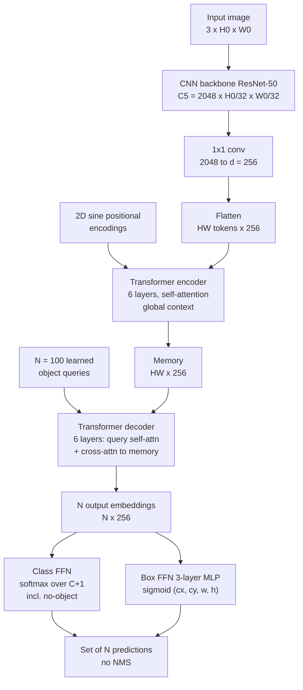
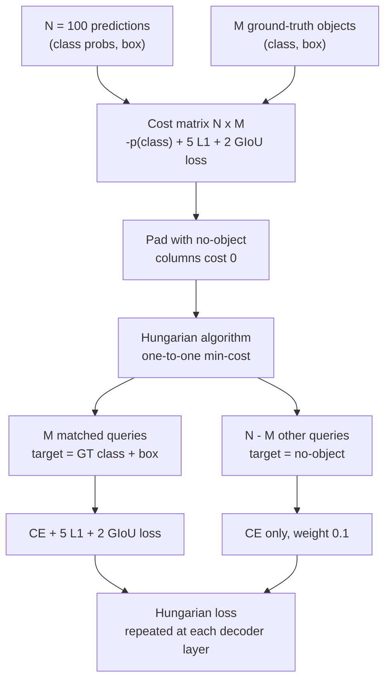
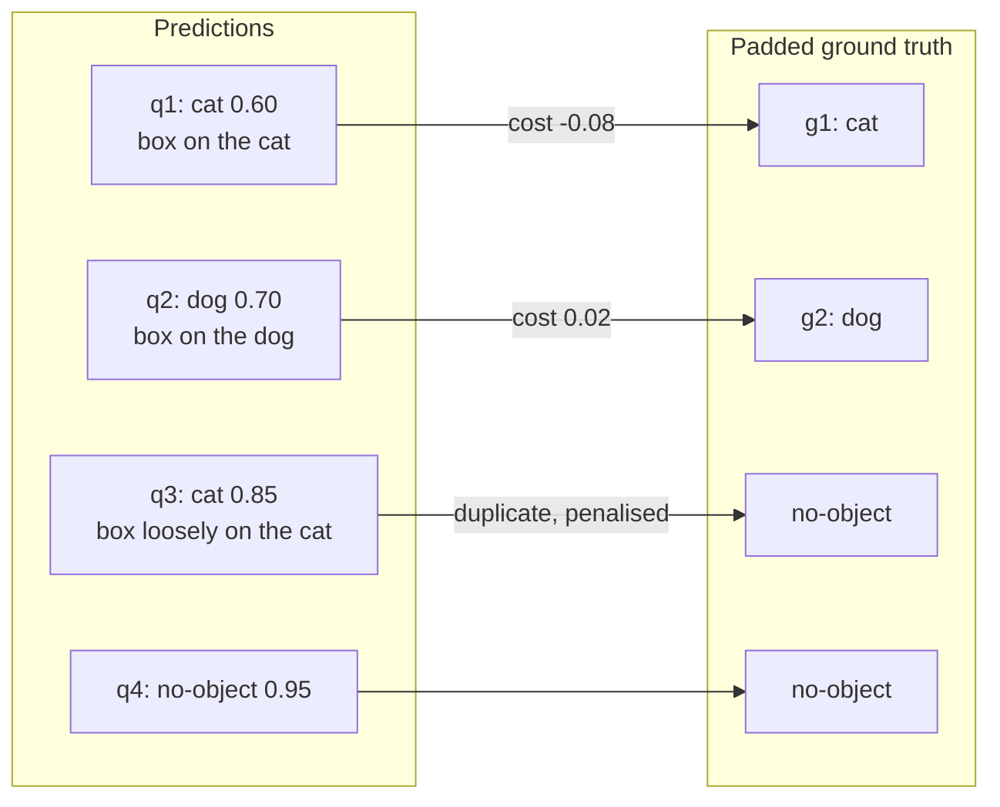
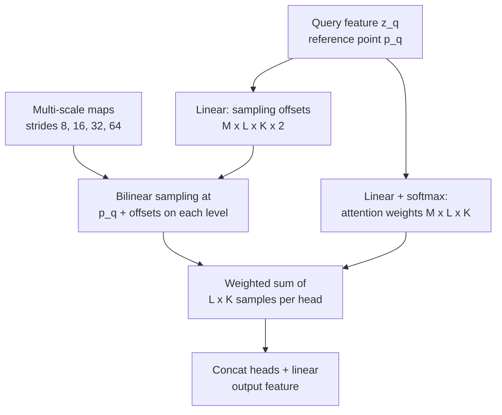
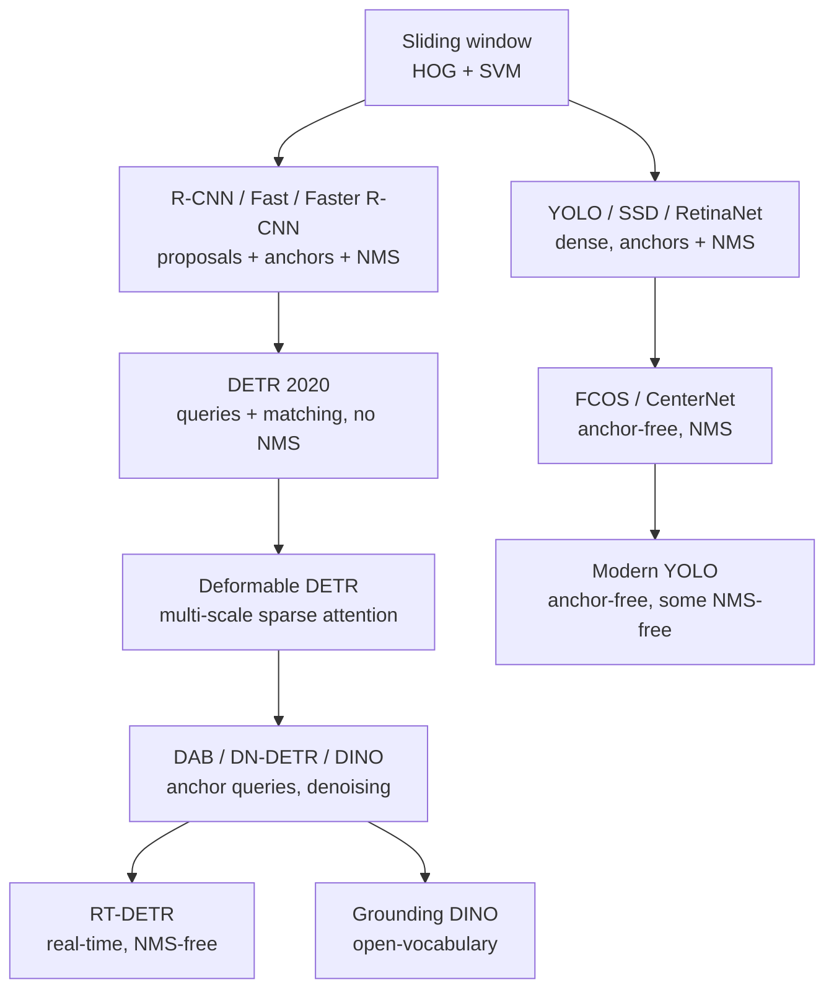

# Session 08 — Object Detection III: Transformers

> **Syllabus:**
> - DETR & object queries
> - Set prediction
> - Two-stage vs one-stage vs DETR
> - Modern detection approaches
> - Practical detector analysis
>
> **Related:** [Session 06 — Two-stage detectors](06_detection_two_stage.md) · [Session 07 — One-stage detectors, NMS, IoU, mAP](07_detection_one_stage.md) · [Session 10 — Segmentation (Mask R-CNN, Mask2Former)](10_image_segmentation.md) · [Session 13 — Foundation models (OWL-ViT, DINOv2)](13_vision_foundation_models.md) · [Session 14 — Grounding DINO](14_vision_plus_plus.md) · [Comparison tables](../00_comparison_tables.md) · [Formula sheet](../00_formula_sheet.md) · [code: IoU / NMS / AP](../code/iou_nms_ap.py)
>
> **Practice:** [Questions](../practice/08_questions.md) · [Solutions](../practice/08_solutions.md)

---

## 1. Big picture

Sessions 06–07 built detectors from **hand-designed parts**: anchors, IoU-based label assignment, region proposals and **non-maximum suppression (NMS)**. **DETR** (DEtection TRansformer, Carion et al., 2020) reframes detection as **direct set prediction**: a CNN + Transformer outputs a fixed-size set of $N=100$ (class, box) predictions in one shot, and training uses a **one-to-one bipartite (Hungarian) matching** between predictions and ground truth, so the network itself learns not to produce duplicates — **no anchors, no NMS**. The price was **slow convergence (~500 epochs)** and **weak small-object accuracy**, which **Deformable DETR** and later variants (DN-DETR, DINO, RT-DETR) fixed. This session also places DETR next to two-stage and one-stage detectors, surveys modern trends (multi-scale, anchor-free, real-time, open-vocabulary) and teaches how to **analyse** a detector beyond a single mAP number.

---

## 2. Core concepts

### DETR architecture and object queries

**Pipeline (inference) — know every stage and tensor shape:**

1. **CNN backbone** (ResNet-50, ImageNet-pretrained). Input image $3\times H_0\times W_0$ → last stage C5 feature map $2048\times H\times W$ with $H=H_0/32,\ W=W_0/32$ (stride 32).
2. **1×1 convolution** reduces channels $2048\rightarrow d=256$ → $d\times H\times W$.
3. **Flatten** the spatial grid into a sequence of $HW$ tokens, each a $d$-dimensional vector ($HW\times d$).
4. **Positional encodings**: the Transformer is permutation-invariant, so fixed **2D sine positional encodings** are added (to queries and keys) in every encoder attention layer — otherwise the model would not know *where* each token is.
5. **Transformer encoder** (6 layers, multi-head self-attention with 8 heads + FFN). Every pixel token attends to every other one → **global context** (useful for large objects and for separating instances). Output: the **memory**, $HW\times d$.
6. **Transformer decoder** (6 layers) with **$N=100$ object queries**. Each layer has: **self-attention among the queries** (queries "talk to each other" — key to avoiding duplicates) → **cross-attention** from queries to the encoder memory (queries "look at" the image) → FFN. All $N$ objects are decoded **in parallel** (not auto-regressively like a language model).
7. **Prediction heads (FFNs)**, shared across all queries:
   - **Class head**: linear layer + softmax over **$C+1$ classes**, the extra one being **"no object" ($\varnothing$)**.
   - **Box head**: 3-layer MLP (ReLU) + **sigmoid** → **normalised $(c_x, c_y, w, h)\in[0,1]^4$** relative to the image size (centre, width, height). No anchors, no offsets — the box is predicted **directly**.
8. **Auxiliary decoding losses**: the same (shared-weight) heads are applied after **every** decoder layer and each output gets its own Hungarian matching + loss. This deep supervision helps each layer output the correct number of objects and speeds training.

**What exactly are object queries?**
- $N$ **learned embedding vectors** ($N\times d$, i.e. $100\times256$) — model **parameters**, learned by backprop, the **same for every image** (the paper calls them *learnt positional encodings*).
- The decoder input starts as zeros; the query embeddings are added at each attention layer. The **outputs** become image-specific only through cross-attention to the memory.
- Each query behaves like a learned "slot" that specialises in certain **regions and box sizes** (analyses of trained DETR show each slot has a few preferred locations/size modes). Think of them as **learned, image-independent proposal generators**, not anchors (no fixed geometry, no IoU assignment).
- **$N$ must be larger than the maximum number of objects** in an image (100 ≫ the average COCO image, which has about 7–8 objects). Unused queries predict $\varnothing$. Consequence: DETR can output **at most $N$ objects**.

**Why a Transformer?** Self-attention computes pairwise interactions between all elements, which suits set prediction: (a) the encoder relates all image regions (global reasoning, separating overlapping instances), (b) decoder self-attention lets predictions **coordinate** (one query claims an object, others back off), (c) the architecture is generic and has no detection-specific heuristics.

**Inference post-processing (no NMS):** for each query take $\text{score}=\max_{c\neq\varnothing}\hat p(c)$, $\text{label}=\arg\max_{c\neq\varnothing}\hat p(c)$; convert the normalised box to pixels; for visualisation keep queries whose score exceeds a threshold (e.g. 0.7) or whose argmax is not $\varnothing$; for computing AP keep all 100 scored predictions.

### Set prediction, Hungarian matching and the set loss

**Detection as a set problem.** The ground truth of an image is an **unordered set** $y=\{y_i\}$ with $y_i=(c_i,b_i)$ (class, box). The model outputs a set $\hat y=\{\hat y_j\}_{j=1}^{N}$. There is no natural order: "the first prediction" means nothing. So the loss must be **permutation-invariant** — it must not change if we shuffle the predictions.

**Why we cannot just compare position by position:** if prediction #3 is compared to object #3, the network must learn an arbitrary ordering convention → impossible to learn consistently. Older detectors avoid this with a **many-to-one** assignment (every anchor overlapping an object by IoU > 0.5 becomes a positive), which **creates duplicates** that NMS must remove afterwards.

**DETR's solution — bipartite matching.**
1. Pad the GT set with $\varnothing$ ("no object") to size $N$.
2. Find the **permutation $\hat\sigma$** of the $N$ predictions with the **lowest total matching cost** (the **Hungarian algorithm**, $O(n^3)$).
3. Compute the loss only between matched pairs.

**Matching cost** (per GT $i$, prediction $\sigma(i)$): class term + box term, only for real objects:

$$
\mathcal L_{match}(y_i,\hat y_{\sigma(i)}) = -\mathbb 1_{\{c_i\neq\varnothing\}}\,\hat p_{\sigma(i)}(c_i) + \mathbb 1_{\{c_i\neq\varnothing\}}\,\mathcal L_{box}(b_i,\hat b_{\sigma(i)})
$$

- uses the **probability** $\hat p$ (not log-probability) in matching so the class term is on a scale comparable to the box term;
- pairs involving $\varnothing$ cost 0, so effectively the algorithm matches the $M$ real objects to $M$ distinct queries and everything else goes to $\varnothing$.

**Hungarian (set) loss** on the optimal matching $\hat\sigma$:
- **Classification**: cross-entropy (log-probability) for **all $N$** queries; matched queries target their GT class, unmatched target $\varnothing$. The $\varnothing$ term is **down-weighted by 0.1** to handle class imbalance (~93 of 100 queries are $\varnothing$).
- **Box loss** for matched (non-$\varnothing$) pairs only: $\lambda_{L1}=5$ × **L1** on normalised $(c_x,c_y,w,h)$ + $\lambda_{giou}=2$ × **GIoU loss**. L1 alone is scale-dependent (a 5-pixel error matters more for a small box than a large one); GIoU is **scale-invariant** and still gives gradient when boxes do not overlap.
- Normalised by the number of GT objects in the batch; plus the same loss at every decoder layer (auxiliary losses).

**Why duplicates are penalised:** with one-to-one matching only **one** query can be matched to a given object. A second query predicting the same object is matched to $\varnothing$ and its confident "cat" prediction is **punished by the classification loss**. So the network is trained to output exactly one prediction per object — the job NMS used to do is learned.

**Why matching instead of fixed assignment is "end-to-end":** the assignment depends on the current predictions (no hand-set IoU thresholds or anchors), and the total pipeline from pixels to final set is a single differentiable network at test time.

### Why DETR needs no NMS, its drawbacks and the Deformable DETR fix

**Why no NMS (two reasons — give both in exams):**
1. **Training signal**: one-to-one Hungarian matching makes duplicates *wrong answers* (they are matched to $\varnothing$ and penalised), unlike many-to-one anchor assignment where duplicates are *rewarded*.
2. **Architecture**: **decoder self-attention** lets queries exchange information, so a query "knows" another query already covers an object and can predict $\varnothing$ instead.
The DETR paper showed NMS helps the output of the **first** decoder layer (which still has duplicates) but gives no gain — even a small AP loss — at the **last** layer, because it wrongly removes true positives.

**Drawbacks of the original DETR:**

| Drawback | Cause | Consequence |
|---|---|---|
| **Slow convergence (~500 epochs on COCO** vs ~12–36 for Faster R-CNN) | attention weights start almost uniform over all $HW$ positions and must slowly learn to focus on a few relevant pixels; the Hungarian assignment of a query can flip between iterations early in training (unstable targets); queries carry no explicit spatial prior | very expensive training (days on many GPUs) |
| **Weak on small objects** | only the **single-scale stride-32** C5 map is used; using high-resolution multi-scale maps is unaffordable because encoder self-attention is **quadratic in $HW$** | lower $AP_S$ than Faster R-CNN with FPN (≈20 vs ≈27 AP on COCO), though better on large objects |
| **Heavy compute / memory** | $O((HW)^2)$ encoder attention | limits input resolution |
| **Fixed max detections** | $N$ queries | at most $N$ objects (fine for COCO with $N=100$) |

**Deformable DETR (Zhu et al., 2021) — the key fix.** Replace dense attention with **multi-scale deformable attention**:
- each query has a **reference point** $\hat p_q$; it attends to only a **small fixed number $K$ of sampling points** (e.g. $K=4$) around that reference point, **per head ($M=8$) and per feature level ($L=4$)** → $M\cdot L\cdot K=128$ sampled values per query instead of all $HW$;
- the **sampling offsets and attention weights are predicted from the query feature** by linear layers (like deformable convolution, hence the name); values at fractional locations are read with **bilinear interpolation**;
- **multi-scale**: levels C3–C5 (+ an extra stride-64 level) are used together, so fine high-resolution features are affordable → **better small-object AP**, and no FPN is needed because the attention mixes scales;
- cost becomes **linear in $HW$**; focusing on few points from the start → **~10× fewer training epochs (≈50)** with better accuracy than DETR.
- Extras in the paper: **iterative bounding-box refinement** (each decoder layer refines the previous box) and a **two-stage** variant (encoder proposes top-scoring regions as queries).

**Successors (brief — know one line each):**
- **Conditional DETR / DAB-DETR**: give queries an explicit **spatial meaning** — DAB-DETR makes each query a **dynamic anchor box** $(x,y,w,h)$ refined layer by layer → faster convergence. (So "anchors" re-enter as *learned, refined query positions*, not as dense hand-designed anchors.)
- **DN-DETR**: **denoising training** — feed noisy copies of GT boxes/labels to the decoder and train it to reconstruct the clean ones; these have a known assignment (no matching needed), which stabilises training and speeds convergence.
- **DINO (the detector)**: "**D**ETR with **I**mproved de**N**oising anch**O**r boxes" — contrastive denoising, mixed query selection, look-forward-twice box refinement; first DETR-style model at the top of COCO. **Not** the self-supervised DINO of Session 13 — and it is the "DINO" in **Grounding DINO**.
- **RT-DETR**: **real-time DETR** — efficient hybrid encoder (attention only within the coarsest scale + CNN-based cross-scale fusion), IoU-aware query selection; NMS-free and competitive with YOLO in speed/accuracy; speed can be traded by using fewer decoder layers.
- **Mask2Former**: the same query + matching idea applied to **segmentation** — each query predicts a class and a **mask**; masked attention; one architecture for semantic, instance and panoptic (see [Session 10](10_image_segmentation.md)).

### Two-stage vs one-stage vs DETR

- **Two-stage (R-CNN → Fast → Faster R-CNN, Session 06)**: stage 1 proposes regions (RPN on anchors), stage 2 crops features per region (RoI Pool / RoIAlign) and classifies + refines. **Accurate**, good localisation, handles scale with FPN; slower; many hand-set parts (anchors, IoU thresholds, sampling ratios, NMS twice: after RPN and at the end).
- **One-stage (YOLO, SSD, RetinaNet, FCOS, Session 07)**: predict classes + boxes densely on a grid / anchors in one pass. **Fast**, real-time; historically lower accuracy due to extreme foreground/background imbalance (fixed by **focal loss** in RetinaNet); still needs NMS and anchor/assignment heuristics (anchor-free versions remove anchors but keep NMS).
- **DETR family**: global set prediction with learned queries and one-to-one matching. **Simplest pipeline** (no anchors, no NMS, no proposals), global reasoning (good for large/overlapping objects), but slow training and (original) poor small-object accuracy; modern variants (Deformable DETR, DINO, RT-DETR) close those gaps.
- Big idea for essays: the field moved from **hand-designed** components (sliding windows → anchors → NMS) towards **learned** components (proposals learned by RPN → assignment learned by matching → duplicates removed by attention). The full comparison table is in [§6](#6-comparison-tables) (and in [Comparison tables](../00_comparison_tables.md)).

### Modern detection approaches

1. **Multi-scale features — FPN.** Feature Pyramid Network: a top-down pathway upsamples coarse, semantically strong maps and adds them (via 1×1 lateral connections) to finer maps → strong features at every scale (P2–P6). Small objects are detected on fine levels, large on coarse. Now standard in two-stage, one-stage and (via multi-scale attention) DETR-style detectors.
2. **Anchor-free detection.** Remove anchor hyper-parameters: **FCOS** predicts per-pixel distances $(l,t,r,b)$ to the box sides + a centre-ness score; **CenterNet** detects objects as **centre-point heatmap peaks** + size regression; YOLOX / YOLOv8 heads are anchor-free. Fewer hyper-parameters, similar or better accuracy. (Still usually NMS — anchor-free ≠ NMS-free.)
3. **Transformer detectors.** DETR → Deformable DETR → DAB/DN-DETR → DINO; also transformer **backbones** (Swin, plain ViT in **ViTDet**) used inside standard detectors.
4. **Real-time detectors.** The **YOLO family** (v1 grid → v2 anchors → v3 multi-scale → … → anchor-free heads; recent versions such as YOLOv10 train a one-to-one head to drop NMS) and **RT-DETR** (real-time, NMS-free transformer). Trade-offs: input resolution, model width/depth, FP16/INT8 quantisation, TensorRT export.
5. **Open-vocabulary / zero-shot detection.** Detect categories named by **free text** at test time, not a fixed label list. **OWL-ViT**: CLIP-style ViT image + text encoders; every output image token gets a box and an embedding that is compared with text-query embeddings (see [Session 13](13_vision_foundation_models.md)). **Grounding DINO**: the DINO detector fused with a text encoder (language-guided query selection, cross-modality decoder) → boxes for phrases like "red mug on the left" (see [Session 14](14_vision_plus_plus.md)). Often chained with SAM for masks.
6. **Foundation-model backbones.** Large pretrained (often self-supervised: MAE, DINOv2, or image–text: CLIP) ViTs used as backbones → better transfer, robustness and few-shot detection; detection heads become small add-ons.

### Practical detector analysis

A single mAP hides *why* a detector fails. A practitioner's checklist:

1. **Metric breakdown (COCO style)**: $AP$ = mean over IoU thresholds 0.50:0.05:0.95 (10 thresholds) and classes; $AP_{50}$ (VOC-style, lenient localisation), $AP_{75}$ (strict); **by size**: $AP_S$ (area $<32^2$ px), $AP_M$ ($32^2$–$96^2$), $AP_L$ ($>96^2$); recall $AR_{1}, AR_{10}, AR_{100}$ (max detections per image). Big gap $AP_{50}\gg AP_{75}$ → **localisation** is the problem. Low $AP_S$ → resolution/multi-scale problem.
2. **Per-class AP**: find weak classes; compare with class frequency in the training set (long tail), and look at confusions between similar classes (e.g. truck vs bus) with a **detection confusion matrix**.
3. **PR curves** (per class, per IoU threshold): precision dropping early at low recall → **high-confidence false positives** (often background or label errors); curve ending at low max recall → **missed objects** the model never detects at any threshold.
4. **Error breakdown (TIDE-style)** with foreground threshold $t_f=0.5$ and background threshold $t_b=0.1$, each false positive / missed GT is assigned to one type:
   - **Classification (Cls)**: IoU ≥ $t_f$ with a GT of the **wrong class**;
   - **Localisation (Loc)**: right class but $t_b\le$ IoU $<t_f$;
   - **Both (Cls+Loc)**: wrong class **and** $t_b\le$ IoU $<t_f$;
   - **Duplicate (Dupe)**: right class, IoU ≥ $t_f$, but that GT was already matched by a higher-scoring detection;
   - **Background (Bkg)**: IoU $<t_b$ with every GT — fired on background;
   - **Missed (Miss)**: GT not covered by any detection.
   TIDE reports $\Delta AP$ = how much AP would rise if that error type were fixed → tells you what to work on (e.g. Dupe errors → NMS threshold; Loc errors → better box regression / higher resolution).
5. **Confidence-threshold selection**: AP integrates over all thresholds, but deployment uses **one** threshold $\tau$. Choose it on a **validation set**: maximise **F1**, or pick the lowest $\tau$ that meets a required **precision** (few false alarms) or the highest $\tau$ that meets a required **recall** (safety-critical: do not miss pedestrians). Per-class thresholds are allowed.
6. **Latency / FPS**: measure **end-to-end** (pre-processing + forward + post-processing including NMS), batch size 1 for latency, after **warm-up** runs, with GPU synchronisation (e.g. `torch.cuda.synchronize()`), at the **deployment resolution and precision** (FP32/FP16/INT8), on the **target hardware**. $\text{FPS}=1/\text{latency}$ only for sequential batch-1 processing; throughput with batching is a different number. NMS time grows with the number of candidate boxes — DETR-style NMS-free detectors have predictable post-processing time.
7. **Visualise failure cases**: draw TP (green), FP (red), FN (blue) boxes; sort FPs by confidence and inspect the top ones (often **missing or wrong labels** in the GT); inspect FNs by size, occlusion, truncation, lighting; for DETR, visualise **encoder self-attention** (instance separation) and **decoder cross-attention** (it focuses on object extremities such as heads and feet).
8. **Dataset slicing / robustness**: day vs night, crowded vs sparse, camera A vs B — a model can have good overall mAP and fail badly on one slice that matters.

---

## 3. Key formulas

### Bipartite matching objective

$$
\hat\sigma=\arg\min_{\sigma\in\mathfrak S_N}\ \sum_{i=1}^{N}\mathcal L_{match}\big(y_i,\hat y_{\sigma(i)}\big)
$$

- $N$ = number of queries (100); $y_i=(c_i,b_i)$ = $i$-th GT object (class $c_i$, box $b_i$), the GT set padded with $\varnothing$ to size $N$; $\hat y_j=(\hat p_j,\hat b_j)$ = $j$-th prediction (class distribution $\hat p_j$ over $C+1$ classes, box $\hat b_j$); $\mathfrak S_N$ = set of all permutations of $N$ elements; $\hat\sigma$ = optimal permutation.
- Brute force over $N!$ permutations is impossible ($100!\approx9.3\times10^{157}$); the **Hungarian algorithm** solves it in $O(N^3)$.

### Matching cost

$$
\mathcal L_{match}(y_i,\hat y_{\sigma(i)})=-\mathbb 1_{\{c_i\neq\varnothing\}}\,\hat p_{\sigma(i)}(c_i)+\mathbb 1_{\{c_i\neq\varnothing\}}\,\mathcal L_{box}\big(b_i,\hat b_{\sigma(i)}\big)
$$

$$
\mathcal L_{box}(b,\hat b)=\lambda_{L1}\Vert b-\hat b\Vert_1+\lambda_{giou}\,\mathcal L_{GIoU}(b,\hat b),\qquad \mathcal L_{GIoU}=1-\text{GIoU},\qquad \lambda_{L1}=5,\ \lambda_{giou}=2
$$

- $\mathbb 1_{\{\cdot\}}$ = indicator (1 if true, else 0); $\hat p_{\sigma(i)}(c_i)$ = predicted probability of the GT class; $\Vert b-\hat b\Vert_1$ = sum of absolute differences of the 4 normalised $(c_x,c_y,w,h)$ coordinates.
- (Implementations often use $-\text{GIoU}$ instead of $1-\text{GIoU}$ in the cost; the constant does not change the assignment because every real GT is matched exactly once.)

**Worked example.** GT "cat", $b=(0.30,0.40,0.20,0.30)$. Prediction: $\hat p(\text{cat})=0.6$, $\hat b=(0.31,0.41,0.20,0.28)$, GIoU $=0.84$.
$\Vert b-\hat b\Vert_1=0.01+0.01+0+0.02=0.04$; cost $=-0.6+5(0.04)+2(1-0.84)=-0.6+0.20+0.32=\mathbf{-0.08}$ (low cost = good match).

### Hungarian (set) loss

$$
\mathcal L_{Hungarian}(y,\hat y)=\sum_{i=1}^{N}\Big[-w_{c_i}\log\hat p_{\hat\sigma(i)}(c_i)+\mathbb 1_{\{c_i\neq\varnothing\}}\,\mathcal L_{box}\big(b_i,\hat b_{\hat\sigma(i)}\big)\Big],\qquad w_{\varnothing}=0.1,\ w_{c}=1\ (c\neq\varnothing)
$$

- $\log\hat p$ = log-probability (cross-entropy) — the **loss** uses log-probabilities, the **matching** uses probabilities. The sum is normalised by the number of GT objects; it is applied at every decoder layer (auxiliary losses).

**Worked example.** Query matched to $\varnothing$ with $\hat p(\varnothing)=0.10$: class term $=0.1\times(-\ln0.10)=0.1\times2.303=\mathbf{0.230}$; no box term. A query matched to a cat with $\hat p(\text{cat})=0.6$: $-\ln0.6=0.511$ + box loss.

### IoU and Generalised IoU

$$
\text{IoU}=\frac{\lvert A\cap B\rvert}{\lvert A\cup B\rvert},\qquad
\text{GIoU}=\text{IoU}-\frac{\lvert C\setminus(A\cup B)\rvert}{\lvert C\rvert}=\text{IoU}-\frac{\lvert C\rvert-\lvert A\cup B\rvert}{\lvert C\rvert}
$$

- $A,B$ = the two boxes, $C$ = the **smallest axis-aligned box enclosing both**. Boxes $(x_1,y_1,x_2,y_2)$, continuous coordinates, area $=(x_2-x_1)(y_2-y_1)$ — **no +1**.
- Range: IoU $\in[0,1]$, GIoU $\in(-1,1]$; GIoU $=$ IoU when $C=A\cup B$; for disjoint boxes IoU $=0$ always but GIoU becomes more negative the further apart they are → **useful gradient even with no overlap**. $\mathcal L_{GIoU}=1-\text{GIoU}\in[0,2)$.

**Worked example.** $A=(0,0,4,4)$, $B=(2,2,6,6)$: $\lvert A\cap B\rvert=2\cdot2=4$, $\lvert A\cup B\rvert=16+16-4=28$, IoU $=4/28=0.143$. $C=(0,0,6,6)$, $\lvert C\rvert=36$. GIoU $=0.143-(36-28)/36=0.143-0.222=\mathbf{-0.079}$.

### Box parametrisation (normalised centre format → pixels)

$$
\hat b=\operatorname{sigmoid}(\text{MLP}(h))=(c_x,c_y,w,h)\in[0,1]^4,\qquad
x_1=(c_x-\tfrac w2)W,\ y_1=(c_y-\tfrac h2)H,\ x_2=(c_x+\tfrac w2)W,\ y_2=(c_y+\tfrac h2)H
$$

- $h$ = decoder output embedding of one query ($d=256$); $W,H$ = image width and height in pixels; $c_x, w$ are fractions of $W$, $c_y, h$ fractions of $H$.

**Worked example.** $W\times H=640\times480$, $\hat b=(0.30,0.35,0.20,0.25)$ → centre $(192,168)$, size $128\times120$ → $(x_1,y_1,x_2,y_2)=(\mathbf{128,108,256,228})$.

### Attention and its cost

$$
\text{Attention}(Q,K,V)=\operatorname{softmax}\!\left(\frac{QK^\top}{\sqrt{d_k}}\right)V
$$

- $Q\in\mathbb R^{n_q\times d_k}$ queries, $K\in\mathbb R^{n_k\times d_k}$ keys, $V\in\mathbb R^{n_k\times d_v}$ values, $d_k$ = key dimension (per head $d_k=d/M=256/8=32$ in DETR).
- **Encoder self-attention**: $n_q=n_k=HW$ → attention matrix $HW\times HW$ per head per layer → cost $O\big((HW)^2d\big)$ — **quadratic in the number of pixels**.
- **Decoder cross-attention**: $N\times HW$ (linear in $HW$); decoder self-attention: $N\times N$.

**Worked example.** $800\times1216$ input, stride 32 → $25\times38=950$ tokens → $950^2=\mathbf{902{,}500}$ attention weights per head per layer. With stride 8 ($100\times152=15{,}200$ tokens) → $2.31\times10^{8}$ per head, **256×** more (tokens ×16, squared).

### Multi-scale deformable attention

$$
\text{MSDeformAttn}\big(z_q,\hat p_q,\{x^l\}_{l=1}^{L}\big)=\sum_{m=1}^{M}W_m\left[\sum_{l=1}^{L}\sum_{k=1}^{K}A_{mlqk}\,W'_m\,x^l\big(\phi_l(\hat p_q)+\Delta p_{mlqk}\big)\right]
$$

- $z_q$ = query feature; $\hat p_q\in[0,1]^2$ = normalised **reference point**; $x^l$ = feature map of level $l$; $\phi_l$ rescales the reference point to level $l$; $M$ heads, $L$ levels, $K$ sampling points; $\Delta p_{mlqk}$ = **learned sampling offset** and $A_{mlqk}$ = **attention weight** (both predicted from $z_q$ by linear layers, $\sum_{l,k}A_{mlqk}=1$); $W_m, W'_m$ = output/value projections; $x^l(\cdot)$ at fractional positions uses **bilinear interpolation**.
- Samples per query $=M\cdot L\cdot K$ → cost $O(N_q\,MLK)$, **linear** in the number of queries/pixels.

**Worked example.** $M=8,\ L=4,\ K=4$ → $8\times4\times4=\mathbf{128}$ sampled points per query, versus 20,197 keys (all pixels of a 4-level pyramid of an $800\times1216$ image) for dense attention.

### Precision, recall, F1 for threshold choice

$$
P(\tau)=\frac{TP(\tau)}{TP(\tau)+FP(\tau)},\qquad R(\tau)=\frac{TP(\tau)}{N_{GT}},\qquad F_1(\tau)=\frac{2P(\tau)R(\tau)}{P(\tau)+R(\tau)}
$$

- $\tau$ = confidence threshold (keep detections with score ≥ $\tau$); $TP$ = detections matched (IoU ≥ 0.5, each GT at most once) to a GT; $FP$ = unmatched or duplicate detections; $N_{GT}$ = number of GT objects ($TP+FN$).

**Worked example.** At $\tau=0.5$: 8 kept, 6 TP, 2 FP, $N_{GT}=8$ → $P=0.75$, $R=0.75$, $F_1=0.75$.

### Number of possible assignments

For $N$ predictions and $M\le N$ real objects, the number of ways to assign the objects to distinct queries is $\dfrac{N!}{(N-M)!}$ (e.g. $N=4,M=3$ → 24) — brute force is only possible for toy sizes.

---

## 4. Algorithms step by step

### Algorithm 1 — DETR inference

1. **Pre-process**: resize (COCO setting: shorter side 800, longer ≤ 1333), normalise with ImageNet mean/std.
2. **Backbone**: ResNet-50 → C5 map $2048\times H\times W$ ($H=H_0/32$, $W=W_0/32$).
3. **Project**: 1×1 conv → $256\times H\times W$; flatten → $HW$ tokens of size 256.
4. **Encode**: add 2D sine positional encodings; 6 encoder layers of self-attention + FFN → memory ($HW\times256$).
5. **Decode**: start from $N=100$ zero vectors plus the 100 learned query embeddings; 6 decoder layers (self-attention among queries → cross-attention to memory → FFN), all queries in parallel.
6. **Heads**: for each of the 100 output embeddings → class softmax over $C+1$ and box $(c_x,c_y,w,h)=\operatorname{sigmoid}(\text{MLP})$.
7. **Post-process**: score $=\max_{c\neq\varnothing}\hat p(c)$, label = its argmax; convert boxes to pixel $(x_1,y_1,x_2,y_2)$ using the original image size; keep predictions with score ≥ threshold (or not predicted as $\varnothing$).
8. **No NMS** — output the remaining predictions directly.

### Algorithm 2 — Hungarian matching in DETR (training only)

1. For one image, take the $N$ predictions $\{(\hat p_j,\hat b_j)\}$ and the $M$ GT objects $\{(c_i,b_i)\}$.
2. **Build the cost matrix** $\mathbf C\in\mathbb R^{N\times M}$: $\mathbf C_{ji}=-\hat p_j(c_i)+\lambda_{L1}\Vert b_i-\hat b_j\Vert_1+\lambda_{giou}\big(1-\text{GIoU}(b_i,\hat b_j)\big)$.
3. **Pad with $\varnothing$**: add $N-M$ dummy "no-object" columns with cost 0 → square $N\times N$ matrix (the indicator terms are 0 for $\varnothing$).
4. **Solve the minimum-cost assignment** (Hungarian / Kuhn–Munkres; in code `scipy.optimize.linear_sum_assignment`, which also accepts the rectangular $N\times M$ matrix directly).
5. Queries assigned to real columns get those GT targets; all others get target $\varnothing$.
6. Matching is done **without gradient** (it only decides targets) and **separately for each decoder layer's output** (auxiliary losses). It is **not** used at inference.

**Classical Hungarian method (square $n\times n$ cost matrix, minimisation):**
1. **Row reduction**: subtract each row's minimum from that row.
2. **Column reduction**: subtract each column's minimum from that column. (Now every row and column has a zero.)
3. **Cover zeros**: cover all zeros with the **minimum number of horizontal/vertical lines**.
4. **Optimality test**: if the number of lines $=n$, an optimal assignment exists among the zeros → go to step 6.
5. **Adjust**: let $k$ = smallest **uncovered** entry; subtract $k$ from every uncovered entry, add $k$ to every entry covered **twice** (line intersections), leave single-covered entries unchanged. Go to step 3.
6. **Assign**: choose $n$ zeros, one per row and column (start with rows/columns that have a single zero). Total cost = sum of the **original** costs at those positions.

*Tiny example (4 queries × 3 GT, padded with a zero $\varnothing$ column):* original costs rows $q_1..q_4$ = (2,3,7), (7,9,8), (1,5,6), (5,1,2). Column minima (1,1,2,0) → after reduction: (1,2,5,0), (6,8,6,0), (0,4,4,0), (4,0,0,0). Zeros covered by 3 lines (row $q_4$, column $g_1$, column $\varnothing$) < 4 → smallest uncovered = 2 → adjust → 4 lines needed → assignment $q_1\to g_2$ (3), $q_3\to g_1$ (1), $q_4\to g_3$ (2), $q_2\to\varnothing$; **total = 6**. A greedy "take the cheapest pair first" gives 9 — greedy is not optimal. (Full working: [practice Q8](../practice/08_solutions.md).)

### Algorithm 3 — DETR training step

1. Sample a batch; apply augmentation (random horizontal flip, multi-scale resize, random crop).
2. Forward pass → for **each decoder layer** $\ell=1..6$, $N$ class distributions + boxes per image.
3. For each image and each layer: build the cost matrix and run Hungarian matching → $\hat\sigma$.
4. Build targets: matched queries ← GT class + box; unmatched ← $\varnothing$.
5. Loss per layer: weighted cross-entropy over all $N$ queries ($\varnothing$ weight 0.1) + $5\times$ L1 + $2\times$ GIoU loss on matched pairs, normalised by the number of GT boxes. Sum over the 6 layers (auxiliary losses).
6. Backpropagate; AdamW (learning rate $10^{-4}$ for the transformer, $10^{-5}$ for the backbone, weight decay $10^{-4}$), gradient clipping; repeat for **~500 epochs** (≈50 for Deformable DETR).

### Algorithm 4 — Deformable attention (high level)

1. Build a multi-scale feature pyramid ($L=4$ levels, e.g. strides 8, 16, 32, 64), each projected to $d=256$; add positional + level embeddings.
2. For each query $q$ (a pixel in the encoder, an object query in the decoder) obtain a **reference point** $\hat p_q$ (its own location in the encoder; predicted from the query embedding — or the previous layer's box — in the decoder).
3. A linear layer on $z_q$ predicts **$M\cdot L\cdot K$ 2-D offsets** $\Delta p_{mlqk}$; another linear layer + softmax predicts **$M\cdot L\cdot K$ attention weights** $A_{mlqk}$ (normalised over the $L\cdot K$ points of each head).
4. For every head $m$, level $l$, point $k$: sample the (projected) value map at $\phi_l(\hat p_q)+\Delta p_{mlqk}$ by **bilinear interpolation**.
5. Weighted sum of the samples with $A_{mlqk}$ → one vector per head; concatenate heads → output projection $W_m$.
6. Cost: $O(N_q\cdot MLK)$ instead of $O(N_q\cdot HW)$; with iterative refinement each decoder layer updates the box and therefore the reference point for the next layer.

### Algorithm 5 — Practical detector analysis workflow

1. Run the detector on a held-out validation set; save all detections (box, class, score) — no threshold.
2. Compute COCO metrics: $AP$, $AP_{50}$, $AP_{75}$, $AP_{S/M/L}$, per-class AP; plot PR curves for the worst classes.
3. Run an error breakdown (TIDE-style: Cls, Loc, Both, Dupe, Bkg, Miss) and rank error types by $\Delta AP$.
4. Pick the operating threshold $\tau$ on validation (max F1 or a precision/recall constraint); report P, R at that $\tau$.
5. Measure latency/FPS end-to-end on target hardware (warm-up, synchronise, include NMS/post-processing).
6. Visualise the top-scoring FPs and the FNs; group failures (small, occluded, rare class, label noise).
7. Fix the dominant error (more/better data, higher resolution or multi-scale for small objects, better box loss, NMS tuning, class rebalancing) and re-evaluate on the same split.

---

## 5. Diagrams

### DETR architecture

### Training: bipartite matching then set loss

### Matching illustration (one image, 2 objects, 4 queries)

q3 has the higher cat probability but a poor box, so the box terms make q1 the cheaper match; q3 is trained towards "no object" — exactly how DETR learns not to output duplicates.

### Deformable DETR attention (one query, one head)

### Evolution of detectors

---

## 6. Comparison tables

### Two-stage vs one-stage vs DETR: full comparison table

| Aspect | Two-stage (Faster R-CNN + FPN) | One-stage (YOLO, SSD, RetinaNet, FCOS) | DETR (original) / Deformable DETR |
|---|---|---|---|
| Region proposals | Yes — RPN proposes ~300–2000 RoIs, then RoI head | No — dense predictions over grid / anchors / points | No — $N=100$ (DETR) learned object queries |
| Anchors | Yes (RPN: 9 per location = 3 scales × 3 ratios) | YOLOv2–v5, SSD, RetinaNet: yes; FCOS, CenterNet, YOLOX/v8: anchor-free | **No** |
| Label assignment | Many-to-one, IoU thresholds | Many-to-one (IoU, centre or grid-cell rules) | **One-to-one Hungarian matching** |
| NMS | Yes (after RPN and at the end) | Yes (except recent NMS-free YOLO variants) | **No** |
| Hand-designed components | Many (anchors, IoU thresholds, sampling ratio, NMS) | Several (anchors or assignment rules, NMS) | Very few (number of queries, loss weights) |
| Training time (COCO) | Short (~12–36 epochs) | Short to moderate | **Very long (~500 epochs)**; Deformable DETR ~50 |
| Inference speed | Slowest (two passes, per-RoI head) | **Fastest — real-time** | Moderate (similar to Faster R-CNN + FPN); RT-DETR is real-time |
| Small objects | Good (FPN + RoIAlign) | Good with FPN; weak in YOLOv1 | **Weak** in DETR (single stride-32 map); fixed by Deformable DETR multi-scale |
| Large objects | Good | Good | **Very good** (global self-attention) |
| Crowded / overlapping objects | NMS can delete true overlapping objects | Same NMS problem | No NMS; queries reason jointly (but at most $N$ outputs) |
| Global context | Local (RoI crops) | Local receptive fields | Global (self-attention) |
| Max detections | Set by NMS / top-k | Set by NMS / top-k | Fixed by $N$ |
| Typical use | High-accuracy offline tasks | Real-time / edge | Research baseline; DINO-style for SOTA accuracy, RT-DETR for real-time |

### DETR vs Deformable DETR

| Aspect | DETR | Deformable DETR |
|---|---|---|
| Attention | Dense: every query attends to all $HW$ keys | Sparse: $K$ sampled points per head per level around a reference point |
| Feature scales | Single (C5, stride 32) | Multi-scale (4 levels, strides 8–64), no FPN needed |
| Encoder cost | $O((HW)^2)$ | $O(HW\cdot MLK)$ — linear in $HW$ |
| Training epochs | ~500 | ~50 (≈10× fewer) |
| Small objects | Weak | Much better |
| Where the attended locations come from | Learned slowly from near-uniform attention | Offsets predicted directly from the query |

### Matching cost vs training loss in DETR

| | Matching cost (choose the pairs) | Hungarian loss (train the network) |
|---|---|---|
| Class term | $-\hat p(c_i)$ — probability | $-\log\hat p(c_i)$ — cross-entropy |
| $\varnothing$ predictions | cost 0 (padding) | CE towards $\varnothing$ with weight 0.1 |
| Box term | $5\,\mathrm{L1}+2\,\mathcal L_{GIoU}$ | same, matched pairs only |
| Gradient | none (just picks targets) | yes |
| Used at inference? | No | No |

### Error types in detector analysis (TIDE-style, $t_f=0.5$, $t_b=0.1$)

| Error | Condition | Typical fix |
|---|---|---|
| Classification | IoU ≥ $t_f$, wrong class | More data for confused classes, better classifier/backbone |
| Localisation | right class, $t_b\le$ IoU $<t_f$ | Better box regression (GIoU loss), higher resolution, refinement stages |
| Both | wrong class and $t_b\le$ IoU $<t_f$ | Usually hard cases — inspect |
| Duplicate | right class, IoU ≥ $t_f$, GT already matched | Tune NMS IoU threshold; one-to-one training (DETR) |
| Background | IoU $<t_b$ with all GT | Hard-negative mining, higher threshold, check missing labels |
| Missed | GT never detected | Small objects → multi-scale/resolution; occlusion → data; raise $N$ / max detections |

### Modern detector families at a glance

| Family | Examples | Key idea | NMS? |
|---|---|---|---|
| Multi-scale CNN | Faster R-CNN + FPN, RetinaNet | Feature pyramid, focal loss | Yes |
| Anchor-free | FCOS, CenterNet, YOLOX | Points / centres instead of anchors | Yes |
| End-to-end transformer | DETR, Deformable DETR, DINO | Queries + Hungarian matching | No |
| Real-time | YOLO family, RT-DETR | Speed/accuracy trade-off, deployment | YOLO: mostly yes; RT-DETR: no |
| Open-vocabulary | OWL-ViT, Grounding DINO | Text-conditioned classes (CLIP-style alignment) | OWL-ViT: optional; Grounding DINO: no |

---

## 7. Common exam traps & misconceptions

- ❌ "DETR uses anchor boxes." → ✅ **No anchors.** Boxes are regressed directly as normalised $(c_x,c_y,w,h)$ via a sigmoid; object queries are learned embeddings, not fixed boxes. (DAB-DETR later re-interprets queries as *learned, dynamic* anchor boxes, but DETR itself has none.)
- ❌ "Object queries are computed from the input image." → ✅ They are **learned parameters**, identical for every image; only the decoder **outputs** become image-dependent via cross-attention.
- ❌ "$N$ must equal the number of objects in the image." → ✅ $N$ is **fixed** (100) and much larger than the typical object count; extra queries predict $\varnothing$. DETR therefore cannot output more than $N$ objects.
- ❌ "DETR still applies NMS at the end." → ✅ No NMS: one-to-one matching penalises duplicates and decoder self-attention lets queries coordinate. (NMS only helped the first decoder layer's outputs in the paper.)
- ❌ "Hungarian matching is run at test time." → ✅ It needs ground truth, so it is **training-only**; it decides which query learns which object.
- ❌ "The matching cost and the loss are the same." → ✅ Matching uses **probabilities** $-\hat p(c)$; the loss uses **log-probabilities** (CE) with $\varnothing$ down-weighted by 0.1; box terms are the same.
- ❌ "Unmatched queries get a box loss pushing them to zero." → ✅ $\varnothing$ queries get **only the classification loss** (weight 0.1); there is no box target.
- ❌ "DETR converges slowly because the Hungarian algorithm is expensive." → ✅ Matching 100 queries is cheap ($O(n^3)$, milliseconds). Slowness comes from **dense attention having to learn sparse focus** from near-uniform initialisation and **unstable matching** early in training.
- ❌ "DETR is better than Faster R-CNN on small objects." → ✅ **Worse** on small objects ($AP_S$ ≈20 vs ≈27 on COCO) and better on large ones — it uses only a stride-32 map and cannot afford high-resolution dense attention.
- ❌ "Deformable DETR uses deformable convolutions in the backbone." → ✅ It uses **deformable attention**: each query samples a few **learned offset** points per head per level; inspired by deformable convolution but it is an attention module.
- ❌ "Grounding DINO's DINO is the self-supervised DINO (self-distillation)." → ✅ It is the **DINO detector** — "DETR with Improved deNoising anchOr boxes".
- ❌ "Anchor-free means NMS-free." → ✅ FCOS/CenterNet/YOLOX are anchor-free but still use NMS (or peak extraction); NMS-free requires **one-to-one assignment** (DETR, RT-DETR, YOLOv10-style heads).
- ❌ "A higher mAP model is always the better choice." → ✅ Check $AP_S$, per-class AP, latency on the target hardware and precision/recall **at your operating threshold**.
- ❌ "FPS = 1 / (forward-pass time)." → ✅ Include pre-processing, post-processing (NMS) and data transfer; warm up and synchronise the GPU; state batch size, resolution and precision.
- ❌ "Raising the confidence threshold improves the detector." → ✅ It moves the **operating point** (higher precision, lower recall); AP — which integrates over thresholds — is unchanged.

---

## 8. 10-line cheat summary

1. DETR = ResNet-50 → 1×1 conv to $d=256$ → flatten + sine positional encodings → Transformer encoder → decoder with $N=100$ learned object queries → FFN heads (class over $C+1$ incl. $\varnothing$, box = sigmoid normalised $(c_x,c_y,w,h)$).
2. Detection as **set prediction**: the loss must be permutation-invariant, so predictions are matched one-to-one to GT (padded with $\varnothing$) by the **Hungarian algorithm** ($O(n^3)$).
3. Matching cost $=-\hat p(c_i)+5\,\mathrm{L1}+2\,(1-\text{GIoU})$ for real objects; $\varnothing$ pairs cost 0.
4. Hungarian loss = CE on all queries ($\varnothing$ weight 0.1) + $5\,$L1 + $2\,$GIoU loss on matched pairs, at every decoder layer (auxiliary losses).
5. **No NMS**: one-to-one matching punishes duplicates, and decoder self-attention lets queries coordinate.
6. **No anchors, no proposals**; object queries are learned, image-independent embeddings; $N\gg$ #objects.
7. Drawbacks: ~500 epochs, weak small objects (single stride-32 map, $O((HW)^2)$ attention), heavy compute.
8. **Deformable DETR**: each query samples $M\cdot L\cdot K$ (8·4·4 = 128) learned-offset points over 4 scales → linear cost, ~10× fewer epochs, better small objects; successors DAB/DN-DETR, DINO, RT-DETR, Mask2Former.
9. Two-stage = accurate but slow & heuristic-heavy; one-stage = fast, needs NMS; DETR = simplest end-to-end pipeline, global reasoning, slow to train.
10. Analyse detectors with $AP/AP_{50}/AP_{75}/AP_{S,M,L}$, per-class AP, PR curves, TIDE errors (Cls, Loc, Both, Dupe, Bkg, Miss), an F1- or constraint-based threshold, end-to-end latency, and visualised failures.
