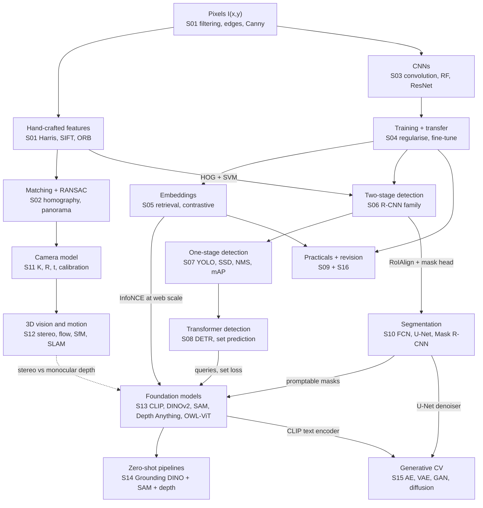
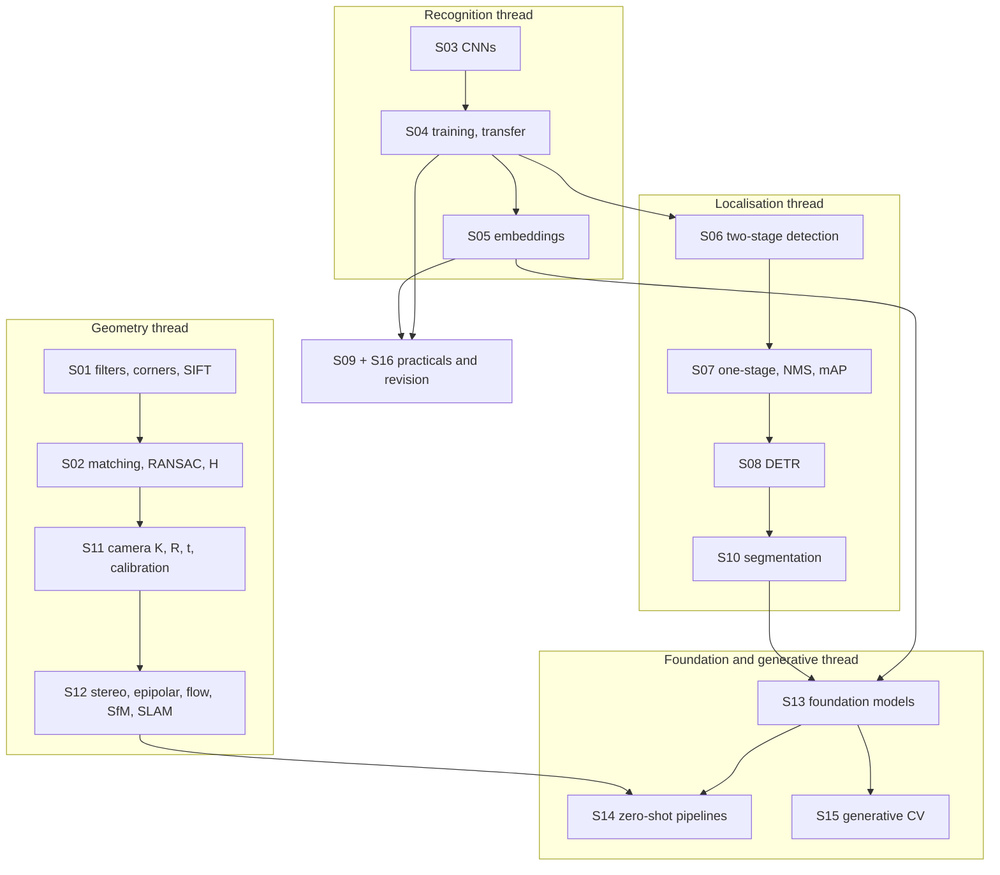
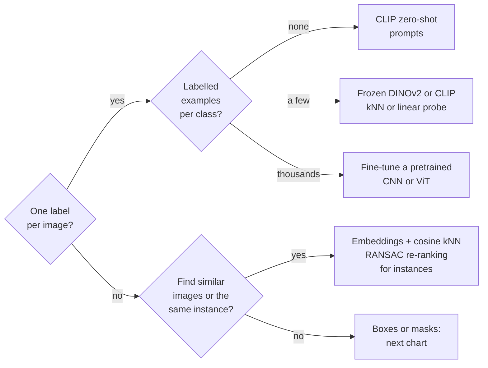
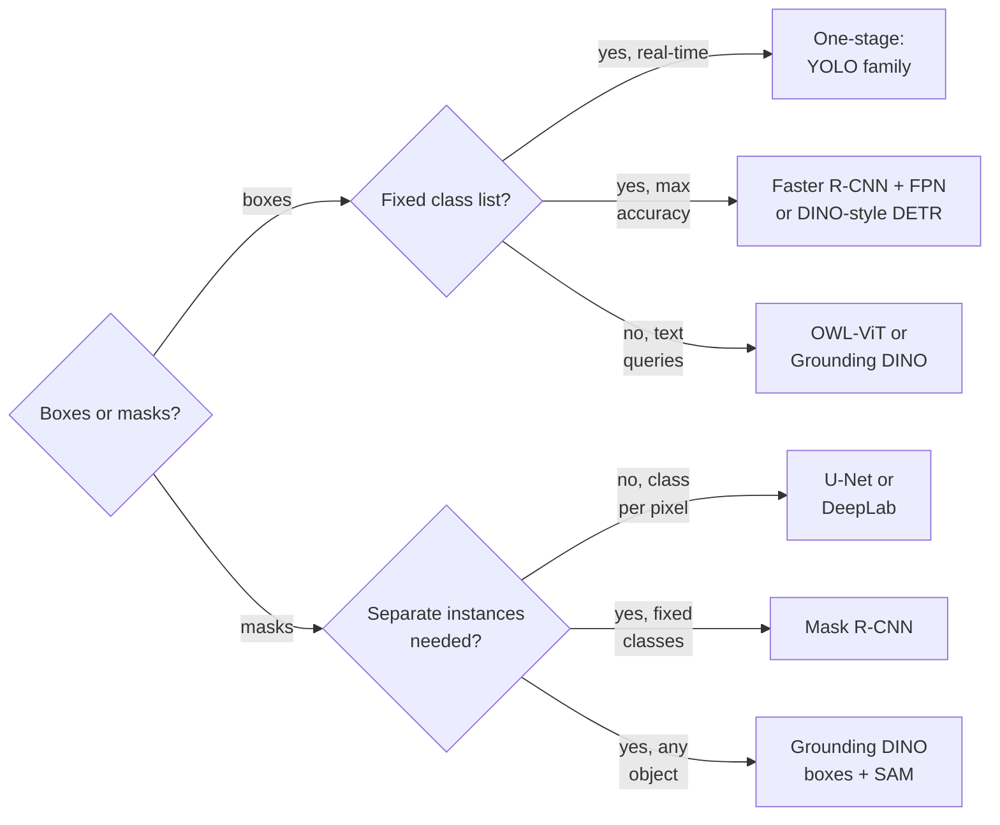
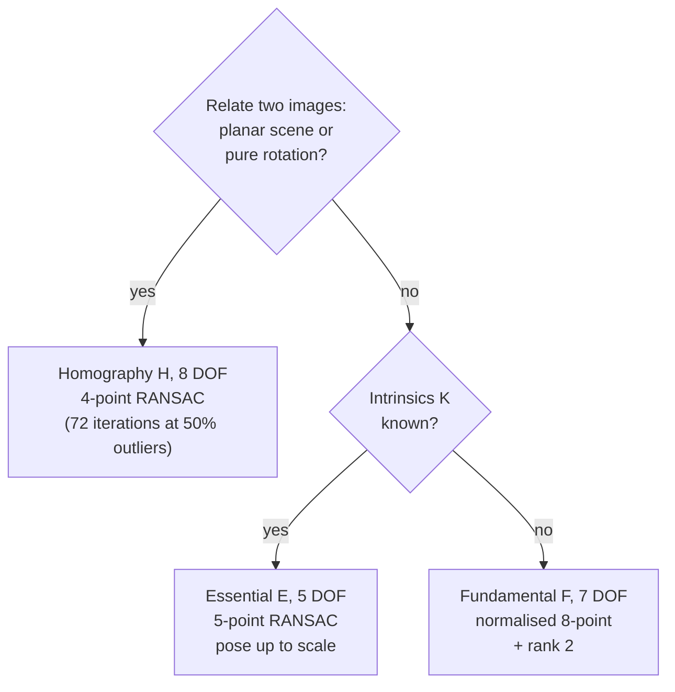
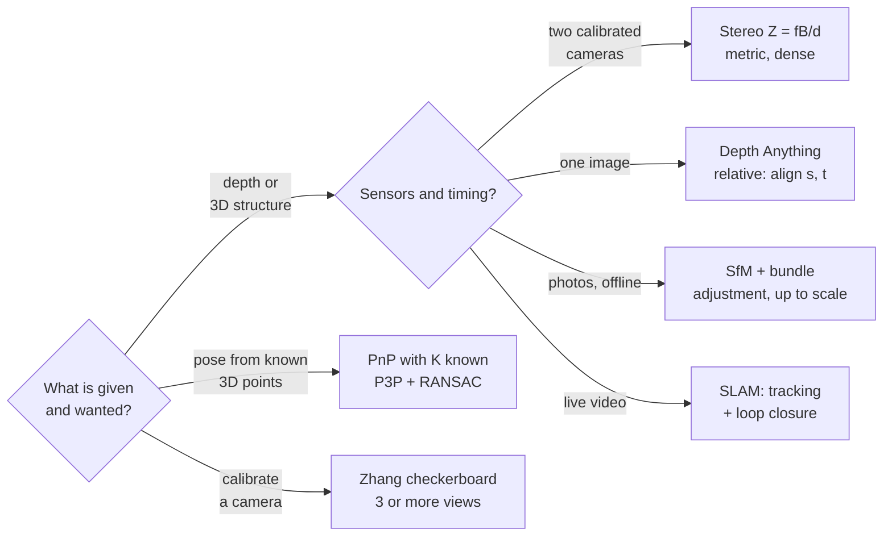
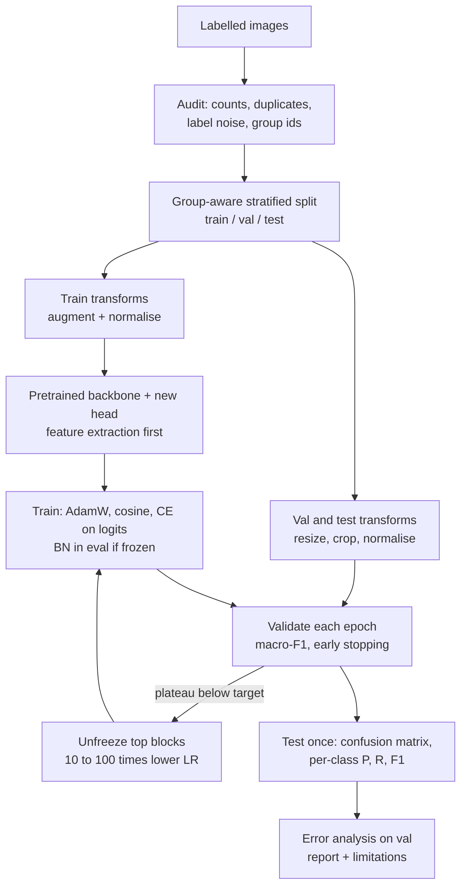
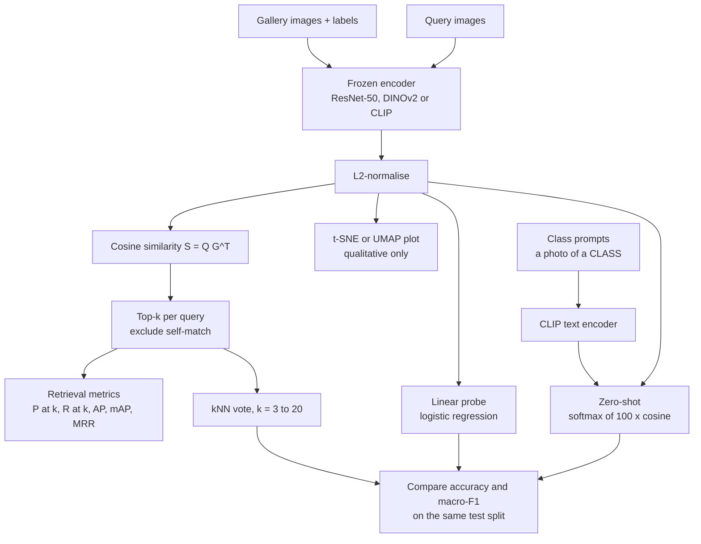
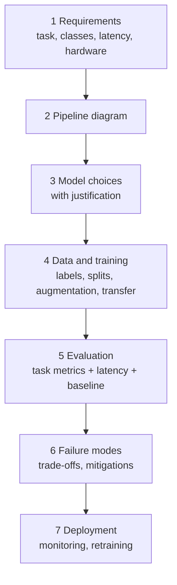

# Session 09 + 16 — Practicals, Revision & Exam Preparation

> **Syllabus:**
> - **Session 9 — Discussion on quiz + project and practicals:** practical classification exercise · practical embedding exercise · lessons from the quiz and the project
> - **Session 16 — Exam preparation:** comprehensive revision (how the course fits together) · compare approaches · exam technique
>
> **Related:** [01 Image processing & features](01_image_processing_features.md) · [02 Matching & RANSAC](02_feature_matching_classical.md) · [03 CNNs](03_cnns_under_the_hood.md) · [04 Training & transfer learning](04_training_transfer_learning.md) · [05 Embeddings](05_embeddings_similarity.md) · [06 Two-stage detection](06_detection_two_stage.md) · [07 One-stage detection & mAP](07_detection_one_stage.md) · [08 DETR](08_detection_transformers.md) · [10 Segmentation](10_image_segmentation.md) · [11 Camera geometry](11_camera_geometry.md) · [12 3D vision & motion](12_3d_vision_motion.md) · [13 Foundation models](13_vision_foundation_models.md) · [14 Vision++ pipelines](14_vision_plus_plus.md) · [15 Generative CV](15_generative_cv.md)
> **Revision kit:** [Formula sheet](../00_formula_sheet.md) · [Comparison tables](../00_comparison_tables.md) · [Numericals drill](../practice/numericals_drill.md) · [Mock exam 1](../practice/mock_exam_1.md) · [Mock exam 2](../practice/mock_exam_2.md) · [Interactive MCQ quiz](../quiz.html) · [Code: transfer-learning skeleton](../code/transfer_learning_skeleton.py) · [Code: IoU / NMS / AP](../code/iou_nms_ap.py)
>
> **Practice:** [Questions](../practice/09_questions.md) · [Solutions](../practice/09_solutions.md)

---

## 1. Big picture

This merged session has two jobs. **Session 9** turns the theory into the two practicals that every CV course and project ends up running: (1) **classify images** with a pretrained network — split, transform, fine-tune or feature-extract, evaluate honestly; (2) **embed images** with a pretrained encoder and use the vectors for **similarity search, kNN/linear-probe classification and CLIP zero-shot** recognition. It also collects the mistakes that cost the most marks in quizzes and projects (leakage, wrong normalisation, missing `model.eval()`, accuracy on imbalanced data, wrong rounding and DOF counts). **Session 16** is revision: a **map** of how all fifteen topic sessions connect (pixels → features → geometry; CNNs → transfer → embeddings → detection → segmentation → foundation models → pipelines; generative models), a set of **cross-session comparisons** (the most common long-question pattern) and **exam technique** — answer templates, a time plan for the 3-hour paper and the twenty numerical types that keep coming back. Use this file as the hub: every section links to the detailed session notes.

---

## 2. Core concepts

### Practical classification exercise

**Goal:** given a folder of labelled images, build the best classifier you can **and prove its performance honestly**. The full pipeline theory is in [Session 04 — practical pipeline](04_training_transfer_learning.md#practical-image-classification-pipeline); a runnable version is [../code/transfer_learning_skeleton.py](../code/transfer_learning_skeleton.py) (`--mode feature` / `--mode finetune`). Below is the walkthrough you should be able to reproduce in an exam answer or a project report.

**Step 0 — Frame the problem.** Fix the class list and label definitions (single-label or multi-label?), the deployment conditions (camera, lighting, resolution) and — **before training** — the **primary metric** (macro-F1 or recall of the critical class if classes are imbalanced; plain accuracy only if they are balanced and errors cost the same). Define a **baseline** (majority class; kNN on frozen features) so every later number has a reference.

**Step 1 — Audit the data.** Count images per class (imbalance), check image sizes and corrupt files, find **near-duplicates** (perceptual hash, or embedding cosine similarity > ~0.95), look at a random sample per class for **label noise**, and collect metadata needed for grouping (patient / plant / product / video / session id, camera, timestamp).

**Step 2 — Split without leakage.** Stratified train / val / test (70/15/15 or 80/10/10); **k-fold cross-validation** (report mean ± std) when there are only a few hundred images. **Leakage** = information from the evaluation data reaching training or model selection, which inflates the reported score.

| Leakage source | Example | Fix |
|---|---|---|
| Same subject in two splits | 6 photos of one plant (or one patient's scans) split at image level | **Group split** by subject (`GroupKFold` / `StratifiedGroupKFold`) |
| Near-duplicates | burst shots, re-uploads, crops of the same photo | de-duplicate, or put the whole duplicate cluster in one group |
| Augment, then split | offline augmented copies of one image land in train **and** test | split first; augment the **training** set only, on the fly |
| Statistics fitted on all data | mean/std, PCA, feature scaler, class weights computed on the full set | fit on train only (or use the pretrained model's statistics) |
| Selecting on test | early stopping / hyperparameters / threshold chosen on test | all choices on **val**; test **once**, at the end |
| Time | future images used for training when deployment predicts forward in time | chronological split |

**Step 3 — Transforms.** Train: `RandomResizedCrop(224)`, horizontal flip (only if label-preserving), mild `ColorJitter` (not if colour is diagnostic), `ToTensor`, `Normalize(ImageNet mean/std)`. Val/test: deterministic `Resize(256)` → `CenterCrop(224)` → `ToTensor` → `Normalize`. Take the preprocessing from the weights (`weights.transforms()`) so it matches pretraining. Watch channel order (OpenCV loads **BGR**, PIL loads RGB), grayscale images (replicate to 3 channels) and normalise **once**. Details and label-preservation caveats: [Session 04 — data augmentation](04_training_transfer_learning.md#data-augmentation).

**Step 4 — Pretrained backbone + new head.** Typical choices: **ResNet-50** (≈25.6M params, 2048-d pooled feature — the safe default), **EfficientNet-B0** (≈5.3M — edge devices), **ViT-B/16** (≈86M — strong when well pretrained), or frozen **DINOv2 / CLIP** features (strongest linear-probe baselines, [Session 13](13_vision_foundation_models.md)). Replace the 1000-way ImageNet head by a $K$-way layer: `model.fc = nn.Linear(2048, K)`.

**Step 5 — Feature extraction first, then fine-tune if justified.** Start with **feature extraction** (backbone frozen, BN in eval mode, train only the head: $(2048+1)\cdot50 = 102{,}450$ parameters for 50 classes — 0.43% of the network). If validation performance plateaus below target and there is enough data (or the domain differs from ImageNet), **unfreeze the top block(s)** with a **10–100× smaller learning rate** and discriminative LRs (unfreezing ResNet-50 `layer4` makes 15,067,186 parameters trainable — 63.8%). Full fine-tuning only for large or very different datasets. Decision matrix: [Session 04 — feature extraction vs fine-tuning](04_training_transfer_learning.md#feature-extraction-vs-fine-tuning).

**Step 6 — Training loop.** Cross-entropy on **raw logits** (optionally `label_smoothing=0.1`, class weights $w_c=N/(Kn_c)$ or a `WeightedRandomSampler` for imbalance); **AdamW** (or SGD + momentum 0.9); cosine schedule with warm-up; mixed precision; validate every epoch in `model.eval()` + `torch.no_grad()`; checkpoint the best **val macro-F1**; early stopping. **Sanity checks:** the initial loss should be ≈ $\ln K$ ($\ln 50 = 3.91$); a small batch must be **overfittable** to ~100% before full training.

**Step 7 — Evaluate (on the test set, once).** Report:
- **Accuracy** — fine only for balanced classes.
- **Confusion matrix** — rows = true class, columns = predicted (**state the convention**); diagonal = correct.
- **Per-class precision, recall, F1** — $P_c=\frac{TP_c}{TP_c+FP_c}$ (column), $R_c=\frac{TP_c}{TP_c+FN_c}$ (row).
- **Macro-F1** (unweighted mean over classes — rare classes count equally), **weighted-F1** (weighted by class support), **micro-F1** (pool all counts — for single-label multi-class it **equals accuracy**), **balanced accuracy** (= macro recall).
- **Top-k accuracy** when classes are confusable (fine-grained species).
- **Uncertainty**: a test accuracy $\hat p$ on $n$ images has standard error $\sqrt{\hat p(1-\hat p)/n}$ — 85% on 200 images is ±4.9% (95% interval), so a 2% "improvement" on such a test set is noise. Report mean ± std over seeds or folds.

```python
from sklearn.metrics import confusion_matrix, classification_report, balanced_accuracy_score
model.eval(); preds, gts = [], []
with torch.no_grad():
    for x, y in test_dl:                                   # shuffle=False
        preds += model(x.to(dev)).argmax(1).cpu().tolist(); gts += y.tolist()
print(confusion_matrix(gts, preds))                        # rows = true, columns = predicted
print(classification_report(gts, preds, target_names=classes, digits=3))  # per-class P/R/F1, macro, weighted
print("balanced accuracy", balanced_accuracy_score(gts, preds))
```

**Step 8 — Error analysis (on the validation set, so the test set stays untouched).**
1. Read the **largest off-diagonal cells** of the confusion matrix → which class pairs are confused (look-alike species, ambiguous label definitions).
2. View the **most confident wrong predictions** and the **highest-loss** images → label errors, ambiguous images, out-of-scope images.
3. **Slice** metrics by metadata (camera, site, lighting, image size) → domain shift between subgroups.
4. Use a saliency map such as **Grad-CAM** (gradients of the class score w.r.t. the last conv feature maps, global-average-pooled into channel weights, weighted sum of the maps, ReLU) to catch **shortcut learning** — the model looking at a watermark, ruler, background or hospital tag instead of the object.
5. Put every error into a bucket (label noise / confusable pair / domain shift / small object / shortcut) and fix the **largest bucket first** (relabel, more data for the pair, higher resolution, targeted augmentation, cleaner split).

**Step 9 — What to report.**

| Block | Must contain |
|---|---|
| Data | source, images per class, **split protocol** (stratified? grouped by what?), de-duplication |
| Preprocessing | resize/crop, normalisation statistics, augmentations (train only) |
| Model | backbone, pretrained weights, head, **trainable / total parameters**, frozen or fine-tuned layers |
| Training | optimiser, LR (per group), schedule, epochs, batch size, early-stopping rule, seeds |
| Results | test size, accuracy, **macro-F1**, balanced accuracy, per-class table, **confusion matrix**, mean ± std over runs, **baseline** |
| Ablations | feature extraction vs fine-tuning, augmentation on/off, backbone A vs B |
| Cost | training time, inference latency, model size |
| Analysis | error buckets with examples, limitations, what you would do next |

### Practical embedding exercise

**Goal:** map each image to a vector so that **cosine similarity ≈ semantic similarity**, then use those vectors for **retrieval** ("find similar images"), **kNN / linear-probe classification** and **zero-shot classification** with CLIP — with little or no training. Theory: [Session 05 — embeddings & retrieval](05_embeddings_similarity.md#image-retrieval) and [Session 13 — CLIP and DINOv2](13_vision_foundation_models.md#clip).

**Step 1 — Choose the encoder and extract embeddings.**

| Encoder | Embedding taken from | Dim | Strength / weakness |
|---|---|---|---|
| ImageNet ResNet-50 | global-average-pool output (`model.fc = nn.Identity()`) | 2048 | cheap baseline; biased towards ImageNet classes |
| DINOv2 ViT-B/14 | [CLS] token (optionally concatenated with the mean patch token) | 768 | best pure-visual kNN/retrieval and fine-grained similarity; **no text** |
| CLIP ViT-B/32 | image-encoder output after the projection | 512 | shares a space with text → **zero-shot** and text→image search; weaker fine-grained |

Rules: `model.eval()` + `torch.no_grad()`; use **the model's own preprocessing** (CLIP has its own mean/std — use its processor); the **same** pipeline for gallery and queries; store the $N\times D$ matrix with image ids and labels; re-embed everything if the model changes (embeddings from different models are **not comparable**).

**Step 2 — L2-normalise.** $\hat{\mathbf z}=\mathbf z/\Vert\mathbf z\Vert_2$. On unit vectors cosine similarity = dot product and $\Vert\hat{\mathbf a}-\hat{\mathbf b}\Vert^2=2-2\cos\theta$, so **Euclidean, cosine and dot-product rankings coincide**. Without normalisation, Euclidean distance is dominated by vector **magnitude** (often contrast/"confidence", not identity) and can rank neighbours differently — see [practice Q11](../practice/09_questions.md). Optional: PCA-whitening fitted on the gallery/training set, then re-normalise.

**Step 3 — Cosine kNN retrieval.** Similarity matrix $S=Z_qZ_g^\top$ ($N_q\times N_g$); sort each row; return the top-$k$. If the queries are taken **from** the gallery, **remove the self-match** (otherwise P@1 = 100% trivially — a classic project bug). For large galleries use a FAISS index: `IndexFlatIP` (exact inner product) or IVF-PQ / HNSW (approximate) — [Session 05 §6.5](05_embeddings_similarity.md#65-exact-vs-approximate-nearest-neighbour-search).

```python
import torch, torch.nn.functional as F, torchvision
backbone = torchvision.models.resnet50(weights="IMAGENET1K_V2"); backbone.fc = torch.nn.Identity()  # 2048-d
@torch.no_grad()
def embed(model, loader):
    model.eval(); Z, Y = [], []
    for x, y in loader:
        Z.append(F.normalize(model(x), dim=1)); Y.append(y)        # L2-normalise each row
    return torch.cat(Z), torch.cat(Y)
Zg, Yg = embed(backbone, gallery_dl)                  # N_g x 2048
Zq, Yq = embed(backbone, query_dl)                    # N_q x 2048
S = Zq @ Zg.T                                         # cosine similarities
# if the query set IS the gallery (same order): S.fill_diagonal_(-2) removes self-matches
top = S.topk(k=10, dim=1).indices                     # ranked gallery indices per query
rel = (Yg[top] == Yq[:, None])                        # N_q x 10 relevance (same class = relevant)
knn_pred = torch.mode(Yg[top[:, :3]], dim=1).values   # k = 3 majority vote (break ties by similarity)
```

**Step 4 — Evaluate retrieval.** "Relevant" = same class (category retrieval) or same object instance (instance retrieval). For each query with $R$ relevant gallery items: **P@k** (fraction of the top-$k$ that is relevant), **R@k** (fraction of the $R$ relevant items found in the top-$k$), **AP** (mean of the precisions at the ranks of the relevant items, **divided by $R$** — unretrieved relevant items count as 0), **mAP** over queries, **MRR** (mean of 1/rank of the first hit). ⚠ Deep-metric-learning papers often call the **hit rate** (≥ 1 relevant in the top-$K$) "Recall@K" — state your definition. Worked example in [§4.2](#42-embedding-retrieval-evaluation-pk-rk-ap-map-mrr); formulas in [Session 05 §3.7](05_embeddings_similarity.md#37-retrieval-metrics).

**Step 5 — kNN classifier vs linear probe (vs fine-tuning).**
- **kNN classifier:** label a query by the **majority vote** of its $k$ most cosine-similar labelled embeddings (odd $k$; break ties by total similarity or by the nearest neighbour), or by a **similarity-weighted** vote. **Zero trainable parameters**; a new class is added by inserting a few embeddings; cost and memory grow with the gallery ($N\times D$ floats); sensitive to class imbalance in the gallery.
- **Nearest class mean (prototypes):** average the normalised embeddings of each class into one prototype and pick the most similar prototype — the few-shot middle ground.
- **Linear probe:** freeze the encoder and train logistic regression (one linear layer, $(D+1)K$ parameters) on the embeddings; usually **≥ kNN accuracy**, tiny and fast at inference, but needs a (short) training run and a fixed class list.
- **Fine-tuning:** best accuracy when labels are plentiful and the domain differs — at the cost of training the backbone ([Session 04](04_training_transfer_learning.md)).
- **Rule:** kNN for a no-training baseline and for class lists that change; linear probe as the standard evaluation of frozen features; fine-tune when the probe plateaus and data allow ([Session 13 — adaptation modes](13_vision_foundation_models.md#62-adaptation-modes)).

**Step 6 — Visualise with t-SNE / UMAP (and know the caveats).** Project the embeddings to 2-D and colour by label (and by metadata) to sanity-check: do classes form groups? are there mislabelled points sitting inside another class? do images cluster by **camera or site** instead of class (a shortcut/domain signal)?
- **t-SNE** (non-linear) preserves **local neighbourhoods**; the **sizes of clusters and the distances between clusters are not meaningful**; results change with **perplexity** (typ. 5–50) and the **random seed**; at low perplexity even structureless data can look clumpy.
- **UMAP** is faster, can map **new points** with a fitted model (standard t-SNE must be re-run), and often keeps more global structure — but distances are still distorted.
- **PCA** is linear and deterministic (good first step: PCA to ~50-d, then t-SNE/UMAP), but cannot unfold non-linear structure.
- **Never** use a 2-D plot as evidence of accuracy: clean-looking clusters ≠ linear separability in the original space. Report kNN / linear-probe / retrieval **metrics computed in the original $D$-dimensional space**.

**Step 7 — Zero-shot classification with CLIP text prompts.** Write each class as a prompt ("a photo of a {class}, a type of plant."), encode all prompts with the text encoder, L2-normalise (averaging several templates per class = **prompt ensembling**), compute cosine similarity with each normalised image embedding, multiply by the logit scale (100), softmax, argmax. Evaluate **top-1 / top-5 accuracy and per-class recall on the same test split** as kNN and the linear probe. Expect zero-shot to beat few-shot probes on common concepts but to lose on **fine-grained** or specialised classes (plant species, medical) where a linear probe with labels wins; softmax probabilities are relative to the listed prompts and **not calibrated** ([Session 13 §3.3](13_vision_foundation_models.md#33-clip-zero-shot-classification)).

### Quiz and project lessons

The mistakes below cost the most marks in quizzes, numericals and project reports. Learn the **fix**, not just the warning.

| # | Mistake | Why it is wrong / symptom | Fix |
|---|---|---|---|
| 1 | **Data leakage** — image-level split of multi-image subjects, duplicates across splits, augment-then-split, statistics fitted on all data | test score far above real-world performance; collapses on new subjects | group-aware stratified split, de-duplicate, augment train only, fit statistics on train only |
| 2 | **Augmenting validation/test data** | noisy, non-reproducible metrics; model selection on unrealistic inputs | deterministic resize + centre crop + normalise for val/test (TTA is a separate, deliberate inference choice) |
| 3 | **Wrong normalisation** — 0–255 instead of 0–1, no ImageNet mean/std, BGR from `cv2.imread`, normalising twice (torchvision detection models normalise internally) | pretrained features degrade silently; accuracy drops a lot | use `weights.transforms()`; convert BGR→RGB; check one tensor's mean/std |
| 4 | **Forgetting `model.eval()`** | dropout stays on and BN uses (and updates!) batch statistics → wrong, run-to-run varying predictions | `model.eval()` for validation, test and feature extraction |
| 5 | **Forgetting `torch.no_grad()`** | same numbers but autograd graphs are stored → slow, out-of-memory | wrap inference in `torch.no_grad()` / `torch.inference_mode()` |
| 6 | **BatchNorm with tiny batches** (or a frozen backbone left in train mode) | noisy batch statistics; with one value per channel PyTorch even raises an error; frozen BN still updates running stats | larger batches, GroupNorm/LayerNorm, or frozen BN in eval mode |
| 7 | **Softmax before `nn.CrossEntropyLoss`** | double softmax flattens gradients; slow or stalled training | pass raw logits |
| 8 | **Accuracy on imbalanced data** | "always majority" scores high (80% when 80% of images are one class) | confusion matrix, per-class recall, macro-F1, balanced accuracy |
| 9 | **Comparing mAP computed differently** | VOC07 11-point vs all-point vs COCO 101-point; mAP@0.5 vs mAP@[.5:.95]; retrieval AP (non-interpolated) vs detection AP | state the AP method, IoU threshold(s), max detections; compare like with like ([07 §6.4](07_detection_one_stage.md#64-ap-variants)) |
| 10 | **Box convention errors in IoU** | mixing $(x,y,w,h)$ (COCO), normalised $(c_x,c_y,w,h)$ (YOLO labels) and $(x_1,y_1,x_2,y_2)$ (torchvision); adding a spurious +1 | convert to $(x_1,y_1,x_2,y_2)$ first; area $=(x_2-x_1)(y_2-y_1)$, **no +1**; clamp the intersection at 0 |
| 11 | **RANSAC iterations rounded down** | 71.36 → 71 lowers the success probability below $p$ | always round **up**: 72 |
| 12 | **Mixing up DOF** | E ≠ 6, F ≠ 8, H ≠ 9, P ≠ 12 | translation 2, rigid 3, similarity 4, affine 6, **H 8**, **E 5**, **F 7**, **K 5**, **P 11** |
| 13 | **Homogeneous coordinates not de-homogenised** | $H\tilde{\mathbf x}$ read directly as pixels | divide by the third coordinate |
| 14 | **Conv arithmetic slips** | ceil instead of floor, missing "+1", forgetting $C_{in}$ or the bias in parameter counts | $\lfloor (W-K+2P)/S\rfloor+1$; $(K^2C_{in}+1)C_{out}$ |
| 15 | **Unit errors in geometry** | $f$ in mm with disparity in pixels; "bigger disparity = farther" | $f$ in **pixels**; $Z=fB/d$ — larger $d$ = nearer |
| 16 | **NMS threshold direction** | "higher IoU threshold suppresses more" | higher threshold → **fewer** suppressions |
| 17 | **Unnormalised embeddings / self-matches** | Euclidean ranks dominated by norm; querying the gallery with itself gives P@1 = 100% | L2-normalise; exclude the query from its own result list |
| 18 | **Retrieval AP divided by retrieved hits** | overestimates AP when relevant items are missed | divide by the total number of relevant items $R$ |
| 19 | **Treating a t-SNE plot as a result** | cluster sizes/gaps are artefacts of perplexity and seed | report metrics in the original space; plots are qualitative |
| 20 | **Evaluation-loader bugs** | `shuffle=True` while comparing predictions with `dataset.targets` in file order; `ImageFolder` index shift when a class folder is missing in one split | `shuffle=False`; reuse the training `class_to_idx` |
| 21 | **Over-trusting foundation models** | SAM masks treated as labelled, Depth Anything output treated as metres, DINOv2 used for text prompts | SAM is class-agnostic, Depth Anything is relative (align $s,t$), DINOv2 has no text encoder |
| 22 | **Single-run claims** | "+1.5% better" from one seed on a small test set | mean ± std over seeds/folds; test-set uncertainty $\sqrt{\hat p(1-\hat p)/n}$ |

**Project-level lessons.** Start with the simplest working baseline (frozen features + linear head) and change **one thing at a time**; overfit a single batch before scaling up; version the data split (save the file lists); log every run (config + metrics); include an ablation table; show failure cases, not just successes; never touch the test set until the end.

### Course map

The fifteen topic sessions form **one story**: from raw **pixels**, to hand-crafted **features** and **geometry**, to **learned** features (CNNs → transfer → embeddings), to **where** objects are (detection → segmentation), to **foundation models** that do all of this with little or no task-specific labelling and are chained into **pipelines** — with **generative** models reusing the same building blocks to create images.



**Four threads to revise in order** (each builds on the previous session):
1. **Geometry thread — S01 → S02 → S11 → S12.** Corners/descriptors → matching + RANSAC + homography → pinhole model $K[R\mid\mathbf t]$ + calibration (Zhang uses homographies) → epipolar geometry, stereo, flow, SfM, SLAM. The Harris matrix $M$ of S01 is the Lucas–Kanade matrix of S12; RANSAC from S02 estimates $F$/$E$ in S12 and PnP in S11.
2. **Recognition thread — S03 → S04 → S05.** Convolution and receptive fields → training, regularisation and transfer → penultimate features as embeddings, metric learning, contrastive SSL.
3. **Localisation thread — S06 → S07 → S08 → S10.** Sliding windows/HOG → R-CNN family (proposals, RoI pooling, anchors) → one-stage detectors (dense prediction, focal loss, NMS, mAP) → DETR (set prediction, no NMS) → segmentation (FCN/U-Net, Mask R-CNN = Faster R-CNN + mask head).
4. **Foundation & generative thread — S13 → S14, S15.** Contrastive learning (S05) scaled to 400M image–text pairs = CLIP; self-distillation = DINO/DINOv2; promptable masks = SAM; teacher–student depth = Depth Anything; DETR-style open-vocabulary detection = OWL-ViT / Grounding DINO; chained into zero-shot pipelines ([S14 — detection + segmentation + depth pipelines](14_vision_plus_plus.md#detection--segmentation--depth-pipelines)). Generative models (S15) reuse the U-Net (S10) and the CLIP text encoder (S13).

**Ideas that recur across sessions** (great material for "compare/connect" answers):

| Idea | Where it appears |
|---|---|
| IoU | detection matching & NMS (S07), mask IoU / mIoU (S10), GIoU loss (S08), SAM's predicted-IoU head (S13), SORT association (S12) |
| RANSAC | homography (S02), $F$/$E$ (S12), PnP (S11), spatial verification in retrieval (S05), robust depth alignment (S13) |
| Homography | panorama (S02), calibration/Zhang and plane rectification (S11), degenerate case for $F$ under pure rotation (S12) |
| Softmax cross-entropy | classification (S04), InfoNCE (S05), CLIP's symmetric loss (S13), DETR class loss (S08) |
| Hungarian matching | DETR set loss (S08), SORT tracking (S12), Mask2Former (S10) |
| EMA teacher | MoCo key encoder (S05), DINO teacher (S13) |
| U-Net | segmentation (S10), pix2pix generator and diffusion denoiser (S15) |
| Attention / transformers | DETR (S08), ViT/CLIP/SAM (S13), cross-attention in Stable Diffusion (S15) |
| Cosine similarity | retrieval (S05), CLIP zero-shot (S13), DeepSORT appearance (S12) |
| Focal loss | RetinaNet/FCOS (S07), SAM mask loss (S13) |
| Second-moment / structure matrix | Harris corners (S01), Lucas–Kanade flow, KLT tracking (S12) |

### Compare approaches

"Compare X and Y" is the most common short/long question and the backbone of design answers. For each pair below: the **one axis that separates them** and a **verdict** you can write as the last line of your answer. Compact tables are in [§6](#6-comparison-tables); the full cross-session tables are in [../00_comparison_tables.md](../00_comparison_tables.md).

1. **Hand-crafted vs learned features** ([01](01_image_processing_features.md), [03](03_cnns_under_the_hood.md), [13](13_vision_foundation_models.md)). *Axis:* invariances **designed by hand** (SIFT: scale/rotation, gradient histograms) vs **learned from data** (CNN/ViT). Hand-crafted features match the **same instance** precisely with no training data and are interpretable; learned features recognise **categories** and survive large appearance changes but need data and compute. *Verdict:* geometry and instance matching (panoramas, SfM, SLAM) → SIFT/ORB (or learned matchers + RANSAC); semantic recognition → learned features.
2. **Classification vs localisation vs detection vs segmentation** ([06 §2.1](06_detection_two_stage.md#21-classification-vs-localisation-vs-detection), [10](10_image_segmentation.md#semantic-vs-instance-vs-panoptic-segmentation)). *Axis:* **output granularity** — one label → one label + one box → a variable-size set of (class, box, score) → a label per pixel (semantic), a mask per object (instance) or both (panoptic). Annotation cost and compute rise in the same order; metrics change from accuracy/F1 to IoU ≥ 0.5, mAP, mIoU/Dice, mask AP, PQ. *Verdict:* pick the **coarsest output that answers the question** (counting → detection; area/shape → segmentation).
3. **Two-stage vs one-stage vs DETR** ([08](08_detection_transformers.md#two-stage-vs-one-stage-vs-detr)). *Axis:* how candidates are generated and de-duplicated — RPN proposals + per-RoI head (two-stage), dense grid/anchor/point predictions + NMS (one-stage), $N$ learned queries + Hungarian one-to-one matching, no NMS (DETR). *Verdict:* real-time/edge → one-stage (YOLO family); accuracy-critical, small or crowded objects offline → two-stage + FPN or a modern DETR (DINO-style); want a simple end-to-end NMS-free pipeline → DETR (Deformable DETR for faster training and small objects).
4. **FCN vs U-Net vs Mask R-CNN vs SAM** ([10](10_image_segmentation.md#fcn-vs-u-net-vs-mask-r-cnn-vs-deeplab), [13 §6.4](13_vision_foundation_models.md#64-sam-vs-mask-r-cnn-10)). *Axis:* semantic vs instance vs promptable/class-agnostic. FCN = first end-to-end dense CNN (skip **addition**, coarse); U-Net = encoder–decoder with **concatenation** skips, excellent with small datasets; Mask R-CNN = boxes + classes + a 28×28 mask per instance; SAM = masks for **any** object from a point/box prompt but **no class labels**. *Verdict:* medical/small-data semantic → U-Net; separate labelled instances → Mask R-CNN; interactive annotation or unseen objects → SAM (+ Grounding DINO for labels).
5. **Homography vs affine vs F vs E vs P** ([02](02_feature_matching_classical.md#model-choice-for-two-views), [11](11_camera_geometry.md#homography-revisited), [12](12_3d_vision_motion.md#essential-and-fundamental-matrices)). *Axis:* what is mapped and under which scene assumption — affine (6 DOF, 3 points, parallelism kept) and **H** (8 DOF, 4 points) map **points to points** and are exact only for a **plane or pure rotation**; **F** (7 DOF, pixels) and **E** (5 DOF, needs $K$) map a **point to an epipolar line** for **any** rigid scene; **P** (11 DOF) maps **3D to 2D**. *Verdict:* panorama/document → H; general two-view geometry → E if calibrated (gives $R$ and $\mathbf t$ up to scale), else F; known 3D points → P (or PnP with known $K$).
6. **Stereo vs monocular foundation depth vs SfM vs SLAM** ([12](12_3d_vision_motion.md), [13 §6.5](13_vision_foundation_models.md#65-monocular-foundation-depth-vs-stereo-12)). *Axis:* inputs, scale and timing — stereo: two calibrated cameras, **metric** dense depth per frame ($Z=fB/d$, error ∝ $Z^2$); Depth Anything: **one** image, dense but **relative** (affine-invariant inverse depth); SfM: many images **offline** → camera poses + sparse 3D points, **up to scale**; SLAM: **online** tracking + mapping with loop closure (monocular scale drifts). *Verdict:* metric obstacle distance in real time → stereo (or RGB-D/LiDAR); quick depth from any photo → Depth Anything (+ 2 reference depths for metres); 3D reconstruction of a site → SfM; robot/AR navigation → SLAM.
7. **Supervised vs self-supervised vs language-supervised** ([04](04_training_transfer_learning.md#pretrained-models), [05](05_embeddings_similarity.md#learned-representations), [13](13_vision_foundation_models.md)). *Axis:* where the training signal comes from — human class labels (ImageNet CE), the data itself (two augmented views: SimCLR/MoCo/DINO; masked patches: MAE, iBOT in DINOv2), or web captions (CLIP). *Verdict:* labels plentiful → supervised fine-tuning; lots of unlabelled in-domain images → self-supervised pretraining + linear probe; need recognition by **text** without labels → CLIP.
8. **Closed-set vs open-vocabulary** ([13 §6.6](13_vision_foundation_models.md#66-open-vocabulary-vs-closed-set-detection), [14 §6.2](14_vision_plus_plus.md#62-closed-set-yolo-vs-open-vocabulary-detectors)). *Axis:* the classifier weights are **learned per class** (fixed vocabulary) vs **text embeddings** of whatever you type (CLIP, OWL-ViT, Grounding DINO). Open-vocabulary needs no labels for new classes but is less accurate on the trained classes, needs per-query thresholds and is slower. *Verdict:* fixed classes with labelled data and latency limits → closed-set; long-tail/changing classes or auto-labelling → open-vocabulary (then distil into a closed-set model for deployment).
9. **AE vs VAE vs GAN vs diffusion** ([15](15_generative_cv.md#6-comparison-tables)). *Axis:* the training objective and the quality–diversity–speed **trilemma** — AE: reconstruction only (not a sampler); VAE: ELBO, fast and diverse but blurry; GAN: adversarial, sharp and fast but unstable with mode collapse; diffusion: denoising regression, best quality and coverage but many sampling steps. *Verdict:* anomaly detection/compression → AE/VAE; real-time generation or super-resolution → GAN; text-to-image and editing → (latent) diffusion.

### Exam technique

**Assumed paper** (3 h, 100 marks): **A** 20 MCQs × 1 · **B** 6 numericals × 5 · **C** short answers, 5 of 6 × 4 · **D** long/design, 3 of 4 × 10. The [mock exams](../practice/mock_exam_1.md) follow this format.

| Block | Content | Time | Marks | Budget |
|---|---|---|---|---|
| Reading | skim the paper, choose C and D questions | inside A | — | — |
| Section A | 20 MCQs | 25 min | 20 | ≈ 1.25 min each |
| Section B | 6 numericals | 55 min | 30 | ≈ 9 min each |
| Section C | 5 of 6 short answers | 35 min | 20 | ≈ 7 min each |
| Section D | 3 of 4 long/design answers | 60 min | 30 | ≈ 20 min each |
| Review | arithmetic, units, unanswered MCQs | 5 min | — | — |
| **Total** | | **180 min** | **100** | |

Do the sections in the order that suits you, but **never exceed a question's budget by more than ~50%** — a half-answered long question still earns more than a perfect extra paragraph elsewhere. Unsure on an MCQ? Eliminate, guess (no negative marking assumed), flag, move on.

**Command words.**

| Word | What earns the marks | Size |
|---|---|---|
| Define / state | one precise sentence + the key property or formula | 1–2 marks |
| Explain / describe | mechanism (how) + motivation (why) + example | 2–4 marks |
| Compare / contrast / distinguish | **table** on 4–6 axes + a verdict ("use X when…, Y when…") | 4–10 marks |
| Discuss / evaluate / justify | pros, cons, assumptions, then a judgement | 4–10 marks |
| Design / propose | the design template below | 10 marks |
| Calculate / derive | formula → symbols → substitution → result with units → sanity check | 5 marks |

**Template 1 — "Define / explain X"** (≈ 4 marks): (1) **definition** in one sentence; (2) the **problem it solves**; (3) **how it works** — key steps or the defining equation with symbols; (4) a **concrete example** or number; (5) one **limitation** or assumption. *Example skeleton for "Explain RANSAC":* robust model fitting with outliers → sample minimal set ($s$), fit, count inliers within $t$, keep best, refit on all inliers → $N=\lceil\log(1-p)/\log(1-(1-e)^s)\rceil$, e.g. 72 for a homography at $e=0.5$ → fails when the inlier ratio is tiny or the threshold is wrong.

**Template 2 — "Compare X and Y"**: one framing sentence (what both do) → a **table** with 4–6 rows chosen from: purpose/output, key mechanism, data/labels needed, accuracy, speed/compute, robustness/failure modes, typical use → a **verdict** line naming the scenario where each wins. Tables earn marks fast and are easy to mark.

**Template 3 — "Design a system for…"** (10 marks): 
1. **Requirements** — task type (classification / detection / segmentation / retrieval / 3D), classes, accuracy target, latency and hardware, privacy, available data and labels.
2. **Pipeline diagram** — boxes and arrows from input to output (sensor → preprocessing → model(s) → post-processing → output/UI).
3. **Model choices** with a one-line justification each (e.g. "YOLO-family because 30 fps on a Jetson"; "DINOv2 frozen features because 30% of data is unlabelled").
4. **Data & training** — labelling plan, group-aware splits, augmentation (label-safe), transfer learning / self-supervision, imbalance handling.
5. **Evaluation** — offline metrics that match the task (macro-F1, mAP@[.5:.95], mIoU/Dice, recall@k/mAP, depth error) **and** operational ones (latency, memory, cost), plus a baseline.
6. **Failure modes & trade-offs** — domain shift, small objects, occlusion, lighting, class imbalance, calibration; mitigations; accuracy vs speed vs labelling cost.
7. **Deployment & monitoring** — quantisation/export, drift monitoring, human-in-the-loop, retraining.

**Template 4 — Numericals**: (1) write the **formula** in symbols; (2) **define every symbol** and state conventions (box format, AP method, rows = true class, natural log); (3) **substitute** with units and show intermediate values (method marks!); (4) give the **result with units** to 3–4 significant figures; (5) **sanity-check**: IoU ∈ [0, 1] and Dice ≥ IoU; probabilities sum to 1; depth positive and larger disparity → nearer; RANSAC $N$ is an integer rounded **up**; DOF match §6.5; conv output sizes are integers; $\ln K$ is the loss of a uniform classifier.

**Top-20 high-yield numerical types** (practise each in the [numericals drill](../practice/numericals_drill.md)):

| # | Type | Formula(s) | Session |
|---|---|---|---|
| 1 | Conv output size | $W_{out}=\lfloor (W-K_{eff}+2P)/S\rfloor+1$, $K_{eff}=D(K-1)+1$; transposed: $(W-1)S-2P+K$ | [03](03_cnns_under_the_hood.md), [10](10_image_segmentation.md) |
| 2 | Conv parameters & MACs | $(K^2C_{in}+1)C_{out}$; MACs $=H_{out}W_{out}K^2C_{in}C_{out}$; depthwise-separable $K^2C_{in}+C_{in}C_{out}$ | [03](03_cnns_under_the_hood.md) |
| 3 | Receptive field | $r_l=r_{l-1}+(K_l-1)j_{l-1}$, $j_l=j_{l-1}S_l$, $r_0=j_0=1$ | [03](03_cnns_under_the_hood.md) |
| 4 | Harris response | $R=\det M-k(\operatorname{tr}M)^2=\lambda_1\lambda_2-k(\lambda_1+\lambda_2)^2$ | [01](01_image_processing_features.md) |
| 5 | RANSAC iterations | $N=\lceil\log(1-p)/\log(1-(1-e)^s)\rceil$ | [02](02_feature_matching_classical.md) |
| 6 | Apply a homography / count DOF | $\tilde{\mathbf x}'\sim H\tilde{\mathbf x}$, divide by $w$; DOF 2/3/4/6/8 | [02](02_feature_matching_classical.md), [11](11_camera_geometry.md) |
| 7 | Descriptor distance & ratio test | L2 (SIFT), Hamming = popcount(XOR) (ORB); accept if $d_1/d_2<\tau$ | [01](01_image_processing_features.md), [02](02_feature_matching_classical.md) |
| 8 | IoU / GIoU of boxes | $\text{IoU}=\lvert A\cap B\rvert/\lvert A\cup B\rvert$; $\text{GIoU}=\text{IoU}-(\lvert C\rvert-\lvert A\cup B\rvert)/\lvert C\rvert$ | [07](07_detection_one_stage.md), [08](08_detection_transformers.md) |
| 9 | Greedy NMS | sort by score; keep the top box; drop boxes with IoU $>\tau$; repeat | [07](07_detection_one_stage.md) |
| 10 | Detection P/R, AP, mAP | $P=\frac{TP}{TP+FP}$, $R=\frac{TP}{\#GT}$; AP = area under the precision envelope (all-point / 11-point / 101-point) | [07](07_detection_one_stage.md) |
| 11 | Box-regression targets | $t_x=\frac{x-x_a}{w_a}$, $t_y=\frac{y-y_a}{h_a}$, $t_w=\log\frac{w}{w_a}$, $t_h=\log\frac{h}{h_a}$ | [06](06_detection_two_stage.md) |
| 12 | Detector output sizes & focal loss | YOLOv1 $S\times S\times(5B+C)$; RPN $2k+4k$ per location; SSD300 8732 boxes; $FL=-\alpha_t(1-p_t)^\gamma\log p_t$ | [06](06_detection_two_stage.md), [07](07_detection_one_stage.md) |
| 13 | Segmentation IoU / Dice / mIoU | $\text{IoU}=\frac{TP}{TP+FP+FN}$, $\text{Dice}=\frac{2TP}{2TP+FP+FN}=\frac{2\,\text{IoU}}{1+\text{IoU}}$ | [10](10_image_segmentation.md) |
| 14 | Classification metrics | per-class $P,R,F1$ from the confusion matrix; macro / micro / weighted; balanced accuracy | [04](04_training_transfer_learning.md), this session |
| 15 | Softmax, CE, BN, dropout | $p_k=\frac{e^{z_k}}{\sum_j e^{z_j}}$, $\mathcal L=-\log p_c$; $\hat x=\frac{x-\mu_B}{\sqrt{\sigma_B^2+\epsilon}}$; inverted dropout $\times\frac{1}{1-p}$ | [04](04_training_transfer_learning.md) |
| 16 | Embedding similarity & losses | $\cos\theta=\frac{\mathbf a\cdot\mathbf b}{\Vert\mathbf a\Vert\Vert\mathbf b\Vert}$; $\Vert\hat{\mathbf a}-\hat{\mathbf b}\Vert^2=2-2\cos\theta$; triplet; InfoNCE | [05](05_embeddings_similarity.md) |
| 17 | Retrieval metrics & index memory | P@k, R@k, AP $=\frac1R\sum_k P@k\cdot\text{rel}(k)$, MRR; memory $=N\cdot D\cdot b$ bytes | [05](05_embeddings_similarity.md), this session |
| 18 | Camera projection | $\lambda\tilde{\mathbf x}=K[R\mid\mathbf t]\tilde{\mathbf X}$; FOV $=2\arctan\frac{W}{2f_x}$; radial distortion $x_d=x(1+k_1r^2+\dots)$ | [11](11_camera_geometry.md) |
| 19 | Stereo depth & epipolar lines | $Z=\frac{fB}{d}$, $\Delta Z\approx\frac{Z^2}{fB}\Delta d$; $\mathbf l'=F\mathbf x$ | [12](12_3d_vision_motion.md) |
| 20 | Foundation & generative | ViT tokens $(H/p)(W/p)+1$; CLIP $p=\mathrm{softmax}(100\cos)$; $x_t=\sqrt{\bar\alpha_t}x_0+\sqrt{1-\bar\alpha_t}\epsilon$; VAE KL $\tfrac12\sum(\mu^2+\sigma^2-\log\sigma^2-1)$ | [13](13_vision_foundation_models.md), [15](15_generative_cv.md) |

**Revision plan for the last week.** (1) Re-read §7 and §8 of every notes file (traps + cheat summaries); (2) one session practice set per day ([09 questions](../practice/09_questions.md) last); (3) the [numericals drill](../practice/numericals_drill.md) until every type above takes < 9 minutes; (4) two timed mocks ([1](../practice/mock_exam_1.md), [2](../practice/mock_exam_2.md)), marked honestly; (5) the [MCQ quiz](../quiz.html) for fast recall; (6) for each of the nine comparisons above, write the table from memory.

---

## 3. Key formulas

The ~15 formulas that score the most marks across the course, each with a one-line worked example. Full list: [../00_formula_sheet.md](../00_formula_sheet.md).

**(1) Conv output size** — $W$ input size, $K$ kernel, $P$ padding, $S$ stride:

$$
W_{out}=\left\lfloor\frac{W-K+2P}{S}\right\rfloor+1
$$

*Example:* $W=224,K=7,P=3,S=2$: $\lfloor 223/2\rfloor+1=112$.

**(2) Conv parameters** — $C_{in}$ input channels, $C_{out}$ filters (with bias); depthwise-separable (no bias):

$$
\#\text{params}=(K^2C_{in}+1)\,C_{out},\qquad \#\text{params}_{dw\text{-}sep}=K^2C_{in}+C_{in}C_{out}
$$

*Example:* 3×3, 64 → 128: $(9\cdot64+1)\cdot128=73{,}856$; depthwise-separable $576+8{,}192=8{,}768$ vs $73{,}728$ without bias (≈ 8.4× fewer).

**(3) Receptive field** — $r_l$ receptive field and $j_l$ jump after layer $l$ (pooling counts as a layer):

$$
r_l=r_{l-1}+(K_l-1)\,j_{l-1},\qquad j_l=j_{l-1}S_l,\qquad r_0=j_0=1
$$

*Example:* conv3 (s1) → conv3 (s1) → pool2 (s2) → conv3 (s1): $r=3,5,6,10$.

**(4) Harris response** — $\lambda_{1,2}$ eigenvalues of the structure matrix $M$, $k\in[0.04,0.06]$:

$$
R=\lambda_1\lambda_2-k(\lambda_1+\lambda_2)^2
$$

*Example:* $\lambda=(10,8)$, $k=0.05$: $80-0.05\cdot18^2=63.8$ → corner; $\lambda=(10,0.5)$: $5-0.05\cdot10.5^2=-0.51$ → edge.

**(5) RANSAC iterations** — $p$ success probability, $e$ outlier ratio, $s$ minimal sample size:

$$
N=\left\lceil\frac{\log(1-p)}{\log\left(1-(1-e)^s\right)}\right\rceil
$$

*Example:* $p=0.99$, $e=0.5$: homography ($s=4$) $71.36\to\mathbf{72}$; essential ($s=5$) 146; fundamental 8-point 1177.

**(6) Applying a homography** — $H$ 3×3 (8 DOF), $\tilde{\mathbf x}=(x,y,1)^\top$:

$$
\begin{bmatrix}u\\v\\w\end{bmatrix}=H\begin{bmatrix}x\\y\\1\end{bmatrix},\qquad (x',y')=\left(\frac uw,\ \frac vw\right)
$$

*Example:* $H=\begin{bmatrix}1&0&2\\0&1&3\\0.001&0&1\end{bmatrix}$, $(100,50)$ → $(102,53,1.1)$ → $(92.73,\ 48.18)$.

**(7) IoU and Dice** — boxes $(x_1,y_1,x_2,y_2)$, area $=(x_2-x_1)(y_2-y_1)$, no +1:

$$
\text{IoU}=\frac{\lvert A\cap B\rvert}{\lvert A\cup B\rvert},\qquad \text{Dice}=\frac{2\lvert A\cap B\rvert}{\lvert A\rvert+\lvert B\rvert}=\frac{2\,\text{IoU}}{1+\text{IoU}}
$$

*Example:* $(0,0,4,4)$ and $(2,2,6,6)$: intersection 4, union $16+16-4=28$ → IoU $=0.143$, Dice $=0.25$. Pixel counts $TP=60,FP=20,FN=20$ → IoU $0.6$, Dice $0.75$.

**(8) Precision, recall, F1** — $TP$ true positives, $FP$ false positives, $FN$ false negatives:

$$
P=\frac{TP}{TP+FP},\qquad R=\frac{TP}{TP+FN},\qquad F1=\frac{2PR}{P+R}
$$

*Example:* $TP=8,FP=2,FN=4$: $P=0.8$, $R=0.667$, $F1=0.727$. Macro-F1 = mean of per-class F1; micro-F1 (single-label) = accuracy.

**(9) Average precision — detection vs retrieval** — ranked list, $\text{rel}(k)\in\{0,1\}$, $R$ relevant items (or GT objects), $p_{interp}(r)=\max_{r'\ge r}p(r')$:

$$
\text{AP}_{det}=\sum_i (r_i-r_{i-1})\,p_{interp}(r_i),\qquad \text{AP}_{ret}=\frac1R\sum_k P@k\cdot\text{rel}(k)
$$

*Example:* ranking TP, FP, FP, TP, TP with 3 GT: precisions at hits $1,\ 0.5,\ 0.6$ → retrieval AP $=(1+0.5+0.6)/3=0.700$; all-point interpolated (envelope $1,0.6,0.6$) $=0.733$; VOC 11-point $=0.745$. **Conventions change the number — always state yours.**

**(10) Softmax and cross-entropy** — $z_k$ logits, $K$ classes, $c$ true class:

$$
p_k=\frac{e^{z_k}}{\sum_{j=1}^{K}e^{z_j}},\qquad \mathcal L_{CE}=-\log p_c
$$

*Example:* $z=[2,1,0.1]$ → $p=[0.659,0.242,0.099]$, $\mathcal L=0.417$ for class 1. Untrained network: $\mathcal L\approx\ln K$ ($\ln 10=2.303$).

**(11) Cosine similarity and unit-vector distance** — $\mathbf a,\mathbf b$ embeddings, $\theta$ angle between them:

$$
\cos\theta=\frac{\mathbf a\cdot\mathbf b}{\Vert\mathbf a\Vert\,\Vert\mathbf b\Vert},\qquad \Vert\hat{\mathbf a}-\hat{\mathbf b}\Vert=\sqrt{2-2\cos\theta}
$$

*Example:* $\mathbf a=(1,2,2)$, $\mathbf b=(2,3,6)$: $20/21=0.952$; unit-vector distance $\sqrt{2-1.905}=0.309$.

**(12) Linear-probe size** — $D$ feature dimension, $K$ classes:

$$
\#\text{trainable}=(D+1)\,K
$$

*Example:* ResNet-50 ($D=2048$), 50 classes: $102{,}450$ (0.43% of 23.6M); ViT-B/16 CLS ($D=768$): $38{,}450$; kNN classifier: 0.

**(13) Pinhole projection** — $f_x,f_y$ focal lengths (px), $(c_x,c_y)$ principal point, $(X_c,Y_c,Z_c)$ camera-frame point:

$$
u=f_x\frac{X_c}{Z_c}+c_x,\qquad v=f_y\frac{Y_c}{Z_c}+c_y
$$

*Example:* $f_x=f_y=800$, $(c_x,c_y)=(320,240)$, $\mathbf X_c=(0.5,-0.25,4)$ m → $(u,v)=(420,\ 190)$ px.

**(14) Stereo depth and its error** — $f$ focal length (px), $B$ baseline (m), $d$ disparity (px):

$$
Z=\frac{fB}{d},\qquad \Delta Z\approx\frac{Z^2}{fB}\,\Delta d
$$

*Example:* $f=700$, $B=0.12$ m, $d=21$ px → $Z=4.0$ m; a 1-px disparity error → $\Delta Z\approx16/84=0.19$ m.

**(15) CLIP zero-shot probability** — $\mathbf v$ image embedding, $\mathbf t_c$ text embedding of class $c$, logit scale $1/\tau=100$:

$$
p(y=c\mid x)=\frac{\exp\left(100\cos(\mathbf v,\mathbf t_c)\right)}{\sum_{c'}\exp\left(100\cos(\mathbf v,\mathbf t_{c'})\right)}
$$

*Example:* cosines dog 0.30, cat 0.25, car 0.10 → $p(\text{dog})=0.993$.

**(16) Box-regression targets** — anchor $(x_a,y_a,w_a,h_a)$, ground truth $(x,y,w,h)$ in centre–size form:

$$
t_x=\frac{x-x_a}{w_a},\quad t_y=\frac{y-y_a}{h_a},\quad t_w=\log\frac{w}{w_a},\quad t_h=\log\frac{h}{h_a}
$$

*Example:* anchor $(100,100,50,100)$, GT $(110,90,100,100)$ → $t=(0.2,\ -0.1,\ 0.693,\ 0)$.

**(17) DDPM forward jump** — $\bar\alpha_t$ cumulative signal level, $\epsilon\sim\mathcal N(0,I)$:

$$
x_t=\sqrt{\bar\alpha_t}\,x_0+\sqrt{1-\bar\alpha_t}\,\epsilon
$$

*Example:* $\bar\alpha_t=0.64$, $x_0=1.0$, $\epsilon=0.5$ → $x_t=0.8+0.6\cdot0.5=1.1$.

---

## 4. Algorithms step by step

### 4.1 Classification practical (end to end)

1. **Frame:** classes, label definitions, deployment conditions, primary metric (macro-F1 if imbalanced), baseline.
2. **Audit:** counts per class, corrupt files, near-duplicates, label noise, group ids.
3. **Split:** stratified + **grouped** train/val/test (or k-fold); save the file lists; de-duplicate across splits.
4. **Transforms:** train = augment + normalise (pretraining statistics); val/test = resize + centre crop + normalise.
5. **Loaders:** `ImageFolder` (check `class_to_idx`), `shuffle=True` for train only.
6. **Model:** pretrained backbone; replace the head with $K$ outputs; freeze the backbone, BN layers in eval mode.
7. **Stage 1 — head only:** AdamW, LR ≈ $10^{-3}$, CE on logits (+ label smoothing / class weights), a few epochs.
8. **Sanity checks:** loss starts ≈ $\ln K$; one batch can be overfitted.
9. **Stage 2 — fine-tune** (if val plateaus and data allow): unfreeze top block(s), LR $10^{-4}$–$10^{-5}$ for the backbone, $10^{-3}$ for the head, warm-up + cosine.
10. **Validate each epoch** in `eval()` + `no_grad()`; checkpoint the best val macro-F1; early stopping.
11. **Test once** with the best checkpoint: accuracy, confusion matrix, per-class P/R/F1, macro/weighted F1, balanced accuracy, ± uncertainty.
12. **Error analysis on val** (confusion pairs, confident errors, slices, Grad-CAM) → fix the largest error bucket → iterate from step 3/4/9.
13. **Report** with the checklist of [§2](#practical-classification-exercise) (data, model, training, results, ablations, cost, limitations).

### 4.2 Embedding-retrieval evaluation (P@k, R@k, AP, mAP, MRR)

1. Embed the gallery and the queries with the **same** frozen encoder and preprocessing; L2-normalise every row.
2. Similarity matrix $S=Z_qZ_g^\top$; if a query also sits in the gallery, set its self-similarity to $-\infty$.
3. For query $q$, sort the gallery by similarity (descending) → relevance vector $\text{rel}(1..n)$ (1 if same class/instance).
4. $R_q$ = number of relevant gallery items for $q$ (count them in the whole gallery, not just in the list).
5. $P@k=\frac1k\sum_{i\le k}\text{rel}(i)$; $R@k=\frac1{R_q}\sum_{i\le k}\text{rel}(i)$; hit@$k$ = 1 if any relevant in the top $k$.
6. $\text{AP}_q=\frac1{R_q}\sum_k P@k\cdot\text{rel}(k)$ (relevant items never retrieved contribute 0).
7. $\text{RR}_q=1/\text{rank of the first relevant item}$.
8. Average over queries: **mAP**, **MRR**, mean P@k / R@k, hit-rate@k.

*Worked example* (one query, $R=5$ relevant in the gallery, top-7 list = R N N R R N R): relevant at ranks 1, 4, 5, 7 → precisions $1,\ 2/4,\ 3/5,\ 4/7=1,\ 0.5,\ 0.6,\ 0.571$. $P@5=3/5=0.6$, $R@5=3/5=0.6$, $\text{AP}=(1+0.5+0.6+0.571)/5=\mathbf{0.534}$ (the fifth relevant item was never retrieved → contributes 0), RR $=1$.

### 4.3 kNN classification with cosine similarity

1. Embed and L2-normalise the labelled gallery (training set) and the query.
2. Compute cosine similarities query ↔ gallery (= dot products).
3. Take the $k$ most similar items (odd $k$, e.g. 3–20; exclude the query itself).
4. **Majority vote** of their labels (or similarity-weighted vote); tie → class with the larger total similarity / of the nearest item.
5. Evaluate on a held-out split with accuracy and macro-F1; tune $k$ on validation.

### 4.4 CLIP zero-shot evaluation

1. Choose prompt templates ("a photo of a {class}.", plus domain context); encode all prompts; average the normalised templates per class and re-normalise → class matrix $T$ ($C\times D$).
2. Encode and normalise each test image → $\mathbf v$.
3. Logits $=100\cdot\mathbf vT^\top$; softmax → probabilities; top-1 / top-5 predictions.
4. Report top-1, top-5, per-class recall (balanced accuracy) on the **same split** used for kNN / linear-probe numbers.
5. Compare: zero-shot (0 labels) vs kNN (labels, 0 training) vs linear probe (labels, tiny training) vs fine-tuning.

### 4.5 Generic "design a CV system" recipe

1. **Requirements:** input (camera, resolution, video?), output (label / boxes / masks / depth / matches), classes, accuracy target, latency, hardware, privacy, budget.
2. **Map to a task type** with the decision chart in [§5.2](#52-which-method-for-which-recognition-task) / [§5.3](#53-which-geometry-or-3d-method).
3. **Draw the pipeline:** preprocessing → model(s) → post-processing (NMS, tracking, geometry) → output.
4. **Choose models** and justify each (accuracy vs speed vs label cost); name a fallback.
5. **Data plan:** what to label (and how — SAM/Grounding DINO auto-labelling + human review), splits by group, augmentation, transfer learning or self-supervision, imbalance.
6. **Evaluation:** task metric (macro-F1, mAP, mIoU/Dice, recall@k, depth error), latency/memory, a baseline, slice analysis.
7. **Failure modes & mitigations:** domain shift, small/occluded objects, lighting, rare classes, adversarial/typographic inputs, calibration.
8. **Deploy & monitor:** export/quantise, thresholds per class, drift detection, active learning loop.

### 4.6 Solving a numerical under exam conditions

1. Read the question twice; underline the givens and **conventions** (box format, AP method, rows = true, units).
2. Write the formula in symbols and define each symbol.
3. Substitute step by step, keeping 4 significant figures in intermediate values.
4. Box the final answer with units.
5. Sanity-check (range, monotonicity, integer rounding, units) — fix or flag any surprise.

---

## 5. Diagrams

### 5.1 Session dependency map (revision order)



### 5.2 Which method for which recognition task

**Image-level tasks** (one label, or similarity search):



**Localisation tasks** (boxes or masks):



### 5.3 Which geometry or 3D method

**Relating two images:**



**Depth, 3D structure, pose and calibration:**



### 5.4 Classification practical pipeline



### 5.5 Embedding practical pipeline



### 5.6 Skeleton of a design answer



---

## 6. Comparison tables

Compact versions for revision; the full cross-session tables live in [../00_comparison_tables.md](../00_comparison_tables.md).

### 6.1 Hand-crafted vs learned vs foundation features

| | Hand-crafted (Harris, SIFT, ORB, HOG) | Learned CNN/ViT (supervised) | Foundation (CLIP, DINOv2) |
|---|---|---|---|
| Where invariance comes from | designed (scale space, orientation, gradient histograms) | learned from labelled data + augmentation | learned from web-scale captions / self-supervision |
| Training data | none | thousands+ labelled images (or transfer) | none for you (pretrained); probe needs a few labels |
| Matches | the **same instance** (local patches) | **categories** | categories, instances; CLIP also text |
| Geometric precision | excellent (sub-pixel keypoints → RANSAC, BA) | weak (coarse feature maps) | weak (patch grid /14–/32) |
| Robustness to big appearance change | low | medium–high | high |
| Interpretability | high | low (saliency maps) | low |
| Compute | CPU, real-time (ORB) | GPU for training | heavy encoders, GPU |
| Typical use | panoramas, SfM, SLAM, calibration | product/plant classifiers, detectors | zero-shot, retrieval, auto-labelling |

### 6.2 Classification vs localisation vs detection vs segmentation

| | Classification | Classification + localisation | Detection | Semantic seg. | Instance seg. | Panoptic |
|---|---|---|---|---|---|---|
| Output | 1 label | 1 label + 1 box | set of (class, box, score) | class per pixel | (class, mask, score) per object | class + instance id per pixel |
| Separates instances? | — | — | yes (boxes) | **no** | yes | yes |
| Label cost | lowest | low | medium (boxes) | high (masks) | high | highest |
| Metric | accuracy, macro-F1 | accuracy + IoU ≥ 0.5 | AP / mAP | mIoU, Dice | mask AP | PQ |
| Examples | ResNet, ViT | ResNet + box head | Faster R-CNN, YOLO, DETR | FCN, U-Net, DeepLab | Mask R-CNN | Panoptic FPN, Mask2Former |

### 6.3 Two-stage vs one-stage vs DETR

| | Two-stage (Faster R-CNN + FPN) | One-stage (YOLO, SSD, RetinaNet, FCOS) | DETR / Deformable DETR |
|---|---|---|---|
| Candidates | RPN proposals → per-RoI head | dense grid / anchors / points | $N=100$ learned queries |
| Assignment | many-to-one, IoU thresholds | many-to-one | one-to-one Hungarian |
| NMS | yes (twice) | yes | **no** |
| Speed | slowest | **real-time** | moderate (RT-DETR real-time) |
| Training | ~12–36 epochs | short | ~500 epochs (Deformable ~50) |
| Small objects | good | good with FPN | weak in DETR, fixed by Deformable DETR |
| Pick when | accuracy-critical, offline | edge / video | simple end-to-end, crowded scenes |

### 6.4 FCN vs U-Net vs Mask R-CNN vs SAM

| | FCN | U-Net | Mask R-CNN | SAM |
|---|---|---|---|---|
| Task | semantic | semantic (often binary/medical) | instance | promptable, class-agnostic |
| Input | image | image | image | image + point/box/mask prompt |
| Output | $C\times H\times W$ scores | $C\times H'\times W'$ scores ($=H\times W$ with padded convs; original valid-conv U-Net: 572 → 388) | class, box, score, 28×28 mask per instance | 3 masks + predicted IoU |
| Key idea | conv-ised classifier, transposed conv, skips by **addition** | encoder–decoder, skips by **concatenation** | Faster R-CNN + mask head + RoIAlign | MAE ViT-H encoder once + light decoder (~50 ms) |
| Data | labelled masks | small labelled sets + heavy augmentation | COCO-style instance masks | SA-1B: 11M images, 1.1B masks |
| Classes | fixed | fixed | fixed | **none** |
| Weakness | coarse boundaries | no instances | low-res masks, slower | no labels, heavy encoder |

### 6.5 Homography vs affine vs F vs E vs P

| | Affine $A$ | Homography $H$ | Fundamental $F$ | Essential $E$ | Camera $P$ |
|---|---|---|---|---|---|
| Maps | 2D point → 2D point | 2D point → 2D point | point → epipolar line, $\mathbf x'^\top F\mathbf x=0$ | normalised point → line, $\hat{\mathbf x}'^\top E\hat{\mathbf x}=0$ | 3D point → pixel |
| Size / constraint | 2×3 (last row 0 0 1) | 3×3, up to scale | 3×3, rank 2 | 3×3, rank 2, singular values $(\sigma,\sigma,0)$ | 3×4, up to scale |
| DOF | **6** | **8** | **7** | **5** | **11** |
| Minimal data | 3 points | 4 points (no 3 collinear) | 7 (8 for linear) | 5 | 6 (2D–3D, DLT); 3 if $K$ known (P3P: up to 4 solutions, +1 point to disambiguate) |
| Needs $K$? | no | no | no | **yes** | — (contains $K$) |
| Valid for | weak perspective / far planar patch | **plane or pure rotation** | any rigid scene | any rigid scene | any |
| RANSAC $N$ ($e=0.5,p=0.99$) | 35 | 72 | 588 / 1177 | 146 | — |
| Gives | warp | warp, panorama, rectification | epipolar lines | $R$, $\mathbf t$ direction (4 solutions + cheirality) | projection, pose, calibration |

### 6.6 Stereo vs monocular foundation depth vs SfM vs SLAM

| | Stereo | Depth Anything (monocular) | SfM | SLAM |
|---|---|---|---|---|
| Input | 2 synced, calibrated, rectified cameras | 1 RGB image | unordered photo collection | live video (+ IMU optional) |
| Output | dense disparity → depth | dense relative inverse depth | camera poses + sparse 3D points | real-time trajectory + map |
| Scale | **metric** (baseline $B$) | **relative** (affine); metres need fine-tune or ≥ 2 references | up to similarity unless a known length/GPS | monocular: ambiguous, drifts (Sim(3) loops); stereo/RGB-D/IMU: metric |
| Timing | per frame, real time | per frame (GPU) | **offline** batch | **online** |
| Core machinery | $Z=fB/d$, block matching/SGM | learned priors, DINOv2 + DPT | features, $E/F$, triangulation, PnP, bundle adjustment | tracking/VO, local BA, loop closure + pose graph |
| Fails on | textureless, occlusion, far range ($\Delta Z\propto Z^2$) | scale ambiguity, reflective/transparent, out-of-distribution | textureless, repetitive, pure rotation, moving objects | fast motion, dynamic scenes, drift without loop closure |

### 6.7 Supervised vs self-supervised vs language-supervised

| | Supervised | Self-supervised | Language-supervised |
|---|---|---|---|
| Examples | ImageNet ResNet/ViT | SimCLR, MoCo, BYOL, DINO/DINOv2, MAE | CLIP |
| Labels | manual class labels | **none** | image–caption pairs from the web |
| Training signal | CE on fixed classes | agreement between augmented views / masked prediction | symmetric InfoNCE image ↔ text |
| Scale (reference) | 1.28M images (ImageNet-1k) | up to 142M curated images (DINOv2) | 400M pairs |
| Zero-shot by text | no | no | **yes** |
| Typical evaluation | fine-tune / transfer | kNN, linear probe, dense heads | zero-shot, linear probe, retrieval |
| Weakness | label cost, class-biased features | augmentation design, compute, false negatives | web bias, fine-grained, counting, typographic attacks |

### 6.8 Closed-set vs open-vocabulary

| | Closed-set (ResNet head, YOLO, Faster R-CNN) | Open-vocabulary (CLIP, OWL-ViT, Grounding DINO) |
|---|---|---|
| Vocabulary | fixed at training | any text (or example image) at test time |
| Classifier weights | learned per class | **text embeddings** of the queries |
| New class needs | labelled data + retraining | a prompt (zero-shot) or one example |
| Accuracy on trained classes | higher | lower |
| Speed / thresholds | real-time possible, one global threshold | slower, per-query thresholds |
| Typical use | production with stable classes | long-tail classes, auto-labelling, prototyping |

### 6.9 AE vs VAE vs GAN vs diffusion

| | Autoencoder | VAE | GAN | Diffusion |
|---|---|---|---|---|
| Objective | reconstruction | ELBO (reconstruction + KL) | adversarial minimax | denoising ($\epsilon$-prediction MSE) |
| Sampler? | no (holes in latent space) | yes, 1 decoder pass | yes, 1 generator pass | yes, 20–1000 denoiser passes |
| Quality | — | blurry | sharp | state of the art |
| Diversity | — | good | mode collapse risk | good |
| Stability | very stable | stable | unstable | stable |
| Typical use | compression, denoising, anomaly detection | latent spaces (e.g. Stable Diffusion's VAE), anomaly detection | real-time generation, super-resolution, image translation | text-to-image, editing, inpainting |

### 6.10 Adaptation modes in the practicals (50 classes, ResNet-50 numbers)

| Mode | Labels | Trainable params | Training cost | New class added by | When |
|---|---|---|---|---|---|
| CLIP zero-shot | none | 0 | none | writing a prompt | no labels, common concepts |
| kNN on frozen embeddings | some | 0 (stores $N\times D$) | none | adding embeddings | baseline, changing class list |
| Linear probe | some–many | $(2048+1)\cdot50=102{,}450$ | minutes | retraining the head | standard frozen-feature evaluation |
| Partial fine-tune (`layer4` + head) | many | 15,067,186 | hours | retraining | domain shift, more data |
| Full fine-tune | many | 23,610,482 | most | retraining | large or very different dataset |

### 6.11 Classification metrics

| Metric | Definition | Under imbalance |
|---|---|---|
| Accuracy | $\sum_c TP_c/N$ | dominated by majority class — misleading |
| Balanced accuracy | mean per-class recall (= macro recall) | chance = $1/K$; robust |
| Macro-F1 | mean of per-class F1 | rare classes count equally — preferred |
| Weighted-F1 | per-class F1 weighted by support | close to accuracy; hides rare classes |
| Micro-F1 | F1 of pooled TP/FP/FN | **= accuracy** for single-label multi-class |
| Top-k accuracy | true class among the $k$ highest scores | for confusable/fine-grained classes |

### 6.12 Retrieval metrics

| Metric | Definition | Rewards | Note |
|---|---|---|---|
| P@k | relevant in top-$k$ / $k$ | clean first page | ignores how many relevant exist |
| R@k | relevant in top-$k$ / $R$ | coverage | bounded by $k/R$ |
| Hit-rate@k ("Recall@K" in DML papers) | 1 if any relevant in top-$k$ | at least one good result | state which "recall" you mean |
| AP / mAP | mean precision at relevant ranks ÷ $R$ | relevant items **early** | standard single-number summary |
| MRR | mean of 1/rank of first relevant | "one right answer" tasks | ignores later hits |

### 6.13 PCA vs t-SNE vs UMAP

| | PCA | t-SNE | UMAP |
|---|---|---|---|
| Type | linear projection | non-linear, neighbour-probability matching | non-linear, neighbour-graph layout |
| Deterministic | yes | no (seed) | no (seed) |
| Preserves | global variance directions | local neighbourhoods | local + more global structure |
| Distances between clusters meaningful? | yes (linear) | **no** | not reliably |
| New points | project directly | re-run | `transform` with the fitted model |
| Speed | fastest | slowest | fast |
| Use | denoise to ~50-d first, variance analysis | qualitative cluster check | qualitative check at larger scale |

---

## 7. Common exam traps & misconceptions

The top cross-course traps (one line each; details in each session's §7).

- ❌ ResNet fixes overfitting → ✅ it fixes **degradation** (higher *training* error of deeper plain nets) ([03](03_cnns_under_the_hood.md)).
- ❌ Conv parameters grow with image size → ✅ params $(K^2C_{in}+1)C_{out}$ are size-independent; MACs and activations scale with $H_{out}W_{out}$.
- ❌ Harris is scale-invariant / R < 0 means flat → ✅ rotation-invariant only; R < 0 = **edge**, |R| small = flat ([01](01_image_processing_features.md)).
- ❌ Match ORB with L2 → ✅ binary descriptors use **Hamming** distance.
- ❌ The ratio test rejects far matches; smaller τ gives more matches → ✅ it rejects **ambiguous** matches; smaller τ is **stricter**.
- ❌ Round RANSAC $N$ to nearest / it depends on the number of matches → ✅ round **up**; $N$ depends only on $p,e,s$.
- ❌ H has 9 DOF and works for any scene → ✅ **8 DOF**; exact only for a **plane or pure rotation**.
- ❌ E has 6 DOF, F has 8 → ✅ **E 5** (translation scale lost), **F 7** (scale + det = 0); P 11, K 5.
- ❌ Larger disparity = farther; depth error linear in Z → ✅ $Z=fB/d$ (larger $d$ = nearer); $\Delta Z\propto Z^2$.
- ❌ Lucas–Kanade works on edges → ✅ aperture problem; track **corners** (same matrix as Harris) ([12](12_3d_vision_motion.md)).
- ❌ Augment validation/test data → ✅ augment **train only**; val/test deterministic.
- ❌ Random image-level split is fine → ✅ split **by subject/group** and de-duplicate, or the score is inflated by leakage.
- ❌ `requires_grad=False` freezes BatchNorm → ✅ in train mode BN still uses batch stats and **updates running stats** — set it to eval.
- ❌ Softmax before `CrossEntropyLoss` → ✅ pass **raw logits**.
- ❌ 95% accuracy = good model → ✅ check the confusion matrix, per-class recall, **macro-F1** on imbalanced data.
- ❌ Higher NMS IoU threshold suppresses more → ✅ it suppresses **fewer** boxes ([07](07_detection_one_stage.md)).
- ❌ Anchor-free means NMS-free → ✅ FCOS still uses NMS; it is removed by one-to-one assignment (DETR, YOLOv10) or replaced by 3×3 max-pool peak extraction (CenterNet).
- ❌ All mAPs are comparable → ✅ VOC 11-point ≠ all-point ≠ COCO 101-point @[.5:.95] (10 thresholds); retrieval AP is non-interpolated — **state the method**.
- ❌ Duplicate detections of one GT are all TPs → ✅ only the highest-scoring match is TP; the rest are **FP**.
- ❌ Dice < IoU, or they rank single comparisons differently → ✅ **Dice ≥ IoU**, monotonic ($\text{Dice}=2\text{IoU}/(1+\text{IoU})$); only averages can disagree ([10](10_image_segmentation.md)).
- ❌ U-Net adds skip features like FCN → ✅ U-Net **concatenates**, FCN **adds** score maps.
- ❌ Cosine and Euclidean always rank the same → ✅ only for **L2-normalised** vectors ($\Vert\hat a-\hat b\Vert^2=2-2\cos$) ([05](05_embeddings_similarity.md)).
- ❌ Retrieval AP divides by the hits retrieved; query the gallery with itself → ✅ divide by **all relevant $R$**; remove **self-matches**.
- ❌ Lower temperature τ = softer distribution → ✅ lower τ (higher logit scale) = **sharper** softmax.
- ❌ t-SNE cluster gaps/sizes show class separation → ✅ they depend on perplexity and seed; report metrics in the original space.
- ❌ SAM labels objects; Depth Anything gives metres; DINOv2 does text zero-shot → ✅ SAM is **class-agnostic**, Depth Anything is **relative** (affine), DINOv2 has **no text** encoder ([13](13_vision_foundation_models.md)).
- ❌ Grounding DINO = self-supervised DINO + text → ✅ its DINO is the **DETR-family detector** (DETR with Improved deNoising anchOr boxes).
- ❌ Diffusion's forward process is learned / CFG needs a classifier → ✅ forward noising is **fixed**; classifier-free guidance uses **one** network with condition dropout ([15](15_generative_cv.md)).
- ❌ Mode collapse = overfitting → ✅ mode collapse = **low diversity** of GAN samples; overfitting = memorising training data.

---

## 8. 10-line cheat summary

1. **Classification practical:** group-aware stratified split → train-only augmentation → pretrained backbone + new head (feature extraction first, then fine-tune top blocks at 10–100× lower LR) → CE on logits, AdamW + cosine → early stopping on val macro-F1 → test once.
2. **Report:** confusion matrix (rows = true), per-class P/R/F1, macro-F1, balanced accuracy, ± uncertainty $\sqrt{\hat p(1-\hat p)/n}$, baseline, ablations; micro-F1 = accuracy for single-label.
3. **Embedding practical:** frozen encoder (ResNet-50 2048-d, DINOv2 768-d, CLIP 512-d) → `eval()` + `no_grad()` → **L2-normalise** → $S=Z_qZ_g^\top$ → top-k (exclude self) → P@k, R@k, AP ($\div R$), mAP, MRR.
4. **kNN** (0 params, majority vote) vs **linear probe** ($(D+1)K$ params) vs fine-tune vs **CLIP zero-shot** (softmax of 100·cos over prompts) — compare on the same split; t-SNE/UMAP are qualitative only.
5. **Top mistakes:** leakage, augmenting val/test, wrong normalisation/BGR, missing `eval()`/`no_grad()`, BN with tiny batches, accuracy on imbalanced data, mismatched mAP conventions, box-format slips, RANSAC rounded down, wrong DOF.
6. **Course map:** pixels → features → matching/RANSAC → camera → 3D (geometry thread); CNN → transfer → embeddings (recognition); two-stage → one-stage → DETR → segmentation (localisation); → foundation models → zero-shot pipelines; generative reuses U-Net + CLIP.
7. **Compare by one axis + verdict:** hand-crafted (instances, no data) vs learned (categories); two-stage (accurate) vs one-stage (fast) vs DETR (no NMS); U-Net (small-data semantic) vs Mask R-CNN (instances) vs SAM (class-agnostic prompts).
8. **Geometry ladder:** affine 6 (3 pts) · H 8 (4 pts, plane/rotation) · F 7 (pixels) · E 5 (needs K) · P 11; depth: stereo metric, Depth Anything relative, SfM offline up to scale, SLAM online + loop closure.
9. **Supervision:** supervised (labels) vs self-supervised (views/masking, kNN/linear probe) vs language-supervised (CLIP, zero-shot); closed-set vs open-vocabulary (text-embedding classifiers); AE/VAE/GAN/diffusion trade quality, diversity and speed.
10. **Exam technique:** A 25 · B 55 · C 35 · D 60 · review 5 min; define = what/why/how/example/limit; compare = table + verdict; design = requirements → diagram → models → data → metrics → failure modes; numericals = formula → symbols → substitution → units → sanity check.
