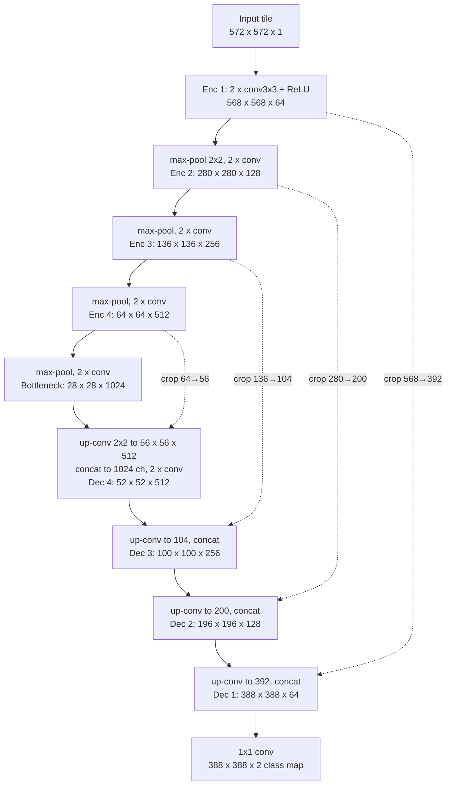
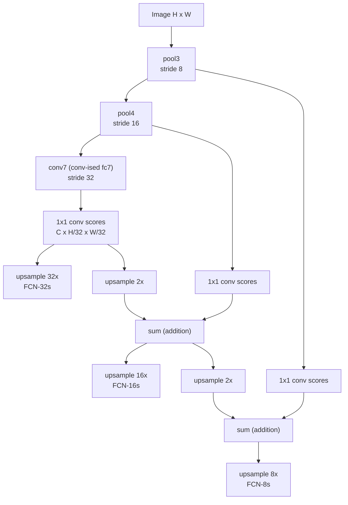
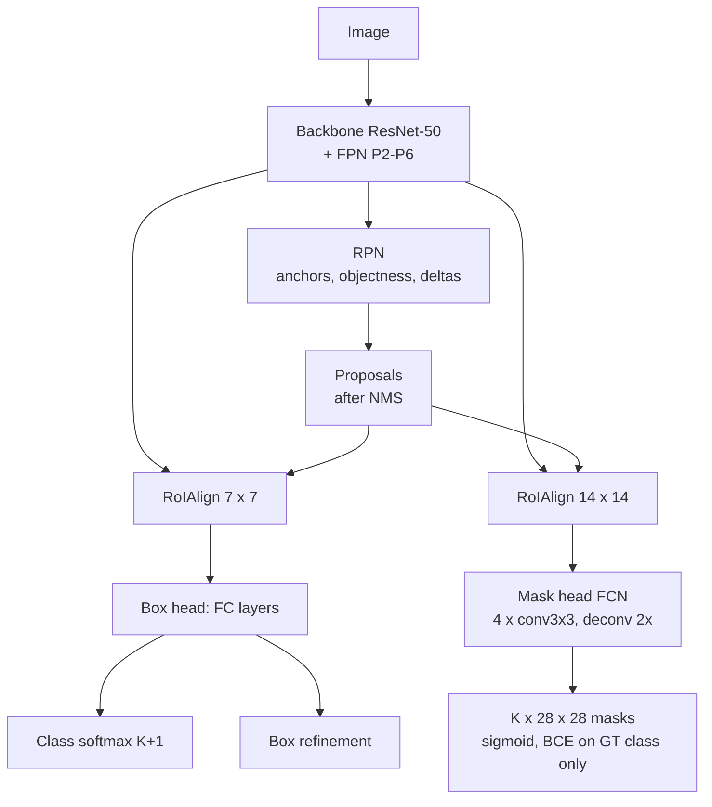
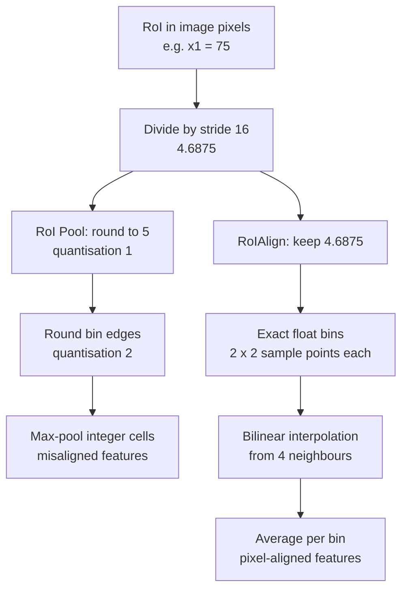
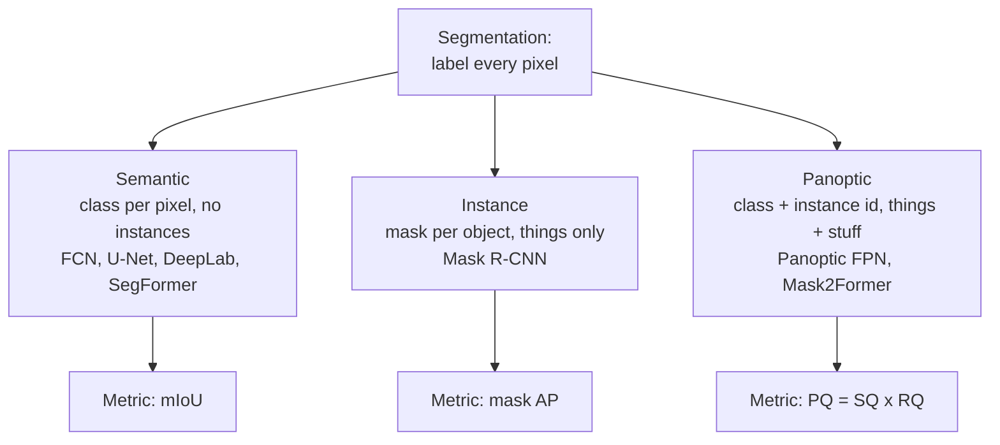

# Session 10 — Image Segmentation

> **Syllabus:**
> - Semantic vs Instance vs Panoptic segmentation
> - FCN, U-Net, Mask R-CNN
> - IoU / Dice metrics
> - Modern segmentation overview
> - Lab: run a pretrained segmentation model
>
> **Related:** [Session 03 — CNNs (conv output size, receptive field)](03_cnns_under_the_hood.md) · [Session 06 — Faster R-CNN, RoI pooling](06_detection_two_stage.md) · [Session 07 — IoU, NMS, AP](07_detection_one_stage.md) · [Session 08 — DETR, set prediction](08_detection_transformers.md) · [Session 13 — Segment Anything](13_vision_foundation_models.md) · [Session 14 — detection + segmentation pipelines](14_vision_plus_plus.md) · [code: Dice / IoU](../code/dice_iou_segmentation.py) · [Formula sheet](../00_formula_sheet.md) · [Comparison tables](../00_comparison_tables.md)
>
> **Practice:** [Questions](../practice/10_questions.md) · [Solutions](../practice/10_solutions.md)

---

## 1. Big picture

Classification answers "what is in the image", detection answers "what and where (box)"; **segmentation** answers "**which pixels**" — it assigns a label to every pixel. It is needed whenever shape matters: medical imaging (tumour volume), autonomous driving (drivable road, pedestrians), robotics (grasping), photo editing (background removal). The core difficulty is to combine **"what"** (deep, coarse, semantic features) with **"where"** (shallow, fine, spatial features): CNN classifiers shrink the image by 32×, but a mask must be full resolution. **FCN** solved this with convolutionalisation + upsampling + skip connections, **U-Net** with a symmetric encoder–decoder and concatenated skips, and **Mask R-CNN** by adding a per-object mask head to the Faster R-CNN detector (Session 06). Evaluation uses region-overlap metrics — **IoU (Jaccard), Dice, mIoU, PQ** — not pixel accuracy. Modern models (DeepLab, SegFormer, Mask2Former, SAM) build on the same ideas.

---

## 2. Core concepts

### Semantic vs instance vs panoptic segmentation

- **Semantic segmentation**: every pixel gets a **class label** from a fixed set (road, car, person, sky). Two touching cars become **one "car" blob** — instances are **not** separated. Output: an $H\times W$ label map. Models: FCN, U-Net, DeepLab, SegFormer.
- **Instance segmentation**: detect each **object instance** and give it its own **mask** + class + score (car #1, car #2). Only countable objects; background/"stuff" pixels are unlabelled; masks may **overlap**. Output: a list of (mask, class, score). Model: Mask R-CNN.
- **Panoptic segmentation** (Kirillov et al., 2019): **unifies** both — every pixel gets a class label **and**, for countable classes, an **instance id**. Output: one label per pixel = (class, instance id), **no overlaps**, every pixel covered (or "void"). Metric: **Panoptic Quality** $PQ=SQ\times RQ$.
- **Things vs stuff**:
  - **Things** = countable objects with well-defined shape (person, car, dog) → get instance ids.
  - **Stuff** = amorphous, uncountable regions (sky, road, grass, water) → class only.
  - Semantic segmentation treats both as stuff-like; instance segmentation handles only things; panoptic handles both.

| | Semantic | Instance | Panoptic |
|---|---|---|---|
| Label per pixel | class | (class, id) for object pixels only | (class, id) for things, class for stuff |
| Separates instances? | No | Yes | Yes (things) |
| Covers stuff? | Yes | No | Yes |
| Overlapping masks? | No | Possible | No |
| Typical metric | mIoU | mask AP | PQ |
| Example model | FCN, U-Net, DeepLab | Mask R-CNN | Panoptic FPN, Mask2Former |

**Assumptions/limitations:** a fixed label set (closed vocabulary — SAM and open-vocabulary models relax this, see [Session 13](13_vision_foundation_models.md)); pixel labels are expensive to annotate (minutes per image), which is why data efficiency (U-Net, transfer learning) matters.

### FCN: fully convolutional networks

**Idea (Long, Shelhamer & Darrell, 2015):** take an ImageNet classifier (VGG-16) and make it output a **dense** prediction map.

1. **Convolutionalisation of FC layers.** A fully connected layer that sees a $7\times7\times512$ input is equivalent to a **7×7 convolution** with 4096 filters; the next FC layers become **1×1 convolutions**; the classifier becomes a **1×1 conv with $C$ outputs** (21 for PASCAL VOC = 20 classes + background). Now the network accepts **any input size** and outputs a **coarse score map** (stride 32) instead of one vector — the pretrained weights are reused directly.
2. **Upsampling with transposed convolution** ("deconvolution", better called fractionally strided convolution) brings the coarse map back to input resolution. The filters are **initialised to bilinear interpolation** and can be learned (the final upsampling can be kept fixed bilinear).
3. **Skip connections fuse coarse and fine predictions by element-wise addition:**
   - **FCN-32s**: score map from conv7 (stride 32) → upsample **32×** → output. Very coarse, blobby boundaries.
   - **FCN-16s**: upsample conv7 scores **2×**, **add** scores predicted from **pool4** (stride 16, via a 1×1 conv), then upsample **16×**.
   - **FCN-8s**: additionally upsample 2× and **add** scores from **pool3** (stride 8), then upsample **8×**. Best detail.
4. **Loss**: **pixel-wise cross-entropy** (softmax over classes at every pixel, summed/averaged over pixels; "void" pixels ignored).

**Why skips help:** deep layers know *what* (semantics) but have lost *where* (resolution); shallow layers know *where* (edges, fine positions) but not *what*. Fusing them gives semantically correct and spatially precise masks.

**Limitations:** fused predictions are still coarse at stride 8; no explicit context aggregation; independent per-pixel decisions (no CRF / no global reasoning); one label per pixel (no instances).

### U-Net

**U-Net (Ronneberger, Fischer & Brox, 2015)** was designed for **biomedical images with very little training data** (e.g. 30 annotated EM images).

- **Architecture — a symmetric "U":**
  - **Contracting path (encoder)**: repeated blocks of **two 3×3 convolutions (unpadded / "valid") + ReLU**, then **2×2 max-pool stride 2**; channels double each level: 64 → 128 → 256 → 512 → **1024** (bottleneck).
  - **Expansive path (decoder)**: **2×2 up-convolution** (transposed conv, stride 2) that **halves the channels**, then **concatenation** with the **cropped** feature map from the same level of the encoder, then two 3×3 convs + ReLU.
  - **Final 1×1 conv** maps 64 channels to the number of classes (2 in the paper). 23 conv layers in total; no fully connected layers.
- **Skip connections by concatenation** (not addition): the decoder receives the encoder's full high-resolution feature maps as extra channels and *learns* how to combine them → precise localisation of boundaries.
- **Valid convolutions + cropping**: each unpadded 3×3 conv removes 2 pixels → a **572×572 input tile gives a 388×388 output**; encoder maps are larger than the corresponding decoder maps, so they are **centre-cropped** before concatenation (e.g. 64×64 → 56×56). Each output pixel therefore has full context (no padding artefacts).
- **Overlap-tile strategy**: large images are segmented tile by tile; missing context at the image border is filled by **mirroring** the image.
- **Heavy data augmentation**: shifts, rotations, grey-value changes and especially **random elastic deformations** (displacements on a coarse 3×3 grid, Gaussian with 10-pixel std, interpolated smoothly) — tissue naturally deforms, so this teaches invariance from few images.
- **Border-weighted loss**: pixel-wise softmax + cross-entropy with a **weight map** that up-weights pixels in the thin gaps **between touching cells** ($w_0=10$, $\sigma\approx5$ px) and balances class frequencies → separates touching instances.
- **Why it works with small data**: skip connections give the decoder high-resolution detail "for free"; strong augmentation; fully convolutional (many training patches per image); every pixel is a training signal.
- **Today**: "U-Net" usually means the encoder–decoder + concatenation design with **padded** convs (output size = input size), often with a pretrained encoder (ResNet), batch norm and Dice + CE loss; it is also the backbone of **diffusion models** ([Session 15](15_generative_cv.md)).

### Mask R-CNN

**Mask R-CNN (He et al., 2017) = Faster R-CNN + a parallel mask branch** — the standard **instance segmentation** model.

- **Backbone + FPN** (e.g. ResNet-50-FPN) → **RPN** proposes RoIs (anchors, objectness, offsets) → for each RoI:
  - **Box head**: RoIAlign 7×7 → FC layers → class scores ($K+1$) + class-specific box refinement;
  - **Mask head** (in parallel): RoIAlign **14×14** → small **FCN** (4 × 3×3 conv, 256 channels) → 2×2 transposed conv → **$28\times28$** → 1×1 conv → **$K\times28\times28$** mask logits (one $m\times m$ mask per class, $m=28$).
- **Multi-task loss** per positive RoI: $\mathcal L=\mathcal L_{cls}+\mathcal L_{box}+\mathcal L_{mask}$.
- **Mask loss = per-pixel sigmoid + average binary cross-entropy**, applied **only to the mask of the GT class $k$** of that RoI → masks of different classes **do not compete** (**class-decoupled**); the box/class head decides the class. The paper showed this beats a per-pixel softmax over classes (which couples mask and class prediction) by a large margin.
- **Mask target**: the GT mask cropped to the RoI and resized to 28×28. Only RoIs with IoU ≥ 0.5 with a GT (positives) get a mask loss.
- **RoIAlign vs RoI Pool** (the key enabler):
  - **RoI Pool** (Fast/Faster R-CNN) **quantises twice**: (1) RoI coordinates divided by the stride are **rounded** to integer feature cells, (2) the RoI is split into $7\times7$ bins whose boundaries are again **rounded**; then max-pool each bin. With stride 16, a rounding of 0.5 cell = **8 pixels** of misalignment — harmless for classification, harmful for pixel-accurate masks.
  - **RoIAlign** does **no rounding**: keeps the exact floating-point RoI and bin boundaries, places a few **regularly spaced sampling points** (e.g. 2×2) in each bin, computes each point's value by **bilinear interpolation** of the 4 nearest feature cells, and **averages (or max-pools)** the points of each bin. Result: features aligned with the pixels → large mask-accuracy gains (10–50% relative improvement in mask AP under strict IoU), small box gains.
- **FPN**: multi-scale features; each RoI is pooled from the pyramid level that matches its size (small RoIs → fine levels).
- **Inference**: proposals → box head → NMS → top **100** detections → mask head run **only on these boxes** → take the **mask channel of the predicted class** → sigmoid → resize 28×28 to the box size → **threshold 0.5** → paste into the image. ~5 fps in the original paper (the mask branch adds little overhead).
- **Extensions**: keypoint detection (one-hot $m\times m$ mask per keypoint); Panoptic FPN adds a semantic "stuff" branch.
- **Limitations**: 28×28 masks give blobby boundaries for large objects; two-stage → slower than one-stage methods; masks depend on box quality (a truncated box truncates the mask).

### IoU and Dice metrics

All are computed from pixel counts of one class: **TP** = pixels predicted as the class and truly the class; **FP** = predicted class but truly not; **FN** = truly class but predicted not; **TN** = neither.

- **IoU / Jaccard index**: $\frac{\lvert A\cap B\rvert}{\lvert A\cup B\rvert}=\frac{TP}{TP+FP+FN}$ — same idea as box IoU (Session 07) but on pixel sets.
- **Dice coefficient (= pixel F1 score)**: $\frac{2\lvert A\cap B\rvert}{\lvert A\rvert+\lvert B\rvert}=\frac{2TP}{2TP+FP+FN}$ — harmonic mean of pixel precision and recall.
- **Relationship**: $\text{Dice}=\frac{2\,\text{IoU}}{1+\text{IoU}}$, $\text{IoU}=\frac{\text{Dice}}{2-\text{Dice}}$; **Dice ≥ IoU** (equal only at 0 and 1). Proof in [§3](#3-key-formulas).
- **Same ranking for a single comparison**: because $f(J)=\frac{2J}{1+J}$ is **strictly increasing**, for one image (or for counts pooled over a dataset) the model with higher IoU always has higher Dice — they **never disagree**.
- **But averages can disagree**: $f$ is **non-linear (concave)**, so **mean Dice over images** is not $f(\text{mean IoU})$. Two models can swap order: per-image IoU (0.50, 0.50) → mean IoU 0.500, mean Dice 0.667; per-image IoU (0.90, 0.15) → mean IoU 0.525 (better) but mean Dice 0.604 (worse). Dice is more forgiving of a few moderate errors, IoU punishes poor images less in relative terms. Always state **how** a metric is averaged.
- **Per-class IoU and mIoU**: compute IoU for each class $c$ (usually from a **confusion matrix accumulated over the whole dataset**), then **mIoU = mean over classes** — every class counts equally regardless of size → the standard semantic-segmentation metric (PASCAL VOC, Cityscapes, ADE20K).
- **Pixel accuracy pitfall**: pixel accuracy $=\frac{\text{correct pixels}}{\text{all pixels}}$ is dominated by large classes. With 95% background, predicting **"all background" scores 95% pixel accuracy** while the object IoU is **0**. Use mIoU / per-class IoU / Dice for imbalanced data and small objects. (Mean class accuracy — average per-class recall — is better but ignores FPs.)
- **Soft Dice loss**: a differentiable version using predicted probabilities $p_i\in[0,1]$ instead of hard labels — directly optimises overlap and is **robust to class imbalance** (a tiny tumour with 1% of pixels still contributes a full Dice term). Usually combined with cross-entropy (CE gives stable gradients early; Dice handles imbalance).
- **Boundary metrics (brief)**: region metrics are insensitive to boundary quality of large objects (a 2-pixel boundary error barely changes IoU of a big mask). **Boundary IoU / boundary F-score** compare only pixels within a thin band around the contours; **Hausdorff distance** (max distance between boundaries; often the 95th percentile) is common in medical imaging.
- **Instance metrics**: mask AP (COCO): like box AP (Session 07) but the IoU between **masks** decides TP/FP. **Panoptic**: PQ.

### Modern segmentation overview

- **DeepLab family (Google)** — semantic segmentation with **atrous (dilated) convolution**:
  - **Atrous conv** inserts gaps between kernel taps: a 3×3 kernel with dilation $D$ covers $K_{eff}=D(K-1)+1$ pixels with the same 9 weights → **larger receptive field without downsampling and without extra parameters**. DeepLab removes the last strides of the backbone and uses dilation instead → output stride 8 or 16 instead of 32.
  - **ASPP (atrous spatial pyramid pooling)**: parallel atrous convs with different rates (e.g. 6, 12, 18) + a 1×1 conv + **image-level pooling** → multi-scale context.
  - **v1/v2** refined boundaries with a **fully connected CRF** post-processing step; **v3** improved ASPP and **dropped the CRF**; **v3+** added a light **decoder** (encoder–decoder like U-Net) and depthwise-separable atrous convs.
- **PSPNet**: **pyramid pooling module** — pool the final feature map into 1×1, 2×2, 3×3, 6×6 bins, project, upsample and concatenate → global scene context (e.g. "boat" on water, not "car").
- **SegFormer**: hierarchical **Transformer** encoder producing multi-scale features, **no positional encodings** (a 3×3 conv inside the FFN gives position information, so it handles any resolution), efficient attention; very light **all-MLP decoder**. Strong accuracy/efficiency.
- **MaskFormer / Mask2Former**: **mask classification** instead of per-pixel classification — $N$ queries each predict a **class + a binary mask** (DETR-style, trained with **Hungarian matching**, [Session 08](08_detection_transformers.md)). **Masked attention** restricts each query's cross-attention to the foreground of its current predicted mask → faster convergence. **One universal architecture** for **semantic, instance and panoptic** segmentation.
- **Panoptic FPN**: Mask R-CNN + FPN with an extra light **semantic-segmentation branch** for stuff; instance and semantic outputs are merged (resolving overlaps) into a panoptic map.
- **SAM (Segment Anything)**: **promptable** segmentation (points, boxes, masks) trained on SA-1B (11M images, 1.1B masks); MAE-pretrained ViT-H image encoder + prompt encoder + light mask decoder; returns **3 masks + predicted IoU** for ambiguous prompts; masks have **no class labels** → pair it with a detector (e.g. Grounding DINO) for labelled masks. See [Session 13](13_vision_foundation_models.md) and [Session 14](14_vision_plus_plus.md).
- **Trends**: transformers + multi-scale features, universal query-based architectures, foundation models and promptable/zero-shot segmentation, real-time models for driving and mobile.

### Lab: running a pretrained segmentation model

**Goal:** run torchvision's pretrained **DeepLabV3-ResNet50** (semantic) and **Mask R-CNN-ResNet50-FPN** (instance) on your own image and interpret the outputs. Full Dice/IoU utilities: [code/dice_iou_segmentation.py](../code/dice_iou_segmentation.py).

**Common rules:**
- `model.eval()` — BatchNorm uses running statistics and dropout is off (training mode gives wrong/unstable outputs, and in training mode BatchNorm errors out when a layer sees only one value per channel, e.g. batch size 1 after global pooling as in DeepLab's image-pooling branch).
- `with torch.no_grad():` — no autograd graph → less memory, faster.
- **Preprocessing must match training**: RGB, float in [0,1], **ImageNet normalisation** (mean (0.485, 0.456, 0.406), std (0.229, 0.224, 0.225)). The weights object provides the matching transform: `weights.transforms()`.

**(a) Semantic segmentation — DeepLabV3:**

```python
import torch
from torchvision.io import read_image
from torchvision.models.segmentation import deeplabv3_resnet50, DeepLabV3_ResNet50_Weights

weights = DeepLabV3_ResNet50_Weights.DEFAULT        # COCO subset with the 20 VOC classes + background
model = deeplabv3_resnet50(weights=weights).eval()
preprocess = weights.transforms()                    # resize (shorter side 520), to float, ImageNet normalise

img = read_image("street.jpg")                       # uint8 tensor [3, H, W]
batch = preprocess(img).unsqueeze(0)                 # [1, 3, h, w]
with torch.no_grad():
    out = model(batch)["out"]                        # logits [1, 21, h, w] (already upsampled to input size)
pred = out.argmax(dim=1)                             # [1, h, w] class index per pixel (0 = background)
classes = weights.meta["categories"]                 # ['__background__', 'aeroplane', ...]
```

- Output is a dict: `out['out']` has shape **[N, 21, H, W]** (21 = 20 VOC classes + background); `'aux'` exists only if the auxiliary head is enabled.
- **argmax over the class dimension** (dim=1) → label map; `softmax(dim=1)` gives per-pixel probabilities (confidence maps).

**(b) Instance segmentation — Mask R-CNN:**

```python
from torchvision.models.detection import maskrcnn_resnet50_fpn, MaskRCNN_ResNet50_FPN_Weights

weights = MaskRCNN_ResNet50_FPN_Weights.DEFAULT       # COCO
model = maskrcnn_resnet50_fpn(weights=weights).eval()
x = weights.transforms()(img)                         # float [3, H, W] in [0, 1]; normalise + resize happen INSIDE the model
with torch.no_grad():
    pred = model([x])[0]                              # input: LIST of images; output: list of dicts
keep = pred["scores"] > 0.5                           # confidence threshold
boxes  = pred["boxes"][keep]                          # [n, 4] (x1, y1, x2, y2) in input-image pixels
labels = pred["labels"][keep]                         # [n] COCO category indices -> weights.meta["categories"]
masks  = pred["masks"][keep] > 0.5                    # [n, 1, H, W] soft probabilities -> binary masks
```

- Output per image: `boxes` [N, 4], `labels` [N], `scores` [N] (sorted, at most 100 detections), `masks` **[N, 1, H, W]** — soft masks in [0, 1] already pasted at full image size → **threshold at 0.5**.
- Unlike DeepLab, torchvision detection models do their own normalisation and resizing internally (`GeneralizedRCNNTransform`), so you pass [0, 1] images — normalising twice is a classic bug.
- **Visualise**: `torchvision.utils.draw_segmentation_masks(img, masks.squeeze(1), alpha=0.5)` (it needs `[n, H, W]` masks) and `draw_bounding_boxes`.
- **Evaluate** against a GT mask with IoU/Dice per class; inspect failures: thin structures, small objects, boundaries, unusual viewpoints, classes outside the training label set (a closed-vocabulary model cannot segment them).

---

## 3. Key formulas

### Pixel-wise cross-entropy (FCN / U-Net loss)

$$
\mathcal L_{CE}=-\frac{1}{\lvert\Omega\rvert}\sum_{p\in\Omega}\ \sum_{c=1}^{C} y_{p,c}\,\log\hat y_{p,c},\qquad \hat y_{p,c}=\frac{e^{z_{p,c}}}{\sum_{c'}e^{z_{p,c'}}}
$$

- $\Omega$ = set of labelled pixels (void pixels excluded); $C$ = number of classes; $y_{p,c}\in\{0,1\}$ = one-hot GT at pixel $p$; $z_{p,c}$ = logit; $\hat y_{p,c}$ = softmax probability.
- **U-Net weighted version**: multiply each pixel's term by

$$
w(\mathbf x)=w_c(\mathbf x)+w_0\exp\!\left(-\frac{\big(d_1(\mathbf x)+d_2(\mathbf x)\big)^2}{2\sigma^2}\right)
$$

  $w_c$ = class-balancing weight; $d_1,d_2$ = distances to the nearest and second-nearest cell border; $w_0=10$, $\sigma\approx5$ px → large weight in narrow gaps between touching cells.

**Worked example.** A pixel with GT class 2 and predicted probability $\hat y_{p,2}=0.8$ contributes $-\ln0.8=0.223$; if it lies in a gap where $w=10$, it contributes $2.23$.

### Transposed-convolution output size

$$
W_{out}=(W_{in}-1)\,S-2P+K\ (+\ \text{output\_padding})
$$

- $W_{in}$ input size, $S$ stride, $P$ padding, $K$ kernel size.

**Worked examples.** FCN-32s: $W_{in}=7$, $K=64$, $S=32$, $P=16$ → $(6)(32)-32+64=\mathbf{224}$. FCN 2× upsampling: $K=4,S=2,P=1$: $7\to(6)(2)-2+4=\mathbf{14}$. U-Net up-conv: $K=2,S=2,P=0$: $28\to(27)(2)+2=\mathbf{56}$.

### Valid convolution and pooling sizes (U-Net)

$$
W_{out}=W_{in}-K+1\ \ (\text{conv},\ P=0,\ S=1),\qquad W_{out}=\left\lfloor\frac{W_{in}}{2}\right\rfloor\ \ (2\times2\ \text{max-pool, stride }2)
$$

**Worked example.** $572\xrightarrow{3\times3}570\xrightarrow{3\times3}568\xrightarrow{\text{pool}}284$ (each valid 3×3 conv loses 2 pixels).

### Dilated (atrous) convolution

$$
K_{eff}=D(K-1)+1
$$

- $D$ = dilation rate. Parameters stay $K^2C_{in}C_{out}$ (+bias). **Example:** $K=3$, $D=2$ → $K_{eff}=5$; $D=4$ → $9$; still 9 weights per input–output channel pair.

### IoU (Jaccard) and Dice from pixel counts

$$
\text{IoU}=\frac{\lvert A\cap B\rvert}{\lvert A\cup B\rvert}=\frac{TP}{TP+FP+FN},\qquad
\text{Dice}=\frac{2\lvert A\cap B\rvert}{\lvert A\rvert+\lvert B\rvert}=\frac{2TP}{2TP+FP+FN}
$$

- $A$ = predicted mask, $B$ = GT mask; $\lvert A\rvert=TP+FP$, $\lvert B\rvert=TP+FN$.

**Worked example.** GT 1,200 px, prediction 1,000 px, overlap 900 → $FP=100$, $FN=300$; IoU $=900/1300=\mathbf{0.692}$; Dice $=1800/2200=\mathbf{0.818}$.

### Dice–IoU relationship (with proof)

$$
\text{Dice}=\frac{2\,\text{IoU}}{1+\text{IoU}},\qquad \text{IoU}=\frac{\text{Dice}}{2-\text{Dice}}
$$

**Proof.** Let $I=\lvert A\cap B\rvert$, $U=\lvert A\cup B\rvert$. Inclusion–exclusion: $\lvert A\rvert+\lvert B\rvert=U+I$. Then

$$
\text{Dice}=\frac{2I}{\lvert A\rvert+\lvert B\rvert}=\frac{2I}{U+I}=\frac{2\,(I/U)}{1+(I/U)}=\frac{2\,\text{IoU}}{1+\text{IoU}}.
$$

Solving $D(1+J)=2J$ for $J$: $J=\frac{D}{2-D}$. Since $\frac{d}{dJ}\frac{2J}{1+J}=\frac{2}{(1+J)^2}>0$, Dice is **strictly increasing** in IoU; and $\frac{2J}{1+J}\ge J\iff 2\ge1+J$, true for $J\le1$ → **Dice ≥ IoU**.

**Worked example.** Dice $=0.8$ → IoU $=0.8/1.2=0.667$. IoU $=0.5$ → Dice $=1/1.5=0.667$.

### Confusion-matrix metrics (semantic segmentation)

$$
\text{PA}=\frac{\sum_c n_{cc}}{\sum_{i,j}n_{ij}},\qquad
\text{IoU}_c=\frac{n_{cc}}{\sum_j n_{cj}+\sum_i n_{ic}-n_{cc}},\qquad
\text{mIoU}=\frac1C\sum_{c=1}^{C}\text{IoU}_c
$$

- $n_{ij}$ = number of pixels of **GT class $i$ predicted as class $j$** (rows = GT, columns = prediction); $n_{cc}$ = TP of class $c$; row sum $\sum_j n_{cj}$ = GT pixels of $c$ (TP + FN); column sum $\sum_i n_{ic}$ = predicted pixels of $c$ (TP + FP). PA = pixel accuracy.
- Mean class accuracy $=\frac1C\sum_c\frac{n_{cc}}{\sum_j n_{cj}}$ (mean per-class recall). Frequency-weighted IoU weights IoU$_c$ by class frequency (again dominated by big classes).

**Worked example** (rows GT, cols pred; classes background, car, person):

$$
\begin{bmatrix}8850 & 100 & 50\\ 120 & 660 & 20\\ 90 & 10 & 100\end{bmatrix}
$$

PA $=9610/10000=0.961$; IoU: background $8850/9210=0.961$, car $660/910=0.725$, person $100/270=0.370$; **mIoU = 0.686**. A trivial "all background" model would get PA $=0.90$ but mIoU $=0.30$.

### Soft Dice loss

$$
\mathcal L_{Dice}=1-\frac{2\sum_i p_i g_i+\epsilon}{\sum_i p_i+\sum_i g_i+\epsilon}
$$

- $p_i\in[0,1]$ predicted foreground probability of pixel $i$, $g_i\in\{0,1\}$ GT, $\epsilon$ small smoothing constant (avoids 0/0 for empty masks). Variant (V-Net): squares in the denominator. Multi-class: average over classes.

**Worked example.** 3 pixels, $p=(0.9,0.6,0.2)$, $g=(1,1,0)$: $\sum pg=1.5$, $\sum p=1.7$, $\sum g=2$ → $\mathcal L=1-3/3.7=0.189$ ($\epsilon\approx0$).

### Panoptic Quality

$$
PQ=\frac{\sum_{(p,g)\in TP}\text{IoU}(p,g)}{\lvert TP\rvert+\tfrac12\lvert FP\rvert+\tfrac12\lvert FN\rvert}
=\underbrace{\frac{\sum_{(p,g)\in TP}\text{IoU}(p,g)}{\lvert TP\rvert}}_{SQ}\times\underbrace{\frac{\lvert TP\rvert}{\lvert TP\rvert+\tfrac12\lvert FP\rvert+\tfrac12\lvert FN\rvert}}_{RQ}
$$

- A predicted segment $p$ and GT segment $g$ of the same class are **matched (TP) if IoU$(p,g)>0.5$** — this matching is **unique** because segments do not overlap (IoU > 0.5 means a prediction covers more than half of that GT segment's pixels, which two disjoint predictions cannot both do). $FP$ = unmatched predicted segments, $FN$ = unmatched GT segments. **SQ** (segmentation quality) = mean IoU of matched pairs; **RQ** (recognition quality) = F1 score of detection. PQ is computed **per class** and averaged over classes (also reported separately as $PQ^{Th}$ for things and $PQ^{St}$ for stuff).

**Worked example.** Class car: matched IoUs 0.92, 0.81, 0.66, 0.55; 1 FP, 1 FN → $SQ=2.94/4=0.735$, $RQ=4/5=0.8$, $PQ=\mathbf{0.588}$.

### Bilinear interpolation (RoIAlign sampling)

$$
f(x,y)=(1-a)(1-b)\,f_{00}+a(1-b)\,f_{10}+(1-a)\,b\,f_{01}+a\,b\,f_{11},\qquad a=x-x_0,\ b=y-y_0
$$

- $(x_0,y_0)=(\lfloor x\rfloor,\lfloor y\rfloor)$; $f_{00}=F(x_0,y_0)$, $f_{10}=F(x_0+1,y_0)$, $f_{01}=F(x_0,y_0+1)$, $f_{11}=F(x_0+1,y_0+1)$ (feature value $F(x,y)$ stored at integer column $x$, row $y$).

**Worked example.** $F(5,3)=10$, $F(6,3)=20$, $F(5,4)=30$, $F(6,4)=60$; sample at $(5.25,3.75)$: $a=0.25$, $b=0.75$ → $0.1875(10)+0.0625(20)+0.5625(30)+0.1875(60)=1.875+1.25+16.875+11.25=\mathbf{31.25}$. (Nearest neighbour would return $F(5,4)=30$.)

### RoI Pool quantisation error

$$
x_f=\frac{x}{s},\qquad \text{RoI Pool uses } [x_f]\ (\text{rounded}),\qquad \text{misalignment}=\big\lvert [x_f]-x_f\big\rvert\cdot s\ \text{pixels}
$$

- $x$ = RoI coordinate in image pixels, $s$ = feature stride (16 for C4/VGG conv5). Maximum error from rounding = 0.5 cell = $s/2=8$ px per coordinate, before the second (bin) quantisation. RoIAlign uses $x_f$ directly.

**Worked example.** $x_1=75$ px, $s=16$: $x_f=4.6875\to5$; error $0.3125$ cells $=\mathbf{5}$ px.

### Mask R-CNN loss and mask-head size

$$
\mathcal L=\mathcal L_{cls}+\mathcal L_{box}+\mathcal L_{mask},\qquad
\mathcal L_{mask}=-\frac{1}{m^2}\sum_{i,j}\Big[y_{ij}\log\sigma(z^{k}_{ij})+(1-y_{ij})\log\big(1-\sigma(z^{k}_{ij})\big)\Big]
$$

- $m=28$; $z^{k}_{ij}$ = logit of pixel $(i,j)$ in the mask channel of the **GT class $k$**; $\sigma$ = sigmoid; $y_{ij}\in\{0,1\}$ = mask target. Mask-head output per RoI: $K\times m\times m$ (COCO $K=80$ → $80\times28\times28=62{,}720$ values, of which only $28\times28=784$ enter the loss).

---

## 4. Algorithms step by step

### Algorithm 1 — FCN-8s inference

1. Normalise the image (ImageNet mean/std); any size $H\times W$.
2. Run the **convolutionalised VGG-16**: conv1–conv5 with 5 pooling stages; fc6 → 7×7 conv (4096), fc7 → 1×1 conv (4096).
3. **Score layer**: 1×1 conv on conv7 → $C$-channel scores at stride 32.
4. Upsample those scores **2×** (transposed conv, bilinear init) → stride 16; **add** a 1×1-conv score map computed from **pool4** (crop to align).
5. Upsample the sum **2×** → stride 8; **add** scores from **pool3**.
6. Upsample **8×** to input resolution (bilinear) → $C\times H\times W$ scores.
7. **Argmax over classes** at each pixel → label map. (Training: pixel-wise CE on step 6 output.)

### Algorithm 2 — U-Net forward pass (original, valid convolutions)

1. Input tile $572\times572$ (image mirrored at borders for overlap-tile).
2. **Encoder level 1**: conv3×3+ReLU → 570, conv3×3+ReLU → **568** (64 ch); save; max-pool → 284.
3. **Level 2**: 282 → **280** (128 ch); save; pool → 140. **Level 3**: 138 → **136** (256 ch); save; pool → 68. **Level 4**: 66 → **64** (512 ch); save; pool → 32.
4. **Bottleneck**: 30 → **28** (1024 ch).
5. **Decoder level 4**: up-conv 2×2 → **56** (512 ch); **crop** saved 64 → 56; **concatenate** → 1024 ch; conv → 54 → **52** (512 ch).
6. **Level 3**: up-conv → 104 (256 ch); crop 136 → 104; concat; conv → 102 → **100**.
7. **Level 2**: up-conv → 200 (128 ch); crop 280 → 200; concat; conv → 198 → **196**.
8. **Level 1**: up-conv → 392 (64 ch); crop 568 → 392; concat; conv → 390 → **388**.
9. **1×1 conv** → $388\times388\times C$ (C = 2) scores → softmax → per-pixel labels for the centre $388\times388$ region of the tile.

### Algorithm 3 — Mask R-CNN inference

1. Resize (shorter side 800) and normalise the image.
2. **Backbone + FPN** → feature maps P2–P6.
3. **RPN** on every level: anchor objectness + offsets → decode → NMS → top ~1000 proposals.
4. **Box head**: RoIAlign 7×7 from the level matching each proposal's size → FC layers → class softmax ($K+1$) + class-specific box deltas.
5. Decode boxes, drop low scores, **per-class NMS** → keep the top **100** detections.
6. **Mask head** on these 100 boxes: RoIAlign 14×14 → 4 × conv3×3 → transposed conv 2× → 28×28 → 1×1 conv → $K\times28\times28$ logits.
7. For each detection pick the channel of its **predicted class**, apply sigmoid.
8. **Resize** the 28×28 mask to the box size (bilinear), **threshold at 0.5**, paste into a full-size image canvas.
9. Output: boxes, labels, scores, masks.

### Algorithm 4 — RoIAlign

1. Map the RoI from image to feature coordinates: divide by the stride $s$ — **no rounding**.
2. Divide the RoI into $k\times k$ bins (7×7 for boxes, 14×14 for masks) of **equal floating-point size** — **no rounding**.
3. In each bin place $n\times n$ **regularly spaced sampling points** (e.g. $2\times2$, at 1/4 and 3/4 of the bin).
4. Compute each point's value by **bilinear interpolation** of the 4 surrounding feature cells.
5. **Aggregate** the points in each bin by **average** (or max) → $k\times k\times C$ output.
6. Gradients flow back to the 4 neighbours of every sampling point through the bilinear weights.

(RoI Pool instead: round coordinates → round bin boundaries → max-pool the integer cells in each bin.)

### Algorithm 5 — mIoU from a confusion matrix

1. Initialise a $C\times C$ matrix $n$ of zeros.
2. For every **labelled** pixel of every image (skip "void"/ignore label, e.g. 255 in VOC): $n[\text{GT}][\text{pred}]\mathrel{+}=1$.
3. For each class $c$: $TP=n_{cc}$; $FN=\text{row}_c-TP$; $FP=\text{col}_c-TP$.
4. $\text{IoU}_c=TP/(TP+FP+FN)$ (skip/flag classes absent from both GT and prediction to avoid 0/0).
5. $\text{mIoU}=$ mean of IoU$_c$ over classes; also report PA $=\text{trace}(n)/\text{sum}(n)$ and per-class IoU.

### Algorithm 6 — Panoptic Quality

1. For each class, list predicted and GT segments (things: one per instance; stuff: one per class per image).
2. Compute IoU for every same-class (prediction, GT) pair; pairs with **IoU > 0.5** are TP (unique by construction).
3. Unmatched predictions → FP; unmatched GT → FN.
4. Per class: $SQ=\frac{\sum\text{IoU}_{TP}}{\lvert TP\rvert}$, $RQ=\frac{\lvert TP\rvert}{\lvert TP\rvert+\frac12\lvert FP\rvert+\frac12\lvert FN\rvert}$, $PQ=SQ\times RQ$.
5. Average PQ over classes (and separately over things / stuff).

### Algorithm 7 — Lab workflow (pretrained segmentation)

1. Load model with pretrained weights; call `.eval()`.
2. Load image as RGB; apply `weights.transforms()` (DeepLab: resize + ImageNet normalisation; Mask R-CNN: only to float in [0,1]).
3. Add batch dimension (DeepLab) or wrap in a list (Mask R-CNN).
4. Forward under `torch.no_grad()`.
5. Post-process: DeepLab → `out['out'].argmax(1)`; Mask R-CNN → filter `scores > 0.5`, binarise `masks > 0.5`.
6. Map indices to names with `weights.meta["categories"]`; overlay masks; compute IoU/Dice against GT if available.

---

## 5. Diagrams

### U-Net (original, valid convolutions)



Left side (down) = **contracting path** ("what"); right side (up) = **expansive path** ("where"); dotted arrows = **skip connections**: copy the encoder map, centre-crop it (sizes on the arrow), then **concatenate** with the upsampled decoder map.

### FCN-32s / 16s / 8s skip fusion (addition)



### Mask R-CNN



### RoI Pool vs RoIAlign



### Segmentation task taxonomy



---

## 6. Comparison tables

### FCN vs U-Net vs Mask R-CNN vs DeepLab

| Aspect | FCN | U-Net | Mask R-CNN | DeepLab (v3/v3+) |
|---|---|---|---|---|
| Task | Semantic | Semantic (binary/multi-class) | **Instance** | Semantic |
| Backbone | Convolutionalised VGG-16 | Own symmetric encoder (64–1024 ch) | ResNet + FPN | ResNet / Xception with dilation |
| Upsampling | Transposed conv (bilinear init) | Learned 2×2 up-convs at every level | 2× deconv inside the mask head; mask resized to box | Bilinear (+ light decoder in v3+) |
| Skip fusion | **Addition** of score maps (pool3, pool4) | **Concatenation** of feature maps at every level | FPN (addition in top-down path) | v3+: concatenation of one low-level feature map |
| Context | Limited | Limited (deep bottleneck) | Per-RoI | ASPP + image pooling (multi-scale) |
| Output | $C\times H\times W$ scores | $C\times H'\times W'$ (388 for 572 input, original) | boxes + $K\times28\times28$ mask per RoI | $C\times H\times W$ |
| Loss | Pixel CE | Weighted pixel CE (border weights) | CE + box L1 + per-pixel **BCE** (GT class only) | Pixel CE |
| Strength | First end-to-end dense CNN | Small data, precise boundaries | Separates instances | Strong context, high mIoU |
| Weakness | Coarse boundaries | No instances; original crop sizes awkward | 28×28 masks, slower | No instances |

### Skip connections: addition (FCN) vs concatenation (U-Net)

| | Addition (FCN, FPN, ResNet) | Concatenation (U-Net, DenseNet) |
|---|---|---|
| Operation | element-wise sum, shapes must match | stack along channels |
| Channels after | unchanged | $C_1+C_2$ |
| What is combined | FCN: class **scores** | full **feature maps** |
| Flexibility | fixed equal weighting | following convs learn how to mix |
| Cost | cheaper | more memory/compute |

### RoI Pool vs RoIAlign

| | RoI Pool (Fast/Faster R-CNN) | RoIAlign (Mask R-CNN) |
|---|---|---|
| RoI coordinates | Rounded to feature cells | Exact floating point |
| Bin boundaries | Rounded | Exact floating point |
| Values read | Integer cells inside each bin | Bilinear interpolation at sampled points |
| Aggregation | Max | Average (or max) |
| Misalignment | Up to $s/2$ px per quantisation (8 px at stride 16) | None |
| Effect | Fine for classification | Large gain for masks and keypoints, small gain for boxes |

### Metrics

| Metric | Formula | Good for | Pitfall |
|---|---|---|---|
| Pixel accuracy | correct / all pixels | balanced data | Dominated by background; "all background" scores high |
| Mean class accuracy | mean per-class recall | imbalance-aware | Ignores false positives |
| IoU (Jaccard) | $TP/(TP+FP+FN)$ | per-class overlap | Insensitive to boundary detail of large objects |
| mIoU | mean IoU over classes | semantic segmentation benchmark | Rare classes noisy; averaging method matters |
| Dice (F1) | $2TP/(2TP+FP+FN)$ | medical, small structures | Same ranking as IoU per comparison; averages can differ |
| Boundary IoU / BF / Hausdorff | contour-based | boundary quality | More expensive; Hausdorff sensitive to outliers |
| Mask AP | AP with mask IoU | instance segmentation | Needs scores; many thresholds |
| PQ = SQ × RQ | see §3 | panoptic | Matching at IoU > 0.5 only |

### Modern segmentation models

| Model | Task | Key idea |
|---|---|---|
| DeepLab v1/v2 | Semantic | Atrous conv; ASPP (v2); dense CRF post-processing |
| DeepLab v3/v3+ | Semantic | Improved ASPP + image pooling, no CRF; v3+ adds decoder |
| PSPNet | Semantic | Pyramid pooling (1, 2, 3, 6 bins) for global context |
| SegFormer | Semantic | Hierarchical transformer without positional encodings + all-MLP decoder |
| Mask R-CNN | Instance | Faster R-CNN + mask head + RoIAlign |
| Panoptic FPN | Panoptic | Mask R-CNN + FPN + semantic branch, merged |
| Mask2Former | Semantic / instance / panoptic | Query-based mask classification, masked attention, Hungarian matching |
| SAM | Promptable, class-agnostic | Prompt (point/box) → 3 masks + IoU scores; no labels |

---

## 7. Common exam traps & misconceptions

- ❌ "U-Net skip connections add encoder and decoder features." → ✅ U-Net **concatenates** (after cropping) along the channel dimension; **FCN adds** score maps. Concatenation keeps both feature sets and lets the next convs learn the mix.
- ❌ "Dice and IoU can rank two models differently on the same image." → ✅ Not for a single comparison: $\text{Dice}=2\,\text{IoU}/(1+\text{IoU})$ is **strictly increasing**, so higher IoU ⇔ higher Dice. **However**, when per-image (or per-class) scores are **averaged**, the non-linearity means mean Dice and mean IoU **can** rank models differently (e.g. IoUs (0.5, 0.5) vs (0.9, 0.15)). State the averaging.
- ❌ "Dice is always smaller than IoU." → ✅ **Dice ≥ IoU** (equal only at 0 and 1).
- ❌ "Pixel accuracy is a good metric for small objects." → ✅ It is dominated by large classes (background); a model that never predicts the small object can still score > 95%. Use per-class IoU, mIoU or Dice.
- ❌ "RoIAlign rounds the RoI to the nearest cell and averages with nearest-neighbour sampling." → ✅ RoIAlign does **no rounding** at all; it samples regular points in each bin with **bilinear interpolation** of the 4 neighbouring cells and averages them.
- ❌ "Mask R-CNN predicts masks with a softmax over classes at each pixel." → ✅ It predicts **$K$ independent binary masks** with **per-pixel sigmoid + BCE**, and only the GT-class mask gets a loss (class-decoupled); the class comes from the box branch.
- ❌ "Mask R-CNN's mask is predicted at full image resolution." → ✅ It is a **28×28** mask per RoI, later resized to the box and thresholded at 0.5.
- ❌ "Semantic segmentation separates the two touching people." → ✅ Semantic segmentation gives both the label "person" — **one blob**; separating them needs instance or panoptic segmentation.
- ❌ "Instance segmentation labels every pixel." → ✅ Only object (thing) pixels; stuff like sky/road is ignored. Panoptic labels every pixel.
- ❌ "Transposed convolution is the inverse of convolution." → ✅ It only reverses the **shape** change (it is the gradient/transpose of a convolution), not the values; output size $(W-1)S-2P+K$.
- ❌ "FCN's upsampling filters must be fixed bilinear." → ✅ They are **initialised** to bilinear interpolation and can be learned.
- ❌ "U-Net's output has the same size as the input." → ✅ In the **original** U-Net (valid convs) a 572×572 tile gives a **388×388** output; only padded variants keep the size.
- ❌ "Dilated convolution adds parameters to enlarge the receptive field." → ✅ Same number of weights; only the spacing between taps grows ($K_{eff}=D(K-1)+1$); beware gridding artefacts at large rates.
- ❌ "SAM outputs class labels." → ✅ SAM masks are class-agnostic; combine with a detector/classifier (e.g. Grounding DINO + SAM) for labels.
- ❌ "For torchvision Mask R-CNN, normalise the image with ImageNet mean/std before calling the model." → ✅ Detection models normalise and resize **internally**; pass float images in [0, 1] (DeepLab, by contrast, needs the normalisation from `weights.transforms()`).
- ❌ "In PQ, a prediction can match several GT segments." → ✅ With IoU > 0.5 and non-overlapping segments the matching is **unique**.

---

## 8. 10-line cheat summary

1. Semantic = class per pixel (no instances); instance = mask per object (things only); panoptic = class + instance id for every pixel (things + stuff), metric $PQ=SQ\times RQ$.
2. FCN: FC layers → convolutions (any input size), transposed-conv upsampling (bilinear init), skips by **addition** (32s → 16s → 8s), pixel-wise CE.
3. U-Net: symmetric encoder–decoder, skips by **concatenation**, valid convs + crop (572 → 388), elastic augmentation, border-weighted loss — works with tiny datasets.
4. Mask R-CNN = Faster R-CNN + parallel FCN mask head → $K\times28\times28$, per-pixel sigmoid + BCE on the GT class only (class-decoupled), FPN.
5. RoI Pool rounds twice (misalignment up to $s/2$ px); RoIAlign keeps floats and **bilinearly** samples regular points per bin → pixel-aligned masks.
6. IoU $=TP/(TP+FP+FN)$; Dice $=2TP/(2TP+FP+FN)$; Dice $=2\,\text{IoU}/(1+\text{IoU})$, IoU $=\text{Dice}/(2-\text{Dice})$, Dice ≥ IoU.
7. Monotonic Dice–IoU ⇒ same ranking for one comparison; averaged per-image scores can rank differently.
8. mIoU = mean of per-class IoU from a dataset confusion matrix; pixel accuracy misleads under imbalance; soft-Dice loss handles imbalance.
9. Modern: DeepLab (atrous conv, ASPP, CRF early), PSPNet (pyramid pooling), SegFormer (transformer + MLP decoder), Mask2Former (queries + masked attention, universal), Panoptic FPN, SAM (promptable, class-agnostic).
10. Lab: `deeplabv3_resnet50` → `out['out']` [N, 21, H, W] → argmax(1); `maskrcnn_resnet50_fpn` → boxes, labels, scores, masks [N, 1, H, W] > 0.5; always `eval()` + `torch.no_grad()` + correct preprocessing.
