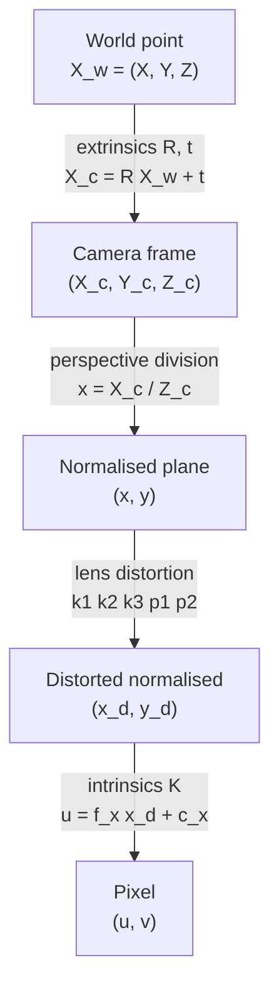
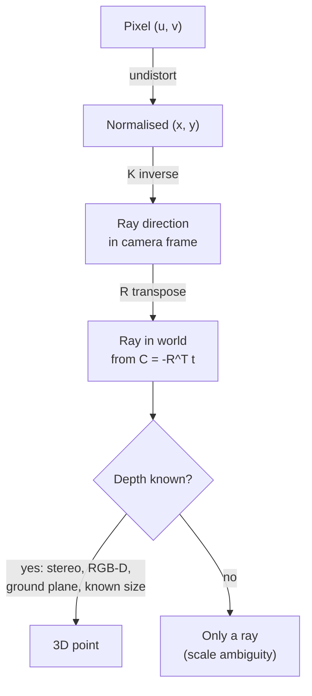
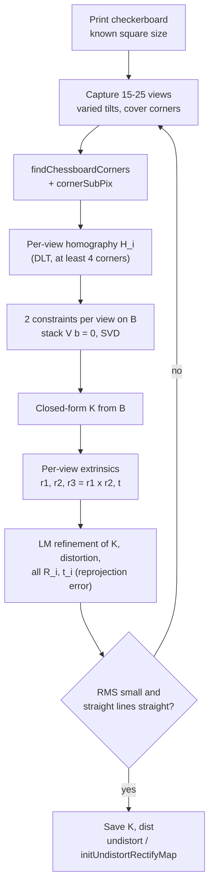
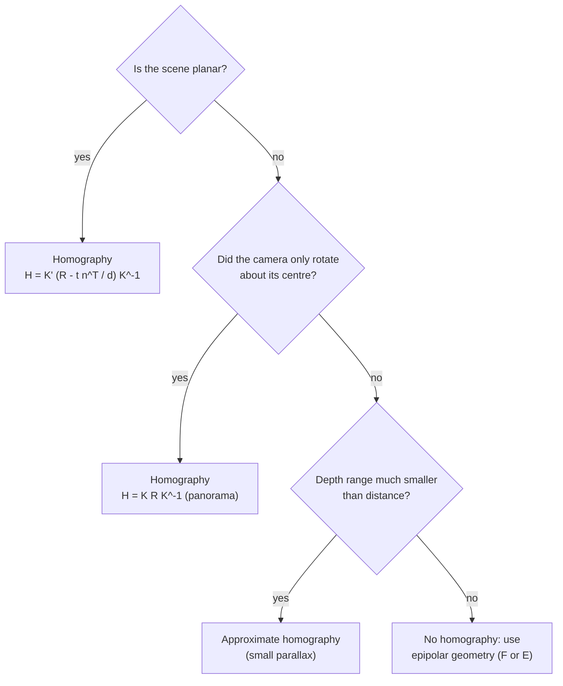

# Session 11 — Camera Geometry

> **Syllabus:**
> - Pinhole camera & perspective projection
> - Intrinsic & extrinsic parameters
> - Camera calibration & distortion
> - Homography revisited
>
> **Related:** [Session 02 — Feature matching, RANSAC, homography, panoramas](02_feature_matching_classical.md) · [Session 12 — Stereo, optical flow, SfM, SLAM](12_3d_vision_motion.md) · [Session 01 — Harris / corners (used to find checkerboard corners)](01_image_processing_features.md) · [Session 13 — Depth Anything (relative vs metric depth)](13_vision_foundation_models.md) · [Formula sheet](../00_formula_sheet.md) · [Comparison tables](../00_comparison_tables.md) · [Numericals drill](../practice/numericals_drill.md) · [code: stereo depth & projection](../code/stereo_depth_and_projection.py)
>
> **Practice:** [Questions](../practice/11_questions.md) · [Solutions](../practice/11_solutions.md)

---

## 1. Big picture

A camera maps the 3D world onto a 2D pixel grid, and that mapping throws away depth. **Camera geometry** writes the mapping down exactly: a **pinhole (perspective) model** $\mathbf x \sim K[R\mid\mathbf t]\mathbf X$, plus a **lens-distortion** model for real lenses. **Calibration** estimates the model's parameters: the **intrinsics** $K$ and distortion, which belong to the camera, and the **extrinsics** $R,\mathbf t$, which give its pose. Once these are known, pixels become measurable rays. That makes metric measurement, AR, robot navigation, stereo depth, SfM and SLAM possible ([Session 12](12_3d_vision_motion.md)). The **homography** from [Session 02](02_feature_matching_classical.md) comes back here as a special case of the camera model. It is exact only for a **planar scene** or a **purely rotating camera**, and the camera model explains why.

---

## 2. Core concepts

### Pinhole camera and perspective projection

**Pinhole model.** All light rays pass through one point, the **centre of projection** (optical centre $C$). The **image plane** sits at distance $f$ (the **focal length**) behind it. The physical image is inverted ($x=-fX/Z$). By convention we put a **virtual image plane** at distance $f$ *in front* of the centre, which removes the sign flip.

**Perspective projection by similar triangles.** Take a camera-frame point $(X,Y,Z)$: $x$ to the right, $y$ down, $Z$ forward along the **optical axis** (the OpenCV convention). The triangle (centre, axis foot at depth $Z$, point) is similar to the triangle (centre, principal point at depth $f$, image point), so

$$
\frac{x}{f}=\frac{X}{Z},\qquad \frac{y}{f}=\frac{Y}{Z}\quad\Longrightarrow\quad x=\frac{fX}{Z},\ \ y=\frac{fY}{Z}
$$

The **division by $Z$** is what makes perspective non-linear in ordinary coordinates, and it is why depth is lost: every point on the ray $\{(kX,kY,kZ):k>0\}$ lands on the same image point.

**Properties of perspective projection** (exam favourite):

| Preserved | NOT preserved |
|---|---|
| **Straight lines → straight lines** (ideal pinhole, no distortion) | **Lengths** and **angles** |
| **Incidence** (a point on a line stays on the line) | **Parallelism**: parallel 3D lines meet at a **vanishing point** |
| **Cross-ratio** of 4 collinear points (the projective invariant) | **Ratios of lengths** (e.g. midpoints are not preserved) |
| | **Size**: apparent size $\propto 1/Z$ (twice as far → half as big) |

- **Vanishing point.** A family of parallel 3D lines with direction $\mathbf D$ (camera frame) converges to the image point $\mathbf v\sim K\mathbf D$. Lines parallel to the image plane ($D_z=0$) have their vanishing point at infinity, so they **stay parallel** in the image.
- **Vanishing line (horizon).** All directions lying in a plane with normal $\mathbf n$ vanish on the line $\mathbf l\sim K^{-\top}\mathbf n$. For the ground plane this is the horizon.
- **Size ∝ 1/Z.** An object of height $H_o$ at depth $Z$ has image height $h=f_yH_o/Z$ pixels. This is the basis of monocular distance estimates from a known object size.

**Field of view (FOV).** For an image $W$ pixels wide with focal length $f_x$ pixels (equivalently, sensor width / focal length in mm):

$$
\text{FOV}_h=2\arctan\!\left(\frac{W}{2f_x}\right)
$$

A short focal length gives a wide FOV (wide-angle lens). A long focal length gives a narrow FOV (telephoto).

**Aperture and lens trade-off (brief).**
- A **pinhole that is too large** blurs the image, because each scene point spreads into a disc. A **pinhole that is too small** lets in little light (long exposures, noise) and causes **diffraction** blur.
- A **lens** collects much more light while still focusing it, following the **thin-lens equation** $\frac{1}{f}=\frac{1}{z_o}+\frac{1}{z_i}$ ($z_o$ = object distance, $z_i$ = image distance). The price is a finite **depth of field** (only one depth is perfectly sharp; a larger aperture gives a shallower depth of field), plus **lens distortion**, vignetting and chromatic aberration.
- The **pinhole model + a distortion model** is the standard model of a focused lens camera. The "$f$" in the model is really the lens-to-sensor distance, which is ≈ the lens focal length when focused far away.

### Homogeneous coordinates

A 2D point $(x,y)$ becomes $\tilde{\mathbf x}=(x,y,1)^\top$, or any non-zero multiple $(wx,wy,w)^\top$. A 3D point becomes $(X,Y,Z,1)^\top$. To convert back, **divide by the last coordinate**. The symbol $\sim$ means "equal up to a non-zero scale".

**Why camera geometry uses them:**
1. **Perspective division becomes linear.** $(X,Y,Z)\mapsto(fX/Z,fY/Z)$ is non-linear, but in homogeneous form it is a matrix product, $\tilde{\mathbf x}\sim\begin{bmatrix}f&0&0&0\\0&f&0&0\\0&0&1&0\end{bmatrix}\tilde{\mathbf X}$, with the division postponed to the end.
2. **Translation becomes a matrix product.** $R\mathbf X+\mathbf t$ becomes $\begin{bmatrix}R&\mathbf t\\\mathbf 0^\top&1\end{bmatrix}\tilde{\mathbf X}$, so a whole chain of rigid motions, projection and pixel mapping collapses into **one** $3\times4$ matrix $P$. Chains of homographies also compose by multiplication.
3. **Points at infinity** ($w=0$, e.g. $(1,0,0)^\top$) are ordinary vectors. Vanishing points, the horizon and epipoles at infinity need no special cases.
4. **Lines and points are dual.** A 2D line is a 3-vector $\mathbf l$ with $\mathbf l^\top\tilde{\mathbf x}=0$. The line through two points is $\mathbf l=\tilde{\mathbf x}_1\times\tilde{\mathbf x}_2$, and the intersection of two lines is $\tilde{\mathbf x}=\mathbf l_1\times\mathbf l_2$.
5. **Scale ambiguity becomes explicit.** $P$ and $H$ are defined only up to scale, which is why DOF counts subtract 1 (12 − 1 = 11 for $P$, 9 − 1 = 8 for $H$).

### Orthographic and weak-perspective projection

| Model | Equations (camera frame) | When valid |
|---|---|---|
| **Perspective** | $x=fX/Z,\ y=fY/Z$ | Always (the ideal pinhole) |
| **Weak perspective** (scaled orthographic) | $x=\frac{f}{Z_0}X,\ y=\frac{f}{Z_0}Y$, with $Z_0$ = average object depth | Object depth range $\Delta Z\ll Z_0$ (rule of thumb ≲ 10 %), e.g. a distant object or a telephoto lens |
| **Orthographic** | $x=X,\ y=Y$ | Telecentric lenses (metrology), or as the limit of weak perspective |

- Weak perspective = orthographic projection followed by a **single uniform scale** $f/Z_0$ for the whole object. Within the object the $1/Z$ variation is ignored.
- These are **affine cameras**: parallel 3D lines **stay parallel**, there are no finite vanishing points, and the camera matrix has last row $(0,0,0,1)$ (an affine camera has 8 DOF).
- Why they matter: the equations are linear in the unknowns, which gives simple closed-form factorisation methods (e.g. Tomasi–Kanade) and a good initialisation for full perspective methods.
- Failure case: a nearby object with large depth variation, such as a close-up of a face or a road receding to the horizon. Perspective effects (converging lines, size ∝ 1/Z) dominate there.

### Intrinsic parameters

**Intrinsics** describe the camera's internal geometry. They map **normalised image coordinates** $(x_n,y_n)=(X_c/Z_c,\,Y_c/Z_c)$ (a virtual camera with $f=1$, principal point at the origin) to **pixels**:

$$
K=\begin{bmatrix}f_x & s & c_x\\0&f_y&c_y\\0&0&1\end{bmatrix},\qquad
\begin{bmatrix}u\\v\\1\end{bmatrix}=K\begin{bmatrix}x_n\\y_n\\1\end{bmatrix}
$$

| Entry | Meaning | Typical notes |
|---|---|---|
| $f_x,\ f_y$ | Focal length **in pixels**: $f_x=f/\rho_x$, $f_y=f/\rho_y$ ($f$ in mm, $\rho$ = pixel pitch in mm/pixel) | $f_x\ne f_y$ only for non-square pixels. Aspect ratio $=f_y/f_x$ |
| $c_x,\ c_y$ | **Principal point**: where the optical axis pierces the image | Near, but rarely exactly at, the image centre $(W/2,H/2)$ |
| $s$ | **Skew** between the pixel axes | ≈ 0 for modern sensors. OpenCV fixes it to 0 |

- **5 DOF** ($f_x,f_y,s,c_x,c_y$). Not 6: the bottom row $(0,0,1)$ is fixed.
- Intrinsics **do not change when the camera moves**. They change if you **zoom**, **refocus** (this slightly changes $f$), **change resolution / bin pixels** (resizing by a factor $a$ multiplies $f_x,f_y,c_x,c_y$ by ≈ $a$), or **crop** (this shifts $c_x,c_y$).
- **Lens distortion coefficients** ($k_1,k_2,p_1,p_2,k_3$) are also intrinsic, i.e. properties of the camera. They are not part of the linear matrix $K$; see [Lens distortion](#lens-distortion).

### Extrinsic parameters

**Extrinsics** give the camera's **pose** relative to the world. They form a rigid transform from world coordinates to camera coordinates:

$$
\mathbf X_c = R\,\mathbf X_w + \mathbf t
$$

- $R$: a $3\times3$ rotation ($R^\top R=I$, $\det R=+1$), **3 DOF** (e.g. roll, pitch, yaw, or a Rodrigues axis-angle vector, which is what OpenCV's `rvec` is).
- $\mathbf t$: a 3-vector, **3 DOF**. ⚠️ $\mathbf t$ is **the world origin expressed in camera coordinates**, **not** the camera position.
- **Camera centre in the world:** $\mathbf X_c=\mathbf 0\Rightarrow C=-R^\top\mathbf t$. Equivalently $\mathbf t=-RC$, and $P=KR\,[I\mid -C]$.
- The rows of $R$ are the camera axes expressed in world coordinates. In particular the **optical axis direction in the world is the 3rd row of $R$**.
- **6 DOF** total. The extrinsics **change every time the camera (or the world frame) moves**, so they are re-estimated per image (per view in calibration, per frame in tracking or SLAM).

### Full projection chain (world to pixels)

$$
\lambda\begin{bmatrix}u\\v\\1\end{bmatrix} = K[R\mid\mathbf t]\begin{bmatrix}X\\Y\\Z\\1\end{bmatrix} = P\,\tilde{\mathbf X}_w
$$

with $\lambda=Z_c$ (the point's depth in the camera frame) when $P$ is exactly $K[R\mid\mathbf t]$.

1. **World → camera** (extrinsics): $\mathbf X_c=R\mathbf X_w+\mathbf t$.
2. **Camera → normalised image plane** (perspective division): $x_n=X_c/Z_c,\ y_n=Y_c/Z_c$. This needs $Z_c>0$, i.e. the point must be in front of the camera.
3. **Lens distortion** (non-linear, applied in normalised coordinates): $(x_n,y_n)\mapsto(x_d,y_d)$.
4. **Normalised → pixels** (intrinsics): $u=f_x x_d+s\,y_d+c_x,\ \ v=f_y y_d+c_y$.

**Camera (projection) matrix** $P=K[R\mid\mathbf t]$ is $3\times4$. It has 12 entries but is defined **up to scale**, so it has **11 DOF** = 5 intrinsic + 6 extrinsic.

**Back-projection.** A pixel does not give a point, it gives a **ray**:

$$
\mathbf X_w(\mu)=C+\mu\,R^\top K^{-1}\tilde{\mathbf x},\quad \mu>0
$$

If the depth $Z_c$ is known (stereo, depth sensor, known ground plane, known object size), the point is $\mathbf X_c=Z_c\,K^{-1}\tilde{\mathbf x}$, i.e. $X_c=(u-c_x)Z_c/f_x$ and $Y_c=(v-c_y)Z_c/f_y$ (zero skew). Converting to world coordinates: $\mathbf X_w=R^\top(\mathbf X_c-\mathbf t)$.

**Decomposing a known $P$.** Write $P=[M\mid\mathbf p_4]$ with $M=KR$. An **RQ decomposition** of $M$ gives $K$ (upper-triangular, with positive diagonal) and $R$ (orthonormal). Then $\mathbf t=K^{-1}\mathbf p_4$ and $C=-M^{-1}\mathbf p_4$.

### Camera calibration

**Goal:** estimate $K$ and the distortion coefficients (plus the pose of every calibration view) from images of a target with **known geometry**.

**(a) DLT with a 3D rig ("resectioning").**
- Use a target with ≥ 2 non-coplanar planes and known 3D points $\mathbf X_i$, observed at pixels $\mathbf x_i$.
- Each correspondence gives $\mathbf x_i\times P\tilde{\mathbf X}_i=\mathbf 0$, i.e. **2 independent linear equations** in the 12 entries of $P$.
- $P$ has 11 DOF, so we need $2n\ge11$, i.e. **$n\ge6$ points** (5½ minimal). Stack the equations into $A\mathbf p=0$ ($A$ is $2n\times12$) and solve by **SVD**: $\mathbf p$ = the right singular vector with the smallest singular value. Use Hartley normalisation.
- The points **must not be coplanar**: points on one plane only constrain a homography, which is degenerate for $P$.
- Then **RQ-decompose** $P\to K,R,\mathbf t$, and refine all parameters (plus distortion) by non-linear least squares on the reprojection error.
- Weakness: a precise 3D rig is expensive and hard to build.

**(b) Zhang's method (planar checkerboard). This is the standard method, used by OpenCV and the MATLAB toolbox.**
- Put the world frame **on the board**, so every board point has $Z=0$. The projection then loses the third column of $R$:

$$
\lambda\begin{bmatrix}u\\v\\1\end{bmatrix}=K[\mathbf r_1\ \mathbf r_2\ \mathbf r_3\ \mathbf t]\begin{bmatrix}X\\Y\\0\\1\end{bmatrix}=\underbrace{K[\mathbf r_1\ \mathbf r_2\ \mathbf t]}_{\propto H}\begin{bmatrix}X\\Y\\1\end{bmatrix}
$$

  So each view of the board is a **homography** $H=[\mathbf h_1\ \mathbf h_2\ \mathbf h_3]=\lambda K[\mathbf r_1\ \mathbf r_2\ \mathbf t]$, estimated from ≥ 4 (in practice dozens of) corners with DLT ([Session 02](02_feature_matching_classical.md)).
- **Orthonormality constraints.** $\mathbf r_1$ and $\mathbf r_2$ are orthonormal, and $\mathbf r_i\propto K^{-1}\mathbf h_i$. Hence

$$
\mathbf h_1^\top B\,\mathbf h_2=0,\qquad \mathbf h_1^\top B\,\mathbf h_1=\mathbf h_2^\top B\,\mathbf h_2,\qquad B=K^{-\top}K^{-1}
$$

- $B$ is **symmetric**: 6 distinct entries, defined **up to scale** → 5 unknowns, exactly the 5 DOF of $K$. ($B$ is the *image of the absolute conic*.)
- **Each view gives 2 constraints.** Intuition: $H$ has 8 DOF, and the board pose uses 6, which leaves 2 for the intrinsics. So:
  - **≥ 3 views** in general ($2n\ge5$),
  - **2 views** if skew = 0 is imposed (4 unknowns),
  - **1 view** only if you also assume the principal point (e.g. at the image centre), leaving $f_x,f_y$.
- Views must have **different orientations**. A board moved only by translation (parallel planes) adds **no** new constraints. Tilt it, by around ±30–45°.
- **Pipeline:** closed-form $B$ (SVD of the stacked $2n\times6$ system) → $K$ (e.g. Cholesky of $B$, or the closed-form formulas in §3) → per-view extrinsics: $\mathbf r_1=K^{-1}\mathbf h_1/\Vert K^{-1}\mathbf h_1\Vert$, $\mathbf r_2=K^{-1}\mathbf h_2/\Vert K^{-1}\mathbf h_1\Vert$, $\mathbf r_3=\mathbf r_1\times\mathbf r_2$, $\mathbf t=K^{-1}\mathbf h_3/\Vert K^{-1}\mathbf h_1\Vert$. Pick the sign so that $t_z>0$, and re-orthogonalise $R$ via SVD. → Distortion initialised at 0 → **Levenberg–Marquardt** refinement of all parameters by minimising the **total reprojection error**:

$$
\min_{K,\,\mathbf k,\,\{R_i,\mathbf t_i\}}\ \sum_{i=1}^{n}\sum_{j=1}^{m}\big\Vert \mathbf x_{ij}-\hat{\mathbf x}(K,\mathbf k,R_i,\mathbf t_i,\mathbf X_j)\big\Vert^2
$$

  ($n$ views, $m$ board corners, $\mathbf k$ = distortion coefficients, $\hat{\mathbf x}$ = the projection of corner $j$ in view $i$.)
- **Square size** fixes the metric units of $\mathbf t$. It does **not** affect $K$, which is in pixels.

**Reprojection error.** The RMS distance (pixels) between detected corners and reprojected corners:
$\text{RMS}=\sqrt{\tfrac1N\sum\Vert\mathbf x-\hat{\mathbf x}\Vert^2}$. A good calibration typically has an RMS well under 1 px, often ≈ 0.1–0.5 px (a rule of thumb). A low RMS is **necessary but not sufficient**: with poor coverage of the image corners, or too many distortion terms, the model can fit the training views and still extrapolate badly. Check per-view errors and held-out views, and cover the whole field of view.

**OpenCV workflow.**
1. Print a checkerboard (e.g. **9×6 inner corners**, known square size) and capture **15–25 images**. Use varied tilts and distances, cover all image regions (especially the corners, where distortion is largest), and keep **focus and zoom fixed**.
2. `cv2.findChessboardCorners(gray, (9,6))` detects the inner-corner grid. `cv2.cornerSubPix(...)` refines the corners to sub-pixel accuracy (gradient-based, cf. Harris in [Session 01](01_image_processing_features.md)).
3. Build the object points $(j\cdot sq,\ i\cdot sq,\ 0)$ for every view.
4. `ret, K, dist, rvecs, tvecs = cv2.calibrateCamera(objpoints, imgpoints, (W,H), None, None)`. Here `ret` = RMS reprojection error, `dist` = $(k_1,k_2,p_1,p_2,k_3)$, `rvecs` = Rodrigues vectors (`cv2.Rodrigues` → $R$).
5. Check: per-view errors via `cv2.projectPoints`. Re-shoot views with large errors.
6. Undistort: `newK, roi = cv2.getOptimalNewCameraMatrix(K, dist, (W,H), alpha)` ($\alpha=0$ crops to valid pixels only, $\alpha=1$ keeps all source pixels and shows black borders). Then `cv2.undistort(img, K, dist, None, newK)`, or for video precompute `map1, map2 = cv2.initUndistortRectifyMap(K, dist, None, newK, (W,H), cv2.CV_32FC1)` once and call `cv2.remap(frame, map1, map2, cv2.INTER_LINEAR)` per frame.

### Lens distortion

Real lenses bend rays, especially far from the optical axis, so **straight lines no longer project to straight lines**. The model is applied in **normalised coordinates** $(x,y)$ (after dividing by $Z$, before $K$), with $r^2=x^2+y^2$:

$$
\begin{aligned}
x_d &= x\,(1+k_1r^2+k_2r^4+k_3r^6) + 2p_1xy + p_2(r^2+2x^2)\\
y_d &= y\,(1+k_1r^2+k_2r^4+k_3r^6) + p_1(r^2+2y^2) + 2p_2xy
\end{aligned}
$$

followed by $u=f_xx_d+c_x,\ v=f_yy_d+c_y$.

- **Radial distortion** ($k_1,k_2,k_3$) is symmetric about the principal point and grows with $r$.
  - **Barrel ($k_1<0$):** points are pulled **towards** the centre, more so the further out they are. Magnification falls with $r$, so straight lines near the border **bow outward** like a barrel. Typical of wide-angle and fisheye lenses.
  - **Pincushion ($k_1>0$):** points are pushed **outward**. Magnification rises with $r$, so lines bow **inward**. Typical of telephoto lenses.
  - **Mustache** distortion = a mix (e.g. $k_1<0$, $k_2>0$).
- **Tangential (decentering) distortion** ($p_1,p_2$) comes from the lens elements not being exactly parallel to (or centred on) the sensor. It is usually small.
- **OpenCV coefficient order: $(k_1,k_2,p_1,p_2,k_3)$** (note that $k_3$ comes **last**). Extended models add $k_4,k_5,k_6$ (rational model) and thin-prism terms. Fisheye lenses (FOV ≳ 120°) need `cv2.fisheye`, an equidistant model with $k_1..k_4$.
- **Why a homography cannot remove it.** A homography is linear in homogeneous coordinates and **maps lines to lines**. Distortion is a **non-linear function of $r$** that curves lines, so no $3\times3$ matrix can undo it.
- **Undistortion is an inverse problem.** The model maps undistorted → distorted, and the polynomial has **no closed-form inverse**.
  - For **points** (`cv2.undistortPoints`), solve iteratively. Fixed-point: start with $(x,y)=(x_d,y_d)$, then repeat $x\leftarrow(x_d-\Delta x_{tan})/(1+k_1r^2+\dots)$, where $\Delta x_{tan}$ is the tangential term evaluated at the current $(x,y)$ (same for $y$).
  - For **whole images**, use **inverse mapping**: for every pixel of the *output* (undistorted) image, apply the **forward** model to find where it came from in the distorted input, and sample there with interpolation (`initUndistortRectifyMap` + `remap`). No inversion is needed, and every output pixel gets a value with no holes.
- Undistort **before** using straight-line or homography assumptions, e.g. IPM, document rectification, or line-based vanishing points.

### Homography revisited

A **homography** is a $3\times3$ projective map $\tilde{\mathbf x}'\sim H\tilde{\mathbf x}$ (8 DOF, ≥ 4 correspondences, no 3 collinear, DLT + RANSAC; see [Session 02](02_feature_matching_classical.md)). Camera geometry tells us **exactly when** two images, or an image and a plane, are related by one:

1. **World plane $Z=0$ → image:** $H=K[\mathbf r_1\ \mathbf r_2\ \mathbf t]$ (up to scale). This is the basis of Zhang calibration, planar AR, IPM and document scanning.
2. **Pure rotation about the camera centre:** $\mathbf x'\sim K'RK^{-1}\mathbf x$, or $KRK^{-1}$ for the same camera. It is **independent of scene depth**, so it holds for **any 3D scene**. This is why panoramas work when you rotate about the optical centre, and why moving the centre gives **parallax** ghosting.
3. **General plane seen by two cameras:** for a plane $\mathbf n^\top\mathbf X+d=0$ in camera-1 coordinates, with camera 2 at $\mathbf X_2=R\mathbf X_1+\mathbf t$,

$$
H=K'\Big(R-\frac{\mathbf t\,\mathbf n^\top}{d}\Big)K^{-1}
$$

   (With the plane written as $\mathbf n^\top\mathbf X=d$ the sign becomes $+$. Always state the convention.) As $d\to\infty$ or $\mathbf t\to\mathbf 0$ this reduces to case 2.

**For a general 3D scene with a translating camera, no single homography exists.** Points at different depths move by different amounts (parallax). The correct two-view relation is then the **epipolar constraint** ([Session 12](12_3d_vision_motion.md)). A homography is still a good **approximation** when the scene depth variation is small relative to its distance.

**Applications.**
- **Document rectification / scanning:** detect the 4 page corners → `cv2.getPerspectiveTransform` (exactly 4 points) or `cv2.findHomography` (≥ 4, RANSAC) → `cv2.warpPerspective` to a fronto-parallel rectangle.
- **Bird's-eye view / inverse perspective mapping (IPM):** the road is (assumed) a plane, so image ↔ road is a homography. Warping gives a top-down metric view for lane detection, parking or speed measurement. **Assumptions:** flat ground, known and fixed camera pose (pitch changes during braking break it), no distortion. Anything above the ground (cars, people) gets **stretched**.
- **Planar AR:** estimate $H$ from a marker (ArUco) or textured planar target. With $K$ known, decompose it into the pose $[\mathbf r_1\ \mathbf r_2\ \mathbf t]$, set $\mathbf r_3=\mathbf r_1\times\mathbf r_2$, and render virtual 3D objects with $P=K[R\mid\mathbf t]$. (`cv2.decomposeHomographyMat` gives up to 4 candidate solutions in the general two-view case.)
- **Panorama stitching:** rotate about the optical centre → $H=KRK^{-1}$ between frames → warp to a common plane or cylinder → blend ([Session 02](02_feature_matching_classical.md)).

### Perspective-n-Point (PnP)

**Problem:** find the camera **pose** $(R,\mathbf t)$ (6 DOF) from $n$ known 3D points and their 2D projections, **given $K$** (and distortion).
- **P3P** is the **minimal** case: 3 points → up to **4** solutions, so a 4th point disambiguates.
- **EPnP** works for $n\ge4$ in $O(n)$. **Iterative** methods (LM) minimise the reprojection error. **IPPE** handles planar targets (e.g. a square marker).
- **RANSAC + P3P/EPnP** (`cv2.solvePnPRansac`) handles outliers. Refine on the inliers.
- **Contrast with DLT:** with $K$ **unknown**, you estimate the full $P$ (11 DOF) and need **≥ 6** points. With $K$ **known**, only the 6-DOF pose remains, and 3 points are minimal.
- **Uses:** AR, robot or drone localisation against a map, **registering new images in SfM** and **tracking in SLAM** ([Session 12](12_3d_vision_motion.md)).

---

## 3. Key formulas

**(1) Perspective projection (camera frame).**

$$
x=\frac{fX}{Z},\qquad y=\frac{fY}{Z}
$$

$f$ = focal length, $(X,Y,Z)$ = point in camera coordinates (Z = depth), $(x,y)$ = image-plane coordinates in the same units as $f$.
*Example:* $f=50$ mm, a point 1 m off-axis at 10 m: $x=50\cdot1/10=5$ mm on the sensor.

**(2) Focal length in pixels.**

$$
f_x=\frac{f}{\rho_x},\qquad f_y=\frac{f}{\rho_y}
$$

$f$ = focal length (mm), $\rho_x,\rho_y$ = pixel pitch (mm per pixel).
*Example:* $f=6$ mm, pixel pitch $3\ \mu\text{m}=0.003$ mm → $f_x=2000$ px. Halving the image resolution → $f_x=1000$ px.

**(3) Field of view.**

$$
\text{FOV}_h=2\arctan\frac{W}{2f_x},\qquad \text{FOV}_v=2\arctan\frac{H}{2f_y}
$$

$W,H$ = image width and height in pixels, $f_x,f_y$ = focal lengths in pixels.
*Example:* $W=1920$, $f_x=2000$ → $2\arctan(0.48)=51.3^\circ$.

**(4) Full pinhole projection.**

$$
\lambda\begin{bmatrix}u\\v\\1\end{bmatrix}=K[R\mid\mathbf t]\begin{bmatrix}X\\Y\\Z\\1\end{bmatrix},\qquad K=\begin{bmatrix}f_x & s & c_x\\0&f_y&c_y\\0&0&1\end{bmatrix}
$$

$(u,v)$ = pixel, $\lambda=Z_c$ = depth in the camera frame, $K$ = intrinsics ($f_x,f_y$ focal lengths in px, $s$ skew, $(c_x,c_y)$ principal point), $R$ = rotation, $\mathbf t$ = translation (world → camera), $(X,Y,Z)$ = world point. With $s=0$: $u=f_x\frac{X_c}{Z_c}+c_x,\ v=f_y\frac{Y_c}{Z_c}+c_y$.
*Example:* $f_x=f_y=500$, $(c_x,c_y)=(320,240)$, $R=I$, $\mathbf t=\mathbf 0$, point $(0.2,-0.1,2)$ → $u=500(0.1)+320=370$, $v=500(-0.05)+240=215$.

**(5) Camera centre.**

$$
C=-R^\top\mathbf t
$$

*Example:* $R=I$, $\mathbf t=(0,0,3)$ → $C=(0,0,-3)$: the camera is 3 m behind the world origin, so the origin appears 3 m in front of it.

**(6) Back-projection at known depth (zero skew).**

$$
X_c=\frac{(u-c_x)Z_c}{f_x},\qquad Y_c=\frac{(v-c_y)Z_c}{f_y},\qquad \mathbf X_w=R^\top(\mathbf X_c-\mathbf t)
$$

*Example:* $(u,v)=(420,340)$, $f=500$, $c=(320,240)$, $Z_c=4$ m → $X_c=100\cdot4/500=0.8$ m, $Y_c=0.8$ m.

**(7) Object size vs distance.**

$$
h=\frac{f_y\,H_o}{Z}\quad\Longleftrightarrow\quad Z=\frac{f_y\,H_o}{h}
$$

$H_o$ = real height (m), $h$ = image height (px), $Z$ = distance (m).
*Example:* a car 4 m long, side-on at 20 m, $f=1000$ px → $1000\cdot4/20=200$ px.

**(8) Vanishing point of direction $\mathbf D$ (camera frame).**

$$
\tilde{\mathbf v}\sim K\mathbf D
$$

*Example:* $\mathbf D=(1,0,1)$, $f=500$, $c=(320,240)$ → $\tilde{\mathbf v}=(820,240,1)$ → $(820,240)$.

**(9) Distortion (normalised coordinates).** See the [Lens distortion](#lens-distortion) block above: $x_d=x(1+k_1r^2+k_2r^4+k_3r^6)+2p_1xy+p_2(r^2+2x^2)$, $y_d=y(1+k_1r^2+k_2r^4+k_3r^6)+p_1(r^2+2y^2)+2p_2xy$.
*Example:* $(x,y)=(0.5,0)$, $k_1=-0.2$, others 0: $r^2=0.25$, factor $0.95$, $x_d=0.475$. With $f_x=500$, $c_x=320$: the ideal pixel $u=570$ appears at $557.5$, i.e. 12.5 px **towards** the centre (barrel).

**(10) RMS reprojection error.**

$$
\text{RMS}=\sqrt{\frac1N\sum_{k=1}^{N}\Vert\mathbf x_k-\hat{\mathbf x}_k\Vert^2}
$$

$\mathbf x_k$ = detected point, $\hat{\mathbf x}_k$ = reprojected point, $N$ = number of points.
*Example:* error vectors $(0.3,0.4)$ and $(0,1)$ → squared norms $0.25,1$ → $\sqrt{0.625}=0.79$ px.

**(11) Zhang's constraints and closed form (zero skew).**

$$
H=\lambda K[\mathbf r_1\ \mathbf r_2\ \mathbf t],\qquad \mathbf h_1^\top B\mathbf h_2=0,\qquad \mathbf h_1^\top B\mathbf h_1-\mathbf h_2^\top B\mathbf h_2=0,\qquad B=K^{-\top}K^{-1}
$$

For $s=0$, $B\propto\begin{bmatrix}1/f_x^2&0&-c_x/f_x^2\\0&1/f_y^2&-c_y/f_y^2\\-c_x/f_x^2&-c_y/f_y^2&c_x^2/f_x^2+c_y^2/f_y^2+1\end{bmatrix}$, so from any scaled estimate of $B$:

$$
c_x=-\frac{B_{13}}{B_{11}},\quad c_y=-\frac{B_{23}}{B_{22}},\quad \mu=B_{33}-\frac{B_{13}^2}{B_{11}}-\frac{B_{23}^2}{B_{22}},\quad f_x=\sqrt{\mu/B_{11}},\quad f_y=\sqrt{\mu/B_{22}}
$$

*Example (counting):* the full $K$ (5 unknowns) at 2 constraints per view needs $\lceil5/2\rceil=3$ views. With $s=0$ there are 4 unknowns → 2 views.

**(12) Homographies from the camera model.**

$$
\begin{aligned}
\text{plane } Z=0:&\quad H=K[\mathbf r_1\ \mathbf r_2\ \mathbf t]\\
\text{pure rotation:}&\quad H=K'RK^{-1}\\
\text{plane } \mathbf n^\top\mathbf X+d=0:&\quad H=K'\Big(R-\frac{\mathbf t\,\mathbf n^\top}{d}\Big)K^{-1}
\end{aligned}
$$

$\mathbf r_1,\mathbf r_2$ = first two columns of $R$, $K,K'$ = intrinsics of the two cameras, $\mathbf n$ = unit plane normal and $d$ = plane offset (camera-1 frame), $(R,\mathbf t)$ = camera 1 → camera 2 motion.
*Example (plane):* $f=500$, $c=(320,240)$, $R=I$, $\mathbf t=(0,0,2)$ → $H=\begin{bmatrix}500&0&640\\0&500&480\\0&0&2\end{bmatrix}$. The board point $(0.1,0.2)$ maps to $(690,580,2)\to(345,290)$.
*Example (rotation):* a pan of $5^\circ$ about the $y$ axis with $f=500$ moves the principal point to $u=500\tan5^\circ+320=363.7$.

**(13) DOF bookkeeping.**

| Object | Entries | DOF | Why |
|---|---|---|---|
| $K$ | 9 | **5** | $f_x,f_y,s,c_x,c_y$ (bottom row fixed) |
| $[R\mid\mathbf t]$ | 12 | **6** | 3 rotation + 3 translation |
| $P=K[R\mid\mathbf t]$ | 12 | **11** | up to scale (= 5 + 6) |
| $H$ | 9 | **8** | up to scale |
| $B=K^{-\top}K^{-1}$ | 6 distinct | **5** | symmetric, up to scale |
| Distortion (OpenCV default) | 5 | 5 | $k_1,k_2,p_1,p_2,k_3$ |

---

## 4. Algorithms step by step

### 4.1 Projecting a 3D world point to a pixel
1. Input: $\mathbf X_w$, $R$, $\mathbf t$, $K$, distortion $(k_1,k_2,p_1,p_2,k_3)$.
2. Transform to the camera frame: $\mathbf X_c=R\mathbf X_w+\mathbf t$.
3. Check **cheirality**: if $Z_c\le0$ the point is behind the camera and is not visible.
4. Normalise: $x=X_c/Z_c$, $y=Y_c/Z_c$.
5. Distort: compute $r^2=x^2+y^2$ and apply the radial and tangential model to get $(x_d,y_d)$.
6. Pixels: $u=f_xx_d+s\,y_d+c_x$, $v=f_yy_d+c_y$.
7. Visibility: keep the point only if $0\le u<W$ and $0\le v<H$ (and it is not occluded). OpenCV: `cv2.projectPoints`.

### 4.2 DLT calibration with a 3D rig
1. Measure $n\ge6$ **non-coplanar** 3D points $\mathbf X_i$ and their pixels $\mathbf x_i$ (in practice dozens).
2. **Normalise**: translate the 2D and 3D centroids to the origin, and scale so the mean distance is $\sqrt2$ (2D) and $\sqrt3$ (3D). Record the transforms $T$ and $U$.
3. For each correspondence, add 2 rows to $A$: $[\tilde{\mathbf X}_i^\top,\ \mathbf 0^\top,\ -u_i\tilde{\mathbf X}_i^\top]$ and $[\mathbf 0^\top,\ \tilde{\mathbf X}_i^\top,\ -v_i\tilde{\mathbf X}_i^\top]$. $A$ is $2n\times12$.
4. SVD $A=U\Sigma V^\top$. $\mathbf p$ = the last column of $V$ (smallest singular value). Reshape it to $3\times4$.
5. Denormalise: $P=T^{-1}\hat PU$.
6. Decompose: $P=[M\mid\mathbf p_4]$, $M=KR$ by **RQ decomposition**. Fix signs so that $\operatorname{diag}(K)>0$ and $\det R=+1$. Scale so $K_{33}=1$. Then $\mathbf t=K^{-1}\mathbf p_4$.
7. **Refine** $K$, distortion, $R$ and $\mathbf t$ by Levenberg–Marquardt on the reprojection error.

### 4.3 Zhang's calibration (planar checkerboard)
1. Print a board with known square size and fix its world frame on the board ($Z=0$).
2. Capture $n\ge3$ views (in practice 15–25) at **different orientations** (not just translations), covering the whole image.
3. Detect the corners (`findChessboardCorners`) and refine them to sub-pixel accuracy (`cornerSubPix`).
4. For each view, estimate the homography $H_i$ (normalised DLT, then refine) from board coordinates $(X,Y)$ to pixels.
5. Each $H_i$ gives 2 linear equations in $\mathbf b=(B_{11},B_{12},B_{22},B_{13},B_{23},B_{33})$. Stack them into $V\mathbf b=0$ ($2n\times6$) and solve by SVD. (If $n=2$, add $B_{12}=0$ for zero skew.)
6. Recover $K$ from $B$ (closed form or Cholesky).
7. For each view, compute the extrinsics: $\mathbf r_1,\mathbf r_2,\mathbf t$ from $K^{-1}H_i$ scaled by $1/\Vert K^{-1}\mathbf h_1\Vert$, then $\mathbf r_3=\mathbf r_1\times\mathbf r_2$. Choose the sign so $t_z>0$ and orthogonalise $R$ by SVD.
8. Initialise the distortion to 0 (or solve linearly for $k_1,k_2$).
9. **Non-linear refinement (LM)** of all intrinsics, distortion and per-view extrinsics, minimising the total squared reprojection error.
10. Report the RMS. Inspect per-view errors, drop or re-shoot bad views, and validate by undistorting an image of straight lines.

### 4.4 Undistorting an image (inverse mapping)
1. Choose the output camera matrix $K_{new}$ (e.g. `getOptimalNewCameraMatrix` with $\alpha\in[0,1]$).
2. For each output pixel $(u,v)$: compute normalised coordinates $(x,y)=K_{new}^{-1}(u,v,1)$.
3. Apply the **forward** distortion model: $(x,y)\to(x_d,y_d)$.
4. Map to the source pixel: $(u_s,v_s)=K(x_d,y_d,1)$.
5. Store $(u_s,v_s)$ in `map1/map2` (computed **once**: `initUndistortRectifyMap`).
6. For every frame: `remap` samples the input at $(u_s,v_s)$ with bilinear interpolation.
7. (Points only: `undistortPoints` inverts the model **iteratively**, using the fixed-point iteration from [Lens distortion](#lens-distortion).)

### 4.5 Plane rectification / bird's-eye view with a homography
1. Undistort the image (or at least the points).
2. Pick ≥ 4 image points on the plane with known plane coordinates: page corners → an $A4$ rectangle, or lane markings → metres on the road.
3. Estimate $H$ (image → plane) with `getPerspectiveTransform` (4 pts) or `findHomography` (≥ 4, RANSAC). If $K,R,\mathbf t$ of the ground plane are known, use $H=K[\mathbf r_1\ \mathbf r_2\ \mathbf t]$ directly and invert it.
4. Compose with a scale and offset so that the output is in convenient units (e.g. 1 px = 2 cm).
5. `warpPerspective` with inverse mapping.
6. Measure distances and angles **on the plane only**. Things above the plane are distorted.

### 4.6 PnP pose estimation (high level)
1. Input: $K$, distortion, $n$ 2D–3D correspondences (e.g. marker corners, or map points matched by descriptors).
2. Undistort and normalise the 2D points.
3. RANSAC loop: sample a minimal set (3 points + 1 to disambiguate) → P3P → up to 4 poses → score each by counting inliers (reprojection error < τ px).
4. Keep the best pose and its inliers. Refine with EPnP / iterative LM on all inliers.
5. Output: $R,\mathbf t$ (camera pose $C=-R^\top\mathbf t$). OpenCV: `cv2.solvePnPRansac`, `cv2.solvePnP(..., flags=cv2.SOLVEPNP_ITERATIVE / SOLVEPNP_EPNP / SOLVEPNP_IPPE_SQUARE)`.

---

## 5. Diagrams

**Projection pipeline (world → pixels).**

**Back-projection (pixel → ray), why depth is lost.**

**Zhang calibration workflow.**

**When is two-view (or plane-to-image) motion a homography?**

---

## 6. Comparison tables

**Intrinsics vs extrinsics.**

| | Intrinsics | Extrinsics |
|---|---|---|
| Parameters | $f_x,f_y,s,c_x,c_y$ (+ distortion $k_1,k_2,p_1,p_2,k_3$) | $R$ (3), $\mathbf t$ (3) |
| DOF | **5** (+ distortion) | **6** |
| Describes | Camera internals: lens + sensor | Camera pose in the world |
| Changes when | Zoom, focus, resolution / crop change | Camera (or world frame) moves |
| Estimated | Once per camera setting (calibration) | Per image (calibration views, PnP, SLAM) |
| Units | Pixels (dimensionless distortion) | Radians / metres (scale from the target) |

**Projection models.**

| | Perspective | Weak perspective | Orthographic |
|---|---|---|---|
| Equation | $x=fX/Z$ | $x=(f/Z_0)X$ | $x=X$ |
| Parallel lines | Converge (vanishing points) | Stay parallel | Stay parallel |
| Size vs depth | $\propto1/Z$ per point | One scale for the whole object | No change |
| Linear in $\mathbf X$? | Only in homogeneous coordinates | Yes (affine) | Yes (affine) |
| Use | General cameras | Distant objects, telephoto | Telecentric metrology, CAD drawings |

**Calibration methods.**

| | DLT (3D rig) | Zhang (planar board) | PnP |
|---|---|---|---|
| Target | Known **non-coplanar** 3D points | Planar checkerboard, **multiple orientations** | Known 3D points |
| Unknowns | Full $P$ (11 DOF) | $K$ (5) + distortion + 6 per view | Pose only (6), $K$ known |
| Minimum data | 6 points | 3 views (2 if $s=0$), ≥ 4 corners each | 3 points (P3P) + 1 to disambiguate |
| Linear step | SVD of $2n\times12$ | Per-view $H$, then SVD of $2n\times6$ for $B$ | P3P / EPnP |
| Refinement | LM on reprojection | LM on reprojection (incl. distortion) | LM on reprojection |
| Practicality | Rig hard to build | Cheap and accurate → the **default** | AR, localisation, SfM registration |

**Radial vs tangential distortion.**

| | Radial | Tangential |
|---|---|---|
| Cause | Lens curvature, magnification varies with $r$ | Lens decentred or tilted relative to the sensor |
| Coefficients | $k_1,k_2,k_3$ | $p_1,p_2$ |
| Symmetry | Symmetric about the principal point | Asymmetric |
| Visual effect | Barrel ($k_1<0$) / pincushion ($k_1>0$) | Slight skewed or "tilted" warping |
| Size | Usually dominant | Usually small |

**Homography cases.**

| Situation | $H$ | Exact? |
|---|---|---|
| Plane $Z=0$ → image | $K[\mathbf r_1\ \mathbf r_2\ \mathbf t]$ | Yes |
| Two views of a plane | $K'(R-\mathbf t\mathbf n^\top/d)K^{-1}$ | Yes |
| Pure rotation, any scene | $K'RK^{-1}$ | Yes |
| Translation + general 3D scene | — | **No** (parallax → epipolar geometry) |
| Distant scene, small baseline | ≈ any of the above | Approximate |

**Useful OpenCV calls.**

| Task | Function(s) |
|---|---|
| Corner detection | `findChessboardCorners`, `cornerSubPix` (or ChArUco) |
| Calibrate | `calibrateCamera` → RMS, `K`, `dist`, `rvecs`, `tvecs` |
| Reproject / check | `projectPoints` |
| Undistort | `getOptimalNewCameraMatrix`, `undistort`, `initUndistortRectifyMap` + `remap`, `undistortPoints` |
| Pose | `solvePnP`, `solvePnPRansac`, `Rodrigues` |
| Homography | `getPerspectiveTransform`, `findHomography`, `warpPerspective`, `decomposeHomographyMat` |

---

## 7. Common exam traps & misconceptions

- ❌ "The intrinsics change when the camera moves." → ✅ **No.** Moving the camera changes only $R,\mathbf t$. $K$ changes only with zoom, focus, resolution or cropping.
- ❌ "$K$ has 6 DOF." → ✅ **5**: $f_x,f_y,s,c_x,c_y$. The bottom row $(0,0,1)$ is fixed.
- ❌ "$P$ has 12 DOF." → ✅ **11**. It has 12 entries but is homogeneous (defined up to scale), and 11 = 5 + 6.
- ❌ "$\mathbf t$ is the camera position." → ✅ $\mathbf t$ is the world origin in camera coordinates. The camera centre is $C=-R^\top\mathbf t$.
- ❌ "A homography relates any two images of any scene." → ✅ Only a **planar scene** or **pure rotation** (approximately: a distant scene with negligible parallax). Otherwise use $F/E$.
- ❌ "Radial distortion can be removed with a homography." → ✅ No. Distortion is **non-linear** in $r$ and bends lines. A homography maps lines to lines. Use the polynomial model and `remap`.
- ❌ "Barrel distortion has $k_1>0$." → ✅ Barrel ⇔ $k_1<0$ (points pulled inward). Pincushion ⇔ $k_1>0$.
- ❌ "OpenCV's distortion vector is $(k_1,k_2,k_3,p_1,p_2)$." → ✅ It is $(k_1,k_2,p_1,p_2,k_3)$.
- ❌ "$f_x$ is the focal length in mm." → ✅ It is in **pixels**: $f_x=f/\text{pixel pitch}$. It depends on the sensor and resolution, not only the lens.
- ❌ "Zhang's method needs one image." → ✅ Each view gives only **2** constraints on 5 unknowns, so **≥ 3** views (2 if skew = 0). Views must be **differently oriented**: parallel board positions add nothing.
- ❌ "DLT calibration works with points on one plane." → ✅ Coplanar points are **degenerate** for $P$. They only determine a homography. Use a 3D rig, or Zhang's multi-view planar method.
- ❌ "PnP needs 6 points." → ✅ That is DLT for an **unknown** $K$. With $K$ known, P3P needs **3** (+1 to pick among ≤ 4 solutions).
- ❌ "Low reprojection error = a perfect calibration." → ✅ It can overfit (too many distortion terms, poor corner coverage). Validate on held-out views and check that straight lines stay straight.
- ❌ "Undistorting an image requires inverting the distortion polynomial at every pixel." → ✅ Image undistortion uses **inverse mapping** with the **forward** model. Only point undistortion needs an iterative inverse.
- ❌ "Perspective projection preserves parallelism / midpoints." → ✅ It preserves lines, incidence and the **cross-ratio** only. Parallel lines meet at vanishing points.
- ❌ "Square size matters for $K$." → ✅ $K$ is in pixels and independent of the square size. The square size sets the metric scale of $\mathbf t$.
- ❌ "Weak perspective is fine for any object." → ✅ Only when the depth range is small compared with the distance.

---

## 8. 10-line cheat summary

1. Pinhole: $x=fX/Z,\ y=fY/Z$. Lines stay lines, parallel lines meet at vanishing points $\mathbf v\sim K\mathbf D$, size ∝ $1/Z$, depth is lost.
2. Homogeneous coordinates make projection and translation linear ($3\times4$ $P$), represent points at infinity, and are defined up to scale.
3. $\lambda\tilde{\mathbf x}=K[R\mid\mathbf t]\tilde{\mathbf X}$. $K$ = 5 DOF ($f_x,f_y,s,c_x,c_y$), $[R\mid\mathbf t]$ = 6 DOF, $P$ = **11** DOF.
4. $f_x=f/\text{pixel pitch}$ (pixels). $\text{FOV}=2\arctan(W/2f_x)$. Resizing or cropping changes $K$, moving the camera does not.
5. World → camera $\mathbf X_c=R\mathbf X_w+\mathbf t$. Camera centre $C=-R^\top\mathbf t$. Back-projection at depth $Z$: $\mathbf X_c=ZK^{-1}\tilde{\mathbf x}$.
6. DLT calibration: ≥ 6 **non-coplanar** points, $A$ is $2n\times12$, SVD, RQ → $K,R$, then LM.
7. Zhang: $H=\lambda K[\mathbf r_1\ \mathbf r_2\ \mathbf t]$, 2 constraints per view on $B=K^{-\top}K^{-1}$ → ≥ 3 views (2 if $s=0$) → closed form → LM with distortion. Report the RMS reprojection error.
8. Distortion in normalised coordinates: radial $k_1,k_2,k_3$ (barrel $k_1<0$, pincushion $k_1>0$) + tangential $p_1,p_2$. OpenCV order $(k_1,k_2,p_1,p_2,k_3)$. Undistort by inverse mapping (`remap`).
9. Homography is exact for plane $Z=0$ ($K[\mathbf r_1\ \mathbf r_2\ \mathbf t]$), pure rotation ($KRK^{-1}$) and any plane ($K'(R-\mathbf t\mathbf n^\top/d)K^{-1}$). Uses: document scan, IPM, planar AR, panoramas.
10. PnP: pose from 2D–3D with known $K$. P3P is minimal (≤ 4 solutions), then EPnP/LM + RANSAC. It is the engine of AR, SfM registration and SLAM tracking.
