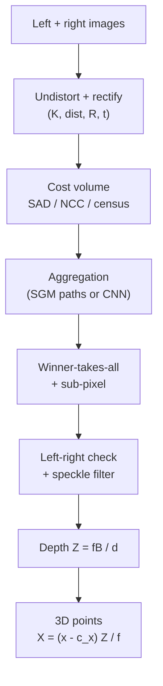
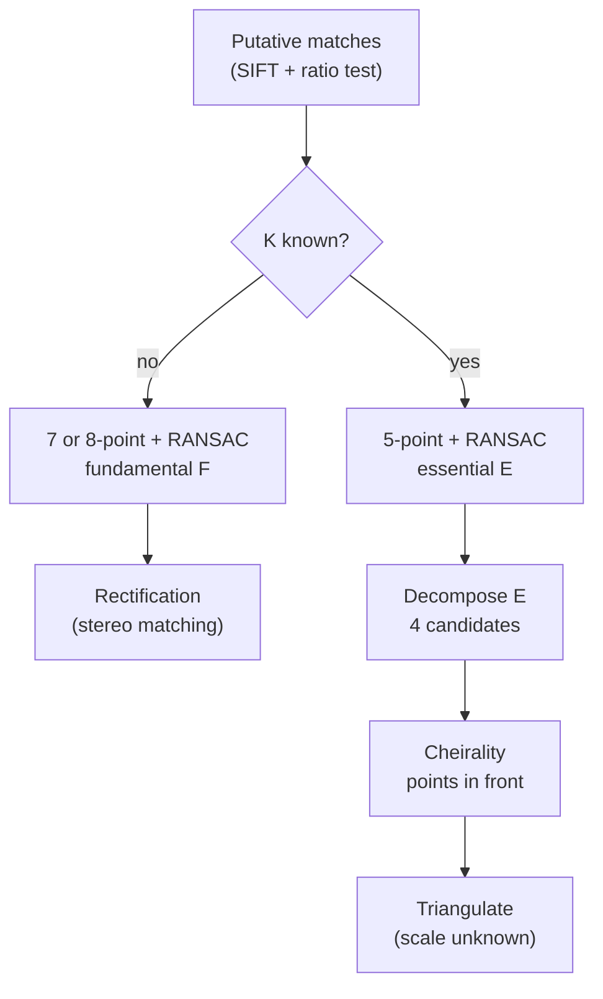
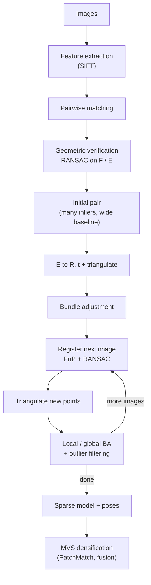
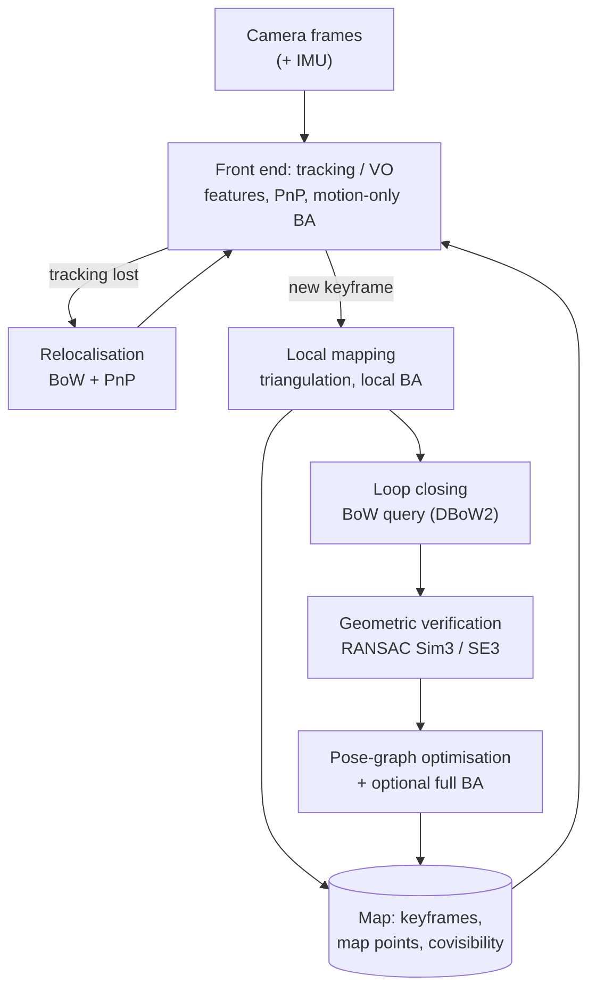
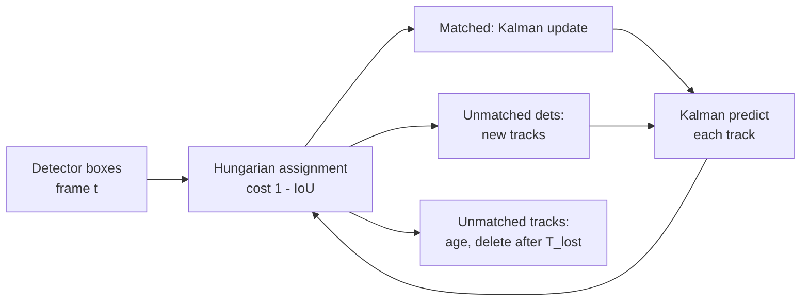

# Session 12 — 3D Vision & Motion

> **Syllabus:**
> - Stereo vision & depth from disparity
> - Optical flow & tracking
> - Structure from Motion (SfM)
> - SLAM conceptual overview
>
> **Related:** [Session 11 — Camera geometry ($K$, projection, PnP)](11_camera_geometry.md) · [Session 02 — RANSAC, homography, matching](02_feature_matching_classical.md) · [Session 01 — Harris matrix (= Lucas–Kanade matrix)](01_image_processing_features.md) · [Session 07 — IoU, detectors used in tracking-by-detection](07_detection_one_stage.md) · [Session 13 — Depth Anything](13_vision_foundation_models.md) · [Session 14 — Detection + segmentation + depth pipelines](14_vision_plus_plus.md) · [Formula sheet](../00_formula_sheet.md) · [Comparison tables](../00_comparison_tables.md) · [Numericals drill](../practice/numericals_drill.md) · [code: stereo depth & projection](../code/stereo_depth_and_projection.py)
>
> **Practice:** [Questions](../practice/12_questions.md) · [Solutions](../practice/12_solutions.md)

---

## 1. Big picture

One image loses depth ([Session 11](11_camera_geometry.md)). **Two or more views** get it back, through **triangulation**. This session covers four ways of exploiting several views or frames:
- **Stereo:** two calibrated cameras a known baseline apart. Depth comes from **disparity**, $Z=fB/d$.
- **Optical flow and tracking:** how pixels and objects move between consecutive frames.
- **Structure from Motion (SfM):** recover camera poses and a 3D point cloud from an unordered photo collection, via epipolar geometry, triangulation and **bundle adjustment**.
- **SLAM:** do the same **online** from a moving robot or headset, while correcting drift with **loop closure**.

The common mathematical core is the **epipolar constraint** ($E$, $F$), the **camera model** $K[R\mid\mathbf t]$, **RANSAC** for outliers ([Session 02](02_feature_matching_classical.md)), and **non-linear least squares** on the reprojection error.

---

## 2. Core concepts

### Stereo vision and depth from disparity

**Rectified stereo setup.** Two identical cameras (same $K$) have parallel optical axes. The right camera is displaced by the **baseline** $B$ along the $x$-axis. A 3D point then appears on the **same image row** in both images, shifted horizontally by the **disparity** $d=x_L-x_R$ (pixels, $d\ge0$ for points in front).

```
            P = (X, Y, Z)
              /\
             /  \
            /    \          Z = depth
           /      \
  -------xL--------xR-------  image planes (distance f)
         /          \
        O_L -------- O_R      baseline B
```

**Derivation (similar triangles).** Measure $x$ from each image's principal point. In the left camera $x_L=fX/Z$. The right camera sits at $(B,0,0)$, so $x_R=f(X-B)/Z$. Subtracting:

$$
d=x_L-x_R=\frac{fB}{Z}\quad\Longrightarrow\quad Z=\frac{fB}{d}
$$

Equivalently, triangle $(P,O_L,O_R)$ (base $B$, height $Z$) is similar to triangle $(P,p_L,p_R)$ (base $B-d$, height $Z-f$), so $\frac{B-d}{Z-f}=\frac{B}{Z}\Rightarrow Z=\frac{fB}{d}$.
Then $X=\frac{(x_L-c_x)Z}{f}$ and $Y=\frac{(y-c_y)Z}{f}$ (left-camera frame, pixel coordinates).

**Consequences.**
- **Disparity ∝ 1/depth:** **large disparity = near**, small disparity = far, $d\to0$ means $Z\to\infty$.
- **Depth resolution degrades quadratically:** $\Delta Z\approx\frac{Z^2}{fB}\Delta d$. Doubling the distance gives 4× the error. A sub-pixel matching accuracy $\Delta d$ (≈ 0.1–0.25 px) is crucial.
- **Maximum useful range:** the smallest resolvable disparity $d_{min}$ gives $Z_{max}=fB/d_{min}$.
- **Minimum range:** the **disparity search range** $[d_{min},d_{max}]$ sets $Z_{min}=fB/d_{max}$. A larger $d_{max}$ means more computation.

**Baseline trade-off.**

| Larger baseline $B$ | Smaller baseline $B$ |
|---|---|
| ✅ Better depth resolution ($\Delta Z\propto1/B$) and longer range | ✅ Easier matching: views look alike, fewer occlusions |
| ❌ More occlusion, larger appearance change, harder matching | ❌ Poor depth precision far away |
| ❌ Larger $Z_{min}$ for a fixed $d_{max}$, less overlap, bulkier rig | ✅ Works close up, compact (phones, headsets) |

**Stereo pipeline:** calibrate both cameras + the stereo extrinsics (`cv2.stereoCalibrate`) → **rectify** (`cv2.stereoRectify`, `initUndistortRectifyMap`, `remap`) → **match** along rows → disparity post-processing → **depth** $Z=fB/d$ (or `cv2.reprojectImageTo3D` with the $4\times4$ disparity-to-depth matrix $Q$).

### Stereo matching

The task: for each left pixel, find the disparity $d\in[d_{min},d_{max}]$ whose right pixel $(x-d,y)$ looks the same.

**Local block matching.** Compare a window around $(x,y)$ in the left image with windows around $(x-d,y)$ in the right image, then take the **winner-takes-all** best $d$. Cost functions:
- **SAD** $=\sum\lvert I_L-I_R\rvert$ and **SSD** $=\sum(I_L-I_R)^2$: fast, but sensitive to brightness and gain differences between the cameras.
- **NCC** $=\frac{\sum(I_L-\bar I_L)(I_R-\bar I_R)}{\sqrt{\sum(I_L-\bar I_L)^2\sum(I_R-\bar I_R)^2}}$: **maximise** it. It is invariant to affine intensity changes (gain and bias) within the window.
- **Census transform + Hamming distance:** robust to radiometric differences.
- **Window size trade-off:** small windows are noisy (ambiguous). Large windows are smoother but blur depth edges ("fattening").
- OpenCV: `cv2.StereoBM`.

**Semi-Global Matching (SGM, Hirschmüller).**
- Minimises a 2D energy: a pixel-wise matching cost, plus penalty $P_1$ for disparity changes of ±1 between neighbours (slanted surfaces), plus a larger $P_2$ for bigger jumps (depth discontinuities).
- Instead of solving the NP-hard 2D problem, it **aggregates costs along several 1D paths** (typically 8 or 16 directions) with dynamic programming, sums them, and takes winner-takes-all.
- Much better than block matching in weakly textured areas, at near real-time speed. OpenCV: `cv2.StereoSGBM` (a variant).

**Learned stereo.**
- **Cost-volume networks** (GC-Net, PSMNet) build a disparity cost volume from CNN features, regularise it with 3D convolutions, and use soft-argmin.
- **RAFT-Stereo** applies RAFT-style **iterative recurrent refinement** to a correlation volume restricted to the same row.
- They are state of the art on benchmarks (KITTI, Middlebury, ETH3D) and better in textureless and reflective regions. The costs are GPU compute, a need for training data, and possible domain gaps.

**Why matching fails.**
- **Occlusions:** points visible in only one view, especially at depth discontinuities, so no true match exists.
- **Textureless regions** (white walls, sky): many disparities have the same cost, so the result is ambiguous.
- **Repetitive patterns** (tiles, fences): several equally good minima, so the match can be wrong.
- **Specular or transparent surfaces, and photometric differences:** the brightness-constancy assumption is violated.
- Fixes: active stereo (an IR pattern projector adds texture), SGM or learned priors, and confidence filtering.

**Post-processing.**
- **Left–right consistency check:** compute the left→right disparity $d_L$ and the right→left disparity $d_R$. Keep pixel $x$ only if $\lvert d_L(x)-d_R(x-d_L(x))\rvert\le1$. This flags occlusions and mismatches.
- Uniqueness ratio (best cost clearly better than the second best, like Lowe's ratio).
- **Sub-pixel refinement** (fit a parabola to the costs at $d-1,d,d+1$).
- Speckle filtering, hole filling, median filtering.

### Epipolar geometry

The geometry of **two views** of the same scene, **independent of scene structure**. It depends only on $K,K'$ and the relative pose $(R,\mathbf t)$.

- **Baseline:** the line joining the camera centres $C$ and $C'$.
- **Epipolar plane:** the plane through $C$, $C'$ and the 3D point $\mathbf X$. Every point gives a different plane, and all of them contain the baseline.
- **Epipoles** $\mathbf e,\mathbf e'$: where the baseline pierces each image plane. Each is the **image of the other camera's centre**. Epipoles can lie outside the image, or at infinity (e.g. in rectified stereo).
- **Epipolar lines:** the intersection of an epipolar plane with an image. The match of $\mathbf x$ must lie on its epipolar line $\mathbf l'=F\mathbf x$ in the other image. **All epipolar lines pass through the epipole.**
- **Why it matters:** the correspondence search drops from **2D to 1D** (along a line). Matches can be checked geometrically (a RANSAC on $F/E$ rejects outliers), and the relative pose can be recovered from $E$.

### Essential and fundamental matrices

**Essential matrix (calibrated, normalised coordinates $\hat{\mathbf x}=K^{-1}\tilde{\mathbf x}$).** Let $\mathbf X_2=R\mathbf X_1+\mathbf t$. The vectors $\mathbf X_2$, $\mathbf t$ and $R\mathbf X_1$ are coplanar (they all lie in the epipolar plane), so $\mathbf X_2\cdot(\mathbf t\times R\mathbf X_1)=0$. Dividing by the depths gives

$$
\hat{\mathbf x}'^\top E\,\hat{\mathbf x}=0,\qquad E=[\mathbf t]_\times R,\qquad [\mathbf t]_\times=\begin{bmatrix}0&-t_z&t_y\\t_z&0&-t_x\\-t_y&t_x&0\end{bmatrix}
$$

- **5 DOF:** 3 (rotation) + 3 (translation) − 1, because the **scale of $\mathbf t$ is unobservable** (the constraint is homogeneous: $\mathbf t$ and $2\mathbf t$ give the same $E$ up to scale).
- **Rank 2**, with **two equal non-zero singular values** $(\sigma,\sigma,0)$.

**Fundamental matrix (uncalibrated, pixel coordinates).**

$$
\mathbf x'^\top F\,\mathbf x=0,\qquad F=K'^{-\top}EK^{-1}
$$

- **7 DOF:** 9 entries − 1 (scale) − 1 ($\det F=0$). **Rank 2**, with singular values unequal in general.
- $\mathbf l'=F\mathbf x$ is the epipolar line in image 2, and $\mathbf l=F^\top\mathbf x'$ is the epipolar line in image 1.
- $F\mathbf e=\mathbf 0$ and $F^\top\mathbf e'=\mathbf 0$: the epipoles are the null vectors.
- $F$ encodes the intrinsics and the pose together. With $K,K'$ known, $E=K'^\top FK$.
- **Degenerate cases for estimating F:** a **planar scene** or **pure rotation**. All matches then satisfy a homography, which leaves a family of valid $F$s. (Use $H$ instead, and note that pure rotation gives no depth.)

### Estimating F and E (8-point, 7-point, 5-point)

- **8-point algorithm.** Each match gives one linear equation $\mathbf a_i^\top\mathbf f=0$ with $\mathbf a_i=(x'x,\ x'y,\ x',\ y'x,\ y'y,\ y',\ x,\ y,\ 1)$. With $n\ge8$ matches, solve $A\mathbf f=0$ by SVD.
  - **Hartley normalisation** (essential in practice): translate each image's points to zero mean and scale them to mean distance $\sqrt2$ (transforms $T,T'$). Raw pixel values (~$10^3$) make the columns of $A$ differ by ~$10^6$ in magnitude, which makes the system badly conditioned. After solving, denormalise: $F=T'^\top\hat FT$.
  - **Rank-2 enforcement:** the linear solution is generally rank 3, so take the SVD $F=U\operatorname{diag}(\sigma_1,\sigma_2,\sigma_3)V^\top$ and set $\sigma_3=0$. This gives the closest rank-2 matrix (Frobenius norm), and all epipolar lines then meet in a single epipole.
- **7-point algorithm (minimal for F).** 7 equations leave a 2D null space, $F=\alpha F_1+(1-\alpha)F_2$. Imposing $\det F=0$ gives a cubic in $\alpha$ with **1 or 3** real solutions, and each is tested in RANSAC.
- **5-point algorithm (Nistér, for E, calibrated).** It is the minimal solver for 5 DOF and gives up to **10** solutions. It is the standard method when $K$ is known: smaller samples mean far fewer RANSAC iterations, and it is less degenerate for planar scenes.
- **Robust estimation:** always use RANSAC (or MAGSAC/LO-RANSAC) with the **Sampson distance** or the point-to-epipolar-line distance as the inlier test, then refine on the inliers. OpenCV: `cv2.findFundamentalMat(..., cv2.FM_RANSAC)` and `cv2.findEssentialMat(..., cv2.RANSAC)`.

**Decomposing E into (R, t).** Take the SVD $E=U\operatorname{diag}(1,1,0)V^\top$ and let $W=\begin{bmatrix}0&-1&0\\1&0&0\\0&0&1\end{bmatrix}$. Then $R\in\{UWV^\top,\ UW^\top V^\top\}$ (flip the sign if $\det R=-1$) and $\mathbf t=\pm\mathbf u_3$ (the third column of $U$, unit norm). This gives **4 candidate poses**. **Cheirality test:** triangulate a point (in practice many) and keep the candidate for which it lies **in front of both cameras** (positive depth in both). OpenCV: `cv2.recoverPose`. The recovered $\mathbf t$ has **unit norm**: only the direction is known.

### Stereo rectification

**Goal:** warp both images with homographies $H,H'$ so that the epipoles go to **infinity along $x$**. Every epipolar line then becomes a **horizontal scanline**, and corresponding points share the **same row** ($y=y'$). Matching becomes a 1D search along rows, and $Z=fB/d$ applies.

- **Calibrated (Bouguet, `cv2.stereoRectify`):** virtually rotate both cameras about their centres, which is a pure rotation and therefore a homography $KR_{rect}K^{-1}$. Make both image planes coplanar, both $x$-axes parallel to the baseline, and the intrinsics identical. The output is $R_1,R_2,P_1,P_2$ and the reprojection matrix $Q$.
- **Uncalibrated (Hartley, `cv2.stereoRectifyUncalibrated`):** compute $H,H'$ from $F$ and the matches, minimising distortion.
- **After rectification** $F\propto[\mathbf e']_\times$ with $\mathbf e'=(1,0,0)^\top$, i.e. $F\propto\begin{bmatrix}0&0&0\\0&0&-1\\0&1&0\end{bmatrix}$. Then $\mathbf x'^\top F\mathbf x=y-y'=0$.
- **Limitation:** when the epipole is inside the image (strong forward motion), planar rectification is ill-posed. Polar rectification is used instead.

### Triangulation

Given matched pixels $\mathbf x,\mathbf x'$ and camera matrices $P,P'$, find $\mathbf X$.
- **Linear (DLT):** $\mathbf x\times P\tilde{\mathbf X}=\mathbf 0$ gives 2 independent equations per view: $x\,\mathbf p^{3\top}\tilde{\mathbf X}-\mathbf p^{1\top}\tilde{\mathbf X}=0$ and $y\,\mathbf p^{3\top}\tilde{\mathbf X}-\mathbf p^{2\top}\tilde{\mathbf X}=0$ ($\mathbf p^{i\top}$ = the $i$-th row of $P$). Stack them into $A\tilde{\mathbf X}=0$ ($4\times4$ for 2 views, $2m\times4$ for $m$ views) and solve by SVD.
- **Midpoint method:** the midpoint of the shortest segment between the two back-projected rays. Simple, but not projectively invariant.
- **Optimal:** minimise the reprojection error (non-linear, LM). This is part of bundle adjustment.
- **Uncertainty grows when the rays are nearly parallel** (small baseline / small **triangulation angle**). SfM therefore rejects points with a triangulation angle below a few degrees. This is the same physics as $\Delta Z\propto Z^2/(fB)$ in stereo.

### Optical flow

**Optical flow** is the apparent 2D motion field $(u,v)$ of brightness patterns between frames $t$ and $t+1$. It can differ from the true **motion field**: a rotating uniform sphere shows no flow, and a moving light source creates flow with no motion.

**Assumptions:**
1. **Brightness constancy:** $I(x+u,\ y+v,\ t+1)=I(x,y,t)$.
2. **Small motion:** a first-order Taylor expansion is valid (≲ 1 px, otherwise use pyramids).
3. **Spatial coherence:** neighbouring pixels move similarly (needed to resolve the ambiguity below).

**Optical flow constraint equation.** Taylor-expand: $I(x+u,y+v,t+1)\approx I(x,y,t)+I_xu+I_yv+I_t$. Setting this equal to $I(x,y,t)$ gives

$$
I_xu+I_yv+I_t=0\quad\Longleftrightarrow\quad\nabla I\cdot(u,v)^\top=-I_t
$$

**Aperture problem.** That is **one equation in two unknowns** per pixel. Only the component of the flow **along the gradient** (the **normal flow**) is determined:

$$
u_\perp=\frac{-I_t}{\Vert\nabla I\Vert}\ \text{(signed magnitude along }\nabla I/\Vert\nabla I\Vert),\qquad \mathbf u_\perp=\frac{-I_t}{\Vert\nabla I\Vert^2}\nabla I
$$

Motion **along an edge** is invisible through a small aperture (the barber-pole illusion). Only **corners or textured patches**, where the gradients point in several directions, pin down both components.

**Dense vs sparse flow.**
- **Sparse:** flow at selected feature points (LK/KLT). Fast, good for tracking.
- **Dense:** flow at every pixel (Horn–Schunck, Farnebäck, RAFT). Used for motion segmentation, video interpolation and action recognition.

### Lucas-Kanade and Horn-Schunck

**Lucas–Kanade (local, sparse).**
- Assume the **flow is constant within a small window** (e.g. 5×5 = 25 pixels, giving 25 equations in 2 unknowns), and solve by least squares, $A^\top A\,\mathbf u=-A^\top\mathbf b$:

$$
\underbrace{\begin{bmatrix}\sum I_x^2 & \sum I_xI_y\\ \sum I_xI_y & \sum I_y^2\end{bmatrix}}_{A^\top A}\begin{bmatrix}u\\v\end{bmatrix}=-\begin{bmatrix}\sum I_xI_t\\ \sum I_yI_t\end{bmatrix}
$$

- **$A^\top A$ is exactly the Harris structure tensor $M$** ([Session 01](01_image_processing_features.md)). Solvability requires $A^\top A$ to be well-conditioned, i.e. **both eigenvalues large** (a **corner**):

| Window type | Eigenvalues | Outcome |
|---|---|---|
| **Flat** | $\lambda_1\approx\lambda_2\approx0$ | Flow undetermined, noise dominates |
| **Edge** | $\lambda_1\gg\lambda_2\approx0$ | Matrix near-singular: the **aperture problem**, only normal flow is recoverable |
| **Corner / texture** | both large | A unique, stable solution |

  This is why we **track corners**: Shi–Tomasi "good features to track" selects windows with $\min(\lambda_1,\lambda_2)>\tau$.
- **Iterative LK:** warp frame 2 by the current estimate, recompute $I_t$, solve again, and add the update (Gauss–Newton). Repeat until the update is tiny.
- **Pyramidal (coarse-to-fine) LK:** build Gaussian pyramids. A 16 px motion is only 2 px at level 3 (1/8 resolution), so the small-motion assumption holds there. Estimate at the top, multiply by 2 when going down a level, warp, refine the residual. OpenCV: `cv2.calcOpticalFlowPyrLK(prev, next, pts, None, winSize=(21,21), maxLevel=3)`.
- **Strengths:** fast and accurate for good features. **Weaknesses:** sparse, fails at occlusions, large motions without a pyramid, illumination changes and motion boundaries (the window straddles two motions).

**Horn–Schunck (global, dense).** Minimise over the whole image

$$
E(u,v)=\iint\Big[(I_xu+I_yv+I_t)^2+\alpha^2\big(\Vert\nabla u\Vert^2+\Vert\nabla v\Vert^2\big)\Big]\,dx\,dy
$$

- The **smoothness term** (weight $\alpha^2$) propagates flow from textured regions into flat and edge regions, so it **fills in** where the aperture problem leaves LK undetermined.
- It is solved iteratively (Jacobi): $u\leftarrow\bar u-\frac{I_x(I_x\bar u+I_y\bar v+I_t)}{\alpha^2+I_x^2+I_y^2}$, and similarly for $v$, where $\bar u,\bar v$ are local averages.
- Weaknesses: it **oversmooths motion boundaries**, is sensitive to outliers (quadratic penalties, later replaced by robust and TV-L1 variants), and is slow.

### Deep optical flow (FlowNet, RAFT)

- **FlowNet (2015):** the first end-to-end CNN for flow. An encoder–decoder with a **correlation layer** (FlowNetC), trained on synthetic **Flying Chairs**. It showed that learned flow works, and FlowNet 2.0 stacked several networks.
- **PWC-Net:** pyramid + warping + cost volume, the classical coarse-to-fine ideas inside a CNN.
- **RAFT (2020):** extract features, then build an **all-pairs 4D correlation volume** (pooled into a pyramid). A **recurrent GRU update operator** iteratively refines a single flow field at 1/8 resolution, followed by learned upsampling. It handles large motions without coarse-to-fine errors and was state of the art on Sintel and KITTI.
- **Evaluation:** **end-point error (EPE)**, the mean Euclidean distance between predicted and true flow vectors.
- Classical vs deep: deep models are far more accurate on large motions, occlusions and textureless regions, but need a GPU and training data (often synthetic), and can suffer domain gaps.

### Tracking (KLT and tracking-by-detection)

**KLT (Kanade–Lucas–Tomasi) feature tracker.** Detect Shi–Tomasi corners (`goodFeaturesToTrack`), track them with pyramidal LK frame to frame, drop failed or inconsistent tracks (status flag, **forward–backward check**: track forward then backward and require a return error under ~1 px), and **re-detect** when the number of tracks falls. Used in visual odometry and video stabilisation. Its weakness is **drift** over long sequences and loss under occlusion.

**Tracking-by-detection (multi-object tracking, MOT).** Run a detector every frame ([Sessions 06–08](07_detection_one_stage.md)), then solve **data association**: which detection belongs to which existing track?

**SORT (Simple Online and Realtime Tracking).**
1. Each track has a **Kalman filter** with a **constant-velocity** model on the box state $[u,v,s,r,\dot u,\dot v,\dot s]$ (centre, scale/area, aspect ratio, and their velocities).
2. **Predict** each track's box in the new frame.
3. Build a cost matrix $1-\text{IoU}$(predicted box, detection) and solve the assignment with the **Hungarian algorithm**. Reject pairs with IoU below a threshold.
4. **Update** matched tracks with their detections. **Create** new tracks for unmatched detections. **Delete** tracks unmatched for too many frames.

It is very fast, but has many **ID switches** under occlusion because there is no appearance model.

**DeepSORT** adds an **appearance descriptor**: a CNN re-identification embedding, compared by cosine distance. It also gates with the **Mahalanobis distance** from the Kalman prediction, and uses a **matching cascade** that prioritises recently seen tracks. The result is far fewer ID switches through occlusions. Modern variants (e.g. ByteTrack) also associate **low-confidence detections** to keep occluded objects alive.

**Kalman filter in one breath.** It maintains a Gaussian belief (mean, covariance) over the state.
- **Predict:** propagate the state through the motion model. The uncertainty grows by the process noise.
- **Update:** blend the prediction with the measurement using the **Kalman gain**, which weighs the prediction by its uncertainty relative to the measurement noise. The uncertainty shrinks.

The equations are in §3.

### Structure from Motion (SfM)

**Goal:** from many images, often **unordered internet photos**, jointly recover **camera poses** (and often intrinsics) and **sparse 3D structure**.

**Incremental SfM pipeline** (e.g. **COLMAP**):
1. **Feature extraction:** SIFT (or learned) keypoints and descriptors per image. Intrinsics come from EXIF or calibration.
2. **Matching:** exhaustive, sequential, or vocabulary-tree retrieval, with the ratio test.
3. **Geometric verification:** RANSAC on $F$, or on $E$ with the 5-point solver if $K$ is known, keeping only the inlier matches. (Estimating $H$ as well detects planar or pure-rotation pairs.) The result is a **scene graph** of verified image pairs.
4. **Initialisation:** choose an **initial pair** with many inliers **and a wide baseline** (enough parallax, i.e. not well explained by a homography).
5. **Two-view geometry:** $E$ → 4 $(R,\mathbf t)$ candidates → cheirality → set $\Vert\mathbf t\Vert=1$, which **fixes the arbitrary scale**.
6. **Triangulate** the initial points. Run BA.
7. **Register the next image** (the one seeing the most already-triangulated points): 2D–3D matches → **PnP + RANSAC** ([Session 11](11_camera_geometry.md#perspective-n-point-pnp)).
8. **Triangulate new points** seen by the new image and previous ones. Filter by reprojection error and triangulation angle.
9. **Bundle adjustment:** local after each addition, global periodically. Reject outliers.
10. Repeat steps 7–9 until no more images can be registered.

The output is camera poses + intrinsics + a sparse point cloud. It is then densified by **MVS**.

**Scale ambiguity.** From images alone, scene + cameras can be scaled (and rotated and translated) together without changing any image. Monocular SfM is therefore defined only **up to a similarity transform (7 DOF)**: you cannot tell a model building from a real one. To fix metric scale, use a known distance (a scale bar or marker), GPS/IMU, or a stereo rig with a known baseline.

**Incremental vs global SfM.**
- **Incremental** (COLMAP, Bundler) is robust and accurate thanks to repeated BA and outlier filtering. But it is slower ($O(n)$ BAs), can **drift**, and depends on the order images are added.
- **Global** (e.g. OpenMVG global, GLOMAP) estimates all relative poses, then does **rotation averaging**, then **translation averaging**, then triangulation, then one final BA. It is faster and spreads error evenly, but is more sensitive to outlier pairs.

**MVS densification (brief).** With the poses known, **multi-view stereo** estimates a depth (and normal) per pixel for each image, e.g. **PatchMatch** stereo with photometric consistency across several views. It then **fuses** the depth maps into a dense point cloud, and meshes it (e.g. Poisson). SfM poses are also the input to NeRF and 3D Gaussian Splatting.

**Failure modes.** Repetitive or symmetric structures (wrong but consistent matches), textureless scenes, pure rotation (no parallax, so no triangulation), too little overlap, dynamic objects, and rolling shutter.

### Bundle adjustment

**Bundle adjustment (BA)** is the joint non-linear least-squares refinement of **all cameras and all points**, minimising the total **reprojection error**:

$$
\min_{\{K_i,R_i,\mathbf t_i\},\{\mathbf X_j\}}\ \sum_{i}\sum_{j\in\mathcal V(i)}\rho\Big(\big\Vert\mathbf x_{ij}-\pi(K_i,R_i,\mathbf t_i,\mathbf X_j)\big\Vert^2\Big)
$$

($\mathbf x_{ij}$ = the observed pixel of point $j$ in image $i$, $\pi$ = the projection including distortion, $\mathcal V(i)$ = the points visible in image $i$, $\rho$ = a robust loss such as Huber or Cauchy.) The "bundles" are the bundles of rays from each camera, adjusted until they meet the points.

- **Solver:** Levenberg–Marquardt. The Jacobian is **very sparse**, since each residual depends on one camera and one point. The **Schur complement** eliminates the points, leaving a small **reduced camera system** of size $6n_{cams}$. Tools: Ceres, g2o, GTSAM.
- **Problem size:** **6 parameters per camera** (+ intrinsics if they are refined), **3 per point**, and **2 residuals per observation**.
- **Gauge freedom:** an overall similarity (7 DOF for monocular) is unobservable. Fix it by holding the first camera and one scale.
- BA needs a **good initialisation** (from steps 4–8 above), because it only finds a local minimum.

### SLAM conceptual overview

**SLAM (Simultaneous Localisation and Mapping):** a moving agent (robot, drone, AR headset, car) builds a map of an **unknown** environment while estimating its own pose in that map, **online and in real time**. It is a chicken-and-egg problem: you need the map to localise and the pose to map.

**Architecture.**
- **Front end (perception and data association):**
  - feature extraction (e.g. ORB),
  - **tracking / visual odometry**: estimate the frame-to-frame or frame-to-map pose with PnP or motion-only BA,
  - **keyframe selection**: keep informative frames only,
  - initialisation and **local mapping** (triangulate new map points).
- **Back end (state estimation):**
  - **optimisation**: local BA over recent keyframes, and **pose-graph optimisation** after loop closures, solved with graph-based solvers (g2o, GTSAM).
  - historically, **filters** (EKF-SLAM, e.g. MonoSLAM). Keyframe + BA methods (PTAM, ORB-SLAM) proved more accurate per unit of compute.

**Drift.** Visual odometry chains relative poses, so small errors **accumulate**. After a long loop, the estimated trajectory does not close, and in monocular SLAM even the **scale drifts**.

**Loop closure.** Recognise that the agent has **returned to a previously mapped place**, then use that to correct the accumulated drift:
1. **Place recognition:** describe each keyframe with a **bag of visual words** (BoW) histogram over a pre-trained vocabulary tree of descriptors (**DBoW2** for binary ORB descriptors), and query an inverted index for similar past keyframes (excluding recent ones). Learned global descriptors such as NetVLAD are an alternative.
2. **Geometric verification:** match features and estimate the relative transform with RANSAC: SE(3) (6 DOF) for stereo/RGB-D, **Sim(3) (7 DOF, including scale)** for monocular. This rejects perceptual aliasing (similar-looking places).
3. **Loop correction:** add the loop constraint as an edge in the **pose graph** (nodes = keyframe poses, edges = relative-pose measurements), and run **pose-graph optimisation** to spread the error around the loop. Fuse duplicate map points, and optionally run a full BA.

**Loop closure ≠ relocalisation.**
- **Relocalisation** recovers the pose when **tracking is lost** (fast motion, occlusion, the "kidnapped robot"), by matching the current frame against the map (BoW + PnP). The map is **not** corrected.
- **Loop closure** happens while tracking is fine. It detects a revisit and **corrects the map and trajectory** (drift).

Both use place recognition.

**ORB-SLAM (example system).** ORB features throughout (tracking, mapping, place recognition). It runs **three parallel threads**:
- **tracking:** per-frame pose via motion-only BA, plus keyframe decisions;
- **local mapping:** triangulation, local BA, keyframe culling;
- **loop closing:** DBoW2 detection, Sim(3) estimation, pose-graph optimisation over an "essential graph", then a full BA.

It also has relocalisation. ORB-SLAM2 added stereo and RGB-D, and ORB-SLAM3 added visual-inertial and multi-map support.

**Sensors.**

| Sensor | Scale | Notes |
|---|---|---|
| **Monocular** | **Unobservable**, so the map is up to scale, and **scale drifts** | Cheapest. Needs translation (parallax) to initialise. Pure rotation is degenerate |
| **Stereo** | Metric (known baseline) | Depth from disparity. Range limited by $fB$ |
| **RGB-D** (structured light / ToF) | Metric (depth sensor) | Dense depth, mainly indoors, limited range, struggles in sunlight |
| **Visual-inertial** (camera + IMU) | Metric (accelerometer) + gravity direction | Robust to fast motion and blur. Needs IMU calibration and time sync |

Other families: **direct** methods (LSD-SLAM, DSO) minimise the photometric error on pixels instead of feature reprojection, and **dense** SLAM (KinectFusion) fuses RGB-D into a volumetric model.

**SfM vs SLAM vs VO.**

| | SfM | SLAM | Visual odometry (VO) |
|---|---|---|---|
| Input | Unordered image set (or video) | Sequential live stream | Sequential live stream |
| Timing | **Offline**, batch | **Online, real time** | **Online, real time** |
| Output | Camera poses + 3D model (sparse, then MVS) | Trajectory + **consistent map** | Trajectory (local) only |
| Optimisation | Global/incremental **full BA** | Local BA + **pose graph** + occasional full BA | Windowed / local only |
| Drift handling | Global BA over all images | **Loop closure** | **None**, so drift accumulates |
| Typical use | 3D reconstruction, photogrammetry, NeRF/3DGS poses | Robots, AR/VR, drones | Odometry front end, short-term motion |

---

## 3. Key formulas

**(1) Depth from disparity (rectified stereo).**

$$
Z=\frac{fB}{d},\qquad d=x_L-x_R
$$

$Z$ = depth (m), $f$ = focal length (pixels), $B$ = baseline (m), $d$ = disparity (pixels).
*Example:* $f=1000$ px, $B=0.10$ m, $d=20$ px → $Z=100/20=5$ m.

**(2) Back-projection from stereo (left camera frame).**

$$
X=\frac{(x_L-c_x)Z}{f},\qquad Y=\frac{(y-c_y)Z}{f}
$$

$(c_x,c_y)$ = principal point (pixels), $y$ = the common row.
*Example:* $x_L-c_x=200$ px at $Z=5$ m with $f=1000$ → $X=1.0$ m.

**(3) Depth resolution, range limits, baseline design.**

$$
\Delta Z\approx\frac{Z^2}{fB}\,\Delta d,\qquad Z_{max}=\frac{fB}{d_{min}},\qquad Z_{min}=\frac{fB}{d_{max}},\qquad B_{req}=\frac{Z^2\,\Delta d}{f\,\Delta Z}
$$

$\Delta d$ = disparity uncertainty (px), $\Delta Z$ = depth uncertainty (m), $d_{min},d_{max}$ = the disparity search limits.
*Example:* $fB=100$ px·m, $Z=5$ m, $\Delta d=0.5$ px → $\Delta Z=25\times0.5/100=0.125$ m. $Z_{max}(d=1)=100$ m. $Z_{min}(d_{max}=64)=1.56$ m.

**(4) Epipolar constraint, essential and fundamental matrices.**

$$
\hat{\mathbf x}'^\top E\hat{\mathbf x}=0,\quad E=[\mathbf t]_\times R;\qquad \mathbf x'^\top F\mathbf x=0,\quad F=K'^{-\top}EK^{-1};\qquad \mathbf l'=F\mathbf x,\ \ \mathbf l=F^\top\mathbf x',\ \ F\mathbf e=\mathbf 0,\ \ F^\top\mathbf e'=\mathbf 0
$$

$\hat{\mathbf x}=K^{-1}\tilde{\mathbf x}$ = normalised homogeneous coordinates, $\tilde{\mathbf x}$ = homogeneous pixel, $(R,\mathbf t)$ = camera-1 → camera-2 motion ($\mathbf X_2=R\mathbf X_1+\mathbf t$), $\mathbf e,\mathbf e'$ = epipoles. $E$: 5 DOF, rank 2, singular values $(\sigma,\sigma,0)$. $F$: 7 DOF, rank 2.
*Example (rectified pair):* $R=I$, $\mathbf t=(1,0,0)$ → $E=[\mathbf t]_\times=\begin{bmatrix}0&0&0\\0&0&-1\\0&1&0\end{bmatrix}$, so $E\hat{\mathbf x}=(0,-1,y)^\top$ and the constraint is $y-y'=0$ (same row). With $K=K'$ ($f=500$, $c=(320,240)$), $F=K^{-\top}EK^{-1}=\begin{bmatrix}0&0&0\\0&0&-0.002\\0&0.002&0\end{bmatrix}$, which is again "same pixel row".

**(5) 8-point linear system.**

$$
\begin{bmatrix}x'x & x'y & x' & y'x & y'y & y' & x & y & 1\end{bmatrix}\mathbf f=0\ \ (\text{one row per match}),\qquad F=T'^\top\hat FT
$$

$\mathbf f$ = the 9 entries of $F$ (row-major), $T,T'$ = Hartley normalising transforms. After solving, set the smallest singular value of $F$ to 0.

**(6) RANSAC iterations for two-view solvers.**

$$
N=\left\lceil\frac{\log(1-p)}{\log\big(1-(1-e)^s\big)}\right\rceil
$$

$p$ = desired success probability, $e$ = outlier ratio, $s$ = sample size.
*Example ($p=0.99$, $e=0.5$):* $s=8$ → **1177**, $s=7$ → **588**, $s=5$ → **146**. With $e=0.3$: 78, 54, 26.

**(7) Linear triangulation (DLT).**

$$
\begin{bmatrix}x\,\mathbf p^{3\top}-\mathbf p^{1\top}\\ y\,\mathbf p^{3\top}-\mathbf p^{2\top}\\ x'\,\mathbf p'^{3\top}-\mathbf p'^{1\top}\\ y'\,\mathbf p'^{3\top}-\mathbf p'^{2\top}\end{bmatrix}\tilde{\mathbf X}=\mathbf 0
$$

$\mathbf p^{i\top}$ = the $i$-th row of $P$. $\tilde{\mathbf X}$ = the last right singular vector, then dehomogenise. For a rectified pair this reproduces $Z=fB/d$.

**(8) Optical flow constraint and normal flow.**

$$
I_xu+I_yv+I_t=0,\qquad \mathbf u_\perp=-\frac{I_t}{\Vert\nabla I\Vert^2}\nabla I,\qquad \Vert\mathbf u_\perp\Vert=\frac{\lvert I_t\rvert}{\Vert\nabla I\Vert}
$$

$I_x,I_y$ = spatial derivatives, $I_t$ = temporal derivative, $(u,v)$ = flow (px/frame).
*Example:* a horizontal edge with $I_x=0$, $I_y=2$, $I_t=-4$ gives $v=2$ px/frame. $u$ is **unknown** (the aperture problem).

**(9) Lucas–Kanade.**

$$
\begin{bmatrix}\sum I_x^2 & \sum I_xI_y\\ \sum I_xI_y & \sum I_y^2\end{bmatrix}\begin{bmatrix}u\\v\end{bmatrix}=-\begin{bmatrix}\sum I_xI_t\\ \sum I_yI_t\end{bmatrix}
$$

The sums run over the window. The matrix is the Harris $M$, and it needs both eigenvalues large.
*Example:* $\sum I_x^2=10$, $\sum I_xI_y=0$, $\sum I_y^2=5$, $\sum I_xI_t=-20$, $\sum I_yI_t=5$ → $10u=20$, $5v=-5$ → $(u,v)=(2,-1)$.
*Pyramid:* a 20 px motion becomes $20/2^3=2.5$ px at level 3.

**(10) Horn–Schunck energy and update.**

$$
E=\iint(I_xu+I_yv+I_t)^2+\alpha^2(\Vert\nabla u\Vert^2+\Vert\nabla v\Vert^2),\qquad u\leftarrow\bar u-\frac{I_x(I_x\bar u+I_y\bar v+I_t)}{\alpha^2+I_x^2+I_y^2}
$$

$\alpha$ = smoothness weight, $\bar u,\bar v$ = neighbourhood averages (the $v$ update is symmetric, with $I_y$ in the numerator).

**(11) Bundle adjustment objective and size.**

$$
\min\sum_{i,j}\big\Vert\mathbf x_{ij}-\pi(K_i,R_i,\mathbf t_i,\mathbf X_j)\big\Vert^2;\qquad \#\text{params}=6n_{cams}+3n_{pts}\ (+\text{intrinsics}),\qquad \#\text{residuals}=2\,n_{obs}
$$

*Example:* 10 cameras, 1000 points, each seen in 3 images → $60+3000=3060$ parameters, $2\times3000=6000$ residuals. The Schur reduced camera system is $60\times60$.

**(12) Kalman filter (symbols renamed to avoid clashes with $F,H,K,R$).** With state $\mathbf s$, covariance $\Sigma$, transition $\Phi$, measurement matrix $C$, process noise $Q$, measurement noise $R_m$, gain $G$ and measurement $\mathbf z$:

$$
\begin{aligned}
\text{predict:}&\quad \mathbf s^-=\Phi\mathbf s,\qquad \Sigma^-=\Phi\Sigma\Phi^\top+Q\\
\text{update:}&\quad G=\Sigma^-C^\top(C\Sigma^-C^\top+R_m)^{-1},\quad \mathbf s=\mathbf s^-+G(\mathbf z-C\mathbf s^-),\quad \Sigma=(I-GC)\Sigma^-
\end{aligned}
$$

(Textbooks write $F,H,Q,R,K$.)
*Example (1D):* prediction 10 (variance 4), measurement 12 (variance 4) → $G=4/8=0.5$, updated estimate $=10+0.5(2)=11$, variance $=(1-0.5)\cdot4=2$.

---

## 4. Algorithms step by step

### 4.1 Stereo depth pipeline
1. **Calibrate** each camera ($K$, distortion) and the stereo pair ($R,\mathbf t$ between them, so $B=\Vert\mathbf t\Vert$) with `stereoCalibrate`.
2. **Rectify:** `stereoRectify` → $R_1,R_2,P_1,P_2,Q$, then `initUndistortRectifyMap` + `remap` both images, so that epipolar lines become rows.
3. **Choose the disparity range** $[d_{min},d_{max}]$ from the required $Z_{min}$: $d_{max}=fB/Z_{min}$.
4. **Match:** compute the cost for each pixel and each $d$ (block matching SAD/NCC, or SGM aggregation along paths, or a learned network).
5. **Select** the disparity (winner-takes-all) with **sub-pixel** parabola refinement.
6. **Filter:** left–right consistency check, uniqueness ratio, speckle removal. Mark invalid pixels.
7. **Depth:** $Z=fB/d$, $X=(x-c_x)Z/f$, $Y=(y-c_y)Z/f$ (or `reprojectImageTo3D` with $Q$).
8. Optionally fill holes or fuse over time. Report confidence using $\Delta Z\approx Z^2\Delta d/(fB)$.

### 4.2 Block matching with a left–right check
1. For each left pixel $(x,y)$ and each $d\in[d_{min},d_{max}]$: compute $\text{SAD}(x,y,d)=\sum_{(i,j)\in\mathcal W}\lvert I_L(x+i,y+j)-I_R(x+i-d,y+j)\rvert$.
2. $d_L(x,y)=\arg\min_d\text{SAD}$.
3. Repeat with the right image as reference to get $d_R$.
4. Keep $d_L(x,y)$ only if $\lvert d_L(x,y)-d_R(x-d_L(x,y),y)\rvert\le1$. Otherwise mark it occluded or invalid.

### 4.3 Normalised 8-point algorithm (for F)
1. Input: $n\ge8$ matches $\mathbf x_i\leftrightarrow\mathbf x'_i$ (inside RANSAC: exactly 8 per sample).
2. Normalise: $\hat{\mathbf x}_i=T\mathbf x_i$ and $\hat{\mathbf x}'_i=T'\mathbf x'_i$ (zero mean, mean distance $\sqrt2$).
3. Build $A$ ($n\times9$), with rows $(\hat x'\hat x,\ \hat x'\hat y,\ \hat x',\ \hat y'\hat x,\ \hat y'\hat y,\ \hat y',\ \hat x,\ \hat y,\ 1)$.
4. SVD of $A$. $\hat{\mathbf f}$ = the right singular vector with the smallest singular value. Reshape to $3\times3$.
5. **Enforce rank 2:** $\hat F=U\operatorname{diag}(\sigma_1,\sigma_2,\sigma_3)V^\top\to U\operatorname{diag}(\sigma_1,\sigma_2,0)V^\top$.
6. **Denormalise:** $F=T'^\top\hat FT$.
7. (In RANSAC) Score with the Sampson / epipolar distance, keep the best model, re-estimate on all inliers, and optionally refine non-linearly.
8. For $E$ with known $K$: use normalised coordinates, project onto singular values $(1,1,0)$, or better, use the 5-point solver.

### 4.4 Relative pose from E (with cheirality)
1. SVD $E=U\Sigma V^\top$. Make $\det U>0$ and $\det V>0$.
2. $R_a=UWV^\top$, $R_b=UW^\top V^\top$, $\mathbf t=\pm\mathbf u_3$.
3. For each of the 4 combinations, triangulate the inlier matches with $P_1=K[I\mid\mathbf 0]$ and $P_2=K'[R\mid\mathbf t]$.
4. Choose the pose with the **most points having positive depth in both cameras**.
5. $\Vert\mathbf t\Vert=1$: the scale is unknown.

### 4.5 Linear triangulation (DLT)
1. Inputs: $P,P'$ (3×4), matched pixels $(x,y)$ and $(x',y')$ (undistorted).
2. Build the 4×4 $A$ from the rows $x\mathbf p^{3\top}-\mathbf p^{1\top}$, $y\mathbf p^{3\top}-\mathbf p^{2\top}$ and the same for the second view (Hartley normalisation helps).
3. SVD. $\tilde{\mathbf X}$ = the last right singular vector. $\mathbf X=\tilde{\mathbf X}_{1:3}/\tilde X_4$.
4. Check cheirality and the reprojection error. Reject points with a tiny triangulation angle.
5. Optionally refine by minimising the reprojection error.

### 4.6 Lucas–Kanade (one level, iterative)
1. Choose a feature at $\mathbf p$ (ideally a Shi–Tomasi corner) and a window $\mathcal W$ (e.g. 15×15).
2. Compute $I_x,I_y$ on frame $t$ inside $\mathcal W$. Form $M=\sum\begin{bmatrix}I_x^2&I_xI_y\\I_xI_y&I_y^2\end{bmatrix}$. Check $\min(\lambda_1,\lambda_2)>\tau$.
3. Initialise $\mathbf u=(0,0)$.
4. Warp frame $t+1$ by $\mathbf u$ and compute $I_t=I_{t+1}(\mathbf x+\mathbf u)-I_t(\mathbf x)$ over $\mathcal W$.
5. Solve $M\,\Delta\mathbf u=-\big(\sum I_xI_t,\ \sum I_yI_t\big)^\top$, and set $\mathbf u\leftarrow\mathbf u+\Delta\mathbf u$.
6. Repeat 4–5 until $\Vert\Delta\mathbf u\Vert<\epsilon$ or the maximum number of iterations is reached.

### 4.7 Pyramidal LK (coarse-to-fine)
1. Build Gaussian pyramids of both frames, levels $0$ (full resolution) to $L$ (coarsest).
2. Set the initial guess $\mathbf g_L=(0,0)$ at level $L$.
3. At level $\ell$, run iterative LK (4.6) starting from $\mathbf g_\ell$, with the point scaled by $2^{-\ell}$, to get the residual $\mathbf d_\ell$.
4. Propagate: $\mathbf g_{\ell-1}=2(\mathbf g_\ell+\mathbf d_\ell)$.
5. The final flow is $\mathbf u=\mathbf g_0+\mathbf d_0$. The track is valid only if it converged and passes the forward–backward check.

### 4.8 Horn–Schunck (dense)
1. Compute $I_x,I_y,I_t$ for all pixels. Initialise $u=v=0$.
2. Repeat: compute the local averages $\bar u,\bar v$, then update $u,v$ with the formula in §3 (10).
3. Stop when the change is small. Choose $\alpha$ to trade data fidelity against smoothness.

### 4.9 KLT tracker
1. Detect up to $N$ Shi–Tomasi corners in the first frame.
2. For each new frame, run pyramidal LK on all points.
3. Drop points with a bad status, a large forward–backward error, or that left the image.
4. If fewer than $N_{min}$ points remain, re-detect corners (avoiding existing ones).
5. Use the tracks for VO (E + RANSAC), stabilisation, and so on.

### 4.10 SORT (tracking-by-detection)
1. Detect objects in frame $t$ (any detector), keeping boxes above a confidence threshold.
2. **Predict** each track's box with its constant-velocity Kalman filter.
3. Cost matrix $C_{ij}=1-\text{IoU}(\text{track}_i,\text{det}_j)$. Solve the **Hungarian** assignment.
4. Discard assignments with IoU < threshold.
5. **Update** the matched tracks' Kalman filters.
6. Unmatched detections → **new tracks** (confirmed after a few hits). Unmatched tracks → age++ → **delete** after $T_{lost}$ frames.
7. (DeepSORT: the cost combines the appearance cosine distance + Mahalanobis gating, with a matching cascade.)

### 4.11 Incremental SfM
1. Extract features (SIFT) in all images. Read $K$ from EXIF or calibration.
2. Match image pairs (exhaustive or retrieval-based), with the ratio test.
3. Verify geometrically with RANSAC on $F$ / $E$ (and $H$), keeping pairs with enough inliers → scene graph.
4. Pick an initial pair (many inliers, wide baseline). Estimate $E$ (5-point + RANSAC), decompose it, choose by cheirality, and set the scale $\Vert\mathbf t\Vert=1$.
5. Triangulate the initial points. Run BA.
6. **Loop:** choose the next image with the most 2D–3D matches → **PnP + RANSAC** pose → triangulate new points → local BA → filter outliers. Periodically run a **global BA**.
7. Stop when no further image can be registered. Output poses + sparse cloud.
8. (Optional) MVS densification → dense cloud → mesh. Fix the metric scale with a known distance or GPS.

### 4.12 Keyframe SLAM with loop closure
1. **Initialise:** monocular uses two frames with parallax (E or H model) → triangulate an initial map. Stereo/RGB-D can initialise from one frame.
2. **Track** every frame: predict the pose (motion model), match features to local map points, PnP / motion-only BA. If tracking is lost, **relocalise** (BoW + PnP).
3. **Keyframe decision:** add a keyframe if enough new content or time has passed.
4. **Local mapping:** triangulate new points from the new keyframe and its covisible keyframes, run local BA, and cull redundant points and keyframes.
5. **Loop detection:** query the BoW database for each new keyframe. Candidates must be consistent over several keyframes.
6. **Geometric verification:** feature matching + RANSAC, Sim(3) (monocular) or SE(3).
7. **Loop correction:** add the loop edge, run **pose-graph optimisation** to distribute the drift, fuse duplicate points, and optionally run a full BA.
8. Continue tracking with the corrected map.

---

## 5. Diagrams

**Stereo depth pipeline.**



**Two-view geometry: from matches to pose and structure.**



**Incremental SfM pipeline.**



**SLAM architecture (ORB-SLAM style).**



**SORT tracking loop.**



---

## 6. Comparison tables

**Essential vs fundamental matrix.**

| | Essential $E$ | Fundamental $F$ |
|---|---|---|
| Coordinates | Normalised $\hat{\mathbf x}=K^{-1}\tilde{\mathbf x}$ | Pixels |
| Requires $K$? | Yes (calibrated) | No |
| Formula | $E=[\mathbf t]_\times R$ | $F=K'^{-\top}EK^{-1}$ |
| DOF | **5** (3 R + 3 t − 1 scale) | **7** (9 − 1 scale − 1 det) |
| Rank / singular values | 2, $(\sigma,\sigma,0)$ | 2, $(\sigma_1,\sigma_2,0)$ |
| Minimal solver | **5-point** (≤ 10 solutions) | **7-point** (1 or 3); linear **8-point** |
| Gives pose? | Yes: $R$, $\mathbf t$ up to scale (4 candidates + cheirality) | Only up to a projective ambiguity |

**Stereo matching methods.**

| | Block matching (SAD/SSD/NCC) | SGM | Learned (cost volume, RAFT-Stereo) |
|---|---|---|---|
| Optimisation | Local, winner-takes-all | Semi-global (1D DP along 8–16 paths) | Learned aggregation / iterative refinement |
| Textureless regions | Poor | Better (smoothness $P_1,P_2$) | Best (learned priors) |
| Depth edges | Fattening | Good | Good |
| Speed | Very fast (CPU) | Real time (CPU/FPGA) | GPU needed |
| Data needed | None | None | Training data, possible domain gap |

**Two-view minimal solvers (RANSAC at $p=0.99$, $e=0.5$).**

| Solver | Estimates | Sample $s$ | Solutions per sample | Iterations $N$ |
|---|---|---|---|---|
| 8-point | $F$ (linear) | 8 | 1 | 1177 |
| 7-point | $F$ | 7 | 1 or 3 | 588 |
| 5-point | $E$ ($K$ known) | 5 | ≤ 10 | 146 |
| 4-point | $H$ | 4 | 1 | 72 |

**Optical flow methods.**

| | Lucas–Kanade | Horn–Schunck | RAFT (deep) |
|---|---|---|---|
| Output | Sparse (features) | Dense | Dense |
| Constraint | Constant flow in a window (local) | Global smoothness | Learned (correlation + GRU) |
| Aperture problem | Fails on edges/flat (needs corners) | Filled in by smoothness | Learned context |
| Large motion | Needs a pyramid | Needs a pyramid | All-pairs correlation handles it |
| Motion boundaries | OK locally | Oversmoothed | Sharp |
| Cost | Very cheap | Moderate (iterative) | GPU |

**Tracking approaches.**

| | KLT | SORT | DeepSORT |
|---|---|---|---|
| Tracks | Feature points | Object boxes | Object boxes |
| Motion model | LK flow | Kalman, constant velocity | Kalman, constant velocity |
| Association | Implicit (local search) | Hungarian on IoU | Cascade: appearance (cosine) + Mahalanobis gate |
| Occlusion | Track lost | ID switches | Re-identifies after occlusion |
| Speed | Very fast | Very fast | Slower (re-ID CNN) |

**Incremental vs global SfM.**

| | Incremental (COLMAP) | Global |
|---|---|---|
| Strategy | Add images one by one, BA repeatedly | Rotation averaging → translation averaging → one BA |
| Robustness | High (filters outliers as it grows) | Sensitive to bad pairs |
| Speed | Slower (many BAs) | Faster |
| Drift | Possible on long chains | Error spread evenly |

**Stereo depth vs monocular foundation-model depth** (see [Session 13](13_vision_foundation_models.md), [Session 14](14_vision_plus_plus.md)).

| | Stereo ($Z=fB/d$) | Monocular (e.g. Depth Anything) |
|---|---|---|
| Scale | **Metric** (from the baseline) | **Relative** (affine-invariant inverse depth). Metric needs fine-tuning or a scale cue |
| Hardware | Two calibrated, synchronised cameras | One camera |
| Failure | Textureless, occlusions, far range | Unusual scenes, scale ambiguity, hallucinated structure |
| Precision vs range | $\Delta Z\propto Z^2/(fB)$ | No geometric guarantee |

---

## 7. Common exam traps & misconceptions

- ❌ "Larger disparity means the point is farther away." → ✅ $Z=fB/d$, so **larger disparity = nearer**. Distant points have $d\to0$.
- ❌ "Depth error grows linearly with distance." → ✅ $\Delta Z\approx Z^2\Delta d/(fB)$: **quadratic**. 3× the distance gives 9× the error.
- ❌ "A bigger baseline is always better." → ✅ It improves depth precision but increases occlusions and matching difficulty, raises $Z_{min}$, and reduces overlap.
- ❌ "$F$ has 8 DOF (8-point algorithm)." → ✅ **7 DOF** (9 − scale − det = 0). 8 points are needed only for the **linear** solution. 7 is minimal.
- ❌ "$E$ has 6 DOF (3 for R + 3 for t)." → ✅ **5 DOF**: the **scale of $\mathbf t$ is unobservable**, so $\mathbf t$ is recovered only as a direction.
- ❌ "$E$ and $F$ are the same except for notation." → ✅ $E$ works on **normalised** coordinates (needs $K$) and has equal singular values. $F$ works on **pixels**. $F=K'^{-\top}EK^{-1}$.
- ❌ "The 8-point algorithm works fine on raw pixel coordinates." → ✅ It is badly conditioned. Use **Hartley normalisation** and **enforce rank 2**.
- ❌ "An epipolar line can be anywhere." → ✅ All epipolar lines pass through the **epipole**, the image of the other camera's centre.
- ❌ "Lucas–Kanade works well on edges." → ✅ Along an edge $A^\top A$ is near-singular (one eigenvalue ≈ 0): the **aperture problem**. Only normal flow is recoverable. Track **corners**.
- ❌ "Optical flow = the true 3D/2D motion." → ✅ It is *apparent* brightness motion. Illumination changes create flow, and uniform rotating objects show none.
- ❌ "LK handles large motions." → ✅ Only with a **pyramid** (coarse-to-fine). The Taylor expansion needs small (~1 px) motion.
- ❌ "SfM recovers metric scale from monocular images." → ✅ Only **up to a similarity (scale)**. Metric scale needs a known length, GPS/IMU, or a stereo baseline.
- ❌ "Bundle adjustment finds the global optimum from any start." → ✅ It is local non-linear least squares (LM), so it needs a good initialisation (incremental SfM / VO).
- ❌ "Loop closure is the same as relocalisation." → ✅ **Relocalisation** recovers the pose after tracking failure without changing the map. **Loop closure** detects a revisit during normal tracking and **corrects accumulated drift** via pose-graph optimisation.
- ❌ "Visual odometry is SLAM." → ✅ VO has no global map and no loop closure, so its drift is never corrected.
- ❌ "Monocular SLAM has a fixed scale once initialised." → ✅ **Scale drifts** over time. Monocular loop closure therefore estimates a **Sim(3)** (7 DOF), not SE(3).
- ❌ "SORT re-identifies people after occlusion." → ✅ SORT uses IoU + Kalman only, so it has many ID switches. **DeepSORT** adds appearance embeddings.
- ❌ "Pure camera rotation is ideal for SfM initialisation." → ✅ Pure rotation means **no parallax**, so triangulation is impossible (and $F$ is degenerate; a homography explains the matches).

---

## 8. 10-line cheat summary

1. Rectified stereo: $d=x_L-x_R$, $Z=fB/d$ (similar triangles), $X=(x-c_x)Z/f$. Large disparity = near.
2. $\Delta Z\approx Z^2\Delta d/(fB)$ (quadratic). $Z_{max}=fB/d_{min}$, $Z_{min}=fB/d_{max}$. Baseline trades precision for occlusion and matching difficulty.
3. Stereo matching: SAD/SSD/NCC block matching → SGM ($P_1,P_2$, 1D paths) → learned (RAFT-Stereo). Fails on occlusion, texturelessness and repetition. Use a left–right check.
4. Epipolar: match lies on $\mathbf l'=F\mathbf x$, all lines pass through the epipoles, $F\mathbf e=0$. Search is 1D.
5. $E=[\mathbf t]_\times R$ (normalised, **5 DOF**, singular values $\sigma,\sigma,0$). $F=K'^{-\top}EK^{-1}$ (pixels, **7 DOF**, rank 2).
6. Normalised 8-point: Hartley normalise → SVD → rank-2 → denormalise. 7-point (cubic), 5-point for $E$. RANSAC $N$ = 1177 / 588 / 146 at $e=0.5$. $E$ → 4 poses → cheirality.
7. Flow: $I_xu+I_yv+I_t=0$ → aperture problem (normal flow only). LK: windowed LS with $A^\top A$ = Harris $M$, so track corners. Pyramids for large motion. HS: global smoothness, dense.
8. Tracking: KLT (Shi–Tomasi + pyramidal LK). SORT = Kalman + Hungarian on IoU. DeepSORT adds appearance re-ID. RAFT = deep dense flow.
9. Incremental SfM: features → matching → RANSAC F/E → initial pair → E → (R,t) → triangulate → PnP register → triangulate → **BA** (6/camera + 3/point, 2 residuals per observation). Monocular is up to scale.
10. SLAM: front end (tracking/VO, keyframes) + back end (BA, pose graph). Drift is fixed by **loop closure** (BoW/DBoW2 → RANSAC Sim(3) → pose-graph optimisation), which is not relocalisation. Example: ORB-SLAM.
