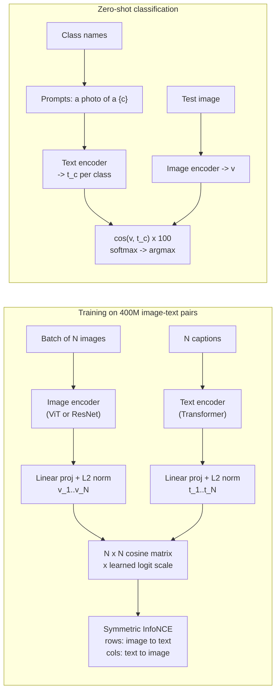
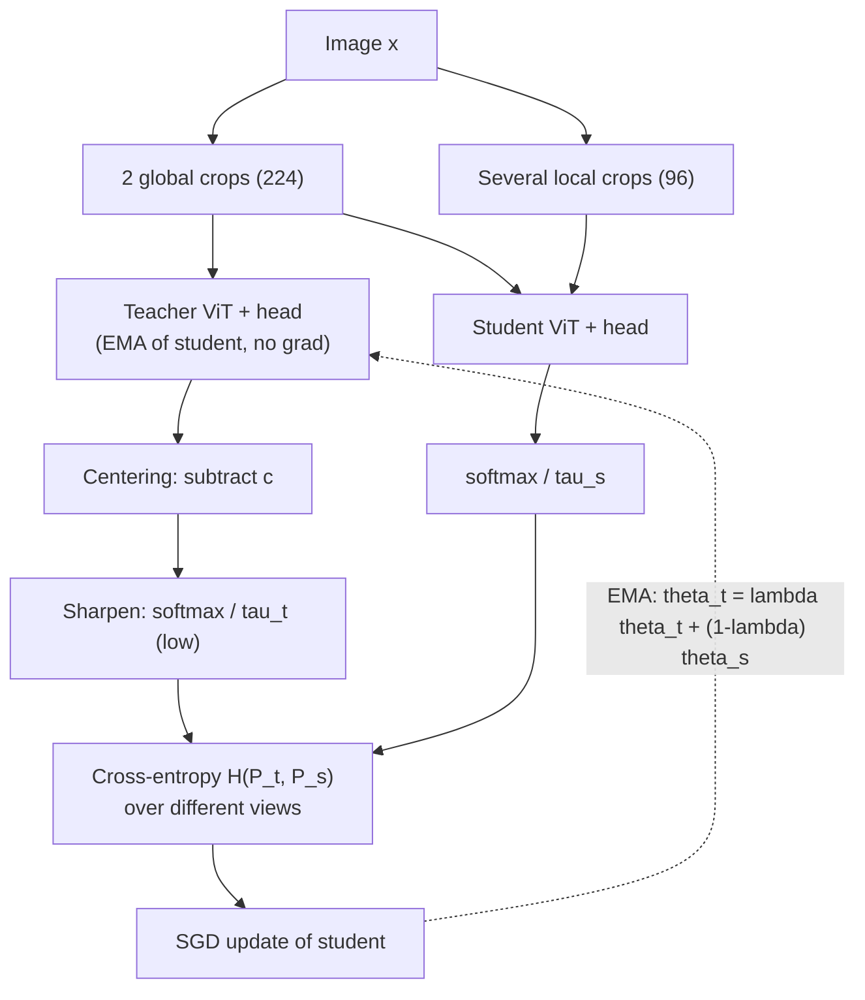
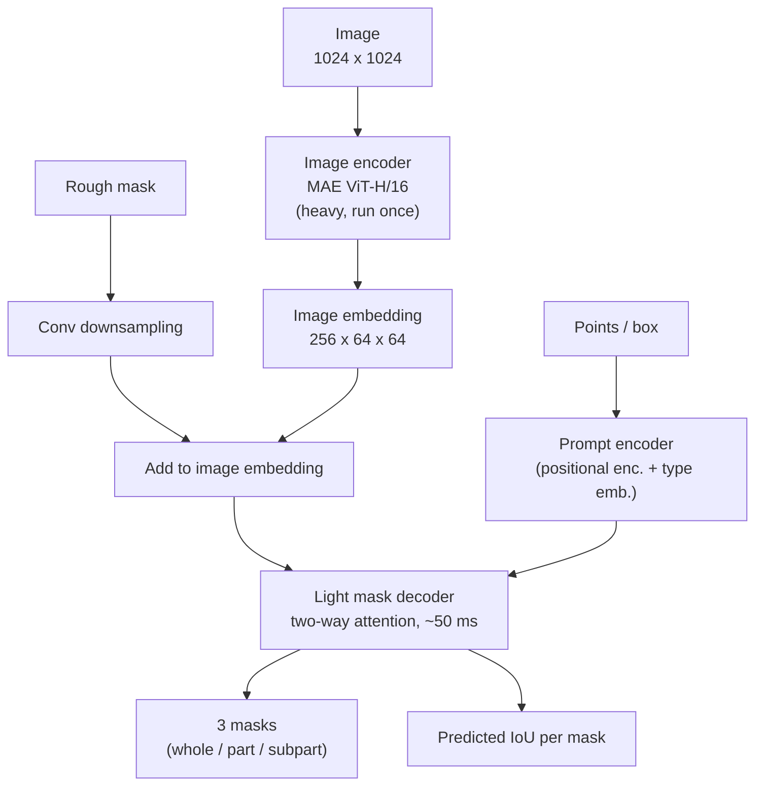
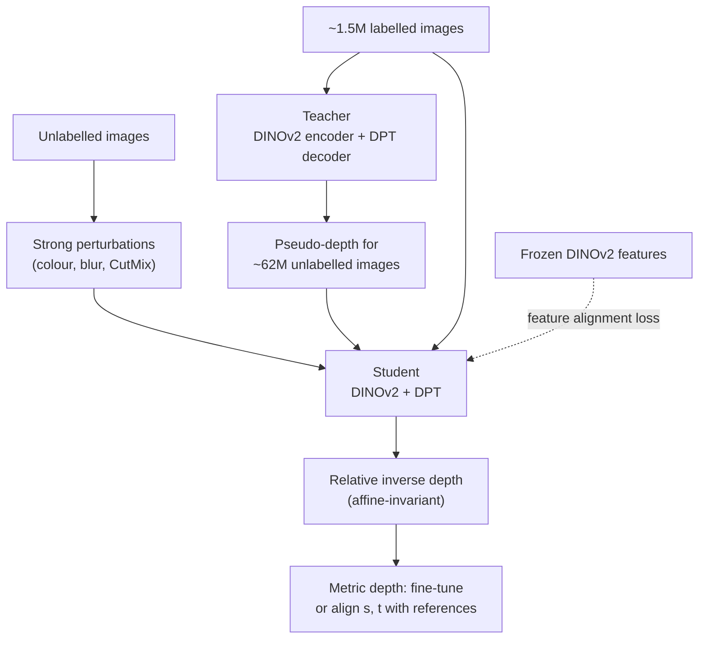
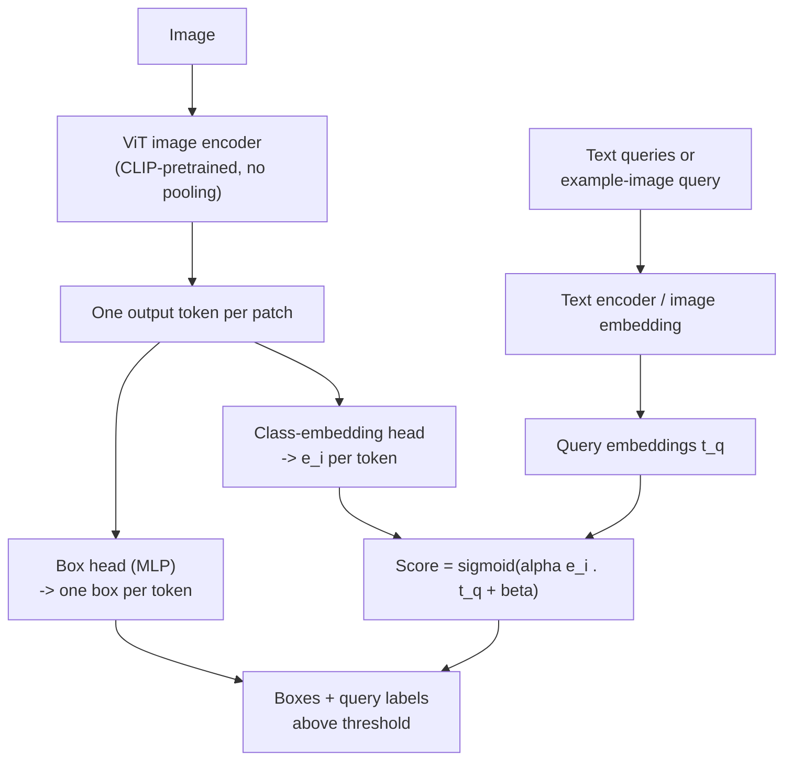

# Session 13 — Vision Foundation Models

> **Syllabus:**
> - What is a foundation model?
> - CLIP
> - DINO / DINOv2
> - Segment Anything (SAM)
> - Depth Anything
> - OWL-ViT
>
> **Related:** [05 Embeddings & contrastive learning (InfoNCE, SimCLR, MoCo, BYOL)](05_embeddings_similarity.md) · [03 CNNs / ViT basics](03_cnns_under_the_hood.md) · [04 Transfer learning (linear probe vs fine-tune)](04_training_transfer_learning.md) · [08 DETR & set prediction](08_detection_transformers.md) · [10 Segmentation (Mask R-CNN, IoU/Dice)](10_image_segmentation.md) · [12 Stereo depth](12_3d_vision_motion.md) · [14 Zero-shot pipelines, Grounding DINO, Grounded-SAM](14_vision_plus_plus.md) · [15 CLIP text encoder in Stable Diffusion](15_generative_cv.md) · [Comparison tables](../00_comparison_tables.md)
>
> **Practice:** [Questions](../practice/13_questions.md) · [Solutions](../practice/13_solutions.md)

---

## 1. Big picture

Up to Session 12 every model was trained for **one task on one labelled dataset** (ImageNet classification, COCO detection…). **Foundation models** flip this: train **one large model on broad, mostly unlabelled or weakly-labelled data** (web image–text pairs, curated unlabelled images, a billion auto-generated masks) and then **adapt** it to many tasks — often with **zero** task-specific labels. This session covers the five you must know: **CLIP** (image–text embedding → zero-shot classification), **DINO/DINOv2** (self-supervised general-purpose features), **SAM** (promptable, class-agnostic segmentation), **Depth Anything** (monocular relative depth) and **OWL-ViT** (open-vocabulary detection). They build directly on the contrastive learning of [Session 05](05_embeddings_similarity.md) and the transformer detectors of [Session 08](08_detection_transformers.md), and in [Session 14](14_vision_plus_plus.md) they are chained into zero-shot pipelines (Grounding DINO + SAM + Depth Anything).

---

## 2. Core concepts

### What is a foundation model?

- **Definition (Bommasani et al., Stanford, 2021):** a model **trained on broad data at scale** (generally with **self-supervision** or **weak supervision**) that can be **adapted** to a **wide range of downstream tasks**.
- **Ingredients:**
  1. **Scale** — data (hundreds of millions to billions of samples), parameters (10⁸–10⁹+), compute.
  2. **Cheap supervision** — no manual class labels: image–text pairs from the web (CLIP), augmented views of the same image (DINO), masks produced by the model itself in a **data engine** (SAM), pseudo-labels from a teacher (Depth Anything).
  3. **Transformer (ViT) backbones** — scale well, tokenise images into patches ($(H/p)(W/p)$ tokens), easy to combine with text tokens.
- **Adaptation modes (from cheapest to most expensive):**
  - **Zero-shot / prompting** — no training: text prompts (CLIP, OWL-ViT), point/box prompts (SAM), just run it (Depth Anything).
  - **k-NN / linear probe** — freeze the backbone, fit a k-NN classifier or a single linear layer on its features (DINOv2's strength).
  - **Parameter-efficient fine-tuning (PEFT)** — adapters, LoRA, prompt tuning: train a few % of weights.
  - **Full fine-tuning** — best accuracy in-domain, highest cost, risk of forgetting / overfitting with few labels ([04](04_training_transfer_learning.md)).
- **Emergence:** capabilities not explicitly trained for appear at scale (e.g. DINO attention maps segment objects; CLIP reads text in images).
- **Homogenisation:** many applications are built on the **same few models** ⇒ improvements propagate everywhere, **but so do their defects** (biases, failure modes) — a single point of failure.
- **Risks / limitations:** biased and unfiltered web data (social bias, NSFW, copyrighted content), privacy and licensing, huge training cost and carbon footprint, opacity (hard to audit what was learned), test-set contamination, over-trust in "zero-shot" outputs that are uncalibrated, domain gaps (medical, industrial).
- **Taxonomy for this session:**

| Kind | Model | Supervision signal |
|---|---|---|
| Language-aligned embedding | **CLIP** | Image–caption pairs (contrastive) |
| Self-supervised visual features | **DINO / DINOv2** | Agreement between augmented views (self-distillation) |
| Promptable task model | **SAM** | 1.1B masks from a model-in-the-loop data engine |
| Dense geometry model | **Depth Anything** | Labelled depth + teacher pseudo-labels on 62M images |
| Open-vocabulary detector | **OWL-ViT** (and Grounding DINO, [14](14_vision_plus_plus.md)) | Image–text pre-training + detection fine-tuning |

### CLIP

**CLIP = Contrastive Language–Image Pre-training (Radford et al., OpenAI, 2021).**

- **Training data:** **400M (image, text) pairs** collected from the internet (the "WIT" dataset). No class labels — the caption **is** the supervision.
- **Architecture — dual encoder:**
  - **Image encoder:** ResNet-50 variants or **ViT** (B/32, B/16, L/14) → global image feature.
  - **Text encoder:** Transformer (≈63M params) → feature of the end-of-text token.
  - Each followed by a **linear projection** into a **shared embedding space** (e.g. 512-d for ViT-B/32), then **L2-normalisation**.
- **Objective — symmetric InfoNCE over the $N\times N$ cosine-similarity matrix:**
  - A batch has $N$ pairs (CLIP used a very large batch of 32,768). Compute $S_{ij}=\cos(\mathbf v_i,\mathbf t_j)$ for every image $i$ and text $j$.
  - Logits $=S\cdot e^{t}$ where $e^{t}=1/\tau$ is a **learned temperature** (initialised to $\tau=0.07$, logit scale clipped at **100**, i.e. $\tau\ge0.01$).
  - **Image→text loss:** for each row, cross-entropy with the diagonal entry as the correct "class" among $N$ texts. **Text→image loss:** same for each column. Final loss = average of the two.
  - Each row therefore has **1 positive and $N-1$ negatives** — the other captions in the batch ([InfoNCE, Session 05](05_embeddings_similarity.md#contrastive-learning)).
  - Why contrastive and not caption generation? Predicting the **exact** words of a caption is very hard and wasteful; matching the right caption among $N$ is much more compute-efficient (the paper found it several times more efficient).
- **Zero-shot classification (inference):**
  1. Turn each class name into a sentence with a **prompt template**: "a photo of a {class}." (a bare word is ambiguous — "crane" the bird or the machine — and does not match the distribution of captions).
  2. Encode all prompts once with the text encoder → **$C$ normalised text embeddings** = the weights of a "zero-shot linear classifier".
  3. Encode the image, normalise, compute cosine similarity with each class embedding, multiply by the logit scale (100), **softmax** → class probabilities; predict the argmax.
  - **Prompt ensembling:** use many templates per class ("a photo of a big {c}", "a sketch of a {c}", "a blurry photo of a {c}"…), **average the normalised text embeddings** (re-normalise) — gains several % accuracy at zero extra inference cost. **Prompt engineering:** add context ("a photo of a {c}, a type of pet.").
  - Result: zero-shot CLIP (ViT-L/14 at 336 px) reaches ≈76% ImageNet top-1 — similar to a supervised ResNet-50 — **without using any ImageNet training labels**, and is much more robust to distribution shift (sketches, renditions).
- **Linear probe:** freeze the image encoder, train logistic regression on its features with labelled data — usually beats zero-shot when you have enough labels for the target domain; zero-shot can beat few-shot (1–4 examples/class) linear probes.
- **Uses:** zero-shot classification; **text↔image retrieval**; **text encoder for text-to-image diffusion** (Stable Diffusion conditions on CLIP text embeddings — [15](15_generative_cv.md)); **backbone for open-vocabulary detectors/segmenters** (OWL-ViT); **re-ranking / verifying** detections ([14](14_vision_plus_plus.md)); filtering web datasets by image–text similarity (CLIP score); image–text evaluation metrics.
- **Limitations:**
  - **Fine-grained** classes (car models, aircraft variants, flower species) and **specialised domains** (medical, satellite) are weak.
  - **Counting** objects, **spatial relations** ("left of"), attribute **binding**/compositionality ("red cube on blue sphere" vs the reverse) — the embedding behaves partly like a bag of concepts.
  - **Typographic attacks:** an apple with a paper label "iPod" is classified as an iPod — CLIP reads text strongly.
  - **Social bias** inherited from web data; sensitivity to prompt wording.
  - **Not a detector / segmenter:** one global vector per image — no boxes, weak localisation.
  - Absolute cosine values are **not calibrated** (typical matching scores are only ≈0.2–0.35); softmax probabilities depend on which classes you list (closed over the given prompts).

### DINO and DINOv2

**DINO = self-DIstillation with NO labels (Caron et al., Meta, 2021).**

- **Setup:** **student** network $g_{\theta_s}$ and **teacher** network $g_{\theta_t}$ with the **same architecture** (ViT + MLP projection head ending in $K$ output dimensions, $K=65{,}536$). Each outputs a probability distribution over $K$ "prototypes" via a **softmax with temperature**.
- **No labels, no negatives:** the student is trained to **match the teacher's output distribution** for a *different view of the same image* — cross-entropy $H(P_t,P_s)=-\sum_k P_t^{(k)}\log P_s^{(k)}$ (knowledge distillation where the teacher is built from the student itself).
- **Teacher = EMA of the student:** $\theta_t\leftarrow\lambda\,\theta_t+(1-\lambda)\,\theta_s$, $\lambda$ following a cosine schedule from 0.996 to 1. **No gradient** flows to the teacher (stop-gradient). The EMA teacher is an ensemble of past students and is actually **better** than the student during training.
- **Multi-crop:** from each image make **2 global views** (224², each covering > 50% of the image) and **several local views** (96², < 50%). **All** views go through the student; **only global** views go through the teacher ⇒ the student must predict the global (teacher) output from a small local crop — **"local-to-global" correspondence** ⇒ learns object-level semantics.
- **Avoiding collapse (the exam point):** two collapse modes —
  - (a) **one dimension dominates** (always the same prototype) — prevented by **centering**: subtract a running mean $c$ from the teacher's logits, $c\leftarrow m\,c+(1-m)\,\overline{g_{\theta_t}(x)}$;
  - (b) **uniform output** (every prototype equally likely) — prevented by **sharpening**: a **low teacher temperature** $\tau_t$ (0.04–0.07) vs student $\tau_s=0.1$.
  - Centering alone pushes towards uniform, sharpening alone towards one-hot; **together** they balance. Plus EMA teacher + stop-gradient (compare BYOL in [05](05_embeddings_similarity.md#contrastive-learning)).
- **Emergent properties:** the self-attention maps of the **[CLS] token** in the last layer **segment the foreground object** — without ever seeing a mask or label; features give excellent **k-NN classification** and **image retrieval / copy detection**; patch features cluster into object parts.

**DINOv2 (Oquab et al., Meta, 2023) — "all-purpose visual features without supervision".**
- **Data:** **LVD-142M** — 142M images **automatically curated** from ~1.2B uncurated web images: de-duplication + **retrieval of images similar to curated seed datasets** (e.g. ImageNet) using self-supervised embeddings. No text, no labels. Lesson: **curated data beats more raw data**.
- **Objective:** **DINO image-level loss** (on [CLS]) **+ iBOT masked-patch loss** (student sees some patches **masked** and must predict the teacher's patch tokens at those positions) — gives strong **dense (patch-level)** features. Plus **KoLeo regulariser** (spreads features uniformly within a batch), Sinkhorn-Knopp centering, and a short **high-resolution** training phase.
- **Models:** a ViT-g/14 (~1.1B params) trained first, then **distilled** into ViT-S/14, B/14, L/14 (patch size **14**).
- **Use:** **frozen** features with a **k-NN or linear** head for classification, **linear heads on patch tokens** for semantic segmentation and depth, instance retrieval, and as the **backbone of Depth Anything**. Often competitive with or better than CLIP features on pure-vision tasks, especially dense ones.
- **Limitations (DINO & DINOv2):** **no text** ⇒ **no zero-shot classification by prompt** (you need labelled examples for a probe/k-NN, or pair with a text model); features carry no class names; large models are costly; ViTs show high-norm "artifact" tokens in attention maps (fixed by adding **register** tokens).

### Segment Anything (SAM)

**SAM (Kirillov et al., Meta, 2023)** — a **promptable segmentation** foundation model: "given any prompt, return a valid mask".

- **Task — promptable segmentation:** prompts = **foreground/background points**, **boxes**, **rough masks** (and **text** explored as a proof of concept via CLIP text embeddings, not in the released model). "Valid" mask = even if the prompt is **ambiguous**, output a reasonable mask for at least one interpretation.
- **Architecture (three parts):**
  1. **Image encoder** — **MAE-pretrained ViT-H/16** (≈632M params), input resized/padded to **1024×1024** ⇒ **64×64** grid of image embeddings (256 channels). Windowed attention with a few global blocks keeps 4096 tokens tractable. **Heavy, but run once per image.**
  2. **Prompt encoder** — **sparse** prompts (points, box corners) → **positional encodings** + learned type embeddings (foreground / background / box corner); **dense** prompts (masks) → small convnet, **added** to the image embedding.
  3. **Mask decoder** — **lightweight** (2-layer) transformer decoder with **two-way attention** (prompt tokens ↔ image embedding), upsampling, and output tokens that produce **3 masks** + a **predicted IoU** score for each. Prompt encoder + decoder ≈4M params, **≈50 ms** — runs even in a web browser ⇒ **real-time interactive** clicking after the one-off image encoding.
- **Ambiguity handling:** a single click on a shirt could mean the **shirt**, the **person**, or a **pocket** ⇒ SAM outputs **3 masks (whole / part / sub-part)**; during training only the mask with the **lowest loss** is back-propagated; the **IoU head** ranks them at inference. With multiple unambiguous prompts a single mask is returned.
- **Training loss:** focal + Dice on masks (20:1), MSE between predicted and actual IoU; prompts are **simulated interactively** over several rounds (new points sampled from the error region).
- **Data engine → SA-1B:**
  1. **Assisted-manual:** annotators click foreground/background points in a browser tool powered by SAM; model retrained as data grows.
  2. **Semi-automatic:** SAM pre-fills confident masks; annotators label the missed objects ⇒ more diverse masks.
  3. **Fully automatic:** prompt SAM with a **32×32 grid of points**, keep masks with high **predicted IoU** and high **stability** (mask barely changes when the probability threshold is perturbed), remove duplicates with **NMS**.
  - Result: **SA-1B = 11M licensed, privacy-protected images (faces and licence plates blurred), 1.1B masks** (~100 per image), almost all generated automatically.
- **Zero-shot transfer:** single-point segmentation on many unseen datasets, edge detection, object proposals, instance segmentation when prompted with a detector's boxes ([14 Grounded-SAM](14_vision_plus_plus.md)).
- **SAM 2 (2024):** extends SAM to **video**: a **streaming** architecture with a **memory bank** (features + predicted masks of past/prompted frames) and **memory attention** that conditions the current frame on it ⇒ prompt an object once and **track its mask ("masklet") through the video**, handling occlusion; trained on a new large video dataset (SA-V). Also faster on single images.
- **Limitations:** **no class labels** — SAM knows *where* a thing is, never *what* it is (pair with CLIP/Grounding DINO); heavy encoder (ViT-H not real-time on edge; lighter variants e.g. MobileSAM/EfficientSAM); thin structures and fine boundaries can be imperfect; may produce small spurious components; granularity ambiguity in automatic mode (parts vs wholes); weaker on out-of-domain imagery (medical, microscopy) without fine-tuning; text prompting weak.

### Depth Anything

**Depth Anything (Yang et al., 2024)** — a foundation model for **monocular depth estimation** (depth from a **single** RGB image).

- **Architecture:** **DINOv2 encoder** (ViT-S/B/L) + **DPT decoder** (Dense Prediction Transformer: reassembles ViT tokens from several layers into a multi-scale feature pyramid and fuses them into a dense map).
- **Data and training (teacher–student self-training):**
  1. Train a **teacher** on **~1.5M labelled images** (from public depth datasets).
  2. Teacher produces **pseudo-labels** (depth maps) for **~62M unlabelled images**.
  3. Train a **student** on labelled + pseudo-labelled data; on the unlabelled images apply **strong perturbations** (colour distortion, blur, CutMix) so the student must learn **more** than just copying the teacher.
  4. Auxiliary **feature-alignment loss** to frozen DINOv2 features keeps rich **semantic priors**.
- **Output:** **relative (affine-invariant) inverse depth** (disparity-like): larger value = **closer**; correct only **up to an unknown scale $s$ and shift $t$**. Trained with an **affine-invariant loss** that normalises prediction and ground truth by their median and mean absolute deviation, so datasets with different depth scales can be mixed.
- **Metric depth** (metres) requires **fine-tuning** on metric data (e.g. indoor NYUv2 or outdoor KITTI) or **aligning** the output with a few known depths (reference object, LiDAR/stereo points) — see §3.7. **Depth Anything V2** trains its teacher on precise **synthetic** depth and pseudo-labels real images ⇒ sharper details.
- **Why monocular depth is possible at all:** learned **priors** — perspective, known object sizes, texture gradients, occlusion order, atmospheric haze, ground-plane contact. Contrast with **stereo** ([12](12_3d_vision_motion.md)): $Z=fB/d$ is **geometric and metric** but needs two calibrated cameras and texture for matching.
- **Uses:** robotics/obstacle awareness, AR occlusion, 3D photo/bokeh effects, depth-conditioned image generation (ControlNet), scene understanding, distance estimation in zero-shot pipelines ([14](14_vision_plus_plus.md)).
- **Limitations:** **scale/shift ambiguity** (no metres without calibration); errors on **transparent/reflective** surfaces, sky and very far regions; frame-to-frame **flicker** in video; inverse-depth alignment makes **far depths very sensitive** to small errors; metric fine-tunes are domain-specific (indoor vs outdoor); no uncertainty estimate.

### OWL-ViT

**OWL-ViT = Vision Transformer for Open-World Localization (Minderer et al., Google, 2022)** — a simple **open-vocabulary detector**.

- **Stage 1 — image–text pre-training:** CLIP-style contrastive training of a ViT image encoder and a text encoder (released versions build on CLIP backbones).
- **Stage 2 — detection fine-tuning:**
  - **Remove** the final token pooling; keep **every output image token**.
  - Attach to each token a **box head** (small MLP → box coordinates for that token) and a **class-embedding head** (linear projection → an embedding in the text space).
  - **Class logits = similarity between each token's class embedding and the text-query embeddings** (with a learned scale/shift) — the classifier weights **are text embeddings**, so the vocabulary is open.
  - Fine-tuned end-to-end on detection datasets with a **DETR-style bipartite-matching loss** ([08](08_detection_transformers.md)); no decoder, no NMS needed in principle — **one prediction per image token** (e.g. ViT-B/32 at 768×768 ⇒ 24×24 = 576 candidate boxes).
- **Queries:**
  - **Text queries** — any class names or phrases ("a red umbrella").
  - **Image queries (one-shot / image-conditioned detection)** — embed an example box from a query image and use its class embedding as the query ⇒ find similar objects even when they are hard to name.
- **OWLv2 (2023):** **self-training** at web scale — OWL-ViT generates **pseudo-box annotations** on billions of web image–caption pairs (queries = n-grams of the captions), a new model is trained on them, plus an **objectness** head and efficiency tricks ⇒ large gains on rare classes.
- **Uses:** detect long-tail/novel categories without labelled boxes, one-shot detection by example, bootstrapping/auto-labelling datasets.
- **Limitations:** lower box precision than closed-set detectors on common classes; threshold must be tuned per query (scores not comparable across prompts); prompt sensitivity; small objects with coarse patches (/32); confuses visually or semantically similar phrases; no masks (pair with SAM).

### Grounding DINO (preview)

- **Grounding DINO** (IDEA Research, 2023) is a stronger **open-set / text-grounded detector**: Swin image backbone + BERT text backbone, **deep cross-modal fusion** (feature enhancer, language-guided query selection, cross-modality decoder), trained on detection + grounding + caption data. Input image + text prompt ("dog . person ."), output boxes with per-phrase scores. Full treatment in [Session 14](14_vision_plus_plus.md#grounding-dino).
- ⚠ **Name trap:** the "DINO" in Grounding DINO is the **DETR-family detector DINO** (DETR with **Improved deNoising anchOr boxes**), **not** the self-supervised DINO of this session.
- **OWL-ViT vs Grounding DINO:** OWL-ViT fuses image and text **late** (only a dot product at the end — fast, text embeddings cacheable); Grounding DINO fuses **early and deeply** (attention between image and text features at several stages — better grounding of phrases and referring expressions, slower).

---

## 3. Key formulas

### 3.1 ViT tokens and attention cost

$$
N_{tok}=\frac{H}{p}\cdot\frac{W}{p}\ (+1\ \text{for [CLS]}),\qquad \text{attention entries per head per layer}=N_{tok}^2
$$

$H,W$ input size, $p$ patch size.

*Worked examples:* ViT-B/16 at 224: $14\times14=196$ (+1) $=197$ tokens ⇒ $197^2=38{,}809$ entries/head. ViT-L/14 at 336: $24^2+1=577$ tokens. **SAM** ViT-H/16 at 1024: $64\times64=$ **4096 tokens** ⇒ $4096^2\approx1.68\times10^7$ entries per head for global attention (hence windowed attention). DINOv2 /14 at 518: $37\times37=1369$ patches.

### 3.2 CLIP similarity matrix and symmetric loss

$$
S_{ij}=\frac{\mathbf v_i\cdot\mathbf t_j}{\Vert\mathbf v_i\Vert\,\Vert\mathbf t_j\Vert},\qquad \ell_{ij}=\frac{S_{ij}}{\tau}
$$

$$
\mathcal L_{I\to T}=-\frac1N\sum_{i=1}^{N}\log\frac{\exp(\ell_{ii})}{\sum_{j=1}^{N}\exp(\ell_{ij})},\qquad
\mathcal L_{T\to I}=-\frac1N\sum_{j=1}^{N}\log\frac{\exp(\ell_{jj})}{\sum_{i=1}^{N}\exp(\ell_{ij})},\qquad
\mathcal L=\tfrac12(\mathcal L_{I\to T}+\mathcal L_{T\to I})
$$

$\mathbf v_i$ image embedding of pair $i$, $\mathbf t_j$ text embedding of pair $j$, $N$ batch size, $\tau$ learned temperature ($1/\tau$ = logit scale, max 100). Matrix has $N^2$ entries: $N$ positives (diagonal) and $N^2-N$ negatives; **each row has $N-1$ negatives**.

*Worked example:* $N=32{,}768$ ⇒ $N^2\approx1.07\times10^9$ similarities, 32,767 negatives per row (≈4.3 GB in float32 — computed sharded across GPUs).

### 3.3 CLIP zero-shot classification

$$
p(y=c\mid x)=\frac{\exp\big(\cos(\mathbf v,\mathbf t_c)/\tau\big)}{\sum_{c'=1}^{C}\exp\big(\cos(\mathbf v,\mathbf t_{c'})/\tau\big)},\qquad
\mathbf t_c=\mathrm{normalise}\Big(\tfrac1M\sum_{m=1}^{M}\hat{\mathbf t}_{c,m}\Big)
$$

$\mathbf v$ image embedding, $\mathbf t_c$ text embedding of class $c$ (averaged over $M$ prompt templates $\hat{\mathbf t}_{c,m}$ for ensembling), $C$ classes, $1/\tau=100$.

*Worked example:* cosine similarities dog 0.30, cat 0.25, car 0.10. Logits ×100: 30, 25, 10 ⇒ $p(\text{dog})=\frac{1}{1+e^{-5}+e^{-20}}=0.993$, $p(\text{cat})=0.0067$. Without the scale (logits 0.30, 0.25, 0.10) the softmax would be almost uniform (0.36, 0.34, 0.30) — the learned temperature is what makes small cosine gaps decisive.

### 3.4 DINO: sharpened distributions, loss, EMA, centering

$$
P_s(x)^{(k)}=\frac{\exp\big(g_{\theta_s}(x)^{(k)}/\tau_s\big)}{\sum_{k'}\exp\big(g_{\theta_s}(x)^{(k')}/\tau_s\big)},\qquad
P_t(x)^{(k)}=\frac{\exp\big((g_{\theta_t}(x)^{(k)}-c^{(k)})/\tau_t\big)}{\sum_{k'}\exp\big((g_{\theta_t}(x)^{(k')}-c^{(k')})/\tau_t\big)}
$$

$$
\mathcal L=\sum_{x\in\{x_1^g,x_2^g\}}\ \sum_{\substack{x'\in V\\ x'\neq x}}H\big(P_t(x),P_s(x')\big),\qquad H(a,b)=-\sum_k a^{(k)}\log b^{(k)}
$$

$$
\theta_t\leftarrow\lambda\,\theta_t+(1-\lambda)\,\theta_s,\qquad c\leftarrow m\,c+(1-m)\frac1B\sum_{i=1}^{B}g_{\theta_t}(x_i)
$$

$g_\theta(x)\in\mathbb R^K$ head output, $\tau_s=0.1$ student temperature, $\tau_t\approx0.04$–$0.07$ teacher temperature (**sharpening**: $\tau_t<\tau_s$), $c$ centre (running mean of teacher outputs, momentum $m\approx0.9$), $V$ = all crops (2 global $x^g$ + local), $\lambda\in[0.996,1)$ EMA rate, $B$ batch size.

*Worked example (EMA):* $\theta_t=0.40$, $\theta_s=0.60$, $\lambda=0.996$ ⇒ $0.996(0.40)+0.004(0.60)=0.4008$.

### 3.5 DINOv2 KoLeo regulariser

$$
\mathcal L_{\text{koleo}}=-\frac1n\sum_{i=1}^{n}\log\Big(\min_{j\neq i}\Vert\mathbf x_i-\mathbf x_j\Vert\Big)
$$

$\mathbf x_i$ L2-normalised features in a batch of $n$. Penalises points whose nearest neighbour is very close ⇒ **spreads features uniformly** (prevents dimensional collapse, helps retrieval).

### 3.6 SAM sizes

$$
\text{embedding grid}=\frac{1024}{16}\times\frac{1024}{16}=64\times64,\qquad \text{image embedding}=256\times64\times64\approx1.05\times10^6\ \text{numbers}\ (\approx4\ \text{MB fp32})
$$

The embedding is computed **once** and cached; every new prompt only re-runs the light decoder. Mask loss $=20\cdot\text{focal}+1\cdot\text{Dice}$; IoU head trained with MSE to the true IoU (IoU/Dice: [10](10_image_segmentation.md)).

### 3.7 Depth Anything: affine-invariant output and alignment to metric depth

Model output $r(x,y)$ = relative **inverse** depth. Assume

$$
\frac{1}{Z(x,y)}\approx s\,r(x,y)+t
$$

$Z$ metric depth (m), $s$ scale, $t$ shift (unknown). Given $n\ge2$ pixels with known depth $Z_i$ (LiDAR, stereo, reference object), solve least squares $\min_{s,t}\sum_i\big(s\,r_i+t-1/Z_i\big)^2$:

$$
\hat s=\frac{n\sum r_iy_i-\sum r_i\sum y_i}{n\sum r_i^2-\left(\sum r_i\right)^2},\qquad \hat t=\frac{\sum y_i-\hat s\sum r_i}{n},\qquad y_i=\frac1{Z_i}
$$

*Worked example (2 points, exact):* $r_1=0.8$ at $Z_1=2$ m ($y_1=0.5$), $r_2=0.3$ at $Z_2=10$ m ($y_2=0.1$). $0.8s+t=0.5$, $0.3s+t=0.1$ ⇒ $s=0.8$, $t=-0.14$. A pixel with $r=0.5$: $1/Z=0.40-0.14=0.26$ ⇒ $Z=3.85$ m. ⚠ Larger $r$ = closer — never treat $r$ as proportional to depth.

Affine-invariant training loss (for reference): normalise each map by $\hat d=(d-\operatorname{median}(d))/\operatorname{mean}\lvert d-\operatorname{median}(d)\rvert$, then $\mathcal L=\operatorname{mean}\lvert\hat d^{*}-\hat d\rvert$ ($d^*$ ground truth, $d$ prediction).

### 3.8 OWL-ViT open-vocabulary scoring

$$
\text{logit}_{i,q}=\alpha_i\,\big(\mathbf e_i\cdot\mathbf t_q\big)+\beta_i,\qquad \text{score}_{i,q}=\sigma(\text{logit}_{i,q})
$$

$\mathbf e_i$ class embedding predicted by image token $i$, $\mathbf t_q$ embedding of query $q$ (text or example image), $\alpha_i,\beta_i$ learned per-token scale and shift, $\sigma$ sigmoid. Each token also predicts one box $\mathbf b_i$. Keep $(\mathbf b_i,q)$ if score > threshold.

---

## 4. Algorithms step by step

### 4.1 CLIP pre-training step
1. Sample a batch of $N$ (image, caption) pairs.
2. Encode images → $\mathbf v_i$; captions → $\mathbf t_i$; linear projections to the joint space; L2-normalise.
3. Compute the $N\times N$ cosine matrix $S$; multiply by the learned logit scale $1/\tau$ (clipped ≤ 100).
4. Row-wise cross-entropy with targets = diagonal ($\mathcal L_{I\to T}$); column-wise cross-entropy ($\mathcal L_{T\to I}$).
5. $\mathcal L=\frac12(\mathcal L_{I\to T}+\mathcal L_{T\to I})$; back-propagate into both encoders **and** the temperature.

### 4.2 CLIP zero-shot classification
1. Choose class names; write prompt templates ("a photo of a {c}.", plus domain context).
2. Encode every prompt; for each class **average** the normalised template embeddings; re-normalise ⇒ classifier weights $\mathbf t_1..\mathbf t_C$ (computed once).
3. Encode and normalise the test image ⇒ $\mathbf v$.
4. Scores $=100\cdot\mathbf v\cdot\mathbf t_c$; softmax ⇒ probabilities; argmax ⇒ label.
5. (Retrieval variant: rank many images by similarity to one text query, or vice versa.)

### 4.3 Linear probe / k-NN on frozen foundation features (CLIP or DINOv2)
1. Freeze the encoder; extract features for the labelled training set (no augmentation needed).
2. **Linear probe:** fit logistic regression (tune L2 regularisation on validation); **k-NN:** store normalised features, classify by majority vote of the $k$ most cosine-similar training features.
3. Evaluate on the test set; compare to zero-shot and to full fine-tuning.

### 4.4 DINO training step
1. For each image create 2 global crops (224²) and several local crops (96²) with augmentations (colour jitter, blur, solarisation, flips).
2. Teacher processes **global** crops: logits → subtract centre $c$ → softmax with low $\tau_t$ (sharpen) → $P_t$; stop-gradient.
3. Student processes **all** crops → softmax with $\tau_s$ → $P_s$.
4. Loss = sum of $H(P_t(x),P_s(x'))$ over all pairs where $x$ is a global crop and $x'\ne x$.
5. Update student by SGD/AdamW; update teacher by EMA $\theta_t\leftarrow\lambda\theta_t+(1-\lambda)\theta_s$.
6. Update centre $c\leftarrow mc+(1-m)\cdot$(batch mean of teacher logits).
7. After training: use the **teacher** backbone; [CLS] features for k-NN/linear probe; attention maps for unsupervised object masks.

### 4.5 SAM — interactive segmentation
1. Resize the image (longest side 1024), pad to 1024×1024, run the **image encoder once** ⇒ 256×64×64 embedding (cache it).
2. User gives a prompt (click/box/rough mask) ⇒ **prompt encoder** ⇒ prompt tokens (+ dense mask embedding).
3. **Mask decoder** (two-way attention) ⇒ 3 candidate masks + predicted IoU each (one mask if the prompt is unambiguous, e.g. box + points).
4. Show the best mask (highest predicted IoU); user adds positive/negative clicks or feeds the previous low-res mask back as a dense prompt; repeat step 3 (≈50 ms per update).
5. Upsample the chosen low-res mask logits to the original resolution and threshold at 0.

### 4.6 SAM — automatic mask generation ("segment everything")
1. Encode the image once.
2. Place a **32×32 grid** of foreground points (optionally also on zoomed-in crops).
3. Decode 3 masks per point.
4. **Filter:** keep masks with predicted IoU above a threshold and high **stability score** (IoU between the masks obtained by thresholding the logits at $+\delta$ and $-\delta$).
5. Remove duplicates with **mask/box NMS**; remove tiny regions and holes.
6. Output a set of class-agnostic masks (label them later with CLIP or a detector if needed).

### 4.7 SAM data engine (how SA-1B was built)
1. **Assisted-manual:** annotators segment with SAM-powered clicking; retrain SAM periodically.
2. **Semi-automatic:** detect confident masks automatically; annotators add the missing objects (increases diversity).
3. **Fully automatic:** grid prompting + IoU/stability filtering + NMS on 11M images ⇒ 1.1B masks; quality checked by sampling against professional annotations.

### 4.8 Depth Anything training (self-training)
1. Train teacher $T$ (DINOv2 + DPT) on labelled images with the affine-invariant loss.
2. Run $T$ on 62M unlabelled images ⇒ pseudo-depth maps.
3. Train a fresh student on labelled + pseudo-labelled images; apply strong colour/blur/CutMix perturbations to the unlabelled inputs (labels stay the teacher's clean predictions).
4. Add a feature-alignment loss to frozen DINOv2 features.
5. (Optional) Fine-tune on metric datasets for metric depth.

### 4.9 Recovering metric distance from relative depth
1. Run the model ⇒ relative inverse depth map $r$.
2. Obtain ≥ 2 reference pixels with known metric depth (LiDAR points, stereo, a known-size object via $Z=fH/h_{px}$ — [11 pinhole](11_camera_geometry.md)).
3. Fit $s,t$ by least squares on $1/Z_i\approx s\,r_i+t$ (use a robust fit/RANSAC if references are noisy).
4. Convert any pixel: $Z=1/(s\,r+t)$ (guard against $s\,r+t\le0$ — far/sky regions).
5. For an object, use the **median** of $r$ inside its mask (robust to boundary/background pixels).

### 4.10 OWL-ViT detection
1. Encode the image ⇒ one output token per patch; each token ⇒ box $\mathbf b_i$ + class embedding $\mathbf e_i$.
2. Encode queries: text prompts with the text encoder, **or** an example image region (take the class embedding of the best-matching box in the example image).
3. Score every (token, query) pair with $\sigma(\alpha_i\,\mathbf e_i\cdot\mathbf t_q+\beta_i)$.
4. Keep pairs above a score threshold (tuned per query); optionally apply NMS; output boxes + query labels.

---

## 5. Diagrams

### 5.1 CLIP — contrastive training and zero-shot inference

### 5.2 DINO — student–teacher self-distillation

### 5.3 SAM — architecture

### 5.4 Depth Anything — teacher–student training

### 5.5 OWL-ViT — open-vocabulary detection

---

## 6. Comparison tables

### 6.1 The five foundation models at a glance (memorise)

| Model | Training data | Objective | Input | Output | Typical use | Key limitation |
|---|---|---|---|---|---|---|
| **CLIP** | 400M web image–text pairs | Symmetric InfoNCE over $N\times N$ cosine matrix, learned $\tau$ | Image and/or text | Global embeddings in a shared space (similarities) | Zero-shot classification, text–image retrieval, text encoder for diffusion | Fine-grained, counting, spatial relations, typographic attacks, bias; no localisation |
| **DINO / DINOv2** | ImageNet (DINO); curated LVD-142M (DINOv2) — **no labels, no text** | Self-distillation student↔EMA teacher (centering + sharpening); + iBOT masked patches, KoLeo (v2) | Image | [CLS] + patch features | Frozen backbone: k-NN/linear classification, retrieval, dense heads (seg., depth) | No text ⇒ no prompt-based zero-shot; needs a head/labels |
| **SAM** | SA-1B: 11M images, 1.1B masks via data engine | Promptable segmentation: focal + Dice, IoU regression, simulated interaction | Image + points/boxes/mask | 3 class-agnostic masks + predicted IoU | Interactive annotation, segment-everything, box→mask (Grounded-SAM) | **No class labels**; heavy encoder; fine structures; domain shift |
| **Depth Anything** | ~1.5M labelled + ~62M unlabelled (pseudo-labelled) | Affine-invariant depth loss, teacher→student self-training, DINOv2 feature alignment | Single RGB image | **Relative** (affine-invariant) inverse depth map | Robotics, AR, 3D effects, depth conditioning, distance with calibration | No metric scale without fine-tune/alignment; reflective/transparent; video flicker |
| **OWL-ViT** | Image–text pre-training + detection datasets (O365, VG); OWLv2: web-scale pseudo-boxes | Contrastive pre-training, then DETR-style bipartite matching with text-embedding classifier | Image + text or image queries | Boxes + per-query scores | Open-vocabulary / one-shot detection, auto-labelling | Box quality < closed-set on common classes; per-query thresholds; no masks |

### 6.2 Adaptation modes

| Mode | Labels needed | Trainable params | Typical when | Example |
|---|---|---|---|---|
| Zero-shot / prompting | None | 0 | New classes on the fly, no data | CLIP prompts, SAM clicks, OWL-ViT text queries |
| k-NN on frozen features | Few–many | 0 | Fast baseline, classes change often | DINOv2 k-NN |
| Linear probe | Some (tens+/class) | One linear layer | Domain differs a bit, cheap training | CLIP/DINOv2 + logistic regression |
| PEFT (adapters, LoRA) | Moderate | ~1–5% | Limited GPU, many tasks sharing a backbone | LoRA on ViT |
| Full fine-tuning | Many | All | Large in-domain dataset, max accuracy | Depth Anything → metric NYUv2 |

### 6.3 CLIP vs DINOv2 features

| | CLIP | DINOv2 |
|---|---|---|
| Supervision | Language (captions) | None (self-distillation) |
| Zero-shot by text | **Yes** | No |
| Dense / patch features | Weaker (trained on global matching) | **Strong** (iBOT patch objective) |
| Fine-grained visual similarity | Moderate | Strong (k-NN, retrieval) |
| Typical role | Classifier from prompts, text retrieval, text encoder | Frozen backbone for vision heads (seg, depth, retrieval) |

### 6.4 SAM vs Mask R-CNN ([10](10_image_segmentation.md))

| | Mask R-CNN | SAM |
|---|---|---|
| Classes | Fixed closed set (e.g. 80 COCO) | **None** (class-agnostic) |
| Input | Image only | Image + **prompt** |
| Training data | COCO (~118k images) | SA-1B (11M images, 1.1B masks) |
| Output | Boxes + class + mask per instance | 3 masks + IoU per prompt |
| Generalisation | In-distribution | Zero-shot to new domains / objects |
| Speed | One pass per image | Heavy encoder once + light decoder per prompt |

### 6.5 Monocular foundation depth vs stereo ([12](12_3d_vision_motion.md))

| | Stereo ($Z=fB/d$) | Depth Anything |
|---|---|---|
| Cameras | 2 calibrated, rectified | **1** uncalibrated |
| Scale | **Metric** (from $f$, $B$) | Relative (affine) unless fine-tuned/aligned |
| Basis | Geometry (triangulation) | Learned priors |
| Fails on | Textureless, occlusions, far range ($\Delta Z\propto Z^2$) | Ambiguous scale, reflective/transparent, out-of-distribution |
| Strength | Accurate absolute depth at short range | Dense, sharp, works anywhere with one image |

### 6.6 Open-vocabulary vs closed-set detection

| | Closed-set (YOLO, Faster R-CNN) | OWL-ViT (open-vocabulary) |
|---|---|---|
| Vocabulary | Fixed at training | Any text / example image at test time |
| Classifier weights | Learned per class | **Text embeddings** of the queries |
| Labels needed for a new class | Hundreds of boxes + retraining | **None** (zero-shot) or 1 example (one-shot) |
| Accuracy on trained classes | Higher | Lower |
| Speed | Real-time possible | Slower (ViT backbone), per-query thresholds |

---

## 7. Common exam traps & misconceptions

- ❌ "Foundation model = any very large model." → ✅ It is defined by **broad (mostly self/weakly-supervised) pre-training + adaptability to many downstream tasks**, not by parameter count alone.
- ❌ "CLIP is trained to classify ImageNet classes / to generate captions." → ✅ It is trained **contrastively** to match each image with its own caption among $N$ in the batch (symmetric InfoNCE); classification is done **zero-shot** afterwards with prompts.
- ❌ "CLIP's softmax probabilities are calibrated absolute confidences." → ✅ They are relative to the **listed prompts** — add or remove a class and they change; raw cosines are small (~0.2–0.35) and only meaningful comparatively.
- ❌ "CLIP can localise objects." → ✅ It produces one global embedding per image — use OWL-ViT/Grounding DINO for boxes.
- ❌ "Lower logit scale (higher τ) makes CLIP more confident." → ✅ Higher logit scale (= lower τ) makes the softmax **sharper**.
- ❌ "DINO uses negatives like SimCLR." → ✅ **No negatives**: collapse avoided by **centering + sharpening + EMA teacher (stop-gradient)**.
- ❌ "In DINO the teacher is a big pre-trained network." → ✅ The teacher is an **EMA of the student** itself (self-distillation), same architecture.
- ❌ "Centering alone prevents collapse." → ✅ Centering prevents one-dimension dominance but encourages a uniform output; **sharpening** counteracts that — both are needed.
- ❌ "DINOv2 can do zero-shot classification from text." → ✅ DINO/DINOv2 have **no text encoder**; you need labelled examples (k-NN/linear probe) or a separate text model.
- ❌ "SAM tells you what the object is." → ✅ SAM masks are **class-agnostic**; labels come from another model (CLIP, Grounding DINO).
- ❌ "SAM runs the whole network for every click." → ✅ The heavy ViT-H encoder runs **once per image**; each click only re-runs the light prompt encoder + decoder (~50 ms).
- ❌ "SAM's 3 output masks are for 3 classes." → ✅ They are 3 **granularities** (whole/part/sub-part) for an **ambiguous** prompt, ranked by predicted IoU.
- ❌ "Depth Anything outputs metric depth in metres." → ✅ It outputs **relative, affine-invariant inverse depth** (bigger = closer); metres need metric fine-tuning or scale-and-shift alignment.
- ❌ "Relative depth only needs a scale factor." → ✅ The ambiguity is **scale and shift** (affine) in inverse-depth space ⇒ at least **2** reference depths to fit $s$ and $t$.
- ❌ "OWL-ViT trains a classifier head per class." → ✅ Its classifier weights are the **text (or image) query embeddings**; per-token class embeddings are compared with them.
- ❌ "Grounding DINO is self-supervised DINO plus text." → ✅ Its "DINO" is the **DETR-family detector (DETR with Improved deNoising anchOr boxes)**.
- ❌ "Zero-shot means the model has never seen anything like the class." → ✅ It means **no labelled examples of the target task/classes** were used; the concept was almost certainly seen in web pre-training data.

---

## 8. 10-line cheat summary

1. **Foundation model** = broad, large-scale, mostly self/weakly-supervised pre-training + adaptation (zero-shot, k-NN/linear probe, PEFT, fine-tune); homogenisation spreads both gains and flaws.
2. **CLIP:** image + text encoders → shared space; **symmetric InfoNCE over the $N\times N$ cosine matrix** with learned τ (logit scale ≤ 100); **400M pairs**.
3. **CLIP zero-shot:** prompts "a photo of a {c}." (ensemble templates) → text embeddings = classifier; softmax(100·cos). Weak at fine-grained, counting, spatial relations, typographic attacks; no boxes.
4. **DINO:** student vs **EMA teacher**, cross-entropy between views, **multi-crop** (2 global + local), **centering + sharpening** prevent collapse, no negatives, no labels; [CLS] attention segments objects.
5. **DINOv2:** curated **LVD-142M**, DINO + **iBOT masked-patch** loss + **KoLeo**; best frozen features (k-NN, linear, dense); **no text**.
6. **SAM:** promptable segmentation; **MAE ViT-H encoder (once) + prompt encoder + light mask decoder (~50 ms)**; 1024² → **64×64** embedding; **3 masks + predicted IoU**; **no class labels**.
7. **SA-1B:** 11M images, **1.1B masks** from a 3-stage data engine (assisted → semi-auto → fully auto 32×32 grid); **SAM 2** adds memory for video.
8. **Depth Anything:** **DINOv2 encoder + DPT decoder**, ~1.5M labelled + ~62M pseudo-labelled; outputs **relative affine-invariant inverse depth**; metric needs fine-tune or $1/Z=s\,r+t$ alignment (≥ 2 references).
9. **OWL-ViT:** CLIP-style pre-training → per-token **box head + class-embedding head**; score = similarity with **text or image-query** embeddings ⇒ open-vocab & one-shot detection; **OWLv2** self-trains on web pseudo-boxes.
10. **Grounding DINO** (→ [14](14_vision_plus_plus.md)): deep image–text fusion detector; its **DINO = DETR with Improved deNoising anchOr boxes**, not self-supervised DINO.
