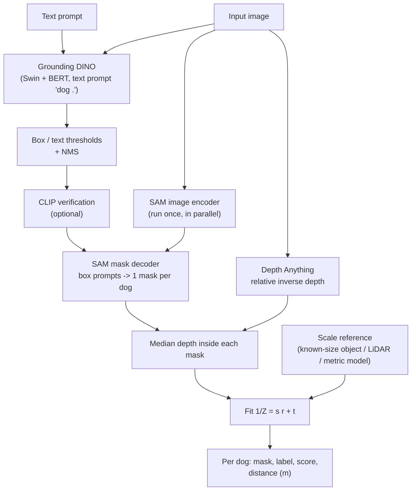
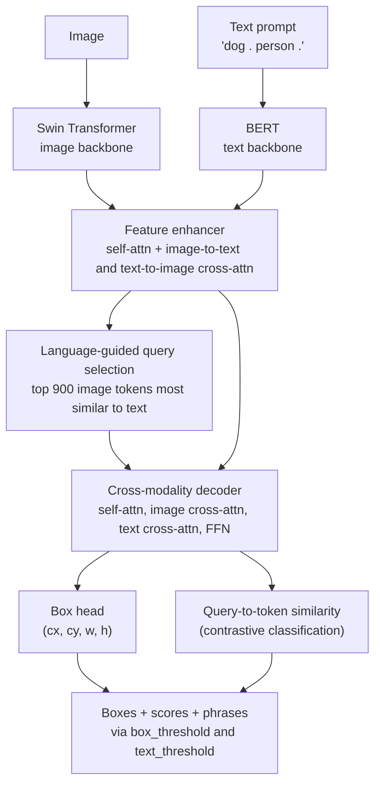
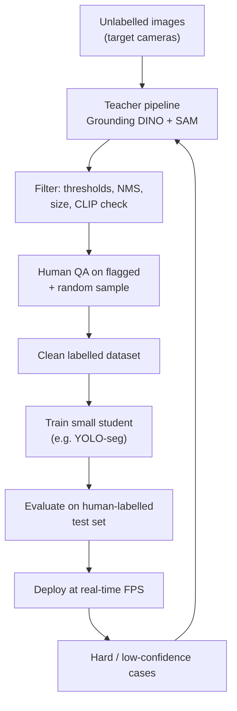
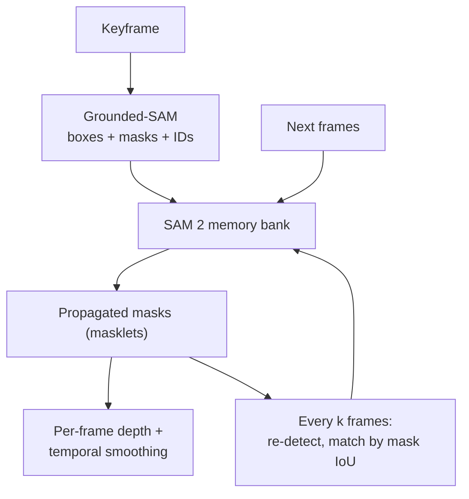

# Session 14 — Vision++ with Foundation Models

> **Syllabus:**
> - Zero-shot vision
> - Grounding DINO
> - Detection + segmentation + depth pipelines
>
> **Related:** [13 Foundation models (CLIP, DINO, SAM, Depth Anything, OWL-ViT)](13_vision_foundation_models.md) · [05 Contrastive learning / embeddings](05_embeddings_similarity.md) · [07 IoU, NMS, P/R, AP](07_detection_one_stage.md) · [08 DETR, object queries, Hungarian matching](08_detection_transformers.md) · [10 Segmentation (IoU/Dice)](10_image_segmentation.md) · [11 Pinhole camera](11_camera_geometry.md) · [12 Stereo depth & tracking](12_3d_vision_motion.md) · [15 CLIP text encoder in Stable Diffusion](15_generative_cv.md) · [code: IoU/NMS/AP](../code/iou_nms_ap.py)
>
> **Practice:** [Questions](../practice/14_questions.md) · [Solutions](../practice/14_solutions.md)

---

## 1. Big picture

Session 13 introduced foundation models one by one; this session **composes** them into systems that solve tasks **without task-specific training data**. Text embeddings make the vocabulary **open**: you can ask for "dog", "forklift" or "the person holding an umbrella" at inference time. **Grounding DINO** turns a text prompt into boxes, **SAM** turns boxes into masks, **Depth Anything** adds how far each object is, a tracker (**SAM 2**) carries them through video, and **CLIP** can double-check the labels. These pipelines are powerful for prototyping and **auto-labelling**, but they are slow and errors **propagate** from stage to stage — so a common end state is to use them to label data and **distil** into a small, fast closed-set detector ([07](07_detection_one_stage.md)). Exam questions are typically *design* questions: "find and segment all X using text and estimate their distance".

---

## 2. Core concepts

### Zero-shot vision

- **Zero-shot:** solve a task for classes/conditions with **no labelled training examples of the target task or classes**. The model relies on knowledge from pre-training (usually image–text). It does **not** mean the concept was never seen — web pre-training almost certainly contained it.
- **Few-shot:** $k$ labelled examples per class (e.g. 1–10) — linear probe, k-NN, prompt/adapter tuning, or image-conditioned queries (OWL-ViT one-shot).
- **Fine-tuning:** many labelled examples; update (some) weights — best in-domain accuracy.
- **Closed-set vs open-vocabulary vs open-set:**
  - **Closed-set** detector (YOLO, Faster R-CNN): fixed $C$ classes; a learned weight vector per class; anything else is background.
  - **Open-vocabulary:** the class list is supplied **at inference time as text** (or example images); classification = similarity between region features and **text embeddings**.
  - **Open-set** (strict sense): also flag **unknown** objects as "unknown". (Grounding DINO's paper uses "open-set" loosely to mean open-vocabulary.)
- **Why text embeddings enable it:** a closed-set classifier is a matrix $W\in\mathbb R^{C\times D}$ learned per class. Replace $W$ with **text embeddings of class names** from an aligned text encoder (CLIP-style, [13](13_vision_foundation_models.md#clip)) ⇒ any concept expressible in words gets a classifier "for free", and related concepts lie close in the embedding space so knowledge transfers (e.g. "husky" ≈ "dog").
- **Zero-shot tasks:**
  - **Classification:** CLIP prompts ([13](13_vision_foundation_models.md#clip)).
  - **Detection:** OWL-ViT / OWLv2, **Grounding DINO**, GLIP, YOLO-World (real-time, vocabulary embeddings pre-computed).
  - **Segmentation:** text → boxes → SAM (**Grounded-SAM**); SAM "segment everything" + CLIP labelling of each mask; dedicated text-to-mask models.
  - **Depth:** Depth Anything on unseen datasets (relative depth).
  - **Tracking:** SAM 2 propagates a prompted mask through video.
- **Prompt engineering for detection/segmentation:**
  - Use **concrete singular nouns** ("dog", not "dogs" or "canine friends"); lower-case; for Grounding DINO separate categories with " . " ("dog . person . sofa .").
  - Add **attributes** to disambiguate ("brown dog", "dog on a leash"); try **synonyms** ("puppy") and keep the union.
  - Add **contrast/distractor classes** that absorb false positives ("cat . stuffed toy . dog .") and then keep only the "dog" outputs.
  - **Tune thresholds per class** on a few checked images — scores are not comparable across prompts.
  - Avoid **negation** ("not a dog") and complex relations — models mostly behave like **bag-of-concepts** matchers.
- **Failure modes:** rare/technical vocabulary (part numbers, medical terms), fine-grained classes, domain shift (thermal, X-ray, microscopy), small or crowded objects, counting, relational/referring queries ("the dog **left** of the chair"), **hallucinations** when the queried object is absent (something similar scores above threshold), duplicate or merged labels, threshold mis-calibration, social bias and **typographic** effects inherited from CLIP-style training.
- **Choosing zero-shot vs few-shot vs fine-tuning** — see table 6.3: zero-shot for prototyping, rare/changing vocabularies and auto-labelling; fine-tune (or distil) for fixed classes, high accuracy and real-time/edge deployment.
- **Detection reformulated as grounding:** GLIP (2022) showed that detection can be cast as **phrase grounding** — "classify" each region by aligning it with the words of a prompt that lists the class names. This unifies detection data (class names → prompt) and grounding data (captions with phrase–box links) into one training signal; Grounding DINO follows the same recipe on a DETR-style detector.
- **Three routes to zero-shot instance masks** (compare in table 6.6):
  1. **Text → boxes → masks** (Grounded-SAM): semantics first, then precise pixels — the standard choice when you know what to look for.
  2. **Masks → labels** (SAM "segment everything" + CLIP classification of each mask crop): finds everything, including objects you did not name, but is slow (hundreds of masks) and CLIP on small crops is noisy.
  3. **Dedicated open-vocabulary segmenters** (text-conditioned mask heads): one model, but usually coarser masks than SAM.
- **Why combine rather than train one model?** Each foundation model is trained on the data that suits its task (web captions for semantics, 1.1B masks for boundaries, 62M images for depth). Composition reuses all of them without new labels; the price is latency, integration effort and error propagation.

### Grounding DINO

**Grounding DINO (Liu et al., IDEA Research, 2023)** — "marrying DINO with grounded pre-training for open-set object detection". It detects objects described by an **arbitrary text prompt** (category names or a referring expression).

- ⚠ **Name trap:** "DINO" here is the **DETR-family detector DINO = DETR with Improved deNoising anchOr boxes** (contrastive denoising training, mixed query selection, look-forward-twice box refinement; deformable attention — [08](08_detection_transformers.md)). It is **not** the self-supervised DINO of [Session 13](13_vision_foundation_models.md#dino-and-dinov2).
- **Inputs / outputs:**
  - **Input:** image + text prompt, e.g. `"dog . person . frisbee ."` (max 256 text tokens) or `"the black dog lying on the sofa"`.
  - **Output:** a fixed set of query predictions (900), each with a **box** (normalised $(c_x,c_y,w,h)$) and a **similarity logit to every text token**; after thresholding: boxes + score + **phrase** (the prompt words matched).
- **Architecture (dual encoder – single decoder, with deep fusion):**
  1. **Image backbone** — **Swin Transformer** (Swin-T or Swin-L) → multi-scale image features.
  2. **Text backbone** — **BERT** → one feature per text token. A **sub-sentence** attention mask stops unrelated category names in the same prompt from attending to each other.
  3. **Feature enhancer** (neck) — stacked layers of image deformable self-attention, text self-attention, and **bi-directional cross-attention** (image→text and text→image) ⇒ **early cross-modal fusion**: image features become text-aware and vice versa.
  4. **Language-guided query selection** — score each image token by its maximum similarity to the text tokens and pick the **top-$N_q$ ($N_q=900$)** tokens; their positions initialise the decoder queries' **anchor boxes** (content parts are learnable). Queries therefore start where the prompt is likely to be.
  5. **Cross-modality decoder** — each layer: query self-attention → cross-attention to **image** features → cross-attention to **text** features → FFN; boxes are refined layer by layer.
  6. **Heads:** box regression + **contrastive classification** = dot product between each query and each text token (sigmoid) — no fixed class list.
- **Training:** DETR-style **Hungarian matching** ([08](08_detection_transformers.md)) with L1 + GIoU box losses and a focal contrastive classification loss over text tokens. Data: **detection** datasets (e.g. Objects365, OpenImages; class names turned into prompts), **grounding** data (phrase–region pairs, e.g. Flickr30k Entities / GoldG), **referring-expression** data (RefCOCO family) and large **image–caption** data with pseudo-boxes. Mixing these is what makes it understand both category lists and free-form phrases.
- **Performance anchor:** ≈52.5 AP **zero-shot** on COCO (no COCO training data) for the large model — far above earlier open-vocabulary detectors.
- **Inference thresholds (typical defaults: `box_threshold = 0.35`, `text_threshold = 0.25`):**
  - **`box_threshold`** — keep a query only if its **maximum** token similarity (after sigmoid) exceeds it ⇒ controls **how many boxes** (precision/recall).
  - **`text_threshold`** — for each kept box, the **phrase** is made of all prompt tokens whose similarity exceeds it ⇒ controls **which label(s)** a box gets. Too low ⇒ merged labels like "dog person"; too high ⇒ empty/partial phrases.
- **Referring expressions:** prompts such as "the dog on the left" ⇒ take the **top-1** box (REC). Works better than late-fusion detectors thanks to deep fusion, but complex spatial relations and negation remain unreliable.
- **Strengths:** state-of-the-art zero-shot detection, phrase grounding, flexible prompts, the standard first stage of Grounded-SAM.
- **Limitations:** heavy (Swin + BERT + fusion ⇒ far from real-time on edge), **256-token prompt limit** (large vocabularies need several passes), label merging/ambiguity, false positives for absent objects, small/crowded objects, outputs **boxes only** (no masks), threshold tuning per use-case.

### Detection + segmentation + depth pipelines

Compose models, each answering one question:

| Stage | Model | Question answered | Output |
|---|---|---|---|
| Open-vocabulary detection | **Grounding DINO** (or OWL-ViT) | *What* and roughly *where*? | Boxes + phrases + scores |
| Verification (optional) | **CLIP** | *Is it really a dog?* | Re-scored / filtered boxes |
| Segmentation | **SAM** (box prompts) | *Exactly which pixels?* | One mask per box |
| Depth | **Depth Anything** | *How far?* | Relative (or metric) depth map |
| Tracking (video) | **SAM 2** / tracker | *Same object over time?* | Mask tracks (masklets) with IDs |

- **Grounded-SAM** (IDEA Research): **Grounding DINO → boxes → SAM** box prompts → one mask per detected object, labelled with Grounding DINO's phrase. Gives **open-vocabulary instance segmentation** with zero training. SAM supplies precise boundaries but **no semantics**; Grounding DINO supplies semantics but only boxes — they complement each other.
- **+ Depth Anything:**
  - Run once on the whole image (independent of detection) ⇒ relative inverse-depth map $r$.
  - For each mask take the **median** $r$ inside the mask (robust to boundary pixels; a box would mix in background) ⇒ ordering by closeness works directly.
  - **Metric distance needs scale (and shift):** relative depth is affine-ambiguous ([13](13_vision_foundation_models.md#depth-anything)). Options: (1) a **metric fine-tuned** Depth Anything (indoor/outdoor); (2) a **reference object of known size** — pinhole $Z=fH/h_{px}$ ([11](11_camera_geometry.md)); (3) sparse **LiDAR/stereo** points ([12](12_3d_vision_motion.md)); (4) known camera height + ground plane; fit $1/Z=s\,r+t$ by least squares.
  - **Depth vs distance:** $Z$ is along the optical axis; the straight-line range is $\sqrt{X^2+Y^2+Z^2}$ with $X=Z(u-c_x)/f_x$, $Y=Z(v-c_y)/f_y$.
- **+ Tracking (video):** detect on the first frame (and every $k$ frames to catch new objects), prompt **SAM 2** with the boxes and **propagate** masks with its memory; or use tracking-by-detection (associate boxes by IoU/appearance, Kalman motion — [12](12_3d_vision_motion.md)). Smooth per-object depth over time (median/Kalman) to remove flicker.
- **+ CLIP verification / re-ranking:** crop each box (with a margin), compute CLIP probabilities over the target prompt **and distractors** ("a photo of a dog / cat / stuffed toy / statue"); drop boxes whose top class is not the target or combine scores (e.g. product of detector score and CLIP probability). Cheap way to cut false positives.
- **Auto-labelling → distillation:** run the slow pipeline **offline** on unlabelled images ⇒ pseudo boxes/masks ⇒ filter (confidence, size, NMS) ⇒ human QA on a sample/uncertain cases ⇒ train a **small closed-set real-time model** (e.g. YOLO-seg) ⇒ deploy at high FPS. The foundation models are the **teacher**, the small model the **student** (cf. Depth Anything's own teacher–student training).
- **Latency / cost:** stage times add up when run sequentially; parallelise independent stages (SAM's image encoder and Depth Anything do not need the boxes); cache embeddings; use FP16/TensorRT and light variants (Swin-T, SAM-B or mobile SAM, Depth-Anything-Small). Even then, a full Grounded-SAM + depth pipeline is typically ~1–5 FPS on a server GPU ⇒ fine for offline labelling or low-rate analytics, not for 30 FPS edge use.
- **Error propagation:** later stages **cannot recover** what earlier stages missed: a missed detection ⇒ no mask, no distance; a loose or wrong box ⇒ wrong mask; a mask leaking into background ⇒ wrong depth; a wrong scale ⇒ every distance wrong by the same factor. If stage success rates are independent, end-to-end success ≈ their **product** (e.g. $0.90\times0.95\times0.95\approx0.81$).
- **Evaluation:** per stage **and** end-to-end on a small hand-labelled set:
  - detection: P/R/AP@0.5 for the prompt class ([07](07_detection_one_stage.md));
  - masks: mask IoU / Dice ([10](10_image_segmentation.md));
  - depth: AbsRel $=\frac1n\sum\lvert d-d^*\rvert/d^*$ and $\delta_1$ (% pixels with $\max(d/d^*,d^*/d)<1.25$);
  - distance: mean absolute error (m) or % within ±10% per object;
  - system: latency/FPS, robustness slices (night, occlusion, small objects).

---

## 3. Key formulas

### 3.1 Open-vocabulary classification score

$$
p(c\mid \mathbf f)=\frac{\exp(\cos(\mathbf f,\mathbf t_c)/\tau)}{\sum_{c'}\exp(\cos(\mathbf f,\mathbf t_{c'})/\tau)}\quad\text{(softmax, CLIP-style)}\qquad
s_{c}=\sigma(\mathbf f\cdot\mathbf t_c)\quad\text{(sigmoid, detectors)}
$$

$\mathbf f$ image or region feature, $\mathbf t_c$ text embedding of class/phrase $c$, $\tau$ temperature, $\sigma$ sigmoid. Detectors use independent sigmoids so a box can score high for several phrases (or none).

### 3.2 Grounding DINO thresholding

$$
\text{score}_q=\max_j\ \sigma(\ell_{q,j}),\qquad \text{keep } q \iff \text{score}_q>\text{box\_threshold},\qquad \text{phrase}_q=\{\,j:\ \sigma(\ell_{q,j})>\text{text\_threshold}\,\}
$$

$\ell_{q,j}$ logit between query $q$ and prompt token $j$.

*Worked example* (prompt "dog . cat .", box 0.35, text 0.25): a query with token scores (dog 0.55, cat 0.27) is kept (0.55 > 0.35) with phrase **"dog cat"** (both > 0.25); raising text_threshold to 0.30 gives "dog". A query with (0.30, 0.10) is dropped.

### 3.3 Box conversion and IoU (convention: $(x_1,y_1,x_2,y_2)$, continuous coordinates, area $=(x_2-x_1)(y_2-y_1)$, **no +1**)

$$
x_1=(c_x-\tfrac w2)W,\quad y_1=(c_y-\tfrac h2)H,\quad x_2=(c_x+\tfrac w2)W,\quad y_2=(c_y+\tfrac h2)H,\qquad \text{IoU}=\frac{\lvert A\cap B\rvert}{\lvert A\cup B\rvert}
$$

$(c_x,c_y,w,h)$ normalised box from Grounding DINO, $W,H$ image width/height in pixels.

*Worked example:* $(0.25,0.5,0.2,0.4)$ on a 640×480 image ⇒ $(96,144,224,336)$. GT $(100,150,240,330)$: intersection $124\times180=22{,}320$; areas $128\times192=24{,}576$ and $140\times180=25{,}200$; union $27{,}456$ ⇒ IoU $=$ **0.813**.

### 3.4 Precision, recall, F1

$$
P=\frac{TP}{TP+FP},\qquad R=\frac{TP}{TP+FN},\qquad F_1=\frac{2PR}{P+R}
$$

*Worked example:* 50 GT dogs, 45 detections, 36 TP ⇒ $P=0.80$, $R=0.72$, $F_1=0.758$.

### 3.5 Pipeline latency and throughput

$$
T_{seq}=\sum_k T_k,\qquad T_{par}=\text{longest dependency path},\qquad \text{FPS}=\frac{1000}{T\ [\text{ms}]},\qquad \text{throughput}_{pipelined}=\frac{1000}{\max_k T_k}
$$

*Worked example:* Grounding DINO 100 ms + SAM encoder 400 ms + SAM decoder 2 × 10 ms + Depth Anything 60 ms ⇒ $T_{seq}=580$ ms ⇒ **1.7 FPS**.

### 3.6 Relative → metric depth and object size (pinhole)

$$
\frac1Z=s\,r+t,\qquad Z_{ref}=\frac{f\,H_{ref}}{h_{px}},\qquad H_{obj}=\frac{Z\,h_{px}}{f},\qquad X=\frac{Z\,(u-c_x)}{f_x}
$$

$r$ relative inverse depth (median over the mask), $s,t$ scale and shift ($t=0$ if only one reference is available — an assumption), $f$ focal length (px), $H$ real height (m), $h_{px}$ height in pixels, $(u,c_x)$ column of the object centre and principal point.

*Worked examples:* a 1.5 m reference 300 px tall with $f=1000$ px ⇒ $Z_{ref}=5$ m. Scale-only: if $r_{ref}=0.4$ ⇒ $s=(1/5)/0.4=0.5$; a dog with $r=0.8$ ⇒ $Z=1/(0.5\cdot0.8)=2.5$ m. An object at $Z=4$ m spanning 150 px ⇒ $H=4\cdot150/1000=0.6$ m.

### 3.7 Error propagation (independence approximation)

$$
P(\text{end-to-end success})\approx\prod_k p_k
$$

$p_k$ success rate of stage $k$ (e.g. detection recall, fraction of good masks, fraction of acceptable depths).

### 3.8 Auto-labelling cost

$$
\text{Cost}\approx\underbrace{\frac{N\,t_{model}}{3600}\,c_{GPU}}_{\text{pipeline}}+\underbrace{\frac{\rho N\,t_{review}}{3600}\,c_{human}}_{\text{QA}}\quad\text{vs}\quad\frac{N\,n_{obj}\,t_{manual}}{3600}\,c_{human}
$$

$N$ images, $t$ seconds per image/object, $c$ hourly cost, $\rho$ fraction sent to human review, $n_{obj}$ objects per image.

---

## 4. Algorithms step by step

### 4.1 Grounding DINO inference
1. Write the prompt: categories separated by " . " (or one referring expression); lower-case.
2. Resize/normalise the image; encode image (Swin) and text (BERT).
3. Feature enhancer fuses the two modalities.
4. Language-guided query selection picks the top 900 image tokens as initial anchors.
5. Cross-modality decoder refines queries ⇒ boxes $(c_x,c_y,w,h)$ + token logits.
6. Keep queries with max token score > `box_threshold`; assign phrase tokens with score > `text_threshold`.
7. Convert boxes to pixel $(x_1,y_1,x_2,y_2)$; optionally class-wise NMS (duplicates can occur) and keep only the target phrase(s).

### 4.2 Grounded-SAM (text → masks)
1. Run Grounding DINO with the prompt (e.g. "dog .") ⇒ boxes, scores, phrases (4.1).
2. (Optional) **CLIP verification** of each box crop against target + distractor prompts; drop failures.
3. Run SAM's **image encoder once** (can start in parallel with step 1).
4. For each kept box: SAM prompt encoder + mask decoder with the **box prompt** (single-mask output; optionally add a positive point at the box centre) ⇒ mask + predicted IoU.
5. Post-process: remove masks with low predicted IoU, fill small holes, drop tiny components, resolve overlaps (higher score wins).
6. Output instance masks labelled with the Grounding DINO phrase and score.

### 4.3 Distance estimation from a mask + depth map
1. Run Depth Anything on the image ⇒ relative inverse depth $r(x,y)$ (resize to image size).
2. For each object mask $M$: $r_{obj}=\operatorname{median}\{r(x,y):(x,y)\in M\}$ (optionally erode $M$ first to avoid boundary bleeding).
3. Get the metric relation: references with known depth ⇒ fit $1/Z=s\,r+t$ (≥ 2 refs; 1 ref ⇒ assume $t=0$); or use a metric depth model directly.
4. $Z_{obj}=1/(s\,r_{obj}+t)$ (check positivity; flag far/unstable values).
5. Optional: lateral offset $X=Z(u-c_x)/f_x$ (and $Y$) ⇒ range $=\sqrt{X^2+Y^2+Z^2}$; physical size $H=Z\,h_{px}/f$ as a sanity check (a "dog" 3 m tall ⇒ error).
6. Report distance with an uncertainty / confidence flag.

### 4.4 Video: detect–segment–track
1. Frame 0 (and every $k$ frames): Grounded-SAM ⇒ masks with IDs.
2. Feed masks/boxes as prompts to **SAM 2**; propagate masklets frame by frame using its memory bank.
3. On re-detection frames, match new detections to existing tracks (mask IoU); start tracks for new objects, end tracks that disappear.
4. Per track, compute per-frame depth (4.3) and smooth over time.

### 4.5 Auto-labelling and distillation into a real-time detector
1. Collect unlabelled images from the **target cameras** (same domain as deployment).
2. Define the ontology: prompt per class (+ synonyms, distractors), per-class thresholds tuned on ~50 hand-checked images.
3. Run Grounding DINO (+ SAM for masks) offline in batches ⇒ pseudo-labels.
4. Filter: score thresholds, class-wise NMS, min/max size, CLIP verification; flag low-confidence or disagreeing cases.
5. **Human QA**: review flagged images and a random sample; fix/delete labels; measure pseudo-label precision/recall.
6. Train a small closed-set model (e.g. YOLO-seg) on the cleaned labels.
7. Evaluate on a **human-labelled** test set (never pseudo-labels); compare with the teacher pipeline.
8. Deploy; collect hard cases (low confidence, disagreements) ⇒ re-label ⇒ retrain (**active learning loop**).

### 4.6 CLIP verification / re-ranking of detections
1. For each kept box, crop the image with a ~10–20% margin (context helps CLIP) and resize to the CLIP input size.
2. Build prompts for the **target** ("a photo of a dog") and **distractors** that cause FPs ("a photo of a cat", "a photo of a stuffed toy", "a photo of a dog statue", "a photo of an empty sofa").
3. Compute CLIP softmax probabilities over these prompts (logit scale 100).
4. Drop the box if the target is not the top prompt, or combine scores, e.g. $\text{score}=\text{score}_{GD}\cdot p_{CLIP}(\text{target})$, and re-threshold.
5. Tune the distractor list and threshold on a small labelled sample (watch recall — tiny crops can be misclassified).

### 4.7 SAM "segment everything" + CLIP labelling (masks → labels)
1. Run SAM automatic mask generation (32×32 point grid, predicted-IoU + stability filtering, NMS) ⇒ class-agnostic masks.
2. For each mask, crop its bounding box (optionally blur/grey out pixels outside the mask).
3. CLIP zero-shot classify the crop over the vocabulary (+ a "background"/"other" prompt).
4. Keep masks whose top class is in the target set with probability above a threshold; merge/remove overlapping masks of the same class.
5. Trade-off: no detector needed and finds un-prompted objects, but slow (hundreds of decoder calls + CLIP crops) and part/whole ambiguity creates duplicate labels.

### 4.8 Evaluating a zero-shot pipeline
1. Hand-label a small but representative test set (boxes, masks, distances).
2. Detection: match predictions to GT at IoU ≥ 0.5 (each GT once) ⇒ P, R, F1, AP for the prompt class.
3. Segmentation: mask IoU/Dice for matched objects.
4. Depth/distance: AbsRel, $\delta_1$, absolute distance error per object.
5. End-to-end: % of GT objects found **and** with distance error < tolerance.
6. Latency/FPS on target hardware; slice by condition (lighting, occlusion, size).

---

## 5. Diagrams

### 5.1 Grounding DINO + SAM + Depth Anything pipeline (find, segment and range objects from text)

### 5.2 Grounding DINO architecture

### 5.3 Auto-labelling → distillation loop

### 5.4 Video extension with SAM 2

---

## 6. Comparison tables

### 6.1 OWL-ViT vs Grounding DINO

| | OWL-ViT / OWLv2 | Grounding DINO |
|---|---|---|
| Base | CLIP-style ViT dual encoder, detection heads per image token | DINO detector (DETR family) + Swin image backbone + BERT text backbone |
| Image–text fusion | **Late**: dot product between per-token class embeddings and query embeddings | **Early and deep**: feature enhancer, language-guided query selection, cross-modality decoder |
| Predictions | One box per patch token (e.g. 576 for B/32 at 768²) | 900 decoder queries |
| Query types | Text **or example image** (one-shot) | Text: category list or referring expression |
| Text encoding | Independent of the image ⇒ cache once, huge vocabularies cheap | Re-fused with every image; ≤ 256 tokens per pass |
| Thresholds | One score threshold (per query) | `box_threshold` + `text_threshold` |
| Strength | Simple, fast-ish, image-conditioned search, scalable vocabulary | Higher zero-shot accuracy (≈52.5 COCO AP zero-shot), phrase grounding, REC |
| Weakness | Weaker localisation, scores not comparable across queries | Slower, label merging, prompt-length limit |

### 6.2 Closed-set YOLO vs open-vocabulary detectors

| | Closed-set (YOLO, Faster R-CNN) | Open-vocabulary (Grounding DINO, OWL-ViT; YOLO-World) |
|---|---|---|
| Classes | Fixed at training | Any text at inference |
| New class | Collect + label hundreds of boxes, retrain | Write a prompt (zero-shot) |
| Accuracy on its classes | **Highest** (in-domain) | Lower on common classes, but non-zero on unseen ones |
| Speed | **Real-time** (ms per frame) on edge | Usually 100s of ms on GPU (YOLO-World is the real-time exception) |
| Calibration | One threshold per model is usually fine | Per-prompt thresholds; scores depend on prompt wording |
| Best use | Production with fixed classes | Prototyping, long-tail search, **auto-labelling** to train the closed-set model |

### 6.3 Zero-shot vs few-shot vs fine-tuned

| | Zero-shot | Few-shot | Fine-tuned |
|---|---|---|---|
| Labels | None | 1–10 per class | Hundreds–thousands |
| Time to first result | Minutes | Hours | Days–weeks |
| Accuracy (in-domain) | Lowest | Medium | **Highest** |
| Domain shift handling | Poor for niche domains | Better | Best |
| Compute at inference | Large foundation model | Usually same backbone | Can be small & fast |
| Maintenance | Edit prompts | Add examples | Re-label & retrain |
| Typical use | Prototype, rare/changing classes, auto-label | Custom classes quickly | Fixed classes, production, edge |

### 6.4 Pipeline stages: what can go wrong

| Stage | Typical failure | Effect downstream | Mitigation |
|---|---|---|---|
| Grounding DINO | Missed object / FP / merged label | Missed object everywhere / extra mask | Prompt engineering, thresholds, synonyms, CLIP check |
| SAM | Mask leaks into background or covers only a part | Wrong depth sample, wrong size | Box + point prompts, predicted IoU filter, erosion |
| Depth Anything | Reflective/transparent surfaces, far range, flicker | Distance error | Median over mask, temporal smoothing, metric model |
| Scale calibration | Wrong or noisy reference | **All** distances scaled wrongly | ≥ 2 references, robust fit, sanity check with object size |
| Tracker | ID switches, drift | Wrong per-object history | Periodic re-detection, mask-IoU association |

### 6.5 Ways to get metric distance

| Method | Needs | Pros | Cons |
|---|---|---|---|
| Metric fine-tuned depth model | Right domain model (indoor/outdoor) | No extra input | Domain-specific; errors grow with range |
| Known-size reference ($Z=fH/h_{px}$) | Intrinsics $f$, a known object | Cheap, single image | One reference ⇒ scale only; object must be measurable |
| Sparse LiDAR / stereo points | Extra sensor or second camera | Accurate, robust LS fit of $s,t$ | Hardware cost, calibration |
| Camera height + ground plane | Calibrated mounting | Works for objects on the ground | Flat-ground assumption |

### 6.6 Three ways to get instance masks for a class

| | Mask R-CNN (closed-set, [10](10_image_segmentation.md)) | Grounded-SAM (text → boxes → masks) | SAM everything + CLIP (masks → labels) |
|---|---|---|---|
| Labels needed | Many masks for each class | None | None |
| Vocabulary | Fixed | Any text prompt | Any text list |
| Mask quality | Good (28×28 mask head upsampled) | **High** (SAM boundaries) | High, but part/whole duplicates |
| Recall limited by | Training data | Grounding DINO detections | SAM grid + CLIP crop accuracy |
| Speed | Fast (one pass) | Slow (detector + SAM) | Slowest (hundreds of masks + CLIP crops) |
| Best for | Production, fixed classes | Prompted search, auto-labelling | Exploring "what is in this image" |

---

## 7. Common exam traps & misconceptions

- ❌ "Grounding DINO is the self-supervised DINO with a text encoder added." → ✅ Its **DINO = DETR with Improved deNoising anchOr boxes**, a supervised DETR-family detector; self-supervised DINO ([13](13_vision_foundation_models.md#dino-and-dinov2)) is unrelated.
- ❌ "Zero-shot means the model has never seen the concept." → ✅ It means **no task-specific labelled examples** were used; the concept was likely in the pre-training data.
- ❌ "Open-vocabulary detectors are as accurate as fine-tuned detectors." → ✅ On a fixed set of classes a fine-tuned closed-set detector is usually more accurate and much faster.
- ❌ "`text_threshold` decides which boxes are kept." → ✅ **`box_threshold`** keeps/drops boxes (max token score); **`text_threshold`** decides which prompt words form each kept box's label.
- ❌ "SAM can recover objects that Grounding DINO missed." → ✅ SAM only segments what it is prompted with — **errors propagate**; recall is capped by the detector.
- ❌ "SAM's masks tell you the class." → ✅ Class labels come from Grounding DINO's phrases (or CLIP); SAM is class-agnostic.
- ❌ "Depth Anything gives metres, so distance = depth value." → ✅ The standard model outputs **relative inverse** depth (bigger = closer); you need a metric model or calibration ($1/Z=s\,r+t$).
- ❌ "Average the depth inside the bounding box." → ✅ Use the **median inside the mask** — the box contains background that biases the estimate (often by tens of %).
- ❌ "Depth $Z$ is the distance to the object." → ✅ $Z$ is along the optical axis; range $=\sqrt{X^2+Y^2+Z^2}$, larger for off-centre objects.
- ❌ "Lowering the box threshold always improves results." → ✅ It raises recall but adds false positives and duplicates; choose by P/R (or F1) on a labelled sample.
- ❌ "Prompting 'not a cat' excludes cats." → ✅ Text-conditioned detectors handle **negation** poorly (bag-of-concepts); add "cat" as an explicit class and discard it instead.
- ❌ "Run the full pipeline per frame on the robot." → ✅ Typically 1–5 FPS on a server GPU; for real time, **distil** into a small detector or use light variants and parallelism.
- ❌ "Auto-labels can be used as the test set." → ✅ Evaluate on **human-verified** labels, otherwise you only measure agreement with the teacher.
- ❌ "Parallelising stages increases accuracy." → ✅ It reduces **latency** only; results are identical.

---

## 8. 10-line cheat summary

1. **Zero-shot** = no labelled examples of the target task; **open-vocabulary** = classes given as text at inference; text embeddings replace per-class classifier weights.
2. Prompting: concrete nouns, " . " separators, attributes, synonyms, distractor classes, per-class thresholds; avoid negation/relations.
3. **Grounding DINO:** Swin + BERT → **feature enhancer** (bi-directional cross-attention) → **language-guided query selection** (900 queries) → **cross-modality decoder** → boxes + token similarities.
4. Trained on detection + grounding + referring + caption data with Hungarian matching; ≈52.5 AP zero-shot COCO; **DINO = DETR with Improved deNoising anchOr boxes** (not self-supervised DINO).
5. **`box_threshold`** (≈0.35) keeps boxes by max token score; **`text_threshold`** (≈0.25) picks the phrase tokens per box.
6. **Grounded-SAM:** Grounding DINO boxes → SAM box prompts → labelled instance masks; SAM encoder runs once (in parallel).
7. **+ Depth Anything:** median relative depth per mask; metres need a metric model or $1/Z=s\,r+t$ calibration (reference $Z=fH/h_{px}$, LiDAR, stereo); range $=\sqrt{X^2+Y^2+Z^2}$.
8. **+ SAM 2** for video tracking, **+ CLIP** crop verification against distractor prompts to cut FPs.
9. **Errors propagate** (end-to-end ≈ product of stage success); latency = sum (sequential) or critical path (parallel); FPS = 1000/ms.
10. **Auto-label → human QA → distil** into a small real-time detector; evaluate on human labels with P/R/AP, mask IoU, depth AbsRel/δ₁, distance error and FPS.
