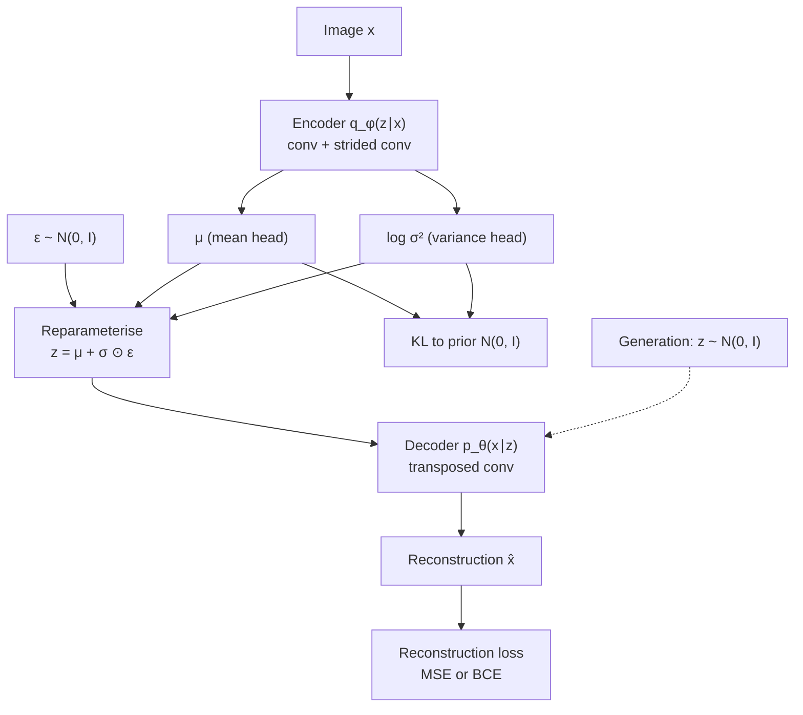
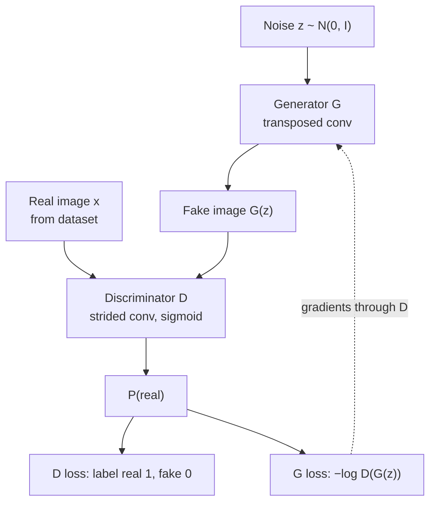
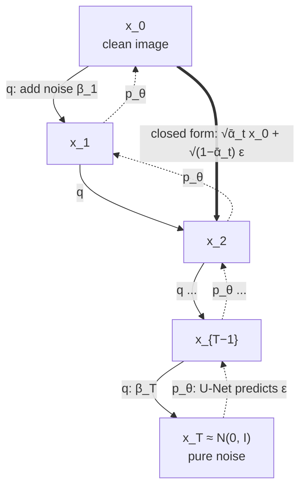
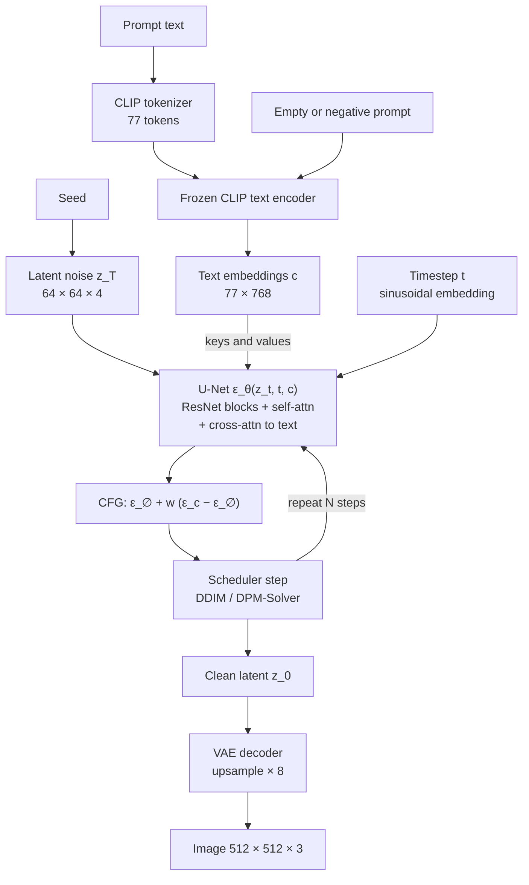
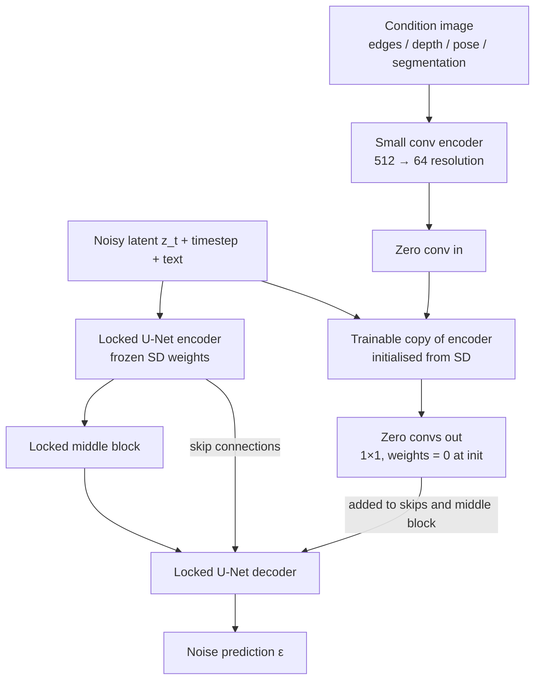
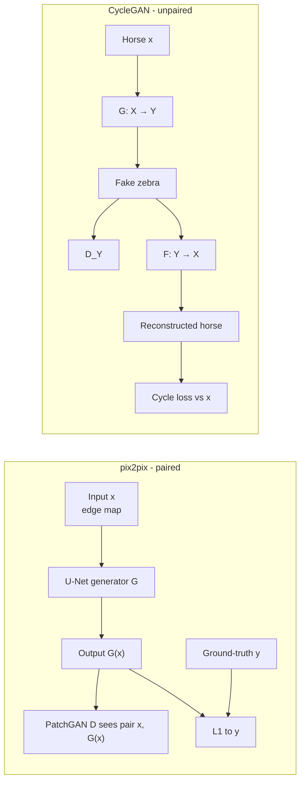

# Session 15 — Generative Computer Vision

> **Syllabus:** Autoencoders & GANs (and VAEs) · Diffusion models · Image generation / editing · Brief modern applications
> **Related:** [U-Net (Session 10)](10_image_segmentation.md) · [CLIP and foundation models (Session 13)](13_vision_foundation_models.md) · [Embeddings and representation learning (Session 5)](05_embeddings_similarity.md) · [Transposed convolutions and CNN building blocks (Session 3)](03_cnns_under_the_hood.md) · [Data augmentation and fine-tuning (Session 4)](04_training_transfer_learning.md) · [Attention and transformers in detection (Session 8)](08_detection_transformers.md) · [Formula sheet](../00_formula_sheet.md) · [Comparison tables](../00_comparison_tables.md) · [Numericals drill](../practice/numericals_drill.md)
> **Practice:** [Questions](../practice/15_questions.md) · [Solutions](../practice/15_solutions.md)

## 1. Big picture

Everything earlier in the course was **discriminative**: given an image $x$, predict a label, box or mask, i.e. model $p(y\mid x)$. **Generative** models learn the data distribution $p(x)$ (or $p(x\mid c)$ for a condition $c$ such as a class, a text prompt or an edge map) so that we can **sample new images**, fill in missing parts, translate between domains and edit images. The session follows the historical path: **autoencoders** (compress and reconstruct, but not real generators) → **VAEs** (probabilistic autoencoders with a sampleable latent space, but blurry) → **GANs** (sharp samples via an adversarial game, but unstable and prone to mode collapse) → **diffusion models** (learn to undo gradual noising; state-of-the-art quality and diversity, but slow to sample). Modern text-to-image systems such as **Stable Diffusion** glue together pieces from across the course: a **VAE** to compress images into latents, a **U-Net** denoiser ([Session 10](10_image_segmentation.md)) with **cross-attention** to a **CLIP** text encoder ([Session 13](13_vision_foundation_models.md)), plus guidance and control modules (CFG, ControlNet) for editing.

## 2. Core concepts

### What is a generative model?

- **Goal:** learn a model $p_\theta(x)$ that approximates the unknown data distribution $p_{data}(x)$, then **sample** $x \sim p_\theta$ to get new, realistic, diverse images. A **conditional** generative model learns $p_\theta(x\mid c)$ (class label, text, sketch, low-resolution image, masked image...).
- **Explicit vs implicit density:**
  - **Explicit** (likelihood-based): define $p_\theta(x)$ and maximise (a bound on) the log-likelihood — VAEs (lower bound), diffusion models (lower bound), autoregressive models and normalising flows (exact).
  - **Implicit**: only define a **sampler** $x = G(z)$; no density is ever written down — **GANs**.
- **Why it is hard:** images are very high-dimensional ($512\times512\times3 \approx 786$K numbers) but real images lie near a low-dimensional **manifold**; a model must put probability mass on that thin manifold, cover **all modes** (all kinds of images), and generate **fast**.
- **Three desiderata = the "generative learning trilemma"** (Xiao et al., 2022): **high sample quality**, **diversity / mode coverage**, **fast sampling**. Roughly: GANs = quality + speed; VAEs = speed + coverage; diffusion = quality + coverage (slow). See [table](#6-comparison-tables).

### Autoencoders

- **Architecture:** an **encoder** $f_\phi$ maps an image $x$ to a **code / latent** $z=f_\phi(x)$; a **decoder** $g_\theta$ maps it back to a reconstruction $\hat x=g_\theta(z)$. For images: conv/strided-conv encoder, transposed-conv or upsample+conv decoder ([Session 3](03_cnns_under_the_hood.md)).
- **Bottleneck:** $\dim z \ll \dim x$ (**undercomplete**). Because the code cannot store everything, the network must keep the **most informative structure** and discard noise/redundancy.
- **Reconstruction loss:** $\mathcal L=\Vert x-\hat x\Vert_2^2$ (MSE) or binary cross-entropy for pixel values in $[0,1]$. No labels needed → **self-supervised / unsupervised**.
- **Linear AE ≈ PCA:** a linear encoder/decoder trained with MSE learns the same subspace as the top principal components. Non-linear AEs learn a curved manifold.
- **Variants (why each exists):**
  - **Undercomplete AE** — the bottleneck itself is the regulariser.
  - **Denoising AE (DAE)** — corrupt the input $\tilde x \sim C(\tilde x\mid x)$ (Gaussian noise, random masking, salt-and-pepper) and train to reconstruct the **clean** $x$: $\Vert x-g_\theta(f_\phi(\tilde x))\Vert^2$. It cannot just copy the input, so it learns the structure of the data manifold ("project back onto the manifold"). Diffusion models are, in effect, denoising autoencoders trained at **many** noise levels.
  - **Sparse AE** — the code may even be larger than the input (**overcomplete**), but a penalty keeps most hidden units inactive: $\lambda\sum_j \lvert h_j\rvert$ (L1) or $\sum_j \mathrm{KL}(\rho\,\Vert\,\hat\rho_j)$ with target activation $\rho$ (e.g. 0.05) and mean activation $\hat\rho_j$. Without such a penalty an overcomplete AE can learn the identity map.
  - (Also: contractive AE penalises $\Vert \partial f/\partial x\Vert_F^2$; **masked autoencoder (MAE)** masks ~75% of ViT patches and reconstructs them — a pre-training method, used e.g. for SAM's image encoder, see [Session 13](13_vision_foundation_models.md).)
- **Uses:**
  - **Compression / dimensionality reduction** (the latent is a compact code; learned image codecs).
  - **Denoising** (DAE) and restoration.
  - **Anomaly detection:** train on **normal** data only; at test time a high reconstruction error $\Vert x-\hat x\Vert^2$ flags an anomaly (defect on a production line, lesion in a scan). Limitation: AEs sometimes generalise well enough to reconstruct anomalies too.
  - **Representation learning / pre-training** — the encoder's features feed a downstream classifier ([Session 5](05_embeddings_similarity.md)).
  - **Latent space for other models** — the VAE in Stable Diffusion; classic **face-swap deepfakes** use one shared encoder with one decoder per identity.
- **Why a plain AE is a poor generator:** the loss only cares about reconstructing training images, so the encoder is free to place codes **anywhere** — an irregular, clustered set of points with **gaps ("holes")** between them. There is no known distribution over $z$ to sample from; a random $z$ (or a point between two codes) usually lands in a region the decoder never saw → garbage output. Nothing forces nearby codes to decode to similar images. **The VAE fixes this** by making the encoder output a distribution and pulling all of them towards a fixed prior $\mathcal N(0,I)$.

### Variational autoencoders (VAE)

- **Generative story (latent-variable model):** draw $z \sim p(z)=\mathcal N(0,I)$, then $x \sim p_\theta(x\mid z)$ where the **decoder** network outputs the parameters (e.g. the mean $\hat x_\theta(z)$ of a Gaussian, or Bernoulli probabilities).
- **Problem:** the likelihood $p_\theta(x)=\int p_\theta(x\mid z)p(z)\,dz$ and the true posterior $p_\theta(z\mid x)$ are intractable (integral over all $z$ through a neural net).
- **Solution — amortised variational inference:** a **probabilistic encoder** $q_\phi(z\mid x)=\mathcal N\big(\mu_\phi(x),\operatorname{diag}\sigma^2_\phi(x)\big)$ approximates the posterior. The encoder has two heads: $\mu$ and $\log\sigma^2$ (predicting the **log-variance** keeps $\sigma^2>0$ and is numerically stable).
- **Objective = maximise the ELBO** (evidence lower bound) — derivation in [§3.2](#32-vae-elbo-and-its-derivation):

$$
\log p_\theta(x)\ \ge\ \underbrace{\mathbb E_{q_\phi(z\mid x)}[\log p_\theta(x\mid z)]}_{\text{reconstruction}}\ -\ \underbrace{\mathrm{KL}\big(q_\phi(z\mid x)\,\Vert\,p(z)\big)}_{\text{regulariser}}
$$

  - **Reconstruction term:** decode a sample $z$ and reward explaining $x$ (Gaussian likelihood → MSE; Bernoulli → BCE).
  - **KL term:** pulls each posterior towards $\mathcal N(0,I)$ → codes are centred, overlapping and **continuous**, with **no holes**, so sampling $z\sim\mathcal N(0,I)$ and decoding gives plausible images.
  - The gap between $\log p_\theta(x)$ and the ELBO is exactly $\mathrm{KL}(q_\phi(z\mid x)\Vert p_\theta(z\mid x))\ge 0$.
- **Reparameterisation trick:** we need $\nabla_\phi \mathbb E_{q_\phi(z\mid x)}[\cdot]$, but "sample $z\sim\mathcal N(\mu,\sigma^2)$" is a random node — you cannot back-propagate through a sampling operation whose distribution depends on $\phi$. Rewrite the sample as a **deterministic, differentiable function** of the parameters plus parameter-free noise:

$$
z=\mu_\phi(x)+\sigma_\phi(x)\odot\epsilon,\qquad \epsilon\sim\mathcal N(0,I)
$$

  Now $\partial z/\partial\mu=1$ and $\partial z/\partial\sigma=\epsilon$, so gradients flow into the encoder. The model is **still stochastic** — the randomness just lives in $\epsilon$. (The alternative score-function/REINFORCE estimator works but has very high variance.) One sample per data point per step is usually enough.
- **Closed-form KL** for a diagonal Gaussian posterior and standard normal prior: $\mathrm{KL}=\tfrac12\sum_j(\mu_j^2+\sigma_j^2-\log\sigma_j^2-1)$ — zero only when $\mu_j=0,\sigma_j=1$ for all $j$.
- **Why VAE samples are blurry (exam favourite):**
  - The main cause is the **likelihood model**: a factorised Gaussian decoder with fixed variance means the reconstruction loss is **pixel-wise MSE**. When the latent leaves fine detail uncertain (exact hair strands, texture phase, edge position), the MSE-optimal output is the **conditional mean** — the **average of all plausible images** → smeared edges and textures. MSE rewards being "close on average", not being *one* sharp plausible image.
  - The KL term contributes indirectly: it forces posteriors of different images to overlap (an information bottleneck), which increases the uncertainty the decoder must average over. But the KL term is not "wrong" — it is what makes sampling possible.
  - Fixes: perceptual (feature-space) and adversarial losses (VAE-GAN; the autoencoder of Stable Diffusion uses perceptual + patch-adversarial losses), hierarchical VAEs, discrete latents (VQ-VAE) with a powerful prior.
- **Posterior collapse:** with a very powerful decoder, the model may set $q_\phi(z\mid x)=p(z)$ (KL = 0) and ignore $z$ entirely.
- **β-VAE** (Higgins et al., 2017): loss $=\text{recon}+\beta\,\mathrm{KL}$. **β > 1** squeezes the latent harder towards the factorised prior and encourages **disentangled** latents (one dimension ≈ one factor such as azimuth, smile, lighting) at the cost of blurrier reconstructions. **β < 1** gives sharper reconstructions but a less regular latent (latent-diffusion autoencoders use a **very small** KL weight because they only need a well-behaved latent, not a sampleable prior).
- **Latent interpolation:** encode two images to $z_1,z_2$, decode $z(\lambda)=(1-\lambda)z_1+\lambda z_2$ for $\lambda\in[0,1]$ → a **smooth morph**, because the latent space is continuous. In high dimensions **spherical interpolation (slerp)** is often preferred: Gaussian samples concentrate near a shell of radius $\approx\sqrt d$, and linear midpoints have a smaller norm, i.e. are atypical. Latent **arithmetic** (attribute vectors such as "smiling minus neutral") also works.

### Generative adversarial networks (GANs)

- **Two networks in a game** (Goodfellow et al., 2014):
  - **Generator** $G(z)$: maps noise $z\sim p_z$ (e.g. $\mathcal N(0,I)$, 100–512-d) to an image. It never sees real images directly; it learns only through $D$'s gradients.
  - **Discriminator** $D(x)\in[0,1]$: probability that $x$ is **real**. A binary classifier trained on real (label 1) vs generated (label 0).
- **Minimax objective:**

$$
\min_G\max_D\ V(D,G)=\mathbb E_{x\sim p_{data}}[\log D(x)]+\mathbb E_{z\sim p_z}[\log(1-D(G(z)))]
$$

- **Optimal discriminator** for a fixed $G$: $D^*(x)=\dfrac{p_{data}(x)}{p_{data}(x)+p_g(x)}$ ($p_g$ = distribution of $G(z)$). Plugging it in gives $V(D^*,G)=2\,\mathrm{JSD}(p_{data}\Vert p_g)-\log4$, so training $G$ against an optimal $D$ **minimises the Jensen–Shannon divergence**. The global optimum is $p_g=p_{data}$, where $D^*(x)=\tfrac12$ everywhere (it cannot tell real from fake) and $V=-\log4\approx-1.386$.
- **Non-saturating generator loss:** early in training fakes are obviously fake, $D(G(z))\approx0$, and $\log(1-D(G(z)))$ is **flat** there → vanishing gradients for $G$. In practice $G$ instead **maximises $\log D(G(z))$**, i.e. minimises $-\log D(G(z))$ (= BCE with the "real" label on fakes). Same fixed point, but strong gradients exactly when $G$ is bad. With $D=\sigma(a)$ ($a$ = logit): $\partial_a\log(1-\sigma(a))=-\sigma(a)\approx0$, while $\partial_a[-\log\sigma(a)]=-(1-\sigma(a))\approx-1$.
- **Strengths:** very **sharp** samples (no pixel-wise averaging — $D$ punishes blur), **one forward pass** to sample (real-time), a compact latent space that supports interpolation and editing.
- **Weaknesses:** no likelihood, no encoder (inverting a real image requires optimisation, "GAN inversion"), unstable training, mode collapse, hard to evaluate.

### Training instability, mode collapse and WGAN

- **Why GAN training is unstable:**
  - It is a **two-player game**, not a minimisation; simultaneous gradient steps can **oscillate or diverge** instead of converging to the equilibrium.
  - **Discriminator too strong** → saturated, vanishing gradients for $G$. Real and generated distributions lie on low-dimensional manifolds that are usually **disjoint** early on; there the JSD is constant ($\log2$) and gives **no useful gradient** about how far apart they are.
  - **Discriminator too weak** → $G$ gets meaningless feedback. Highly sensitive to architecture, learning rates, batch size.
- **Mode collapse:**
  - **What it looks like:** $G$ maps many different $z$ to the **same or a few outputs** — e.g. an MNIST GAN that only draws "1"s, or a face GAN producing near-identical faces; samples look good individually but **lack diversity**. Sometimes it **hops** between modes over training.
  - **Why:** the generator objective rewards fooling the **current** $D$, not covering $p_{data}$. For a fixed $D$, the best response of $G$ is to put all its mass on the single output $D$ finds most "real"; $D$ adapts, $G$ jumps to another mode, and so on. There is no likelihood term that penalises missing modes.
  - **Not overfitting:** overfitting = memorising/copying training images (good on train, poor generalisation). Mode collapse = **low diversity** — the collapsed outputs need not be training images at all, and it can happen on huge datasets.
- **Remedies:**
  - **Minibatch discrimination** (Salimans et al., 2016) — $D$ sees statistics across the whole batch (e.g. similarity between samples; ProGAN's minibatch standard-deviation feature), so a batch of near-identical fakes is easy to spot.
  - **WGAN** (Arjovsky et al., 2017) — replace JSD with the **Wasserstein-1 (earth-mover) distance**, which stays meaningful and gives smooth gradients **even when supports are disjoint**. The discriminator becomes a **critic** $f$ (no sigmoid, outputs an unbounded score) that must be **1-Lipschitz**:
    - original WGAN: **weight clipping** (e.g. to $[-0.01,0.01]$) — crude, can cause capacity problems;
    - **WGAN-GP** (Gulrajani et al., 2017): **gradient penalty** $\lambda(\Vert\nabla_{\hat x}f(\hat x)\Vert_2-1)^2$ on points interpolated between real and fake ($\lambda=10$).
    - Benefits: critic loss correlates with sample quality, much less mode collapse, train the critic more (e.g. 5 critic steps per $G$ step).
  - **Spectral normalisation** (Miyato et al., 2018) — divide each weight matrix of $D$ by its largest singular value (estimated by power iteration) → each layer is 1-Lipschitz → controls $D$'s gradients cheaply.
  - **Two time-scale update rule (TTUR)** (Heusel et al., 2017 — the same paper that introduced FID) — different learning rates for $D$ and $G$ (e.g. SAGAN: $4\times10^{-4}$ for $D$, $1\times10^{-4}$ for $G$).
  - Others: one-sided label smoothing (real label 0.9), feature matching, unrolled GANs, larger batches, data augmentation for $D$ with few images, regularisers such as $R_1$.

### GAN family: DCGAN, conditional GAN, pix2pix, CycleGAN, StyleGAN

- **DCGAN** (Radford et al., 2015) — the first reliably trainable **convolutional** GAN:
  - $G$: project $z$ → small spatial map → stack of **transposed (fractionally-strided) convolutions** up to the image; $D$: **strided convolutions** (no pooling); **no fully-connected hidden layers**.
  - **BatchNorm** in both (except $G$ output and $D$ input); **ReLU** in $G$ with **tanh** output; **LeakyReLU (0.2)** in $D$; Adam, lr $2\times10^{-4}$, $\beta_1=0.5$.
  - Showed smooth latent interpolation and **latent vector arithmetic** ("man with glasses" − "man" + "woman" ≈ "woman with glasses").
- **Conditional GAN (cGAN)** (Mirza & Osindero, 2014): feed the condition $y$ (class label, text, image) to **both** networks: $G(z,y)$ and $D(x,y)$. $D$ must judge "is this a real image **of class y**?" → control over what is generated.
- **pix2pix** (Isola et al., 2017) — **paired** image-to-image translation (edges → photo, label map → street scene, day → night, B&W → colour):
  - A cGAN where the condition is the input image $x$; $D$ sees the **pair** $(x,y)$.
  - Loss $=\mathcal L_{cGAN}+\lambda\,\Vert y-G(x)\Vert_1$ with $\lambda=100$: **L1** gets the low frequencies right (and is less blurry than L2), the **adversarial** term makes high-frequency detail sharp.
  - **U-Net generator** with skip connections ([Session 10](10_image_segmentation.md)) — input and output share structure (edges in the same places), so low-level information should bypass the bottleneck.
  - **PatchGAN discriminator** — classifies each $N\times N$ patch (70×70) as real/fake and averages: models local texture/style, has fewer parameters, works on any image size. Noise comes from dropout rather than an explicit $z$.
  - Requires **pixel-aligned pairs**.
- **CycleGAN** (Zhu et al., 2017) — **unpaired** translation between domains $X$ and $Y$ (horse ↔ zebra, summer ↔ winter, photo ↔ Monet):
  - Two generators $G:X\to Y$, $F:Y\to X$ and two discriminators $D_Y$, $D_X$.
  - Adversarial losses alone are under-constrained (any mapping onto realistic zebras satisfies $D_Y$), so add **cycle-consistency**: $F(G(x))\approx x$ and $G(F(y))\approx y$ (L1, weight $\lambda=10$); optional identity loss to preserve colour.
  - Works best for **appearance/texture/colour** changes; struggles with large **geometric** changes (cat ↔ dog shape). It can also "hide" information in imperceptible signals to satisfy the cycle.
- **StyleGAN** (Karras et al., NVIDIA, 2019; StyleGAN2 2020) — high-resolution (e.g. 1024×1024 faces), highly controllable:
  - **Mapping network:** an 8-layer MLP maps $z\in\mathcal Z$ to an intermediate latent $w\in\mathcal W$ (512-d), which is **less entangled** than $\mathcal Z$ (it need not follow a fixed Gaussian shape).
  - **Synthesis network** starts from a **learned constant** tensor; at every layer $w$ is turned into a **style** by a learned affine transform that modulates the feature maps — **AdaIN** in StyleGAN: $\mathrm{AdaIN}(x_i,y)=y_{s,i}\frac{x_i-\mu(x_i)}{\sigma(x_i)}+y_{b,i}$; StyleGAN2 replaces AdaIN by **weight modulation/demodulation** (removes "droplet" artefacts).
  - **Per-layer noise inputs** create stochastic detail (hair strands, freckles).
  - **Style mixing:** coarse layers control pose/face shape, middle layers features/hairstyle, fine layers colour/micro-texture. **Truncation trick** $w'=\bar w+\psi(w-\bar w)$, $\psi<1$, trades diversity for quality.
  - Widely used for **GAN-inversion** editing (find $w$ for a real photo, move along semantic directions).

### Evaluating generative models: FID and IS

- No single "accuracy". We want **fidelity** (realism), **diversity**, and for conditional models **alignment** with the condition.
- **Fréchet Inception Distance (FID)** (Heusel et al., 2017) — the standard metric:
  1. Pass real and generated images through an ImageNet-pretrained **Inception-v3**; take the 2048-d pool features.
  2. Fit a Gaussian to each set: $(\mu_r,\Sigma_r)$ and $(\mu_g,\Sigma_g)$.
  3. $\mathrm{FID}=\Vert\mu_r-\mu_g\Vert_2^2+\operatorname{Tr}\big(\Sigma_r+\Sigma_g-2(\Sigma_r\Sigma_g)^{1/2}\big)$ — the squared Fréchet (Wasserstein-2) distance between the two Gaussians.
  - **Lower is better**; 0 = identical feature statistics. Sensitive to both **quality** (mean shift) and **diversity** (a collapsed generator has a too-small covariance → large trace term).
  - Limitations: **biased** for small sample sizes (use ≥ 10k, typically 50k, and only compare at equal $N$); depends on Inception features (ImageNet bias, may not suit medical images); assumes Gaussian features; does not measure prompt alignment (use **CLIP score** for that); sensitive to resizing/compression implementation details.
- **Inception Score (IS)** (Salimans et al., 2016): $\mathrm{IS}=\exp\big(\mathbb E_{x\sim p_g}\,\mathrm{KL}(p(y\mid x)\,\Vert\,p(y))\big)$ — high when each image is **confidently classified** (sharp, recognisable) and the **marginal** $p(y)$ over classes is **uniform** (diverse). Range $[1,\ \#\text{classes}]$; **higher is better**. Weaknesses: never looks at real data, blind to intra-class mode collapse, meaningful mainly for ImageNet-like classes.
- Others: **precision/recall for generative models** (precision = fraction of samples on the real manifold ≈ quality, recall = fraction of the real manifold covered ≈ diversity), **CLIP score** (text–image alignment), **human preference studies**, LPIPS diversity, memorisation checks (nearest training neighbour).

### Diffusion models: DDPM

- **Idea** (Sohl-Dickstein et al., 2015; **DDPM**, Ho et al., 2020): destroying structure is easy — just keep adding Gaussian noise. **Learn to reverse** that process one small step at a time; then start from pure noise and denoise into an image.
- **Forward (diffusion) process $q$ — fixed, no learned parameters:**

$$
q(x_t\mid x_{t-1})=\mathcal N\big(\sqrt{1-\beta_t}\,x_{t-1},\ \beta_tI\big),\qquad t=1,\dots,T
$$

  with a pre-set **variance schedule** $\beta_1<\dots<\beta_T$ (DDPM: $T=1000$, linear $\beta$ from $10^{-4}$ to $0.02$). The $\sqrt{1-\beta_t}$ shrink keeps the variance bounded (**variance preserving**).
- **Closed form (jump straight to any $t$):** with $\alpha_t=1-\beta_t$, $\bar\alpha_t=\prod_{s=1}^t\alpha_s$:

$$
q(x_t\mid x_0)=\mathcal N\big(\sqrt{\bar\alpha_t}\,x_0,\ (1-\bar\alpha_t)I\big)\ \Longleftrightarrow\ x_t=\sqrt{\bar\alpha_t}\,x_0+\sqrt{1-\bar\alpha_t}\,\epsilon,\ \ \epsilon\sim\mathcal N(0,I)
$$

  Training therefore never simulates the chain — sample $t$, sample $\epsilon$, compute $x_t$ in one line.
- **Why $x_T\approx\mathcal N(0,I)$:** $\bar\alpha_t$ is a product of numbers $<1$, so it decays to ~0. For the linear schedule $\bar\alpha_{1000}\approx4.0\times10^{-5}$, so $x_T\approx0.006\,x_0+1.0\,\epsilon$ — the image is gone and $x_T$ is (almost exactly) standard Gaussian, which is easy to sample at test time.
- **Reverse process (learned):** the true reverse $q(x_{t-1}\mid x_t)$ needs the whole data distribution, but for small $\beta_t$ it is close to Gaussian, so model

$$
p_\theta(x_{t-1}\mid x_t)=\mathcal N\big(\mu_\theta(x_t,t),\ \sigma_t^2I\big),\qquad p(x_T)=\mathcal N(0,I)
$$

  with fixed variance $\sigma_t^2=\beta_t$ (or $\tilde\beta_t$) in DDPM. Conditioned on $x_0$ the reverse step **is** tractable: $q(x_{t-1}\mid x_t,x_0)$ is Gaussian with mean $\tilde\mu_t$ — so the network only needs to predict what it does not know, the **noise** $\epsilon$.
- **ε-prediction parameterisation:** a network $\epsilon_\theta(x_t,t)$ predicts the noise that was added, and

$$
\mu_\theta(x_t,t)=\frac{1}{\sqrt{\alpha_t}}\Big(x_t-\frac{\beta_t}{\sqrt{1-\bar\alpha_t}}\,\epsilon_\theta(x_t,t)\Big)
$$

- **Training loss:** the variational bound (ELBO) on $\log p_\theta(x_0)$ decomposes into per-step KLs between Gaussians; each becomes a weighted noise-regression error. DDPM drops the weights ("simple" loss), which works better in practice:

$$
\mathcal L_{simple}=\mathbb E_{t\sim\mathcal U\{1..T\},\,x_0,\,\epsilon}\Big[\big\Vert\epsilon-\epsilon_\theta\big(\sqrt{\bar\alpha_t}\,x_0+\sqrt{1-\bar\alpha_t}\,\epsilon,\ t\big)\big\Vert^2\Big]
$$

  This is a plain **MSE regression** → training is **stable** (no adversary, no mode collapse; the likelihood-based bound encourages covering all modes).
- **Sampling:** start at $x_T\sim\mathcal N(0,I)$ and apply $x_{t-1}=\mu_\theta(x_t,t)+\sigma_tz$ ($z\sim\mathcal N(0,I)$, $z=0$ at the last step) for $t=T,\dots,1$ → **$T$ network evaluations (NFEs)** — the main drawback (1000 U-Net passes per image in original DDPM).
- **Equivalent predictions:** from $\epsilon_\theta$ one can always recover a clean-image estimate $\hat x_0=(x_t-\sqrt{1-\bar\alpha_t}\,\epsilon_\theta)/\sqrt{\bar\alpha_t}$. Some models predict $x_0$ or $v=\sqrt{\bar\alpha_t}\,\epsilon-\sqrt{1-\bar\alpha_t}\,x_0$ instead.
- **Why it works so well:** each step is an easy, local denoising problem; a single network shared across all $t$; coarse structure is decided at high noise (large $t$) and fine detail at low noise (small $t$) — a natural coarse-to-fine generation.

### Noise schedules, U-Net denoiser, DDIM and the score view

- **Noise schedules:**
  - **Linear** (DDPM): $\beta_t$ from $10^{-4}$ to $0.02$. Destroys information quickly: $\bar\alpha_{500}\approx0.079$, so the second half of the chain is almost pure noise and is partly wasted — especially at low resolution.
  - **Cosine** (Nichol & Dhariwal, 2021): define $\bar\alpha_t=\frac{f(t)}{f(0)}$, $f(t)=\cos^2\!\big(\frac{t/T+s}{1+s}\cdot\frac{\pi}{2}\big)$, $s=0.008$, clip $\beta_t\le0.999$. Noise is added more **gradually** ($\bar\alpha_{500}\approx0.49$), improving likelihood and sample quality.
  - Schedules are often described by the **signal-to-noise ratio** $\mathrm{SNR}(t)=\bar\alpha_t/(1-\bar\alpha_t)$, which must decrease monotonically with $t$.
- **U-Net denoiser** — the workhorse $\epsilon_\theta(x_t,t)$:
  - Encoder–decoder with **skip connections** ([Session 10](10_image_segmentation.md)): output has the **same shape as the input** (it predicts a noise image), and skips preserve fine spatial detail.
  - **ResNet blocks** + GroupNorm; **self-attention** at low resolutions (e.g. 16×16) for global context.
  - **Timestep embedding:** $t$ → **sinusoidal embedding** (as in transformer positional encodings) → MLP → added to (or used to scale/shift) the features of **every residual block**. One network handles all noise levels because it is told how noisy the input is.
  - **Conditioning:** class embeddings are added to the time embedding; **text** is injected through **cross-attention** layers (see Stable Diffusion below).
- **DDIM** (Song, Meng & Ermon, 2021) — faster, deterministic sampling **without retraining**:
  - Defines a **non-Markovian** forward process with the **same marginals** $q(x_t\mid x_0)$, hence the **same training loss** → any DDPM-trained $\epsilon_\theta$ can be used.
  - Update: predict $\hat x_0$, then jump to $x_{t-1}$ (or to any earlier timestep): $x_{t-1}=\sqrt{\bar\alpha_{t-1}}\,\hat x_0+\sqrt{1-\bar\alpha_{t-1}-\sigma_t^2}\,\epsilon_\theta+\sigma_tz$.
  - With $\sigma_t=0$ ($\eta=0$) the sampler is **deterministic**; it can skip timesteps (e.g. 50 instead of 1000 → 10–50× faster) with little quality loss.
  - Deterministic noise ↔ image mapping enables **DDIM inversion** (find the noise that produces a given image) for editing and meaningful interpolation in noise space.
  - Later samplers (DPM-Solver, Euler/Heun ODE solvers) reach good quality in ~20–30 steps; **distillation** (progressive distillation, consistency models, adversarial distillation as in SDXL-Turbo) reaches 1–4 steps.
- **Score-based view (brief):** the **score** is $\nabla_x\log p(x)$ — a vector field pointing towards higher data density. **Denoising score matching** trains $s_\theta(x,\sigma)$ at many noise levels; sampling follows the score with **annealed Langevin dynamics** (Song & Ermon, 2019). The two views coincide: $\epsilon_\theta(x_t,t)\approx-\sqrt{1-\bar\alpha_t}\,\nabla_{x_t}\log p(x_t)$ — predicting the noise **is** estimating the score. Song et al. (2021) unify both as **SDEs**; the deterministic **probability-flow ODE** corresponds to DDIM.

### Latent diffusion and Stable Diffusion

- **Problem with pixel-space diffusion:** every one of the many steps runs a big U-Net at full resolution ($512\times512\times3$) — very expensive to train and sample. Most bits of an image are imperceptible high-frequency detail.
- **Latent Diffusion Model (LDM)** (Rombach et al., CVPR 2022) — split the work in two:
  1. **Perceptual compression:** a **VAE-style autoencoder** (KL-regularised, trained once with reconstruction + **perceptual** + **patch-adversarial** losses so it stays sharp) maps $x\in\mathbb R^{H\times W\times3}$ to $z\in\mathbb R^{h\times w\times c}$ with **downsampling factor $f=H/h$**.
  2. **Semantic generation:** run the diffusion model **in latent space** — noise, denoise and train on $z$, not pixels. Decode only once at the end.
- **Stable Diffusion (v1)** numbers: $f=8$, $c=4$ → $512\times512\times3$ image ↔ **$64\times64\times4$ latent** = **48× fewer values** ($786{,}432/16{,}384$). The U-Net (~860M parameters) denoises latents; the latent is scaled by a constant (0.18215) to have roughly unit variance.
- **Text conditioning via cross-attention:**
  - The prompt is tokenised (77 tokens) and encoded by a **frozen CLIP text encoder** (ViT-L/14 text tower in v1) into $c\in\mathbb R^{77\times768}$ — CLIP's text space is already aligned with images ([Session 13](13_vision_foundation_models.md)).
  - Inside the U-Net, **cross-attention** layers use the **image latent features as queries** and **text tokens as keys/values**: each spatial location "looks up" the words relevant to it. That is how "a red cube on a blue sphere" places colours and objects.
- **Pipeline (text → image):** prompt → CLIP text encoder → $z_T\sim\mathcal N(0,I)$ ($64\times64\times4$, set by the **seed**) → $N$ scheduler steps (e.g. 20–50 DDIM/DPM-Solver steps), each a U-Net call with CFG → $z_0$ → **VAE decoder** → $512\times512$ image. Training: encode images with the VAE encoder, add noise to latents, train $\epsilon_\theta(z_t,t,c)$ with the ε-loss. Full steps in [§4.10](#410-stable-diffusion-text-to-image-pipeline).
- **Why latent diffusion matters:** much cheaper training and sampling (consumer GPUs), the autoencoder is reused across tasks, and conditioning is flexible (text, layouts, images). Downsides: fine details (small text, faces at small scale) limited by the autoencoder; reconstructions are not pixel-perfect.

### Guidance: classifier vs classifier-free

- **Motivation:** a conditional model $p_\theta(x\mid c)$ samples images that are only loosely tied to $c$. **Guidance** trades diversity for **fidelity / prompt adherence** by sharpening the conditional distribution towards $p(x)\,p(c\mid x)^{w}$.
- **Classifier guidance** (Dhariwal & Nichol, 2021, "Diffusion models beat GANs"):
  - Train a **separate classifier** $p_\phi(y\mid x_t,t)$ **on noisy images** (an ordinary ImageNet classifier fails on noisy $x_t$).
  - During sampling, push the noise prediction along the classifier gradient: $\hat\epsilon=\epsilon_\theta(x_t,t)-s\sqrt{1-\bar\alpha_t}\,\nabla_{x_t}\log p_\phi(y\mid x_t)$, guidance scale $s$.
  - Costs: an extra model to train for every kind of condition, gradients through the classifier at each step, limited to labels the classifier knows (hard for free-form text), and classifier gradients can be adversarial.
- **Classifier-free guidance (CFG)** (Ho & Salimans, 2022) — **no classifier at all**:
  - **Training:** one network learns both $\epsilon_\theta(x_t,c)$ and $\epsilon_\theta(x_t,\varnothing)$ by **dropping the condition** (replacing it with a null/empty token) at random, ~10% of the time (Stable Diffusion: 10% text dropout).
  - **Sampling:** run the network twice per step and extrapolate:

$$
\hat\epsilon=\epsilon_\theta(x_t,\varnothing)+w\,\big(\epsilon_\theta(x_t,c)-\epsilon_\theta(x_t,\varnothing)\big)
$$

  - $w=0$ → unconditional; $w=1$ → plain conditional; $w>1$ → **extrapolate** beyond conditional (typical text-to-image $w\approx5$–$10$; Stable Diffusion default 7.5). The difference $\epsilon_c-\epsilon_\varnothing$ acts as an **implicit classifier** gradient $\propto-\nabla\log p(c\mid x_t)$.
  - **Trade-off:** higher $w$ → better prompt adherence and "cleaner" images but **less diversity**; very high $w$ → over-saturated, over-contrasted, artefacts.
  - **Cost:** 2 U-Net evaluations per step (batched together). **Negative prompts** simply replace $\varnothing$ with the embedding of the text to avoid.
  - **Convention warning:** some papers write $\hat\epsilon=(1+w')\epsilon_c-w'\epsilon_\varnothing$; then $w'=w-1$ and $w'=0$ is plain conditional. This pack uses the $w$ form above.

### Image generation and editing: ControlNet, inpainting, img2img, personalisation

- **Text-to-image generation:** CFG-guided latent diffusion as above. Text alone is weak at specifying **exact spatial layout** (pose, composition, edges) → control and editing methods.
- **ControlNet** (Zhang, Rao & Agrawala, 2023) — **spatial control** for a pretrained text-to-image model:
  - **Locked original:** the pretrained Stable Diffusion U-Net is **frozen** (keeps its quality and knowledge).
  - **Trainable copy:** a copy of the U-Net's **encoder** blocks (and middle block), initialised from the original weights, receives the noisy latent **plus the condition image** (encoded by a small conv net from 512×512 to latent resolution).
  - **Zero convolutions:** 1×1 convolutions whose **weights and biases start at 0** connect the copy's outputs into the locked U-Net (added to its skip connections / middle block). At initialisation they output 0 → the combined model is **exactly the original SD**, and no random noise disturbs the pretrained features. They still learn: the gradient w.r.t. a zero conv's weights is proportional to its **input features**, which are non-zero, so the weights move away from zero as training proceeds.
  - **Conditions:** Canny/HED **edges**, **depth** maps (e.g. from a monocular depth model — [Session 13](13_vision_foundation_models.md)), human **pose** (OpenPose skeleton), **segmentation** maps, scribbles, normal maps, line drawings.
  - Training uses the normal diffusion loss on (image, prompt, condition) triplets; prompts are randomly emptied (50% in the paper) so the network learns to read meaning from the condition. Robust for both small (<50k) and large (>1M) training sets because the base model is locked; ControlNets can be **combined** and reused with fine-tunes of the same base model; a **conditioning scale** controls strength.
- **Inpainting** — fill a masked region consistently with the rest and with a prompt:
  - **Dedicated inpainting model:** give the U-Net **extra input channels** — the mask (downsampled to latent size) and the **VAE latent of the masked image**. SD-inpainting: $4+4+1=9$ input channels (noisy latent + masked-image latent + mask), fine-tuned with random masks. The model sees the context directly.
  - **Training-free (RePaint, Lugmayr et al., 2022):** use any trained diffusion model. At each reverse step, take the **known** region from the forward-noised original ($q(x_{t-1}\mid x_0)$) and the **unknown** region from the model's denoising step, and paste them together; **resampling** (re-noise $x_{t-1}\to x_t$ and repeat a few times) harmonises the boundary.
  - **Outpainting** = inpainting outside the original canvas.
- **img2img / SDEdit** (Meng et al., 2022): encode an input image (photo, rough sketch, colour layout), **add noise up to an intermediate level** $t_0=s\cdot T$ via the closed form, then **denoise from $t_0$** with a (new) prompt. **Strength** $s\in[0,1]$: low $s$ keeps the structure and colours of the input (faithful), high $s$ gives the model more freedom (realistic / prompt-driven, less faithful); $s=1$ ≈ text-to-image from scratch. With $N$ scheduler steps, only about $\lfloor sN\rfloor$ denoising steps run.
- **Other editing:** instruction-based editing (e.g. InstructPix2Pix: "make it winter"), prompt-to-prompt (edit cross-attention maps), DDIM inversion + re-generation, GAN-inversion edits (StyleGAN), super-resolution and colourisation as conditional generation.
- **Personalisation** — teach a pretrained model a **new subject or style** from ~3–5 images:
  - **Textual inversion** (Gal et al., 2022): learn **only a new word embedding** $v_*$ for a pseudo-token "S*" in the text encoder's input space; the whole model stays frozen. Tiny (one vector), but limited fidelity.
  - **DreamBooth** (Ruiz et al., 2023): **fine-tune the diffusion model** (U-Net, optionally text encoder) on the subject images with a rare identifier ("a photo of [V] dog") plus a **class-specific prior-preservation loss** (keep generating normal "dogs") to avoid overfitting and language drift. High fidelity, large checkpoint.
  - **LoRA** (Hu et al., 2021; applied to diffusion): freeze each weight $W$ and learn a **low-rank update** $\Delta W=BA$ ($r\ll d$) in the attention layers; small files (MBs), can be swapped and scaled; often combined with DreamBooth-style training.

### Diffusion transformers (DiT) and beyond

- **DiT** (Peebles & Xie, 2023): replace the U-Net with a **Vision Transformer** operating on **patchified latents** (patch size $p$, tokens $=(h/p)(w/p)$ as in ViT); timestep and class are injected via **adaptive LayerNorm** (adaLN-Zero, zero-initialised like ControlNet's zero convs). Image quality improves predictably with model compute (**scaling**), which made transformers the backbone of many newer image and video generators (e.g. Stable Diffusion 3 uses a multimodal DiT; OpenAI describes Sora as a diffusion transformer over spacetime patches).
- **Flow matching / rectified flow** — a close relative of diffusion that learns a velocity field transporting noise to data along (near) straight paths; used in several recent text-to-image models. Same family, same conditioning/guidance ideas.
- **Other text-to-image designs (brief):** Imagen (frozen large T5 text encoder + cascaded pixel-space diffusion 64 → 256 → 1024); DALL·E 2 (CLIP-embedding prior + diffusion decoder).

### Brief modern applications and ethics

- **Text-to-image** for design, concept art, advertising, prototyping (Stable Diffusion, DALL·E, Imagen, Midjourney...).
- **Image editing:** inpainting/outpainting (object removal, extension), img2img restyling, instruction editing, ControlNet-guided layouts, face/age/expression edits (StyleGAN inversion).
- **Super-resolution & restoration:** GAN-based (SRGAN/ESRGAN: perceptual + adversarial loss → sharp textures) and diffusion-based (SR3: iterative refinement conditioned on the low-res image; cascaded upsamplers); denoising, deblurring, colourisation.
- **Video generation:** diffusion models extended with **temporal layers/attention** or spatio-temporal latent patches; challenges are temporal consistency and compute.
- **Data augmentation / synthetic data:** generate rare classes, edge cases, balanced datasets, domain-randomised scenes, privacy-preserving stand-ins; always **validate on real test data** — synthetic data can carry the generator's artefacts and biases, and may **memorise** training images.
- **Medical imaging:** augmenting rare pathologies, **modality translation** (e.g. MR → CT with CycleGAN-style models), anomaly detection with autoencoders, denoising / accelerated MRI reconstruction with diffusion priors. Risk: **hallucinated anatomy** — a sharp, plausible-looking but false detail is dangerous in diagnosis.
- **3D and beyond:** text-to-3D via 2D diffusion priors, novel-view synthesis.
- **Ethics and risks:**
  - **Deepfakes:** face swaps and fully synthetic people → misinformation, fraud, non-consensual imagery; detectors exist but are an arms race.
  - **Bias:** models mirror and can amplify training-data skews (e.g. stereotyped demographics for professions); under-representation of groups.
  - **Copyright, consent and memorisation:** trained on web-scraped images; style imitation of living artists; diffusion models have been shown to regurgitate some near-copies of training images (Carlini et al., 2023); legal status is contested and varies by jurisdiction.
  - **Watermarking & provenance:** invisible watermarks embedded at generation time (e.g. SynthID; Stable Diffusion's reference code adds an invisible watermark) and **C2PA "Content Credentials"** — an open industry standard for cryptographically signed provenance metadata recording how media was created and edited. Metadata can be stripped and watermarks attacked, so these are mitigations, not guarantees.
  - Also: safety filters for harmful content, privacy of people in training data, environmental cost of training.

## 3. Key formulas

### 3.1 Autoencoder reconstruction loss

$$
\mathcal L_{AE}(\phi,\theta)=\frac1N\sum_{i=1}^N\big\Vert x_i-g_\theta(f_\phi(x_i))\big\Vert_2^2
$$

$x_i$ = training image $i$ of $N$; $f_\phi$ = encoder with parameters $\phi$; $g_\theta$ = decoder with parameters $\theta$; $z_i=f_\phi(x_i)$ = code. Denoising AE: replace $f_\phi(x_i)$ by $f_\phi(\tilde x_i)$, $\tilde x_i$ = corrupted input, target stays clean $x_i$.

*Example:* $x=(0.2,0.8)$, $\hat x=(0.3,0.6)$ → $\Vert x-\hat x\Vert^2=0.01+0.04=0.05$. As an anomaly score: if normal parts give errors ≈ 0.01 and this part gives 0.05, it is flagged.

### 3.2 VAE ELBO and its derivation

Symbols: $x$ = image; $z\in\mathbb R^d$ = latent; $p(z)=\mathcal N(0,I)$ = prior; $p_\theta(x\mid z)$ = decoder likelihood; $q_\phi(z\mid x)=\mathcal N(\mu_\phi(x),\operatorname{diag}\sigma_\phi^2(x))$ = encoder (approximate posterior); $\mathrm{KL}(q\Vert p)=\mathbb E_q[\log q-\log p]\ge0$.

**Via Jensen** ($\log$ is concave, so $\log\mathbb E[Y]\ge\mathbb E[\log Y]$):

$$
\begin{aligned}
\log p_\theta(x)&=\log\int p_\theta(x\mid z)\,p(z)\,dz=\log\mathbb E_{q_\phi(z\mid x)}\!\left[\frac{p_\theta(x\mid z)\,p(z)}{q_\phi(z\mid x)}\right]\\
&\ge\mathbb E_{q_\phi(z\mid x)}\!\left[\log\frac{p_\theta(x\mid z)\,p(z)}{q_\phi(z\mid x)}\right]\\
&=\mathbb E_{q_\phi(z\mid x)}[\log p_\theta(x\mid z)]-\mathrm{KL}\big(q_\phi(z\mid x)\,\Vert\,p(z)\big)=:\mathrm{ELBO}(x)
\end{aligned}
$$

**Via KL decomposition** (shows the gap): since $p_\theta(x)=p_\theta(x,z)/p_\theta(z\mid x)$ for any $z$,

$$
\log p_\theta(x)=\mathrm{ELBO}(x)+\mathrm{KL}\big(q_\phi(z\mid x)\,\Vert\,p_\theta(z\mid x)\big)\ \ge\ \mathrm{ELBO}(x)
$$

Maximising the ELBO therefore both raises the likelihood and makes $q_\phi$ approach the true posterior. **Training loss** $=-\mathrm{ELBO}$ = reconstruction loss + KL.

**Gaussian decoder → MSE:** if $p_\theta(x\mid z)=\mathcal N(\hat x_\theta(z),\sigma_x^2I)$ over $D$ pixels, $-\log p_\theta(x\mid z)=\frac{1}{2\sigma_x^2}\Vert x-\hat x_\theta(z)\Vert^2+\frac D2\log(2\pi\sigma_x^2)$. The fixed $\sigma_x$ acts like a weight between reconstruction and KL (like β).

### 3.3 Closed-form Gaussian KL (diagonal posterior vs standard normal)

$$
\mathrm{KL}\big(\mathcal N(\mu,\operatorname{diag}\sigma^2)\,\Vert\,\mathcal N(0,I)\big)=\frac12\sum_{j=1}^{d}\big(\mu_j^2+\sigma_j^2-\log\sigma_j^2-1\big)
$$

$\mu_j,\sigma_j$ = mean and standard deviation of latent dimension $j$; natural log; result in nats. Each term is $\ge0$, zero iff $\mu_j=0,\sigma_j=1$.

*Example:* $\mu=1,\sigma=1$: $\tfrac12(1+1-0-1)=0.5$. $\mu=0,\sigma=0.5$: $\tfrac12(0.25-\ln0.25-1)=\tfrac12(0.25+1.3863-1)=0.3181$ nats (checked by Monte Carlo). Both a shifted mean and a shrunken variance are penalised.

### 3.4 Reparameterisation trick

$$
z=\mu_\phi(x)+\sigma_\phi(x)\odot\epsilon,\qquad\epsilon\sim\mathcal N(0,I),\qquad\sigma_\phi=\exp\!\big(\tfrac12\log\sigma_\phi^2\big)
$$

$\odot$ = element-wise product; $\epsilon$ = parameter-free noise.

*Example:* $\mu=(0.2,-0.3)$, $\sigma=(0.5,2.0)$, $\epsilon=(1.0,-0.5)$ → $z=(0.2+0.5,\ -0.3-1.0)=(0.7,-1.3)$; $\partial z_1/\partial\mu_1=1$, $\partial z_1/\partial\sigma_1=\epsilon_1=1.0$.

### 3.5 Latent interpolation

$$
z(\lambda)=(1-\lambda)z_1+\lambda z_2,\qquad \mathrm{slerp}(z_1,z_2;\lambda)=\frac{\sin((1-\lambda)\Omega)}{\sin\Omega}z_1+\frac{\sin(\lambda\Omega)}{\sin\Omega}z_2,\ \ \cos\Omega=\frac{z_1\cdot z_2}{\Vert z_1\Vert\Vert z_2\Vert}
$$

$\lambda\in[0,1]$ = interpolation weight; $\Omega$ = angle between the codes. *Example:* $z_1=(1,0)$, $z_2=(0,1)$, $\lambda=0.5$: linear gives $(0.5,0.5)$ with norm 0.707; slerp ($\Omega=90°$) gives $(0.707,0.707)$ with norm 1 — the norm (typicality) is preserved.

### 3.6 GAN minimax objective, optimal discriminator and value at the optimum

$$
V(D,G)=\mathbb E_{x\sim p_{data}}[\log D(x)]+\mathbb E_{z\sim p_z}[\log(1-D(G(z)))]\qquad\min_G\max_D V(D,G)
$$

$p_{data}$ = real data distribution; $p_z$ = noise prior; $p_g$ = distribution of $G(z)$; $D(x)$ = probability "real".

Writing $V=\int\big[p_{data}(x)\log D(x)+p_g(x)\log(1-D(x))\big]dx$ and maximising $a\log y+b\log(1-y)$ pointwise ($y^*=\frac{a}{a+b}$):

$$
D^*(x)=\frac{p_{data}(x)}{p_{data}(x)+p_g(x)},\qquad V(D^*,G)=2\,\mathrm{JSD}(p_{data}\Vert p_g)-\log4
$$

with $\mathrm{JSD}(P\Vert Q)=\tfrac12\mathrm{KL}(P\Vert M)+\tfrac12\mathrm{KL}(Q\Vert M)$, $M=\tfrac12(P+Q)$, $0\le\mathrm{JSD}\le\log2$.

*Example:* at a point with $p_{data}=0.2$, $p_g=0.6$: $D^*=0.2/0.8=0.25$ (more likely fake). At the global optimum $p_g=p_{data}$: $D^*=\tfrac12$, $V=\log\tfrac12+\log\tfrac12=-\log4\approx-1.386$.

### 3.7 Non-saturating generator loss

$$
\mathcal L_G^{sat}=\mathbb E_z[\log(1-D(G(z)))]\ (\text{minimise}),\qquad \mathcal L_G^{NS}=-\mathbb E_z[\log D(G(z))]\ (\text{minimise})
$$

With $D=\sigma(a)$, $a$ = discriminator logit of a fake: $\frac{\partial}{\partial a}\log(1-\sigma(a))=-\sigma(a)$, $\frac{\partial}{\partial a}[-\log\sigma(a)]=-(1-\sigma(a))$.

*Example:* $D(G(z))=0.05$: saturating gradient magnitude $0.05$, non-saturating $0.95$ → **19× stronger** signal when the generator is losing. Discriminator loss (both cases): $\mathcal L_D=-\mathbb E_x[\log D(x)]-\mathbb E_z[\log(1-D(G(z)))]$.

### 3.8 WGAN and gradient penalty

$$
W(p_r,p_g)=\inf_{\gamma\in\Pi(p_r,p_g)}\mathbb E_{(x,y)\sim\gamma}\Vert x-y\Vert=\sup_{\Vert f\Vert_L\le1}\ \mathbb E_{x\sim p_r}[f(x)]-\mathbb E_{x\sim p_g}[f(x)]
$$

$\Pi$ = set of joint distributions (transport plans) with marginals $p_r,p_g$; $f$ = critic, $\Vert f\Vert_L\le1$ = 1-Lipschitz. Critic loss (WGAN-GP):

$$
\mathcal L_{critic}=\mathbb E_{\tilde x\sim p_g}[f(\tilde x)]-\mathbb E_{x\sim p_r}[f(x)]+\lambda\,\mathbb E_{\hat x}\big[(\Vert\nabla_{\hat x}f(\hat x)\Vert_2-1)^2\big],\quad \hat x=u\,x+(1-u)\,\tilde x,\ u\sim\mathcal U[0,1]
$$

$\lambda=10$; generator loss $\mathcal L_G=-\mathbb E_z[f(G(z))]$.

*Example (why Wasserstein helps):* real data at point 0, generated at point $\theta$ (disjoint). $W=\lvert\theta\rvert$ (shrinks smoothly as $\theta\to0$: useful gradient), whereas $\mathrm{JSD}=\log2\approx0.693$ for every $\theta\neq0$ (flat: no gradient) and $\mathrm{KL}=\infty$.

### 3.9 pix2pix and CycleGAN losses

$$
G^*=\arg\min_G\max_D\ \mathcal L_{cGAN}(G,D)+\lambda\,\mathbb E_{x,y}\Vert y-G(x)\Vert_1,\quad\lambda=100
$$

$$
\mathcal L_{CycleGAN}=\mathcal L_{GAN}(G,D_Y)+\mathcal L_{GAN}(F,D_X)+\lambda\big(\mathbb E_x\Vert F(G(x))-x\Vert_1+\mathbb E_y\Vert G(F(y))-y\Vert_1\big),\quad\lambda=10
$$

$x$ = input/source-domain image, $y$ = target image (paired for pix2pix; any image of domain $Y$ for CycleGAN); $G:X\to Y$, $F:Y\to X$; $D_X,D_Y$ = domain discriminators.

*Example:* a horse pixel 0.40 → zebra 0.90 → back to 0.46: cycle L1 contribution $\lvert0.46-0.40\rvert=0.06$, weighted $\times10=0.6$.

### 3.10 FID and IS

$$
\mathrm{FID}=\Vert\mu_r-\mu_g\Vert_2^2+\operatorname{Tr}\big(\Sigma_r+\Sigma_g-2(\Sigma_r\Sigma_g)^{1/2}\big)
$$

$\mu_r,\Sigma_r$ / $\mu_g,\Sigma_g$ = mean and covariance of Inception-v3 pool features (2048-d) of real / generated images; $\operatorname{Tr}$ = trace; $(\cdot)^{1/2}$ = matrix square root. **1-D case:** $(\mu_r-\mu_g)^2+\sigma_r^2+\sigma_g^2-2\sigma_r\sigma_g=(\mu_r-\mu_g)^2+(\sigma_r-\sigma_g)^2$. **Diagonal covariances:** $\Vert\mu_r-\mu_g\Vert^2+\sum_i(\sigma_{r,i}-\sigma_{g,i})^2$.

*Example (1-D):* real $\mathcal N(0,1^2)$, generated $\mathcal N(0.3,0.8^2)$ → $0.09+0.04=0.13$.

$$
\mathrm{IS}=\exp\Big(\mathbb E_{x\sim p_g}\,\mathrm{KL}\big(p(y\mid x)\,\Vert\,p(y)\big)\Big),\qquad p(y)=\mathbb E_{x\sim p_g}[p(y\mid x)]
$$

$p(y\mid x)$ = Inception class posterior for a generated image. *Example:* 1000 classes, every image classified with certainty and classes used uniformly → $\mathrm{KL}=\log1000$ → $\mathrm{IS}=1000$ (the maximum); all images of one class → $\mathrm{IS}=1$.

### 3.11 DDPM forward process and closed form

$$
q(x_t\mid x_{t-1})=\mathcal N\big(\sqrt{1-\beta_t}\,x_{t-1},\beta_tI\big),\quad\alpha_t=1-\beta_t,\quad\bar\alpha_t=\prod_{s=1}^t\alpha_s
$$

$$
x_t=\sqrt{\bar\alpha_t}\,x_0+\sqrt{1-\bar\alpha_t}\,\epsilon,\qquad\epsilon\sim\mathcal N(0,I),\qquad\mathrm{SNR}(t)=\frac{\bar\alpha_t}{1-\bar\alpha_t}
$$

$x_0$ = clean image (scaled to $[-1,1]$); $x_t$ = noisy image at step $t$; $\beta_t$ = noise variance added at step $t$; $T$ = number of steps (1000).

*Why the closed form holds (two steps):* $x_2=\sqrt{\alpha_2}x_1+\sqrt{1-\alpha_2}\,\epsilon_2=\sqrt{\alpha_2\alpha_1}\,x_0+\sqrt{\alpha_2(1-\alpha_1)}\,\epsilon_1+\sqrt{1-\alpha_2}\,\epsilon_2$; the two independent Gaussian noises merge into one with variance $\alpha_2-\alpha_2\alpha_1+1-\alpha_2=1-\alpha_1\alpha_2=1-\bar\alpha_2$. Induction does the rest. If $\operatorname{Var}(x_0)=1$ then $\operatorname{Var}(x_t)=\bar\alpha_t+(1-\bar\alpha_t)=1$ (variance preserving).

*Example:* constant $\beta=0.02$ for 3 steps: $\bar\alpha_3=0.98^3=0.9412$. With $x_0=0.8$, $\epsilon=-1.0$, $\bar\alpha_t=0.64$: $x_t=0.8(0.8)+0.6(-1.0)=0.04$; $\mathrm{SNR}=0.64/0.36=1.78$. Linear schedule ($10^{-4}\to0.02$, $T=1000$): $\bar\alpha_{250}\approx0.524$, $\bar\alpha_{500}\approx0.079$, $\bar\alpha_{1000}\approx4.0\times10^{-5}$.

### 3.12 Reverse process, posterior and sampling update

$$
q(x_{t-1}\mid x_t,x_0)=\mathcal N(\tilde\mu_t,\tilde\beta_tI),\quad\tilde\mu_t=\frac{\sqrt{\bar\alpha_{t-1}}\,\beta_t}{1-\bar\alpha_t}x_0+\frac{\sqrt{\alpha_t}(1-\bar\alpha_{t-1})}{1-\bar\alpha_t}x_t,\quad\tilde\beta_t=\frac{1-\bar\alpha_{t-1}}{1-\bar\alpha_t}\beta_t
$$

Substituting $x_0=(x_t-\sqrt{1-\bar\alpha_t}\,\epsilon)/\sqrt{\bar\alpha_t}$ and replacing the true $\epsilon$ by the prediction gives the sampling update:

$$
x_{t-1}=\frac{1}{\sqrt{\alpha_t}}\Big(x_t-\frac{\beta_t}{\sqrt{1-\bar\alpha_t}}\,\epsilon_\theta(x_t,t)\Big)+\sigma_tz,\qquad z\sim\mathcal N(0,I),\ \sigma_t^2\in\{\beta_t,\tilde\beta_t\}
$$

$\epsilon_\theta(x_t,t)$ = network's noise prediction; $\sigma_t$ = reverse-step standard deviation; $z=0$ at the final step ($t=1$). Clean-image estimate: $\hat x_0=(x_t-\sqrt{1-\bar\alpha_t}\,\epsilon_\theta)/\sqrt{\bar\alpha_t}$.

*Example:* $x_t=0.04$, $\epsilon_\theta=-1.0$, $\bar\alpha_t=0.64$, $\beta_t=0.02$: $\mu_\theta=\frac{1}{\sqrt{0.98}}\big(0.04+\frac{0.02}{0.6}\big)=\frac{0.07333}{0.98995}=0.0741$; $\hat x_0=(0.04+0.6)/0.8=0.8$ — a perfect noise prediction recovers $x_0$ exactly.

### 3.13 Diffusion training loss

$$
\mathcal L_{simple}(\theta)=\mathbb E_{t,x_0,\epsilon}\Big[\big\Vert\epsilon-\epsilon_\theta\big(\sqrt{\bar\alpha_t}\,x_0+\sqrt{1-\bar\alpha_t}\,\epsilon,\ t\big)\big\Vert^2\Big],\quad t\sim\mathcal U\{1,\dots,T\}
$$

The exact ELBO term for step $t$ is the same error multiplied by $\frac{\beta_t^2}{2\sigma_t^2\alpha_t(1-\bar\alpha_t)}$; DDPM drops this weight (down-weights easy low-noise steps), which improves sample quality.

*Example:* true $\epsilon=(0.4,-1.2)$, predicted $(0.5,-1.0)$ → loss $0.01+0.04=0.05$.

### 3.14 DDIM update

$$
x_{t-1}=\sqrt{\bar\alpha_{t-1}}\,\hat x_0+\sqrt{1-\bar\alpha_{t-1}-\sigma_t^2}\;\epsilon_\theta(x_t,t)+\sigma_tz,\qquad\sigma_t=\eta\sqrt{\tfrac{1-\bar\alpha_{t-1}}{1-\bar\alpha_t}}\sqrt{1-\tfrac{\bar\alpha_t}{\bar\alpha_{t-1}}}
$$

$\eta=0$ → deterministic DDIM; $\eta=1$ → DDPM-like stochastic sampling. "$t-1$" may be replaced by any earlier timestep in a sub-sequence (e.g. 50 of 1000 steps). *Example:* $\eta=0$, $\hat x_0=0.8$, $\epsilon_\theta=-1.0$, jumping to $\bar\alpha_{t-1}=0.81$: $x_{t-1}=0.9(0.8)+\sqrt{0.19}(-1.0)=0.72-0.436=0.284$.

### 3.15 Guidance

$$
\text{CFG: }\ \hat\epsilon=\epsilon_\theta(x_t,\varnothing)+w\big(\epsilon_\theta(x_t,c)-\epsilon_\theta(x_t,\varnothing)\big)\qquad\text{Classifier guidance: }\ \hat\epsilon=\epsilon_\theta(x_t)-s\sqrt{1-\bar\alpha_t}\,\nabla_{x_t}\log p_\phi(y\mid x_t)
$$

$c$ = condition (text embedding); $\varnothing$ = null/empty condition; $w$ = CFG guidance scale; $s$ = classifier-guidance scale; $p_\phi(y\mid x_t)$ = noise-aware classifier.

*Example (one latent entry):* $\epsilon_\varnothing=0.1$, $\epsilon_c=0.3$: $w=0\to0.1$, $w=1\to0.3$, $w=7.5\to0.1+7.5(0.2)=1.6$ — far beyond the conditional prediction (extrapolation).

### 3.16 Latent diffusion sizes and cross-attention

$$
h=\frac Hf,\quad w=\frac Wf,\qquad\text{compression}=\frac{H\cdot W\cdot3}{h\cdot w\cdot c}
$$

$$
\mathrm{CrossAttn}(Q,K,V)=\operatorname{softmax}\!\Big(\frac{QK^\top}{\sqrt{d_k}}\Big)V,\quad Q=W_Q\,\varphi(z_t),\ K=W_K\,\tau(y),\ V=W_V\,\tau(y)
$$

$f$ = downsampling factor; $c$ = latent channels; $\varphi(z_t)$ = flattened U-Net feature map (one row per spatial location); $\tau(y)$ = text-encoder token embeddings ($77\times768$); $d_k$ = key dimension.

*Example:* SD v1, $f=8$, $c=4$: $512\times512\times3=786{,}432$ → $64\times64\times4=16{,}384$ → **48×**. A $768\times768$ image → $96\times96\times4$ latent (still 48×). At the $64\times64$ level the attention matrix is $4096\times77$ (4096 image queries, 77 text keys).

### 3.17 img2img strength and LoRA

$$
t_0\approx s\,T,\qquad\text{denoising steps run}=\lfloor s\,N\rfloor;\qquad W'=W+\Delta W=W+BA,\ B\in\mathbb R^{d\times r},\ A\in\mathbb R^{r\times k}
$$

$s$ = strength; $N$ = scheduler steps; $W\in\mathbb R^{d\times k}$ = frozen weight; $r$ = LoRA rank; $B$ initialised to 0 (so $\Delta W=0$ at start).

*Examples:* $s=0.75$, $N=40$ → 30 denoising steps (60 U-Net calls with CFG). LoRA on a $768\times768$ projection with $r=8$: $8(768+768)=12{,}288$ trainable parameters vs $589{,}824$ for the full matrix (2.1%).

## 4. Algorithms step by step

### 4.1 Autoencoder training (and anomaly detection)

1. Choose encoder $f_\phi$ and decoder $g_\theta$ with bottleneck $\dim z\ll\dim x$ (or add a sparsity / denoising regulariser).
2. For each minibatch $x$: (DAE: corrupt to $\tilde x$) → $z=f_\phi(x\text{ or }\tilde x)$ → $\hat x=g_\theta(z)$.
3. Loss $\Vert x-\hat x\Vert^2$ (+ sparsity penalty); back-propagate; update $\phi,\theta$.
4. Anomaly detection: train on normal data only; on a validation set of normal data choose a threshold on reconstruction error (e.g. 99th percentile); at test time flag samples whose error exceeds it (a per-pixel error map localises the defect).

### 4.2 VAE training step

1. Sample a minibatch $x$.
2. Encoder → $\mu_\phi(x)$ and $\log\sigma_\phi^2(x)$; $\sigma=\exp(\tfrac12\log\sigma^2)$.
3. Sample $\epsilon\sim\mathcal N(0,I)$; **reparameterise** $z=\mu+\sigma\odot\epsilon$.
4. Decoder → $\hat x=g_\theta(z)$ (mean of $p_\theta(x\mid z)$).
5. Reconstruction loss: $\Vert x-\hat x\Vert^2$ (Gaussian) or BCE (Bernoulli), summed over pixels.
6. KL loss: $\tfrac12\sum_j(\mu_j^2+\sigma_j^2-\log\sigma_j^2-1)$.
7. Total $\mathcal L=\text{recon}+\beta\,\mathrm{KL}$ ($\beta=1$ for a standard VAE); back-propagate through the reparameterisation into both encoder and decoder; update $\phi,\theta$ jointly.
8. **Generate:** $z\sim\mathcal N(0,I)$ → decoder. **Interpolate:** encode two images (use $\mu$), interpolate (linear or slerp), decode.

### 4.3 GAN training loop (non-saturating)

1. Initialise $G$, $D$ (DCGAN-style: weights $\sim\mathcal N(0,0.02^2)$; Adam lr $2\times10^{-4}$, $\beta_1=0.5$).
2. **Discriminator step** (repeat $k$ times, $k=1$ usually): sample real minibatch $\{x_i\}$ and noise $\{z_i\}$; compute fakes $G(z_i)$ (**detached** — no gradient into $G$); minimise $\mathcal L_D=-\frac1m\sum_i[\log D(x_i)+\log(1-D(G(z_i)))]$, i.e. BCE with labels real = 1, fake = 0.
3. **Generator step:** sample fresh $\{z_i\}$; minimise $\mathcal L_G=-\frac1m\sum_i\log D(G(z_i))$ (BCE with label "real" on fakes); gradients flow through the (fixed) $D$ into $G$; update only $G$.
4. Repeat; monitor samples and FID regularly (the losses themselves are not a reliable progress measure); watch for mode collapse (diversity of samples for many $z$).
5. **WGAN-GP variant:** critic without sigmoid; do ~5 critic steps per $G$ step with $\mathcal L_{critic}$ from §3.8 (gradient penalty on random interpolates $\hat x$); generator minimises $-\mathbb E[f(G(z))]$.

### 4.4 DDPM training

1. Fix the schedule $\beta_1..\beta_T$ ($T=1000$, linear $10^{-4}\to0.02$ or cosine); precompute $\alpha_t$, $\bar\alpha_t$.
2. Sample a minibatch of clean images $x_0$ (scaled to $[-1,1]$; for latent diffusion: $z_0=$ VAE-encoded latents).
3. For each image sample a timestep $t\sim\mathcal U\{1,\dots,T\}$ and noise $\epsilon\sim\mathcal N(0,I)$.
4. Form $x_t=\sqrt{\bar\alpha_t}\,x_0+\sqrt{1-\bar\alpha_t}\,\epsilon$ in one shot (no chain simulation).
5. Predict $\epsilon_\theta(x_t,t)$ with the U-Net ($t$ via sinusoidal embedding; condition $c$ via cross-attention, dropped to $\varnothing$ ~10% of the time if CFG is wanted).
6. Loss $\Vert\epsilon-\epsilon_\theta(x_t,t)\Vert^2$; gradient step on $\theta$. Repeat until converged (often with an EMA of the weights for sampling).

### 4.5 DDPM sampling (forward / reverse)

**Forward (used for training data, img2img, RePaint):** $x_t=\sqrt{\bar\alpha_t}\,x_0+\sqrt{1-\bar\alpha_t}\,\epsilon$ for any $t$, or step by step with $q(x_t\mid x_{t-1})$.

**Reverse (generation):**
1. Sample $x_T\sim\mathcal N(0,I)$ (same shape as the image/latent).
2. For $t=T,T-1,\dots,1$:
   1. $z\sim\mathcal N(0,I)$ if $t>1$, else $z=0$.
   2. Predict $\epsilon_\theta(x_t,t)$.
   3. $x_{t-1}=\frac{1}{\sqrt{\alpha_t}}\big(x_t-\frac{\beta_t}{\sqrt{1-\bar\alpha_t}}\epsilon_\theta(x_t,t)\big)+\sigma_tz$.
3. Return $x_0$ (clip to $[-1,1]$; for latent diffusion decode with the VAE). Cost: $T$ network evaluations.

### 4.6 DDIM sampling (fast, deterministic)

1. Choose a sub-sequence of timesteps $\tau_1<\dots<\tau_S$ (e.g. $S=50$ evenly spaced in $1..1000$).
2. $x_{\tau_S}\sim\mathcal N(0,I)$.
3. For $i=S,\dots,1$: predict $\epsilon_\theta(x_{\tau_i},\tau_i)$; compute $\hat x_0$; jump to $x_{\tau_{i-1}}=\sqrt{\bar\alpha_{\tau_{i-1}}}\hat x_0+\sqrt{1-\bar\alpha_{\tau_{i-1}}}\,\epsilon_\theta$ ($\eta=0$; with $\bar\alpha_{\tau_0}=1$ the last step returns $\hat x_0$).
4. Same seed → same image; running the update in reverse ("DDIM inversion") maps an image to its noise.

### 4.7 Classifier-free guidance sampling

1. **Training prerequisite:** the model was trained with the condition replaced by $\varnothing$ with probability ~10%.
2. Encode the condition $c$ (prompt) and the null condition $\varnothing$ (empty prompt, or a **negative prompt**).
3. At every sampler step, run the U-Net on the batch $[x_t,x_t]$ with $[\varnothing,c]$ → $\epsilon_\varnothing$, $\epsilon_c$.
4. Combine: $\hat\epsilon=\epsilon_\varnothing+w(\epsilon_c-\epsilon_\varnothing)$ (e.g. $w=7.5$).
5. Feed $\hat\epsilon$ to the sampler update (DDPM/DDIM/DPM-Solver) to get $x_{t-1}$. Repeat. Cost: 2 NFEs per step.

### 4.8 Classifier guidance sampling

1. Train a **noise-aware** classifier $p_\phi(y\mid x_t,t)$ on noised images at all $t$.
2. At each step compute $\epsilon_\theta(x_t,t)$ and the gradient $g=\nabla_{x_t}\log p_\phi(y\mid x_t,t)$ by back-propagating through the classifier.
3. $\hat\epsilon=\epsilon_\theta-s\sqrt{1-\bar\alpha_t}\,g$; sampler update with $\hat\epsilon$.

### 4.9 Stable Diffusion training (latent diffusion)

1. Stage 1 (once): train the autoencoder ($\mathcal E$, $\mathcal D$) with reconstruction + perceptual + patch-adversarial loss and a tiny KL weight; freeze it.
2. Stage 2: for each (image, caption) pair: $z_0=\mathcal E(x)$ (scaled); caption → frozen CLIP text encoder → $c$ (empty caption 10% of the time).
3. Sample $t$, $\epsilon$; $z_t=\sqrt{\bar\alpha_t}z_0+\sqrt{1-\bar\alpha_t}\epsilon$.
4. Loss $\Vert\epsilon-\epsilon_\theta(z_t,t,c)\Vert^2$; update the U-Net (and its cross-attention projections) only.

### 4.10 Stable Diffusion text-to-image pipeline

1. **Tokenise** the prompt with the CLIP tokenizer (pad/truncate to 77 tokens); also tokenise the empty/negative prompt.
2. **Encode** both with the frozen CLIP text encoder → $c,c_\varnothing\in\mathbb R^{77\times768}$.
3. **Seed** the RNG and sample $z_T\sim\mathcal N(0,I)$ of shape $64\times64\times4$ (for $512\times512$ output).
4. **Scheduler:** choose a sampler (DDIM, DPM-Solver, Euler...) and number of steps $N$ (e.g. 20–50); it picks the timesteps.
5. **Denoising loop**, for each timestep $t$:
   1. U-Net($[z_t,z_t]$, $t$, $[c_\varnothing,c]$) — ResNet blocks with timestep embedding, self-attention, and **cross-attention** to the text tokens → $\epsilon_\varnothing,\epsilon_c$.
   2. CFG: $\hat\epsilon=\epsilon_\varnothing+w(\epsilon_c-\epsilon_\varnothing)$, $w\approx7.5$.
   3. Scheduler step: $z_{t-1}=\text{step}(z_t,\hat\epsilon,t)$.
   4. (ControlNet: add the ControlNet residuals to the U-Net's skip connections in every call.)
6. **Decode:** $x=\mathcal D(z_0/0.18215)$ → $512\times512\times3$ in $[-1,1]$ → map to $[0,255]$.
7. Post-process: optional safety checker, invisible watermark, upscaler.

### 4.11 img2img / SDEdit

1. Encode the input image: $z_0=\mathcal E(x)$.
2. Choose strength $s$ and steps $N$; start index $t_0\approx sT$; the scheduler runs only the last $\lfloor sN\rfloor$ steps.
3. Noise it: $z_{t_0}=\sqrt{\bar\alpha_{t_0}}z_0+\sqrt{1-\bar\alpha_{t_0}}\,\epsilon$.
4. Run the CFG denoising loop from $t_0$ down to 0 with the new prompt; decode.

### 4.12 Inpainting

**(a) Dedicated inpainting model (SD-inpainting):**
1. Inputs: image $x$, binary mask $m$ (1 = region to regenerate), prompt.
2. Masked image $x\odot(1-m)$ → VAE encoder → $z_{masked}$ (4 ch); downsample $m$ to $64\times64$ (1 ch).
3. $z_T\sim\mathcal N(0,I)$; at every step the U-Net input is the concatenation $[z_t,\ m_\downarrow,\ z_{masked}]$ (9 channels); CFG on the prompt; scheduler step.
4. Decode; optionally paste the original pixels back outside the mask and blend the seam.

**(b) RePaint (any pretrained diffusion model; here $k$ = 1 for known pixels, 0 for the hole):**
1. $x_T\sim\mathcal N(0,I)$.
2. For $t=T,\dots,1$, repeat $U$ times (resampling):
   1. Known part: $x_{t-1}^{known}=\sqrt{\bar\alpha_{t-1}}\,x_0+\sqrt{1-\bar\alpha_{t-1}}\,\epsilon$ (noise the original to level $t-1$).
   2. Unknown part: $x_{t-1}^{unk}$ = one reverse DDPM step from $x_t$.
   3. Merge: $x_{t-1}=k\odot x_{t-1}^{known}+(1-k)\odot x_{t-1}^{unk}$.
   4. If not the last repetition: re-noise one step $x_t\sim\mathcal N(\sqrt{1-\beta_t}\,x_{t-1},\beta_tI)$ and redo (harmonises the boundary).
3. Return $x_0$.

### 4.13 ControlNet training and inference

1. Take pretrained SD; **freeze** it (locked copy).
2. Create the **trainable copy** of the U-Net encoder + middle block, initialised with SD's weights; insert **zero convolutions** (1×1, weights = bias = 0) at its input (for the condition features) and at every output that is added to the locked U-Net's skip connections.
3. Build training triplets (image, prompt, condition): extract the condition automatically (Canny edges, depth estimator, pose detector, segmenter).
4. For each step: encode image to $z_0$, noise to $z_t$; condition image → small conv encoder → added (through a zero conv) to the copy's input; loss $\Vert\epsilon-\epsilon_\theta(z_t,t,c_{text},c_{cond})\Vert^2$; update only the copy, the condition encoder and the zero convs. Replace ~50% of prompts with the empty string.
5. **Inference:** run the preprocessor on a reference image (or draw a pose/scribble), then the normal SD pipeline where every U-Net call adds `conditioning_scale × ControlNet residuals`; CFG as usual.

### 4.14 Computing FID

1. Generate $N$ images (typically 50k) and take $N$ real images (same preprocessing).
2. Resize to $299\times299$; extract Inception-v3 2048-d pool features.
3. Compute $\mu_r,\Sigma_r,\mu_g,\Sigma_g$.
4. $\mathrm{FID}=\Vert\mu_r-\mu_g\Vert^2+\operatorname{Tr}(\Sigma_r+\Sigma_g-2\sqrt{\Sigma_r\Sigma_g})$ (matrix square root, e.g. `scipy.linalg.sqrtm`, drop tiny imaginary parts).
5. Report $N$, resolution and implementation; compare models only under identical settings.

## 5. Diagrams

**Autoencoder vs VAE**

(A plain autoencoder is the same picture with a single deterministic code $z$, no $\epsilon$, no KL term, and no way to sample $z$.)

**GAN**

**DDPM forward (fixed) and reverse (learned) chains**

Solid arrows = fixed forward noising $q$ (no parameters); dotted = learned reverse denoising $p_\theta$; thick = one-shot closed-form jump used in training.

**Stable Diffusion text-to-image pipeline**

**ControlNet**

**pix2pix vs CycleGAN**

## 6. Comparison tables

**AE vs VAE vs GAN vs diffusion (the big one)**

| Aspect | Autoencoder | VAE | GAN | Diffusion (DDPM / LDM) |
|---|---|---|---|---|
| Training objective | Reconstruction (MSE/BCE) | ELBO = reconstruction + KL to prior | Adversarial minimax (≈ JSD), or Wasserstein | Denoising: predict $\epsilon$ (weighted ELBO), MSE |
| Latent | Deterministic code, unstructured, holes | Low-dim, Gaussian, regularised, smooth | Low-dim $z$ (StyleGAN: $w$); no encoder | Same size as image ($x_T$), or VAE latent in LDM; chain of latents |
| Sampling speed | Not a sampler | Fast: 1 decoder pass | Fast: 1 generator pass | Slow: 20–1000 U-Net passes (×2 with CFG) |
| Sample quality | — | Blurry (MSE averaging) | Sharp, photorealistic | State of the art, sharp |
| Diversity / mode coverage | — | Good (likelihood-based) | Weak: mode collapse risk | Good (likelihood-based) |
| Training stability | Very stable | Stable | Unstable, sensitive to hyperparameters | Stable (plain regression loss) |
| Likelihood | None | Lower bound (ELBO) | None (implicit) | Lower bound (ELBO); exact via probability-flow ODE |
| Controllability | — | Latent arithmetic, interpolation | Latent editing, cGAN, StyleGAN styles | Text (cross-attn), CFG, ControlNet, inpainting, img2img |
| Typical use | Compression, denoising, anomaly detection, pre-training | Representation learning, anomaly detection, latent space for LDM, disentanglement | Real-time generation, super-resolution, image translation, faces | Text-to-image, editing, inpainting, super-resolution, video |

**Generative learning trilemma**

| | High quality | Diversity / coverage | Fast sampling |
|---|---|---|---|
| GAN | ✅ | ❌ (mode collapse) | ✅ |
| VAE | ❌ (blurry) | ✅ | ✅ |
| Diffusion | ✅ | ✅ | ❌ (many steps; mitigated by DDIM, solvers, distillation, latent space) |

**pix2pix vs CycleGAN**

| | pix2pix | CycleGAN |
|---|---|---|
| Data | **Paired**, pixel-aligned $(x,y)$ | **Unpaired** sets of domains $X$ and $Y$ |
| Networks | 1 generator (U-Net) + 1 PatchGAN $D$ on the pair | 2 generators $G,F$ + 2 discriminators $D_X,D_Y$ |
| Key loss | cGAN + $\lambda$ L1 to ground truth ($\lambda=100$) | GAN ×2 + cycle-consistency L1 ($\lambda=10$) |
| Typical tasks | Labels → photo, edges → photo, map ↔ aerial | Horse ↔ zebra, summer ↔ winter, photo ↔ painting, MR ↔ CT |
| Limitation | Needs aligned pairs | Weak at geometric change; may hide information |

**Classifier guidance vs classifier-free guidance**

| | Classifier guidance | Classifier-free guidance (CFG) |
|---|---|---|
| Extra model | Separate **noise-aware classifier** $p_\phi(y\mid x_t)$ | None |
| Training | Train diffusion model + classifier on noisy images | One model; drop condition ~10% of the time |
| Sampling | $\epsilon_\theta-s\sqrt{1-\bar\alpha_t}\nabla\log p_\phi(y\mid x_t)$ | $\epsilon_\varnothing+w(\epsilon_c-\epsilon_\varnothing)$ |
| Cost per step | 1 U-Net + classifier forward/backward | 2 U-Net passes (batched) |
| Conditions | Class labels the classifier knows | Anything the model is conditioned on (text, images) |
| Used in | ADM ("Diffusion models beat GANs") | Stable Diffusion, Imagen, most text-to-image |

**DDPM vs DDIM**

| | DDPM sampler | DDIM sampler |
|---|---|---|
| Process | Markovian, stochastic ($\sigma_t>0$) | Non-Markovian, deterministic for $\eta=0$ |
| Steps | All $T$ (1000) | Sub-sequence (e.g. 50) |
| Training | ε-prediction loss | **Same** model, no retraining |
| Same seed → same image? | No (fresh noise each step) | Yes; supports inversion and interpolation |

**Pixel-space vs latent diffusion**

| | Pixel diffusion (DDPM, ADM, Imagen) | Latent diffusion (Stable Diffusion) |
|---|---|---|
| Denoised tensor | Full-resolution pixels, e.g. $512\times512\times3$ (Imagen instead denoises $64\times64\times3$ and upsamples with a super-resolution cascade) | $64\times64\times4$ latents ($f=8$, 48× fewer values) |
| Extra component | — (often cascaded super-resolution) | Pretrained VAE encoder/decoder |
| Cost | Very high | Much lower; consumer GPUs |
| Weakness | Compute | Fine detail capped by the autoencoder |

**Editing and personalisation methods**

| Method | Input | What is trained | Typical use |
|---|---|---|---|
| img2img / SDEdit | Image + prompt + strength | Nothing (sampling trick) | Restyle, sketch → image |
| Inpainting (SD-inpainting) | Image + mask + prompt | U-Net fine-tuned with 9-channel input | Remove/replace objects, outpainting |
| RePaint | Image + mask | Nothing (resampling trick) | Inpainting with any diffusion model |
| ControlNet | Edge/depth/pose/seg map + prompt | Trainable encoder copy + zero convs (base frozen) | Precise spatial layout and pose |
| Textual inversion | 3–5 subject images | One new token embedding | Lightweight concept/style |
| DreamBooth | 3–5 subject images + class prior images | Whole U-Net (± text encoder) | High-fidelity subject |
| LoRA | Images for a subject/style | Low-rank $BA$ adapters | Small, swappable fine-tunes |

**FID vs IS**

| | FID | IS |
|---|---|---|
| Uses real images? | Yes (compares feature statistics) | No |
| Better is | **Lower** (0 = match) | **Higher** (max = #classes) |
| Detects mode collapse? | Yes (covariance term) | Poorly (only class-level diversity) |
| Features | Inception-v3 2048-d pool | Inception-v3 class posterior |

## 7. Common exam traps & misconceptions

- ❌ "VAE samples are blurry because the KL term is wrong." → ✅ Mainly because the **Gaussian likelihood = pixel-wise MSE**, whose optimum under uncertainty is the **average** of plausible images. The KL term only contributes indirectly (overlapping posteriors) and is needed to make sampling possible.
- ❌ "The diffusion forward process has learned parameters." → ✅ It is **fixed**: Gaussian noising with a pre-set $\beta$ schedule. Only the **reverse** denoiser $\epsilon_\theta$ is learned (contrast: a VAE learns its encoder).
- ❌ "Classifier-free guidance needs a separate classifier." → ✅ That is **classifier guidance**. CFG uses **one** network trained with condition dropout and combines conditional and unconditional predictions.
- ❌ "The generator minimises $\log D(G(z))$." → ✅ Wrong sign. Original: $G$ minimises $\log(1-D(G(z)))$; non-saturating version **maximises** $\log D(G(z))$ (minimises $-\log D(G(z))$).
- ❌ "Mode collapse = overfitting." → ✅ Mode collapse is **low diversity** (many $z$ → same few outputs, not necessarily training images). Overfitting/memorisation is copying training data.
- ❌ "Latent diffusion denoises pixels." → ✅ It denoises **latents** ($64\times64\times4$ for $512\times512$ in SD v1); pixels appear only after the VAE decoder at the very end.
- ❌ "At the GAN optimum, D outputs 1 for real images." → ✅ $D^*(x)=\tfrac12$ everywhere when $p_g=p_{data}$; the value is $-\log4$.
- ❌ "The reparameterisation trick makes the VAE deterministic." → ✅ $z$ is still random; the randomness is moved into $\epsilon$ so gradients flow through $\mu$ and $\sigma$.
- ❌ "A plain autoencoder is a generative model — just decode a random $z$." → ✅ Its latent space is irregular with holes; random codes decode to garbage. VAE's KL to $\mathcal N(0,I)$ fixes this.
- ❌ "Training a DDPM requires running the noising chain step by step." → ✅ The closed form $x_t=\sqrt{\bar\alpha_t}x_0+\sqrt{1-\bar\alpha_t}\epsilon$ jumps to any $t$ directly.
- ❌ "The denoiser predicts the clean image." → ✅ DDPM's network predicts the **noise** $\epsilon$ (from which $\hat x_0$ can be computed); $x_0$- and $v$-prediction are alternatives.
- ❌ "DDIM is a new model that must be retrained." → ✅ DDIM is a **sampler** for the same trained network (same marginals, same loss).
- ❌ "Diffusion latents are low-dimensional like a VAE's." → ✅ $x_T$ has the **same dimensionality** as $x_0$ (or as the VAE latent in LDM).
- ❌ "A higher guidance scale is always better." → ✅ It improves prompt adherence but reduces diversity and, when too high, over-saturates and adds artefacts. $w=1$ is plain conditional, $w=0$ unconditional.
- ❌ "ControlNet fine-tunes the whole Stable Diffusion U-Net." → ✅ The original is **locked**; a **trainable copy of the encoder** is attached through **zero convolutions**.
- ❌ "Zero convolutions can never learn because their gradient is zero." → ✅ $\partial(Wx+b)/\partial W=x\neq0$, so the weights receive gradients and grow from zero; only the **output** is zero at initialisation.
- ❌ "CycleGAN needs paired images." → ✅ CycleGAN is **unpaired** (cycle-consistency); **pix2pix** needs pairs.
- ❌ "Higher FID is better" / "lower IS is better." → ✅ FID: lower is better. IS: higher is better.
- ❌ "WGAN's critic outputs a probability." → ✅ It outputs an unbounded score (no sigmoid) and must be 1-Lipschitz (clipping, gradient penalty or spectral norm).
- ❌ "Textual inversion fine-tunes the network." → ✅ It learns **only a new token embedding**; DreamBooth fine-tunes the model; LoRA trains low-rank adapters.
- ❌ "img2img strength 0.2 changes the image a lot." → ✅ Low strength = little noise added = output stays close to the input; strength near 1 ≈ text-to-image from scratch.
- ❌ "Stable Diffusion trains its text encoder jointly." → ✅ SD v1 uses a **frozen** CLIP text encoder; only the U-Net (with cross-attention) is trained on top of a frozen VAE.

## 8. 10-line cheat summary

1. Autoencoder = encoder → bottleneck $z$ → decoder, trained on reconstruction; great for compression, denoising, anomaly detection — but a poor generator (irregular latent with holes).
2. VAE: $q_\phi(z\mid x)=\mathcal N(\mu,\operatorname{diag}\sigma^2)$, prior $\mathcal N(0,I)$; maximise ELBO $=\mathbb E_q[\log p_\theta(x\mid z)]-\mathrm{KL}(q\Vert p)$; reparameterise $z=\mu+\sigma\odot\epsilon$; KL $=\tfrac12\sum(\mu^2+\sigma^2-\log\sigma^2-1)$.
3. VAE blur comes mainly from the Gaussian/MSE likelihood averaging modes; β > 1 → more disentangled, blurrier.
4. GAN: $\min_G\max_D\mathbb E[\log D(x)]+\mathbb E[\log(1-D(G(z)))]$; $D^*=p_{data}/(p_{data}+p_g)$; optimum $p_g=p_{data}$, $D^*=\tfrac12$, $V=-\log4$; train $G$ with non-saturating $-\log D(G(z))$.
5. GAN problems: instability and mode collapse (low diversity ≠ overfitting); fixes: minibatch discrimination, WGAN (Wasserstein + Lipschitz via clipping/GP), spectral norm, TTUR.
6. GAN family: DCGAN (conv), cGAN (condition both nets), pix2pix (paired, U-Net + PatchGAN + L1·100), CycleGAN (unpaired, cycle L1·10), StyleGAN (mapping net $z\to w$, style modulation, noise, truncation).
7. FID $=\Vert\mu_r-\mu_g\Vert^2+\operatorname{Tr}(\Sigma_r+\Sigma_g-2(\Sigma_r\Sigma_g)^{1/2})$, lower is better; IS higher is better.
8. DDPM: fixed forward $x_t=\sqrt{\bar\alpha_t}x_0+\sqrt{1-\bar\alpha_t}\epsilon$; train $\Vert\epsilon-\epsilon_\theta(x_t,t)\Vert^2$; sample $x_{t-1}=\frac1{\sqrt{\alpha_t}}(x_t-\frac{\beta_t}{\sqrt{1-\bar\alpha_t}}\epsilon_\theta)+\sigma_tz$; DDIM = deterministic, fewer steps, no retraining.
9. Stable Diffusion = VAE ($f=8$: $512^2\times3\to64^2\times4$, 48×) + U-Net with cross-attention to frozen CLIP text (77×768) + CFG $\hat\epsilon=\epsilon_\varnothing+w(\epsilon_c-\epsilon_\varnothing)$ (dropout 10%, $w\approx7.5$, 2 NFEs/step).
10. Control/editing: ControlNet (locked SD + trainable encoder copy via zero convs; edges/depth/pose/seg), inpainting (mask + masked-image channels, or RePaint), img2img (strength), personalisation (textual inversion / DreamBooth / LoRA); mind deepfakes, bias, copyright, watermarking/C2PA.
