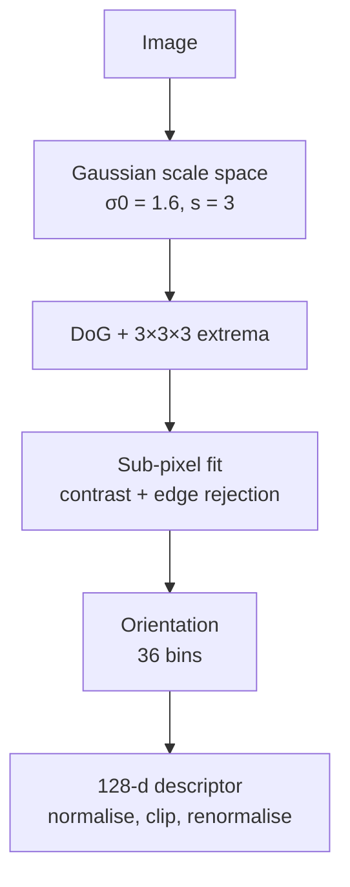
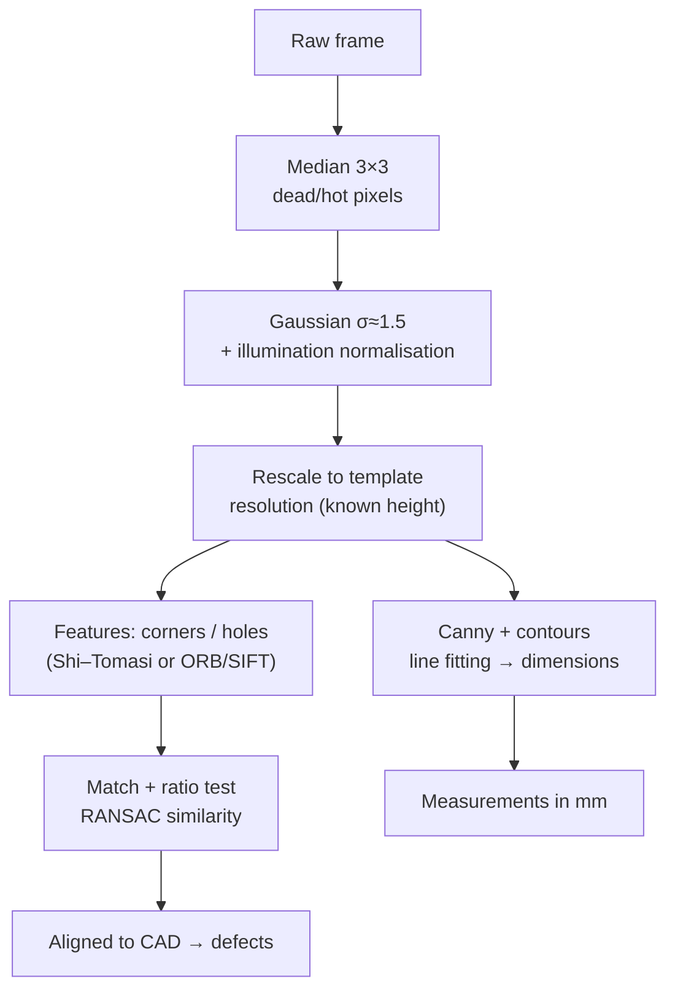

# Session 01 — Course Structure, Image Processing & Features · Solutions

> Questions: [01_questions.md](01_questions.md) · Notes: [../notes/01_image_processing_features.md](../notes/01_image_processing_features.md)

## Section A — MCQs

### Q1 — Answer: **C**
**Why C:** The median is an order statistic: median(f + g) ≠ median(f) + median(g) in general (e.g. [0,0,5] and [5,0,0] both have median 0, but their sum [5,0,5] has median 5). So it is non-linear and cannot be written as a convolution.
- **A** ✗ — The Gaussian filter is a weighted sum → linear (and shift-invariant).
- **B** ✗ — The mean filter is a uniform weighted sum → linear.
- **D** ✗ — Sobel is a fixed kernel applied by correlation → linear.

### Q2 — Answer: **B**
**Why B:** Deep-learning frameworks and `cv2.filter2D` slide the kernel **without flipping it** — that is cross-correlation. Because CNN kernels are learned, the network would simply learn the flipped kernel, so the distinction does not matter for CNNs.
- **A** ✗ — That is the mathematical definition of convolution, which these implementations do not follow.
- **C** ✗ — Median is a non-linear rank filter, unrelated to a conv layer.
- **D** ✗ — Libraries may use FFT or Winograd tricks for speed, but the operation computed is spatial correlation, and most use direct/GEMM spatial implementations.

### Q3 — Answer: **D**
**Why D:** One large and one small eigenvalue = intensity changes in only one direction = **edge**. $R=\lambda_1\lambda_2-k(\lambda_1+\lambda_2)^2=1000-0.04\cdot502^2=1000-10080.16=-9080.16<0$.
- **A** ✗ — A corner needs *both* eigenvalues large; here $R$ is negative.
- **B** ✗ — Flat needs *both* eigenvalues small; $\lambda_1=500$ is large.
- **C** ✗ — For an edge the $-k(\operatorname{tr}M)^2$ term dominates, so $R<0$, not $>0$.

### Q4 — Answer: **A**
**Why A:** Harris uses a fixed-size window, so it is **not scale-invariant**: after zooming in ×4 the rounded corner fills the window and looks locally like one or more edges ($R<0$ or small), so it is no longer detected.
- **B** ✗ — Rotation rotates the error ellipse but leaves the eigenvalues of $M$ unchanged → still detected.
- **C** ✗ — An additive offset does not change derivatives, so $M$ and $R$ are unchanged.
- **D** ✗ — Harris is computed locally everywhere → translation-invariant.

### Q5 — Answer: **C**
**Why C:** 50 ≤ 90 < 150 makes it a **weak** pixel. Hysteresis keeps weak pixels only if they connect (8-connectivity, possibly via other weak pixels) to a **strong** pixel (≥ 150); isolated weak pixels are discarded as noise.
- **A** ✗ — Being above $T_{low}$ is necessary, not sufficient.
- **B** ✗ — That would be a single threshold at 150 and would break contours.
- **D** ✗ — Direction only matters in NMS, which has already happened.

### Q6 — Answer: **B**
**Why B:** SIFT samples a 16×16 window, splits it into 4×4 cells, and builds an 8-bin gradient-orientation histogram in each: $4\times4\times8=128$.
- **A** ✗ — 64-d with Haar sums is the **SURF** descriptor.
- **C** ✗ — 256 binary tests is **ORB/rBRIEF** (256 bits).
- **D** ✗ — 36 bins is SIFT's **orientation-assignment** histogram, not the descriptor.

### Q7 — Answer: **D**
**Why D:** From the heat-diffusion equation $\partial G/\partial\sigma=\sigma\nabla^2G$, a finite difference gives $G(k\sigma)-G(\sigma)\approx(k-1)\sigma^2\nabla^2G$. The factor $\sigma^2$ is exactly the **scale normalisation** that makes responses comparable across scales; $(k-1)$ is constant over all scales, so extrema locations are unchanged.
- **A** ✗ — That is Canny's edge filter (first derivative), not a blob detector; "DoG" here means *difference*, not *derivative*, of Gaussians.
- **B** ✗ — Harris uses first-derivative products, not differences of blurred images.
- **C** ✗ — The un-normalised Laplacian's response **decreases** with $\sigma$; DoG includes the $\sigma^2$ factor, which is why it is suitable for scale selection.

### Q8 — Answer: **A**
**Why A:** ORB's rBRIEF descriptor is 256 binary intensity tests = 256 bits (32 bytes), compared with the Hamming distance (XOR + popcount).
- **B** ✗ — DoG extrema are SIFT; ORB uses FAST-9 + Harris ranking on an image pyramid.
- **C** ✗ — ORB is free (BSD) in main OpenCV; **SURF** is the non-free one.
- **D** ✗ — That describes SURF's 64-d descriptor.

## Section B — Numericals

### Q9 — Mean vs median; correlation vs convolution; output size
**Given:** $A$ with centre 255; $B$, $K=\begin{bmatrix}1&2&3\\0&0&0\\0&0&0\end{bmatrix}$; $W=512$, $K=5$, $S=1$.

**Formula:**

$$
\text{corr}=\sum_{u,v}K(u,v)B(y+v,x+u),\qquad \text{conv}=\sum_{u,v}K(u,v)B(y-v,x-u),\qquad W_{out}=\left\lfloor\frac{W-K+2P}{S}\right\rfloor+1
$$

**Working:**
- (a) Sum $=12+14+20+12+255+24+14+16+26=393$ → mean $=393/9=$ **43.67**. Sorted: 12, 12, 14, 14, **16**, 20, 24, 26, 255 → median **16**. The 255 is an **impulse (salt)** pixel; the median ignores it (output ≈ neighbours), the mean spreads it (43.7 is far above the ~16 local level). → **Median** handles salt-and-pepper.
- (b) Correlation: $1\cdot10+2\cdot20+3\cdot30=$ **140**. Convolution = correlation with the 180°-rotated kernel $\begin{bmatrix}0&0&0\\0&0&0\\3&2&1\end{bmatrix}$: $3\cdot70+2\cdot80+1\cdot90=$ **460**. They are equal whenever $K(u,v)=K(-u,-v)$ (kernel symmetric under 180° rotation), e.g. box, Gaussian, Laplacian.
- (c) No padding: $(512-5+0)/1+1=$ **508 → 508×508**. $P=2$: $(512-5+4)/1+1=$ **512 → 512×512** ("same").

**Answer:** mean **43.67**, median **16**; correlation **140**, convolution **460**; output **508×508** / **512×512**.
> ✔ Verified numerically (Python: NumPy, `scipy.ndimage.correlate/convolve`, `cv2.filter2D` gives 140).
> **Common slip:** flipping only one axis for convolution — the flip is in **both** axes (180° rotation).

### Q10 — Sobel gradient and one Canny decision
**Given:** $N=\begin{bmatrix}20&40&60\\30&50&90\\40&80&120\end{bmatrix}$, Sobel $K_x,K_y$ (correlation, $y$ down), neighbours 250 and 275, $T_{low}=100$, $T_{high}=250$.

**Formula:**

$$
I_x=\sum K_x\odot N,\quad I_y=\sum K_y\odot N,\quad \Vert\nabla I\Vert_2=\sqrt{I_x^2+I_y^2},\quad \theta=\operatorname{atan2}(I_y,I_x)
$$

**Working:**
- (a) $I_x=(60-20)+2(90-30)+(120-40)=40+120+80=$ **240**. $I_y=(40+2\cdot80+120)-(20+2\cdot40+60)=320-160=$ **160**.
- (b) L2: $\sqrt{240^2+160^2}=\sqrt{83200}=$ **288.4**. L1: $240+160=$ **400** (OpenCV Canny default). $\theta=\operatorname{atan2}(160,240)=$ **33.7°** (pointing right and **down**, since $y$ is down). The edge runs perpendicular: **123.7°** (equivalently −56.3°).
- (c) 33.7° lies in [22.5°, 67.5°) → **45° bin**. Along the gradient (right-down / left-up) the neighbours are **$(x+1,y+1)$ (bottom-right) and $(x-1,y-1)$ (top-left)**. 288.4 > 275 and 288.4 > 250 → $p$ is a local maximum → **survives NMS**.
- (d) 288.4 ≥ 250 → **strong edge** (kept regardless of connectivity). Ratio $250/100=$ **2.5**, inside Canny's recommended **2:1–3:1**.

**Answer:** $I_x=240$, $I_y=160$, $\Vert\nabla I\Vert=288.4$ (L1 400), $\theta=33.7^\circ$ → 45° bin, survives NMS, **strong** edge.
> ✔ Verified numerically (Python; `cv2.Sobel` on the padded patch gives 240 and 160).
> **Common slip:** using $y$-up conventions and comparing with the top-right/bottom-left neighbours instead.

### Q11 — Harris response and classification
**Given:** $M_A,M_B,M_C$; $k=0.04$; corner if $R>10^4$, edge if $R<0$, else flat.

**Formula:**

$$
R=\det M-k(\operatorname{tr}M)^2,\qquad \lambda_{1,2}=\frac{\operatorname{tr}M\pm\sqrt{(\operatorname{tr}M)^2-4\det M}}{2},\qquad R_{ST}=\min(\lambda_1,\lambda_2)
$$

**Working:**

| Window | $\det M$ | $\operatorname{tr}M$ | $k(\operatorname{tr}M)^2$ | $R$ | $\lambda_1,\lambda_2$ | Class | Shi–Tomasi |
|---|---|---|---|---|---|---|---|
| A | $400\cdot380-20^2=151600$ | 780 | $0.04\cdot608400=24336$ | **127 264** | 412.36, 367.64 | **Corner** | 367.64 |
| B | $500\cdot8-10^2=3900$ | 508 | $0.04\cdot258064=10322.56$ | **−6 422.56** | 500.20, 7.80 | **Edge** | 7.80 |
| C | $6\cdot5-1^2=29$ | 11 | $0.04\cdot121=4.84$ | **24.16** | 6.62, 4.38 | **Flat** | 4.38 |

- (c) Doubling intensities doubles $I_x,I_y$ → $M\to4M$ → $\det\to16\det$, $(\operatorname{tr})^2\to16(\operatorname{tr})^2$ → $R_A\to16\times127264=$ **2 036 224**. $R$ scales with $a^4$ under $I\to aI$: classification by *sign* is unchanged, but a **fixed threshold** keeps a different set of corners → only **partial** invariance to intensity scaling (full invariance to additive offsets).

**Answer:** $R_A=127264$ (corner), $R_B=-6422.56$ (edge), $R_C=24.16$ (flat); after doubling $R_A=2{,}036{,}224$.
> ✔ Verified numerically (Python, `numpy.linalg.eigvalsh`; $\lambda_1\lambda_2-k(\lambda_1+\lambda_2)^2$ matches $R$).

### Q12 — Image memory and separable Gaussian cost
**Given:** 1920×1080, $C=3$, 8 bit; 30 fps, 60 s; $\sigma=2$ and $\sigma=4$; $K=2\lceil3\sigma\rceil+1$.

**Formula:**

$$
\text{bytes}=W H C\frac{b}{8},\qquad \text{2-D cost}=K^2,\quad \text{separable cost}=2K,\qquad \sigma_{tot}=\sqrt{\sigma_1^2+\sigma_2^2}
$$

**Working:**
- (a) $1920\cdot1080\cdot3\cdot1=$ **6 220 800 B** = **6.22 MB** = $6220800/1048576=$ **5.93 MiB**.
- (b) $6220800\cdot30\cdot60=11\,197\,440\,000$ B ≈ **11.2 GB** per minute.
- (c) $K=2\lceil6\rceil+1=$ **13**. Direct: $13^2=$ **169** mult/pixel/channel; separable: $2\cdot13=$ **26**; speed-up $169/26=$ **6.5×**. Samples per frame $=6\,220\,800$ → direct $169\times6220800=$ **1 051 315 200 ≈ 1.05×10⁹**; separable $26\times6220800=$ **161 740 800 ≈ 1.62×10⁸**.
- (d) $\sigma=4$: $K=25$ → 625 vs 50 (12.5×) — **more** expensive than $\sigma=2$. Blurring twice with $\sigma=2$ gives $\sqrt{4+4}=$ **2.83**, not 4 (variances add, not standard deviations).

**Answer:** 6.22 MB (5.93 MiB) per frame; 11.2 GB/min; $K=13$, 169 vs 26 per pixel (≈1.05×10⁹ vs 1.62×10⁸ per frame); σ=4 → 625 vs 50; two σ=2 blurs ≈ σ=2.83.
> ✔ Verified numerically (Python).
> **Common slip:** forgetting the 3 channels, or mixing MB and MiB.

### Q13 — Integral image, Hamming distance, SIFT scales
**Given:** 4×4 image $I$; bytes `10110100`, `10011101`; $\sigma_0=1.6$, $s=3$.

**Formula:**

$$
\sum_{x_0\le x\le x_1,\ y_0\le y\le y_1}I=ii(x_1,y_1)-ii(x_0-1,y_1)-ii(x_1,y_0-1)+ii(x_0-1,y_0-1),\qquad \sigma_i=\sigma_0\,2^{i/s}
$$

**Working:**
- (a) Cumulative sums along rows and columns:

$$
ii=\begin{bmatrix}3&4&8&9\\8&18&24&31\\13&26&37&52\\22&42&62&80\end{bmatrix}
$$

  Rectangle: $x_0=1,x_1=3$ (columns), $y_0=1,y_1=2$ (rows). Lookups: $ii(3,2)=52$, $ii(0,2)=13$, $ii(3,0)=9$, $ii(0,0)=3$ → $52-13-9+3=$ **33**. Direct: $9+2+6+3+5+8=33$ ✓.
- (b) XOR: `10110100` ⊕ `10011101` = `00101001` → popcount = **3**. ORB descriptor: 256 bits = **32 bytes**.
- (c) $k=2^{1/3}=1.26$: $\sigma=$ **1.600, 2.016, 2.540, 3.200, 4.032, 5.080** ($s+3=6$ Gaussian images). DoG images: $s+2=$ **5**. Extrema are searched in the **middle 3** DoG levels (the top and bottom DoG have no level above/below). Each candidate is compared with **26** neighbours (8 + 9 + 9). The next octave starts from the image with $\sigma=3.2$ downsampled by 2.

**Answer:** rectangle sum **33**; Hamming **3**, ORB = **32 B**; σ = 1.6, 2.016, 2.54, 3.2, 4.032, 5.08; **5** DoG; middle 3 levels; **26** neighbours.
> ✔ Verified numerically (Python: `cumsum`, XOR/popcount, σ sequence).
> **Common slip:** using $ii(x_0,\cdot)$ instead of $ii(x_0-1,\cdot)$ — that drops the first column of the rectangle.

## Section C — Short answers (model answers)

### Q14 — Canny's criteria (4 marks)
Canny (1986) posed edge detection as an optimisation problem with three criteria:

| Criterion | Meaning | Canny step(s) that address it |
|---|---|---|
| **Good detection** | Few missed edges and few false edges (high SNR) | **Gaussian smoothing** raises SNR; **double threshold + hysteresis** keeps weak true edges that connect to strong ones while dropping isolated noise |
| **Good localisation** | Marked edge close to the true edge | Derivative-of-Gaussian filter with moderate σ; **NMS** keeps the exact ridge of the gradient magnitude |
| **Single response** | One response per edge | **NMS** along the gradient direction thins ridges to 1 px; hysteresis avoids broken/streaked duplicate responses |

**Effect of σ:** larger σ → better noise suppression and fewer spurious/texture edges, but **worse localisation** (edges shift, corners rounded, nearby edges merge, fine detail lost). Smaller σ → finer, better-localised edges but more noise edges. This detection–localisation trade-off is inherent; choose σ to match the scale of the structures you care about.

### Q15 — Harris invariance and SIFT's solution (4 marks)
- **Rotation:** Harris uses $M$, whose eigenvalues describe how much intensity changes along the principal directions. Rotating the image rotates the eigenvectors (the error ellipse) but **leaves the eigenvalues unchanged**, so $R=\lambda_1\lambda_2-k(\lambda_1+\lambda_2)^2$ is the same → rotation-invariant.
- **Scale:** the window $\mathcal W$ (and derivative σ) has a **fixed size in pixels**. Zoom in and a corner's curvature spreads over many windows, each of which sees an almost straight **edge** ($R<0$); zoom out and several structures fall in one window. The same physical point is not re-detected → **not scale-invariant**.
- **SIFT scale invariance:** build a Gaussian scale space and **DoG ≈ scale-normalised LoG**; a keypoint is an extremum over **space and scale** (3×3×3), giving its **characteristic scale σ**; the descriptor window is sized proportionally to σ, so the same image content is described regardless of zoom.
- **SIFT rotation invariance:** a **36-bin gradient-orientation histogram** gives a dominant orientation θ (extra keypoints for peaks ≥ 80%); the descriptor's 16×16 grid and gradient angles are expressed **relative to θ**.

### Q16 — Choosing a smoothing filter (4 marks)
- **(i) Gaussian sensor noise → Gaussian filter.** Weighted local average reduces zero-mean noise variance; smooth frequency response (no ringing), separable (cheap) and it is the smoothing part of derivative-of-Gaussian/Canny.
- **(ii) 5% salt-and-pepper → median filter (3×3).** Impulses are extreme values, so as long as fewer than half of the window pixels are corrupted the median is a clean pixel; a mean/Gaussian would smear each impulse into a grey blob. Median also preserves step edges.
- **(iii) Portrait skin smoothing → bilateral filter.** Its range kernel $G_{\sigma_r}(\lvert I_p-I_q\rvert)$ gives near-zero weight to pixels across an edge (eye, lip, face outline), so it smooths skin texture while keeping outlines sharp.
- **Linearity:** only the **Gaussian** is linear (and shift-invariant). **Median and bilateral are non-linear** (rank-based / weights depend on the image itself).

**Trade-off:** Gaussian is fastest but blurs edges; median is ideal for impulses but erodes thin lines; bilateral preserves edges at higher cost and can give a cartoon look.

### Q17 — Keypoints, descriptors and ORB (4 marks)
- **Detector** finds *where*: repeatable interest points with location $(x,y)$ and possibly scale σ and orientation θ (Harris, FAST, DoG). **Descriptor** describes *what*: a vector summarising the normalised patch around the keypoint so it can be matched (SIFT 128-d, BRIEF 256 bits).
- **Good-feature properties:** **repeatability** (re-detected under viewpoint/lighting change), **distinctiveness** (descriptors discriminate between different points), **invariance/robustness** (rotation, scale, illumination), **locality** (robust to occlusion), **efficiency**, **accuracy**, **quantity**.
- **ORB's fixes:**
  - FAST has **no orientation** → ORB adds **intensity-centroid orientation** $\theta=\operatorname{atan2}(m_{01},m_{10})$.
  - FAST has **no scale** → ORB runs it on an **image pyramid** (8 levels × 1.2).
  - FAST has a weak corner score and fires on edges → ORB **ranks by Harris response** and keeps the top N.
  - BRIEF is **not rotation-invariant** → **steer** the test pattern by θ.
  - Steered BRIEF tests become correlated/low-variance → ORB **learns 256 uncorrelated, high-variance tests** (rBRIEF).
  Result: fast, free, rotation-invariant binary descriptor matched with Hamming distance.

## Section D — Long answers (model answers)

### Q18 — The SIFT pipeline (10 marks)
SIFT (Lowe 2004) produces keypoints $(x,y,\sigma,\theta)$ and 128-d descriptors that are invariant to translation, rotation and scale and robust to illumination and moderate viewpoint change.

**1. Scale-space extrema (scale invariance).**
- $L(x,y,\sigma)=G_\sigma*I$; per octave $s=3$ intervals, $k=2^{1/3}$, $\sigma_0=1.6$ → 6 Gaussian images, 5 DoG images $D=L(k\sigma)-L(\sigma)$; next octave = image at $2\sigma_0$ downsampled ×2 (Lowe doubles the input first).
- **Why DoG:** $D\approx(k-1)\sigma^2\nabla^2G$ = scale-normalised LoG, the classic blob detector, but almost free (subtract images already computed).
- Candidate = max/min over **26 neighbours in 3×3×3** → location *and* characteristic scale.

**2. Keypoint localisation (accuracy, stability).**
- Quadratic Taylor fit of $D$ → sub-pixel/sub-scale offset $\hat{\mathbf x}=-(\partial^2D/\partial\mathbf x^2)^{-1}\partial D/\partial\mathbf x$.
- Reject **low contrast** $\lvert D(\hat{\mathbf x})\rvert<0.03$ (noise-sensitive).
- Reject **edge responses**: $\operatorname{tr}(H)^2/\det H\ge(r+1)^2/r=12.1$ ($r=10$). DoG responds strongly along edges, but such points are poorly localised along the edge (same principle as Harris).

**3. Orientation assignment (rotation invariance).**
- 36-bin (10°) histogram of gradient orientations in a Gaussian window (1.5σ), weighted by magnitude; dominant peak = θ; peaks ≥ 80% spawn extra keypoints (~15% of points); parabola interpolation.

**4. Descriptor (distinctiveness + robustness).**
- 16×16 window rotated to θ and scaled to σ → 4×4 cells × 8 orientation bins = **128-d**, Gaussian weighting and trilinear interpolation (robust to small shifts).
- **Normalise** (invariance to contrast gain; gradients already ignore additive offsets) → **clip at 0.2** (limit large gradient magnitudes from non-linear lighting/saturation) → **renormalise**.

**Invariance summary:**

| Invariant / robust to | Not invariant to |
|---|---|
| Translation, rotation, scale, brightness offset, contrast gain, small affine/viewpoint change, moderate noise | Large out-of-plane rotation (strong affine/projective distortion), non-rigid deformation, strong non-linear illumination (day/night), textureless or repetitive regions, mirror reflections |

**When ORB instead:** real-time or embedded/mobile use (SLAM, AR): ORB is roughly two orders of magnitude faster, descriptors are 32 bytes (vs 512 B as float32) and matched with Hamming distance; accept lower distinctiveness and weaker scale handling. Choose SIFT for offline accuracy (SfM, large scale changes, panoramas from mixed zooms).

**Marking scheme:** 2 – scale space & DoG justification · 2 – localisation, contrast & edge rejection · 2 – orientation assignment · 2 – descriptor & normalisation · 2 – invariance summary + SIFT vs ORB trade-off.

### Q19 — Industrial plate inspection design (10 marks)
**Framing.** Fixed overhead camera, plate lying flat → image-to-template mapping is a **similarity transform** (rotation + translation + scale, 4 DOF; an affine/homography only if the camera is tilted). The two lines differ only in scale, which is **known** from the mounting height → we can remove it by calibration rather than relying on scale invariance.

**1. Pre-processing (2 marks).**
- **Median 3×3 first** — removes dead/hot pixels; a Gaussian applied first would smear each impulse into a blob that Canny would detect as an edge.
- **Gaussian σ ≈ 1–2** against sensor noise (or rely on Canny's smoothing).
- **Lighting drift:** prefer hardware fixes (diffuse dome light or **backlight** → plate becomes a high-contrast silhouette). In software, gradients are invariant to additive offsets; normalise contrast (histogram equalisation/CLAHE) and set thresholds adaptively.
- **Calibrate** the camera (intrinsics + lens distortion, [Session 11](../notes/11_camera_geometry.md)) so pixels convert to millimetres; rescale line-2 images by the known height ratio.

**2. Outline extraction (2 marks).**
- **Canny** with σ ≈ 1.5; thresholds **adaptive**, e.g. $T_{high}$ = 80th–90th percentile of gradient magnitude, $T_{low}=T_{high}/2.5$ (Canny's 2:1–3:1), so lighting drift does not change the edge set.
- Hysteresis gives a closed outline; extract the outer contour, fit straight lines to each side (least squares or RANSAC lines — robust to burrs), intersect lines for corners, measure side lengths/hole diameters with sub-pixel accuracy.

**3. Alignment features (3 marks).**
- **Rotation:** Harris/Shi–Tomasi corners and ORB/SIFT are rotation-invariant; alternatively get a coarse angle from contour moments or `minAreaRect`.
- **Scale:** Harris is **not scale-invariant** → normalise scale by the known camera height first; if heights were unknown use **SIFT** (DoG scale space) or ORB's pyramid.
- **Choice:** machined plates have little texture but strong corners and holes → **Shi–Tomasi corners + hole centres** (fast, precise) as geometric primitives; or **ORB** for speed on the conveyor (Hamming matching), **SIFT** if robustness matters more than speed (patent expired, free).
- **Matching to the CAD template:** render the template, match descriptors with the **ratio test**, estimate a **similarity transform with RANSAC** (2 correspondences minimum) — see [Session 02](../notes/02_feature_matching_classical.md); refine with ICP on edge points.

**4. Failure cases (2 marks).**
- **Specular reflections** on metal → saturated highlights create false edges/corners (fix: diffuse lighting, polariser).
- **Repetitive hole patterns** → ambiguous descriptors, ratio test discards them (fix: use geometric consistency/outline alignment first).
- Low plate–belt contrast, dirt/scratches (false corners), **motion blur** from the conveyor (strobe/short exposure), plates touching or partly out of view, residual lens distortion biasing measurements.

**5. Evaluation (1 mark).**
- Measurement accuracy vs calipers/CMM (mean absolute error in mm, repeatability = std over repeated captures), alignment reprojection error (px) and inlier ratio, detection repeatability across rotations/scales/lighting conditions (test sets collected at different times of day), throughput (ms per plate vs conveyor rate), false reject/accept rate of the final pass/fail decision.

**Trade-off:** hand-crafted filters + Canny + corners are precise, explainable and need no training data — ideal for a controlled factory — but depend on good lighting; a learned approach would only be worth it for textured or highly variable defects.

**Marking scheme:** 2 – pre-processing & noise handling · 2 – edge pipeline & parameter choices · 3 – alignment features with rotation/scale/lighting handling · 2 – failure cases · 1 – evaluation.
