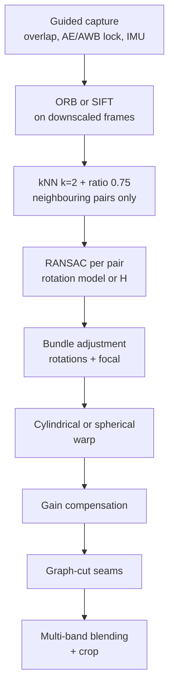

# Session 02 — Feature Matching & Classical CV · Solutions

> Questions: [02_questions.md](02_questions.md) · Notes: [../notes/02_feature_matching_classical.md](../notes/02_feature_matching_classical.md)

## Section A — MCQs

### Q1 — Answer: **C**
**Why C:** ORB produces **binary** 256-bit descriptors (32 bytes); the natural dissimilarity is the number of differing bits, the **Hamming** distance (XOR + popcount).
- **A** ✗ — L2 is for float descriptors (SIFT/SURF); on packed bytes it is meaningless.
- **B** ✗ — L1 on the byte values is equally meaningless for bit strings.
- **D** ✗ — Converting bits to floats and using cosine wastes time and does not measure bit disagreement.

### Q2 — Answer: **A**
**Why A:** The test accepts only if $d_1/d_2<\tau$ ($\tau\approx0.7$–$0.8$). A ratio near 1 means two candidates are almost equally similar → the match is **ambiguous** and likely wrong.
- **B** ✗ — That is an absolute threshold, which the ratio test is designed to replace.
- **C** ✗ — That is the cross-check (mutual nearest neighbour), a different filter.
- **D** ✗ — $d_2\gg d_1$ gives a *small* ratio → the match is **accepted** (distinctive).

### Q3 — Answer: **D**
**Why D:** $H$ has 9 entries but is defined up to scale → **8 DOF**. Each correspondence gives 2 equations → **4 correspondences**, and no three of them may be collinear (degenerate).
- **A** ✗ — Ignores the scale ambiguity (9 → 8).
- **B** ✗ — 6 DOF / 3 points is an **affine** transform.
- **C** ✗ — 3 points give only 6 equations, not enough for 8 DOF.

### Q4 — Answer: **B**
**Why B:** Under **pure rotation** about the optical centre, $H=KRK^{-1}$ maps every pixel exactly, independent of scene depth — the basis of panoramas.
- **A** ✗ — Translation with depth variation causes **parallax**; points at different depths shift differently.
- **C** ✗ — A general rigid scene between two views needs the fundamental/essential matrix, not a homography.
- **D** ✗ — Forward motion through a 3-D room is translation with strong depth variation → parallax.

### Q5 — Answer: **C**
**Why C:** $N=\left\lceil\frac{\log(0.01)}{\log(1-0.5^4)}\right\rceil=\left\lceil\frac{-4.605}{-0.06454}\right\rceil=\lceil71.36\rceil=72$.
- **A** ✗ — 17 is for $s=2$ (line/similarity) at $e=0.5$, or $s=4$ at $e=0.3$.
- **B** ✗ — Rounding down; $N$ must be rounded **up** to guarantee $p$.
- **D** ✗ — 1177 is the 8-point fundamental matrix ($s=8$).

### Q6 — Answer: **D**
**Why D:** LSH hashes random subsets of bits, so similar binary strings (small Hamming distance) collide in the same buckets → fast approximate NN for ORB/BRIEF.
- **A** ✗ — KD-trees split on coordinate values of float vectors; they work poorly in Hamming space.
- **B** ✗ — Brute force is not a FLANN index, and L2 is the wrong norm for binary descriptors.
- **C** ✗ — Hierarchical k-means with L2 is meant for float descriptors.

### Q7 — Answer: **B**
**Why B:** Each Laplacian-pyramid band is blended with a correspondingly blurred mask: coarse (low-frequency) bands over a wide region → no visible exposure step; fine (high-frequency) bands over a narrow region → no blur/double edges.
- **A** ✗ — Blending cannot fix geometric misalignment from parallax; ghosting needs capture discipline, seam cutting or local warps.
- **C** ✗ — Homographies come from matching + RANSAC (+ bundle adjustment), not blending.
- **D** ✗ — Lens distortion is corrected by calibration/undistortion before warping.

### Q8 — Answer: **A**
**Why A:** A white, textureless wall has almost no corners or blobs, so SIFT detects few keypoints, and those it finds have bland, ambiguous descriptors → too few correct matches for RANSAC.
- **B** ✗ — Textured scene + pure rotation is the ideal case (homography, many features).
- **C** ✗ — SIFT is rotation- and scale-invariant; a 45° rotation and 2× scale is handled well.
- **D** ✗ — A textured plane under moderate lighting change is a classic success case (gradients + normalisation).

## Section B — Numericals

### Q9 — RANSAC iteration counts
**Given:** $p=0.99$ (and 0.999); $s=4$ (H), 8 and 7 (F); $e\in\{0.5,0.3,0.4\}$.

**Formula:**

$$
N=\left\lceil\frac{\log(1-p)}{\log\left(1-(1-e)^s\right)}\right\rceil
$$

**Working:** $\log(1-0.99)=\ln0.01=-4.6052$.
- (a) $(1-0.5)^4=0.0625$; $\ln(0.9375)=-0.06454$ → $4.6052/0.06454=71.36$ → **72**.
- (b) $(0.7)^4=0.2401$; $\ln(0.7599)=-0.27457$ → $16.77$ → **17**.
- (c) (i) $(0.5)^8=0.003906$; $\ln(0.996094)=-0.003914$ → $1176.6$ → **1177**. (ii) $(0.5)^7=0.0078125$; $\ln(0.9921875)=-0.007843$ → $587.2$ → **588**. Compared with 72 for $H$: ×16 and ×8 more — $N$ grows **exponentially in $s$**, which is why minimal solvers (7-point, 5-point) and good matching (low $e$) matter.
- (d) $e=1-60/100=0.4$: $(0.6)^4=0.1296$; $\ln(0.8704)=-0.13880$ → $33.18$ → **34** (the loop can stop after 34 iterations instead of running forever). With $p=0.999$, $e=0.5$: $\ln(0.001)=-6.9078$ → $6.9078/0.06454=107.03$ → **108**.

**Answer:** (a) **72** (b) **17** (c) **1177** (8-pt), **588** (7-pt) (d) **34**; **108** for $p=0.999$.
> ✔ Verified numerically (Python, `math.log`, `math.ceil`).
> **Common slip:** rounding 71.36 down to 71, or using $e$ where $(1-e)$ belongs.

### Q10 — Ratio test and cross-check
**Given:** the table of $d_1,d_2$ and nearest/reverse neighbours; $\tau=0.75$ and $0.8$; absolute threshold 160.

**Formula:** accept if $d_1/d_2<\tau$; cross-check keeps $(i,j)$ only if $NN(i)=j$ and $NN(j)=i$.

**Working:**

| Query | $d_1/d_2$ | $\tau=0.75$ | $\tau=0.8$ | Mutual? | $d_1<160$ |
|---|---|---|---|---|---|
| q1 | 120/300 = **0.400** | ✓ | ✓ | ✓ (t4 → q1) | ✓ |
| q2 | 200/230 = **0.870** | ✗ | ✗ | ✓ | ✗ |
| q3 | 150/190 = **0.789** | ✗ | ✓ | ✓ | ✓ |
| q4 | 90/95 = **0.947** | ✗ | ✗ | ✓ | ✓ |
| q5 | 250/420 = **0.595** | ✓ | ✓ | ✗ (t1 → q6) | ✗ |
| q6 | 180/400 = **0.450** | ✓ | ✓ | ✓ (t1 → q6) | ✗ |

- (a) $\tau=0.75$: **{q1, q5, q6}**. $\tau=0.8$: **{q1, q3, q5, q6}**.
- (b) q5 and q6 both claim t1, but t1's own nearest query is q6 → q5 fails the cross-check. Remaining: $\tau=0.75$ → **{q1, q6}**; $\tau=0.8$ → **{q1, q3, q6}**.
- (c) $d_1<160$ accepts **{q1, q3, q4}**. It **accepts q4**, whose two candidates are almost equally close (0.947) — typical of repetitive texture; the small $d_1$ only means the patch is generic, not that the match is right. It **rejects q6**, whose $d_1=180$ is large (e.g. blur/viewpoint change) but which is far more similar to t1 than to anything else (0.45) → very likely correct. The ratio test measures **ambiguity per feature**, adapting automatically to how distinctive each descriptor is; one global distance threshold cannot.

**Answer:** ratio 0.75 → q1, q5, q6 (+ cross-check → q1, q6); ratio 0.8 → q1, q3, q5, q6 (+ cross-check → q1, q3, q6); absolute threshold → q1, q3, q4.
> ✔ Verified numerically (Python).

### Q11 — Descriptor distances
**Given:** $\mathbf a=(1,2,0,3)$, $\mathbf b=(2,0,1,3)$; two 16-bit strings; histograms $h,g$.

**Formula:**

$$
d_{L1}=\sum\lvert a_i-b_i\rvert,\quad d_{L2}=\sqrt{\sum(a_i-b_i)^2},\quad \cos=\frac{\mathbf a\cdot\mathbf b}{\Vert\mathbf a\Vert\Vert\mathbf b\Vert},\quad d_H=\operatorname{popcount}(\mathbf a\oplus\mathbf b),\quad \chi^2=\tfrac12\sum\frac{(h_i-g_i)^2}{h_i+g_i}
$$

**Working:**
- (a) $\mathbf a-\mathbf b=(-1,2,-1,0)$ → L1 $=1+2+1+0=$ **4**; L2 $=\sqrt{1+4+1+0}=\sqrt6=$ **2.449**. $\mathbf a\cdot\mathbf b=2+0+0+9=11$; $\Vert\mathbf a\Vert=\sqrt{14}=3.742$, $\Vert\mathbf b\Vert=\sqrt{14}=3.742$ → $\cos=11/14=$ **0.786**; cosine distance $=1-0.786=$ **0.214**.
- (b) $\Vert\hat{\mathbf a}-\hat{\mathbf b}\Vert=\sqrt{2-2(0.7857)}=\sqrt{0.4286}=$ **0.655** (direct computation on the normalised vectors gives the same).
- (c) `1011 0010 1110 0001` ⊕ `1001 0110 1010 0111` = `0010 0100 0100 0110` → popcount $1+1+1+2=$ **5**.
- (d) $\tfrac12\left[\frac{0.01}{0.5}+\frac{0.04}{0.8}+\frac{0.01}{0.7}\right]=\tfrac12(0.02+0.05+0.01429)=$ **0.0421**. Metrics: **SIFT → L2**, **ORB → Hamming**, **colour histograms → χ²** (or intersection).

**Answer:** L1 = 4, L2 = 2.449, cos = 0.786 (distance 0.214); unit-vector L2 = 0.655; Hamming = 5; χ² = 0.0421.
> ✔ Verified numerically (Python/NumPy).

### Q12 — Applying a homography and checking inliers
**Given:** $H$; $\mathbf p_1=(100,50)$, $\mathbf p_2=(200,150)$; observations $(147,76)$, $(260,170)$; $t=5$ px.

**Formula:**

$$
(u,v,w)^\top=H(x,y,1)^\top,\quad (x',y')=(u/w,\ v/w),\quad r=\Vert\mathbf p'_{obs}-(x',y')\Vert_2
$$

**Working:**
- (a) $\mathbf p_1$: $u=1.2(100)+0.1(50)+30=155$, $v=0.05(100)+1.1(50)+20=80$, $w=0.0005(100)+0.0002(50)+1=1.06$ → **(146.23, 75.47)**.
  $\mathbf p_2$: $u=240+15+30=285$, $v=10+165+20=195$, $w=0.1+0.03+1=1.13$ → **(252.21, 172.57)**.
  Origin: $(30,20,1)$ → **(30, 20)** (the translation column).
- (b) $r_1=\sqrt{(147-146.23)^2+(76-75.47)^2}=\sqrt{0.773^2+0.528^2}=$ **0.94 px < 5 → inlier**.
  $r_2=\sqrt{(260-252.21)^2+(170-172.57)^2}=\sqrt{7.788^2+2.566^2}=$ **8.20 px > 5 → outlier**.
- (c) **Not affine**: the last row is $(0.0005,0.0002,1)\neq(0,0,1)$, so $w$ varies with position (perspective foreshortening; parallel lines can converge). $2H$ gives $(2u,2v,2w)$ → **the same point** after division — the overall scale is irrelevant, which is why $H$ has 8 DOF.

**Answer:** $\mathbf p_1\to(146.23,75.47)$ inlier (0.94 px); $\mathbf p_2\to(252.21,172.57)$ outlier (8.20 px); origin → (30, 20); projective, scale-invariant.
> ✔ Verified numerically (Python/NumPy).
> **Common slip:** forgetting to divide by $w$ — using (155, 80) would wrongly make $\mathbf p_1$ an outlier.

### Q13 — DOF counting and DLT sizes
**Given:** transform hierarchy; 25 matches, 18 inliers; rotation-only model with known $K$; $e=0.6$, $p=0.99$.

**Formula:** min correspondences $=\lceil\text{DOF}/2\rceil$ (2 equations per point); DLT $A\in\mathbb R^{2n\times9}$; $N$ formula as in Q9.

**Working:**
- (a)

| Transform | DOF | Min. correspondences |
|---|---|---|
| Translation | 2 | 1 |
| Euclidean (rigid) | 3 | 2 |
| Similarity | 4 | 2 |
| Affine | 6 | 3 |
| Projective (homography) | 8 | 4 (no 3 collinear) |

- (b) (i) minimal sample $n=4$ → **8×9**; (ii) refit on inliers $n=18$ → **36×9**; (iii) all matches $n=25$ → **50×9**. $\mathbf h$ has **9 unknowns** but only **8 DOF** (scale fixed by $\Vert\mathbf h\Vert=1$). Noise-free, non-degenerate minimal sample: **rank 8** → 1-D null space → unique $H$ up to scale.
- (c) $H=KRK^{-1}$ with known $K$ has only the **3 DOF** of $R$ → **2 correspondences** (4 equations ≥ 3). RANSAC at $e=0.6$: $s=2$: $(0.4)^2=0.16$, $\ln0.84=-0.17435$ → $26.41$ → **27**; general $H$, $s=4$: $(0.4)^4=0.0256$, $\ln0.9744=-0.02593$ → $177.6$ → **178** — about 6.6× fewer iterations with the minimal, physically correct model.

**Answer:** DOF 2/3/4/6/8 with 1/2/2/3/4 points; $A$ = 8×9, 36×9, 50×9; 9 unknowns, 8 DOF, rank 8; rotation model 3 DOF, 2 points, **27** vs **178** iterations.
> ✔ Verified numerically (Python; DLT on 4 points via SVD reproduced `cv2.getPerspectiveTransform`).

## Section C — Short answers (model answers)

### Q14 — Why the ratio test works (4 marks)
- **Idea:** compare the nearest distance $d_1$ with the second-nearest $d_2$; accept if $d_1/d_2<\tau$. For a **correct** match the true partner is much closer than any other descriptor; for an **incorrect** match, $d_1$ and $d_2$ are both distances to unrelated descriptors and, in 128-d space, are similar → ratio ≈ 1.
- **Why better than an absolute threshold:** descriptor distinctiveness varies widely. A correct match can have a large $d_1$ (blur, viewpoint, lighting) and a wrong match a small $d_1$ (bland or repeated patch). The ratio is a **per-feature, self-normalising** measure of ambiguity; one global threshold cannot fit all features.
- **Typical τ:** 0.7–0.8 (Lowe used 0.8, removing ~90% of false matches while losing <5% of correct ones; OpenCV tutorials use 0.75). Lower τ = stricter.
- **Repetitive structures:** the true match has near-identical twins (windows, tiles) → $d_1\approx d_2$ → rejected. Good for robustness (avoids confident wrong matches) but the region yields few matches.
- **Cross-check differs:** it enforces **mutual** nearest neighbours (1→2 and 2→1 agree) — removes many-to-one matches but does **not** test ambiguity; in OpenCV it requires $k=1$, so combining both means doing the mutual check manually.

### Q15 — RANSAC derivation, threshold, limitations (4 marks)
- **Derivation:** with outlier ratio $e$ and minimal sample size $s$, P(sample all inliers) $=(1-e)^s$; P(sample contaminated) $=1-(1-e)^s$; P(all $N$ samples contaminated) $=(1-(1-e)^s)^N$. Require this to be $\le1-p$:

$$
N=\left\lceil\frac{\log(1-p)}{\log(1-(1-e)^s)}\right\rceil
$$

- **Threshold $t$:** from the expected localisation noise $\sigma$: $t^2=\chi^2_{m}(0.95)\,\sigma^2$, e.g. $t=2.45\sigma$ for homography transfer error ($m=2$), $1.96\sigma$ for epipolar distance ($m=1$); practically 1–5 px.
- **Adaptive RANSAC:** $e$ is unknown, so start with $N=\infty$ and, whenever a better model is found, set $e=1-\text{inliers}/\text{total}$ and recompute $N$.
- **Limitations (any two):** $N$ explodes for high $e$ or large $s$; needs a hand-set threshold; non-deterministic; finds a single model only; degenerate samples (collinear points) give wrong models; counting inliers ignores residual size.
- **Variant:** **PROSAC** samples high-quality (low ratio) matches first → far fewer iterations; **MSAC** uses a truncated quadratic score; **LO-RANSAC** locally refines new best models; **MAGSAC++** reduces threshold sensitivity.

### Q16 — DLT and validity of the homography (4 marks)
**(a) DLT.** From $x'=\frac{h_{11}x+h_{12}y+h_{13}}{h_{31}x+h_{32}y+h_{33}}$ and the analogous $y'$, multiply out the denominators:

$$
\begin{aligned}
h_{11}x+h_{12}y+h_{13}-x'(h_{31}x+h_{32}y+h_{33})&=0\\
h_{21}x+h_{22}y+h_{23}-y'(h_{31}x+h_{32}y+h_{33})&=0
\end{aligned}
$$

i.e. rows $(x,y,1,0,0,0,-x'x,-x'y,-x')$ and $(0,0,0,x,y,1,-y'x,-y'y,-y')$ — **linear** in $\mathbf h$. Stacking $n$ correspondences gives $A\mathbf h=\mathbf 0$ with $A$ of size $2n\times9$. Minimise $\Vert A\mathbf h\Vert$ subject to $\Vert\mathbf h\Vert=1$ → $\mathbf h$ = **right singular vector of the smallest singular value** (SVD). Needs $n\ge4$. **Hartley normalisation** (centroid → origin, mean distance → $\sqrt2$, per image; denormalise $H=T'^{-1}\tilde HT$) makes $A$ well-conditioned. **Degenerate:** three or more of the four points collinear → rank-deficient system or singular $H$.

**(b) Validity.** A homography is exact when (1) the scene is a **plane** ($H=K_2(R+\mathbf t\mathbf n^\top/d)K_1^{-1}$), (2) the camera **purely rotates** about its optical centre ($H=KRK^{-1}$), or approximately (3) the scene is very far relative to the camera translation. **Parallax:** if the camera translates and the scene has depth variation, a point's image displacement depends on its depth (for a sideways baseline $B$, shift $=fB/Z$), so near and far points move by different amounts — no single 2-D projective map fits. Then use the **fundamental matrix** (uncalibrated, 7/8-point) or **essential matrix** (calibrated, 5-point) with RANSAC — see [Session 12](../notes/12_3d_vision_motion.md); for stitching with parallax use local warps or seam cutting.

### Q17 — Where classical CV works and fails (4 marks)
**Works well:** geometric tasks on **textured, rigid, static** scenes — panoramas, document rectification, visual odometry/SLAM, SfM/photogrammetry, instance recognition of a specific poster/book cover, calibration. No training data, interpretable, precise with RANSAC + bundle adjustment, runs on a CPU.

**Fails (with reasons):**
- **Textureless** regions (white walls, sky) → no keypoints.
- **Repetitive** patterns (facades, tiles) → ambiguous descriptors; ratio test discards them or RANSAC locks onto a wrong shift.
- **Non-rigid** motion (people, cloth) → no global $H$/$F$ explains it.
- **Large illumination change** (day/night) and **large viewpoint/scale change** → descriptors only invariant to similarity + mild affine and to affine intensity changes.
- **Semantic, category-level** tasks → local descriptors encode instance appearance, not meaning.

**Learned matchers:** **SuperPoint** learns a detector + descriptor (self-supervised with homographic adaptation) that is more repeatable under lighting/viewpoint change. **SuperGlue / LightGlue** match **jointly** using self- and cross-attention over all keypoints plus optimal transport (dustbin for unmatched) → context disambiguates repetitive structures and handles occlusion; LightGlue adapts its depth for speed. **LoFTR** is **detector-free**: a transformer produces dense coarse matches refined to sub-pixel, so textureless regions still match. Costs: GPU, training data, domain shift — and their matches still go through **RANSAC**.

## Section D — Long answers (model answers)

### Q18 — Panorama app design (10 marks)
**Framing.** Handheld phone, 6–10 photos, possibly > 180° total field of view. Ideal model: pure rotation → homographies $H=KRK^{-1}$; reality adds small translation (parallax), auto-exposure changes and moving people.

**1. Capture & features (2).**
- UI guides the user to **rotate the phone in place** with roughly 30–40% overlap; **lock exposure and white balance** during the sweep; record **gyroscope** orientations as priors.
- Features on downscaled images (~1 MP): **ORB** (fast, 32-byte, Hamming) for on-device speed; **SIFT** (free since 2020) if quality matters more and compute allows. Same descriptor type for all images.

**2. Matching & robust estimation (2).**
- kNN ($k=2$) + **ratio test $\tau=0.75$**; only match **neighbouring** images (capture order + IMU) → fewer pairs and fewer false pairings on repetitive scenes.
- **RANSAC** per pair: either a full homography ($s=4$, $t\approx3$–5 px, 72 iterations at $e=0.5$) or, better, the **rotation-only model** $KRK^{-1}$ ($s=2$, 17 iterations) since the physics is rotation. Accept a pair only with enough inliers.

**3. Global alignment, projection, compositing (2).**
- **Bundle adjustment** of all rotations + a shared focal length minimises reprojection error over all matches → removes drift and closes 360° loops; **wave correction** straightens the horizon.
- **Cylindrical** projection for horizontal sweeps (spherical for 360×180); planar only for narrow FOV (stretching, impossible at 180°).
- Inverse-mapped warping with bilinear interpolation; **gain compensation**; **graph-cut seams** routed through low-difference regions and around people; **multi-band blending** (seamless, sharp); crop to a rectangle.

**4. Failure cases & mitigations (3).**

| Failure | Cause | Mitigation |
|---|---|---|
| Ghosting / broken lines near the camera | **Parallax** from hand translation | Guide rotation about the phone's lens; seam cutting; local warps (as-projective-as-possible) |
| Duplicated / half-transparent people | **Moving objects** | Seam finding that assigns each moving object to one image; median/deghosting |
| Brightness steps at seams | Auto-exposure, vignetting | AE/AWB lock, gain compensation, multi-band blending |
| Too few matches | **Textureless sky**, water, white walls | Larger overlap, rely on horizon/ground features, use **IMU rotation prior** as fallback |
| Wrong alignment | Repetitive facades | Ratio test, restrict matching to IMU-predicted region, RANSAC inlier checks |
| Extreme stretching | Planar projection of a wide FOV | Cylindrical/spherical projection |
| Blur, drift, distortion | Motion blur, chained errors, lens distortion | Reject blurry frames (low Laplacian variance), bundle adjustment, undistort with factory calibration |

**5. Evaluation (1).** RMS reprojection error after bundle adjustment, success rate across scene types (indoor, outdoor, sky-heavy), seam/ghost artefact rating in user studies, runtime and memory on target phones.

**Trade-off:** ORB + rotation model + IMU priors gives speed on device; SIFT + full bundle adjustment gives higher robustness at higher cost — no blending method can fix parallax, so capture guidance matters as much as algorithms.

**Marking scheme:** 2 – capture & feature/matching choices · 2 – robust estimation & global alignment · 2 – projection & compositing · 3 – failure cases & mitigations · 1 – evaluation.

### Q19 — SIFT vs ORB for real-time mobile AR (10 marks)
**Framing.** 30 fps → **≈33 ms per frame** for everything (camera, vision, rendering) on a mid-range phone CPU. Target: a **planar** printed poster → its image is related to the reference by a **homography**, and its 3-D pose follows from $H$ and $K$.

**1. Comparison (3).**

| Aspect | SIFT | ORB |
|---|---|---|
| Detector | DoG scale-space extrema (many Gaussian blurs per octave) | FAST-9 + Harris ranking on an 8-level pyramid |
| Descriptor | 128-d float (512 B as float32) | 256-bit binary (32 B) |
| Matching | L2, KD-tree | **Hamming** (XOR + popcount), LSH |
| Speed on phone CPU | Too slow for 30 fps without GPU acceleration | Real-time; roughly two orders of magnitude faster than SIFT |
| Memory (1000 features) | ≈ 512 KB | ≈ 32 KB |
| Rotation invariance | Yes | Yes (intensity centroid) |
| Scale invariance | Strong (continuous scale space) | Moderate (discrete pyramid, factor 1.2) |
| Viewpoint / illumination robustness | Higher, more distinctive | Lower, degrades at steep angles |
| Licensing | Free since patent expiry (2020) | Free (BSD) |

**2. Recommendation (2).** Use **ORB** for runtime detection (meets the frame budget, compact, Hamming matching), compensate for its weaker scale/viewpoint robustness by (a) extracting reference features from **several scales** (and optionally a few synthetically warped views) of the poster, and (b) **tracking** between frames instead of re-detecting. SIFT remains the choice for an offline/server-side recognition step over a large poster database or on devices with GPU support.

**3. Recognition-and-tracking loop (3).**
1. **Offline:** ORB keypoints + descriptors of the poster at multiple scales; store 2-D positions and their 3-D coordinates on the poster plane ($Z=0$, in cm).
2. **Detection mode:** ORB on the camera frame (e.g. 640×480, ~500–1000 features) → BF-Hamming kNN ($k=2$) + **ratio test 0.75** → **RANSAC homography** (`findHomography(..., cv2.RANSAC, 3–5 px)`) → accept if ≥ 15–20 inliers and $H$ is well-conditioned.
3. **Pose:** with calibrated $K$, either decompose $H\propto K[\mathbf r_1\ \mathbf r_2\ \mathbf t]$ ($\mathbf r_3=\mathbf r_1\times\mathbf r_2$, re-orthonormalise) or call `solvePnP` (planar IPPE) on inlier 2-D/3-D pairs → $R,\mathbf t$ → render the 3-D overlay ([Session 11](../notes/11_camera_geometry.md)).
4. **Tracking mode:** track inlier points frame-to-frame with **pyramidal Lucas–Kanade** (Shi–Tomasi corners; [Session 12](../notes/12_3d_vision_motion.md)) or search for model points only in small windows around their predicted positions → re-estimate $H$/pose with RANSAC each frame — far cheaper than full detection.
5. **Re-detect** when the inlier count or the reprojection error crosses a threshold (tracking lost), or periodically in a background thread to correct drift.
6. **Smooth** the pose (Kalman/IMU fusion) to remove jitter.

**4. Failure handling & evaluation (2).**
- **Motion blur** → IMU-predicted pose, re-detection when sharp; **steep viewing angles** → multi-view reference features; **large scale changes** → multi-scale reference; **glare on glossy print / lighting changes** → ratio test + RANSAC, matte target; **partial occlusion by hands** → enough well-spread features, RANSAC; **low-texture or repetitive poster art** → choose a texture-rich design or add a fiducial marker.
- Evaluate: recognition rate vs distance/angle/lighting, pose jitter (mm/deg) and reprojection error, time to first detection, per-frame latency (ms) and battery use on target devices.

**Conclusion:** ORB + KLT tracking + RANSAC homography fits the 33 ms budget and is free; SIFT is more robust but belongs offline or on accelerated hardware. Modern alternatives (SuperPoint + LightGlue on an NPU) improve robustness further at higher compute cost.

**Marking scheme:** 3 – SIFT vs ORB comparison · 2 – justified recommendation · 3 – detection/pose/tracking loop · 2 – failure handling & evaluation.
