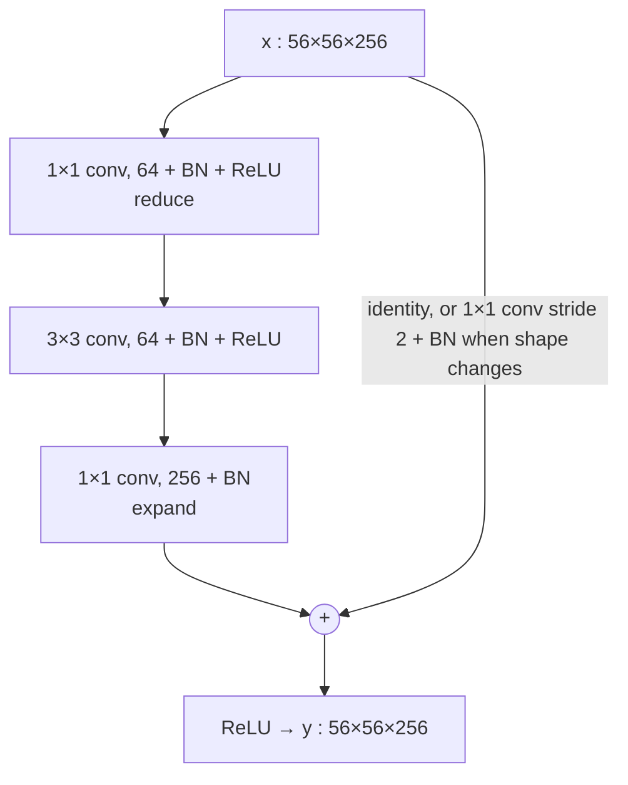

# Session 03 — CNNs Under the Hood · Solutions

> Questions: [03_questions.md](03_questions.md) · Notes: [../notes/03_cnns_under_the_hood.md](../notes/03_cnns_under_the_hood.md) · Code: [../code/conv_output_and_receptive_field_calc.py](../code/conv_output_and_receptive_field_calc.py)

## Section A — MCQs

### Q1 — Answer: **B**
**Why B:** A stride-1 convolution applies the same filter at every position, so shifting the input shifts the response map by the same amount: $f(T_tI)=T_tf(I)$ — **translation equivariance**.
- **A** ✗ — invariance ($F_2=F_1$) is what *pooling*, especially global pooling, approximately provides; convolution alone is equivariant.
- **C** ✗ — kernel flipping (convolution vs cross-correlation) changes the filter, not the direction of the shift; the response moves with the input.
- **D** ✗ — weights are **shared** across positions; position-specific weights describe an FC (or locally connected) layer.

### Q2 — Answer: **C**
**Why C:** Pooling is a fixed operation → **0 parameters**. Output: $\lfloor(56-2)/2\rfloor+1 = 28$ per side, and pooling acts per channel, so channels stay 64 → $28\times28\times64$.
- **A** ✗ — $256 = 2\cdot2\cdot64$ treats the window as learnable weights; max-pool has none.
- **B** ✗ — 64 would be one parameter per channel; pooling has no per-channel scale or bias.
- **D** ✗ — pooling does not change the channel count (16 = 64/4 confuses spatial and channel reduction).

### Q3 — Answer: **D**
**Why D:** $(K^2C_{in}+1)C_{out} = (9\cdot64+1)\cdot128 = 577\cdot128 = 73{,}856$.
- **A** ✗ — $(9+1)\cdot128 = 1{,}280$ forgets that each kernel has depth $C_{in}=64$.
- **B** ✗ — $73{,}728$ is the weight count without the 128 biases.
- **C** ✗ — $147{,}584 = (9\cdot128+1)\cdot128$ uses $C_{out}$ in place of $C_{in}$.

### Q4 — Answer: **A**
**Why A:** $r$: $1 \to 3$ (conv, $j=1$) $\to 5$ (conv) $\to 6$ (pool: $+1\cdot1$, then $j=2$) $\to 6+2\cdot2 = 10$.
- **B** ✗ — 8 forgets the jump: the conv after the pool adds $(3-1)\cdot j = 4$, not 2.
- **C** ✗ — 7 ignores the pooling layer entirely ($1+2+2+2$).
- **D** ✗ — 14 is the RF one conv layer later.

### Q5 — Answer: **D**
**Why D:** Higher **training** error in the deeper net means it is not fitting the data as well — an optimisation problem, called **degradation**. A deeper net could reproduce the shallow one by making the extra layers identities, so the deeper net's training error should not be higher; the solver fails to find such solutions. ResNets fix this with $y=F(x)+x$.
- **A** ✗ — overfitting would give *lower* training error and higher test error.
- **B** ✗ — data quantity/augmentation targets the generalisation gap, not training error.
- **C** ✗ — both nets downsample similarly; the issue is optimisation of depth, not pooling.

### Q6 — Answer: **C**
**Why C:** Two stride-1 $3\times3$ layers: $r = 1+2+2 = 5$. Weights $2\cdot9C^2 = 18C^2$ vs $25C^2$ (28% fewer), with a ReLU in between → more non-linearity (the VGG argument).
- **A** ✗ — RF is $5$, not 6 ($n(K-1)+1 = 2\cdot2+1$).
- **B** ✗ — two layers of $9C^2$ each are still fewer than one $25C^2$.
- **D** ✗ — stacking grows the RF; the second layer sees $3\times3$ units, each seeing $3\times3$ pixels.

### Q7 — Answer: **B**
**Why B:** A $1\times1$ conv keeps $H\times W$ and maps 256 channels to 64 at each pixel: params $(1\cdot1\cdot256+1)\cdot64 = 16{,}448$. It is a per-pixel linear layer across channels (bottleneck).
- **A** ✗ — the output has $C_{out}=64$ channels and the layer is not an identity.
- **C** ✗ — forgets kernel depth $C_{in}=256$.
- **D** ✗ — spatial size is unchanged; global average pooling is a different (parameter-free) operation.

### Q8 — Answer: **A**
**Why A:** EfficientNet (2019) scales depth $d=\alpha^\phi$, width $w=\beta^\phi$ and resolution $r=\gamma^\phi$ jointly (**compound scaling**), with $\alpha\beta^2\gamma^2\approx2$.
- **B** ✗ — Inception modules belong to GoogLeNet; VGG uses only stacked $3\times3$ convs.
- **C** ✗ — identity shortcuts are ResNet (2015); AlexNet's ideas were ReLU, dropout, GPU training.
- **D** ✗ — ≈138M params mostly in FC layers describes VGG-16; GoogLeNet has ≈6.8M and uses global average pooling.

## Section B — Numericals

### Q9 — Shapes and parameters through a stack
**Given:** input $128\times128\times3$; layers as in the table; biases included.
**Formulas:**

$$
W_{out}=\left\lfloor\frac{W-K+2P}{S}\right\rfloor+1,\qquad \text{Params}=(K^2C_{in}+1)C_{out},\qquad \text{FC}=(N_{in}+1)N_{out}
$$

**Working (a) + (b):**

| Layer | Output size computation | Output shape | Params |
|---|---|---|---|
| L1 conv $5\times5$, 32, s1, p2 | $\lfloor(128-5+4)/1\rfloor+1=128$ | $128\times128\times32$ | $(25\cdot3+1)\cdot32 = 2{,}432$ |
| L2 max-pool $2\times2$, s2 | $\lfloor(128-2)/2\rfloor+1=64$ | $64\times64\times32$ | $0$ |
| L3 conv $3\times3$, 64, s2, p1 | $\lfloor(64-3+2)/2\rfloor+1=\lfloor31.5\rfloor+1=32$ | $32\times32\times64$ | $(9\cdot32+1)\cdot64 = 18{,}496$ |
| L4 conv $3\times3$, 64, s1, p0 | $\lfloor(32-3)/1\rfloor+1=30$ | $30\times30\times64$ | $(9\cdot64+1)\cdot64 = 36{,}928$ |
| **Total L1–L4** | | | **57,856** |

**(c) Heads:**
- (i) Flatten: $30\cdot30\cdot64 = 57{,}600$ → FC(10): $(57{,}600+1)\cdot10 = 576{,}010$. Network total $= 57{,}856 + 576{,}010 = \mathbf{633{,}866}$ — the head is ≈ **91%** of all parameters.
- (ii) GAP: $30\times30\times64 \to 64$ (0 params) → FC(10): $(64+1)\cdot10 = 650$. Network total $= 57{,}856+650 = \mathbf{58{,}506}$.

**Answer:** shapes $128^2\times32,\ 64^2\times32,\ 32^2\times64,\ 30^2\times64$; conv params 57,856; totals **633,866** (flatten) vs **58,506** (GAP).
**Comment:** GAP cuts the parameters by ≈ 11×, reduces overfitting risk and makes the network accept any input size; flatten keeps spatial layout but ties the head to a fixed $30\times30$ map.
> ✔ Verified numerically (Python).
> **Common slip:** L3's $(64-3+2)/2 = 31.5$ → floor to 31, then **+1** = 32.

### Q10 — AlexNet conv1
**Given:** $W=227$, $C_{in}=3$, $K=11$, $S=4$, $P=0$, $C_{out}=96$.
**Formulas:** output size, params, $\text{MACs}=H_{out}W_{out}K^2C_{in}C_{out}$.
**Working:**
- (a) $W_{out}=\lfloor(227-11+0)/4\rfloor+1 = 54+1 = 55$ → $\mathbf{55\times55\times96}$.
- (b) $(11\cdot11\cdot3+1)\cdot96 = 364\cdot96 = \mathbf{34{,}944}$.
- (c) $55\cdot55\cdot11\cdot11\cdot3\cdot96 = 3025\cdot34{,}848 = \mathbf{105{,}415{,}200}$ MACs (≈ 105M; ≈ 211M FLOPs).
- (d) FC: inputs $227\cdot227\cdot3 = 154{,}587$, outputs $55\cdot55\cdot96 = 290{,}400$ → weights $154{,}587\cdot290{,}400 = \mathbf{44{,}892{,}064{,}800 \approx 4.5\times10^{10}}$, about **1.3 million times** the conv layer's 34,944 parameters (weight sharing + locality).
- (e) $W_{out}=\lfloor(454-11)/4\rfloor+1 = \lfloor110.75\rfloor+1 = 111$ → $111\times111\times96$; params **unchanged: 34,944**; MACs $111^2\cdot34{,}848 = \mathbf{429{,}362{,}208}$ (≈ 4.07× more).

**Answer:** 55×55×96; 34,944 params; 105,415,200 MACs; FC ≈ 4.49×10¹⁰ weights; at 454 px: 111×111×96, 34,944 params, 429,362,208 MACs.
> ✔ Verified numerically (Python).
> **Common slip:** with a 224 input (as printed in the AlexNet paper) the formula gives $\lfloor213/4\rfloor+1=54$, not 55 — that is why 227 is used.

### Q11 — Receptive field with pooling and dilation
**Given:** layers conv3, conv3, pool2/s2, conv3, conv3, pool2/s2, conv3 ($D=2$).
**Formula:**

$$
r_l = r_{l-1}+(K_{eff,l}-1)\,j_{l-1},\qquad j_l=j_{l-1}S_l,\qquad K_{eff}=D(K-1)+1
$$

**Working (a):**

| $l$ | Layer | $K_{eff}$ | $S$ | $r_l$ | $j_l$ |
|---|---|---|---|---|---|
| 0 | input | – | – | 1 | 1 |
| 1 | conv $3\times3$ | 3 | 1 | $1+2\cdot1=3$ | 1 |
| 2 | conv $3\times3$ | 3 | 1 | $3+2\cdot1=5$ | 1 |
| 3 | pool $2\times2$ | 2 | 2 | $5+1\cdot1=6$ | 2 |
| 4 | conv $3\times3$ | 3 | 1 | $6+2\cdot2=10$ | 2 |
| 5 | conv $3\times3$ | 3 | 1 | $10+2\cdot2=14$ | 2 |
| 6 | pool $2\times2$ | 2 | 2 | $14+1\cdot2=16$ | 4 |
| 7 | conv $3\times3$, $D=2$ | $2\cdot2+1=5$ | 1 | $16+4\cdot4=\mathbf{32}$ | 4 |

**(b)** Undilated last layer: $r = 16 + 2\cdot4 = \mathbf{24}$. Dilation costs **0 extra parameters** (still $9C_{in}$ weights per filter) — it only spaces the taps out.
**(c)** No. This is the **theoretical** RF. Central pixels reach the output through many more paths than border pixels, so the **effective RF** (gradient magnitude) is roughly Gaussian and much smaller than $32\times32$; dilation also samples the input sparsely (gridding).

**Answer:** RF **32×32**, jump 4; without dilation 24×24; dilation adds 0 params.
> ✔ Verified numerically (Python: back-propagating from one output unit of an all-ones network gives a 32-pixel-wide non-zero gradient footprint).

### Q12 — Kernel factorisation and bottleneck
**Given:** $C=256$, no biases.
**Formula:** weights $=K^2C_{in}C_{out}$; MACs $=H_{out}W_{out}K^2C_{in}C_{out}$.
**Working:**
- (a) One $5\times5$: $25\cdot256^2 = 1{,}638{,}400$ (RF 5). Two $3\times3$: $2\cdot9\cdot256^2 = 1{,}179{,}648$ (RF $1+2+2=5$). Saving $1-18/25 = \mathbf{28\%}$.
- (b) One $7\times7$: $49\cdot256^2 = 3{,}211{,}264$ (RF 7). Three $3\times3$: $27\cdot256^2 = 1{,}769{,}472$ (RF 7). Saving $1-27/49 = \mathbf{44.9\%}$.
- (c) Bottleneck: $256\cdot64 + 9\cdot64\cdot64 + 64\cdot256 = 16{,}384+36{,}864+16{,}384 = \mathbf{69{,}632}$ weights. Basic (two $3\times3$ at 256): $\mathbf{1{,}179{,}648}$ → ≈ **16.9× fewer** weights.
  MACs at $56\times56$ (padding keeps 56): bottleneck $3136\cdot69{,}632 = \mathbf{218{,}365{,}952}$; basic $3136\cdot1{,}179{,}648 = \mathbf{3{,}699{,}376{,}128}$ (same 16.9× ratio, since every layer has the same $H_{out}W_{out}$).

**Answer:** 28% and 44.9% savings at equal RF; bottleneck 69,632 vs 1,179,648 weights, 218.4M vs 3.70G MACs.
> ✔ Verified numerically (PyTorch `sum(p.numel() …)`; torchvision's ResNet-50 bottleneck with BN = 70,400 = 69,632 + 768 BN params).

### Q13 — Inception reduction and depthwise-separable conv
**Given:** (a,b) input $28\times28\times192$, output 32 maps at $28\times28$; (c) $56\times56$, $64\to128$, $K=3$.
**Formulas:** params $(K^2C_{in}+1)C_{out}$; MACs $H_{out}W_{out}K^2C_{in}C_{out}$; DS ratio $\frac{1}{C_{out}}+\frac{1}{K^2}$.
**Working:**
- (a) MACs $=28\cdot28\cdot25\cdot192\cdot32 = \mathbf{120{,}422{,}400}$; params $(25\cdot192+1)\cdot32 = \mathbf{153{,}632}$.
- (b) $1\times1$ reduce: MACs $28\cdot28\cdot192\cdot16 = 2{,}408{,}448$, params $(192+1)\cdot16 = 3{,}088$.
  $5\times5$ on 16 channels: MACs $28\cdot28\cdot25\cdot16\cdot32 = 10{,}035{,}200$, params $(25\cdot16+1)\cdot32 = 12{,}832$.
  Totals: MACs $\mathbf{12{,}443{,}648}$, params $\mathbf{15{,}920}$. Reduction $120{,}422{,}400/12{,}443{,}648 \approx \mathbf{9.68\times}$ (params ≈ 9.65×).
- (c) Standard: params $9\cdot64\cdot128 = 73{,}728$; MACs $56^2\cdot73{,}728 = 231{,}211{,}008$.
  Depthwise: $9\cdot64 = 576$; pointwise: $64\cdot128 = 8{,}192$ → params $\mathbf{8{,}768}$; MACs $56^2\cdot8{,}768 = \mathbf{27{,}496{,}448}$.
  Ratio $8{,}768/73{,}728 = 0.1189$; formula $1/128+1/9 = 0.0078+0.1111 = 0.1189$ ✓ (≈ 8.4× cheaper).

**Answer:** (a) 120.4M MACs, 153,632 params; (b) 12.44M MACs, 15,920 params, ≈ 9.7× fewer MACs; (c) DS 8,768 params / 27.5M MACs vs 73,728 / 231.2M, ratio 0.119.
> ✔ Verified numerically (Python).

## Section C — model answers

### Q14 — Why convolutions instead of FC layers?
**Intro:** Images are large, spatially structured signals; CNNs build that structure into the architecture.

- **Parameter explosion of FC layers:** a $224\times224\times3$ image has 150,528 inputs; a single FC layer to 1000 units needs $150{,}528\cdot1000+1000 = \mathbf{150{,}529{,}000}$ params (more than all of VGG-16). A $3\times3$ conv with 64 filters needs $(27+1)\cdot64 = \mathbf{1{,}792}$.
- **Local connectivity:** each unit sees a small $K\times K\times C_{in}$ window — pixels are correlated locally and low-level features (edges, corners) are local.
- **Weight sharing:** one filter is reused at every position → params independent of image size, the same detector works everywhere, far less overfitting and data needed.
- **Translation equivariance:** shifting the object shifts the feature map; with pooling/GAP the classifier becomes (approximately) translation invariant.
- **Hierarchy:** stacking layers composes edges → textures → parts → objects with growing receptive fields.
- **Inductive biases encoded:** locality, stationarity (weight sharing/equivariance), hierarchical compositionality.

**Trade-off:** these biases make CNNs sample-efficient but limit long-range modelling early in the network — ViTs drop most of them and compensate with much more data.

### Q15 — Equivariance vs invariance
**Definitions** (translation operator $T_t$ shifts an image by $t$):
- **Equivariance:** $f(T_tI) = T_tf(I)$ — output shifts with the input.
- **Invariance:** $g(T_tI) = g(I)$ — output unchanged.

| Component | Property |
|---|---|
| Stride-1 convolution, element-wise ReLU, BN | equivariant |
| Max/avg pooling | local (small-shift) invariance |
| Global average/max pooling | (approximate) global invariance |
| Flatten + FC | neither — position-specific weights |

**Why only approximate invariance:**
1. **Striding/pooling (subsampling)** — the network is equivariant only to shifts that are multiples of the total stride (e.g., 32 px in ResNet); a 1-pixel shift changes which samples are kept (**aliasing**), so outputs can change.
2. **Zero padding/borders** — padding lets the network infer absolute position near the borders; objects partly leaving the frame change the features.
3. (Also) a flatten + FC head is position-specific.

**Rotations:** standard CNNs are **not** rotation-equivariant; robustness is learned via **data augmentation** (random rotations, flips), optionally test-time augmentation, or specialised group-equivariant CNNs.

### Q16 — Theoretical vs effective receptive field
- **Theoretical RF (TRF):** all input pixels that *can* influence a unit; computed by $r_l=r_{l-1}+(K_l-1)j_{l-1}$, $j_l=j_{l-1}S_l$.
- **Effective RF (ERF):** the pixels that influence it *substantially* (gradient magnitude). It is roughly **Gaussian** and much **smaller** than the TRF because central pixels have many more paths to the unit; it grows roughly with $\sqrt{\text{depth}}$ and enlarges during training.

**Four ways to grow the RF (trade-off):**

| Method | Trade-off |
|---|---|
| More layers | more params/compute, harder optimisation |
| Stride / pooling (bigger jump) | loses spatial resolution (bad for segmentation) |
| Dilated convolution | no extra params, but gridding artefacts |
| Larger kernels | params grow as $K^2$ |
| (Global pooling / self-attention) | loses location / quadratic cost |

**Why it matters:** to classify, detect or segment a large object a unit must "see" enough of it — if the RF (especially the ERF) is smaller than the object, the prediction is based on a fragment (e.g., a patch of fur rather than the whole dog), giving inconsistent labels inside large objects. Segmentation nets therefore use dilation/ASPP or encoder–decoders, and detectors use multi-scale feature pyramids (see [Session 10](../notes/10_image_segmentation.md), [Session 07](../notes/07_detection_one_stage.md)).

### Q17 — Hierarchical features and depth
**Zeiler & Fergus (2014)** visualised activations with a deconvnet:
- **Layer 1:** oriented edges, colour blobs (Gabor-like).
- **Layer 2:** corners, edge/colour conjunctions, simple textures.
- **Layer 3:** more complex textures and patterns (meshes, text).
- **Layer 4:** class-specific parts (dog faces, wheels, bird legs).
- **Layer 5:** whole objects with pose variation.

**Why depth helps:**
1. **Compositionality** — complex features are built from simpler ones, matching how visual objects are structured.
2. **Parameter efficiency + non-linearity** — stacks of $3\times3$ reach a large RF with fewer params and more ReLUs than big kernels.
3. **Larger receptive field and more invariance** at higher layers; early generic features transfer across tasks.

**Why stacking plain layers stopped helping:** beyond ~20–30 layers plain nets suffered the **degradation problem** — higher *training* error with depth (an optimisation difficulty), on top of vanishing/exploding gradients that BN and careful initialisation only partly solved. ResNet's identity shortcuts removed this barrier.

## Section D — model answers

### Q18 — Why ResNet enabled 100+ layer networks
**Intro:** By 2015, depth was known to help (VGG, GoogLeNet), yet plain nets stopped improving beyond ~20–30 layers. ResNet (He et al., 2015) changed *what* each block learns rather than adding capacity.

**1. The degradation problem (evidence, not overfitting).**
- A 56-layer plain net had **higher training and test error** than a 20-layer one on CIFAR-10; plain-34 was worse than plain-18 on ImageNet.
- **Not overfitting:** overfitting = low training, high test error; here *training* error rises.
- **Not simply vanishing gradients:** the plain nets used BatchNorm and showed healthy gradient norms.
- **Construction argument:** the deeper net could copy the shallow net and make the extra layers identity → it should be no worse. SGD fails to find this → **optimisation difficulty**: stacks of non-linear layers struggle to represent the identity.

**2. Residual formulation.** Let $H(x)$ be the desired mapping of a block. Learn the residual

$$
F(x) = H(x) - x,\qquad y = F(x) + x
$$

- If identity is optimal, drive $F\to0$ (weights → 0) — easy; weight decay and small init already bias toward it.
- If the optimum is near identity, learn small corrections — easier than learning the full mapping from scratch.
- Identity shortcut: **no parameters**, negligible compute (element-wise add).

**3. Gradient flow.**

$$
\frac{\partial y}{\partial x} = I + \frac{\partial F}{\partial x}
\quad\Rightarrow\quad
\frac{\partial\mathcal L}{\partial x} = \frac{\partial\mathcal L}{\partial y} + \frac{\partial\mathcal L}{\partial y}\frac{\partial F}{\partial x}
$$

For a chain of (pre-activation) blocks $x_L = x_l + \sum_{i=l}^{L-1}F(x_i)$, so

$$
\frac{\partial\mathcal L}{\partial x_l} = \frac{\partial\mathcal L}{\partial x_L}\left(I + \frac{\partial}{\partial x_l}\sum_{i=l}^{L-1}F(x_i)\right)
$$

The gradient is a **sum containing a direct term** from the loss to every block, instead of a **product** of $L$ Jacobians that can shrink exponentially — a "gradient highway".

**4. Bottleneck block and projection shortcut.**

- Weights: $256\cdot64+9\cdot64\cdot64+64\cdot256 = 69{,}632$ vs $2\cdot9\cdot256^2 = 1{,}179{,}648$ for two $3\times3$ convs at 256 channels (≈ 17× fewer) → ResNet-50/101/152 afford 16/33/50 blocks.
- **Projection shortcut** $y=F(x)+W_sx$ ($W_s$ = $1\times1$ conv, stride 2) at stage transitions where $H,W$ halve and channels double; identity elsewhere (projections everywhere gave only marginal gains).

**5. BatchNorm and design.** BN after every conv keeps activations well-scaled, permits high learning rates and regularises mildly; ResNets use no dropout, GAP + single FC head. ResNet-50 ≈ 25.6M params: stem $7\times7$/s2 + max-pool, stages [3, 4, 6, 3] at 256→2048 channels.

**6. Outcome.** ResNet-34 < ResNet-18 error (depth helps again); ResNet-152 won ILSVRC 2015 (top-5 ≈ 3.6%); a 1202-layer CIFAR net trained to near-zero training error but overfit — confirming residuals solve **optimisation**, not generalisation. Residual connections are now standard (DenseNet, MobileNetV2, EfficientNet, Transformers).

**Trade-off line:** residuals add almost no cost and make depth usable, but they do not regularise — data, augmentation and weight decay are still needed against overfitting.

**Marking scheme:** 2 – degradation + evidence + not overfitting · 2 – residual formulation and why identity is easy · 2 – gradient derivation · 3 – bottleneck + projection (diagram, param comparison) · 1 – BN / results.

### Q19 — Architecture evolution, ViT tokens and a small-CNN design
**(a) Evolution [3]**

| Model | Year | Key idea | Params |
|---|---|---|---|
| LeNet-5 | 1998 | conv–subsample–conv–subsample–FC, tanh, digits | ≈ 60K |
| AlexNet | 2012 | ReLU, dropout, augmentation, GPUs, overlapping max-pool; ILSVRC-2012 win | ≈ 60M |
| VGG-16 | 2014 | only stacked $3\times3$ convs + $2\times2$ pools; deep and uniform | ≈ 138M |
| GoogLeNet | 2014 | Inception module, $1\times1$ bottlenecks, GAP, auxiliary classifiers | ≈ 6.8M |
| ResNet-50 | 2015 | residual blocks $F(x)+x$, bottleneck, BN; fixes degradation | ≈ 25.6M |
| EfficientNet-B0 | 2019 | compound scaling of depth/width/resolution, MBConv + SE | ≈ 5.3M |
| ViT-B/16 | 2020 | $16\times16$ patches as tokens + Transformer encoder | ≈ 86M |

**(b) ViT-B/16 [2]**
- Tokens: $(224/16)^2 = 14^2 = 196$ patches $+1$ [CLS] $= \mathbf{197}$.
- Patch embedding = linear map of $16\cdot16\cdot3 = 768$ values to 768-d (a $16\times16$ conv, stride 16): $768\cdot768+768 = \mathbf{590{,}592}$ params.
- **Data:** self-attention lacks the CNN's built-in locality and translation equivariance (weak inductive bias); ViT must learn these regularities from data, so it underperforms ResNets on ImageNet-1k alone and excels only with large-scale pretraining (ImageNet-21k/JFT) or strong augmentation + distillation (DeiT).

**(c) Design ≤ 100K params for $64\times64\times3$, 10 classes [5]**

| Layer | Output | Params |
|---|---|---|
| conv $3\times3$, 32, p1 + BN + ReLU | $64\times64\times32$ | $896 + 64$ |
| conv $3\times3$, 32, p1 + BN + ReLU | $64\times64\times32$ | $9{,}248 + 64$ |
| max-pool $2\times2$/s2 | $32\times32\times32$ | 0 |
| conv $3\times3$, 64, p1 + BN + ReLU | $32\times32\times64$ | $18{,}496 + 128$ |
| max-pool $2\times2$/s2 | $16\times16\times64$ | 0 |
| conv $3\times3$, 64, p1 + BN + ReLU | $16\times16\times64$ | $36{,}928 + 128$ |
| max-pool $2\times2$/s2 | $8\times8\times64$ | 0 |
| global average pool | $64$ | 0 |
| FC → 10 | $10$ | $650$ |
| **Total** | | **66,602** |

- **RF before GAP:** $r$: 3, 5, 6 (j=2), 10, 12 (j=4), 20, 24 (j=8) → $\mathbf{24\times24}$; GAP then aggregates evidence over the whole image.
- **Justification:** stacked $3\times3$ (cheap RF growth + non-linearity, VGG); channel doubling when resolution halves (keeps compute per stage balanced); BN for stable, fast training (conv bias could be dropped); **GAP instead of flatten** — flatten of $8\times8\times64 = 4096$ → FC(10) alone would cost 40,970 params and overfit more; max-pool for cheap downsampling (stride-2 convs are a learnable alternative). Budget headroom (~33K) could fund a residual shortcut or a wider last stage; a stride-2 first layer or dilation would enlarge the RF if objects fill the frame.

**Trade-off line:** small CNNs with strong inductive bias suit small data and low budgets; larger budgets favour ResNet/EfficientNet backbones, very large data favours ViT.

**Marking scheme:** 3 – evolution table (≈ 0.5 per correct row, min 6 rows) · 2 – ViT tokens/params + data argument · 3 – correct shapes/params within budget · 2 – RF and justification of choices.
