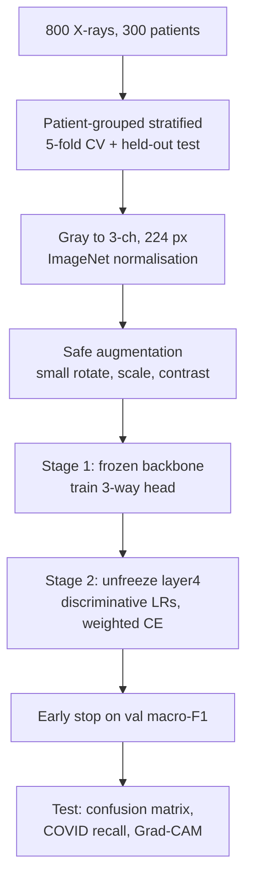

# Session 04 — Training CNNs & Transfer Learning · Solutions

> Questions: [04_questions.md](04_questions.md) · Notes: [../notes/04_training_transfer_learning.md](../notes/04_training_transfer_learning.md) · Code: [../code/transfer_learning_skeleton.py](../code/transfer_learning_skeleton.py)

## Section A — MCQs

### Q1 — Answer: **C**
**Why C:** With **inverted dropout** the $1/(1-p)$ scaling is applied during training, so the expected activation already matches test time. In eval mode dropout is switched off and the layer is the **identity**.
- **A** ✗ — that is the training-mode behaviour (drop + scale by $1/(1-p)=2$).
- **B** ✗ — multiplying by the keep probability at test time belongs to the *original* (non-inverted) formulation; with inverted dropout it would wrongly halve activations.
- **D** ✗ — masks are re-sampled every forward pass and never reused at inference.

### Q2 — Answer: **B**
**Why B:** Falling training loss with rising validation loss and a widening gap is the signature of **overfitting** after epoch 12. Keep the best (epoch-12) checkpoint — **early stopping** — and add regularisation (augmentation, weight decay, dropout) or more data / pretrained weights.
- **A** ✗ — underfitting shows high training loss; here training loss keeps decreasing.
- **C** ✗ — a too-low LR gives slow decrease of *both* losses, not a rising validation loss.
- **D** ✗ — training loss cannot detect overfitting; the validation set is exactly what reveals it.

### Q3 — Answer: **D**
**Why D:** Random augmentation is a **training-time regulariser**. Validation and test must be **deterministic** (resize, centre crop, normalise) so metrics are comparable across epochs/models and reflect deployment conditions.
- **A** ✗ — random val/test transforms make metrics noisy and not representative of real inputs.
- **B** ✗ — augmenting validation corrupts model selection; the model is not trained more robustly by it.
- **C** ✗ — the test set should mirror real data; deliberate test-time augmentation (TTA) averages predictions, which is different from scoring on randomly perturbed test images.

### Q4 — Answer: **A**
**Why A:** Small dataset + domain similar to ImageNet → **feature extraction**: pretrained features already separate dog breeds well; training only a $2048\to5$ head ($10{,}245$ params) avoids overfitting. Later, the top block can be fine-tuned with a low LR if validation results justify it.
- **B** ✗ — 2,000 images are far too few to train 23.5M parameters from scratch; ImageNet even contains many dog breeds.
- **C** ✗ — a large LR destroys the pretrained features (and the random head's gradients make it worse).
- **D** ✗ — the 1000-way head is tied to ImageNet's label set; a new head is needed (mapping by name is fragile and ignores the new data).

### Q5 — Answer: **C**
**Why C:** `requires_grad=False` only stops gradient updates to $\gamma,\beta$. In train mode BN still normalises with **batch statistics** and **updates running mean/var** (buffers, not parameters), so the frozen backbone's features drift — especially with small or domain-shifted batches. Fix: call `.eval()` on the frozen BN layers after `model.train()`.
- **A** ✗ — the running statistics still change (verified: one train-mode forward pass changes `running_mean`).
- **B** ✗ — reversed: $\gamma,\beta$ are frozen; it is the running statistics that update.
- **D** ✗ — no error is raised; that is why the bug is silent.

### Q6 — Answer: **D**
**Why D:** AdamW (Loshchilov & Hutter) applies $\theta \leftarrow \theta - \eta\lambda_{wd}\theta$ **separately** from the adaptive step $\eta\,\hat m/(\sqrt{\hat v}+\epsilon)$. With Adam + L2, the penalty gradient $\lambda_{wd}\theta$ is divided by $\sqrt{\hat v}$, so weights with large gradients are barely regularised.
- **A** ✗ — AdamW still uses an L2-type (multiplicative) decay, not L1.
- **B** ✗ — they are equivalent only for plain SGD, not for adaptive methods.
- **C** ✗ — AdamW keeps both Adam moments.

### Q7 — Answer: **B**
**Why B:** Mixup mixes labels with the same coefficient as images: $\tilde y = 0.3\,[1,0] + 0.7\,[0,1] = [0.3,\ 0.7]$.
- **A** ✗ — ignores that 70% of the image content is the dog.
- **C** ✗ — a hard label discards the soft-target idea that makes mixup work.
- **D** ✗ — label weights equal the image weights $\lambda$ and $1-\lambda$, not 0.5.

### Q8 — Answer: **A**
**Why A:** Rotating a handwritten **6** by 180° produces a **9** (and vice versa) — the transformation changes the class, so it is not label-preserving.
- **B** ✗ — a mirrored cat is still a cat; horizontal flip is the most standard safe augmentation for natural images.
- **C** ✗ — mild brightness changes do not change vehicle type.
- **D** ✗ — a 90% crop keeps nearly all scene content.

## Section B — Numericals

### Q9 — Transfer-learning bookkeeping (ResNet-50)
**Given:** total $25{,}557{,}032$; FC $2048\to1000$; `layer4` $14{,}964{,}736$; new head $2048\to10$.
**Formula:** FC params $=(d+1)K$; normalisation $x'=(x/255-\text{mean})/\text{std}$.
**Working:**
- (a) Old FC: $(2048+1)\cdot1000 = \mathbf{2{,}049{,}000}$. Backbone: $25{,}557{,}032 - 2{,}049{,}000 = \mathbf{23{,}508{,}032}$.
- (b) New head: $(2048+1)\cdot10 = \mathbf{20{,}490}$ trainable. New total $= 23{,}508{,}032 + 20{,}490 = \mathbf{23{,}528{,}522}$. Trainable share $= 20{,}490/23{,}528{,}522 = \mathbf{0.087\%}$.
- (c) Trainable $= 14{,}964{,}736 + 20{,}490 = \mathbf{14{,}985{,}226}$ → $14{,}985{,}226/23{,}528{,}522 = \mathbf{63.7\%}$ (the last stage holds most of ResNet-50's parameters).
- (d) Scaled: $(1.0,\ 0,\ 0.50196)$.
  R: $(1.0-0.485)/0.229 = \mathbf{2.249}$; G: $(0-0.456)/0.224 = \mathbf{-2.036}$; B: $(0.50196-0.406)/0.225 = \mathbf{0.426}$.

**Answer:** 2,049,000 / 23,508,032; 20,490 trainable of 23,528,522 (0.087%); with layer4 14,985,226 (63.7%); pixel → (2.249, −2.036, 0.426).
> ✔ Verified numerically (PyTorch `sum(p.numel() for p in model.parameters() if p.requires_grad)` on torchvision ResNet-50).
> **Common slip:** forgetting to subtract the old 1000-way head before adding the new one.

### Q10 — Softmax, cross-entropy, label smoothing, mixup
**Given:** $z=[2.0,\,1.0,\,0.1]$, true class cat (index 1 of 3).
**Formulas:**

$$
p_k=\frac{e^{z_k}}{\sum_j e^{z_j}},\qquad \mathcal L=-\sum_k t_k\log p_k,\qquad \frac{\partial\mathcal L_{CE}}{\partial z}=p-y,\qquad q=(1-\varepsilon)y+\frac{\varepsilon}{K}
$$

**Working:**
- (a) $e^{z} = [7.3891,\ 2.7183,\ 1.1052]$, sum $= 11.2125$ → $p = [\mathbf{0.6590},\ \mathbf{0.2424},\ \mathbf{0.0986}]$.
- (b) $\mathcal L = -\ln0.6590 = \mathbf{0.4170}$. Gradient $p-y = [0.6590-1,\ 0.2424,\ 0.0986] = [\mathbf{-0.3410},\ \mathbf{0.2424},\ \mathbf{0.0986}]$ (raise the cat logit, lower the others).
- (c) $q = 0.9\,[1,0,0] + 0.1/3 = [\mathbf{0.9333},\ \mathbf{0.0333},\ \mathbf{0.0333}]$.
  $\ln p = [-0.4170,\ -1.4170,\ -2.3170]$ → $\mathcal L_{LS} = 0.9333(0.4170)+0.0333(1.4170)+0.0333(2.3170) = 0.3892+0.0472+0.0772 = \mathbf{0.5137}$.
- (d) $\tilde y = 0.7[1,0,0]+0.3[0,0,1] = [\mathbf{0.7},\ \mathbf{0},\ \mathbf{0.3}]$; $\mathcal L = 0.7(0.4170) + 0.3(2.3170) = 0.2919 + 0.6951 = \mathbf{0.9870}$.

**Answer:** $p=[0.659, 0.242, 0.099]$; CE 0.417; gradient $[-0.341, 0.242, 0.099]$; smoothed target $[0.933, 0.033, 0.033]$, loss 0.514; mixup target $[0.7, 0, 0.3]$, loss 0.987.
> ✔ Verified numerically (PyTorch `F.cross_entropy`, including `label_smoothing=0.1`).
> **Common slip:** in label smoothing the true class gets $1-\varepsilon+\varepsilon/K = 0.9333$, not $0.9$.

### Q11 — BatchNorm forward pass and inverted dropout
**Given:** $x=[2,4,6,8]$, $\gamma=2$, $\beta=1$, $\rho=0.1$, running (mean, var) $=(0, 1)$; dropout $p=0.2$, mask $[1,0,1,1]$.
**Formulas:**

$$
\hat x_i=\frac{x_i-\mu_B}{\sqrt{\sigma_B^2+\epsilon}},\quad y_i=\gamma\hat x_i+\beta,\quad \hat\mu\leftarrow(1-\rho)\hat\mu+\rho\mu_B,\quad \hat\sigma^2\leftarrow(1-\rho)\hat\sigma^2+\rho\tfrac{m}{m-1}\sigma_B^2,\quad \tilde y=\frac{r\,y}{1-p}
$$

**Working:**
- (a) $\mu_B = 20/4 = \mathbf{5}$; $\sigma_B^2 = (9+1+1+9)/4 = \mathbf{5}$; $\sqrt5 = 2.2361$.
  $\hat x = [-3, -1, 1, 3]/2.2361 = [\mathbf{-1.3416},\ \mathbf{-0.4472},\ \mathbf{0.4472},\ \mathbf{1.3416}]$.
  $y = 2\hat x + 1 = [\mathbf{-1.6833},\ \mathbf{0.1056},\ \mathbf{1.8944},\ \mathbf{3.6833}]$ (mean $\beta=1$, std $\gamma=2$ ✓).
- (b) Running mean $= 0.9\cdot0 + 0.1\cdot5 = \mathbf{0.5}$. Unbiased variance $= 20/3 = 6.6667$; running var $= 0.9\cdot1 + 0.1\cdot6.6667 = \mathbf{1.5667}$.
- (c) Eval: $2\cdot\frac{6-0.5}{\sqrt{1.5667}} + 1 = 2\cdot\frac{5.5}{1.2517}+1 = \mathbf{9.788}$, versus $1.894$ for the same value in train mode. After one update the running estimates are far from the true statistics — they need many batches to converge. This is why a model evaluated after very little training, or whose running stats were corrupted (e.g., frozen BN left in train mode on unusual batches), behaves very differently in eval mode.
- (d) Scale $1/(1-0.2) = 1.25$: $[-1.6833\cdot1.25,\ 0,\ 1.8944\cdot1.25,\ 3.6833\cdot1.25] = [\mathbf{-2.1041},\ \mathbf{0},\ \mathbf{2.3680},\ \mathbf{4.6041}]$. At **test time** dropout is the identity → outputs equal $y$ (no mask, no scaling).

**Answer:** $\mu_B=5$, $\sigma_B^2=5$, $y=[-1.683, 0.106, 1.894, 3.683]$; running (0.5, 1.567); eval output 9.788; dropout $[-2.104, 0, 2.368, 4.604]$, identity at test.
> ✔ Verified numerically (PyTorch `nn.BatchNorm1d` train/eval, `nn.Dropout`).
> **Common slip:** using the unbiased variance (6.667) for normalisation in train mode — BN normalises with the **biased** variance; only the running estimate uses the unbiased one.

### Q12 — Confusion-matrix metrics
**Given:** rows = true, columns = predicted; $N=120$.
**Formulas:** $P_c = TP_c/(\text{column sum})$, $R_c = TP_c/(\text{row sum})$, $F1_c = 2P_cR_c/(P_c+R_c)$.
**Working:**
- (a) Accuracy $= (50+30+15)/120 = 95/120 = \mathbf{79.17\%}$.
- (b)

| Class | TP | FP (col − TP) | FN (row − TP) | Precision | Recall | F1 |
|---|---|---|---|---|---|---|
| Normal | 50 | 6 | 10 | $50/56 = \mathbf{0.893}$ | $50/60 = \mathbf{0.833}$ | $\mathbf{0.862}$ |
| Pneumonia | 30 | 12 | 10 | $30/42 = \mathbf{0.714}$ | $30/40 = \mathbf{0.750}$ | $\mathbf{0.732}$ |
| COVID | 15 | 7 | 5 | $15/22 = \mathbf{0.682}$ | $15/20 = \mathbf{0.750}$ | $\mathbf{0.714}$ |

  e.g., Normal F1 $= 2(0.8929)(0.8333)/(0.8929+0.8333) = 1.4881/1.7262 = 0.862$.
- (c) Macro-F1 $= (0.862+0.732+0.714)/3 = \mathbf{0.769}$. Balanced accuracy (macro recall) $= (0.833+0.75+0.75)/3 = \mathbf{0.778}$. (Weighted F1 = 0.794.)
- (d) **COVID recall (sensitivity) = 0.75** — 5 of 20 COVID patients are missed (4 called Pneumonia, 1 Normal). For a screening concern, false negatives matter most, so report per-class recall (with its confidence interval — 20 cases is a small sample), not overall accuracy.

**Answer:** Acc 79.17%; P/R/F1: Normal 0.893/0.833/0.862, Pneumonia 0.714/0.750/0.732, COVID 0.682/0.750/0.714; macro-F1 0.769; balanced accuracy 0.778.
> ✔ Verified numerically (NumPy).
> **Common slip:** swapping row and column sums (precision uses the **predicted** column).

### Q13 — LR schedules and SGD-momentum updates
**Given:** as stated.
**Formulas:** $\eta_t=\eta_0\gamma^{\lfloor t/s\rfloor}$; cosine as given; $g=\nabla\mathcal L+\lambda_{wd}\theta$, $v\leftarrow\mu v+g$, $\theta\leftarrow\theta-\eta v$.
**Working:**
- (a) Epoch 29: $\lfloor29/30\rfloor=0$ → $\mathbf{0.1}$; epoch 30: $\lfloor30/30\rfloor = 1$ → $\mathbf{0.01}$; epoch 65: $\lfloor65/30\rfloor=2$ → $\mathbf{0.001}$.
- (b) $t=30$: $0.05(1+\cos0.3\pi) = 0.05(1+0.5878) = \mathbf{0.07939}$; $t=50$: $0.05(1+0) = \mathbf{0.05}$; $t=75$: $0.05(1-0.7071) = \mathbf{0.01464}$.
- (c) $0.1\cdot2/5 = \mathbf{0.04}$.
- (d) Step 1: $g_0 = 0.5 + 0.01\cdot1.0 = 0.51$; $v_1 = 0.9\cdot0 + 0.51 = 0.51$; $\theta_1 = 1.0 - 0.1\cdot0.51 = \mathbf{0.949}$.
  Step 2: $g_1 = 0.3 + 0.01\cdot0.949 = 0.30949$; $v_2 = 0.9\cdot0.51 + 0.30949 = 0.459 + 0.30949 = 0.76849$; $\theta_2 = 0.949 - 0.1\cdot0.76849 = \mathbf{0.872151}$.

**Answer:** 0.1 / 0.01 / 0.001; 0.0794 / 0.05 / 0.0146; 0.04; $\theta_1=0.949$, $\theta_2=0.8722$.
> ✔ Verified numerically (PyTorch `StepLR`, `CosineAnnealingLR`, `SGD(momentum=0.9, weight_decay=0.01)`).
> **Common slip:** forgetting the momentum term in step 2 (that would give $0.949-0.1\cdot0.30949 = 0.918$).

## Section C — model answers

### Q14 — Batch Normalisation
**Equations** (per channel, batch of $m$ values; for conv layers $m=N\cdot H\cdot W$):

$$
\mu_B=\frac1m\sum x_i,\quad \sigma_B^2=\frac1m\sum(x_i-\mu_B)^2,\quad \hat x_i=\frac{x_i-\mu_B}{\sqrt{\sigma_B^2+\epsilon}},\quad y_i=\gamma\hat x_i+\beta
$$

$\gamma,\beta$ are learnable, so the network can undo the normalisation if useful.

| | Training mode | Evaluation mode |
|---|---|---|
| Statistics | current mini-batch $\mu_B,\sigma_B^2$ | running estimates $\hat\mu,\hat\sigma^2$ |
| Running stats | updated: $\hat\mu\leftarrow0.9\hat\mu+0.1\mu_B$ | frozen |
| Output | depends on the other images in the batch | deterministic affine map (foldable into conv) |

**Benefits:** (1) stable activation scale → much **higher learning rates** and faster convergence, less sensitivity to initialisation (smoother loss landscape); (2) **mild regularisation** — batch-dependent noise; enabled very deep nets (ResNet, Session 03).
**Pitfalls:** (1) **small batches** (≤ 8) → noisy statistics → use GroupNorm/LayerNorm or frozen BN; (2) **train/eval mismatch** — forgetting `model.eval()` at test time, or leaving "frozen" BN in train mode during fine-tuning, which silently updates running statistics.

### Q15 — Feature extraction vs fine-tuning
| | Feature extraction | Fine-tuning |
|---|---|---|
| What trains | new head only (backbone frozen, BN eval) | head + some/all backbone layers |
| LR | normal for head ($\sim10^{-3}$) | 10–100× lower for backbone |
| Data / compute | little / low (features cacheable) | more / higher |
| Adapts features? | no | yes |
| Risk | underfits distant domains | overfitting, catastrophic forgetting |

**Decision matrix:**

| | Similar domain | Different domain |
|---|---|---|
| Small data | feature extraction (linear head) | fine-tune only top blocks, low LR, strong augmentation; or features from earlier layers |
| Large data | fine-tune most/all layers | fine-tune whole network (or from scratch if huge) |

**Making fine-tuning safer:**
- **Head warm-up + gradual unfreezing:** train the random head first with the backbone frozen, then unfreeze from the top down — prevents large random gradients from wrecking pretrained features.
- **Discriminative learning rates:** smaller LR for early generic layers, larger for late layers/head (optimiser parameter groups); plus low overall LR, warm-up, and keeping BN frozen/eval if batches are small.

### Q16 — Data augmentation
**Families:**
1. **Geometric** — horizontal flip, `RandomResizedCrop`, small rotations/scaling/translation.
2. **Photometric** — colour jitter (brightness/contrast/saturation/hue), blur, noise.
3. **Occlusion** — Cutout / Random Erasing (remove a random patch).
4. **Mixing / automated** — mixup, CutMix; AutoAugment (searched policy), RandAugment ($N$ ops at magnitude $M$).

**Mixup:** $\tilde x=\lambda x_i+(1-\lambda)x_j$ and $\tilde y=\lambda y_i+(1-\lambda)y_j$, $\lambda\sim\mathrm{Beta}(\alpha,\alpha)$ — smoother decision boundaries, better calibration. **CutMix:** paste a box from $x_j$ into $x_i$, label weight = area fraction — locally natural images, occlusion robustness.

**Not label-preserving:**
- 180° rotation of digits (6 ↔ 9); flipping text or left/right-arrow traffic signs.
- Horizontal flip of chest X-rays (laterality, heart side, burned-in L/R markers).
- Hue jitter when colour is the label (fruit ripeness, skin lesions); aggressive crops that remove small objects.

**Splits:** augment the **training set only**; validation/test use deterministic preprocessing (optionally TTA at inference, applied consistently).

### Q17 — Diagnosing training runs
| Run | Diagnosis | Fix |
|---|---|---|
| (i) 99% train, 72% val, val loss ↑ after epoch 10 | **Overfitting** | early stopping at the val minimum; stronger augmentation, weight decay, dropout/label smoothing; pretrained backbone; more data |
| (ii) 55% train ≈ 54% val, flat | **Underfitting** (high bias) | larger/pretrained model, train longer, raise LR or fix schedule, reduce regularisation/augmentation strength |
| (iii) oscillation then NaN at LR = 1.0 | **LR too high** → divergence | lower LR (0.1 or 0.01), linear warm-up, gradient clipping; check inputs are normalised |
| (iv) constant 2.303 = $\ln10$ | model outputs a **uniform distribution** and nothing updates | **bug**: missing `optimizer.step()`/`zero_grad`, optimiser given the wrong (frozen) params, LR = 0, dead/constant outputs, broken labels. Run the overfit-one-batch test and check gradients are non-zero |

**Closing line:** always compare train vs val curves first — the gap tells you variance, the level tells you bias, and the shape tells you the LR.

## Section D — model answers

### Q18 — Training strategy for 800 chest X-rays (3 classes)
**Framing:** small, **imbalanced**, **medical** (different domain from ImageNet), images grouped by patient → priorities: avoid leakage, exploit pretrained features carefully, handle imbalance, measure per-class sensitivity.

**1. Splitting (leakage-free).**
- **Patient-level, stratified** split (e.g., 70/15/15 of patients ≈ 560/120/120 images) — all images of a patient in one split.
- Data are tiny → prefer **5-fold patient-grouped stratified cross-validation** for model selection; report mean ± std; keep a final held-out test (ideally from another hospital).

**2. Preprocessing.**
- Grayscale → replicate to 3 channels; resize to 224 (or larger, e.g., 384, if subtle findings matter); scale to $[0,1]$ and apply **ImageNet mean/std** to match the pretrained backbone.
- Remove/crop burned-in text markers if possible (shortcut risk).

**3. Augmentation (training only).**
- **Safe:** small rotations (±10°), small translations/scaling (`RandomResizedCrop` scale 0.85–1.0), brightness/contrast ±10–20%, slight Gaussian noise/blur.
- **Unsafe:** horizontal/vertical flips (laterality — heart side, L/R markers), large rotations, hue/saturation jitter (meaningless for grayscale), aggressive crops that cut off lung fields. Mixup/CutMix optional and mild.

**4. Model and transfer learning** (small data + different domain):
- ImageNet-pretrained **ResNet-18/50** or **EfficientNet-B0** (or domain-pretrained chest-X-ray / self-supervised weights if available).
- **Stage 1:** freeze backbone (BN in eval), train new head ($2048\to3$: 6,147 params for ResNet-50; $512\to3$: 1,539 for ResNet-18) with AdamW LR $10^{-3}$.
- **Stage 2:** unfreeze `layer4` (then `layer3`) with **discriminative LRs** (backbone $10^{-4}$–$10^{-5}$, head $10^{-3}$), keep early layers/BN frozen because batches are small (16–32).

**5. Class imbalance.**
- Weighted cross-entropy with $w_c = \frac{N}{Kn_c}$, $N=800$, $K=3$:
  Normal $800/(3\cdot500) = \mathbf{0.533}$, Pneumonia $800/(3\cdot200)=\mathbf{1.333}$, COVID $800/(3\cdot100) = \mathbf{2.667}$
  (computed on the training split counts in practice).
- Alternatives: `WeightedRandomSampler` oversampling (not both at full strength), focal loss, extra augmentation of COVID images; tune the decision threshold for COVID recall.

**6. Regularisation, optimiser, schedule.**
- AdamW (weight decay $10^{-2}$) or SGD-momentum 0.9 (wd $10^{-4}$); **linear warm-up (2–3 epochs) + cosine decay**; 30–50 epochs.
- Dropout 0.3–0.5 before the head, label smoothing 0.1, **early stopping on validation macro-F1** (patience ≈ 8).

**7. Evaluation.**
- Confusion matrix, **per-class recall** (COVID sensitivity is the key clinical number), per-class precision/F1, **macro-F1**, balanced accuracy, one-vs-rest ROC-AUC; CV mean ± std.
- **Grad-CAM** to check the model looks at the lungs, not text markers or hospital tags (shortcut learning); calibration check; ideally an external test set.

**8. Sanity checks.**
- Initial loss ≈ $\ln3 = 1.099$ (unweighted); **overfit one small batch**; visualise augmented batches with labels; confirm no patient appears in two splits.

**Trade-off line:** feature extraction is safest with 800 images, but the X-ray domain gap usually rewards careful partial fine-tuning — the validation (CV) results decide how far to unfreeze.

**Marking scheme:** 1 – leakage-free split/CV · 1 – preprocessing · 1.5 – augmentation incl. unsafe ones · 2 – transfer-learning strategy · 1.5 – imbalance + weights · 1 – regularisation/optimiser/schedule · 1.5 – evaluation metrics + Grad-CAM · 0.5 – sanity checks.

### Q19 — Regularising ResNet-18 from scratch on CIFAR-10
**Framing:** 99.5% train vs 76% val = a 23.5-point gap → **high variance (overfitting)**; 50,000 small images are not enough for 11.7M parameters without regularisation. Use a held-out validation split (e.g., 45k/5k) and touch the official test set once.

**Prioritised plan:**

| Priority | Intervention | Mechanism | Train vs inference | How to verify |
|---|---|---|---|---|
| 1 | **Standard augmentation**: random crop (pad 4) + horizontal flip | enlarges the effective dataset; encodes translation/mirror invariance | train only; deterministic val/test | val acc ↑, train acc slightly ↓, gap shrinks |
| 2 | **Weight decay** $5\times10^{-4}$ with SGD-momentum 0.9 (or AdamW) | shrinks weights → smoother function, lower variance | same in both | ablation with/without; weight-norm curves |
| 3 | **Proper LR schedule**: LR 0.1 + warm-up + cosine (or step ×0.1), train longer | better optimum; small final LR settles in flatter minima | – | val curve smoother, higher plateau |
| 4 | **Early stopping / best checkpoint** on val accuracy | stop before overfitting dominates | – | report the epoch selected |
| 5 | **Stronger augmentation**: Cutout/RandAugment, **mixup/CutMix**, **label smoothing** 0.1 | occlusion robustness; soft targets prevent over-confident memorisation | train only (soft targets in loss only) | each as a separate ablation; also check calibration |
| 6 | **Dropout** before the FC head (p≈0.2–0.3) | prevents co-adaptation; implicit ensemble | train: drop + scale $1/(1-p)$; test: identity | small effect with BN; keep only if val improves |
| 7 | **Architecture fit**: CIFAR stem (3×3 s1 conv, no max-pool) instead of the ImageNet 7×7/s2 + max-pool stem | the ImageNet stem shrinks 32×32 inputs to 8×8 immediately, discarding detail | – | val acc comparison |

**BatchNorm note:** ResNet-18 already has BN; ensure `model.eval()` for validation (running stats) — evaluating in train mode would use batch statistics and distort the numbers.

**Verification methodology:** change **one thing at a time** (ablation table), fixed seeds and ≥ 2–3 runs per setting (report mean ± std), same epochs/budget, decide on validation only, test once at the end. With priorities 1–3 a CIFAR-adapted ResNet-18 typically exceeds 90% validation accuracy.

**Would ImageNet transfer help?** Yes, usually substantially: pretrained features are a strong prior and CIFAR's classes (vehicles, animals) resemble ImageNet content. Required changes:
- **Upsample** inputs (e.g., to 224, or at least 96–128) so objects appear at scales the pretrained filters expect — compute rises roughly with pixel count ($224^2/32^2 = 49\times$);
- **ImageNet normalisation**, a new 10-way head ($512\cdot10+10 = 5{,}130$ params);
- with 50k images in a similar domain → **fine-tune the whole network** with a low LR (SGD $10^{-2}$–$10^{-3}$ or AdamW $10^{-4}$), warm-up, and keep the same augmentation.

**Trade-off line:** regularisation fixes variance at no data cost; transfer learning adds a prior that often beats every regulariser combined, at the price of higher input resolution and compute.

**Marking scheme:** 2 – augmentation (mechanism + train-only) · 2 – weight decay/optimiser/schedule · 2 – other regularisers with train vs inference behaviour (dropout, BN, label smoothing/mixup, early stopping) · 2 – verification/ablation methodology · 2 – transfer-learning discussion with required changes.
