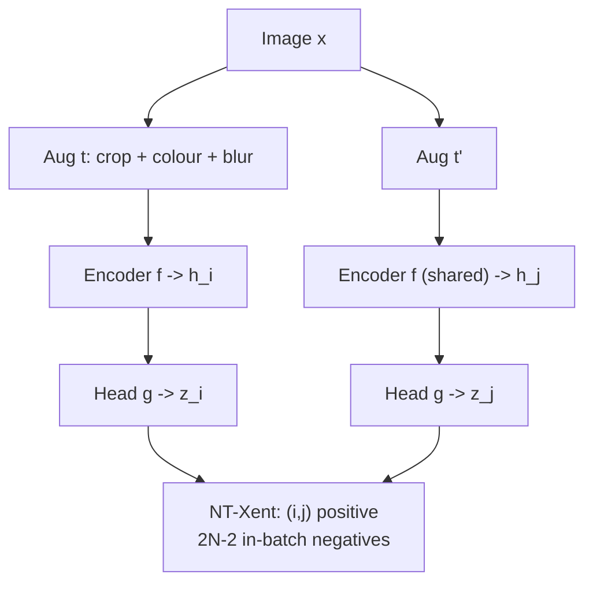
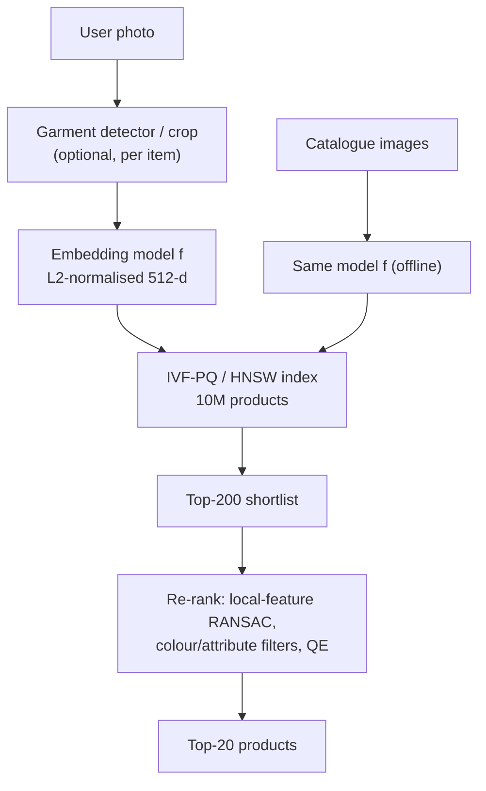
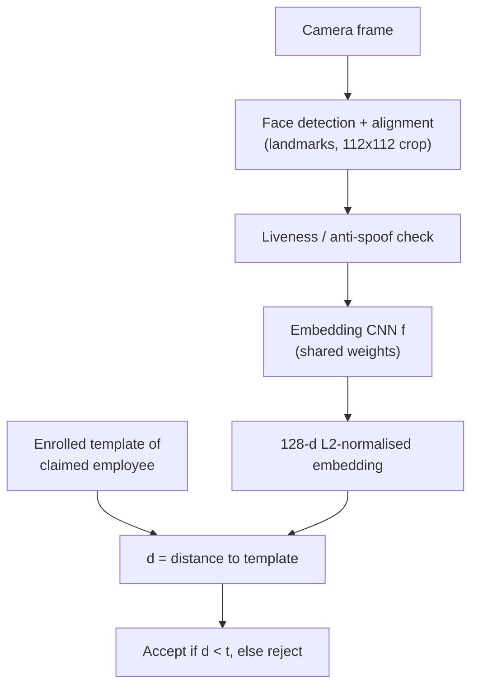

# Session 05 — Embeddings & Image Similarity · Solutions

> Questions: [05_questions.md](05_questions.md) · Notes: [../notes/05_embeddings_similarity.md](../notes/05_embeddings_similarity.md)

## Section A — MCQs

### Q1 — Answer: **B**
**Why B:** A Siamese network is **one** embedding network applied to both inputs with **tied weights**. This puts both signatures in the same embedding space and makes the distance symmetric; the decision is made by thresholding $d=\Vert f(x_1)-f(x_2)\Vert$.
- **A** ✗ — two independent networks would map the inputs into different spaces, so distances would be meaningless; concatenation + classifier is not the Siamese design.
- **C** ✗ — the weights are shared through the whole network, not just the first layer.
- **D** ✗ — cross-entropy over known signers cannot handle new signers; Siamese training uses a distance-based (contrastive/triplet) loss.

### Q2 — Answer: **D**
**Why D:** For unit vectors $\Vert\hat a-\hat b\Vert^2=2-2\cos\theta$, a strictly decreasing function of $\cos\theta$. Smallest distance ⇔ largest cosine, so ranking by increasing distance = ranking by **decreasing** cosine.
- **A** ✗ — increasing cosine would put the *least* similar item first: the order is reversed.
- **B** ✗ — magnitude sensitivity only matters for **un-normalised** vectors; here all norms are 1.
- **C** ✗ — the identity holds in any dimension.

### Q3 — Answer: **A**
**Why A:** Logits are $\mathrm{sim}/\tau$. A smaller $\tau$ magnifies the gaps between logits ⇒ the softmax becomes **sharper**, and the gradient on negative $k$ ($p_k/\tau$) is dominated by the most similar (hardest) negatives.
- **B** ✗ — that is the effect of *increasing* $\tau$ (the classic trap).
- **C** ✗ — $\tau$ divides each logit *inside* the exponential; it does not cancel.
- **D** ✗ — every logit is scaled, so the negatives' weights change too (easy negatives' weights collapse towards 0, hard negatives keep most of the negative mass).

### Q4 — Answer: **C**
**Why C:** $2N=2048$ views. For each anchor, the denominator excludes itself and contains its 1 positive partner plus $2N-2=$ **2046** negatives.
- **A** ✗ — 1023 = $N-1$; counts images, forgetting that every other image contributes **two** views.
- **B** ✗ — 2047 = $2N-1$ is the total number of denominator terms *including* the positive.
- **D** ✗ — 1024 = $N$, unrelated to the view count.

### Q5 — Answer: **B**
**Why B:** MoCo keeps a **queue** of keys from many past batches as negatives. Because the key encoder is an **EMA** of the query encoder ($\theta_k\leftarrow0.999\theta_k+0.001\theta_q$), it changes slowly, so old and new keys are **consistent**; the number of negatives ($K=65{,}536$) no longer depends on the batch size.
- **A** ✗ — the key encoder receives **no** gradients at all; it is not about speed of back-propagation.
- **C** ✗ — MoCo **does** use negatives (the queue); BYOL is the method without negatives.
- **D** ✗ — the key encoder is not separately trained, and downstream normally uses the query encoder.

### Q6 — Answer: **D**
**Why D:** Semi-hard means $d(a,p)<d(a,n)<d(a,p)+m$, i.e. $0.40<d(a,n)<0.70$. Only 0.60 satisfies this (loss $=0.40-0.60+0.30=0.10>0$).
- **A** ✗ — 0.30 < 0.40 ⇒ **hard** negative (closer than the positive).
- **B** ✗ — 0.80 > 0.70 ⇒ **easy** negative (loss 0, no gradient).
- **C** ✗ — 0.20 < 0.40 ⇒ hard.

### Q7 — Answer: **A**
**Why A:** SimCLR computes the loss on $\mathbf z=g(\mathbf h)$, but then **discards the projection head** and uses the encoder output $\mathbf h$, which retains information (e.g. colour, orientation) that the contrastive objective makes $\mathbf z$ invariant to; linear-probe accuracy on $\mathbf h$ is clearly higher.
- **B** ✗ — $\mathbf z$ is deliberately invariant to the augmentations and loses information.
- **C** ✗ — at test time there is only one image/view; concatenating views is not the protocol.
- **D** ✗ — a similarity row depends on the batch; it is not a representation of the image.

### Q8 — Answer: **C**
**Why C:** **Product quantisation** splits each vector into $m$ sub-vectors and stores only the index (1 byte) of the nearest centroid for each ⇒ $m$ bytes per vector (e.g. 2048 B → 64 B).
- **A** ✗ — HNSW speeds up search with a graph but stores full vectors **plus** graph links (more memory, not less).
- **B** ✗ — IVF without PQ reduces the number of comparisons, not the memory per vector.
- **D** ✗ — a flat index stores every vector uncompressed.

## Section B — Numericals

### Q9 — Cosine vs Euclidean
**Given:** $\mathbf u=(2,1,2)$, $\mathbf v=(1,4,8)$; $\mathbf q=(1,0)$, $\mathbf x_1=(10,1)$, $\mathbf x_2=(0.5,0.5)$.
**Formula:**

$$
\cos\theta=\frac{\mathbf u\cdot\mathbf v}{\Vert\mathbf u\Vert\Vert\mathbf v\Vert},\qquad d=\Vert\mathbf u-\mathbf v\Vert,\qquad \Vert\hat{\mathbf u}-\hat{\mathbf v}\Vert^2=2-2\cos\theta
$$

**Working:**
(a) $\mathbf u\cdot\mathbf v=2+4+16=22$. $\Vert\mathbf u\Vert=\sqrt{4+1+4}=3$, $\Vert\mathbf v\Vert=\sqrt{1+16+64}=9$.
$\cos\theta=22/27=0.8148$. $d=\sqrt{(2-1)^2+(1-4)^2+(2-8)^2}=\sqrt{1+9+36}=\sqrt{46}=6.782$.

(b) $\hat{\mathbf u}=(2/3,1/3,2/3)$, $\hat{\mathbf v}=(1/9,4/9,8/9)$. Difference $=(5/9,-1/9,-2/9)$ ⇒ squared norm $=(25+1+4)/81=30/81=0.3704$ ⇒ $\Vert\hat{\mathbf u}-\hat{\mathbf v}\Vert=0.6086$.
Check: $2-2(22/27)=10/27=0.3704$ ✓.

(c) Cosine: $\cos(\mathbf q,\mathbf x_1)=10/\sqrt{101}=0.995$; $\cos(\mathbf q,\mathbf x_2)=0.5/\sqrt{0.5}=0.707$ ⇒ cosine ranks **$\mathbf x_1$ first**.
Euclidean: $d(\mathbf q,\mathbf x_1)=\sqrt{81+1}=9.055$; $d(\mathbf q,\mathbf x_2)=\sqrt{0.25+0.25}=0.707$ ⇒ Euclidean ranks **$\mathbf x_2$ first**.
Reason: $\mathbf x_1$ points almost exactly in the query's direction but has a large norm; Euclidean distance is dominated by the norm difference. After L2-normalising, $d(\mathbf q,\hat{\mathbf x}_1)=0.0996<d(\mathbf q,\hat{\mathbf x}_2)=0.765$ and both metrics agree.

(d) $\cos\theta=1-\tfrac12(0.8)^2=1-0.32=0.68$; $\theta=\arccos(0.68)=47.2^\circ$.

**Answer:** **(a) dot = 22, cos = 0.815, d = 6.78; (b) 0.609; (c) cosine → $\mathbf x_1$, Euclidean → $\mathbf x_2$; (d) cos = 0.68, θ ≈ 47.2°**
> ✔ Verified numerically (Python).
> **Common slip:** forgetting the square: $\cos\theta=1-d^2/2$, not $1-d/2$ (which would give 0.6).

### Q10 — Triplet and contrastive losses
**Given:** $a=(1,1)$, $p=(1.3,1.4)$, $n_1=(1.6,1.8)$, $n_2=(1.36,0.52)$, $n_3=(0.76,1.32)$; triplet $m=0.2$; contrastive $m=1.0$.
**Formula:**

$$
\mathcal L_{\text{trip}}=\max(0,\ d(a,p)-d(a,n)+m),\qquad \mathcal L_{\text{contr}}=y\,d^2+(1-y)\max(0,m-d)^2
$$

**Working:**
(a) $d(a,p)=\sqrt{0.3^2+0.4^2}=\sqrt{0.25}=0.5$.
$d(a,n_1)=\sqrt{0.6^2+0.8^2}=1.0$; $d(a,n_2)=\sqrt{0.36^2+0.48^2}=\sqrt{0.1296+0.2304}=0.6$; $d(a,n_3)=\sqrt{0.24^2+0.32^2}=\sqrt{0.16}=0.4$.

(b) Semi-hard window: $0.5<d(a,n)<0.7$.

| Negative | $d(a,n)$ | $0.5-d(a,n)+0.2$ | Loss | Type |
|---|---|---|---|---|
| $n_1$ | 1.0 | −0.3 | **0** | Easy ($>0.7$) |
| $n_2$ | 0.6 | 0.1 | **0.1** | Semi-hard |
| $n_3$ | 0.4 | 0.3 | **0.3** | Hard ($<0.5$) |

(c) Positive pair: $y=1$ ⇒ $d^2=0.5^2=$ **0.25**.
Negatives ($y=0$): $n_1$: $\max(0,1-1.0)^2=$ **0**; $n_2$: $(1-0.6)^2=$ **0.16**; $n_3$: $(1-0.4)^2=$ **0.36**.

**Answer:** **distances 0.5 / 1.0, 0.6, 0.4; triplet losses 0, 0.1, 0.3 (easy, semi-hard, hard); contrastive 0.25 (pos), 0, 0.16, 0.36 (neg)**
> ✔ Verified numerically (Python).
> **Common slip:** squaring the distances in the triplet loss when the question says $d$ (FaceNet's squared version gives different numbers — always use the stated form).

### Q11 — InfoNCE and temperature
**Given:** $\mathrm{sim}(q,k^+)=0.8$; negatives $0.6,\ 0.2,\ -0.4$.
**Formula:**

$$
p_0=\frac{e^{0.8/\tau}}{e^{0.8/\tau}+e^{0.6/\tau}+e^{0.2/\tau}+e^{-0.4/\tau}},\qquad \mathcal L=-\ln p_0
$$

**Working:**
(a) $\tau=0.5$: logits $1.6,\ 1.2,\ 0.4,\ -0.8$ ⇒ exponentials $4.953,\ 3.320,\ 1.492,\ 0.449$; sum $=10.214$.
$p_0=4.953/10.214=0.4849$ ⇒ $\mathcal L=-\ln0.4849=$ **0.724**.

(b) $\tau=0.1$: logits $8,\ 6,\ 2,\ -4$ ⇒ exponentials $2980.96,\ 403.43,\ 7.389,\ 0.0183$; sum $=3391.79$.
$p_0=2980.96/3391.79=0.8789$ ⇒ $\mathcal L=-\ln0.8789=$ **0.129**.

(c) Probabilities on the negatives: $\tau=0.5$: $0.325,\ 0.146,\ 0.044$ ⇒ share of the hardest $=0.325/0.515=$ **0.63**. $\tau=0.1$: $0.1189,\ 0.0022,\ 0.000005$ ⇒ share $=$ **0.98**.
Lower $\tau$ makes the softmax **sharper**: almost all of the "push-away" gradient ($\partial\mathcal L/\partial s_k=p_k/\tau$: 0.65 → 1.19 for the hard negative, 0.088 → 0.00005 for the easy one) goes to the **hardest negative**. $\tau$ therefore controls how strongly the loss focuses on hard negatives (too low ⇒ unstable, sensitive to false negatives; too high ⇒ weak signal).

(d) $N=256$ ⇒ $2N=$ **512 views**; negatives per anchor $=2N-2=$ **510**; similarity matrix $512\times512=$ **262,144** entries (512 diagonal entries masked).
Collapse ⇒ all 511 candidates have equal logits ⇒ $p_{\text{pos}}=1/511$ ⇒ $\mathcal L=\ln511=$ **6.24** — far from the minimum, so negatives penalise collapse.

**Answer:** **τ = 0.5: p₀ = 0.485, L = 0.724; τ = 0.1: p₀ = 0.879, L = 0.129; hardest-negative share 0.63 → 0.98; 512 views, 510 negatives, 262,144 entries, collapsed loss ln 511 = 6.24**
> ✔ Verified numerically (Python).

### Q12 — Retrieval metrics
**Given:** A: 1,0,1,1,0,0,1,0,0,0 with $R_A=5$; B: 0,1,0,0,1 with $R_B=2$. Non-interpolated AP, divided by total relevant $R$.
**Formula:**

$$
P@k=\frac{\#\text{rel in top-}k}{k},\quad R@k=\frac{\#\text{rel in top-}k}{R},\quad \text{AP}=\frac1R\sum_k P@k\cdot\text{rel}(k),\quad \text{MRR}=\frac1{\lvert Q\rvert}\sum_q\frac1{\text{rank}_q}
$$

**Working:**
(a) Top-5 of A has 3 relevant ⇒ $P@5=3/5=$ **0.6**, $R@5=3/5=$ **0.6**. Top-10 has 4 ⇒ $P@10=4/10=$ **0.4**, $R@10=4/5=$ **0.8**.

(b) A: relevant at ranks 1, 3, 4, 7 with precisions $1/1,\ 2/3,\ 3/4,\ 4/7$ $=1,\ 0.667,\ 0.75,\ 0.571$; sum $=2.988$.
$\text{AP}_A=2.988/5=$ **0.598** (the 5th relevant image was never retrieved ⇒ contributes 0).
B: relevant at ranks 2 and 5 with precisions $1/2,\ 2/5$ ⇒ $\text{AP}_B=(0.5+0.4)/2=$ **0.45**.
$\text{mAP}=(0.598+0.45)/2=$ **0.524**.

(c) First relevant: A at rank 1 (RR = 1), B at rank 2 (RR = 0.5) ⇒ $\text{MRR}=(1+0.5)/2=$ **0.75**.

**Answer:** **P@5 = 0.6, R@5 = 0.6, P@10 = 0.4, R@10 = 0.8; AP_A = 0.598, AP_B = 0.45, mAP = 0.524; MRR = 0.75**
> ✔ Verified numerically (Python).
> **Common slip:** dividing AP_A by the 4 retrieved relevant items (gives 0.747) — that over-rewards a system that misses relevant images.

### Q13 — Index memory and search cost
**Given:** $N=10^6$, $D=512$; PQ $m=64$ × 8 bits; 50 GMAC/s; IVF `nlist` = 1024, `nprobe` = 8.
**Formula:**

$$
\text{Mem}=N\cdot D\cdot b,\qquad \text{Mem}_{PQ}=N\cdot m\ \text{B},\qquad \text{MACs}=N\cdot D
$$

**Working:**
(a) float32: $10^6\times512\times4=2.048\times10^9$ B $=$ **2.048 GB** (≈1.91 GiB). float16: **1.024 GB**.

(b) Codes: $64$ B/vector ⇒ $10^6\times64=$ **64 MB**. Compression $=2048/64=$ **32×**.
Codebooks: $64$ sub-quantisers × 256 centroids × $(512/64=8)$ dims × 4 B $=524{,}288$ B ≈ **0.52 MB** (negligible).

(c) $10^6\times512=$ **$5.12\times10^8$ MACs/query**. Time $=5.12\times10^8/5\times10^{10}=$ **10.24 ms** ⇒ ≈ **98 queries/s**.

(d) Vectors scanned $\approx10^6\times8/1024=7{,}812.5\approx$ **7,813**, plus **1,024** centroid comparisons ⇒ ≈ **8,837** comparisons ⇒ speed-up $\approx10^6/8{,}837\approx$ **113×** (at the cost of missing neighbours that fall in unprobed cells).

**Answer:** **2.048 GB (fp32), 1.024 GB (fp16); PQ 64 MB, 32×, codebooks ≈ 0.52 MB; 5.12×10⁸ MACs, 10.24 ms, ≈ 98 QPS; IVF ≈ 8.8k comparisons, ≈ 113× faster**
> ✔ Verified numerically (Python).

## Section C — Short answers

### Q14 — Unit-vector identity and why normalise
**Proof.** Expand the squared norm:

$$
\Vert\hat{\mathbf a}-\hat{\mathbf b}\Vert^2=(\hat{\mathbf a}-\hat{\mathbf b})\cdot(\hat{\mathbf a}-\hat{\mathbf b})=\Vert\hat{\mathbf a}\Vert^2+\Vert\hat{\mathbf b}\Vert^2-2\,\hat{\mathbf a}\cdot\hat{\mathbf b}=1+1-2\cos\theta=2-2\cos\theta
$$

since $\Vert\hat{\mathbf a}\Vert=\Vert\hat{\mathbf b}\Vert=1$ and $\hat{\mathbf a}\cdot\hat{\mathbf b}=\cos\theta$. Hence L2 distance is a monotonically decreasing function of cosine similarity on the unit sphere.

**Why L2-normalise (any three):**
- **Equivalent rankings:** Euclidean, cosine and dot-product search give the **same** neighbours ⇒ use fast inner-product (MIPS) indexes for cosine search.
- **Removes nuisance magnitude:** feature norms often track contrast, image quality or class frequency rather than identity; normalising keeps only the **direction** (semantics).
- **Bounded similarities** in $[-1,1]$ ⇒ a single margin $m$ or temperature $\tau$ has a consistent meaning; prevents the loss from being "solved" by inflating norms; stabilises training.
- **Uniformity on the hypersphere:** contrastive losses spread normalised features over the sphere, which preserves information and avoids degenerate solutions.

*Trade-off:* normalisation discards norm information that is occasionally useful (e.g. confidence/popularity in recommendation).

### Q15 — Four sources of embeddings

| Source | Supervision / positive pairs | Strength | Weakness |
|---|---|---|---|
| **Penultimate layer of an ImageNet classifier** | Class labels; cross-entropy (no explicit pairs) | Free, off-the-shelf, strong generic semantics; one forward pass | Not trained for distances; collapses within-class detail; tied to ImageNet classes/domain |
| **Metric learning (Siamese / triplet)** | Pairs/triplets with **same identity/class** labels | Directly optimises the ranking/verification objective; handles **unseen classes** (one-shot) | Needs identity labels; slow convergence; **mining** and margin tuning |
| **Self-supervised contrastive (SimCLR/MoCo)** | **Two augmentations of the same image** (no labels) | Uses unlimited unlabelled data; general features; good for transfer | False negatives (same-class images pushed apart); depends on augmentation design; compute-heavy |
| **Language-supervised (CLIP)** | **Image + its caption** (400M web pairs) | Shared image–text space ⇒ **zero-shot** classification/retrieval by text | Web bias; weak at fine-grained, counting, spatial relations ([13](../notes/13_vision_foundation_models.md)) |

Closing line: labels decrease from top to bottom while generality increases; for a specific retrieval product you typically **start from SSL/CLIP features and fine-tune with a metric-learning loss**.

### Q16 — SimCLR

- **Pretext task:** for each image make **two random views**; the network must identify which of the $2N-1$ other views in the batch is its partner (**instance discrimination**) — no labels.
- **Augmentations = the supervision.** The key composition is **random resized crop + colour distortion** (plus blur, flip). Crops force agreement between global and local / different parts of an object; **colour jitter** is essential because two crops of the same image share the same colour histogram — without it the network can match views by colour statistics instead of learning semantics.
- **Encoder** $f$ (ResNet-50) gives $\mathbf h$; **projection head** $g$ (2-layer MLP) gives $\mathbf z$ on which the loss is computed. After training, $g$ is **discarded** and $\mathbf h$ is used: the head absorbs the augmentation invariance, so $\mathbf h$ keeps more transferable information.
- **NT-Xent:** $\ell_{i,j}=-\log\frac{\exp(\mathrm{sim}(\mathbf z_i,\mathbf z_j)/\tau)}{\sum_{k\neq i}\exp(\mathrm{sim}(\mathbf z_i,\mathbf z_k)/\tau)}$, cosine similarity, temperature $\tau$, averaged over all $2N$ anchors.
- **Large batches** (thousands): negatives come only from the batch ($2N-2$ per anchor), and more negatives give a better estimate of the softmax denominator and stronger uniformity pressure ⇒ better features. Cost: huge memory, LARS optimiser, TPUs. (MoCo solves this with a queue.)

### Q17 — Representation collapse
- **Collapse:** the encoder maps **every input to the same (or a very low-dimensional) vector**. Positive pairs are then perfectly aligned, so a loss that *only* pulls positives together is minimised — but the representation carries no information (all images look identical; downstream accuracy = chance). Dimensional collapse is the partial version (features occupy only a few directions).
- **Why InfoNCE resists it:** the loss is a softmax over 1 positive + $N$ negatives. If all embeddings are equal, all logits are equal ⇒ $p_0=1/(N+1)$ ⇒ $\mathcal L=\log(N+1)$ (e.g. $\ln511=6.24$ for SimCLR with $N=256$), which is **high**, not minimal. To lower the loss the model must make the positive **more similar than the negatives** ⇒ it must spread different images apart (**uniformity**).
- **MoCo:** keeps InfoNCE with **many negatives** from a **queue** (65,536 keys) encoded by a **momentum encoder** (EMA, $m=0.999$); the negatives' repulsion prevents collapse, and the slowly moving key encoder keeps the queued negatives consistent.
- **BYOL:** **no negatives**. An **online** network (encoder → projector → **predictor**) predicts the projection of a **target** network whose weights are an **EMA** of the online weights; **stop-gradient** on the target branch. Loss $=\Vert\bar q-\bar z'\Vert^2=2-2\cos$. The **asymmetry** (predictor + stop-gradient + slowly moving target) means the trivial constant solution is not reached in practice (SimSiam shows stop-gradient is the critical piece).
- (Related: DINO avoids collapse with **centering + sharpening** of an EMA teacher — [13](../notes/13_vision_foundation_models.md).)

## Section D — Long answers / Design

### Q18 — Visual product search ("shop the look") for 10M images

**1. Problem framing.** Query = noisy **consumer photo** (clutter, people, lighting); gallery = clean **studio catalogue** images ⇒ a **cross-domain retrieval** problem. Requirement: top-20 in < 200 ms over $10^7$ items ⇒ embedding + **ANN** index; quality measured by retrieval metrics.

**2. Architecture**

**3. Embedding model and training**
- **Backbone:** start from strong general features — **DINOv2 or CLIP ViT** (or ImageNet ResNet-50) — then **fine-tune with metric learning** because generic features do not separate near-identical products (two black dresses).
- **Data / positives:** (street photo, shop photo) pairs of the **same product ID** (from customer reviews, influencer posts, or synthetic: catalogue images with heavy augmentation — background paste, crop, colour/lighting jitter, blur). Negatives = other products, especially **same category**.
- **Loss:** **triplet loss with semi-hard / batch-hard mining** ($P$ products × $K$ images per batch) or **InfoNCE** with in-batch + queue negatives (MoCo-style) — both give a ranking-oriented space. Margin/temperature tuned on validation. Optional auxiliary classification on category/attributes.
- **Output:** 512-d, **L2-normalised** ⇒ cosine = dot product.
- **Detection step:** a garment detector crops each item in the query so background/person does not dominate the embedding; let the user pick the item if several are found.

**4. Index (memory estimate)**
- Flat float32: $10^7\times512\times4=$ **20.48 GB** (too large/slow for 200 ms on CPU; brute force = $5.1\times10^9$ MACs/query).
- **IVF-PQ** (e.g. 16,384 cells, PQ $m=64$): codes $=10^7\times64$ B $=$ **640 MB** + ids (80 MB) ⇒ fits in RAM on one machine; with `nprobe` = 16 only ≈ 9.8k codes per query are scanned. Alternatively **HNSW** for higher recall if memory allows. Shard by category if needed.
- Return a **shortlist of ~200**, then re-rank with exact (un-compressed) vectors to recover PQ errors.

**5. Re-ranking**
- Exact cosine on the shortlist; **query expansion** (average with top-3); **spatial verification** of local features (logos/prints) via RANSAC inlier counts ([02](../notes/02_feature_matching_classical.md)); business filters (in stock, size, price).

**6. Latency budget (assumed):** detection + embedding on GPU ≈ 30–60 ms, ANN ≈ 5–10 ms, re-ranking ≈ 20–50 ms ⇒ comfortably < 200 ms.

**7. Evaluation**
- Offline: labelled street-to-shop queries ⇒ **Recall@K (hit rate)** — is the exact product in the top-20? — plus **mAP** and **MRR**; per-category breakdown; ANN recall vs exact search.
- Online: click-through, add-to-cart, A/B tests; latency P95.

**8. Keeping it up to date**
- New products: embed with the **current** model and **add** to the index (IVF-PQ supports adds without retraining codebooks; periodically retrain centroids if distribution drifts). Deleted products: tombstone + periodic rebuild.
- New model version ⇒ **re-embed the whole catalogue** (embeddings from different models are incomparable) and switch atomically (blue/green index).

**9. Failure modes and mitigations**
- Domain gap (lighting, occlusion, folds) → street-to-shop training data, augmentation.
- Multiple garments / background dominating → detection crop.
- Colour vs shape trade-off (colour jitter in SSL makes features colour-blind!) → add colour attributes or avoid strong colour augmentation in fine-tuning.
- Near-duplicate catalogue entries flooding results → de-duplicate / diversify.
- PQ quantisation errors → exact re-ranking.

**Trade-off line:** more compression (PQ) and fewer probes ⇒ lower memory/latency but lower recall; re-ranking a shortlist recovers most of the accuracy at small cost.

**Marking scheme:** 2 – problem framing & pipeline · 3 – embedding model, data, loss & mining · 2 – index & memory/latency estimate · 1 – re-ranking · 1 – evaluation metrics · 1 – updates & failure modes.

### Q19 — Face verification with Siamese/triplet networks

**1. Framing.** This is **1:1 verification** (badge gives the claimed identity): accept if the camera face is close enough to the enrolled template. New employees appear weekly ⇒ need a **similarity function**, not a closed-set classifier ⇒ **metric learning / one-shot**.

**2. Architecture**

- **Siamese/triplet** setup: one CNN (e.g. ResNet) with **shared weights**, output **128-d**, L2-normalised (FaceNet-style). Alignment before embedding removes pose/scale nuisance.

**3. Training data and loss**
- Large public/licensed face datasets with many identities and many images per identity (pose, lighting, age variation); the office's employees need **not** be in training.
- **Triplet loss** $\max(0,d(a,p)-d(a,n)+m)$ ($m\approx0.2$ on unit vectors), batches of $P$ identities × $K$ images, **online semi-hard mining** (hard negatives = similar-looking people, same gender/age). Alternative: contrastive pair loss $y\,d^2+(1-y)\max(0,m-d)^2$.

**4. Threshold selection and evaluation**
- Build genuine pairs (same person) and impostor pairs on a validation set that resembles the office camera (lighting, angle).
- Plot the **ROC** (TAR vs FAR) / DET curve; choose $t$ for the security requirement, e.g. **FAR = 0.1%** (impostor accepted 1 in 1000 attempts) and report the resulting **FRR**; or the **EER** point for a balanced setting.
- Report TAR@FAR, EER, and performance across demographic groups and lighting conditions.

**5. Enrolment of new employees (one-shot)**
- Capture 3–5 aligned photos; store their embeddings (or their normalised mean) as the template. **No retraining** — the network generalises to unseen identities because it learned a distance function. Re-enrol periodically (ageing, glasses, beard).

**6. Contrastive vs triplet for this use**

| | Contrastive (pair) loss | Triplet loss |
|---|---|---|
| Constraint | Absolute: genuine $d\to0$, impostor $d\ge m$ | Relative: impostor farther than genuine by $m$ |
| Threshold fit | Directly encourages a **global** threshold (good for verification) | Ranking-focused; global threshold must be calibrated |
| Training | Simpler sampling; can waste time on easy pairs | Needs **mining**; usually better embeddings for many identities |

In practice triplet (or modern margin-softmax losses) gives better separation; contrastive aligns more naturally with a single threshold.

**7. Risks and limitations**
- **Spoofing** (printed photo, phone screen, mask) → liveness detection, IR/depth camera.
- **Bias:** unequal FAR/FRR across demographic groups if training data is unbalanced → audit per group.
- Domain shift (backlight, masks, glasses), ageing → periodic re-enrolment, threshold recalibration on site data.
- **Privacy/legal:** biometric data protection, consent, secure template storage (store embeddings, not photos; encrypt).
- Fallback path (PIN/guard) for false rejects.

**Trade-off line:** lowering $t$ reduces false accepts (security) but increases false rejects (convenience); pick $t$ from the ROC according to the cost of each error.

**Marking scheme:** 2 – framing (verification, one-shot) · 2 – architecture & embedding · 2 – loss & mining · 2 – threshold/ROC evaluation & enrolment · 2 – contrastive vs triplet comparison & risks.
