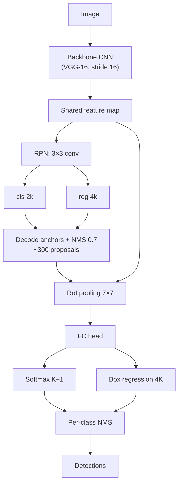

# Session 06 — Object Detection I: Classical & Two-Stage Detectors · Solutions

> Questions: [06_questions.md](06_questions.md) · Notes: [../notes/06_detection_two_stage.md](../notes/06_detection_two_stage.md)
>
> Box convention: $(x_1,y_1,x_2,y_2)$, continuous coordinates, area $=(x_2-x_1)(y_2-y_1)$ — no +1. $\log$ = natural log.

## Section A — MCQs

### Q1 — Answer: **B**
**Why B:** Detection must find **all** instances, so the number of outputs is unknown in advance; this forces a background class (most candidates contain nothing), duplicate removal (NMS) and set-based evaluation (AP).
- **A** ✗ — that is image classification.
- **C** ✗ — classification + localisation also regresses a box (CE + L2/smooth-L1).
- **D** ✗ — that is semantic segmentation ([notes 10](../notes/10_image_segmentation.md)).

### Q2 — Answer: **C**
**Why C:** Dalal & Triggs found the simplest unsmoothed centred $[-1,0,1]$ derivative best, 9 **unsigned** bins (0–180°) for people (clothing/background contrast polarity varies), 8×8 cells, and **overlapping** 2×2-cell blocks with L2-Hys (64×128 → 3780-d).
- **A** ✗ — smoothing hurt performance and signed 0–360° bins did not help for pedestrians.
- **B** ✗ — blocks **overlap** (stride 1 cell); overlap with L2-Hys clearly beat non-overlapping blocks.
- **D** ✗ — no block normalisation loses illumination invariance; 4×4 cells/36 bins are not the standard settings.

### Q3 — Answer: **A**
**Why A:** The cascade is an **early-rejection** device: simple first stages (a couple of features) discard most non-face windows, so expensive later stages run on very few windows → average of only a handful of features per window.
- **B** ✗ — that is the **integral image**.
- **C** ✗ — that is **AdaBoost** feature selection.
- **D** ✗ — Viola–Jones is not rotation invariant (near-frontal, upright faces).

### Q4 — Answer: **D**
**Why D:** R-CNN warps each of ~2000 proposals to 227×227 and runs a full CNN forward pass on each — ~2000 passes over largely overlapping regions.
- **A** ✗ — selective search costs seconds, not tens of seconds; it becomes the bottleneck only in Fast R-CNN.
- **B** ✗ — R-CNN uses **linear** SVMs (cheap dot products).
- **C** ✗ — NMS over a few thousand boxes is negligible compared with 2000 CNN passes.

### Q5 — Answer: **B**
**Why B:** Fast R-CNN computes the conv feature map **once**, RoI-pools each proposal, and trains classifier + regressor jointly — but proposals are still selective-search inputs.
- **A** ✗ — classic trap: end-to-end **except proposals**.
- **C** ✗ — the RPN is Faster R-CNN's contribution.
- **D** ✗ — that is R-CNN; Fast R-CNN uses a softmax over $K+1$ classes and no disk cache.

### Q6 — Answer: **A**
**Why A:** cls has $2k=2\times9=18$ channels (two scores per anchor), reg has $4k=4\times9=36$ channels (four offsets per anchor) — 54 outputs per location.
- **B** ✗ — ignores the $k$ anchors (that would be $k=1$).
- **C** ✗ — 4 regression channels would give one box per location, not one per anchor.
- **D** ✗ — swapped: regression needs 4 numbers per anchor, classification 2.

### Q7 — Answer: **D**
**Why D:** Anchors are fixed, hand-chosen priors (3 scales × 3 ratios) tiled at every location; the RPN learns objectness and the offsets $(t_x,t_y,t_w,t_h)$ that move each anchor onto an object.
- **A** ✗ — scales and ratios are hyper-parameters (YOLOv2 chose them by k-means, still not by back-prop).
- **B** ✗ — the regression branch predicts **offsets relative to** anchors; the decoded boxes are proposals, not anchors.
- **C** ✗ — anchors are placed densely at **every** location; 0.7 is the training IoU threshold for positive labels.

### Q8 — Answer: **C**
**Why C:** NMS (IoU 0.7) reduces thousands of decoded anchors to ~300 proposals, and per-class NMS removes duplicate final detections.
- **A** ✗ — Faster R-CNN does not remove NMS (set prediction in DETR does).
- **B** ✗ — misses the proposal-level NMS.
- **D** ✗ — anchors are fixed priors; NMS operates on scored, decoded boxes.

## Section B — Numericals

### Q9 — HOG descriptor length and gradient voting
**Given:** cells 8×8 px, 9 unsigned bins (centres 10°, 30°, …, 170°), 2×2-cell blocks, stride 1 cell.
**Formula:**

$$
N_{desc}=(n_x-1)(n_y-1)\cdot(2\cdot2)\cdot9,\qquad m=\sqrt{I_x^2+I_y^2},\qquad \theta=\operatorname{atan2}(I_y,I_x)\bmod180^\circ
$$

**Working:**
(a) 64×128 → $n_x=64/8=8$, $n_y=128/8=16$ → 128 cells. Blocks: $(8-1)\times(16-1)=7\times15=105$. Per block $4\times9=36$ → $105\times36=\mathbf{3780}$.
(b) 48×96 → $6\times12$ cells → $5\times11=55$ blocks → $55\times36=\mathbf{1980}$.
(c) $I_x=80-50=30$, $I_y=60-120=-60$.
$m=\sqrt{30^2+60^2}=\sqrt{4500}=\mathbf{67.08}$.
$\operatorname{atan2}(-60,30)=-63.43^\circ$ → $+180^\circ$ → $\theta=\mathbf{116.57^\circ}$.
Nearest centres: 110° and 130°. Fraction to 110°: $\frac{130-116.57}{20}=0.672$ → $0.672\times67.08=\mathbf{45.06}$; to 130°: $0.328\times67.08=\mathbf{22.02}$ (check: $45.06+22.02=67.08$).
**Answer:** **3780**, **1980**; $m=67.08$, $\theta=116.57^\circ$, votes **45.06 (110° bin)** and **22.02 (130° bin)**.
> ✔ Verified numerically (Python).
> **Common slip:** forgetting the block overlap (giving 4×8 blocks × 36 = 1152), or using $\operatorname{atan2}(60,30)=63.4^\circ$ with a $y$-up convention — the stated convention ($y$ down) matters for unsigned angles.

### Q10 — Sliding-window count and cascade false positives
**Given:** 800×600 image, 64×128 window, stride 8, pyramid factor 2; 10 stages with $d=0.99$, $f=0.30$.
**Formula:**

$$
N=\sum_l\left(\left\lfloor\tfrac{W_l-64}{8}\right\rfloor+1\right)\left(\left\lfloor\tfrac{H_l-128}{8}\right\rfloor+1\right),\qquad D=\prod d_i,\quad F=\prod f_i
$$

**Working:**
(a)
| Level | Size | $x$ positions | $y$ positions | Windows |
|---|---|---|---|---|
| 0 | 800×600 | $\lfloor736/8\rfloor+1=93$ | $\lfloor472/8\rfloor+1=60$ | 5580 |
| 1 | 400×300 | $\lfloor336/8\rfloor+1=43$ | $\lfloor172/8\rfloor+1=\lfloor21.5\rfloor+1=22$ | 946 |
| 2 | 200×150 | $\lfloor136/8\rfloor+1=18$ | $\lfloor22/8\rfloor+1=3$ | 54 |
| 3 | 100×75 | — | $75<128$ → stop | 0 |
Total $=5580+946+54=\mathbf{6580}$.
(b) $3\times6580=\mathbf{19\,740}$.
(c) $D=0.99^{10}=\mathbf{0.904}$; $F=0.3^{10}=\mathbf{5.90\times10^{-6}}$.
(d) $6580\times5.90\times10^{-6}=\mathbf{0.039}$ false positives per image (≈ one false alarm every ~26 images).
**Answer:** 6580 windows (19 740 with 3 ratios); $D=0.904$, $F=5.9\times10^{-6}$; ≈0.04 FP/image.
> ✔ Verified numerically (Python).
> **Common slip:** multiplying the detection rates is easy to forget — a cascade **loses recall** at every stage ($0.99^{10}$ is only 90 %), which is why each stage is tuned for a very high $d$.

### Q11 — RPN anchors and head parameters
**Given:** 640×960 image, stride 16, $C=512$, $k=3\times3=9$.
**Formula:**

$$
N_{anchors}=H_fW_fk,\qquad \text{Params}=(K_hK_wC_{in}+1)\,C_{out},\qquad w=\frac{s}{\sqrt r},\ h=s\sqrt r
$$

**Working:**
(a) $H_f=640/16=40$, $W_f=960/16=60$ → 2400 locations; anchors $=2400\times9=\mathbf{21\,600}$.
(b) cls: $2k=\mathbf{18}$ channels → output $40\times60\times18$; reg: $4k=\mathbf{36}$ channels → output $40\times60\times36$.
(c) 3×3 conv: $(3\cdot3\cdot512+1)\cdot512=4609\cdot512=2\,359\,808$.
cls 1×1: $(512+1)\cdot18=9234$. reg 1×1: $(512+1)\cdot36=18\,468$.
Total $=2\,359\,808+9234+18\,468=\mathbf{2\,387\,510}$ (≈2.39 M; the two output layers alone are 27 702 ≈ $2.8\times10^4$).
(d) $s=128$: $r=0.5$ → $w=128/\sqrt{0.5}=181.0$, $h=128\sqrt{0.5}=90.5$; $r=1$ → $128\times128$; $r=2$ → $w=90.5$, $h=181.0$. Each has area $128^2=16\,384$.
**Answer:** 40×60 map, **21 600 anchors**; 18 / 36 channels; **2 387 510** params; anchors **181.0×90.5, 128×128, 90.5×181.0** (w×h).
> ✔ Verified numerically (Python).
> Only 256 of the 21 600 anchors (≈1.2 %) are sampled per image for the RPN loss.

### Q12 — Anchor labelling, encoding and decoding
**Given:** $G_1=(100,100,220,180)$ (area 9600), $G_2=(300,40,340,100)$ (area 2400); anchors $A_1$–$A_3$ are 128×96 (area 12 288), $A_4,A_5$ are 64×64 (area 4096).
**Formula:**

$$
\text{IoU}=\frac{\lvert A\cap B\rvert}{\lvert A\rvert+\lvert B\rvert-\lvert A\cap B\rvert},\qquad t_x=\frac{x-x_a}{w_a},\ t_y=\frac{y-y_a}{h_a},\ t_w=\log\frac{w}{w_a},\ t_h=\log\frac{h}{h_a}
$$

**Working:**
(a)
| Anchor | Intersection with $G_1$ | IoU($G_1$) | Intersection with $G_2$ | IoU($G_2$) | Label |
|---|---|---|---|---|---|
| $A_1$ | $120\times80=9600$; union $12288$ | **0.781** | 0 | 0 | **positive** (> 0.7) |
| $A_2$ | $90\times80=7200$; union $14688$ | **0.490** | 0 | 0 | **ignored** (0.3–0.7) |
| $A_3$ | $40\times40=1600$; union $20288$ | **0.079** | 0 | 0 | **negative** (< 0.3 with all) |
| $A_4$ | 0 | 0 | $40\times60=2400$; union $4096$ | **0.586** | **positive** (best anchor for $G_2$) |
| $A_5$ | 0 | 0 | $20\times50=1000$; union $5496$ | **0.182** | **negative** |
Note $A_4$ is below 0.7 but is the highest-IoU anchor for $G_2$, so rule (ii) makes it positive — without this rule the small box $G_2$ would have no positive anchor.
(b) $A_1$: centre $(156,144)$, $w_a=128$, $h_a=96$. $G_1$: centre $(160,140)$, $w=120$, $h=80$.
$t_x=\frac{160-156}{128}=\mathbf{0.0313}$, $t_y=\frac{140-144}{96}=\mathbf{-0.0417}$, $t_w=\log\frac{120}{128}=\mathbf{-0.0645}$, $t_h=\log\frac{80}{96}=\mathbf{-0.1823}$.
(c) $\hat x=156+0.05\cdot128=162.4$; $\hat y=144-0.10\cdot96=134.4$; $\hat w=128e^{0.10}=141.46$; $\hat h=96e^{-0.20}=78.60$.
$x_1=162.4-70.73=91.67$, $x_2=162.4+70.73=233.13$, $y_1=134.4-39.30=95.10$, $y_2=134.4+39.30=173.70$.
**Answer:** labels **A1 +, A2 ignore, A3 −, A4 +, A5 −**; $t=(0.031,-0.042,-0.065,-0.182)$; decoded box **(91.67, 95.10, 233.13, 173.70)**.
> ✔ Verified numerically (Python).
> **Common slip:** labelling $A_4$ as ignored (forgetting the "best anchor per GT" rule), or normalising $t_y$ by $w_a$ instead of $h_a$.

### Q13 — RoI projection, RoI pooling and the multi-task loss
**Given:** stride 16, 7×7 output, image 800×600, $\lambda=1$.
**Formula:**

$$
x'=\operatorname{round}(x/16),\qquad \operatorname{smooth}_{L_1}(z)=\begin{cases}0.5z^2&\lvert z\rvert<1\\ \lvert z\rvert-0.5&\text{otherwise}\end{cases},\qquad L=-\log p_u+\lambda[u\ge1]\sum_i\operatorname{smooth}_{L_1}(z_i)
$$

**Working:**
(a) $800/16=50$, $600/16=37.5$ → **50×37** with floor-mode pooling (38 with ceil-mode pooling, as in the original Caffe code).
(b) $R_1/16=(4,5,25,19)$ (exact) → $21\times14$ cells (W×H) → bin $=\frac{21}{7}\times\frac{14}{7}=\mathbf{3\times2}$ cells (= 48×32 image px).
(c) $R_2/16=(3.125,4.375,23.125,18.125)$ → rounded $(3,4,23,18)$ → $20\times14$ cells → bin width $20/7=\mathbf{2.86}$ cells (integer bins of 2 or 3 cells, e.g. 3,3,3,2,3,3,3), height 2 cells. Corner shifts: $x_1$: $0.125\times16=2$ px, $y_1$: $0.375\times16=\mathbf{6}$ **px** (largest), $x_2$: 2 px, $y_2$: 2 px.
(d) $-\ln0.8=0.2231$. Smooth-L1: $0.5(0.4)^2=0.08$; $0.5(0.2)^2=0.02$; $\lvert1.5\rvert-0.5=1.0$; $0.5(0.1)^2=0.005$ → sum $=1.105$. $L=0.2231+1.105=\mathbf{1.328}$. Background: $[u\ge1]=0$ → $L=-\ln0.9=\mathbf{0.105}$ (no box loss).
**Answer:** 50×37 map; $R_1$ → $(4,5,25,19)$, 21×14 cells, **3×2-cell bins**; $R_2$ → $(3,4,23,18)$, 20×14 cells, bin width 2.86, max shift **6 px**; $L=\mathbf{1.328}$ (fg), **0.105** (bg).
> ✔ Verified numerically (Python).
> **Common slip:** applying the box loss to background RoIs, or using $0.5z^2$ for $\lvert z\rvert=1.5$ (gives 1.125 instead of 1.0). The 6 px misalignment is exactly what **RoIAlign** removes ([notes 10](../notes/10_image_segmentation.md)).

## Section C — Short answers (model answers)

### Q14 — Classification vs localisation vs detection
- **Classification**: one label per image; output $K$ class probabilities; **softmax cross-entropy**.
- **Classification + localisation**: assumes **exactly one** object; output = class + **one box** (4 numbers) → fixed-size output; loss = **CE + box regression** (L2 or smooth-L1).
- **Object detection**: **all** instances of $K$ classes; output = a **variable-size set** of (class, box, score); loss = CE over **$K+1$** classes (background included) + **smooth-L1 box regression on foreground candidates only**, summed over candidates matched to GT by **IoU**.
- **Why not a fixed regression head**: the number of objects varies (0 to dozens), so a fixed-length output cannot represent the set; there is no natural ordering of objects to assign to outputs; and most locations are background. Detectors therefore use **dense candidates** (windows, anchors, proposals) each classified as object/background, followed by **NMS** — or set prediction with Hungarian matching (DETR, [Session 08](../notes/08_detection_transformers.md)).

*Trade-off line:* localisation is a regression problem; detection is a **search + classification + regression + de-duplication** problem.

### Q15 — Hard-negative mining and NMS
- **What**: iterative bootstrapping of the negative set. Train an initial linear SVM on positives + random negative windows → run it **exhaustively** over object-free images → collect every **false positive** ("hard negative") → add to the training set → **retrain** (1–2 rounds).
- **Why**: the person-free training images yield millions of windows; random samples are mostly trivially easy (sky, road) and don't constrain the decision boundary. The SVM margin is defined by the **hard** examples (support vectors), so mining them gives a much lower false-positive rate per window — vital when $10^4$–$10^5$ windows are scored per image.
- **NMS still needed** because a classifier is smooth in position and scale: a true person fires at many nearby positions and neighbouring pyramid levels. NMS (or mean-shift fusion) keeps the **local maximum** score and deletes overlapping boxes (IoU > threshold), producing one detection per object.

*Closing line:* hard-negative mining improves **precision per window**; NMS fixes **duplicate** detections per object — they solve different problems.

### Q16 — Selective search
- **How**: (1) over-segment the image into superpixels (graph-based segmentation); (2) **greedily merge the most similar neighbouring regions**, similarity = colour-histogram + texture-histogram + **size** (small regions merge first) + **fill** (regions that fit together in a tight box); (3) the bounding box of every region in the hierarchy is a proposal → all scales; (4) **diversify** over colour spaces and parameters → ~**2000** class-agnostic boxes with very high recall.
- **Why it made R-CNN practical**: an expensive CNN can be run on ~$10^3$ well-chosen boxes instead of $10^5$+ sliding windows at all scales **and aspect ratios**; proposals adapt to object shape (any aspect ratio), and high recall at IoU 0.5 means few objects are lost before classification.
- **Drawbacks**: hand-crafted and not learned (can't improve with data, can't share features with the detector); runs on the **CPU at ~seconds/image**. After Fast R-CNN shared the CNN computation, selective search **dominated runtime** → replaced by the learned, GPU-based **RPN** in Faster R-CNN.

### Q17 — RoI pooling and RoIAlign
- **Problem solved**: FC layers need a **fixed-size input**, but proposals have arbitrary size/aspect ratio. R-CNN warped image crops (2000 CNN passes); RoI pooling extracts a fixed-size feature **from the shared feature map** → one CNN pass per image.
- **How**: project the RoI onto the feature map (divide by stride 16, round) → divide it into an $H\times W$ grid (7×7) of sub-windows of size ≈ $h/7\times w/7$ → **max-pool** each sub-window per channel → $7\times7\times C$ output regardless of RoI size.
- **Gradients**: like max pooling — each output's gradient is routed to the **argmax** input cell (summed over RoIs that share a cell), so the backbone is fine-tuned through RoI pooling (unlike SPPnet's training).
- **Quantisation problem**: rounding the RoI to integer cells and rounding bin boundaries misaligns the pooled features with the true RoI by up to ~half a stride (e.g. 6–8 px at stride 16) — tolerable for classification, harmful for precise boxes and **masks**.
- **RoIAlign** (Mask R-CNN): no rounding at all; each bin samples a few regularly spaced points with **bilinear interpolation**, then max/average → sub-pixel alignment; large gains in mask AP and box AP at high IoU ([notes 10](../notes/10_image_segmentation.md)).

## Section D — Long answers (model answers)

### Q18 — R-CNN → Fast R-CNN → Faster R-CNN and the RPN

**Intro.** The R-CNN family are **two-stage** detectors: generate region proposals, then classify and refine each with a CNN. Each version removes the previous bottleneck.

**1. R-CNN (2014)**
- *Pipeline*: selective search → ~2000 proposals → **warp** each to 227×227 → **CNN per crop** → fc7 features → **per-class linear SVMs** → class-specific **box regression** → per-class NMS.
- *Training*: multi-stage — ImageNet pre-training → fine-tune on proposals (IoU ≥ 0.5 = positive) → SVMs with hard-negative mining on disk-cached features → box regressors.
- *Bottleneck*: ~2000 CNN passes per image (tens of seconds), hundreds of GB of cached features, three separately trained components.

**2. Fast R-CNN (2015)**
- *Pipeline*: **one CNN pass** on the whole image → project selective-search proposals → **RoI pooling (7×7)** → FC layers → softmax over $K+1$ classes + class-specific box regression → NMS.
- *Training*: single stage, **multi-task loss** $L=-\log p_u+\lambda[u\ge1]\sum\operatorname{smooth}_{L_1}(t^u_i-v_i)$; 128 RoIs from 2 images, 25 % foreground; gradients flow through RoI pooling into the backbone.
- *Bottleneck*: proposals — selective search (seconds on CPU) dominates; proposals are not learned (end-to-end **except proposals**).

**3. Faster R-CNN (2015)** = **RPN + Fast R-CNN** sharing one backbone.

**RPN training**
- **Anchors**: at every feature-map location, $k=9$ **fixed** boxes (scales $128^2,256^2,512^2$ × ratios 1:2, 1:1, 2:1) — e.g. a 40×60 map has 21 600 anchors. The network learns objectness and offsets, not the anchors.
- **Labels**: positive if IoU > 0.7 with a GT **or** the best anchor for a GT; negative if IoU < 0.3 with all GTs; others and cross-boundary anchors ignored.
- **Sampling**: 256 anchors per image, up to 1:1 positive:negative → controls the extreme imbalance.
- **Loss**: $\frac1{N_{cls}}\sum L_{cls}(p_i,p_i^*)+\lambda\frac1{N_{reg}}\sum p_i^*\operatorname{smooth}_{L_1}(t_i-t_i^*)$, $\lambda=10$; targets $t_x=(x-x_a)/w_a$, $t_y=(y-y_a)/h_a$, $t_w=\log(w/w_a)$, $t_h=\log(h/h_a)$.
- **Schedule**: 4-step alternating training (RPN → detector → fine-tune RPN layers with shared conv frozen → fine-tune detector layers) or approximate joint training.

**RPN inference**: decode all anchors with predicted offsets → clip → keep top-scoring → **NMS at 0.7** → top **~300** proposals (≈2000 during training) → RoI pooling → head → per-class NMS. Proposals cost ~10 ms; the full system runs at ≈5 fps with VGG-16 and is more accurate than with selective search.

**Two-stage philosophy**
- *Accurate* because the proposal stage discards most easy negatives (class imbalance handled by proposals + fixed fg:bg sampling), RoI-wise pooling gives aligned per-object features, and boxes are regressed twice (anchor → proposal → final).
- *Costs*: per-RoI head computation, two sequential stages, many hand-tuned hyper-parameters (anchors, IoU thresholds, NMS) → slower than one-stage detectors ([Session 07](../notes/07_detection_one_stage.md)).

| | R-CNN | Fast R-CNN | Faster R-CNN |
|---|---|---|---|
| Proposals | SS (CPU) | SS (CPU) | RPN (learned, shared) |
| CNN passes | ~2000 | 1 | 1 |
| Bottleneck | per-crop CNN | proposals | per-RoI head / two stages |

**Marking scheme:** 3 – three pipelines with bottlenecks · 2 – Faster R-CNN diagram · 3 – RPN training (anchors, labels, sampling, loss) and inference · 2 – two-stage philosophy / trade-offs.

### Q19 — Pedestrian counting: embedded vs server design

**Problem framing.** Pedestrians 30–300 px tall, partial occlusion (other people, cars, poles), day/night, fixed camera. Output: per-frame detections → tracking → counts. Requirement for Option A: ~10 fps on a CPU-only, low-power board.

**Option A — classical sliding-window detector (HOG + linear SVM, optionally with a cascade)**
- *Why*: no GPU → CNN two-stage detectors are far too slow; HOG + linear SVM is cheap (one dot product per window), HOG cells are shared across overlapping windows, and a **cascade** (Viola–Jones-style early rejection) cuts average cost further.
- *Speed-ups*: exploit the **fixed camera**: restrict the search to a crosswalk ROI, use the ground-plane geometry to restrict which window **scales** are plausible at each image row (people far away are small and higher in the image), background subtraction to skip static regions.
- *Training*: crops of pedestrians from this camera (64×128 windows with margin, + flips), negatives from pedestrian-free frames of the same scene; **hard-negative mining** (poles, bins, car parts generate false positives) — 1–2 rounds.
- *Scale 30–300 px*: image pyramid (or rescaled features), possibly two models (a low-resolution model for small people, as 30 px is below the 64×128 template's natural size — upsample the ROI).
- *Occlusion*: a rigid template degrades; part-based **DPM** helps, or rely on the tracker to bridge short occlusions.

**Option B — Faster R-CNN with ResNet + FPN on a GPU server**
- *Why*: highest accuracy, robust to pose/clothing/lighting; **FPN** handles the 10× scale range (small people pooled from high-resolution levels); anchors with tall aspect ratios (e.g. $h/w=2$–3) suit pedestrians.
- *Training*: start from a COCO-pre-trained model (transfer learning, [notes 04](../notes/04_training_transfer_learning.md)), fine-tune on labelled frames from the site; class imbalance handled by the RPN's 1:1 anchor sampling and the head's 25 % foreground RoI sampling; augmentation for night/rain.
- *Occlusion/crowds*: per-RoI features cope with partial occlusion better than a rigid template; tune the NMS threshold (too low suppresses adjacent people in groups); a tracker smooths counts.
- *Cost*: GPU server, network bandwidth, latency, privacy (video leaves the site).

**Evaluation (both)**
- Hold out days/conditions not seen in training; annotate boxes.
- Detection: precision–recall curve, **AP at IoU 0.5** (and AP across IoU thresholds for localisation quality), broken down by pedestrian height (small/medium/large) and occlusion level; miss rate vs false positives per image is also common for pedestrians.
- Application: counting error (MAE per hour) against manual counts; latency / fps on the target hardware.

**Trade-offs**
| | Option A (HOG + SVM, CPU) | Option B (Faster R-CNN + FPN, GPU) |
|---|---|---|
| Accuracy | moderate; weak on small/occluded people | high, robust to pose and lighting |
| Speed / power | real-time only with ROI + scale pruning, very low power | ~real-time on GPU, high power |
| Data needs | modest, but hand-tuned features | more labelled data (mitigated by pre-training) |
| Deployment | on-site, private, no bandwidth | network + server, privacy concerns |

*Conclusion:* Option A is viable because the scene is fixed and constrained; Option B wins on accuracy, especially for small and occluded pedestrians. (In practice a lightweight one-stage CNN on an embedded accelerator — [Session 07](../notes/07_detection_one_stage.md) — is the modern middle ground.)

**Marking scheme:** 2 – problem framing and constraints · 3 – detector choice + justification for each option · 3 – training (negatives / sampling), scale and occlusion handling · 2 – evaluation and trade-offs.
