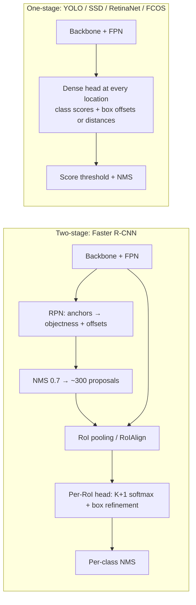

# Session 07 — Object Detection II: One-Stage Detectors, NMS & Evaluation · Solutions

> Questions: [07_questions.md](07_questions.md) · Notes: [../notes/07_detection_one_stage.md](../notes/07_detection_one_stage.md) · Code: [../code/iou_nms_ap.py](../code/iou_nms_ap.py)
>
> Box convention: $(x_1,y_1,x_2,y_2)$, continuous coordinates, area $=(x_2-x_1)(y_2-y_1)$ — no +1. $\ln$ = natural log.

## Section A — MCQs

### Q1 — Answer: **C**
**Why C:** $S\times S\times(5B+C)=7\times7\times(5\cdot2+20)=7\times7\times30$ — each of the 2 boxes has $(x,y,w,h,\text{conf})$ and the 20 class probabilities are shared per cell.
- **A** ✗ — $5+20=25$ assumes only one box per cell ($B=1$).
- **B** ✗ — $4+20=24$ forgets the confidence and the second box.
- **D** ✗ — $2\times(5+20)=50$ wrongly gives each box its own class probabilities (that is how anchor-based YOLOv2+ work, not YOLOv1).

### Q2 — Answer: **A**
**Why A:** A box is suppressed only when its IoU with a higher-scoring box **exceeds** the threshold; raising the threshold to 0.7 means only very-high-overlap boxes are removed → fewer suppressions, more surviving boxes (better recall on overlapping objects, more duplicates).
- **B** ✗ — classic trap; that is the effect of **lowering** the threshold.
- **C** ✗ — greedy NMS never changes scores (Soft-NMS does); the set of survivors changes.
- **D** ✗ — confuses the NMS **IoU** threshold with a **confidence** threshold.

### Q3 — Answer: **D**
**Why D:** AP = area under the precision–recall curve, made monotone with the precision envelope (all-point, 11-point or 101-point interpolation).
- **A** ✗ — ROC needs true negatives, which are undefined in detection (every unreported background window).
- **B** ✗ — recall vs IoU threshold is a different diagnostic (average recall), not AP.
- **C** ✗ — precision vs threshold ignores recall; AP integrates precision over **recall**.

### Q4 — Answer: **B**
**Why B:** COCO AP averages over IoU thresholds 0.50:0.05:0.95 — that is **10** values — and over the 80 classes (101-point AP at each).
- **A** ✗ — wrong step (0.1) and count (5); the trap.
- **C** ✗ — only two thresholds would ignore the intermediate localisation quality.
- **D** ✗ — the thresholds are on **IoU**, not on confidence; AP already integrates over confidence.

### Q5 — Answer: **C**
**Why C:** With $\gamma=0$ the modulating factor $(1-p_t)^0=1$, so $FL=-\alpha_t\log p_t$ — α-balanced cross-entropy (plain CE if also $\alpha_t=1$).
- **A** ✗ — $(1-p_t)^0=1$, not 0.
- **B** ✗ — that would need a large $\gamma$; with $\gamma=0$ all examples count fully.
- **D** ✗ — smooth-L1 is a regression loss on box offsets, unrelated.

### Q6 — Answer: **D**
**Why D:** FCOS is anchor-free: each location inside a GT box regresses $(l,t,r,b)$; centre-ness (BCE-trained) multiplies the class score so off-centre, low-quality boxes rank low — and NMS is still applied afterwards.
- **A** ✗ — trap: anchor-free ≠ NMS-free; FCOS uses NMS.
- **B** ✗ — that describes RetinaNet; FCOS has one prediction per location.
- **C** ✗ — FCOS assigns levels by the **regression range** of $\max(l,t,r,b)$ (0/64/128/256/512), not by anchor IoU.

### Q7 — Answer: **A**
**Why A:** SSD mines hard negatives: negatives are sorted by confidence loss and only the top ones are kept so that neg : pos ≤ 3 : 1.
- **B** ✗ — using all boxes lets the easy negatives dominate the loss.
- **C** ✗ — 1 : 1 random sampling is closer to the Faster R-CNN RPN, and SSD picks the *hardest*, not random, negatives.
- **D** ✗ — focal loss was introduced later by RetinaNet.

### Q8 — Answer: **B**
**Why B:** CenterNet treats each object as a heatmap peak; a 3×3 max-pool keeps local maxima (value equal to the pooled value), then the top-100 peaks are decoded — no IoU-based NMS.
- **A** ✗ — avoiding NMS is one of CenterNet's selling points.
- **C** ✗ — Hungarian matching is used by DETR during **training**, never at inference.
- **D** ✗ — Soft-NMS is a modification of NMS, which CenterNet does not need.

## Section B — Numericals

### Q9 — IoU, GIoU and Dice
**Given:** $A=(10,10,60,50)$, $\lvert A\rvert=50\times40=2000$; $B=(30,20,90,70)$, $\lvert B\rvert=3000$; $C=(70,60,100,90)$, $\lvert C\rvert=900$; $D=(20,20,40,40)$, $\lvert D\rvert=400$.
**Formula:**

$$
\text{IoU}=\frac{I}{\lvert A\rvert+\lvert X\rvert-I},\qquad \text{GIoU}=\text{IoU}-\frac{\lvert E\rvert-\lvert A\cup X\rvert}{\lvert E\rvert},\qquad \text{Dice}=\frac{2\,\text{IoU}}{1+\text{IoU}}
$$

**Working:**
(a) $A,B$: $I=(\min(60,90)-\max(10,30))\times(\min(50,70)-\max(10,20))=30\times30=900$; union $=2000+3000-900=4100$ → IoU $=\mathbf{0.2195}$.
$A,C$: $\min(60,100)-\max(10,70)=-10<0$ → $I=0$ → IoU $=\mathbf{0}$.
$A,D$: $D\subset A$ → $I=400$, union $=2000$ → IoU $=\mathbf{0.200}$ (containment: IoU = small area / large area).
(b) $A,B$: $E=(10,10,90,70)$, $\lvert E\rvert=80\times60=4800$ → GIoU $=0.2195-\frac{700}{4800}=0.2195-0.1458=\mathbf{0.0737}$.
$A,C$: $E=(10,10,100,90)$, $\lvert E\rvert=90\times80=7200$, union $=2900$ → GIoU $=0-\frac{4300}{7200}=\mathbf{-0.597}$.
(c) Dice $=\frac{2(0.2195)}{1.2195}=\mathbf{0.36}$ (check: $\frac{2\cdot900}{2000+3000}=0.36$). For $(A,C)$, IoU is 0 whatever the distance, so $1-\text{IoU}$ has **zero gradient**; GIoU ($-0.597$) increases as $C$ moves towards $A$, so $1-\text{GIoU}=1.597$ still gives a useful gradient.
**Answer:** IoU = **0.2195, 0, 0.200**; GIoU = **0.074, −0.597**; Dice = **0.36**.
> ✔ Verified numerically (Python).
> **Common slip:** using +1 in widths (not our convention) or forgetting to clamp negative overlaps to 0.

### Q10 — Greedy NMS and Soft-NMS
**Given:** five boxes, one class; each box is 100×100 (area 10 000) except $b_3,b_5$ (80×100, area 8000).
**Formula:** greedy NMS: keep max, delete IoU > $\tau$; linear Soft-NMS $s_i\leftarrow s_i(1-\text{IoU})$ if IoU ≥ $N_t$.
**Working:**
(a) $b_1,b_2$: $I=90\times95=8550$, union $=20000-8550=11450$ → **0.747**.
$b_1,b_4$: $I=50\times50=2500$, union $17500$ → **0.143**.
$b_2,b_4$: $I=60\times55=3300$, union $16700$ → **0.198**.
$b_3,b_5$: $I=70\times90=6300$, union $8000+8000-6300=9700$ → **0.649** (6300/9700 = 0.6495).
(b) $\tau=0.5$, order $b_1,b_2,b_3,b_4,b_5$:
1. Keep $b_1$; $b_2$ (0.747 > 0.5) **suppressed**; $b_4$ (0.143) stays; $b_3,b_5$ (0) stay.
2. Keep $b_3$; $b_5$ (0.649 > 0.5) **suppressed**; $b_4$ (0) stays.
3. Keep $b_4$. List empty.
→ **kept $\{b_1,b_3,b_4\}$**.
(c) $\tau=0.7$: $b_1$ suppresses $b_2$ (0.747 > 0.7); $b_3$ does **not** suppress $b_5$ (0.649 < 0.7) → **kept $\{b_1,b_3,b_4,b_5\}$** — a higher threshold suppresses **fewer** boxes.
(d) Select $b_1$: $b_2$ → $0.90(1-0.747)=0.228$; $b_4$ (0.143 < 0.5) unchanged. Select $b_3$: $b_5$ → $0.60(1-0.649)=0.210$. Select $b_4$: IoU with $b_2$ = 0.198 < 0.5 → no change. Final scores: $b_1$ 0.95, $b_3$ 0.85, $b_4$ 0.80, **$b_2$ 0.228**, **$b_5$ 0.210** — nothing deleted, duplicates just ranked low.
**Answer:** IoUs 0.747, 0.143, 0.198, 0.649; NMS@0.5 keeps **$b_1,b_3,b_4$**; NMS@0.7 keeps **$b_1,b_3,b_4,b_5$**; Soft-NMS scores **0.228** and **0.210**.
> ✔ Verified numerically (Python).
> **Common slip:** comparing every box with every other box instead of only with the **kept** box at each step.

### Q11 — AP (all-point and 11-point), mAP and COCO-style AP
**Given:** $N_{GT}=5$, 10 ranked detections, IoU threshold 0.5.
**Formula:**

$$
P_k=\frac{TP_k}{k},\quad R_k=\frac{TP_k}{5},\quad AP_{all}=\sum_k(R_k-R_{k-1})\,p_{interp}(R_k),\quad AP_{11}=\frac1{11}\sum_{r\in\{0,\dots,1\}}p_{interp}(r)
$$

**Working:**
(a)
| $k$ | Det | Result | Reason | cum TP | cum FP | Precision | Recall |
|---|---|---|---|---|---|---|---|
| 1 | $d_1$ | TP | $G_1$, 0.82 | 1 | 0 | 1.000 | 0.2 |
| 2 | $d_2$ | TP | $G_2$, 0.76 | 2 | 0 | 1.000 | 0.4 |
| 3 | $d_3$ | FP | duplicate of $G_1$ | 2 | 1 | 0.667 | 0.4 |
| 4 | $d_4$ | TP | $G_3$, 0.57 | 3 | 1 | 0.750 | 0.6 |
| 5 | $d_5$ | FP | IoU 0.42 < 0.5 | 3 | 2 | 0.600 | 0.6 |
| 6 | $d_6$ | FP | no GT | 3 | 3 | 0.500 | 0.6 |
| 7 | $d_7$ | TP | $G_4$ still unmatched, 0.71 | 4 | 3 | 0.571 | 0.8 |
| 8 | $d_8$ | FP | duplicate of $G_2$ | 4 | 4 | 0.500 | 0.8 |
| 9 | $d_9$ | FP | no GT | 4 | 5 | 0.444 | 0.8 |
| 10 | $d_{10}$ | TP | $G_5$, 0.53 | 5 | 5 | 0.500 | 1.0 |

(b) Precision envelope (max precision at recall ≥ $r$): $R=0.2\to1.0$, $0.4\to1.0$, $0.6\to0.75$, $0.8\to0.571$, $1.0\to0.5$.
$AP_{all}=0.2(1.0)+0.2(1.0)+0.2(0.75)+0.2(0.571)+0.2(0.5)=0.2\times3.821=\mathbf{0.764}$ (exactly $107/140$).
(c) $p_{interp}$ at $r=0,0.1,0.2,0.3,0.4$: 1.0 (5 points); $r=0.5,0.6$: 0.75; $r=0.7,0.8$: 0.571; $r=0.9,1.0$: 0.5.
$AP_{11}=\frac{5(1)+2(0.75)+2(0.571)+2(0.5)}{11}=\frac{8.643}{11}=\mathbf{0.786}$.
(d) (i) mAP@0.5 $=\frac{0.764+0.62+0.51}{3}=\mathbf{0.631}$.
(ii) $AP_{[.5:.95]}=\frac{0.764+0.664+0.486+0.486+0.486+0.400+0.200+0+0+0}{10}=\frac{3.486}{10}=\mathbf{0.349}$. Much lower than 0.764 because the boxes are **loose**: only $d_1$ reaches IoU ≥ 0.8 and none reaches 0.85, so precision collapses at strict thresholds — COCO AP rewards precise localisation.
**Answer:** AP (all-point) = **0.764**; AP (11-point) = **0.786**; mAP@0.5 = **0.631**; COCO-style AP = **0.349**.
> ✔ Verified numerically (Python, exact fractions). COCO's 101-point AP@0.5 for this list would be 0.767.
> **Common slip:** marking $d_7$ as a duplicate — $d_5$ was an FP, so $G_4$ was still unmatched. If you code 11-point AP with `np.arange(0, 1.1, 0.1)`, floating-point values such as 0.6000000000000001 can wrongly fail `recall >= r`; use a tolerance or exact fractions.

### Q12 — YOLO, SSD and RetinaNet output sizes
**Given:** designs as stated.
**Formula:**

$$
\text{YOLOv1}: S\times S\times(5B+C),\qquad N_{boxes}=\sum_k f_k^2\,n_k,\qquad \text{SSD head channels}=(C+1+4)\,k
$$

**Working:**
(a) VOC: $7\times7\times(10+20)=\mathbf{7\times7\times30}$ = **1470** values; boxes $=7\cdot7\cdot2=\mathbf{98}$. COCO: $7\times7\times(10+80)=\mathbf{7\times7\times90}$ (4410 values).
(b) Grids $416/32=\mathbf{13}$, $416/16=\mathbf{26}$, $416/8=\mathbf{52}$. Channels per scale $=3\times(4+1+80)=\mathbf{255}$. Boxes $=3(13^2+26^2+52^2)=3(169+676+2704)=3\times3549=\mathbf{10\,647}$.
(c) $38^2\cdot4+19^2\cdot6+10^2\cdot6+5^2\cdot6+3^2\cdot4+1^2\cdot4=5776+2166+600+150+36+4=\mathbf{8732}$. conv4_3 head: $(21+4)\times4=\mathbf{100}$ channels (84 class + 16 box).
(d) Maps $640/8=80$, $40$, $20$, $10$, $5$ → $6400+1600+400+100+25=8525$ locations × 9 = **76 725** anchors.
**Answer:** **7×7×30** (1470 values, 98 boxes), COCO **7×7×90**; YOLOv3 **13/26/52**, **255** channels, **10 647** boxes; SSD **8732**, **100** channels; RetinaNet **76 725** anchors.
> ✔ Verified numerically (Python).
> The jump from 98 (YOLOv1) to ~$10^4$–$10^5$ candidates is exactly why later one-stage detectors needed hard-negative mining or focal loss.

### Q13 — Focal loss and FCOS targets
**Given:** $\gamma=2$, $\alpha=0.25$; FCOS GT $(50,40,250,200)$, point $(110,90)$.
**Formula:**

$$
CE=-\ln p_t,\qquad FL=-\alpha_t(1-p_t)^2\ln p_t,\qquad \text{centreness}=\sqrt{\frac{\min(l,r)}{\max(l,r)}\cdot\frac{\min(t,b)}{\max(t,b)}}
$$

**Working:**
(a) (i) Background ($y=0$), $p=0.1$ → $p_t=0.9$, $\alpha_t=0.75$: $CE=-\ln0.9=\mathbf{0.1054}$; $FL=0.75\times0.1^2\times0.1054=\mathbf{7.90\times10^{-4}}$ (133× smaller; the modulating factor alone gives 100×).
(ii) Foreground ($y=1$), $p=0.5$ → $p_t=0.5$, $\alpha_t=0.25$: $CE=\ln2=\mathbf{0.6931}$; $FL=0.25\times0.25\times0.6931=\mathbf{0.0433}$ (modulating factor alone: 4×).
(b) Hard foreground: $p_t=0.1$ → $CE=2.3026$; $FL=0.25\times0.81\times2.3026=0.4663$.
| | Background total | Foreground total | Foreground share |
|---|---|---|---|
| CE | $10^5\times0.1054=10\,536$ | $100\times2.3026=230.3$ | **2.1 %** |
| FL | $10^5\times7.90\times10^{-4}=79.0$ | $100\times0.4663=46.6$ | **37.1 %** |
Under CE, 100 000 individually tiny easy-negative losses outweigh the 100 informative hard positives by **46×**, so the gradient is spent on examples that are already correct. Under focal loss the ratio drops to **1.7×** — the hard positives now drive learning, with no sampling needed.
(c) $l^*=110-50=\mathbf{60}$, $t^*=90-40=\mathbf{50}$, $r^*=250-110=\mathbf{140}$, $b^*=200-90=\mathbf{110}$. $\max=140\in(128,256]$ → **$P_5$** (stride 32). Centre-ness $=\sqrt{\frac{60}{140}\cdot\frac{50}{110}}=\sqrt{0.4286\times0.4545}=\sqrt{0.1948}=\mathbf{0.441}$ (the point is well off-centre — the exact centre $(150,120)$ would give 1.0).
**Answer:** (i) CE 0.105, FL $7.9\times10^{-4}$; (ii) CE 0.693, FL 0.0433; foreground share **2.1 % (CE) → 37.1 % (FL)**; FCOS $(60,50,140,110)$, **$P_5$**, centre-ness **0.441**.
> ✔ Verified numerically (Python).
> **Common slip:** giving the background anchor $\alpha_t=0.25$ — in focal loss $\alpha=0.25$ weights the **foreground**; background gets $1-\alpha=0.75$.

## Section C — Short answers (model answers)

### Q14 — YOLOv1
- **Single regression**: one CNN pass maps the 448×448 image to a $7\times7\times30$ tensor containing all boxes and class probabilities — no proposals, no per-region processing → real time.
- **Grid & responsibility**: the image is split into $S\times S$ cells; the cell containing an object's **centre** is responsible for it. Each cell predicts $B=2$ boxes $(x,y,w,h,\text{conf})$ and one set of $C$ class probabilities; of the 2 predictors, the one with the **highest IoU** with the GT is responsible (gets coordinate loss) → predictors specialise.
- **Confidence** $=\Pr(\text{Obj})\times\text{IoU}^{\text{truth}}_{\text{pred}}$: "is there an object, and how well does this box fit it". Test-time class score $=\Pr(\text{Class}\mid\text{Obj})\times\text{conf}$, then per-class NMS.
- **Limitations → fixes**:
  1. ≤2 boxes and **1 class per cell** → misses small objects in groups and adjacent objects → **anchor boxes** with per-anchor class predictions (YOLOv2), **3 output scales** with 3 anchors each (YOLOv3).
  2. **Small objects / coarse 7×7 grid** → finer grids (13×13 at 416), passthrough layer (v2), FPN-like multi-scale heads (v3+).
  3. Poor localisation / unusual aspect ratios → **k-means anchor priors** (IoU distance) and sigmoid-bounded centre offsets (v2); later anchor-free decoupled heads (YOLOX, YOLOv8).

*Closing line:* YOLOv1 traded accuracy (especially small, clustered objects) for speed; later versions recovered accuracy while staying real-time.

### Q15 — NMS
- **Greedy NMS** (per class): sort by score → keep the highest box $M$ → delete every remaining box with IoU($M$, $b$) > $\tau$ → repeat on the rest until empty.
- **Threshold effect**: **lower** $\tau$ (e.g. 0.3) → more aggressive suppression → fewer duplicates (**higher precision**) but nearby true objects get deleted (**lower recall**); **higher** $\tau$ (e.g. 0.7) → fewer suppressions → better recall on overlapping objects but more duplicates (FPs). Typical $\tau\approx0.5$.
- **Crowds**: two genuinely overlapping people with IoU > $\tau$ — the lower-scoring true detection is deleted → missed object. No single $\tau$ fits both sparse and crowded regions.
- **Soft-NMS**: instead of deleting, **decay** overlapping scores — linear $s_i(1-\text{IoU})$ or Gaussian $s_ie^{-\text{IoU}^2/\sigma}$. A heavily overlapping box drops in rank but can still be output if its score was high → better recall/AP in crowds; drop-in, no retraining.

*Closing line:* NMS is a hand-tuned post-process; learned alternatives (CenterNet peaks, DETR set prediction — [Session 08](../notes/08_detection_transformers.md)) try to remove it.

### Q16 — Anchor-based vs anchor-free
- **Anchors**: fixed reference boxes (scales × aspect ratios) at every location/level; the head predicts class scores and offsets relative to each anchor. **Assignment** by IoU with GT (e.g. RetinaNet ≥ 0.5 positive, < 0.4 negative, else ignored; RPN 0.7/0.3). **Hyper-parameters**: number, scales, ratios, IoU thresholds, levels — dataset-specific; ~$10^5$ anchors, mostly negative.
- **FCOS**: every location (on FPN $P_3$–$P_7$) that falls inside a GT box is positive and regresses distances $(l,t,r,b)$; ambiguity resolved by FPN **size ranges** and smallest-area rule; **centre-ness** suppresses low-quality off-centre boxes; focal + IoU loss.
- **CenterNet**: objects = **centre points** on a stride-4 heatmap per class (Gaussian targets) + offset + size regression; inference by **3×3 max-pool** peak extraction.
- **Benefits of anchor-free**: fewer hyper-parameters, 1 prediction per location, no IoU matching of anchors; performance comparable or better (ATSS: the real difference is the positive/negative definition).
- **NMS?** No — anchor-free ≠ NMS-free. FCOS (and YOLOX/YOLOv8) still use NMS; only designs with one-to-one outputs (CenterNet's peak extraction approximately, DETR exactly) avoid it.

### Q17 — Class imbalance in one-stage detectors
- **Problem**: a one-stage detector scores $10^4$–$10^5$ anchors per image but only a few dozen are positive. Each easy negative has a small loss, but their **sum dominates** (e.g. 100 000 easy negatives at CE 0.105 = 10 536 vs 100 hard positives = 230) → gradients are wasted on solved examples and the classifier is biased towards background.
- **Two-stage remedy**: the **RPN** filters candidates down to ~2000/300 proposals, removing most easy background; the RPN and the head then use **fixed fg:bg sampling** (1:1, 1:3). Effective, but needs the extra stage.
- **SSD hard-negative mining**: keep only the negatives with the highest confidence loss so that neg : pos ≤ **3 : 1**; discards most data, hard cut-off, sensitive to the ratio.
- **Focal loss** (RetinaNet): keep **all** anchors, multiply CE by $(1-p_t)^\gamma$ ($\gamma=2$) → easy examples' loss shrinks ~100× at $p_t=0.9$; plus $\alpha$-balancing, normalisation by #positives, prior-probability initialisation ($\pi=0.01$). Smooth, automatic, no sampling hyper-parameters.

| | Proposals + sampling | Hard-negative mining | Focal loss |
|---|---|---|---|
| Uses all negatives? | no (sampled) | no (top 3× pos) | **yes**, re-weighted |
| Extra stage? | yes | no | no |
| Key hyper-parameters | fg fraction, IoU thresholds | neg:pos ratio | $\gamma$, $\alpha$ |

## Section D — Long answers (model answers)

### Q18 — Compare two-stage and one-stage detectors

**Intro.** Both families map an image to a set of (class, box, score) triples using dense candidates, IoU-based label assignment, box regression and NMS. They differ in **whether candidates are first filtered and re-pooled (two-stage) or classified directly in one dense pass (one-stage)**.

**Pipelines**

**1. Candidate generation & labelling**
- *Two-stage*: RPN anchors (9/location) labelled by IoU (> 0.7 / < 0.3) → ~300–2000 class-agnostic proposals → head labels proposals (IoU ≥ 0.5 fg).
- *One-stage*: anchors (SSD default boxes, RetinaNet 9/location, YOLOv2+ k-means anchors) or points (FCOS, CenterNet) labelled once; $10^4$–$10^5$ candidates go straight to the final classifier.

**2. Class imbalance**
- *Two-stage*: proposal stage removes easy negatives; fixed fg:bg sampling (RPN 1:1, head 25 % fg).
- *One-stage*: must face the full imbalance: $\lambda_{noobj}$ (YOLOv1), hard-negative mining 3:1 (SSD), **focal loss** (RetinaNet, FCOS).

**3. Anchors and NMS**
- *Two-stage*: anchors in the RPN; boxes refined twice (anchor → proposal → final); **NMS twice**.
- *One-stage*: anchor-based or anchor-free; one regression step; **NMS once** (CenterNet: max-pool peaks). Neither family is NMS-free in its classic form — DETR ([Session 08](../notes/08_detection_transformers.md)) is.

**4. Speed vs accuracy**

| | Two-stage | One-stage |
|---|---|---|
| Speed | slower: per-RoI head × hundreds of RoIs; classic VGG-16 Faster R-CNN ≈ 5 fps | real time: one dense pass (tens to 100+ fps) |
| Accuracy | historically higher, esp. small objects, high-IoU localisation | historically lower; now comparable |
| Features per object | re-pooled, aligned (RoIAlign) | fixed receptive field at a location |
| Complexity | more components and hyper-parameters | simpler, easier to deploy/export |
| Extensions | masks, keypoints per RoI (Mask R-CNN), cascades | heads for masks/pose exist but less natural |

**5. Why one-stage lagged — and what closed the gap**
- *Causes*: (i) **extreme fg/bg imbalance** — easy negatives dominate the loss; (ii) **no second refinement** with aligned features; (iii) **coarse features** for small objects (YOLOv1's 7×7 grid, SSD's shallow conv4_3).
- *Fixes*: **FPN** (strong semantics at high resolution), **focal loss** (RetinaNet matched two-stage accuracy), better **label assignment** (ATSS, centre sampling, SimOTA), **anchor-free heads** (FCOS, CenterNet, YOLOX), **IoU-based losses** (GIoU), stronger backbones and augmentation (Mosaic, multi-scale training).

**6. Recommendations**
- *Real-time video on an edge device* (e.g. traffic camera, robot): **one-stage** (modern YOLO / FCOS-style, anchor-free, FPN) — latency budget dominates, accuracy now competitive.
- *Offline, accuracy-critical, small/crowded objects or masks needed* (e.g. medical slides, satellite imagery, instance segmentation): **two-stage** (Faster/Mask R-CNN with FPN, Cascade R-CNN).

*Conclusion:* two-stage = "propose then refine" (accuracy through filtering and re-pooling); one-stage = "predict densely once" (speed, with imbalance solved by loss design). The gap is now small; choose by latency budget, object size and the need for per-instance heads.

**Marking scheme:** 2 – pipelines + diagram · 2 – candidates, labelling, anchors/NMS · 2 – imbalance handling · 2 – speed/accuracy and why the gap closed · 2 – justified recommendations.

### Q19 — Real-time small-object detector for drone video

**Problem framing.** Top-down views, objects 10–40 px, dense car parks, motion blur, varying altitude (scale changes), ≥ 25 fps on an embedded GPU. Small objects are the main accuracy problem; dense scenes stress NMS; the latency budget rules out heavy two-stage models.

**1. Architecture (one-stage, anchor-free)**
- **Backbone**: efficient CNN (e.g. a CSP-style or ResNet-18/34-class network), ImageNet/COCO pre-trained ([notes 04](../notes/04_training_transfer_learning.md)).
- **Neck**: **FPN/PAN** with an **extra high-resolution level $P_2$ (stride 4)** — at stride 32 a 16 px car occupies less than one cell; $P_2$/$P_3$ give several cells per object. Drop $P_6$/$P_7$ (no very large objects) to save compute.
- **Head**: **anchor-free, decoupled** classification and regression branches (FCOS / YOLOX / YOLOv8-style). Rationale: no anchor tuning for tiny objects (anchor IoU with a 12 px box is extremely sensitive to 2–3 px shifts), one prediction per location.
- If anchors are used instead: **k-means** on the drone dataset's box sizes, placed on $P_2$–$P_4$.

**2. Label assignment and losses**
- Centre sampling or a dynamic assignment (ATSS / SimOTA) — fixed IoU thresholds give tiny objects too few positives.
- **Focal loss** (or a variant) for classification — tens of thousands of background locations per frame.
- **GIoU/CIoU loss** for boxes (scale-invariant, gradient when not overlapping) + centre-ness/objectness branch.

**3. Small objects and data**
- **Input resolution**: keep the native resolution (e.g. 1280 px) or use **tiled inference** (overlapping crops, merged before NMS) when the budget allows.
- **Augmentation**: mosaic, copy-paste of small objects, random scale (altitude), rotation (top-down views have no canonical orientation), blur and lighting.
- Balanced sampling of rare classes (e.g. pedestrians vs cars).

**4. Duplicate removal in dense scenes**
- Per-class NMS with a **tuned, slightly higher** IoU threshold (e.g. 0.6) because neighbouring parked cars overlap little in top-down views but their boxes may touch; or **Soft-NMS** to avoid deleting adjacent true objects; when tiling, a global NMS after merging tiles.
- Optional tracking (e.g. IoU/Kalman tracker) for temporal consistency and counting.

**5. Speed engineering**
- FP16/INT8 inference with an optimised runtime, fused NMS on GPU, measure **end-to-end latency including pre/post-processing**; trade resolution vs fps on the target board.

**6. Evaluation protocol**
- Held-out flights (different sites, altitudes, weather) — avoid frame-level leakage between train and test.
- **COCO AP@[.5:.95]** (localisation quality), **AP50** (detection ability — at 10–40 px a few pixels of error already drop IoU below 0.75), **AP75**.
- **Size breakdown**: COCO AP_S/M/L (32², 96²) plus finer custom bins (e.g. < 16², 16²–32²) since almost everything is "small" by COCO's definition.
- Per-class PR curves; state the AP interpolation (101-point COCO).
- **Deployment thresholds**: choose the confidence threshold on a validation set to maximise F1 (or to meet a required precision/recall); tune the NMS IoU threshold on crowded validation scenes by AP and by visual duplicate/miss counts; report fps/latency on the device.

**Trade-offs.** Higher resolution and a $P_2$ level raise small-object AP but cost fps; anchor-free + focal + GIoU reduce tuning; Soft-NMS helps crowded car parks at little cost. A two-stage detector would be more accurate on tiny objects but would miss the 25 fps budget on embedded hardware.

**Marking scheme:** 2 – framing and constraints · 3 – architecture choices (backbone, FPN with high-res level, anchor-free head) justified · 2 – assignment, losses, imbalance and small-object strategy · 1 – dense-scene NMS · 2 – evaluation protocol and threshold selection.
