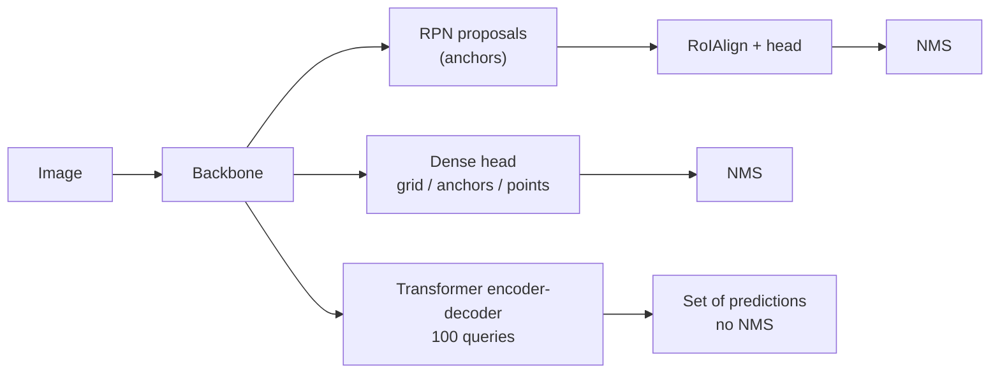

# Session 08 — Object Detection III: Transformers · Solutions

> Questions: [08_questions.md](08_questions.md) · Notes: [../notes/08_detection_transformers.md](../notes/08_detection_transformers.md)

## Section A — MCQs

### Q1 — Answer: **B**
**Why B:** DETR's class FFN is a linear layer + softmax over $C+1$ classes; the extra class $\varnothing$ ("no object") is what the ~93 unused queries predict.
- **A** ✗ — there is no separate objectness score; "no object" is just one more softmax class.
- **C** ✗ — DETR is single-stage end-to-end; there is no second-stage classifier.
- **D** ✗ — DETR uses no NMS, and background must be predicted explicitly as $\varnothing$.

### Q2 — Answer: **C**
**Why C:** Hungarian matching assigns the 7 GT objects to 7 distinct queries; only those pairs get the L1 + GIoU box loss. The other 93 queries are matched to $\varnothing$ and receive only the (0.1-weighted) classification loss.
- **A** ✗ — $\varnothing$ queries have no box target.
- **B** ✗ — these are exactly the queries **without** a box loss.
- **D** ✗ — DETR uses one-to-one cost-based matching, not IoU-threshold (many-to-one) assignment.

### Q3 — Answer: **A**
**Why A:** Object queries are $N\times d$ learned parameters (learnt positional encodings), the same for all images; image content enters only through cross-attention, so the decoder **outputs** are image-specific.
- **B** ✗ — DETR has no RPN or proposals.
- **C** ✗ — DETR has no anchors; queries carry no fixed box geometry.
- **D** ✗ — the encoder tokens are the memory (keys/values for cross-attention), not the queries.

### Q4 — Answer: **D**
**Why D:** With one-to-one matching only one query can be matched to each object; a duplicate is matched to $\varnothing$ and its confident prediction is penalised by the classification loss. Decoder self-attention gives queries the means to "agree" on who predicts which object.
- **A** ✗ — a threshold removes low-confidence predictions, not confident duplicates.
- **B** ✗ — 100 queries could still all fire on the same object; the number alone prevents nothing.
- **C** ✗ — GIoU loss only compares a prediction with its own matched GT box; it does not act between predictions.

### Q5 — Answer: **C**
**Why C:** Multi-scale deformable attention lets each query sample only $K$ points per head per level at **predicted offsets** around a reference point. Attention is sparse and focused from the start (fast convergence), costs are linear in $HW$, and high-resolution levels become affordable (small objects).
- **A** ✗ — Deformable DETR keeps Hungarian matching and stays NMS-free.
- **B** ✗ — the "deformable" part is the attention module, not the backbone convolutions.
- **D** ✗ — the encoder is kept, using deformable self-attention over the multi-scale maps.

### Q6 — Answer: **B**
**Why B:** Grounding DINO extends the **DINO detector** ("DETR with Improved deNoising anchOr boxes") with text grounding.
- **A** ✗ — this is the classic trap: self-supervised DINO (Session 13) is a different method.
- **C** ✗ — invented expansion; no such dataset is involved.
- **D** ✗ — "DINO" in the name is the detector architecture, not a DINOv2 backbone.

### Q7 — Answer: **D**
**Why D:** Correct class with $t_b=0.1\le\text{IoU}=0.35<t_f=0.5$ → the box is in the right place roughly but not accurately enough → **localisation** error.
- **A** ✗ — classification error needs IoU ≥ $t_f$ with a GT of a **different** class.
- **B** ✗ — duplicate needs IoU ≥ $t_f$ with a GT already matched by a higher-scoring detection.
- **C** ✗ — background needs IoU $<t_b$ with **every** GT; here IoU with the dog is 0.35.

## Section B — Numericals

### Q8 — Hungarian assignment of a 4 × 3 cost matrix

**Given:** $\mathbf C$ (rows $q_1..q_4$, columns $g_1,g_2,g_3$) = (2,3,7), (7,9,8), (1,5,6), (5,1,2).

**(a) Padding.** Add one $\varnothing$ column with cost **0** for every query: in DETR's matching cost both terms are multiplied by $\mathbb 1_{\{c_i\neq\varnothing\}}$, so any query–$\varnothing$ pair costs 0 (no preference among queries for being "no object").

$$
\mathbf C_{pad}=\begin{bmatrix}2&3&7&0\\7&9&8&0\\1&5&6&0\\5&1&2&0\end{bmatrix}
$$

**(b) Hungarian method.**
1. **Row reduction:** every row minimum is 0 (the $\varnothing$ column) → matrix unchanged.
2. **Column reduction:** column minima $(1,1,2,0)$ →

$$
\begin{bmatrix}1&2&5&0\\6&8&6&0\\0&4&4&0\\4&0&0&0\end{bmatrix}
$$

3. **Cover zeros:** minimum cover = column $g_1$, column $\varnothing$, row $q_4$ → **3 lines < 4** → not optimal yet.
4. **Adjust:** uncovered entries (rows $q_1,q_2,q_3$ × columns $g_2,g_3$) are 2, 5, 8, 6, 4, 4 → smallest $k=2$. Subtract 2 from uncovered entries, add 2 to the doubly covered entries $(q_4,g_1)$ and $(q_4,\varnothing)$:

$$
\begin{bmatrix}1&0&3&0\\6&6&4&0\\0&2&2&0\\6&0&0&2\end{bmatrix}
$$

5. **Cover again:** zeros now need **4 lines** (one per column) → optimal assignment exists among the zeros.
6. **Assign:** $q_2$ has a single zero (column $\varnothing$) → $q_2\to\varnothing$; then $q_3\to g_1$; $q_1\to g_2$; $q_4\to g_3$.

**(c) Answer:** $q_1\to g_2$ (3), $q_3\to g_1$ (1), $q_4\to g_3$ (2), $q_2\to\varnothing$.
**Total cost = 3 + 1 + 2 = 6** (original costs). **$q_2$** is trained towards "no object" (it is expensive for every object).

**(d) Greedy:** take $(q_3,g_1)=1$, then $(q_4,g_2)=1$, then only $g_3$ is left with $q_1$ (7) or $q_2$ (8) → $(q_1,g_3)=7$. **Greedy total = 9** — 50% worse than the optimum, because it commits $q_4$ to $g_2$ and is then forced into an expensive pair. The Hungarian algorithm optimises the **sum** (global optimum, $O(n^3)$); the next-best complete assignment also costs 9, so the optimum 6 is unique.

**Answer:** **$q_1\to g_2,\ q_3\to g_1,\ q_4\to g_3,\ q_2\to\varnothing$; total cost 6** (greedy: 9).
> ✔ Verified numerically (Python: `scipy.optimize.linear_sum_assignment` + brute force over all 24 assignments + step-by-step reduction).
> **Common slip:** forgetting that the final cost must be read from the **original** matrix, not the reduced one (the reduced entries at the chosen zeros are all 0).

### Q9 — DETR matching cost from class probabilities, L1 and GIoU

**Given:** $b_1=(0.30,0.40,0.20,0.30)$ cat, $b_2=(0.70,0.60,0.30,0.40)$ dog; queries in the table; GIoU matrix given; $\lambda_{L1}=5,\ \lambda_{giou}=2$.

**Formula:**

$$
\mathbf C_{ji}=-\hat p_j(c_i)+5\,\Vert b_i-\hat b_j\Vert_1+2\,\big(1-\text{GIoU}(b_i,\hat b_j)\big)
$$

**(a) L1 distances** (sum of 4 absolute coordinate differences):

| Pair | $\lvert\Delta c_x\rvert+\lvert\Delta c_y\rvert+\lvert\Delta w\rvert+\lvert\Delta h\rvert$ | L1 |
|---|---|---|
| $q_1,g_1$ | 0.01 + 0.01 + 0.00 + 0.02 | **0.04** |
| $q_1,g_2$ | 0.39 + 0.19 + 0.10 + 0.12 | **0.80** |
| $q_2,g_1$ | 0.38 + 0.22 + 0.10 + 0.08 | **0.78** |
| $q_2,g_2$ | 0.02 + 0.02 + 0.00 + 0.02 | **0.06** |
| $q_3,g_1$ | 0.10 + 0.06 + 0.04 + 0.04 | **0.24** |
| $q_3,g_2$ | 0.30 + 0.14 + 0.06 + 0.06 | **0.56** |

**(b) Cost matrix:**

| | $g_1$ (cat) | $g_2$ (dog) |
|---|---|---|
| $q_1$ | $-0.60+5(0.04)+2(0.16)=-0.60+0.20+0.32=\mathbf{-0.08}$ | $-0.10+5(0.80)+2(1.48)=-0.10+4.00+2.96=\mathbf{6.86}$ |
| $q_2$ | $-0.15+5(0.78)+2(1.51)=-0.15+3.90+3.02=\mathbf{6.77}$ | $-0.70+5(0.06)+2(0.21)=-0.70+0.30+0.42=\mathbf{0.02}$ |
| $q_3$ | $-0.85+5(0.24)+2(0.81)=-0.85+1.20+1.62=\mathbf{1.97}$ | $-0.05+5(0.56)+2(1.31)=-0.05+2.80+2.62=\mathbf{5.37}$ |

**(c) Optimal matching** — try all $3\times2=6$ assignments $(g_1,g_2)$:
$(q_1,q_2)=-0.08+0.02=\mathbf{-0.06}$; $(q_1,q_3)=5.29$; $(q_2,q_1)=13.63$; $(q_2,q_3)=12.14$; $(q_3,q_1)=8.83$; $(q_3,q_2)=1.99$.
**Optimum: $q_1\to$ cat, $q_2\to$ dog, total $-0.06$; $q_3\to\varnothing$.**
No — $q_3$ has the highest cat probability (0.85) but its box is poor (L1 0.24, GIoU 0.19); the box terms add 2.82 to its cost versus 0.52 for $q_1$. Matching weighs **class and box together**, so the well-localised $q_1$ wins.

**(d) Classification-loss terms** (CE $=-w\ln\hat p(\text{target})$):
- $q_1$ (target cat): $-\ln0.60=\mathbf{0.511}$
- $q_2$ (target dog): $-\ln0.70=\mathbf{0.357}$
- $q_3$ (target $\varnothing$, weight 0.1): $0.1\times(-\ln0.10)=0.1\times2.303=\mathbf{0.230}$ — no box loss for $q_3$. The network is pushed to lower $q_3$'s cat score: this is how duplicates are suppressed without NMS.

**Answer:** **$q_1\to g_1$, $q_2\to g_2$ (total cost −0.06), $q_3\to\varnothing$; CE terms 0.511, 0.357, 0.230.**
> ✔ Verified numerically (Python; GIoU values computed with exact boxes then rounded to 2 d.p.).
> **Common slip:** using $-\log\hat p$ in the **matching** cost (DETR matching uses the probability) or forgetting the 0.1 weight for $\varnothing$ in the **loss**.

### Q10 — Normalised box conversion, IoU and GIoU

**Given:** $W=640$, $H=480$; $\hat b_1=(0.30,0.35,0.20,0.25)$, $\hat b_2=(0.75,0.35,0.20,0.25)$; $G=(160,120,288,240)$; area $=(x_2-x_1)(y_2-y_1)$, no +1.

**Formula:** $x_{1,2}=(c_x\mp\tfrac w2)W,\ y_{1,2}=(c_y\mp\tfrac h2)H$;

$$
\text{GIoU}=\text{IoU}-\frac{\lvert C\rvert-\lvert A\cup B\rvert}{\lvert C\rvert}
$$

**(a) Conversion:**
- $\hat b_1$: centre $(0.30\cdot640,\ 0.35\cdot480)=(192,168)$; size $(0.20\cdot640,\ 0.25\cdot480)=(128,120)$ → $P_1=(\mathbf{128,108,256,228})$.
- $\hat b_2$: centre $(480,168)$, size $(128,120)$ → $P_2=(\mathbf{416,108,544,228})$.

**(b) $P_1$ vs $G$:**
- Intersection: $x\in[160,256]$ → 96; $y\in[120,228]$ → 108 → $\lvert P_1\cap G\rvert=10{,}368$.
- Areas: $\lvert P_1\rvert=128\cdot120=15{,}360$; $\lvert G\rvert=128\cdot120=15{,}360$; union $=30{,}720-10{,}368=20{,}352$.
- IoU $=10{,}368/20{,}352=\mathbf{0.509}$.
- Enclosing box $C=(128,108,288,240)$: $160\cdot132=21{,}120$.
- GIoU $=0.5094-(21{,}120-20{,}352)/21{,}120=0.5094-0.0364=\mathbf{0.473}$.

**(c) $P_2$ vs $G$:**
- $P_2$ starts at $x_1=416>288=G_{x_2}$ → no overlap → IoU $=\mathbf 0$; union $=30{,}720$.
- $C=(160,108,544,240)$: $384\cdot132=50{,}688$.
- GIoU $=0-(50{,}688-30{,}720)/50{,}688=-19{,}968/50{,}688=\mathbf{-0.394}$.
- GIoU losses: $P_1$: $1-0.473=\mathbf{0.527}$; $P_2$: $1+0.394=\mathbf{1.394}$.
- **Why GIoU:** for non-overlapping boxes IoU is 0 regardless of distance → zero gradient, the box gets no signal to move. GIoU still decreases as the boxes move apart (here $-0.394$), so its loss has a gradient that pulls $P_2$ toward $G$. It is also **scale-invariant**, complementing the scale-dependent L1 term.

**Answer:** **$P_1=(128,108,256,228)$, $P_2=(416,108,544,228)$; IoU/GIoU = 0.509/0.473 and 0/−0.394; GIoU losses 0.527 and 1.394.**
> ✔ Verified numerically (Python, and `torchvision.ops.generalized_box_iou`).

### Q11 — Attention cost: DETR vs Deformable DETR

**Given:** $800\times1216$ image, stride 32, 8 heads, 6 layers, fp32; deformable $M=8,\ L=4,\ K=4$.

**Formula:** tokens $T=\frac{H_0}{s}\cdot\frac{W_0}{s}$; dense attention weights per head per layer $=T^2$; deformable samples per query $=M\cdot L\cdot K$.

**(a) Stride 32:**
- $T=25\times38=\mathbf{950}$ tokens.
- Per head per layer: $950^2=\mathbf{902{,}500}$ weights.
- One layer, 8 heads: $8\times902{,}500=7{,}220{,}000$ weights $\times4$ B $=\mathbf{28.88\ MB}$ (all 6 layers: 173.28 MB).

**(b) Stride 8:** $100\times152=\mathbf{15{,}200}$ tokens → $15{,}200^2=\mathbf{231{,}040{,}000}$ weights per head per layer → factor $\left(\frac{15{,}200}{950}\right)^2=16^2=\mathbf{256\times}$. (One 8-head layer would need ≈7.4 GB in fp32 — infeasible.)

**(c) Deformable DETR:**
- Tokens: $15{,}200+3{,}800+950+247=\mathbf{20{,}197}$.
- Samples per query: $8\times4\times4=\mathbf{128}$.
- Per encoder layer: $20{,}197\times128=\mathbf{2{,}585{,}216}$ sampled values.
- Dense 8-head attention over the same tokens: $8\times20{,}197^2=3{,}263{,}350{,}472$ weights → deformable is **≈1262× cheaper** ($=20{,}197/16$), and its cost grows **linearly** with the number of tokens instead of quadratically.

**Answer:** **950 tokens, 902,500 weights/head/layer, 28.88 MB per layer; stride 8 → 15,200 tokens, 2.31×10⁸ weights (256×); deformable → 20,197 tokens × 128 samples = 2,585,216 per layer (≈1262× fewer than dense).**
> ✔ Verified numerically (Python).
> **Common slip:** treating the growth as 16× (number of tokens) instead of 256× (tokens squared).

### Q12 — Choosing the confidence threshold

**Given:** 12 detections, $N_{GT}=8$; keep if score ≥ $\tau$.

**Formula:** $P=\frac{TP}{TP+FP}$, $R=\frac{TP}{N_{GT}}$, $F_1=\frac{2PR}{P+R}$.

**(a) Working:**

| $\tau$ | kept | TP | FP | Precision | Recall | $F_1$ |
|---|---|---|---|---|---|---|
| 0.9 | 2 | 2 | 0 | 1.000 | 0.250 | 0.400 |
| 0.7 | 5 | 4 | 1 | 0.800 | 0.500 | 0.615 |
| 0.5 | 8 | 6 | 2 | 0.750 | 0.750 | **0.750** |
| 0.3 | 10 | 6 | 4 | 0.600 | 0.750 | 0.667 |
| 0.1 | 12 | 7 | 5 | 0.583 | 0.875 | 0.700 |

**(b)** Maximum $F_1=0.75$ at **$\tau=0.5$**.

**(c)** Recall ≥ 0.85 is reached only at **$\tau=0.1$** ($R=0.875$), paying with precision **0.583** (5 false alarms for 7 hits). Even at $\tau=0.1$ one object (8 − 7) is never detected — no threshold can recover it; that needs a better model.

**Answer:** **Best $F_1=0.75$ at $\tau=0.5$; safety setting $\tau=0.1$ gives $R=0.875$, $P=0.583$.**
> ✔ Verified numerically (Python).
> **Common slip:** dividing recall by the number of detections instead of the number of **ground-truth** objects.

## Section C — Short answers (model answers)

### Q13 — Detection as set prediction (4 marks)

- **Set view:** the GT of an image is an **unordered set** of $(c_i,b_i)$; the model outputs a fixed-size set of $N$ predictions. The order of predictions has no meaning, so the loss must give the same value for any **permutation** of the outputs — otherwise the network would have to learn an arbitrary ordering.
- **Bipartite matching:** pad GT with $\varnothing$ to size $N$, find the permutation $\hat\sigma$ minimising $\sum_i\mathcal L_{match}(y_i,\hat y_{\sigma(i)})$ (Hungarian algorithm, cost $=-\hat p(c_i)+5\,$L1$+2\,$GIoU loss). The loss is computed on the matched pairs, so it is **independent of the output order** by construction.
- **Duplicates:** matching is **one-to-one** — each GT gets exactly one query. A second query predicting the same object is matched to $\varnothing$ and its confident class score is **penalised** by cross-entropy. In contrast, many-to-one anchor assignment rewards several predictions per object, which is why those detectors need NMS.
- **Result:** the network learns to output one prediction per object → end-to-end detection without NMS.

### Q14 — Roles of DETR's attention components (4 marks)

| Component | Role |
|---|---|
| (a) **Encoder self-attention** | Every pixel token of the stride-32 map attends to every other → **global context**; separates individual instances, relates parts of large objects. Sine positional encodings tell it where each token is. |
| (b) **Object queries** | $N=100$ **learned embeddings**, the same for every image; each acts as a slot that will produce one prediction (or $\varnothing$). Different queries specialise in different regions/box sizes. |
| (c) **Decoder self-attention** | Queries exchange information → **joint reasoning** about all objects; a query can see that another already covers an object and predict $\varnothing$ → **removes duplicates** (replaces NMS). |
| (d) **Decoder cross-attention** | Each query attends to the encoder memory to **gather image evidence** for its object (in trained DETR it focuses on object extremities that define the box boundaries). |

Closing line: encoder = "understand the image globally", decoder = "N slots ask the image what objects are there, while coordinating with each other".

### Q15 — DETR's slow convergence and small-object weakness; the Deformable DETR fix (5 marks)

**(i) Slow convergence (~500 epochs vs ~12–36 for a standard Faster R-CNN schedule):**
- At initialisation attention weights are **nearly uniform over all $HW$ keys**; learning to focus on the few relevant pixels for each object takes very long.
- **Unstable matching**: early in training a query's matched object can change from iteration to iteration, so its target keeps changing.
- Queries have **no explicit spatial prior** (no anchors), so they must discover where to look.

**(ii) Small objects:**
- Only the **single stride-32 C5** map is used — a 20-pixel object covers less than one feature cell.
- High-resolution / multi-scale maps are unaffordable: encoder self-attention costs **$O((HW)^2)$** (stride 8 would be 256× more expensive than stride 32). No FPN.

**Deformable DETR fix — multi-scale deformable attention:**
- Each query has a **reference point** and attends only to $K$ (e.g. 4) **sampling points per head per level** (8 heads × 4 levels → 128 points), at **offsets predicted from the query** (bilinear sampling).
- **Sparse, focused attention from the start** → much faster convergence (**~50 epochs, ≈10× fewer**).
- Cost **linear in $HW$** → multi-scale maps (strides 8–64) become affordable → **much better $AP_S$**; attention across levels replaces FPN.
- Extras: iterative box refinement and a two-stage variant improve accuracy further.

Trade-off line: Deformable DETR keeps DETR's NMS-free set prediction but brings back a locality prior (reference points), which is exactly what made CNN detectors data-efficient.

### Q16 — Interpreting detector metrics (4 marks)

**Interpretation:**
- $AP_{50}=65$ but $AP_{75}=37$: objects are **found** but boxes are **not tight** → consistent with TIDE's large **localisation** $\Delta AP$.
- $AP_S=12$ vs $AP_L=55$: **small objects** are the weakness; large **missed** $\Delta AP$ is probably dominated by small objects never detected.

**Three improvements:**
1. **Higher input resolution / multi-scale features** (FPN or multi-scale deformable attention), or tiling for very small objects → fewer misses.
2. **Better box regression**: add/upweight a GIoU (or DIoU/CIoU) loss, cascade/iterative box refinement → tighter boxes, higher $AP_{75}$.
3. **Data**: more small-object examples, copy-paste/scale augmentation, check GT box quality (sloppy labels also cause "Loc" errors); optionally raise max detections if images are crowded.

**Threshold:** on a **validation** set, plot P/R/F1 vs $\tau$; choose $\tau$ maximising $F_1$, or the threshold that meets the application's precision or recall requirement (per class if needed). AP does not change with $\tau$ — it only picks the operating point.

## Section D — Long answers (model answers)

### Q17 — Compare two-stage, one-stage and DETR detectors (10 marks)

**Intro.** All three families output (class, box) sets, but they differ in **how candidate boxes are generated** and **how training targets are assigned** — and therefore in speed, accuracy and the amount of hand-design.

**1. Two-stage — Faster R-CNN (+ FPN).**
Backbone → **RPN** slides over the feature map with **9 anchors/location** (3 scales × 3 ratios), predicts objectness ($2k$) and box offsets ($4k$) → NMS → top ~300–2000 **proposals** → **RoI Pool/RoIAlign** (7×7) → head classifies each RoI and refines its box → per-class **NMS**.
Strengths: high accuracy, tight boxes (two refinement steps), good small objects with FPN. Weaknesses: slower, many heuristics.

**2. One-stage — YOLO / SSD / RetinaNet / FCOS.**
Single network predicts class scores + box offsets **densely** for every grid cell/anchor/point (e.g. YOLOv1 $7\times7\times30$; SSD300 8732 default boxes) → threshold → **NMS**. RetinaNet's **focal loss** solved the foreground–background imbalance; FCOS/CenterNet are anchor-free.
Strengths: **fast/real-time**, simple deployment. Weaknesses: needs NMS and assignment rules; historically lower accuracy on small objects.

**3. DETR (set prediction).**
CNN → 1×1 conv to 256 → flatten + positional encodings → transformer encoder → decoder with **100 learned object queries** → FFNs (class over $C+1$ incl. $\varnothing$, sigmoid box). Training: **Hungarian matching** (one-to-one) + loss CE + 5·L1 + 2·GIoU.
Strengths: **no anchors, no proposals, no NMS**, global reasoning, great on large objects. Weaknesses: ~500 epochs, weak small objects (fixed by Deformable DETR, 10× fewer epochs, multi-scale).

**Comparison:**

| Aspect | Two-stage | One-stage | DETR |
|---|---|---|---|
| Proposals | Yes (RPN) | No | No (learned queries) |
| Anchors | Yes | Usually (anchor-free variants exist) | No |
| Label assignment | Many-to-one, IoU thresholds | Many-to-one, IoU/centre rules | One-to-one Hungarian |
| NMS | Yes | Yes | No |
| Hand-designed parts | Most | Several | Fewest |
| Training time | ~12–36 epochs | Short–moderate | ~500 (Deformable ~50) |
| Inference speed | Slowest | Fastest (real-time) | Moderate (RT-DETR real-time) |
| Small objects | Good (FPN) | Good with FPN | Weak (original) → good (Deformable) |
| Crowded scenes | NMS may delete true overlapping objects | Same | No NMS, joint reasoning; capped at $N$ |

**When to choose:**
- **Two-stage**: offline, accuracy-critical tasks; when instance masks are needed (Mask R-CNN builds on it).
- **One-stage**: real-time and edge devices (YOLO family), mature deployment tooling.
- **DETR family**: when you want a simple end-to-end pipeline, crowded scenes where NMS hurts, or extension to segmentation/open-vocabulary (Mask2Former, Grounding DINO); use Deformable DETR/DINO for accuracy, RT-DETR for real time.

**Conclusion.** The trend is from hand-designed heuristics (anchors, NMS) to **learned** components; modern systems borrow from all three (multi-scale features, anchor-free heads, one-to-one assignment).

**Marking scheme:** 3 – pipelines of the three families (1 each) · 4 – comparison on the listed criteria (table) · 2 – reasoning (why NMS/anchors are needed or not, why DETR is slow/weak on small objects) · 1 – when to choose / conclusion.

### Q18 — Design: warehouse shelf detector (10 marks)

**1. Requirements analysis.**
- **Real-time**: ≥ 30 FPS → ≤ 33 ms end-to-end on an embedded GPU (pre-processing + network + post-processing).
- **Small objects**: need high-resolution, multi-scale features.
- **Crowded/overlapping items**: NMS may suppress true neighbouring products; need good duplicate handling.
- **New categories monthly**: the label set is not fixed → must add classes cheaply.

**2. Detector choice.**
- Deploy a **real-time, NMS-free transformer detector — RT-DETR** (or a modern YOLO with FPN as the fallback):
  - multi-scale features (strides 8–32) → small items;
  - **one-to-one matching, no NMS** → no suppression of overlapping true products, predictable post-processing time;
  - speed adjustable by the number of decoder layers; export to TensorRT FP16 for the embedded GPU.
- Raise the number of queries/maximum detections (e.g. 300) because shelves contain many items.
- Why not plain DETR: too slow to train, weak on small objects. Why not Faster R-CNN: too slow on edge.

**3. Small objects.** Higher input resolution (e.g. 1024–1280 px longer side) or **tiling** of the shelf image, stride-8 level, copy-paste and scale augmentation, anchor-free/deformable multi-scale heads.

**4. New categories (open-vocabulary in the loop).**
- An **open-vocabulary detector** (Grounding DINO or OWL-ViT; see [Session 14](../notes/14_vision_plus_plus.md)) is too slow for 30 FPS on the robot, so use it **offline as an auto-labeller**: prompt with the new product names ("blue detergent bottle"), generate pseudo-boxes on new shelf images, have humans verify a sample, then **fine-tune** the real-time detector (knowledge distillation into a closed-set model).
- Alternatively a class-agnostic "product" detector + an **embedding-based classifier** (Session 05): new products are added by inserting reference embeddings into a gallery — no detector retraining.

**5. Evaluation and tuning.**
- Metrics on a held-out set of real shelves: COCO $AP$, $AP_{50}$, $AP_{75}$, **$AP_S$**, per-class AP (especially new classes), recall at the operating point.
- **TIDE-style breakdown** (Cls, Loc, Dupe, Bkg, Miss) → decide whether to fix resolution (misses), regression (loc) or classes (cls); confusion matrix for look-alike products.
- **Threshold**: chosen on validation — e.g. maximise $F_1$, or meet a precision target if wrong picks are costly.
- **Latency**: measured end-to-end on the robot's GPU with warm-up and synchronisation, FP16/INT8 after quantisation (re-check AP after quantising).
- Slices: lighting, motion blur, shelf types; visualise top FPs/FNs; monitor drift and re-run the auto-labelling loop when products change.

**Trade-off line:** a fast closed-set detector on the robot plus a slow open-vocabulary model offline gives both 30 FPS and monthly extensibility; the cost is a periodic fine-tuning pipeline.

**Marking scheme:** 2 – requirements analysis · 3 – detector choice justified (speed, NMS-free, multi-scale) · 2 – handling small objects, crowding and new categories · 3 – evaluation & deployment plan (metrics, TIDE, threshold, latency).
