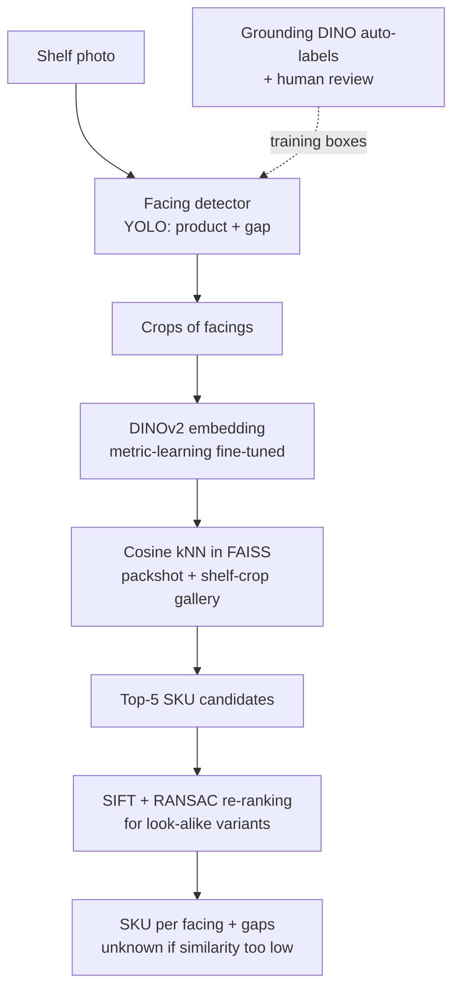
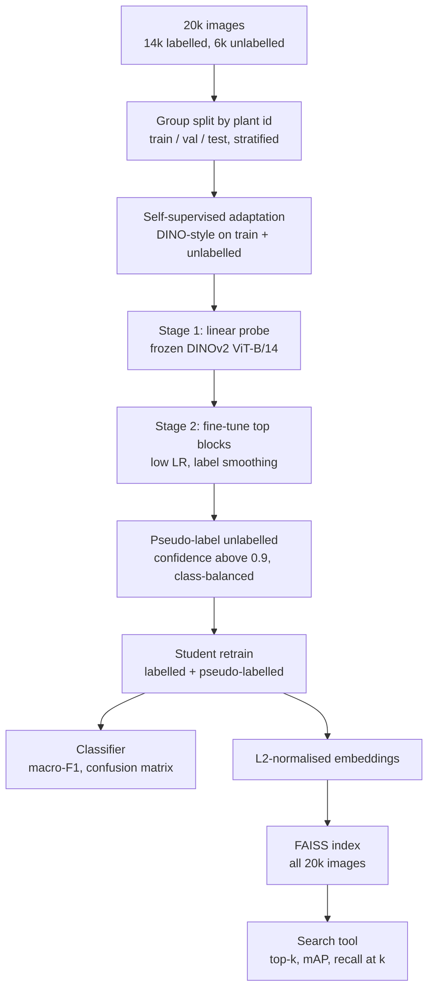

# Session 09 + 16 — Practicals, Revision & Exam Preparation · Solutions

> Questions: [09_questions.md](09_questions.md) · Notes: [../notes/09_revision_practicals.md](../notes/09_revision_practicals.md) · Code: [../code/transfer_learning_skeleton.py](../code/transfer_learning_skeleton.py) · Related: [04 metrics](../notes/04_training_transfer_learning.md#practical-image-classification-pipeline) · [05 retrieval metrics](../notes/05_embeddings_similarity.md#37-retrieval-metrics) · [13 CLIP zero-shot](../notes/13_vision_foundation_models.md#33-clip-zero-shot-classification)

## Section A — MCQs

### Q1 — Answer: **B**
**Why B:** A **one-stage** detector predicts classes and boxes densely in a single pass — the YOLO family runs in real time on embedded GPUs, and 15,000 labelled boxes are plenty for fine-tuning from pretrained (e.g. COCO) weights on a **fixed** set of 12 classes ([07](../notes/07_detection_one_stage.md), [08 comparison](../notes/08_detection_transformers.md#two-stage-vs-one-stage-vs-detr)).
- **A** ✗ — R-CNN runs the CNN on ~2,000 warped proposals per image (tens of seconds per image) — hopeless for 30 fps.
- **C** ✗ — the original DETR needs ~500 training epochs on COCO, is weak on small objects (cracks, small potholes) and is not a real-time edge detector.
- **D** ✗ — open-vocabulary detectors are slow (hundreds of ms per frame on a server GPU) and less accurate than a fine-tuned closed-set detector on a fixed class list; they are better used to **auto-label** data for the closed-set model.

### Q2 — Answer: **C**
**Why C:** With 95% healthy images, a model that always says "healthy" scores 95% accuracy while detecting **no** disease. The confusion matrix, per-class precision/recall and **macro-F1** (or balanced accuracy = mean per-class recall) expose this.
- **A** ✗ — accuracy is dominated by the majority class on imbalanced data.
- **B** ✗ — with only 2 classes, top-5 (and even top-2) accuracy is always 100% — meaningless.
- **D** ✗ — mean IoU is a segmentation (pixel-overlap) metric, not an image-classification metric.

### Q3 — Answer: **D**
**Why D:** A translating camera viewing a general 3-D scene produces **parallax**, so only epipolar geometry is valid. With $K$ known, use normalised coordinates and the **essential matrix** (5 DOF, 5-point minimal solver, 146 RANSAC iterations at $e=0.5$, $p=0.99$), then decompose $E$ into 4 candidate $(R,\mathbf t)$ and keep the one with points in front of both cameras (cheirality); $\mathbf t$ is known only up to scale ([12](../notes/12_3d_vision_motion.md#essential-and-fundamental-matrices)).
- **A** ✗ — a homography is exact only for a **planar scene or pure rotation**; a statue with translation violates both.
- **B** ✗ — an affine model is even more restrictive (weak perspective, parallel lines stay parallel).
- **C** ✗ — $F$ lives in pixel coordinates and determines the cameras only up to a projective ambiguity; to get metric $R,\mathbf t$ you must use $K$ ($E=K'^\top FK$). The 8-point sample also needs far more iterations (1177).

### Q4 — Answer: **A**
**Why A:** Photos of the same patient (often of the **same lesion**) are near-duplicates. Splitting **by patient** keeps them in one split; fitting statistics on train only prevents information from val/test leaking into preprocessing. This measures generalisation to **new patients** — what deployment needs.
- **B** ✗ — an image-level split puts photos of the same lesion in train and test → the model is "tested" on images it has effectively seen → inflated score.
- **C** ✗ — augment-then-split leaks augmented copies of training images into the test set.
- **D** ✗ — training accuracy measures memorisation, not generalisation.

### Q5 — Answer: **B**
**Why B:** If the query set **is** the gallery, every query's nearest neighbour is **itself** (cosine similarity exactly 1) → P@1 = 100% and an inflated mAP. Remove the self-match (set the diagonal of $S$ to $-\infty$ / leave-one-out) before ranking.
- **A** ✗ — off-the-shelf ImageNet features are good but not perfect on 50 fine-grained species; a perfect score is a red flag, not an expected result.
- **C** ✗ — normalisation only makes the ranking cosine-based; it cannot create perfect retrieval.
- **D** ✗ — changing the AP averaging convention does not remove the self-match bug.

### Q6 — Answer: **D**
**Why D:** t-SNE preserves **local neighbourhoods** only; cluster sizes and inter-cluster gaps depend on perplexity and the random seed. Use it as a qualitative sanity check (clusters, outliers, camera/site shortcuts) and compute kNN / linear-probe / retrieval metrics in the original $D$-dimensional space.
- **A** ✗ — t-SNE is **non-linear and stochastic**; PCA is the linear, deterministic one.
- **B** ✗ — 2-D separation does not imply linear separability (or 100% accuracy) in the original space; t-SNE can exaggerate separation.
- **C** ✗ — distances between clusters in a t-SNE plot are not meaningful.

### Q7 — Answer: **A**
**Why A:** CLIP's image and text encoders share an embedding space, so encoding prompts like "a photo of a {class}." gives a zero-shot classifier with no labels or training ([13](../notes/13_vision_foundation_models.md#clip)).
- **B** ✗ — DINOv2 has **no text encoder**; it needs labelled examples (kNN / linear probe).
- **C** ✗ — SAM masks are **class-agnostic**; labels need another model (Grounding DINO, CLIP).
- **D** ✗ — Depth Anything outputs **relative (affine-invariant) inverse depth**; metres need a metric fine-tune or calibration with ≥ 2 known depths.

### Q8 — Answer: **C**
**Why C:** The task needs **instance** masks (separate touching apples) **with class labels** (apple vs leaf), and labelled instance masks exist → **Mask R-CNN** predicts class, box, score and a mask per instance ([10](../notes/10_image_segmentation.md#mask-r-cnn)).
- **A** ✗ — semantic segmentation labels pixels "apple" but merges touching apples into one blob → no per-apple outline or count.
- **B** ✗ — same problem as U-Net, with coarser boundaries.
- **D** ✗ — SAM's automatic masks have no class labels (and include leaf parts, stems, background pieces); you would still need a classifier or detector to say which masks are apples.

## Section B — Numericals

### Q9 — Confusion matrix → macro / micro metrics
**Given:** $3\times3$ matrix (rows = true); $N=120$; diagonal $TP=(70,12,15)$; row sums (support) $(80,20,20)$; column sums $(76,20,24)$.
**Formula:**

$$
P_c=\frac{TP_c}{TP_c+FP_c},\qquad R_c=\frac{TP_c}{TP_c+FN_c},\qquad F1_c=\frac{2P_cR_c}{P_c+R_c},\qquad FP_c=\text{col}_c-TP_c,\ \ FN_c=\text{row}_c-TP_c
$$

**Working:**
- (a) Accuracy $=(70+12+15)/120=97/120=\mathbf{0.8083}$.
- (b) Per class:

| Class | $TP$ | $FP$ | $FN$ | Precision | Recall | F1 |
|---|---|---|---|---|---|---|
| Healthy | 70 | 6 | 10 | $70/76=0.9211$ | $70/80=0.8750$ | $0.8974$ |
| Rust | 12 | 8 | 8 | $12/20=0.6000$ | $12/20=0.6000$ | $0.6000$ |
| Blight | 15 | 9 | 5 | $15/24=0.6250$ | $15/20=0.7500$ | $0.6818$ |

- (c) Macro-P $=(0.9211+0.6+0.625)/3=\mathbf{0.7154}$; macro-R $=(0.875+0.6+0.75)/3=\mathbf{0.7417}$; macro-F1 $=(0.8974+0.6+0.6818)/3=\mathbf{0.7264}$.
  Micro: $\sum TP=97$, $\sum FP=6+8+9=23$, $\sum FN=10+8+5=23$ → micro-P = micro-R $=97/120$ → micro-F1 $=\mathbf{0.8083}$ = accuracy. **Why:** in single-label classification every error is **one FP** (for the predicted class) **and one FN** (for the true class), so $\sum FP=\sum FN=N-\sum TP$ and micro-P = micro-R = accuracy.
- (d) Weighted-F1 $=(80\cdot0.8974+20\cdot0.6+20\cdot0.6818)/120=97.43/120=\mathbf{0.8119}$. Balanced accuracy = macro recall $=\mathbf{0.7417}$.
- (e) All-"Healthy": accuracy $80/120=\mathbf{0.667}$; F1 = (0.8, 0, 0) (Healthy: $P=80/120$, $R=1$) → macro-F1 $=\mathbf{0.267}$; balanced accuracy $=(1+0+0)/3=\mathbf{0.333}$ (= chance for 3 classes).

**Answer:** acc 0.808; F1 = 0.897 / 0.600 / 0.682; macro-P 0.715, macro-R 0.742, macro-F1 0.726, micro-F1 0.808; weighted-F1 0.812; balanced acc 0.742; trivial model 0.667 / 0.267 / 0.333. Accuracy drops only 0.14 between the real and the useless model, while macro-F1 drops 0.46 and balanced accuracy falls to chance — **report macro metrics on imbalanced data**.
> ✔ Verified numerically (Python).
> **Common slip:** computing precision from the row instead of the column (rows = true here), or averaging F1 weighted by support and calling it macro.

### Q10 — Retrieval metrics for two queries
**Given:** relevance lists (top 10), $R_A=4$, $R_B=3$.
**Formula:**

$$
P@k=\frac1k\sum_{i\le k}\text{rel}(i),\qquad R@k=\frac1R\sum_{i\le k}\text{rel}(i),\qquad \text{AP}=\frac1R\sum_{k}P@k\cdot\text{rel}(k),\qquad \text{MRR}=\frac1{\lvert Q\rvert}\sum_q\frac1{\text{rank}_q}
$$

**Working:**
- (a) Query A: hits at ranks 1, 3, 4, 8 → 3 hits in the top 5, 4 in the top 10: $P@5=3/5=\mathbf{0.6}$, $R@5=3/4=\mathbf{0.75}$, $P@10=4/10=\mathbf{0.4}$, $R@10=4/4=\mathbf{1.0}$.
  Query B: hits at ranks 3, 5 → $P@5=2/5=\mathbf{0.4}$, $R@5=2/3=\mathbf{0.667}$, $P@10=2/10=\mathbf{0.2}$, $R@10=2/3=\mathbf{0.667}$ (one moss is never retrieved).
- (b) A: precisions at hits $1/1,\ 2/3,\ 3/4,\ 4/8=1,\ 0.6667,\ 0.75,\ 0.5$ → $\text{AP}_A=2.9167/4=\mathbf{0.7292}$.
  B: precisions at hits $1/3,\ 2/5=0.3333,\ 0.4$ → $\text{AP}_B=0.7333/3=\mathbf{0.2444}$ (the missing third moss contributes 0).
  $\text{mAP}=(0.7292+0.2444)/2=\mathbf{0.4868}$.
- (c) Hit@1: A yes, B no → $\mathbf{0.5}$. Hit@5: both have a hit in the top 5 → $\mathbf{1.0}$. First hits at ranks 1 and 3 → $\text{MRR}=(1+1/3)/2=\mathbf{0.667}$.
- (d) Dividing by retrieved hits: $\text{AP}_A$ unchanged (all 4 retrieved), $\text{AP}_B=0.7333/2=0.3667$ → mAP $=(0.7292+0.3667)/2=\mathbf{0.548}$. Wrong because it **ignores relevant items that were never retrieved** — a system that returns only one good result and misses everything else would get AP = 1. The standard AP divides by **all** relevant items $R$.

**Answer:** A: P@5 0.6, R@5 0.75, P@10 0.4, R@10 1.0, AP 0.729; B: P@5 0.4, R@5 0.667, P@10 0.2, R@10 0.667, AP 0.244; mAP 0.487; hit@1 0.5, hit@5 1.0, MRR 0.667; the wrong convention gives 0.548.
> ✔ Verified numerically (Python).
> **Common slip:** using $k$ instead of $R$ as the denominator of R@k, or averaging P@k over **all** ranks instead of only the relevant ones.

### Q11 — Cosine kNN vs raw Euclidean kNN
**Given:** $\mathbf q=(3,4)$, $\Vert\mathbf q\Vert=5$; six labelled gallery vectors; $k=3$.
**Formula:**

$$
\hat{\mathbf z}=\frac{\mathbf z}{\Vert\mathbf z\Vert},\qquad \mathrm{sim}(\mathbf q,\mathbf g)=\hat{\mathbf q}\cdot\hat{\mathbf g},\qquad d(\mathbf q,\mathbf g)=\Vert\mathbf q-\mathbf g\Vert,\qquad \Vert\hat{\mathbf q}-\hat{\mathbf g}\Vert=\sqrt{2-2\,\mathrm{sim}}
$$

**Working:**
- (a) $\hat{\mathbf q}=(0.6,\ 0.8)$.

| Item | Norm | Unit vector | Cosine with $\hat{\mathbf q}$ | Raw Euclidean $d$ | Unit-vector distance |
|---|---|---|---|---|---|
| m1 Maple | 10.000 | (0.6000, 0.8000) | **1.0000** | 5.000 | 0.000 |
| m3 Maple | 15.811 | (0.5692, 0.8222) | **0.9993** | 10.817 | 0.038 |
| m2 Maple | 1.414 | (0.7071, 0.7071) | **0.9899** | 3.606 | 0.142 |
| o1 Oak | 5.000 | (0.8000, 0.6000) | 0.9600 | **1.414** | 0.283 |
| o2 Oak | 6.325 | (0.3162, 0.9487) | 0.9487 | **2.236** | 0.320 |
| b1 Birch | 5.000 | (1.0000, 0.0000) | 0.6000 | 4.472 | 0.894 |

  (e.g. m2: $(0.6+0.8)\cdot0.7071=0.9899$; o1: $0.48+0.48=0.96$.)
- (b) Top-3 by cosine: m1, m3, m2 → **Maple** (3 votes of 3).
- (c) Top-3 by raw Euclidean distance: o1 (1.414), o2 (2.236), m2 (3.606) → **Oak** (2 votes to 1).
- (d) Raw Euclidean distance mixes **direction and magnitude**: m1 and m3 point in almost exactly the query's direction but are 2–3× longer, so they look "far"; o1 and o2 happen to have a similar norm but a different direction. For CNN embeddings the **norm mostly reflects contrast/activation strength, not identity**, so the **cosine result (Maple)** is the one to trust — standard practice is to L2-normalise before kNN. After normalisation, $\Vert\hat{\mathbf q}-\hat{\mathbf o}_1\Vert=\sqrt{2-2(0.96)}=\sqrt{0.08}=\mathbf{0.283}$, and the unit-vector distances (last column) give exactly the cosine ranking m1 < m3 < m2 < o1 < o2 < b1, because $\sqrt{2-2\cos\theta}$ is monotonically decreasing in $\cos\theta$.

**Answer:** cosine kNN → **Maple**; raw Euclidean kNN → **Oak**; trust the normalised (cosine) result; unit-vector distance to o1 = 0.283.
> ✔ Verified numerically (Python).

### Q12 — Linear probe vs fine-tuning: parameters and memory
**Given:** ResNet-50 backbone 23,508,032 params, $D=2048$; `layer4` 14,964,736; ViT-B/16 backbone 85,798,656, $D=768$; $K=50$.
**Formula:**

$$
\#\text{head}=(D+1)K,\qquad \text{Mem}\approx16\,n_{train}+4\,n_{frozen}\ \text{bytes}
$$

**Working:**
- (a) Head $=(2048+1)\cdot50=\mathbf{102{,}450}$. Total $=23{,}508{,}032+102{,}450=23{,}610{,}482$ → $102{,}450/23{,}610{,}482=\mathbf{0.434\%}$.
- (b) $14{,}964{,}736+102{,}450=\mathbf{15{,}067{,}186}$ → $\mathbf{63.8\%}$ (the last stage holds most of ResNet-50's weights).
- (c) Full fine-tuning: all $\mathbf{23{,}610{,}482}$.
- (d) Full FT: $23{,}610{,}482\times16=377{,}767{,}712$ B ≈ $\mathbf{377.8\ MB}$ (≈ 360 MiB).
  Linear probe: $23{,}508{,}032\times4+102{,}450\times16=94{,}032{,}128+1{,}639{,}200=95{,}671{,}328$ B ≈ $\mathbf{95.7\ MB}$ — about 4× less (and only ≈ 1.6 MB if the features are pre-computed and cached, so the backbone is not needed during training). Activations for back-propagation through the backbone (full FT only) add much more in practice.
- (e) ViT-B/16 linear probe: $(768+1)\cdot50=\mathbf{38{,}450}$ (0.045% of 85.8M). kNN classifier: **0** trainable parameters. Gallery: $14{,}000\times768\times4=43{,}008{,}000$ B ≈ $\mathbf{43.0\ MB}$ (41.0 MiB).

**Answer:** 102,450 (0.434%); 15,067,186 (63.8%); 23,610,482; ≈ 378 MB vs ≈ 96 MB; 38,450; 0; ≈ 43 MB.
> ✔ Verified numerically (Python; ResNet-50 and ViT-B/16 counts checked with torchvision).
> **Common slip:** forgetting the bias (+1) in the head, or computing the percentage relative to the backbone instead of the whole model.

### Q13 — CLIP zero-shot from a similarity table
**Given:** cosine table; logit scale $1/\tau=100$.
**Formula:**

$$
p(c\mid x)=\frac{\exp(s\cdot\cos_c)}{\sum_{c'}\exp(s\cdot\cos_{c'})},\qquad s=100
$$

**Working:**
- (a) Argmax per row: I1 → rose ✔; I2 → rose ✘ (tulip second); I3 → daisy ✔; I4 → daisy ✘ (sunflower second); I5 → sunflower ✘ (order sunflower 0.28, rose 0.24, tulip 0.23, daisy 0.22 → true class ranked 4th).
  Top-1 $=2/5=\mathbf{40\%}$; top-2: I1, I2, I3, I4 ✔, I5 ✘ → $4/5=\mathbf{80\%}$.
- (b) Recall: rose $1/1=1$, tulip $0/1=0$, daisy $1/2=0.5$ (I3 right, I5 wrong), sunflower $0/1=0$ → balanced accuracy $=(1+0+0.5+0)/4=\mathbf{0.375}$.
- (c) I2 logits $=(29,\ 27,\ 21,\ 19)$; subtract the max: $(0,-2,-8,-10)$; $e^{\cdot}=(1,\ 0.1353,\ 0.000335,\ 0.0000454)$, sum $=1.1357$ →
  $p=(\mathbf{0.880},\ \mathbf{0.119},\ 0.0003,\ 0.00004)$ for (rose, tulip, daisy, sunflower). The model is **88% confident and wrong**: the scale turns a cosine gap of only 0.02 into a large probability gap, so CLIP softmax scores are **not calibrated** confidences — they are relative to the listed prompts.
- (d) Scale 1: logits $(0.29,0.27,0.21,0.19)$ → $p=(0.263,\ 0.257,\ 0.242,\ 0.238)$ — almost uniform. The **learned temperature** ($1/\tau\approx100$) is what makes the small cosine differences of CLIP decisive.
- (e) Any two of: **prompt ensembling** (average several templates, e.g. "a close-up photo of a {class}", "a photo of a {class} flower in a garden") and **prompt engineering** with domain context; a **linear probe** or **kNN / class prototypes** on frozen CLIP (or DINOv2) image embeddings using a few labelled images per class; adding hard-negative/distractor prompts.

**Answer:** top-1 40%, top-2 80%; recalls 1 / 0 / 0.5 / 0, balanced accuracy 0.375; I2 → $p\approx(0.880, 0.119, 0.0003, 0.00004)$ with scale 100, ≈ uniform with scale 1.
> ✔ Verified numerically (Python).

## Section C — Short answers (model answers)

### Q14 — Supervised vs self-supervised vs language-supervised embeddings for plant search
All three give a frozen encoder whose L2-normalised output can be indexed for cosine kNN search; they differ in **where the training signal came from**, which decides what the embedding is sensitive to.

| | ImageNet ResNet-50 (supervised) | DINOv2 (self-supervised) | CLIP (language-supervised) |
|---|---|---|---|
| Signal | cross-entropy on 1,000 ImageNet classes | self-distillation between augmented views + masked patches, curated 142M images | image–caption contrastive (InfoNCE), 400M web pairs |
| Labels needed for search | none (pretrained) | none | none |
| Text queries ("purple flower with spikes") | no | **no** (no text encoder) | **yes** — shared image–text space |
| Fine-grained visual similarity | moderate — features tuned to ImageNet's classes, may ignore species details | **strong** — best frozen kNN/retrieval features, good dense/patch features | moderate — global caption-level semantics; weak on fine-grained species |
| Weakness | class-biased, 2048-d, older | no text; heavy ViT | fine-grained, counting, typographic attacks, web bias |

**Recommendation:** use **DINOv2** embeddings for image → image plant search (fine-grained similarity, strong kNN); add **CLIP** only if users need **text** search (or as a second index). If species labels exist, fine-tune with a metric-learning loss (triplet / InfoNCE with same-species positives) and measure P@k / mAP against the ResNet-50 baseline.

*Marking:* 1 – supervision signals · 1 – text and labels · 1 – fine-grained/weaknesses · 1 – justified recommendation.

### Q15 — Depth sensing for a delivery robot
The robot needs **metric, real-time** distance to nearby obstacles; the options differ in input, scale and timing.

| | Stereo | Depth Anything (monocular) | SfM | SLAM |
|---|---|---|---|---|
| Input | 2 calibrated, synced cameras | 1 camera | many photos, offline | live video (+ IMU) |
| Output | dense depth per frame | dense relative depth per frame | camera poses + sparse 3D points | trajectory + map, online |
| Scale | **metric** ($Z=fB/d$) | **relative** (affine inverse depth) — metres need fine-tuning or ≥ 2 references | up to scale | metric with stereo/IMU; monocular scale drifts |
| Timing | real time | real time on a GPU | offline batch | real time |
| Failure modes | textureless/repetitive surfaces, occlusion, error $\Delta Z\approx Z^2\Delta d/(fB)$ (e.g. $f=700$ px, $B=0.12$ m: 0.19 m at 4 m but 1.19 m at 10 m per pixel of disparity error) | scale ambiguity, glass/reflections, out-of-distribution scenes | not real time, needs parallax, static scene | dynamic objects, fast motion, drift without loop closure |

**Recommendation:** **stereo** (or an RGB-D/ToF sensor) for metric obstacle distance at short range, fused into a **SLAM** system (stereo-inertial) for localisation and mapping; optionally use **Depth Anything** as a dense prior on textureless areas, aligned in scale and shift to the sparse stereo points. SfM is unsuitable online (it is for offline reconstruction, e.g. building a map of the delivery area beforehand).

*Marking:* 2 – correct comparison (scale, timing, failures) · 1 – quadratic error / limitations · 1 – sensible recommendation.

### Q16 — Choosing a segmentation model
- **(i) Tumours in 200 MRI slices → U-Net.** Semantic (tumour vs background) task with very little data; the encoder–decoder with **concatenated skip connections** keeps fine boundaries, and U-Net was designed for small biomedical datasets with heavy (elastic) augmentation; train with Dice + CE to cope with the small foreground ([10](../notes/10_image_segmentation.md#u-net)).
- **(ii) Touching apples with labels → Mask R-CNN.** Needs **instances** (count, separate outlines) **and classes**; 3,000 instance-labelled images are enough to fine-tune a COCO-pretrained Mask R-CNN (boxes + class + 28×28 mask per instance via RoIAlign).
- **(iii) One-click annotation tool → SAM.** Promptable and class-agnostic: the heavy image encoder runs once per image, then each click re-runs only the light decoder (~50 ms), returning 3 candidate masks with predicted IoU; works on unseen object types without training.
- **(iv) FCN** was the first end-to-end fully convolutional segmenter (convolutionalised classifier, transposed-conv upsampling, skip **addition** of score maps), but its predictions are **coarse** (8-stride fusion at best) and it has no instances; U-Net, DeepLab (atrous conv + ASPP) and query-based models (Mask2Former) are more accurate — FCN remains the conceptual ancestor.

*Marking:* 1 per scenario.

### Q17 — AE vs VAE vs GAN vs diffusion
| | Autoencoder | VAE | GAN | Diffusion |
|---|---|---|---|---|
| Objective | reconstruction (MSE/BCE) | ELBO = reconstruction − KL to $\mathcal N(0,I)$ | adversarial minimax ($G$ vs $D$) | predict the added noise ($\epsilon$-MSE) |
| Sample quality | not a sampler | blurry | sharp | state of the art |
| Diversity | — | good | mode-collapse risk | good |
| Sampling speed | — | 1 decoder pass | 1 generator pass | 20–1000 network passes |
| Stability | very stable | stable | unstable | stable |

- **(i) Defect detection from good parts only → autoencoder (or VAE).** Train to reconstruct normal parts; defects reconstruct poorly → **high reconstruction error = anomaly**; no defect labels needed.
- **(ii) Real-time 4× super-resolution on a phone → GAN.** One forward pass gives sharp, realistic texture; diffusion is too slow for real time on a phone and VAE outputs are blurry.
- **(iii) Text-to-image marketing images → latent diffusion (Stable Diffusion).** Best quality and diversity, text conditioning through cross-attention to CLIP text embeddings, classifier-free guidance, and editing tools (inpainting, ControlNet); latency is acceptable offline.

*Marking:* 2 – comparison table · 2 – three justified choices.

## Section D — Long answers (model answers)

### Q18 — Recognising 2,000 products on shelves: classical vs CNN vs foundation models
**Framing.** Input: phone photos of shelves (perspective, glare, motion blur, partial occlusion, many small facings per image). Output: for each facing, the product ID (SKU) — 2,000 classes with **look-alike variants** (same brand, different flavour/size) — plus empty-gap flags. Constraints: products change every week, labelled data is scarce, staff need results in seconds, and wrong IDs must be explainable to merchandisers.

**The three approaches.**
1. **Classical local features.** SIFT/ORB keypoints on one reference **packshot** per SKU; match shelf-photo descriptors (ratio test), verify each candidate with **RANSAC homography** (the front of a package is roughly planar), count inliers.
2. **CNN pipeline.** A detector (YOLO / Faster R-CNN) finds facings ("product" class + "gap"); a fine-tuned CNN either classifies 2,000 SKUs or, better, produces **metric-learning embeddings** matched by kNN against a gallery of SKU images.
3. **Foundation pipeline.** Grounding DINO / OWL-ViT ("product . bottle . box .") or SAM proposes facings zero-shot; crops are embedded with **DINOv2** (visual similarity) or **CLIP** (also reads brand text) and matched by cosine kNN against packshot embeddings.

| Criterion | Classical (SIFT/ORB + RANSAC) | CNN (detector + classifier/embedding) | Foundation (open-vocab detector/SAM + DINOv2/CLIP) |
|---|---|---|---|
| Accuracy | excellent on textured, rigid, planar packs — exact instance match separates flavours by printed detail; poor on textureless, glossy, transparent or deformable packs | highest in-domain once trained; fine-grained variants still hard; 2,000-way classifier struggles with rare SKUs | good detection of generic "products" with no training; DINOv2 kNN good for look-alikes, CLIP weaker on fine-grained; lower than a tuned in-domain model |
| Data needs | 1 packshot per SKU, no training | thousands of labelled boxes + many images per SKU; retraining when SKUs change (unless embedding + gallery) | almost none to start; a gallery of packshots; optional fine-tuning later |
| Compute | CPU; matching cost grows with 2,000 references (needs an index / BoW shortlist) | GPU to train; fast inference (real-time detector) | heavy: ViT encoders, hundreds of ms per image on a server GPU |
| Robustness | brittle to blur, glare, large illumination change, deformation; robust to viewpoint (homography) | good if augmentation matches shelf conditions; domain shift between stores | strong generalisation to new stores/products; prompt/threshold sensitivity; typographic quirks |
| Explainability | **high** — inlier match lines show why | low (Grad-CAM only) | low; scores uncalibrated |
| New product | add a packshot | add gallery images (embedding) or retrain (classifier) | add a packshot embedding / prompt |

**Recommended system (hybrid).**

- **Detection:** bootstrap facing boxes with **Grounding DINO auto-labelling + human review**, then **distil** into a fast closed-set YOLO detector with two classes (product, empty gap).
- **Identification as retrieval, not 2,000-way classification:** DINOv2 embeddings fine-tuned with a metric-learning loss on collected crops (same SKU = positive), indexed with FAISS; a new product needs only its packshot embedding — no retraining. A **cosine threshold** returns "unknown" for unseen packaging (open-set).
- **Geometric re-ranking:** for the top-5 candidates run SIFT matching + RANSAC homography; inlier counts break ties between look-alike flavours and give an **explainable** match visualisation.
- **Gap detection** from the "gap" class, cross-checked against the planogram.

**Evaluation.** Facing detector: AP@0.5 and recall of facings (missed facings hurt everything downstream). SKU identification: top-1/top-5 accuracy, **macro-F1 across SKUs** and per-SKU recall (long tail), retrieval mAP / recall@5 on held-out stores. End-to-end: shelf-level SKU-presence accuracy and gap precision/recall against audited shelves; latency per photo. Split **by store** to test generalisation; ablate (embedding only vs + RANSAC re-ranking; frozen vs fine-tuned DINOv2).

**Failure modes & mitigations.** Look-alike variants → RANSAC re-ranking, higher-resolution crops; glare/blur → augmentation, capture guidance in the app; new packaging → open-set threshold + quick enrolment; occlusion → multiple photos; domain shift between stores → periodic re-labelling of hard cases (active learning).

**Verdict:** classical features are the most precise and explainable for exact planar packaging but brittle and slow at 2,000 references; a CNN pipeline is fastest and most accurate in-domain but label-hungry; foundation models remove the labelling bottleneck but are heavy and less precise — the **hybrid** uses each where it is strongest.

*Marking scheme:* 2 – problem framing and requirements · 4 – comparison on accuracy, data, compute, robustness, explainability across all three approaches · 2 – recommended design with justification · 2 – evaluation and failure modes.

### Q19 — Classifier + similarity search for 50 plant species with 30% unlabelled data
**Requirements and assumptions.** 20,000 images: 14,000 labelled (50 species) + 6,000 unlabelled; ~2,000 individual plants with several photos each → **grouping matters**. Two products: a species classifier and an image → similar-image search tool. Assume a single GPU, near-real-time inference, possible class imbalance and look-alike species.

**1. Data splitting (no leakage).** Use `StratifiedGroupKFold`-style splitting **by plant id** on the labelled set: ≈ 70/15/15 of plants → about 9,800 / 2,100 / 2,100 images, every species in every split. De-duplicate near-identical shots within groups. Remove from the unlabelled pool any images of test plants (if plant ids are known), so test plants never influence training. Fit nothing on val/test; touch test once.

**2. Model choice.** Backbone **DINOv2 ViT-B/14** (strong frozen kNN/linear-probe features, fine-grained similarity, 768-d [CLS]); baselines: ImageNet ResNet-50 linear probe and CLIP zero-shot with prompts "a photo of a {species}, a type of plant." (expected to be weak on fine-grained species). One backbone serves **both** tools.

**3. Using the 6,000 unlabelled images.**
- **Self-supervised domain adaptation:** continue DINO-style self-distillation on train + unlabelled images (no labels needed) so the features adapt to plant imagery.
- **Pseudo-labelling (self-training):** after stage 2, predict the unlabelled images; keep confident predictions (e.g. max probability > 0.9, capped per class to avoid amplifying majority classes); retrain a **student** on labelled + pseudo-labelled data with strong augmentation (the teacher–student idea used by Depth Anything). Check on val that pseudo-labels help.
- **Gallery enrichment:** all 20,000 images (labelled or not) go into the search index.

**4. Training procedure.** Stage 1 — **linear probe** on frozen features: $(768+1)\cdot50=38{,}450$ trainable parameters; Stage 2 — unfreeze the top transformer blocks with **AdamW**, LR $10^{-5}$ (backbone) / $10^{-3}$ (head), warm-up + cosine, **label smoothing 0.1**, class-weighted CE if imbalanced; augmentation: `RandomResizedCrop`, flips, small rotations, **mild** colour jitter (colour can be diagnostic for species); validate each epoch in `eval()` + `no_grad()`, early-stop on **val macro-F1**; sanity checks (initial loss ≈ $\ln 50=3.91$, overfit one batch).

**5. Search index.** Embed every image with the final backbone ([CLS], L2-normalised; optionally fine-tuned with a metric-learning loss using species labels so same-species images are close). Store ids, species label (or "unlabelled") and plant id. 20,000 × 768 × 4 B ≈ **61 MB** → an exact **FAISS `IndexFlatIP`** is fast enough; switch to HNSW / IVF-PQ only if the collection grows to millions. Query: embed → top-$k$ cosine → show images with species names; exclude the query itself; optionally return a species vote (kNN classifier) as a second opinion.

**6. Evaluation.**
- **Classifier (test set, once):** accuracy, **macro-F1**, balanced accuracy, top-5 accuracy, confusion matrix (rows = true), per-species recall, ± uncertainty ($\sqrt{\hat p(1-\hat p)/n}$ ≈ ±1.5% at 85% on 2,100 images) or mean ± std over 3 seeds; compare with the linear-probe, kNN and CLIP zero-shot baselines.
- **Search tool:** test images as queries against the labelled train gallery (relevance = same species): **P@10, R@10 (or hit-rate@k), mAP, MRR**; also **instance retrieval** (another photo of the same plant) as a separate metric; latency per query.
- **Ablations:** frozen vs fine-tuned; with vs without SSL adaptation; with vs without pseudo-labels (and threshold).

**7. Error-analysis plan (on val).** Largest off-diagonal confusion pairs (look-alike species → more data, higher resolution, organ-specific crops); most confident errors and highest-loss images (label noise → relabel); slices by camera, season, organ (leaf vs flower) and background; t-SNE/UMAP coloured by species **and** by camera to detect shortcuts; Grad-CAM to confirm attention on the plant, not the pot or background; fix the biggest bucket first and iterate.

**Trade-offs.** Frozen DINOv2 + linear probe is cheap and strong; fine-tuning gains accuracy but risks overfitting look-alike classes; pseudo-labels add data but can reinforce errors (hence the confidence threshold and val check); exact search is simplest at this scale.

*Marking scheme:* 2 – data split / leakage control · 3 – model choice and use of unlabelled data · 2 – search index design · 2 – evaluation metrics for both tools · 1 – error-analysis plan.
