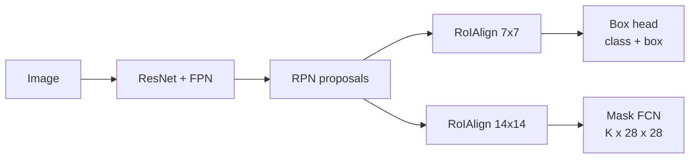

# Session 10 — Image Segmentation · Solutions

> Questions: [10_questions.md](10_questions.md) · Notes: [../notes/10_image_segmentation.md](../notes/10_image_segmentation.md) · Code: [../code/dice_iou_segmentation.py](../code/dice_iou_segmentation.py)

## Section A — MCQs

### Q1 — Answer: **C**
**Why C:** Panoptic segmentation labels **every** pixel with a class (stuff: road, sky) **and** gives each countable object (things: car, person) its own instance id.
- **A** ✗ — semantic segmentation gives class labels only; touching cars would merge into one region.
- **B** ✗ — instance segmentation separates objects but leaves stuff (road, sky) unlabelled.
- **D** ✗ — detection outputs boxes, not pixel labels.

### Q2 — Answer: **A**
**Why A:** U-Net copies the encoder feature map, **centre-crops** it (valid convs make it larger) and **concatenates** it with the up-convolved decoder map along channels; the following convs learn how to mix them.
- **B** ✗ — that is FCN's skip fusion (addition of score maps).
- **C** ✗ — passing pooling indices is SegNet's mechanism.
- **D** ✗ — that describes attention-gated variants (e.g. Attention U-Net), not the original U-Net.

### Q3 — Answer: **B**
**Why B:** RoIAlign performs **no quantisation**: exact RoI and bin boundaries, regular sampling points per bin (e.g. 2×2), **bilinear interpolation** from the 4 neighbouring cells, then averaging.
- **A** ✗ — rounding is exactly what RoI Pool does and what causes misalignment.
- **C** ✗ — anchors are used by the RPN; RoIAlign has nothing to do with them.
- **D** ✗ — that is R-CNN-style image cropping/warping (one CNN pass per region), not RoIAlign.

### Q4 — Answer: **D**
**Why D:** Mask R-CNN applies a per-pixel **sigmoid** and **average binary cross-entropy**, and only the mask channel of the RoI's GT class $k$ contributes → masks of different classes do not compete (class-decoupled); the class is decided by the box head.
- **A** ✗ — a softmax across classes couples mask and class prediction; the paper showed it performs much worse.
- **B** ✗ — Mask R-CNN does not use a Dice loss, and never trains all $K$ masks.
- **C** ✗ — masks are binary classification targets, not L2 regression targets.

### Q5 — Answer: **B**
**Why B:** All background pixels are correct → pixel accuracy $=0.95$. Tumour: TP $=0$ → IoU $=0$. Background IoU $=0.95/(0.95+0.05)=0.95$, so mIoU $=(0.95+0)/2=0.475$. Pixel accuracy hides the complete failure.
- **A** ✗ — tumour IoU is 0 (no tumour pixel predicted).
- **C** ✗ — pixel accuracy counts all correctly labelled pixels, and 95% are correct.
- **D** ✗ — mIoU is 0.475, and a model that never finds tumours is useless.

### Q6 — Answer: **A**
**Why A:** $\text{IoU}=\frac{\text{Dice}}{2-\text{Dice}}=\frac{0.8}{1.2}=0.667$ (check: $2(0.667)/1.667=0.8$).
- **B** ✗ — Dice and IoU are equal only at 0 and 1; Dice ≥ IoU.
- **C** ✗ — that is $2(0.8)/1.8$, i.e. applying the IoU→Dice formula in the wrong direction.
- **D** ✗ — $0.8^2$; there is no squared relation.

### Q7 — Answer: **C**
**Why C:** $K_{eff}=D(K-1)+1=4(3-1)+1=9$ → 9×9 receptive window, but still only **9 weights** (3×3) per channel pair — dilation spreads the taps without adding parameters or downsampling.
- **A** ✗ — $3\times4=12$ is the wrong formula, and parameters do not grow.
- **B** ✗ — dilation is not stride; atrous conv keeps resolution.
- **D** ✗ — the window is 9×9 but only 9 taps carry weights (81 would be a dense 9×9 kernel).

### Q8 — Answer: **D**
**Why D:** $(W-1)S-2P+K=(7-1)\cdot32-2\cdot16+64=192-32+64=224$ — back to the 224×224 input.
- **A** ✗ — 192 $=(7-1)\cdot32$ only; forgets $-2P+K$.
- **B** ✗ — 256 forgets the padding term ($-2P$).
- **C** ✗ — 240 subtracts the padding only once ($-P$ instead of $-2P$).

## Section B — Numericals

### Q9 — Dice and IoU from pixel counts

**Given:** $\lvert B\rvert$ (GT) $=1200$, $\lvert A\rvert$ (prediction) $=1000$, $\lvert A\cap B\rvert=900$.

**Formula:**

$$
\text{IoU}=\frac{TP}{TP+FP+FN},\qquad \text{Dice}=\frac{2TP}{2TP+FP+FN}=\frac{2\,\text{IoU}}{1+\text{IoU}},\qquad \text{IoU}=\frac{\text{Dice}}{2-\text{Dice}}
$$

**Working:**
- (a) $TP=900$; $FP=1000-900=\mathbf{100}$; $FN=1200-900=\mathbf{300}$.
- (b) IoU $=900/(900+100+300)=900/1300=\mathbf{0.692}$; Dice $=1800/(1800+100+300)=1800/2200=\mathbf{0.818}$.
- (c) $2(0.6923)/(1.6923)=0.818$ ✓. Model B: IoU $=0.85/(2-0.85)=0.85/1.15=\mathbf{0.739}$ > 0.692 → **B is better**, and it is better under both metrics (monotonic relation — a single comparison can never disagree).
- (d) Per-image Dice $=2J/(1+J)$:

| Model | Per-image IoU | Mean IoU | Per-image Dice | Mean Dice |
|---|---|---|---|---|
| P | 0.50, 0.50 | **0.500** | 0.667, 0.667 | **0.667** |
| Q | 0.90, 0.15 | **0.525** | 0.947, 0.261 | **0.604** |

Mean IoU ranks **Q > P**, mean Dice ranks **P > Q** → **the rankings disagree**. Reason: Dice is a non-linear (concave) function of IoU, so the mean of Dice values is not a function of the mean IoU. Its slope $2/(1+J)^2$ is large at low overlap and small at high overlap, so Q's very bad image (0.15) costs more Dice than its very good image (0.90) gains. Dice-averaging therefore favours **consistent** models. Lesson: Dice and IoU agree for any single comparison, but **averaged** scores can rank models differently — always report how the averaging was done.

**Answer:** **TP 900, FP 100, FN 300; IoU 0.692, Dice 0.818; Model B IoU 0.739 (better); P: 0.500/0.667, Q: 0.525/0.604 → rankings flip.**
> ✔ Verified numerically (Python).
> **Common slip:** using $\lvert A\rvert+\lvert B\rvert$ in the IoU denominator (that counts the overlap twice).

### Q10 — mIoU and pixel accuracy from a confusion matrix

**Given:** rows GT, columns prediction; row sums (GT pixels) 9000, 800, 200; column sums (predicted pixels) $8850+120+90=9060$, $100+660+10=770$, $50+20+100=170$.

**Formula:**

$$
\text{PA}=\frac{\sum_c n_{cc}}{\sum_{ij}n_{ij}},\qquad \text{IoU}_c=\frac{n_{cc}}{\text{row}_c+\text{col}_c-n_{cc}}
$$

**Working:**
- (a) PA $=(8850+660+100)/10000=9610/10000=\mathbf{0.961}$.
- (b)

| Class | TP | FP = col − TP | FN = row − TP | IoU |
|---|---|---|---|---|
| background | 8850 | 210 | 150 | $8850/9210=\mathbf{0.961}$ |
| car | 660 | 110 | 140 | $660/910=\mathbf{0.725}$ |
| person | 100 | 70 | 100 | $100/270=\mathbf{0.370}$ |

mIoU $=(0.9609+0.7253+0.3704)/3=\mathbf{0.686}$.
- (c) Per-class recall: $8850/9000=0.983$, $660/800=0.825$, $100/200=0.500$ → mean class accuracy $=\mathbf{0.769}$.
- (d) Trivial model: PA $=9000/10000=\mathbf{0.90}$; IoU background $=9000/10000=0.90$, car $=0$, person $=0$ → mIoU $=\mathbf{0.30}$.

**Comment:** the trivial model loses only 6 points of pixel accuracy (0.90 vs 0.961) but drops mIoU from 0.686 to 0.30. Pixel accuracy is dominated by the 90% background; mIoU weights each class equally and exposes the poor person class (IoU 0.37).

**Answer:** **PA 0.961; IoU 0.961 / 0.725 / 0.370; mIoU 0.686; mean class accuracy 0.769; trivial model PA 0.90 but mIoU 0.30.**
> ✔ Verified numerically (Python).
> **Common slip:** mixing up rows and columns — FP comes from the **column** (predicted as $c$), FN from the **row** (truly $c$).

### Q11 — U-Net size chain

**Given:** valid 3×3 conv: $W\to W-2$; 2×2 pool: $W\to W/2$; up-conv: $(W-1)\cdot2-0+2=2W$.

**(a) Contracting path:**

| Level | After conv 1 | After conv 2 (saved for skip) | After pool |
|---|---|---|---|
| 1 (64 ch) | 570 | **568** | 284 |
| 2 (128 ch) | 282 | **280** | 140 |
| 3 (256 ch) | 138 | **136** | 68 |
| 4 (512 ch) | 66 | **64** | 32 |
| Bottleneck (1024 ch) | 30 | **28** | — |

**(b) Expansive path** (crop = take the centre region; amount removed on each side = (skip − up)/2):

| Level | Up-conv output $(W-1)2+2$ | Skip size → crop | Conv 1 | Conv 2 |
|---|---|---|---|---|
| 4 | $(28-1)2+2=$ **56** | 64 → 56 (4 px each side) | 54 | **52** |
| 3 | $(52-1)2+2=$ **104** | 136 → 104 (16 px each side) | 102 | **100** |
| 2 | $(100-1)2+2=$ **200** | 280 → 200 (40 px each side) | 198 | **196** |
| 1 | $(196-1)2+2=$ **392** | 568 → 392 (88 px each side) | 390 | **388** |

**(c)** Final 1×1 conv keeps the size → output **388×388** (× number of classes). Area fraction $=388^2/572^2=150{,}544/327{,}184=\mathbf{0.460}$ — only the central 46% of the tile is predicted; the rest is context. That is why U-Net uses the **overlap-tile** strategy with mirrored borders to segment a full image.

**Answer:** **572→570→568→284→282→280→140→138→136→68→66→64→32→30→28; up: 56, 104, 200, 392 with crops 64→56, 136→104, 280→200, 568→392; output 388×388 (46% of the tile area).**
> ✔ Verified numerically (Python).
> **Common slip:** forgetting that each valid 3×3 conv removes **2** pixels (1 per side), not 1.

### Q12 — RoI Pool quantisation, RoIAlign bins, bilinear sampling, mask-head size

**Given:** stride $s=16$; RoI $(75,42,300,250)$; $F(5,3)=10$, $F(6,3)=20$, $F(5,4)=30$, $F(6,4)=60$.

**(a) Feature coordinates** ($\div16$): $(4.6875,\ 2.625,\ 18.75,\ 15.625)$.
RoI Pool rounds → $(5,\ 3,\ 19,\ 16)$, i.e. $(80,48,304,256)$ in image pixels.
Misalignment: $x_1$: $0.3125\times16=\mathbf{5}$ px; $y_1$: $0.375\times16=\mathbf{6}$ px; $x_2$: $0.25\times16=\mathbf{4}$ px; $y_2$: $0.375\times16=\mathbf{6}$ px — and a **second** rounding follows when the 14 × 13-cell RoI is split into 7×7 bins of unequal integer sizes.

**(b) RoIAlign bins:** width $(18.75-4.6875)/7=14.0625/7=\mathbf{2.009}$ cells ($\approx32.1$ px); height $(15.625-2.625)/7=13/7=\mathbf{1.857}$ cells ($\approx29.7$ px) — exact, no rounding.

**(c) Bilinear interpolation** at $(5.25,3.75)$: $x_0=5$, $y_0=3$, $a=0.25$, $b=0.75$:

$$
\begin{aligned}
f&=(1-a)(1-b)F(5,3)+a(1-b)F(6,3)+(1-a)b\,F(5,4)+ab\,F(6,4)\\
&=0.1875(10)+0.0625(20)+0.5625(30)+0.1875(60)\\
&=1.875+1.25+16.875+11.25=\mathbf{31.25}
\end{aligned}
$$

Nearest neighbour would return $F(5,4)=30$ (and gradients would reach only one cell); bilinear uses all 4 neighbours weighted by distance and is differentiable with respect to the sampling position.

**(d) Mask head:** $80\times28\times28=\mathbf{62{,}720}$ values per RoI; only the GT-class channel enters the loss: $28\times28=\mathbf{784}$ values.

**Answer:** **(4.6875, 2.625, 18.75, 15.625) → rounded (5, 3, 19, 16), misalignment 5, 6, 4, 6 px; bins 2.009 × 1.857 cells; bilinear value 31.25 (NN: 30); 62,720 outputs, 784 in the loss.**
> ✔ Verified numerically (Python, and cross-checked with `torchvision.ops.roi_align`).

### Q13 — Panoptic Quality

**Given:** car pairs with IoU 0.92, 0.81, 0.66, 0.55, 0.45; 5 GT and 5 predictions; road IoU 0.90.

**Formula:**

$$
PQ=\underbrace{\frac{\sum_{TP}\text{IoU}}{\lvert TP\rvert}}_{SQ}\times\underbrace{\frac{\lvert TP\rvert}{\lvert TP\rvert+\frac12\lvert FP\rvert+\frac12\lvert FN\rvert}}_{RQ}
$$

**Working:**
- (a) Matches need IoU > 0.5 → 0.92, 0.81, 0.66, 0.55 are TP → **TP = 4**. The pair with IoU 0.45 is **not** a match: its prediction is a **FP** and its GT a **FN** → **FP = 1, FN = 1**.
- (b) $SQ=(0.92+0.81+0.66+0.55)/4=2.94/4=\mathbf{0.735}$; $RQ=4/(4+0.5+0.5)=\mathbf{0.800}$; $PQ_{car}=0.735\times0.8=\mathbf{0.588}$ (check: $2.94/5=0.588$).
- (c) Road: TP = 1, FP = FN = 0 → $SQ=0.90$, $RQ=1$, $PQ_{road}=\mathbf{0.90}$. Overall $PQ=(0.588+0.90)/2=\mathbf{0.744}$.
- (d) Panoptic segments **do not overlap**. IoU$(p,g)>0.5$ means $\lvert p\cap g\rvert>0.5\lvert p\cup g\rvert\ge0.5\lvert g\rvert$, so the prediction covers more than half of $g$'s pixels; two disjoint predictions cannot both do that (and symmetrically for two GTs). So each GT has at most one match and vice versa — no Hungarian matching needed.

**Answer:** **car: TP 4, FP 1, FN 1; SQ 0.735, RQ 0.80, PQ 0.588; road PQ 0.90; overall PQ 0.744.**
> ✔ Verified numerically (Python).
> **Common slip:** counting the IoU-0.45 pair as a TP with low quality — below the threshold it costs **both** a FP and a FN.

## Section C — Short answers (model answers)

### Q14 — Semantic vs instance vs panoptic; things vs stuff (4 marks)

- **Semantic segmentation**: every pixel gets a class label. The two touching pedestrians become **one "person" region**; car, road and sky each get their class. No instance ids. Metric: mIoU.
- **Instance segmentation**: each **countable object** gets its own mask + class + score: pedestrian #1, pedestrian #2, car #1 — the two people are **separated**; road and sky are **not labelled**. Masks may overlap. Metric: mask AP.
- **Panoptic segmentation**: every pixel gets a **class**, and pixels of countable classes also get an **instance id**: person-1, person-2, car-1, road, sky. Non-overlapping, complete. Metric: PQ = SQ × RQ.
- **Things** = countable objects with a defined shape (pedestrians, car) → instance ids. **Stuff** = amorphous uncountable regions (road, sky) → class only.

| Pixel of | Semantic | Instance | Panoptic |
|---|---|---|---|
| pedestrian A / B | person / person | person #1 / person #2 | person-1 / person-2 |
| car | car | car #1 | car-1 |
| road, sky | road, sky | unlabelled | road, sky |

### Q15 — FCN vs U-Net skip connections (4 marks)

- **Convolutionalisation**: the FC layers of VGG-16 are rewritten as convolutions (fc6 → 7×7 conv, fc7 → 1×1 conv, classifier → 1×1 conv with $C$ outputs). The network accepts any input size and outputs a **coarse score map** (stride 32) instead of one vector, reusing the ImageNet weights.
- **Upsampling**: **transposed convolutions** initialised to **bilinear interpolation** (learnable) bring scores back to input resolution; trained with **pixel-wise cross-entropy**.
- **Skips (addition)**: FCN-32s upsamples conv7 scores 32× (coarse). FCN-16s **adds** 2×-upsampled conv7 scores to scores from **pool4**, then upsamples 16×. FCN-8s also **adds** scores from **pool3**, then upsamples 8× → finer boundaries. Deep layers give *what*, shallow layers give *where*.
- **U-Net difference**: U-Net fuses **feature maps** (not class scores) at **every** resolution level by **concatenation** (after cropping), followed by convs that learn the combination; it has a full, symmetric learned decoder rather than a few upsampling steps. Concatenation keeps more information than addition, at higher memory cost.

### Q16 — RoI Pool vs RoIAlign (4 marks)

- **Quantisation 1 (RoI boundary)**: RoI Pool divides image coordinates by the stride and **rounds** them to integer feature cells (e.g. $75/16=4.69\to5$, a 5-pixel shift; up to $s/2=8$ px at stride 16).
- **Quantisation 2 (bins)**: the integer RoI is split into $7\times7$ bins whose boundaries are again **rounded** → unequal bins; each bin is max-pooled.
- **RoIAlign**: keeps **exact floating-point** RoI and bin coordinates; samples a few **regular points** (e.g. 2×2) in each bin; computes each value by **bilinear interpolation** of the 4 neighbouring cells; **averages** them. No rounding anywhere → features aligned with the image.
- **Why masks care more**: a classifier only needs to know *what* is in the RoI, and a few pixels of shift barely change the class score; box regression is mildly affected. A **mask** must label each pixel; a misalignment of 5–8 px (a large fraction of a small object) shifts the predicted mask relative to the object, hurting mask IoU, especially at strict thresholds and for small objects. Mask R-CNN reported 10–50% relative gains in mask AP from RoIAlign.

### Q17 — Lab: running pretrained torchvision models (5 marks)

**(i) DeepLabV3-ResNet50 (semantic):**

```python
import torch
from torchvision.io import read_image
from torchvision.models.segmentation import deeplabv3_resnet50, DeepLabV3_ResNet50_Weights
w = DeepLabV3_ResNet50_Weights.DEFAULT
model = deeplabv3_resnet50(weights=w).eval()
x = w.transforms()(read_image("img.jpg")).unsqueeze(0)   # resize + float + ImageNet normalise -> [1,3,h,w]
with torch.no_grad():
    logits = model(x)["out"]                              # [1, 21, h, w]
labels = logits.argmax(dim=1)                             # [1, h, w], 0 = background
```

- Output: an `OrderedDict` with `'out'` (and `'aux'` if enabled); `'out'` has shape **[N, 21, H, W]** (20 VOC classes + background), already upsampled to the input size. **argmax over dim 1** → label map; softmax over dim 1 → per-pixel probabilities.

**(ii) Mask R-CNN-ResNet50-FPN (instance):**

```python
from torchvision.models.detection import maskrcnn_resnet50_fpn, MaskRCNN_ResNet50_FPN_Weights
w = MaskRCNN_ResNet50_FPN_Weights.DEFAULT
model = maskrcnn_resnet50_fpn(weights=w).eval()
img = w.transforms()(read_image("img.jpg"))               # float [3,H,W] in [0,1]
with torch.no_grad():
    out = model([img])[0]                                 # list in, list of dicts out
keep = out["scores"] > 0.5
masks = out["masks"][keep] > 0.5                          # [n,1,H,W] bool
```

- Output per image: `boxes` **[N, 4]** $(x_1,y_1,x_2,y_2)$ pixels, `labels` **[N]**, `scores` **[N]**, `masks` **[N, 1, H, W]** soft values in [0, 1] → threshold scores (e.g. 0.5) and masks at **0.5**; names from `w.meta["categories"]`.

**Common bugs (any two):**
1. Forgetting **`model.eval()`** → BatchNorm/dropout in training mode give wrong outputs (and BatchNorm fails on a single image).
2. **Preprocessing mismatch**: no ImageNet normalisation for DeepLab; **double** normalisation for Mask R-CNN (it normalises internally); BGR images from `cv2.imread` instead of RGB; passing uint8 instead of float.
3. No **`torch.no_grad()`** → autograd graph wastes memory.
4. argmax over the wrong dimension (dim 0 is the batch) or forgetting to threshold the soft masks.

## Section D — Long answers (model answers)

### Q18 — Mask R-CNN in detail (10 marks)

**Intro.** Mask R-CNN (He et al., 2017) extends **Faster R-CNN** with a small **mask branch** in parallel with the box branch, turning a detector into an **instance segmentation** model with little overhead (~5 fps originally).

**1. Architecture.**
- **Backbone + FPN**: ResNet-50/101; the Feature Pyramid Network adds a top-down path with lateral connections → P2–P6, strong semantics at every scale.
- **RPN**: on every FPN level, anchors (3 aspect ratios per level, one scale per level) → objectness + box deltas → NMS → ~1000 proposals.
- **RoIAlign**: each proposal is pooled from the FPN level matching its size: **7×7** for the box head, **14×14** for the mask head.
- **Box head**: 2 FC layers → softmax over $K+1$ classes and class-specific box refinement.
- **Mask head**: a small **FCN** — 4 × (3×3 conv, 256 ch) → 2×2 transposed conv (14 → 28) → 1×1 conv → **$K\times28\times28$** logits. Being convolutional, it keeps the spatial layout (no FC flattening).



**2. Loss.** $\mathcal L=\mathcal L_{cls}+\mathcal L_{box}+\mathcal L_{mask}$ per sampled RoI.
- $\mathcal L_{mask}$ = **average per-pixel binary cross-entropy with sigmoid**, computed **only on the channel of the GT class $k$** and only for positive RoIs (IoU ≥ 0.5). Target = GT mask cropped to the RoI and resized to 28×28.
- **Class-decoupled masks**: each class has its own binary mask, and classes do not compete pixel-wise. Classification is left to the box head. A per-pixel softmax over classes (as in FCN) couples the two tasks and was found to be much worse.

**3. RoIAlign.** RoI Pool rounds RoI coordinates and bin boundaries (misalignment up to 8 px at stride 16) — fine for classification, harmful for pixel masks. RoIAlign keeps floats, samples 2×2 regular points per bin with **bilinear interpolation**, and averages → pixel-aligned features; large gains in mask AP.

**4. Inference.**
1. Backbone + FPN → RPN proposals.
2. Box head → class scores + refined boxes → per-class NMS → top **100** detections.
3. Mask head on these 100 boxes only (faster and more accurate than on all proposals).
4. Take the **mask of the predicted class**, sigmoid, resize 28×28 → box size, **threshold 0.5**, paste into the image.

**5. Contrast with semantic segmentation (U-Net).**

| | Mask R-CNN | U-Net |
|---|---|---|
| Output | per-object masks + class + score | one label per pixel |
| Instances | separated | merged |
| Stuff (sky, road) | ignored | labelled |
| Resolution | 28×28 per RoI (resized) | full resolution |
| Pipeline | detect then segment (top-down) | dense per-pixel (bottom-up) |
| Typical use | counting, robotics, instance editing | medical, scene parsing |

**Trade-off line:** Mask R-CNN is accurate and modular (keypoints, panoptic extensions) but two-stage and limited to 28×28 masks; query-based models (Mask2Former) now unify instance and semantic segmentation.

**Marking scheme:** 3 – architecture (backbone/FPN, RPN, two heads) · 2 – mask head + output size · 2 – loss and class decoupling · 2 – RoIAlign and inference steps · 1 – contrast with semantic segmentation.

### Q19 — Design: brain-tumour MRI segmentation (10 marks)

**1. Problem framing.** Binary semantic segmentation (tumour vs background) of 2D MRI slices; **small data** (300 slices, 40 patients) and **extreme imbalance** (~2% tumour pixels). Errors matter clinically: missed tumour (FN) is worse than a small over-segmentation, but boundary accuracy also matters (volume, surgical planning).

**2. Architecture.** A **U-Net** (encoder–decoder with **concatenated** skips) with **padded** convs (output size = input), batch norm, and preferably an **ImageNet-pretrained encoder** (e.g. ResNet-34) for data efficiency (transfer learning, Session 04). Input: resized/cropped slices (e.g. 256×256), intensity-normalised per scan (z-score). If several MRI sequences exist, stack them as channels. Optional: 2.5D input (neighbouring slices as channels) for 3D context.

**3. Loss.** **Dice loss + cross-entropy** (or focal loss):
- soft Dice optimises overlap directly and is insensitive to the 98% background;
- CE gives smooth, stable gradients early in training.
Avoid plain CE alone — it can collapse to "all background".

**4. Augmentation** (critical with 300 slices): random rotations, scaling, flips (if anatomically acceptable), **elastic deformations** (as in U-Net), intensity/gamma changes, noise and blur, bias-field-like intensity variation. Apply the same geometric transform to image and mask (nearest-neighbour for the mask).

**5. Training strategy.**
- **Patient-level split** (train/val/test by patient, never by slice — slices of one patient are highly correlated → leakage); with 40 patients use **5-fold cross-validation** at patient level.
- Oversample slices containing tumour; Adam, cosine/plateau LR schedule; early stopping on validation Dice; ensemble the fold models.
- Optionally pre-annotate new data with a promptable model such as SAM (box prompts) and let experts correct it — check it carefully, as it is not trained for MRI.

**6. Evaluation.**
- **Metrics**: **Dice** (primary) and IoU per patient, reported as mean ± std over patients; **sensitivity (recall)** and precision; **Hausdorff distance (95th percentile)** or boundary F-score for contour quality; tumour volume error; detection rate per lesion.
- **Do not rely on pixel accuracy** (an all-background model scores ~98%) or on a single dataset-pooled Dice that hides failing patients. State averaging (per slice vs per patient — they can rank models differently).
- Handle slices without tumour separately (Dice is undefined/unstable when both masks are empty — report false-positive rate on them).
- Check failure cases visually with a radiologist.

**7. Post-processing.** Choose the probability threshold on validation (maximise Dice or meet a sensitivity target); remove tiny connected components; fill holes; enforce consistency across adjacent slices; optionally output an uncertainty map (e.g. ensemble variance) for clinician review.

**Trade-off line:** U-Net + Dice/CE + heavy augmentation + patient-level validation is the robust baseline for small, imbalanced medical data; bigger models (transformers, foundation models) need more data or careful fine-tuning to beat it.

**Marking scheme:** 2 – problem framing (small data, imbalance, clinical costs) · 2 – architecture justified · 2 – loss and augmentation · 3 – evaluation metrics and patient-level protocol (incl. why not pixel accuracy) · 1 – post-processing.
