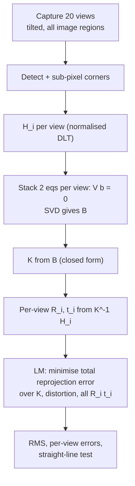
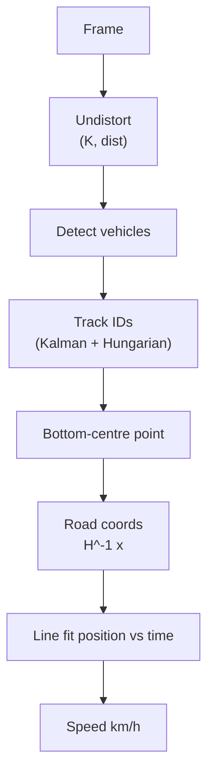

# Session 11 — Camera Geometry · Solutions

> Questions: [11_questions.md](11_questions.md) · Notes: [../notes/11_camera_geometry.md](../notes/11_camera_geometry.md)

## Section A — MCQs

### Q1 — Answer: **C**
**Why C:** $K$ has 5 free parameters: $f_x,f_y$ (focal lengths in pixels), $s$ (skew) and $(c_x,c_y)$ (principal point). The bottom row $(0,0,1)$ is fixed.
- **A** ✗ — 4 is the count when skew is fixed to 0 (OpenCV's model), not the general $K$.
- **B** ✗ — a classic slip: counting the 6 upper-triangular entries and forgetting that $K_{33}=1$ is fixed.
- **D** ✗ — 11 is the DOF of the full camera matrix $P$ (5 intrinsic + 6 extrinsic).

### Q2 — Answer: **B**
**Why B:** Moving and rotating the camera changes only its **pose**, i.e. the **extrinsics** $R,\mathbf t$. The intrinsics (and distortion) belong to the lens and sensor, which are unchanged.
- **A** ✗ — backwards: $K$ is the part that does **not** change.
- **C** ✗ — re-estimating $K$ is unnecessary because zoom and focus are fixed.
- **D** ✗ — distortion is intrinsic and does not depend on pose.

### Q3 — Answer: **D**
**Why D:** A pinhole projection maps every 3D line to a 2D line, because the plane through the line and the centre cuts the image plane in a line. Collinearity, incidence and the cross-ratio are preserved.
- **A** ✗ — parallel lines converge to a vanishing point (unless they are parallel to the image plane).
- **B** ✗ — length ratios (e.g. midpoints) are not preserved. Only the cross-ratio of 4 points is.
- **C** ✗ — angles are distorted by perspective foreshortening.

### Q4 — Answer: **A**
**Why A:** Lines bowing outward is **barrel** distortion. With $k_1<0$ the factor $1+k_1r^2$ is below 1 and shrinks further with $r$, so points are pulled **towards** the centre, most strongly at the border. A straight line's ends (large $r$) move in more than its middle, so it bows outward.
- **B** ✗ — $k_1>0$ is pincushion (lines bow inward), typical of telephoto lenses.
- **C** ✗ — the sign is right but the direction is wrong: a factor below 1 cannot push points outward.
- **D** ✗ — inconsistent: $k_1>0$ makes the factor greater than 1, which pushes points outward.

### Q5 — Answer: **D**
**Why D:** $P$ has 12 entries but is homogeneous (defined up to scale), so it has $12-1=11$ DOF = 5 intrinsic + 6 extrinsic.
- **A** ✗ — forgets the scale ambiguity.
- **B** ✗ — that is only the extrinsics (pose).
- **C** ✗ — that is a homography's DOF ($3\times3$ up to scale).

### Q6 — Answer: **C**
**Why C:** For a rotation about the centre, $\mathbf x'\sim KRK^{-1}\mathbf x$, **independent of depth**, so any scene works. This is the panorama case.
- **A** ✗ — translation with a non-planar scene causes parallax: points at different depths shift by different amounts.
- **B** ✗ — same reason. Two views of a 3D object with a baseline are governed by $F/E$, not $H$.
- **D** ✗ — removing distortion only restores the pinhole model. It does not remove parallax.

### Q7 — Answer: **A**
**Why A:** Each view gives $H=\lambda K[\mathbf r_1\ \mathbf r_2\ \mathbf t]$ (8 DOF). The orthonormality of $\mathbf r_1,\mathbf r_2$ yields 2 equations in $B=K^{-\top}K^{-1}$, which is symmetric and up to scale (5 unknowns). Then $2n\ge5\Rightarrow n\ge3$.
- **B** ✗ — wrong counts: each view gives 2 constraints and $K$ has 5 unknowns.
- **C** ✗ — the board is planar with known coordinates. No triangulation is involved.
- **D** ✗ — confuses Zhang with DLT for $P$. The per-view pose is eliminated, not estimated jointly at that step.

### Q8 — Answer: **B**
**Why B:** $\tilde{\mathbf v}\sim K\mathbf D=(800\cdot1+320\cdot1,\ 0+240\cdot1,\ 1)=(1120,240,1)$ → $(1120,240)$. Equivalently, the line points $(X,0,Z)$ with $X/Z\to1$ give $u\to800\cdot1+320$.
- **A** ✗ — this is the vanishing point of the optical-axis direction $(0,0,1)$.
- **C** ✗ — uses $f\cdot D_x/\Vert\mathbf D\Vert=800\cdot0.707$. The vanishing point depends on $D_x/D_z=\tan45^\circ=1$.
- **D** ✗ — only lines parallel to the image plane ($D_z=0$) have their vanishing point at infinity. Here $D_z=1$.

## Section B — Numericals

### Q9 — Projecting points and the camera centre
**Given:** $f_x=f_y=800$, $(c_x,c_y)=(320,240)$, no distortion.
**Formula:**

$$
\mathbf X_c=R\mathbf X_w+\mathbf t,\qquad u=f_x\frac{X_c}{Z_c}+c_x,\quad v=f_y\frac{Y_c}{Z_c}+c_y,\qquad C=-R^\top\mathbf t
$$

**Working:**

(a) $\mathbf X_c=(0.3+0.1,\ -0.2+0,\ 3+1)=(0.4,\ -0.2,\ 4)$.
Normalised: $x=0.4/4=0.1$, $y=-0.2/4=-0.05$.
$u=800(0.1)+320=400$, $v=800(-0.05)+240=200$.

(b) $R\mathbf X_w=(Z_w,\ Y_w,\ -X_w)=(1.2,\ 0.6,\ -1)$. Adding $\mathbf t$ gives $\mathbf X_c=(1.2,\ 0.6,\ 4)$.
Normalised: $(0.3,\ 0.15)$.
$u=800(0.3)+320=560$, $v=800(0.15)+240=360$.

(c) $R^\top=\begin{bmatrix}0&0&-1\\0&1&0\\1&0&0\end{bmatrix}$, so $R^\top\mathbf t=(-5,0,0)$ and $C=-R^\top\mathbf t=(5,0,0)$.
The optical axis in the world is the 3rd row of $R$: $(-1,0,0)$.

**Answer:** **(a) $(400,\ 200)$ px · (b) $(560,\ 360)$ px · (c) $C=(5,0,0)$ m, looking along $-X_w$, i.e. back towards the origin.**
Sanity check: the point's depth is $5-X_w=4$ m, which matches $Z_c=4$.
> ✔ Verified numerically (Python, also with `cv2.projectPoints`).
> **Common slip:** taking $\mathbf t$ as the camera position, which would give $C=(0,0,5)$. Use $C=-R^\top\mathbf t$.

### Q10 — Focal length in pixels, FOV, size–distance
**Given:** $f=4.2$ mm, $\rho=1.4\ \mu\text{m}=0.0014$ mm, $W\times H=4000\times3000$.
**Formula:**

$$
f_x=\frac{f}{\rho},\qquad \text{FOV}=2\arctan\frac{W}{2f_x},\qquad h=\frac{f_yH_o}{Z}
$$

**Working:**
(a) $f_x=4.2/0.0014=3000$ px. Square pixels, so $f_y=3000$ px.
(b) $\text{FOV}_h=2\arctan(4000/6000)=2\arctan(0.667)=2(33.69^\circ)=67.4^\circ$.
$\text{FOV}_v=2\arctan(3000/6000)=2(26.57^\circ)=53.1^\circ$.
Check via the sensor: the sensor width is $4000\times1.4\ \mu\text{m}=5.6$ mm, and $2\arctan(5.6/8.4)$ is the same angle.
(c) $h=3000\times1.8/12=450$ px.
(d) $Z=f_yH_o/h=3000\times1.5/75=60$ m.

**Answer:** **$f_x=3000$ px · FOV $67.4^\circ\times53.1^\circ$ · 450 px · 60 m**
> ✔ Verified numerically (Python).
> **Common slip:** mixing mm and µm, which gives 3 px or 3 000 000 px. Convert both to the same unit first.

### Q11 — Radial + tangential distortion
**Given:** $(x,y)=(0.3,0.2)$, $k_1=-0.25$, $k_2=0.05$, $p_1=0.001$, $p_2=-0.002$, $k_3=0$, $f=800$, $c=(320,240)$.
**Formula:**

$$
\begin{aligned}
x_d &= x(1+k_1r^2+k_2r^4+k_3r^6)+2p_1xy+p_2(r^2+2x^2)\\
y_d &= y(1+k_1r^2+k_2r^4+k_3r^6)+p_1(r^2+2y^2)+2p_2xy
\end{aligned}
$$

**Working:**
(a) Ideal pixel: $u=800(0.3)+320=560$, $v=800(0.2)+240=400$.

(b) $r^2=0.09+0.04=0.13$ and $r^4=0.0169$.
Radial factor: $1-0.25(0.13)+0.05(0.0169)=1-0.0325+0.000845=0.968345$.
Radial part: $x\cdot0.968345=0.2905035$ and $y\cdot0.968345=0.193669$.
Tangential parts:
$\Delta x=2(0.001)(0.3)(0.2)+(-0.002)(0.13+2\cdot0.09)=0.00012-0.00062=-0.00050$
$\Delta y=0.001(0.13+2\cdot0.04)+2(-0.002)(0.3)(0.2)=0.00021-0.00024=-0.00003$
So $x_d=0.2900035$ and $y_d=0.193639$.

(c) $u_d=800(0.2900035)+320=552.00$, $v_d=800(0.193639)+240=394.91$.
The shift is $(-8.00,\ -5.09)$ px, about 9.5 px **towards the principal point**, so this is **barrel** distortion ($k_1<0$).

**Answer:** **$(x_d,y_d)=(0.29000,\ 0.19364)$ → pixel $(552.00,\ 394.91)$, vs ideal $(560,400)$. Barrel distortion.**
> ✔ Verified numerically (Python, identical to `cv2.projectPoints` with these coefficients. `cv2.undistortPoints` recovers $(0.3,0.2)$).
> **Common slip:** applying the distortion to *pixel* coordinates instead of normalised ones, or using the order $(k_1,k_2,k_3,p_1,p_2)$.

### Q12 — Floor homography and back-projection
**Given:** $K$ as stated, $\mathbf r_1=(1,0,0)^\top$, $\mathbf r_2=(0,0.8,0.6)^\top$, $\mathbf t=(0,0,5)^\top$.
**Formula:**

$$
H=K[\mathbf r_1\ \mathbf r_2\ \mathbf t],\qquad \tilde{\mathbf x}\sim H\begin{bmatrix}X\\Y\\1\end{bmatrix},\qquad X_c=\frac{(u-c_x)Z_c}{f_x},\ Y_c=\frac{(v-c_y)Z_c}{f_y}
$$

**Working:**
(a) $[\mathbf r_1\ \mathbf r_2\ \mathbf t]=\begin{bmatrix}1&0&0\\0&0.8&0\\0&0.6&5\end{bmatrix}$. Multiplying by $K$:
row 1 $=(800,\ 320\cdot0.6,\ 320\cdot5)=(800,\ 192,\ 1600)$;
row 2 $=(0,\ 800\cdot0.8+240\cdot0.6,\ 240\cdot5)=(0,\ 784,\ 1200)$;
row 3 $=(0,\ 0.6,\ 5)$.

$$
H=\begin{bmatrix}800&192&1600\\0&784&1200\\0&0.6&5\end{bmatrix}
$$

(b) $H(1,2,1)^\top=(800+384+1600,\ 1568+1200,\ 1.2+5)=(2784,\ 2768,\ 6.2)$, giving $(449.03,\ 446.45)$.
Check with the full model: $\mathbf X_c=R(1,2,0)^\top+\mathbf t=(1,\ 1.6,\ 1.2)+(0,0,5)=(1,\ 1.6,\ 6.2)$.
Then $u=800/6.2+320=449.03$ and $v=800(1.6)/6.2+240=446.45$ ✓.
Note the third row of $H$ is not constant: depth varies across the tilted floor, which is the perspective foreshortening.

(c) $X_c=(500-320)(2.5)/800=0.5625$ m, $Y_c=(150-240)(2.5)/800=-0.28125$ m, $Z_c=2.5$ m.

**Answer:** **$H$ as above · floor point (1, 2) → $(449.0,\ 446.5)$ px · back-projected point $(0.5625,\ -0.281,\ 2.5)$ m**
> ✔ Verified numerically (Python). Also checked that $H^{-1}$ maps the pixel back to $(1,2)$, and that decomposing $K^{-1}H$ recovers $\mathbf r_1,\mathbf r_2,\mathbf t$.

### Q13 — Calibration bookkeeping
**Given:** $P$ has 11 DOF, each correspondence gives 2 equations, $B$ has 5 unknowns, each view gives 2 constraints.
**Formula:**

$$
2n\ge11,\qquad 2n_{views}\ge\#\text{unknowns of }B,\qquad \text{RMS}=\sqrt{\tfrac1N\textstyle\sum\Vert\mathbf e_k\Vert^2}
$$

**Working:**
(a) $n\ge5.5\Rightarrow$ **6 points**. $A$ is $2n\times12=12\times12$.
(b) 2 constraints per view. (i) 5 unknowns → $n\ge3$. (ii) skew $=0$ → 4 unknowns → $n\ge2$. (iii) also known $(c_x,c_y)$ → 2 unknowns → $n\ge1$.
(c) Parameters: $4+5+6\times15=99$. Residuals: $15\text{ views}\times54\text{ corners}\times2=1620$.
(d) Squared norms: $0.25,\ 1.00,\ 0.25,\ 1.69$, sum $3.19$. $\sqrt{3.19/4}=\sqrt{0.7975}=0.893$ px.

**Answer:** **6 points, $A$ is $12\times12$ · 2 per view: 3 / 2 / 1 views · 99 parameters, 1620 residuals · RMS ≈ 0.89 px**
> ✔ Verified numerically (Python). A synthetic Zhang test confirmed that $V$ reaches rank 5 with 3 views, while a second view that is only a translated (parallel) board leaves the rank unchanged.
> **Common slip:** averaging the error *norms* ($0.5,1,0.5,1.3$ → 0.825) instead of root-mean-*square*.

## Section C — Short answers

### Q14 — Homogeneous coordinates (3 marks)
**Definition.** A 2D point $(x,y)$ is written $(x,y,1)^\top$ or any non-zero multiple $(wx,wy,w)^\top$. A 3D point is written $(X,Y,Z,1)^\top$. Points are **equal up to scale**, and you recover the ordinary point by dividing by the last coordinate.

**Why used (any three):**
1. **Projection becomes linear:** the division by $Z$ is deferred, so $\lambda\tilde{\mathbf x}=K[R\mid\mathbf t]\tilde{\mathbf X}$ is a single $3\times4$ matrix product.
2. **Translations become matrix multiplications**, so rigid motions, projection and pixel mapping (and homographies) **compose by multiplication**.
3. **Points at infinity** ($w=0$) are ordinary vectors. Vanishing points, the horizon and epipoles at infinity need no special cases.
4. **Point–line duality:** a line is $\mathbf l$ with $\mathbf l^\top\tilde{\mathbf x}=0$, the line through two points is $\tilde{\mathbf x}_1\times\tilde{\mathbf x}_2$, and the intersection of two lines is $\mathbf l_1\times\mathbf l_2$.
5. **Scale ambiguity becomes explicit**, which explains the DOF counts ($P$: 12 − 1 = 11, $H$: 9 − 1 = 8).

**Trade-off line:** the price is a final perspective division, and every estimated matrix is defined only up to scale. That is why we solve $A\mathbf h=0$ with SVD under $\Vert\mathbf h\Vert=1$.

### Q15 — Intrinsics vs extrinsics (4 marks)

| | Intrinsics | Extrinsics |
|---|---|---|
| Parameters | $K$: $f_x,f_y$ (focal lengths in px), $s$ (skew), $c_x,c_y$ (principal point), **+ distortion** $k_1,k_2,p_1,p_2,k_3$ | $R$ (rotation), $\mathbf t$ (translation): $\mathbf X_c=R\mathbf X_w+\mathbf t$ |
| DOF | **5** (+ distortion) | **6** (3 + 3) |
| Meaning | How camera-frame rays map to pixels: lens + sensor geometry | Where the camera is and where it points. Camera centre $C=-R^\top\mathbf t$ |

Together: $P=K[R\mid\mathbf t]$, **11 DOF**.

**Scenarios:**
- (i) **Camera on a moving car:** only the **extrinsics** change, every frame. They are tracked by VO or SLAM. $K$ is fixed.
- (ii) **Zoom in:** the **intrinsics** change ($f_x,f_y$ grow, the principal point and distortion can shift), so recalibrate or use a zoom-dependent model. The extrinsics are unchanged unless the camera also moves.
- (iii) **Resize to half resolution:** the **intrinsics** change, since $f_x,f_y,c_x,c_y$ are all ≈ halved (pixel units). The distortion coefficients (dimensionless, normalised coordinates) and the extrinsics are unchanged.

**Closing line:** intrinsics are calibrated once per camera setting, while extrinsics are estimated per image (PnP / SLAM).

### Q16 — Lens distortion (4 marks)
**Model** (normalised coordinates $(x,y)$, $r^2=x^2+y^2$, applied *before* $K$):
$x_d=x(1+k_1r^2+k_2r^4+k_3r^6)+2p_1xy+p_2(r^2+2x^2)$, $y_d=y(1+k_1r^2+k_2r^4+k_3r^6)+p_1(r^2+2y^2)+2p_2xy$. OpenCV stores $(k_1,k_2,p_1,p_2,k_3)$.
- **Radial** ($k_i$) comes from lens curvature: magnification varies with distance from the optical axis, symmetrically.
  - **Barrel** ($k_1<0$): points are pulled inward and lines bow outward (wide-angle).
  - **Pincushion** ($k_1>0$): points are pushed outward and lines bow inward (telephoto).
- **Tangential** ($p_i$) comes from lens elements that are decentred or tilted relative to the sensor. It is asymmetric and usually small.

**Why a homography fails:** a homography is a linear map of homogeneous coordinates, so it maps every straight line to a straight line. Radial distortion is a **non-linear function of $r$** that maps straight lines to curves, so no $3\times3$ matrix can undo it.

**Efficient undistortion of video:** precompute, **once**, a lookup map using **inverse mapping** (`initUndistortRectifyMap`). For each output pixel, apply $K_{new}^{-1}$, then the **forward** distortion model, then $K$, which gives the source pixel. Then call `cv2.remap` per frame (bilinear interpolation). No per-frame polynomial inversion is needed, and there are no holes. Points only (e.g. feature tracks) can use `undistortPoints`, which inverts the model iteratively.

**Trade-off:** undistorted images lose border pixels or gain black regions, controlled by $\alpha$ in `getOptimalNewCameraMatrix`.

### Q17 — Where homographies come from (5 marks)
**(a) Plane → image.** Put the world frame on the plane so that $Z=0$:
$\lambda\tilde{\mathbf x}=K[\mathbf r_1\ \mathbf r_2\ \mathbf r_3\ \mathbf t]\,(X,Y,0,1)^\top=K[\mathbf r_1\ \mathbf r_2\ \mathbf t]\,(X,Y,1)^\top$.
The third column of $R$ multiplies 0 and disappears, leaving an invertible $3\times3$ map, $H=K[\mathbf r_1\ \mathbf r_2\ \mathbf t]$ up to scale. Two images of the same plane are then related by $H_2H_1^{-1}$, also a homography. **[2]**

**(b) Pure rotation.** Put the world frame at the camera centre, so view 1 has $\lambda_1\tilde{\mathbf x}_1=K\mathbf X$ and view 2 (rotated, $\mathbf t=\mathbf 0$) has $\lambda_2\tilde{\mathbf x}_2=KR\mathbf X$.
Substituting $\mathbf X=\lambda_1K^{-1}\tilde{\mathbf x}_1$ gives $\tilde{\mathbf x}_2\sim KRK^{-1}\tilde{\mathbf x}_1$.
The depth $\lambda_1$ cancels as an overall scale, so this holds for **every** point of **any** scene. This is the panorama case. **[2]**

**(c) General translation.** With $\mathbf t\ne\mathbf 0$: $\lambda_2\tilde{\mathbf x}_2=KRK^{-1}\lambda_1\tilde{\mathbf x}_1+K\mathbf t$. The second term's relative effect depends on the depth $\lambda_1$, so points at different depths along the same ray map to different pixels (**parallax**). No single $3\times3$ matrix can do this. The two views are related only by the **epipolar constraint** $\mathbf x'^\top F\mathbf x=0$ (a point → line mapping, [Session 12](../notes/12_3d_vision_motion.md)). **[1]**

**Applications (bonus):** document rectification, IPM / bird's-eye view, planar AR, panoramas, Zhang calibration.

## Section D — Long answers

### Q18 — Designing a Zhang calibration for a robot camera (10 marks)

**1. What we estimate (model).** We estimate $\lambda\tilde{\mathbf x}=K[R\mid\mathbf t]\tilde{\mathbf X}$ plus lens distortion:
- **Intrinsics** $K$: $f_x,f_y,c_x,c_y$ (skew ≈ 0), 4–5 DOF;
- **Distortion** $(k_1,k_2,p_1,p_2,k_3)$, applied in normalised coordinates;
- **Extrinsics** $R_i,\mathbf t_i$ for each calibration view (6 DOF each). These are nuisance parameters, unless we also want the camera-to-robot transform, which is a separate hand–eye calibration.

Metric measurement then uses $K$ and distortion to turn pixels into rays, plus a depth source (stereo, a known ground plane, a known object size).

**2. Why a planar target gives a homography.** With the board at $Z=0$, $\lambda\tilde{\mathbf x}=K[\mathbf r_1\ \mathbf r_2\ \mathbf t]\,(X,Y,1)^\top$, so each view is a homography $H_i=\lambda K[\mathbf r_1\ \mathbf r_2\ \mathbf t]$. It is estimated by normalised DLT from ≥ 4 (in practice 54) corners.

**3. Why ≥ 3 views.** $\mathbf r_1\perp\mathbf r_2$ and $\Vert\mathbf r_1\Vert=\Vert\mathbf r_2\Vert$ give $\mathbf h_1^\top B\mathbf h_2=0$ and $\mathbf h_1^\top B\mathbf h_1=\mathbf h_2^\top B\mathbf h_2$, with $B=K^{-\top}K^{-1}$ (symmetric, up to scale, so 5 unknowns). Each view therefore gives 2 constraints, and we need $n\ge3$ (2 if skew $=0$). Views must differ in **orientation**: parallel board positions add no constraints.

**4. Algorithm.**

Steps: corners → $H_i$ → $B$ (SVD of $2n\times6$) → $K$ → $\mathbf r_1,\mathbf r_2,\mathbf t$ from $K^{-1}\mathbf h_i/\Vert K^{-1}\mathbf h_1\Vert$, $\mathbf r_3=\mathbf r_1\times\mathbf r_2$, orthogonalise → distortion initialised at 0 → **Levenberg–Marquardt** on $\sum_i\sum_j\Vert\mathbf x_{ij}-\hat{\mathbf x}(K,\mathbf k,R_i,\mathbf t_i,\mathbf X_j)\Vert^2$.

**5. OpenCV.** `findChessboardCorners` → `cornerSubPix` → object points $(j\cdot sq, i\cdot sq,0)$ → `calibrateCamera` (returns the RMS, `K`, `dist`, `rvecs`, `tvecs`) → `getOptimalNewCameraMatrix` → `initUndistortRectifyMap` + `remap` at run time. Save `K` and `dist` with the resolution they belong to.

**6. Quality checks.**
- RMS reprojection error, typically well under 1 px (≈ 0.1–0.5 px for a good setup).
- Per-view errors (re-shoot outlier views).
- Stable $K$ across bootstrap subsets of views.
- Undistorted straight edges are straight.
- **Metric test:** measure a known distance (e.g. via PnP on a held-out board) and compare to ground truth.

**7. Pitfalls (any four).**
- Autofocus or zoom changing between shots (fix them).
- Too few or only fronto-parallel views (weak $f$ and principal-point estimates; parallel views are degenerate).
- Corners not covering the image edges (distortion is poorly constrained, so extrapolation is bad).
- Board not flat, or a wrong square size (metric scale error in $\mathbf t$).
- Motion blur and rolling shutter (wrong corners).
- Over-parameterised distortion overfitting (low RMS, bad generalisation).
- Calibrating at one resolution and running at another (rescale $K$).

**Trade-off line:** more views and more distortion terms reduce training error but need good coverage to avoid overfitting. A well-spread set of 15–25 tilted views is the practical sweet spot.

**Marking scheme:** 2 – model and parameters · 2 – homography + 2-constraints-per-view derivation (≥ 3 views) · 3 – algorithm incl. LM refinement and OpenCV steps · 1 – quality metrics · 2 – pitfalls.

### Q19 — Single-camera vehicle speed measurement with a road-plane homography (10 marks)

**1. Framing.** Speed = distance travelled **on the road plane** ÷ time. A single camera cannot measure depth in general, but points **on a known plane** are fully recoverable, because image ↔ plane is a **homography** ([Homography revisited](../notes/11_camera_geometry.md#homography-revisited)). So we measure the motion of the **road-contact point** of each vehicle in road coordinates.

**2. Calibration.**
- **Intrinsics + distortion** in the lab by Zhang's method, with fixed zoom and focus. Undistortion is essential, otherwise the lane lines curve and the homography is wrong.
- **Image ↔ road mapping:** survey ≥ 4 (better 8–12, spread over the measurement zone) ground control points, e.g. lane-marking corners with known dash length and lane width, measured by tape or RTK-GPS. Then `findHomography` (RANSAC) from undistorted pixels to road metres.
- Alternative: `solvePnP` with $K$ to get $R,\mathbf t$ of the road frame, then $H=K[\mathbf r_1\ \mathbf r_2\ \mathbf t]$.

**3. IPM / bird's-eye view.** Warp with $H^{-1}$ composed with a metric scaling (e.g. 1 px = 5 cm) to get a top-down view where lanes are parallel and distances are metric. This is for visualisation and debugging; speed can also be computed by mapping just the tracked points.

**4. Detection + tracking.** Use a detector (e.g. YOLO) and a tracker (SORT / ByteTrack: Kalman + Hungarian, [Session 12](../notes/12_3d_vision_motion.md)). Track the **bottom-centre of the box / wheel–road contact point**, because only points on the plane $Z=0$ are mapped correctly by $H$.

**5. Speed computation.** Map each track point to road coordinates, $\tilde{\mathbf X}_{road}\sim H^{-1}\tilde{\mathbf x}$, and fit a line to position vs time over many frames (least squares), rather than differencing two frames.
**Worked example:** 2.5 m in 5 frames at 25 fps: $\Delta t=5/25=0.2$ s, so $v=2.5/0.2=12.5$ m/s $=12.5\times3.6=$ **45 km/h**.

**6. Error sources.**
- **Height bias (key point).** The homography assumes the tracked point is on the ground. A roof point at $h_p=1.5$ m, seen by a camera at $h_c=6$ m, is back-projected along its ray down to the ground, which lies **further** from the camera foot. By similar triangles the ground-plane positions, and therefore displacements, are scaled by
  $\frac{h_c}{h_c-h_p}=\frac{6}{4.5}=1.33$.
  So the speed is **overestimated by 33 %**: 45 km/h would read as 60 km/h. (Verified numerically.) Even a bumper point at 0.5 m gives +9 %.
- **Resolution falls with distance:** one pixel covers more road far away, so position noise grows. Restrict the measurement zone to the near and middle field and average over many frames.
- Non-flat road (camber, slope), camera vibration or wind changing the pose (re-estimate $H$ from fixed markers and monitor it), residual distortion, timestamp jitter (use the frame timestamps, not the nominal fps), occlusions and ID switches, shadows biasing the box bottom.

**7. Validation.** Drive test vehicles with GPS or radar ground-truth speeds across the speed range and lanes, then report the mean and max error. Check the homography on held-out surveyed points (error in metres). Monitor drift over time and in different weather and lighting.

**Trade-off line:** a single camera + homography is cheap and exact **for points on the road plane**. Accuracy hinges on tracking the ground-contact point and on a stable, well-surveyed calibration. Radar or stereo avoid the planarity assumption at higher cost.

**Marking scheme:** 2 – calibration (intrinsics, distortion, ground control points / homography) · 2 – IPM and the plane assumption · 2 – tracking + correct choice of ground point + speed computation (45 km/h) · 3 – error analysis incl. the 1.33× height bias · 1 – validation.
