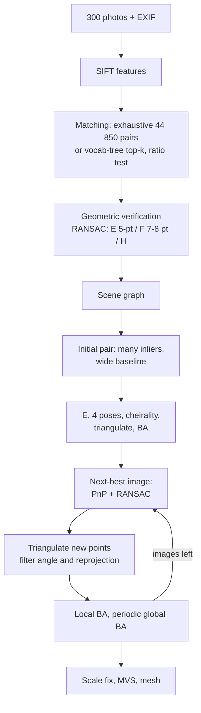
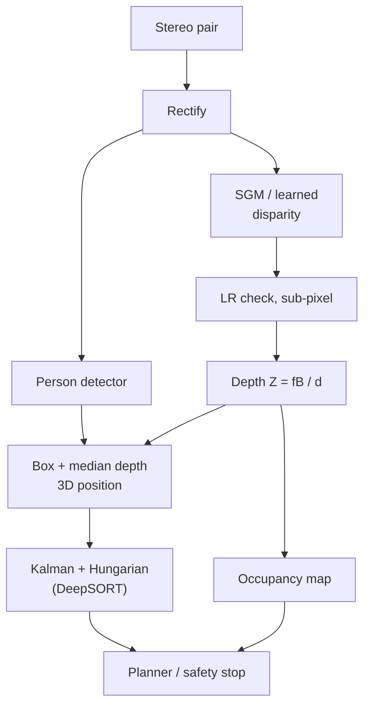

# Session 12 — 3D Vision & Motion · Solutions

> Questions: [12_questions.md](12_questions.md) · Notes: [../notes/12_3d_vision_motion.md](../notes/12_3d_vision_motion.md)

## Section A — MCQs

### Q1 — Answer: **C**
**Why C:** $Z=fB/d$, so depth is inversely proportional to disparity. A larger disparity means a **nearer** point. (Hold a finger close to your eyes and alternate them: it jumps a lot.)
- **A** ✗ — the classic inversion. Far points have $d\to0$.
- **B** ✗ — the baseline is the same for every point. Disparity varies with depth.
- **D** ✗ — in rectified stereo the epipoles are at infinity. Disparity says nothing about distance to an epipole.

### Q2 — Answer: **B**
**Why B:** $F$ has 9 entries, minus 1 for scale, minus 1 for the constraint $\det F=0$ (rank 2), giving **7 DOF**. This is why the 7-point algorithm is minimal.
- **A** ✗ — 8 is the number of points for the *linear* 8-point algorithm (it ignores the det constraint), not the DOF.
- **C** ✗ — ignores both the scale and the rank constraint.
- **D** ✗ — 5 is the DOF of the essential matrix.

### Q3 — Answer: **A**
**Why A:** Image correspondences are unchanged if the whole scene and the baseline are scaled together, so only the **direction** of $\mathbf t$ (2 DOF) is observable: $3+3-1=5$.
- **B** ✗ — $E=[\mathbf t]_\times R$ is rank 2 automatically, because $[\mathbf t]_\times$ is rank 2. That constraint does not remove a DOF from $(R,\mathbf t)$.
- **C** ✗ — $E$ involves no $K$ at all. It works on normalised coordinates.
- **D** ✗ — confuses the 5-point minimal solver with the definition of DOF. Any number of matches can be available.

### Q4 — Answer: **D**
**Why D:** With $I_y\approx0$, $A^\top A\approx\begin{bmatrix}\sum I_x^2&0\\0&\approx0\end{bmatrix}$ is near-singular (one eigenvalue ≈ 0). Only the component **along the gradient** (horizontal, normal to the edge), $u=-\sum I_xI_t/\sum I_x^2$, is determined. This is the **aperture problem**.
- **A** ✗ — that needs two large eigenvalues (a corner or texture).
- **B** ✗ — backwards. Motion **along** the edge (vertical) produces no brightness change, so it is invisible.
- **C** ✗ — $I_t\ne0$ when the edge moves horizontally, so the normal component is recoverable.

### Q5 — Answer: **B**
**Why B:** Both are the gradient second-moment matrix $\sum w\begin{bmatrix}I_x^2&I_xI_y\\I_xI_y&I_y^2\end{bmatrix}$. Good corners for Harris and Shi–Tomasi are exactly the windows where LK is well-conditioned.
- **A** ✗ — SIFT's edge test uses the Hessian of second derivatives ($D_{xx},D_{yy},D_{xy}$), not products of first derivatives.
- **C** ✗ — $F$ is a $3\times3$ two-view geometric relation, unrelated to image gradients.
- **D** ✗ — the Kalman covariance describes uncertainty in the box state, not image gradients.

### Q6 — Answer: **C**
**Why C:** Scaling, rotating and translating the scene together with all cameras leaves every image unchanged. A monocular reconstruction is therefore fixed only **up to a 7-DOF similarity**. Metric scale needs a known length, GPS/IMU, or a stereo baseline.
- **A** ✗ — metric units are not observable from images alone.
- **B** ✗ — SfM recovers translations (up to scale) and triangulates 3D points.
- **D** ✗ — a projective ambiguity applies to **uncalibrated** cameras. With $K$ known it reduces to a similarity.

### Q7 — Answer: **A**
**Why A:** Loop closure recognises a revisit (BoW place recognition + geometric verification) while tracking is working. It then adds a loop constraint and runs pose-graph optimisation (and BA) to **correct the drift** in the trajectory and map.
- **B** ✗ — that describes **relocalisation**: recovering the pose after tracking failure, map unchanged.
- **C** ✗ — map initialisation (two-view E/H + triangulation).
- **D** ✗ — keyframe selection is a front-end / local-mapping decision.

### Q8 — Answer: **D**
**Why D:** $\Delta Z\approx Z^2\Delta d/(fB)$, so the error scales with $Z^2$. Going from 5 m to 15 m is $3^2=9\times$, giving $9\times5$ cm $=45$ cm.
- **A** ✗ — assumes linear growth.
- **B** ✗ — assumes a constant depth error. Only the disparity error is constant.
- **C** ✗ — assumes cubic growth ($3^3=27$).

## Section B — Numericals

### Q9 — Depth and 3D point from rectified stereo
**Given:** $f=700$ px, $B=0.12$ m, $(c_x,c_y)=(320,240)$.
**Formula:**

$$
Z=\frac{fB}{d},\qquad X=\frac{(x_L-c_x)Z}{f},\qquad Y=\frac{(y-c_y)Z}{f}
$$

**Working:**
$fB=700\times0.12=84$ px·m.
(a) $d=84\Rightarrow Z=84/84=1.0$ m. $d=21\Rightarrow Z=4.0$ m. $d=7\Rightarrow Z=12.0$ m.
(b) $d=450-415=35$ px, so $Z=84/35=2.4$ m.
$X=(450-320)(2.4)/700=130\times2.4/700=0.446$ m.
$Y=(300-240)(2.4)/700=60\times2.4/700=0.206$ m.

**Answer:** **(a) 1 m, 4 m, 12 m · (b) $d=35$ px, $(X,Y,Z)=(0.446,\ 0.206,\ 2.40)$ m**
> ✔ Verified numerically (Python).
> **Common slip:** using $x_L$ instead of $x_L-c_x$ for $X$, or writing $B$ in cm (which gives $Z$ in cm).

### Q10 — Depth resolution and baseline design
**Given:** $f=700$ px, $B=0.12$ m, $\Delta d=0.25$ px.
**Formula:**

$$
\Delta Z\approx\frac{Z^2}{fB}\Delta d,\qquad B_{req}=\frac{Z^2\Delta d}{f\,\Delta Z},\qquad Z_{max}=\frac{fB}{d_{min}},\qquad Z_{min}=\frac{fB}{d_{max}}
$$

**Working:**
(a) $\Delta Z=\frac{10^2\times0.25}{84}=\frac{25}{84}=0.298$ m (≈ 30 cm).
(b) $B=\frac{100\times0.25}{700\times0.10}=\frac{25}{70}=0.357$ m (≈ 36 cm, i.e. 3× the original).
(c) Original rig: $Z_{max}=84/1=84$ m and $Z_{min}=84/128=0.656$ m.
New rig: $fB=700\times0.357=250$, so $Z_{min}=250/128=1.95$ m.

**Answer:** **(a) ≈ 0.30 m · (b) $B\approx0.36$ m · (c) $Z_{max}=84$ m, $Z_{min}=0.66$ m (original) → 1.95 m (new baseline)**
**Trade-off:** tripling the baseline cuts the depth error at 10 m by 3×. But the near limit grows 3× (unless the disparity search range is tripled to 384 px, which triples the matching cost), occlusions increase, and the rig gets bigger.
> ✔ Verified numerically (Python).
> **Common slip:** forgetting to square $Z$. Note also that the linearised $\Delta Z$ is approximate: the exact errors for $d\pm0.25$ px are 0.289 m and 0.307 m.

### Q11 — Essential matrix, epipolar line, epipole
**Given:** $R=R_z(90^\circ)$, $\mathbf t=(1,0,0)^\top$, $\mathbf X_1=(1,2,4)^\top$.
**Formula:**

$$
E=[\mathbf t]_\times R,\quad [\mathbf t]_\times=\begin{bmatrix}0&-t_z&t_y\\t_z&0&-t_x\\-t_y&t_x&0\end{bmatrix},\quad \hat{\mathbf x}_2^\top E\hat{\mathbf x}_1=0,\quad \mathbf l_2=E\hat{\mathbf x}_1
$$

**Working:**
(a) $[\mathbf t]_\times=\begin{bmatrix}0&0&0\\0&0&-1\\0&1&0\end{bmatrix}$. Row 2 of $[\mathbf t]_\times$ picks $-(\text{row 3 of }R)=(0,0,-1)$, and row 3 picks $\text{row 2 of }R=(1,0,0)$. So

$$
E=\begin{bmatrix}0&0&0\\0&0&-1\\1&0&0\end{bmatrix}
$$

(b) $R\mathbf X_1=(-2,\ 1,\ 4)$, so $\mathbf X_2=(-2+1,\ 1,\ 4)=(-1,\ 1,\ 4)$.
$\hat{\mathbf x}_1=(1/4,\ 2/4,\ 1)=(0.25,\ 0.5,\ 1)$ and $\hat{\mathbf x}_2=(-0.25,\ 0.25,\ 1)$.
$E\hat{\mathbf x}_1=(0,\ -1,\ 0.25)$, so $\hat{\mathbf x}_2^\top E\hat{\mathbf x}_1=0+(0.25)(-1)+(1)(0.25)=0$ ✓.
(c) $\mathbf l_2=(0,-1,0.25)$, i.e. $-y+0.25=0$, so **$y=0.25$**: a horizontal line. $\hat{\mathbf x}_2$ has $y=0.25$, so it lies on the line ✓.
(d) The singular values are **(1, 1, 0)**: rank 2 with two equal non-zero values, so this is a valid essential matrix.
$E^\top=\begin{bmatrix}0&0&1\\0&0&0\\0&-1&0\end{bmatrix}$, and $E^\top(a,b,c)^\top=(c,0,-b)=\mathbf 0\Rightarrow\mathbf e_2=(1,0,0)^\top$. This is a **point at infinity in the $x$ direction** (the direction of $\mathbf t$), so every epipolar line in image 2 is horizontal, consistent with (c).

**Answer:** **$E=\begin{bmatrix}0&0&0\\0&0&-1\\1&0&0\end{bmatrix}$ · constraint $=0$ ✓ · $\mathbf l_2$: $y=0.25$ · singular values $(1,1,0)$, $\mathbf e_2=(1,0,0)^\top$ (at infinity)**
> ✔ Verified numerically (Python). Also: `cv2.recoverPose` on this $E$ returns $R=R_z(90^\circ)$, $\mathbf t=(1,0,0)$. Of the 4 decomposition candidates, only that one puts the point in front of both cameras (depths 4 and 4).
> **Common slip:** computing $R[\mathbf t]_\times$ instead of $[\mathbf t]_\times R$ (matrix order matters), or forgetting to divide by $Z$ before applying $E$.

### Q12 — Normal flow and Lucas–Kanade
**Given:** (a) $I_x=3$, $I_y=4$, $I_t=-10$. (b) the window sums. (c) the second window.
**Formula:**

$$
I_xu+I_yv+I_t=0,\qquad \mathbf u_\perp=-\frac{I_t}{\Vert\nabla I\Vert^2}\nabla I,\qquad \begin{bmatrix}\sum I_x^2&\sum I_xI_y\\\sum I_xI_y&\sum I_y^2\end{bmatrix}\begin{bmatrix}u\\v\end{bmatrix}=-\begin{bmatrix}\sum I_xI_t\\\sum I_yI_t\end{bmatrix}
$$

**Working:**
(a) $\Vert\nabla I\Vert=\sqrt{9+16}=5$. Only the **normal flow** is recoverable from one pixel (the aperture problem).
Its magnitude is $-I_t/\Vert\nabla I\Vert=10/5=2$ px/frame along $\nabla I/\Vert\nabla I\Vert=(0.6,0.8)$, so $\mathbf u_\perp=(1.2,\ 1.6)$.
Check: $3(1.2)+4(1.6)-10=3.6+6.4-10=0$ ✓.
Any $(1.2,1.6)+k(-0.8,0.6)$ also satisfies the equation: the tangential component is unknown.
(b) $\begin{bmatrix}20&4\\4&10\end{bmatrix}\begin{bmatrix}u\\v\end{bmatrix}=\begin{bmatrix}28\\1\end{bmatrix}$, with $\det=200-16=184$.
$u=(28\cdot10-4\cdot1)/184=276/184=1.5$.
$v=(20\cdot1-4\cdot28)/184=-92/184=-0.5$.
(c) $\lambda=15\pm\sqrt{225-184}=15\pm6.40$, giving $\lambda_1=21.40$ and $\lambda_2=8.60$. Both are large (condition number ≈ 2.5), so the window is **corner-like** and well-conditioned.
The second window has $\lambda=20$ and $0.01$ (condition number 2000), so it is an **edge**. $v$ is essentially undetermined, and noise would be amplified 2000×.

**Answer:** **(a) normal flow $(1.2,1.6)$ px/frame, magnitude 2 · (b) $(u,v)=(1.5,\ -0.5)$ px/frame · (c) eigenvalues 21.4 and 8.6, so track window 1. Window 2 is an edge (aperture problem).**
> ✔ Verified numerically (Python).
> **Common slip:** dropping the minus sign on the right-hand side, which gives $(-1.5,0.5)$.

### Q13 — RANSAC iterations and bundle-adjustment size
**Given:** $p=0.99$, $e=0.5$, $s\in\{8,7,5\}$. 50 cameras, $10^4$ points, 4 observations per point.
**Formula:**

$$
N=\left\lceil\frac{\log(1-p)}{\log(1-(1-e)^s)}\right\rceil,\qquad \#\text{params}=6n_{cams}+3n_{pts},\qquad \#\text{res}=2n_{obs}
$$

**Working:**
(a) $\log(0.01)=-4.6052$.
- $s=8$: $0.5^8=0.003906$, $\log(0.996094)=-0.003914$, so $N=1176.6\to$ **1177**.
- $s=7$: $0.5^7=0.0078125$, $\log(0.992188)=-0.007843$, so $N=587.2\to$ **588**.
- $s=5$: $0.5^5=0.03125$, $\log(0.96875)=-0.031749$, so $N=145.05\to$ **146**.

(b) Parameters $=50\times6+10\,000\times3=300+30\,000=$ **30 300** (7 of these are gauge freedoms, fixed by holding the first camera and the scale).
Observations $=10\,000\times4=$ **40 000**, so residuals $=2\times40\,000=$ **80 000**.
The Schur complement eliminates the 30 000 point parameters, leaving a **300 × 300** reduced camera system.

**Answer:** **1177 / 588 / 146 iterations · 30 300 parameters, 40 000 observations, 80 000 residuals, 300 × 300 reduced system**
> ✔ Verified numerically (Python).
> **Common slip:** rounding down (always round **up**), or counting 1 residual per observation instead of 2 ($u$ and $v$).

## Section C — Short answers

### Q14 — Depth from disparity (4 marks)
**Setup.** Two identical, rectified cameras with focal length $f$ (pixels) and centres $O_L=(0,0,0)$, $O_R=(B,0,0)$. A point $P=(X,Y,Z)$ projects to $x_L$ and $x_R$ (measured from each principal point) on the **same row**.

**Derivation.**
- Left camera: $x_L=fX/Z$. Right camera (shifted by $B$): $x_R=f(X-B)/Z$.
- Subtract: $d=x_L-x_R=fB/Z$, so $\boxed{Z=fB/d}$.
- Similar-triangles view: triangle $(P,O_L,O_R)$ has base $B$ and height $Z$. Triangle $(P,p_L,p_R)$ has base $B-d$ and height $Z-f$. Then $\frac{B-d}{Z-f}=\frac{B}{Z}\Rightarrow Z=\frac{fB}{d}$.

**Precision.** $\frac{\partial Z}{\partial d}=-\frac{fB}{d^2}=-\frac{Z^2}{fB}$, so $\Delta Z\approx\frac{Z^2}{fB}\Delta d$. A fixed matching error $\Delta d$ (≈ 0.1–0.25 px) produces a depth error that grows **quadratically**: far points have tiny disparities, so a quarter-pixel is a large fraction of them.

**Baseline trade-off.**

| Larger $B$ | Smaller $B$ |
|---|---|
| Better $\Delta Z$, longer range ($Z_{max}=fB/d_{min}$) | Easier matching (similar views), fewer occlusions |
| More occlusion and appearance change, larger $Z_{min}=fB/d_{max}$ or bigger search | Poor far-range precision, compact |

**Closing line:** choose the baseline from the required $\Delta Z$ at the working distance, $B=Z^2\Delta d/(f\Delta Z)$, then check that $Z_{min}$ and the search range are acceptable.

### Q15 — Optical flow, aperture problem, LK vs HS (4 marks)
**Assumptions.**
1. **Brightness constancy**: $I(x+u,y+v,t+1)=I(x,y,t)$.
2. **Small motion**, so a first-order Taylor expansion is valid.
3. **Spatial coherence**: neighbours move alike.

**Derivation.** $I(x+u,y+v,t+1)\approx I+I_xu+I_yv+I_t$. Setting this equal to $I$ gives $\boxed{I_xu+I_yv+I_t=0}$.

**Aperture problem.** That is one equation per pixel in two unknowns. Only the flow component along $\nabla I$ (the **normal flow**, magnitude $\lvert I_t\rvert/\Vert\nabla I\Vert$) is determined. Motion along an edge is invisible.

**Lucas–Kanade (local).** Assume constant flow in a window and solve the over-determined system by least squares: $A^\top A\,\mathbf u=-A^\top\mathbf b$. It is reliable only where $A^\top A$ (the **Harris matrix**) has two large eigenvalues, i.e. at **corners**. On edges it is near-singular, which is the aperture problem in action. So track Shi–Tomasi corners. The result is sparse and fast.

**Horn–Schunck (global).** Add a smoothness term $\alpha^2(\Vert\nabla u\Vert^2+\Vert\nabla v\Vert^2)$ and minimise over the whole image. Flow from textured regions **propagates into** flat and edge regions. The result is dense, but it **oversmooths motion boundaries**.

**Pyramids.** The Taylor expansion fails for motions much above ~1 px. In a Gaussian pyramid a motion of $m$ px is $m/2^L$ px at level $L$. Estimate there, upsample (×2), warp, and refine the residual at each finer level (coarse-to-fine).

**Closing line:** LK is a cheap, sparse tracker for corners. HS is dense but blurry at boundaries. Modern deep flow (RAFT) learns to resolve both problems.

### Q16 — E vs F and the normalised 8-point algorithm (4 marks)

| | Essential $E$ | Fundamental $F$ |
|---|---|---|
| Coordinates | Normalised $\hat{\mathbf x}=K^{-1}\tilde{\mathbf x}$: $\hat{\mathbf x}'^\top E\hat{\mathbf x}=0$ | Pixels: $\mathbf x'^\top F\mathbf x=0$ |
| Formula | $E=[\mathbf t]_\times R$ | $F=K'^{-\top}EK^{-1}$ |
| DOF | **5** (scale of $\mathbf t$ lost) | **7** (scale + $\det=0$) |
| Rank / singular values | 2, $(\sigma,\sigma,0)$ | 2, $(\sigma_1,\sigma_2,0)$ |
| Use | Relative pose $R$, $\hat{\mathbf t}$ (needs $K$) | Epipolar lines and verification without calibration |

**Normalised 8-point algorithm.**
1. **Normalise** each image's points with $T,T'$ (centroid → origin, mean distance $\sqrt2$).
2. Each match gives a row $(x'x,x'y,x',y'x,y'y,y',x,y,1)$. Stack $n\ge8$ rows into $A$.
3. SVD of $A$. $\mathbf f$ = the singular vector of the smallest singular value, reshaped into $\hat F$.
4. **Enforce rank 2:** SVD of $\hat F$, set $\sigma_3=0$, recompose.
5. **Denormalise:** $F=T'^\top\hat FT$. (Inside RANSAC: score inliers with the Sampson distance and refit.)

**Why normalise:** raw pixel coordinates (~$10^2$–$10^3$) make the entries of $A$ range from ~1 to ~$10^6$. $A$ becomes badly conditioned and the SVD solution is noise-dominated. Normalisation (Hartley) makes the 8-point algorithm competitive with iterative methods.
**Why rank 2:** a true $F$ is singular. The noisy linear solution is not, so its epipolar lines would not meet at a single epipole. Zeroing $\sigma_3$ gives the closest rank-2 matrix (Frobenius norm).

### Q17 — SLAM: front end, back end, loop closure (4 marks)
**Front end:** sensor processing and data association.
- Feature extraction (e.g. ORB).
- **Tracking / visual odometry:** match to the previous frame or local map, then PnP / motion-only BA to get the pose.
- **Keyframe selection.**
- Local triangulation of new map points.

**Back end:** estimation over many poses and points.
- **Local bundle adjustment** over recent keyframes.
- **Pose-graph optimisation** after loop closures, using graph solvers (g2o / GTSAM). Historically EKF filters were used here.

**Loop closure (3 steps).**
1. **Place recognition:** compare the current keyframe's **bag-of-visual-words** vector (DBoW2 vocabulary tree) with past keyframes via an inverted index.
2. **Geometric verification:** match features and estimate the relative transform with RANSAC, **Sim(3)** for monocular (or SE(3)), rejecting look-alike places.
3. **Correction:** add the loop edge to the pose graph, optimise to **distribute the accumulated drift** around the loop, fuse duplicate map points, and optionally run a full BA.

**vs relocalisation:** relocalisation recovers the pose when **tracking is lost**, by matching to the existing map (BoW + PnP). It does **not** change the map. Loop closure runs during successful tracking and **corrects** the map and trajectory.

**Monocular scale drift:** a single camera observes only bearings, so translation and structure are known only **up to scale**. Each newly triangulated segment inherits a slightly wrong scale, and these errors compound. Loop closure must therefore estimate the scale too (Sim(3)). Stereo, RGB-D or an IMU make the scale observable.

## Section D — Long answers

### Q18 — Incremental SfM for 300 tourist photos (10 marks)

**Goal and output.** From 300 unordered images (different phones, so different intrinsics), recover the camera poses and intrinsics, a sparse 3D point cloud, and then a dense model. Tool of choice: a COLMAP-style incremental pipeline.

1. **Features (1 mark).** SIFT (scale and rotation invariant, robust to moderate viewpoint and illumination changes) on every image. Initial intrinsics come from EXIF: $f_{px}=f_{mm}\cdot W_{px}/\text{sensor width}_{mm}$, principal point at the image centre. They are refined later per camera model.
2. **Matching (1 mark).** Exhaustive matching over $300\cdot299/2=44\,850$ pairs is feasible, or use vocabulary-tree retrieval of the top-$k$ similar images. Lowe ratio test (≈ 0.8) and mutual nearest neighbours.
3. **Geometric verification (1 mark).** Putative matches contain many outliers (repetitive windows, tourists), so use **RANSAC**:
   - **$E$ with the 5-point solver** when $K$ is roughly known: 146 iterations at 50 % outliers, vs 1177 for 8-point $F$.
   - **$F$** (7/8-point) otherwise.
   - Also fit $H$ to flag planar or pure-rotation pairs.
   Keep pairs with enough inliers (e.g. ≥ 15–30). This builds the **scene graph**.
4. **Initial pair (1 mark).** Many inliers **and** a wide baseline (a low homography-inlier ratio, i.e. real parallax), in a well-connected part of the graph. A bad start (too little parallax) gives poorly conditioned triangulation.
5. **Two-view reconstruction (1 mark).** $E\to$ SVD → 4 $(R,\mathbf t)$ candidates → **cheirality** (most points in front of both cameras) → set $\Vert\mathbf t\Vert=1$ (this fixes the arbitrary scale) → **DLT triangulation** → BA.
6. **Registration (1 mark).** Choose the image with the most 2D–3D matches to existing points. Estimate its pose with **P3P/EPnP inside RANSAC**, then refine. **Triangulate** new points seen in ≥ 2 registered images. Reject points with a small triangulation angle (a few degrees) or a large reprojection error.
7. **Bundle adjustment (2 marks).** Minimise $\sum_{i,j}\rho(\Vert\mathbf x_{ij}-\pi(K_i,R_i,\mathbf t_i,\mathbf X_j)\Vert^2)$ with a robust loss $\rho$.
   - Size example: 300 cameras × 6 pose parameters (+ a few intrinsics per phone model), and ~100k points × 3 → ≈ 301 800 parameters. With ~4 observations per point, ~800k residuals.
   - Solver: **Levenberg–Marquardt** exploiting sparsity (the **Schur complement** gives a 1800 × 1800 reduced camera system), with Ceres.
   - Run local BA after each registration and global BA when the model has grown significantly. Then re-triangulate and filter outliers.
8. **Scale (1 mark).** Monocular SfM is defined only **up to a similarity (7 DOF)**. To get metres:
   - measure one or more real distances (door width, a tape-measured façade length, or a scale bar placed in some photos) and rescale;
   - or align to geotags / surveyed control points with a 7-DOF similarity (Umeyama/Helmert) fit.
9. **Densification (½ mark).** **MVS**: per-image depth and normal maps (PatchMatch, multi-view photometric consistency) → fusion → dense cloud → Poisson mesh → texture. Alternatively feed the poses to NeRF / 3D Gaussian Splatting.
10. **Failure modes and mitigation (½ mark+).**

| Failure | Mitigation |
|---|---|
| Symmetric or repetitive façades ("doppelgangers") wrongly merged | Stricter verification, scene-graph consistency checks, using more context |
| Tourists and cars (dynamic objects) | RANSAC outlier rejection, optional person masks |
| Day/night or season changes | Learned features/matchers (SuperPoint + LightGlue), more images |
| Textureless walls | Rely on textured parts, add photos |
| Pure-rotation photo bursts | No parallax: treat as panoramas, don't initialise from them |
| Different phones, zoom, wrong EXIF | Per-camera intrinsics refined in BA, robust initial focal guess |
| Disconnected components, drift | Add bridging images, global BA |

**Trade-off line:** incremental SfM is slower than global SfM but more robust to the noisy, outlier-heavy matching typical of internet photos, which is why it is the default for this kind of collection.

**Marking scheme:** 2 – features, matching, RANSAC verification (model choice) · 2 – initialisation + E/cheirality/triangulation · 2 – PnP registration + BA (objective, size, solver) · 2 – scale ambiguity and fix + MVS · 2 – failure modes / mitigations.

### Q19 — Stereo depth + people tracking for a warehouse robot (10 marks)

**1. Baseline and disparity range (3 marks).**
- Precision requirement: $\Delta Z\le0.05$ m at $Z=4$ m with $\Delta d=0.25$ px, $f=800$ px:
  $B\ge\frac{Z^2\Delta d}{f\,\Delta Z}=\frac{16\times0.25}{800\times0.05}=\frac{4}{40}=$ **0.10 m**.
  Choose **$B\approx0.12$ m** for margin, which gives $\Delta Z(4\,\text{m})=16\times0.25/96=4.2$ cm.
- Near limit $Z_{min}=0.5$ m: $d_{max}=fB/Z_{min}=800\times0.10/0.5=$ **160 px** at $B=0.10$ m (**192 px** at $B=0.12$ m, a convenient multiple of 16 for SGBM's `numDisparities`).
- Far end, 8 m (at $B=0.10$ m): $d=80/8=10$ px and $\Delta Z=\frac{64\times0.25}{80}=$ **0.20 m** (0.17 m at $B=0.12$ m). That is acceptable for obstacle detection but coarse, so plan slower speeds or larger safety margins for far obstacles.
- Trade-off: a larger $B$ helps precision but increases occlusion near the robot and raises $d_{max}$ (compute).

**2. Calibration and rectification (1 mark).** Calibrate each camera (Zhang: $K$, distortion), then `stereoCalibrate` for $R,\mathbf t$ between the cameras, then `stereoRectify` + `initUndistortRectifyMap` (maps computed once) + `remap` per frame. Use a rigid mount and periodic checks of the rectification (row alignment of matches), since vibration on a robot degrades it.

**3. Matching (2 marks).**
- **SGM (StereoSGBM)** on an embedded GPU or FPGA: real time, and the $P_1/P_2$ smoothness handles weak texture far better than block matching.
- If GPU budget allows, a compact **learned stereo** network (e.g. a RAFT-Stereo variant) is more robust on hard surfaces.
- Post-processing: **left–right consistency check** (occlusions), uniqueness ratio, **sub-pixel** refinement (needed to reach $\Delta d=0.25$ px), speckle filter, and a per-pixel confidence. Then $Z=fB/d$ and a 3D point cloud → occupancy grid for navigation.

**4. Warehouse problem surfaces (1 mark).**
- **Textureless** floors and walls, and cardboard: an **active IR pattern projector** adds texture.
- **Repetitive** shelving racks give ambiguous matches: SGM smoothness, uniqueness ratio, temporal filtering.
- Shiny shrink-wrap and specular metal, and low light: IR illumination, filtering by confidence.
- Fallbacks: a bumper or ultrasonic sensor for safety.

**5. People tracking (2 marks).**
- A detector (e.g. YOLO) on the left rectified image gives person boxes.
- Depth for each person = the **median disparity** inside the box (or mask) → $Z=fB/d$, plus $X=(x-c_x)Z/f$ → a 3D ground-plane position.
- **Kalman filter** per person with a constant-velocity model on $(X,Z,\dot X,\dot Z)$.
- Association with the **Hungarian algorithm**. SORT uses $1-$IoU. **DeepSORT** adds appearance re-ID embeddings + Mahalanobis gating, which keeps **identities through occlusions** behind racks.
- The predicted trajectories feed the planner (slow down or stop if a person's predicted path enters the robot's path).

**6. Evaluation (1 mark).**
- **Depth:** compare against a laser rangefinder or LiDAR at known distances (0.5–8 m). Report absolute and relative error, the % of pixels within 5 cm at 4 m, and the fill rate (valid disparities).
- **Tracking:** MOT metrics (**MOTA**, **IDF1**, ID switches) on recorded warehouse sequences.
- **System:** latency and fps, obstacle-detection recall vs distance, false stops.

**Trade-off line:** a 10–12 cm baseline meets the 5 cm @ 4 m spec but gives ~20 cm error at 8 m. Range precision, near-field occlusion and compute (disparity range) must be balanced. Active IR and SGM or learned matching address the warehouse's textureless and repetitive surfaces.

**Marking scheme:** 3 – baseline / disparity-range / ΔZ calculations · 1 – calibration + rectification · 2 – matching algorithm + post-processing · 1 – problem surfaces and fixes · 2 – tracking design (Kalman, association, re-ID) · 1 – evaluation.
