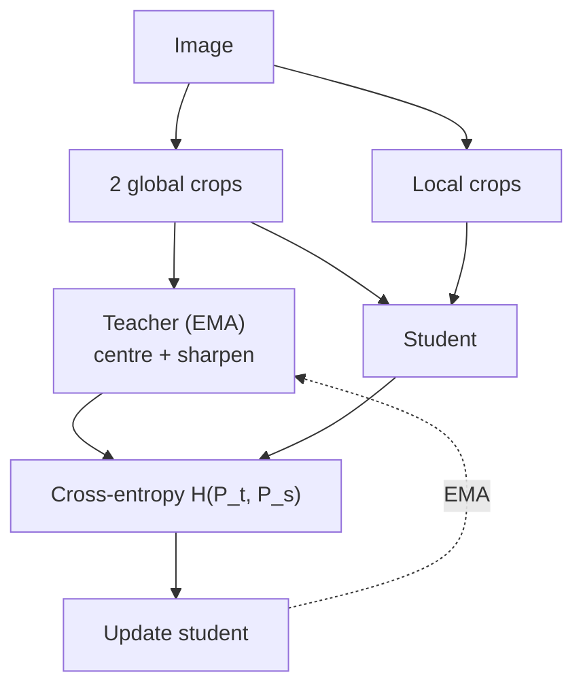
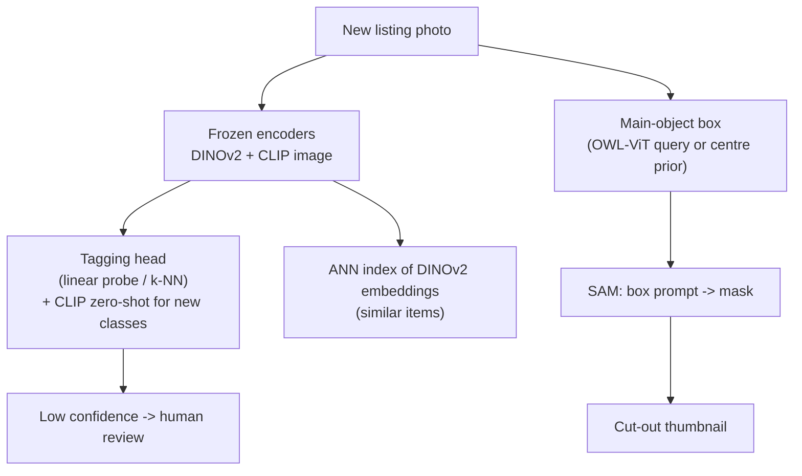

# Session 13 — Vision Foundation Models · Solutions

> Questions: [13_questions.md](13_questions.md) · Notes: [../notes/13_vision_foundation_models.md](../notes/13_vision_foundation_models.md)

## Section A — MCQs

### Q1 — Answer: **A**
**Why A:** The defining features are **broad, large-scale pre-training** (usually self- or weakly-supervised: web image–text pairs, unlabelled images, model-generated masks) and **adaptability** to many downstream tasks (zero-shot, probes, fine-tuning).
- **B** ✗ — size alone does not make a foundation model; a 1B-parameter model trained for one narrow task is not one.
- **C** ✗ — that is the classic single-task supervised model the paradigm replaces.
- **D** ✗ — foundation models are routinely fine-tuned (full or PEFT) as well as prompted.

### Q2 — Answer: **C**
**Why C:** CLIP encodes $N$ images and $N$ captions, builds the $N\times N$ cosine matrix, scales it by a learned logit scale $1/\tau$, and applies cross-entropy along rows (image→text) and columns (text→image), averaging the two.
- **A** ✗ — CLIP never trains on ImageNet labels; classification is zero-shot afterwards.
- **B** ✗ — caption generation was found to be far less compute-efficient; CLIP only has to pick the right caption among $N$.
- **D** ✗ — without negatives, an MSE objective could collapse; CLIP's other captions in the batch are its negatives.

### Q3 — Answer: **B**
**Why B:** For each class, several templates ("a photo of a {c}", "a sketch of a {c}", …) are encoded; their **normalised text embeddings are averaged and re-normalised** into one class embedding. Inference cost is unchanged (one embedding per class) and accuracy improves by several points.
- **A** ✗ — that is test-time augmentation on the image side, not prompt ensembling.
- **C** ✗ — no classifier is trained in zero-shot CLIP.
- **D** ✗ — selecting templates on the test set is data leakage.

### Q4 — Answer: **D**
**Why D:** DINO's teacher is an **EMA of the student** with stop-gradient; its outputs are **centered** (subtract a running mean ⇒ no single dimension dominates) and **sharpened** (low $\tau_t$ ⇒ not uniform). Together they avoid both collapse modes.
- **A** ✗ — that is MoCo's queue; DINO uses **no negatives**.
- **B** ✗ — DINO uses no labels ("self-distillation with **no labels**").
- **C** ✗ — that is MAE; DINO matches output distributions between views.

### Q5 — Answer: **B**
**Why B:** A single point is **ambiguous** (pocket / shirt / whole person). SAM outputs 3 masks at different granularities and an **IoU head** predicts the quality of each so the best can be chosen; in training only the lowest-loss mask is back-propagated.
- **A** ✗ — SAM masks are **class-agnostic**; it predicts no class labels at all.
- **C** ✗ — SAM's encoder produces a single 64×64 embedding, not a pyramid of outputs.
- **D** ✗ — the three masks are actual outputs used at inference, not auxiliary deep-supervision heads.

### Q6 — Answer: **A**
**Why A:** Depth Anything is trained with an affine-invariant loss and outputs **relative inverse depth** (larger = closer), correct up to an unknown **scale and shift**; metres need metric fine-tuning or alignment with known depths.
- **B** ✗ — monocular depth has an inherent scale ambiguity; metric versions are separately fine-tuned and domain-specific.
- **C** ✗ — it needs a **single** image; disparity from two rectified images is stereo ([12](../notes/12_3d_vision_motion.md)).
- **D** ✗ — it predicts depth only.

### Q7 — Answer: **C**
**Why C:** OWL-ViT removes the pooling of a CLIP-style ViT; every output token predicts a **box** and a **class embedding**, and the class score is the (scaled) similarity between that embedding and the **query embedding** (text prompt or example image). The classifier weights are therefore the queries themselves ⇒ open vocabulary.
- **A** ✗ — no per-class training is needed for new categories.
- **B** ✗ — that describes a SAM + CLIP pipeline, not OWL-ViT.
- **D** ✗ — OWL-ViT does not caption images.

### Q8 — Answer: **D**
**Why D:** DINOv2 keeps self-distillation but scales it with the automatically curated **LVD-142M** dataset, adds the **iBOT masked-patch** loss (better dense features) and the **KoLeo** regulariser (uniform feature spread), plus other training improvements.
- **A** ✗ — DINOv2 has **no text encoder** (classic trap).
- **B** ✗ — it is still self-supervised; no labels.
- **C** ✗ — it does not switch to pixel reconstruction; the masked objective predicts **teacher patch tokens**, combined with the DINO loss.

## Section B — Numericals

### Q9 — CLIP zero-shot probabilities
**Given:** cosines dog 0.32, cat 0.29, fox 0.30, car 0.15; logit scale 100.
**Formula:**

$$
p(c)=\frac{\exp(100\cos_c)}{\sum_{c'}\exp(100\cos_{c'})}
$$

**Working:**
(a) Logits: 32, 29, 30, 15. Subtract the max (32): 0, −3, −2, −17 ⇒ exponentials $1,\ 0.0498,\ 0.1353,\ 4.1\times10^{-8}$; sum $=1.1851$.
$p(\text{dog})=1/1.1851=$ **0.844**; $p(\text{cat})=0.0498/1.1851=$ **0.042**; $p(\text{fox})=0.1353/1.1851=$ **0.114**; $p(\text{car})\approx$ **3.5×10⁻⁸ ≈ 0**. Prediction: **dog**.

(b) Logit scale 1: softmax of (0.32, 0.29, 0.30, 0.15) = **(0.264, 0.256, 0.258, 0.222)** — almost uniform. Same argmax, but the cosine gaps (0.02–0.03) are tiny; the learned temperature ($\tau=0.01$) is what turns them into a decisive distribution.

(c) Logits 32, 29, 30, 15, 32 ⇒ sum $=2.1851$ ⇒ $p(\text{dog})=p(\text{wolf})=1/2.1851=$ **0.458** (cat 0.023, fox 0.062). The image did not change, yet $p(\text{dog})$ halved: zero-shot probabilities are **relative to the listed prompts** (closed over the candidate set, no "none of these"), so they are not calibrated absolute confidences.

**Answer:** **(a) dog 0.844, cat 0.042, fox 0.114, car ≈ 0 → dog; (b) ≈ uniform (0.264, 0.256, 0.258, 0.222); (c) p(dog) = 0.458**
> ✔ Verified numerically (Python).

### Q10 — CLIP symmetric loss
**Given:** $S$ (3×3), logit scale 20 ⇒ logits $=20S$:

$$
20S=\begin{bmatrix}6 & 2 & 1\\ 2.4 & 5.6 & 3\\ 0.4 & 4 & 5\end{bmatrix}
$$

**Formula:** row $i$: $\ell_i=-\ln\frac{e^{20S_{ii}}}{\sum_j e^{20S_{ij}}}$; column $j$: $\ell_j=-\ln\frac{e^{20S_{jj}}}{\sum_i e^{20S_{ij}}}$; $\mathcal L=\tfrac12(\mathcal L_{I\to T}+\mathcal L_{T\to I})$.

**Working:**
(a) Rows (subtract each row's max):
- Row 1: $(0,-4,-5)$ ⇒ $1+0.0183+0.0067=1.0250$ ⇒ $p=0.9756$ ⇒ $\ell_1=0.0247$.
- Row 2: $(-3.2,0,-2.6)$ ⇒ $0.0408+1+0.0743=1.1151$ ⇒ $p=0.8968$ ⇒ $\ell_2=0.1089$.
- Row 3: $(-4.6,-1,0)$ ⇒ $0.0101+0.3679+1=1.3779$ ⇒ $p=0.7257$ ⇒ $\ell_3=0.3206$.
- $\mathcal L_{I\to T}=(0.0247+0.1089+0.3206)/3=$ **0.1514**.

(b) Columns:
- Col 1: $(6,2.4,0.4)$ ⇒ $1+0.0273+0.0037=1.0310$ ⇒ $p=0.9699$ ⇒ $0.0306$.
- Col 2: $(2,5.6,4)$ ⇒ $0.0273+1+0.2019=1.2292$ ⇒ $p=0.8135$ ⇒ $0.2064$.
- Col 3: $(1,3,5)$ ⇒ $0.0183+0.1353+1=1.1537$ ⇒ $p=0.8668$ ⇒ $0.1429$.
- $\mathcal L_{T\to I}=(0.0306+0.2064+0.1429)/3=$ **0.1266**.

(c) $\mathcal L=(0.1514+0.1266)/2=$ **0.139**.
$N=32{,}768$: $N^2=$ **1,073,741,824** entries (32,768 positives on the diagonal); **32,767 negatives per row**; float32 memory $=1.0737\times10^9\times4$ B $=$ **4.29 GB** (in practice sharded across GPUs).

**Answer:** **$\mathcal L_{I\to T}=0.151$, $\mathcal L_{T\to I}=0.127$, $\mathcal L=0.139$; 1.07×10⁹ entries, 32,767 negatives/row, 4.29 GB**
> ✔ Verified numerically (Python).
> **Common slip:** using only the row loss — CLIP's loss is **symmetric** (rows and columns).

### Q11 — ViT tokens, attention cost, SAM caching
**Given:** patch sizes and resolutions as stated.
**Formula:** $N_{tok}=(H/p)(W/p)\ (+1)$; entries $=N_{tok}^2$.

**Working:**
(a) $(224/16)^2=14^2=196$, $+1=$ **197 tokens**; $197^2=$ **38,809** entries/head/layer; ×12 heads ×12 layers $=$ **5,588,496**.

(b) $(336/14)^2=24^2=576$, $+1=$ **577 tokens**; $577^2=332{,}929$ ⇒ ratio $332{,}929/38{,}809=$ **8.58×**.

(c) $1024/16=64$ ⇒ **64×64 grid = 4096 tokens**; global attention $4096^2=$ **16,777,216** entries/head.
Windowed: $70/14=5$ ⇒ $5\times5=25$ windows of $14\times14=196$ tokens ⇒ $25\times196^2=25\times38{,}416=$ **960,400** entries ⇒ reduction $16{,}777{,}216/960{,}400\approx$ **17.5×**.

(d) $256\times64\times64=1{,}048{,}576$ values × 4 B $=4{,}194{,}304$ B ≈ **4.19 MB**.
Cached: $0.45+10\times0.05=$ **0.95 s**. Re-running the encoder: $10\times(0.45+0.05)=$ **5.0 s** (≈5.3× slower) — this is why SAM encodes the image **once**.

**Answer:** **(a) 197, 38,809, 5.59×10⁶; (b) 577, 8.58×; (c) 4096 tokens, 1.68×10⁷ vs 9.6×10⁵ entries, ≈17.5×; (d) 4.19 MB, 0.95 s vs 5.0 s**
> ✔ Verified numerically (Python).

### Q12 — Aligning relative depth to metres
**Given:** $(r_1,Z_1)=(0.8,2.0)$, $(r_2,Z_2)=(0.3,10.0)$, later $(r_3,Z_3)=(0.6,2.5)$; model $1/Z=s\,r+t$.
**Formula:**

$$
\hat s=\frac{n\sum r_iy_i-\sum r_i\sum y_i}{n\sum r_i^2-(\sum r_i)^2},\qquad \hat t=\frac{\sum y_i-\hat s\sum r_i}{n},\qquad y_i=1/Z_i
$$

**Working:**
(a) $0.8s+t=0.5$ and $0.3s+t=0.1$ ⇒ subtract: $0.5s=0.4$ ⇒ $s=$ **0.8**; $t=0.5-0.64=$ **−0.14**.

(b) $r=0.5$: $1/Z=0.40-0.14=0.26$ ⇒ $Z=$ **3.85 m**. $r=0.2$: $1/Z=0.16-0.14=0.02$ ⇒ $Z=$ **50 m**.

(c) $y=(0.5,0.1,0.4)$; $\sum r=1.7$, $\sum r^2=1.09$, $\sum y=1.0$, $\sum ry=0.40+0.03+0.24=0.67$, $n=3$.
$\hat s=\frac{3(0.67)-1.7(1.0)}{3(1.09)-1.7^2}=\frac{0.31}{0.38}=$ **0.816**; $\hat t=\frac{1.0-0.816(1.7)}{3}=$ **−0.129**.
$r=0.5$: $1/Z=0.408-0.129=0.279$ ⇒ $Z=$ **3.58 m** (was 3.85). $r=0.2$: $1/Z=0.1632-0.1289=0.0342$ ⇒ $Z=$ **29.2 m** (was 50 m!).
Comment: far pixels have small $1/Z$, so a tiny change in $s,t$ (or noise in $r$) changes $Z$ enormously — far-range metric estimates from aligned relative depth are **unreliable** (same flavour as stereo's $\Delta Z\propto Z^2$). Use more, well-spread references and a robust fit.

(d) $k=Z_1/r_1=2.0/0.8=2.5$ ⇒ $Z(0.3)=0.75$ m, but the true value is **10 m**. $r$ is an **inverse**, affine-ambiguous quantity (larger = closer, unknown shift), so treating it as proportional to depth reverses the ordering and ignores the shift.

**Answer:** **(a) s = 0.8, t = −0.14; (b) 3.85 m, 50 m; (c) s ≈ 0.816, t ≈ −0.129 → 3.58 m, 29.2 m; (d) 0.75 m — wrong (inverse depth + shift)**
> ✔ Verified numerically (Python).

### Q13 — DINO EMA, centering, sharpening
**Given:** $\theta_t=0.40$, $\theta_s=0.60$, $\lambda=0.996$; $c=(2.2,0.1,1.0)$, teacher $(3,1,2)$, $\tau_t=0.05$; student $(0.2,0.1,0.3)$, $\tau_s=0.1$; $m=0.9$.
**Formula:**

$$
\theta_t\leftarrow\lambda\theta_t+(1-\lambda)\theta_s,\quad P_t=\mathrm{softmax}\Big(\frac{g_t-c}{\tau_t}\Big),\quad P_s=\mathrm{softmax}\Big(\frac{g_s}{\tau_s}\Big),\quad H=-\sum_kP_t^{(k)}\ln P_s^{(k)}
$$

**Working:**
(a) $0.996(0.40)+0.004(0.60)=0.3984+0.0024=$ **0.4008**.

(b) Centred: $(3-2.2,\ 1-0.1,\ 2-1.0)=(0.8,\ 0.9,\ 1.0)$; divide by 0.05: $(16,18,20)$; subtract max: $(-4,-2,0)$ ⇒ $0.0183,\ 0.1353,\ 1$; sum $1.1537$ ⇒ $P_t=$ **(0.016, 0.117, 0.867)** — sharp.

(c) $(0.2,0.1,0.3)/0.1=(2,1,3)$ ⇒ $(-1,-2,0)$ ⇒ $0.3679,\ 0.1353,\ 1$; sum $1.5032$ ⇒ $P_s=$ **(0.245, 0.090, 0.665)**; $\ln P_s=(-1.408,-2.408,-0.408)$.
$H=0.0159(1.408)+0.1173(2.408)+0.8668(0.408)=0.0224+0.2824+0.3533=$ **0.658**.

(d) Batch mean of teacher outputs $=((3+5)/2,(1+1)/2,(2+0)/2)=(4,1,1)$ ⇒ $c\leftarrow0.9(2.2,0.1,1.0)+0.1(4,1,1)=$ **(2.38, 0.19, 1.00)**.
With $\tau_t=1$: $P_t=\mathrm{softmax}(0.8,0.9,1.0)=$ **(0.301, 0.332, 0.367)** — nearly uniform. Centering pushes the teacher towards uniform outputs; without sharpening the student would be trained to output the same near-uniform distribution for **every** image — a **collapsed**, information-free solution. Sharpening (low $\tau_t$) counteracts it.

**Answer:** **(a) 0.4008; (b) centred (0.8, 0.9, 1.0), P_t = (0.016, 0.117, 0.867); (c) P_s = (0.245, 0.090, 0.665), H = 0.658; (d) c = (2.38, 0.19, 1.00); τ_t = 1 gives ≈ uniform (0.30, 0.33, 0.37) → uniform collapse**
> ✔ Verified numerically (Python).

## Section C — Short answers

### Q14 — Foundation models, adaptation, homogenisation
**Definition:** a model **pre-trained on broad data at scale**, mostly with **self- or weak supervision** (web image–text pairs, unlabelled images, auto-generated masks), that can be **adapted to a wide range of downstream tasks** (Bommasani et al., 2021). Examples: CLIP, DINOv2, SAM.

**Adaptation (cheapest → most expensive):**
1. **Zero-shot / prompting** — no training (CLIP text prompts, SAM clicks).
2. **k-NN or linear probe** on frozen features — fit only a classifier.
3. **Parameter-efficient fine-tuning** (adapters, LoRA) — train a few % of the weights.
4. **Full fine-tuning** — update all weights; best in-domain accuracy, needs most data/compute, risk of forgetting.

**Homogenisation — opportunities:** one strong backbone lifts every downstream application; drastically less labelled data and engineering per task; shared tooling and fast prototyping.
**Risks:** defects and **biases propagate** to all applications (single point of failure); everyone inherits the same blind spots (e.g. typographic attacks); opaque training data (licensing, privacy); concentration of power and compute; uncalibrated "zero-shot" outputs trusted blindly.

### Q15 — CLIP zero-shot classification
**Steps:**
1. List the class names; wrap each in **prompt templates** ("a photo of a {c}.", with domain context such as "a satellite photo of {c}.") — single words are ambiguous and unlike training captions.
2. Encode all prompts with the text encoder; L2-normalise; **ensemble** by averaging each class's template embeddings and re-normalising ⇒ class embeddings $\mathbf t_c$ (computed once; they act as a linear classifier's weights).
3. Encode the image ⇒ normalised $\mathbf v$.
4. Logits $=100\cdot\mathbf v\cdot\mathbf t_c$ (learned logit scale); softmax ⇒ probabilities; predict the argmax.

**Limitations (any four):** weak on **fine-grained** classes and specialised domains; poor at **counting** and **spatial relations**/compositional binding; **typographic attacks** (written text overrides content); **social biases** from web data; **no localisation** (global embedding only); sensitive to **prompt wording**; probabilities relative to the chosen class list (not calibrated).

### Q16 — DINO self-distillation

- **Student and teacher** share the same architecture (ViT + projection head → $K$-way softmax). The student is trained by gradient descent to make its output distribution for one view match the **teacher's** distribution for a **different view** of the same image: $H(P_t,P_s)=-\sum P_t\log P_s$. **No labels, no negatives.**
- **Teacher update:** **EMA** of the student, $\theta_t\leftarrow\lambda\theta_t+(1-\lambda)\theta_s$ ($\lambda$: 0.996 → 1), with **stop-gradient**; it behaves like an ensemble of past students and gives stable targets.
- **Multi-crop:** 2 high-resolution **global** crops (>50% of the image) go to the teacher; the student also sees several small **local** crops ⇒ it must infer the global semantics from a part ("local-to-global").
- **Collapse prevention:** **centering** subtracts a running mean $c$ from the teacher logits so no single prototype dominates; **sharpening** uses a low teacher temperature ($\tau_t\approx0.04$ vs $\tau_s=0.1$) so the target is not uniform. Each alone leads to a collapse mode; together they balance.
- **Emergent property:** the last-layer **[CLS] self-attention maps segment the main object** without any mask supervision; features also give strong k-NN classification and retrieval.

### Q17 — SAM architecture and design choices
- **Architecture:** (1) **image encoder** — MAE-pretrained **ViT-H/16**, 1024×1024 input → **256×64×64** embedding; (2) **prompt encoder** — points/box corners as positional encodings + type embeddings; masks via convolutions added to the embedding; (3) **mask decoder** — a light two-way-attention transformer producing **3 masks + predicted IoU**.
- **Why the split:** the expensive image understanding is done **once per image** and cached; each new click re-runs only the ~4M-parameter decoder (~50 ms), enabling **real-time interactive** annotation and cheap "segment everything" (many prompts per image).
- **Ambiguity:** for one point, output **3 masks** (sub-part / part / whole); train with the **minimum** loss over the three; the **IoU head** ranks them at inference.
- **SA-1B via a data engine:** assisted-manual (annotators click with SAM in the loop) → semi-automatic (SAM proposes confident masks, humans add missing ones) → fully automatic (32×32 point grid, filter by predicted IoU + stability, NMS) ⇒ **11M images, 1.1B masks**.
- **Key limitation:** masks have **no class labels** — SAM does not know *what* it segmented, so real applications need a detector or CLIP for semantics (e.g. Grounding DINO → SAM, [14](../notes/14_vision_plus_plus.md)). (Also: heavy encoder for edge devices, imperfect thin structures, domain shift.)

## Section D — Long answers / Design

### Q18 — Comparing the five models and choosing between them

**(a) Comparison table**

| Model | Training data | Objective | Input | Output | Typical use | Key limitation |
|---|---|---|---|---|---|---|
| **CLIP** | 400M web image–text pairs | Symmetric InfoNCE over $N\times N$ cosine matrix, learned temperature | Image and/or text | Embeddings in a shared image–text space | Zero-shot classification, text↔image retrieval, diffusion text encoder | Fine-grained, counting, spatial relations, typographic attacks, bias; no boxes |
| **DINOv2** | LVD-142M curated unlabelled images | Self-distillation (DINO) + iBOT masked patches + KoLeo | Image | [CLS] and patch features | Frozen backbone for k-NN/linear classification, retrieval, segmentation/depth heads | No text ⇒ no prompt-based zero-shot |
| **SAM** | SA-1B (11M images, 1.1B masks) from a data engine | Promptable segmentation: focal + Dice, IoU regression | Image + points/box/mask | 3 class-agnostic masks + IoU scores | Interactive annotation, box→mask, segment everything | No class labels; heavy encoder |
| **Depth Anything** | ~1.5M labelled + ~62M pseudo-labelled images | Affine-invariant depth loss, teacher–student self-training, DINOv2 feature alignment | Single RGB image | Relative inverse depth map | AR, robotics, 3D effects, depth-conditioned generation | No metric scale without fine-tune/alignment |
| **OWL-ViT** | Image–text pre-training + detection data (OWLv2: web pseudo-boxes) | Contrastive pre-training; bipartite matching with text-embedding classifier | Image + text or image queries | Boxes + per-query scores | Open-vocabulary / one-shot detection, auto-labelling | Lower box accuracy than closed-set; per-query thresholds; no masks |

**(b) Scenarios**
- **(i) Text search of a photo library → CLIP.** Embed every photo once; embed the query text; rank by cosine similarity (FAISS index — [05](../notes/05_embeddings_similarity.md)). Shared image–text space is exactly what is needed; compositional queries ("cake **on** a beach") may be imperfect — re-rank top results if needed.
- **(ii) 30 plant diseases, 20 images/class → DINOv2 (frozen) + linear probe / k-NN** (CLIP linear probe also reasonable). Disease names are fine-grained and rare in captions ⇒ CLIP zero-shot is weak; 600 labelled images are too few for full fine-tuning but plenty for a linear head on strong frozen features.
- **(iii) AR occlusion → Depth Anything** (relative depth is enough to know which surface is in front; for metric placement, align with the phone's AR depth/IMU scale). Optionally SAM to get crisp furniture boundaries for the occlusion mask.
- **(iv) Forklifts with no labelled boxes → OWL-ViT** (or Grounding DINO, [14](../notes/14_vision_plus_plus.md)) with the text query "forklift"; if the name is unreliable, use **image-conditioned (one-shot)** queries from one example photo. Tune the score threshold on a few checked images; add SAM if masks are needed.

**Closing line:** CLIP = language-aligned semantics; DINOv2 = best pure-vision features; SAM = *where* (masks); Depth Anything = *how far* (relative); OWL-ViT = *what + where* from text.

**Marking scheme:** 6 – table (≈1 per model + 1 for consistent columns) · 4 – scenarios (1 each, choice + justification).

### Q19 — Foundation-model solution for a marketplace

**1. Framing.** Three tasks — **classification** (50 classes, growing), **retrieval** (visual similarity), **segmentation** (cut-outs) — with abundant unlabelled data (2M) and few labels (5,000 ≈ 100/class). Requirements: handle new categories monthly with minimal labelling; per-listing latency of ~1 s is acceptable (offline at upload time).

**2. Architecture**

**3. Tagging — compare three options**

| Option | Labels needed | New category | Expected accuracy | Cost |
|---|---|---|---|---|
| **CLIP zero-shot** ("a product photo of a {category}") | None | Add a prompt — instant | Good for generic categories, weak for fine-grained/brand-specific | Cheapest |
| **DINOv2 / CLIP frozen + linear probe or k-NN** | 5,000 (≈100/class) | k-NN: add a few examples, no training; linear: retrain in minutes | Usually clearly better than zero-shot in-domain | Low |
| **Full fine-tuning** | Many (5k may overfit a big ViT; use the 2M unlabelled via pseudo-labels/SSL) | Retrain | Highest if enough data | Highest (GPU time, maintenance) |

**Recommendation:** **frozen DINOv2 (+ CLIP) features with a linear probe** for the 50 known classes; **k-NN / CLIP zero-shot** to cover a **new** category on day one, then add it to the probe once ~50–100 examples are confirmed. Use the 2M unlabelled images for **semi-supervised pseudo-labelling** (keep high-confidence predictions) if accuracy must rise further; only then consider PEFT/fine-tuning.

**4. Retrieval.** Embed all 2M images with DINOv2 (strong visual similarity; [05](../notes/05_embeddings_similarity.md)), L2-normalise, index with IVF-PQ/HNSW. Memory: $2\times10^6\times768\times4$ B ≈ 6.1 GB flat (ViT-B features), or ~128 MB with 64-byte PQ codes. Optionally fine-tune a projection with metric learning on duplicate/same-product pairs. Re-rank with category filters.

**5. Cut-outs with SAM.** SAM needs a prompt: obtain a **box** of the main product (OWL-ViT with the category name as query, or a "salient object" prior such as the centre point for studio-style photos) → **box prompt** ⇒ choose the highest predicted-IoU mask → refine edges (matting), compose on a white background. Flag masks with low predicted IoU for review.

**6. Evaluation.** Tagging: accuracy / macro-F1 on a held-out labelled set, per-class confusion, calibration (reject threshold → human review rate). Retrieval: Recall@K / mAP on labelled same-product pairs. Cut-outs: mask IoU/Dice on a small annotated set ([10](../notes/10_image_segmentation.md)) + human acceptance rate. Track drift monthly.

**7. Cost / latency.** Per image: DINOv2-B + CLIP-B ≈ tens of ms on GPU; SAM ViT-H encoder is the heaviest (hundreds of ms) — acceptable at upload time; use SAM ViT-B or a light variant if volume grows. Batch the 2M back-catalogue offline (one-off GPU-hours).

**8. Risks.** Domain shift (phone photos, clutter); CLIP biases and typographic attacks (text printed on products/packaging can fool zero-shot tags); class imbalance; SAM masks without semantics may pick the wrong object (hand, table) ⇒ need the box prompt and QA; licensing of foundation-model weights for commercial use; privacy (people in photos).

**Trade-off line:** zero-shot gives instant coverage of new categories but lower accuracy; a linear probe on frozen features gives most of the fine-tuning accuracy at a fraction of the cost — fine-tune only when data and accuracy requirements justify it.

**Marking scheme:** 2 – framing & architecture · 3 – tagging options compared + justified recommendation · 1 – retrieval design · 2 – SAM prompting for cut-outs · 1 – evaluation · 1 – cost/latency & risks.
