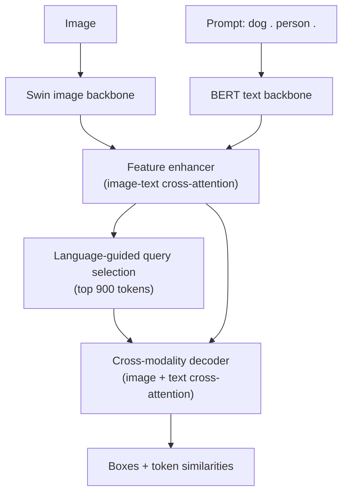
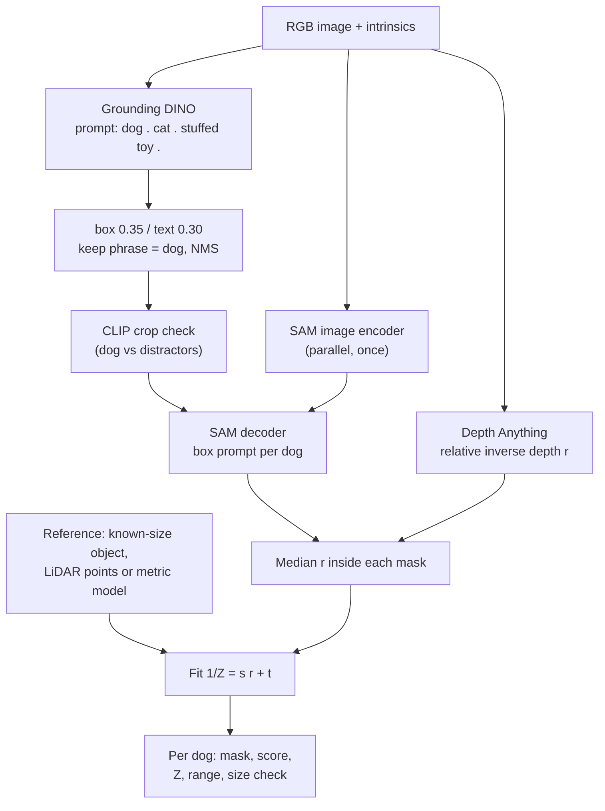
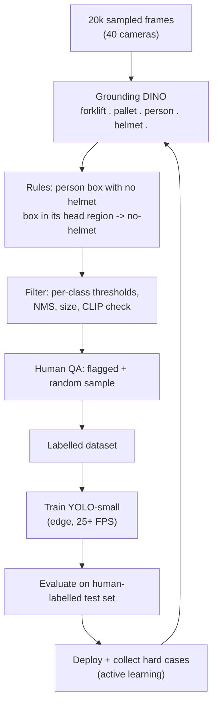

# Session 14 — Vision++ with Foundation Models · Solutions

> Questions: [14_questions.md](14_questions.md) · Notes: [../notes/14_vision_plus_plus.md](../notes/14_vision_plus_plus.md)

## Section A — MCQs

### Q1 — Answer: **C**
**Why C:** Grounding DINO is built on the **DINO detector — DETR with Improved deNoising anchOr boxes** (contrastive denoising, mixed query selection, look-forward-twice), extended with a text backbone and cross-modal fusion.
- **A** ✗ — the classic trap: self-supervised DINO (self-distillation, [13](../notes/13_vision_foundation_models.md)) is unrelated; Grounding DINO's image backbone is a Swin Transformer.
- **B** ✗ — DINOv2 has no text encoder and is not part of Grounding DINO.
- **D** ✗ — "DINO" is not a distillation step; distilling into YOLO is something you may do *with* it.

### Q2 — Answer: **A**
**Why A:** Open-vocabulary detectors replace fixed per-class classifier weights with **text embeddings** of whatever names/phrases are given at inference, so the category list can change without retraining.
- **B** ✗ — a fixed 80-class detector is closed-set by definition.
- **C** ✗ — that describes class-agnostic proposal/segmentation models (e.g. SAM everything).
- **D** ✗ — needing retraining for a new class is exactly the closed-set limitation.

### Q3 — Answer: **D**
**Why D:** For each of the 900 queries the score is the **maximum** sigmoid similarity over prompt tokens; the query is kept only if this exceeds `box_threshold` ⇒ it controls how many boxes survive (precision vs recall).
- **A** ✗ — NMS IoU is a separate (optional) post-processing parameter.
- **B** ✗ — that is `text_threshold`, which builds the phrase for each kept box.
- **C** ✗ — there is no area meaning in `box_threshold`.

### Q4 — Answer: **B**
**Why B:** Grounded-SAM converts Grounding DINO's boxes to pixel coordinates and feeds each one to SAM as a **box prompt**; SAM's light decoder returns one mask per box; the label comes from Grounding DINO's phrase.
- **A** ✗ — SAM is class-agnostic; it cannot be conditioned on class labels.
- **C** ✗ — SAM's image encoder is still used (run once per image); text embeddings are not SAM's input in the released model.
- **D** ✗ — depth is a separate, optional stage that consumes masks; it is not given to SAM.

### Q5 — Answer: **C**
**Why C:** The standard Depth Anything output is **relative, affine-invariant inverse depth**. Metres need either a metric fine-tuned model or calibration of $1/Z=s\,r+t$ with references (known-size object via $Z=fH/h_{px}$, LiDAR, stereo).
- **A** ✗ — the relative model has unknown scale and shift.
- **B** ✗ — thresholds affect which dogs are detected, not the depth scale.
- **D** ✗ — multi-mask output changes mask granularity, not depth scale.

### Q6 — Answer: **A**
**Why A:** In Grounded-SAM, SAM is prompted **only** by detected boxes; a dog without a box never gets a mask or a distance — the detector caps the pipeline's recall (**error propagation**).
- **B** ✗ — that is SAM's automatic mode, which is not used in Grounded-SAM (and would carry no label).
- **C** ✗ — SAM never outputs class labels.
- **D** ✗ — SAM has no mechanism to change the detector's scores.

### Q7 — Answer: **D**
**Why D:** After the feature enhancer, each image token is scored by its similarity to the text tokens; the top-$N_q$ (900) tokens initialise the positional part (anchor boxes) of the decoder queries, so decoding starts where the prompt is likely present.
- **A** ✗ — no part-of-speech filtering is performed.
- **B** ✗ — the backbone is fixed by the chosen model checkpoint.
- **C** ✗ — de-duplication is NMS/Hungarian training, not query selection.

### Q8 — Answer: **B**
**Why B:** Fixed classes + real-time edge constraint + no labels ⇒ use the slow open-vocabulary model **offline as a teacher** to auto-label, verify a sample by hand, then **distil** into a small closed-set detector that easily runs at 60 FPS.
- **A** ✗ — Grounding DINO + SAM runs at a few FPS on a server GPU, far below 60 FPS on edge hardware.
- **C** ✗ — whole-frame classification gives no boxes and no per-part localisation.
- **D** ✗ — SAM masks have no part-type labels.

## Section B — Numericals

### Q9 — Pipeline latency and FPS
**Given:** GD 120 ms; CLIP 5 ms/box; SAM encoder 450 ms; SAM decoder 10 ms/box; Depth 80 ms; 3 boxes.
**Formula:**

$$
T_{seq}=\sum_k T_k,\qquad T_{par}=\max(\text{parallel branches})+\text{dependent stages},\qquad \text{FPS}=\frac{1000}{T\,[\text{ms}]}
$$

**Working:**
(a) $T_{seq}=120+3(5)+450+3(10)+80=120+15+450+30+80=$ **695 ms** ⇒ $1000/695=$ **1.44 FPS**.

(b) Branches: GD + CLIP $=135$ ms; SAM encoder $=450$ ms; Depth $=80$ ms. The SAM decoder starts when both GD+CLIP and the encoder are done: $\max(135,450,80)+30=450+30=$ **480 ms** ⇒ **2.08 FPS** (depth finishes earlier and waits).

(c) $\max(135,40,80)+30=135+30=$ **165 ms** ⇒ **6.06 FPS**. Bottleneck is now the **Grounding DINO + CLIP** branch (135 ms).

(d) Sequential: $12+20=32$ ms ⇒ **31.25 FPS** ≥ 30 ✓ (budget 33.3 ms — only a 1.3 ms margin). Parallel: $\max(12,20)=20$ ms ⇒ **50 FPS**.

**Answer:** **(a) 695 ms, 1.44 FPS; (b) 480 ms, 2.08 FPS; (c) 165 ms, 6.06 FPS, bottleneck GD+CLIP; (d) 31.25 FPS (meets 30), 50 FPS in parallel**
> ✔ Verified numerically (Python).
> **Common slip:** in (b) adding the depth time to the critical path — it runs in parallel and is not on the longest path.

### Q10 — Box and text thresholds
**Given:** token scores table; strict ">" comparisons.
**Formula:** keep if $\max(s_{dog},s_{person})>\text{box\_threshold}$; phrase $=\{\text{tokens with } s>\text{text\_threshold}\}$.

**Working:**
(a) box 0.35, text 0.25:

| Box | max score | Kept? | Phrase |
|---|---|---|---|
| B1 | 0.62 | ✓ | dog |
| B2 | 0.31 | ✗ (0.31 ≤ 0.35) | — |
| B3 | 0.48 | ✓ | person |
| B4 | 0.40 | ✓ | **dog person** (0.40 and 0.28 both > 0.25) |
| B5 | 0.36 | ✓ | dog |
| B6 | 0.33 | ✗ | — |

Kept: **B1 dog 0.62, B3 person 0.48, B4 "dog person" 0.40, B5 dog 0.36**.

(b) text 0.30: B4's person score 0.28 ≤ 0.30 ⇒ B4 becomes **"dog"**; nothing else changes.

(c) box 0.30, text 0.30: **B2** (0.31) is now kept as **"dog"**, **B6** (0.33) is kept as **"person"** (0.22 ≤ 0.30); B4 stays "dog".

(d) *Dog* predictions and matching (3 GT dogs):
- (a): dog-labelled boxes B1, B5 ⇒ TP = 2, FP = 0, FN = 1 (B4's merged label does not count) ⇒ $P=$ **1.00**, $R=2/3=$ **0.667**.
- (b): B1, B4, B5 ⇒ TP = 3, FP = 0, FN = 0 ⇒ $P=$ **1.00**, $R=$ **1.00**.
- (c): B1, B2, B4, B5; B2 duplicates B1's GT (already matched by the higher-scoring B1) ⇒ TP = 3, FP = 1 ⇒ $P=3/4=$ **0.75**, $R=$ **1.00**. (Also B6 is a *person* FP.)

**Answer:** **(a) B1 dog, B3 person, B4 "dog person", B5 dog; (b) B4 → dog; (c) + B2 dog, + B6 person; (d) dog P/R: (1.00, 0.667), (1.00, 1.00), (0.75, 1.00)**
> ✔ Verified numerically (Python).
> **Lesson:** `text_threshold` fixes **labels** (merged phrases), `box_threshold` trades **precision for recall** (duplicates and look-alikes appear when lowered).

### Q11 — Box conversion, IoU, P/R/F1
**Given:** $(c_x,c_y,w,h)=(0.50,0.40,0.30,0.40)$, $W=1000$, $H=800$; GT $(360,180,680,500)$; counts as stated.
**Formula:**

$$
x_{1,2}=(c_x\mp\tfrac w2)W,\quad y_{1,2}=(c_y\mp\tfrac h2)H,\qquad \text{IoU}=\frac{\lvert A\cap B\rvert}{\lvert A\cup B\rvert},\qquad F_1=\frac{2PR}{P+R}
$$

**Working:**
(a) $c_x=500$, $c_y=320$, $w=300$, $h=320$ px ⇒ **$(350,\ 160,\ 650,\ 480)$**.

(b) Intersection: $x$ from 360 to 650 (290), $y$ from 180 to 480 (300) ⇒ $87{,}000$. Areas: pred $300\times320=96{,}000$; GT $320\times320=102{,}400$. Union $=96{,}000+102{,}400-87{,}000=111{,}400$.
IoU $=87{,}000/111{,}400=$ **0.781** ⇒ TP at 0.5 **and** at 0.75.

(c) Threshold 0.35: $P=255/340=$ **0.750**, $R=255/400=$ **0.638**, $F_1=$ **0.689** (85 FP, 145 FN).
Threshold 0.45: $P=190/220=$ **0.864**, $R=190/400=$ **0.475**, $F_1=$ **0.613** (30 FP, 210 FN).
Counting (count = number of detections): 340 vs 400 ⇒ error −60 (**−15%**); 220 vs 400 ⇒ −180 (**−45%**). **0.35** is better — FPs partly cancel FNs in the count, and recall matters most.

(d) $P=300/330=$ **0.909**, $R=300/400=$ **0.750**, $F_1=$ **0.822** — better on both P and R than either zero-shot setting: when labelled data exist for a fixed class, fine-tuning wins; zero-shot wins on time-to-deploy.

**Answer:** **(a) (350, 160, 650, 480); (b) IoU = 0.781, TP at both 0.5 and 0.75; (c) 0.35: P 0.75, R 0.638, F1 0.689; 0.45: P 0.864, R 0.475, F1 0.613 → 0.35 better for counting; (d) P 0.909, R 0.75, F1 0.822**
> ✔ Verified numerically (Python).
> **Common slip:** treating $(c_x,c_y,w,h)$ as $(x_1,y_1,x_2,y_2)$ or forgetting to multiply by $W$ and $H$ (different for $x$ and $y$).

### Q12 — Distance from mask + relative depth
**Given:** $f=1000$ px, $c_x=500$; door 2.0 m, 400 px, $r=0.50$; dog $r=0.80$, 160 px, $u=700$; wall 10.0 m, $r=0.20$.
**Formula:**

$$
Z_{ref}=\frac{fH}{h_{px}},\qquad \frac1Z=s\,r+t,\qquad H_{obj}=\frac{Z\,h_{px}}{f},\qquad X=\frac{Z(u-c_x)}{f}
$$

**Working:**
(a) $Z_{door}=1000\times2.0/400=$ **5.0 m**. Scale only: $s=(1/5)/0.5=$ **0.4**. Dog: $1/Z=0.4\times0.8=0.32$ ⇒ $Z=$ **3.125 m**.

(b) $H=3.125\times160/1000=$ **0.50 m** (plausible for a dog ✓).

(c) $0.5s+t=0.2$ and $0.2s+t=0.1$ ⇒ $0.3s=0.1$ ⇒ $s=$ **0.333**, $t=0.2-0.1667=$ **0.0333**.
Dog: $1/Z=0.333(0.8)+0.0333=0.300$ ⇒ $Z=$ **3.33 m**; $H=3.333\times160/1000=$ **0.533 m**. (The scale-only assumption $t=0$ was 6% off.)

(d) $r_{box}=0.6(0.8)+0.4(0.2)=0.56$ ⇒ $1/Z=0.333(0.56)+0.0333=0.220$ ⇒ $Z=$ **4.55 m** ⇒ error $=(4.545-3.333)/3.333=$ **+36%**. Background pixels pull the estimate far away — use the **median inside the mask**.

(e) $X=3.333\times(700-500)/1000=$ **0.667 m**; range $=\sqrt{0.667^2+3.333^2}=$ **3.40 m**.

**Answer:** **(a) Z_door = 5.0 m, s = 0.4, Z_dog = 3.125 m; (b) 0.50 m; (c) s = 0.333, t = 0.0333, Z = 3.33 m, H = 0.533 m; (d) 4.55 m, +36%; (e) X = 0.667 m, range 3.40 m**
> ✔ Verified numerically (Python).
> **Common slip:** treating $r$ as proportional to depth (it is **inverse** depth: larger $r$ = closer).

### Q13 — Auto-labelling cost and distillation speed-up
**Given:** 50,000 images, 0.8 s/image, $2/GPU-h; 20% review at 6 s, $15/h; manual 60 s/object × 3 objects; student 8 ms, teacher 800 ms.
**Formula:**

$$
\text{hours}=\frac{N\,t}{3600},\qquad \text{cost}=\text{hours}\times\text{rate}
$$

**Working:**
(a) $50{,}000\times0.8=40{,}000$ s $=$ **11.1 h** ⇒ $11.11\times2=$ **$22.22**. On 4 GPUs: $11.11/4=$ **2.78 h** wall-clock.

(b) Reviewed images $=0.2\times50{,}000=10{,}000$; $10{,}000\times6=60{,}000$ s $=$ **16.7 h** ⇒ $16.67\times15=$ **$250**. Total $=22.22+250=$ **$272.22**.

(c) $50{,}000\times3=150{,}000$ objects × 60 s $=9{,}000{,}000$ s $=$ **2,500 h** ⇒ **$37,500**. Ratio $=37{,}500/272.22\approx$ **138×** cheaper with auto-labelling (human review dominates its cost).

(d) Speed-up $=800/8=$ **100×**; teacher **1.25 FPS**, student **125 FPS**.

**Answer:** **(a) 11.1 GPU-h, $22.22, 2.78 h on 4 GPUs; (b) 16.7 h, $250, total ≈ $272; (c) 2,500 h, $37,500, ≈ 138×; (d) 100×, 1.25 vs 125 FPS**
> ✔ Verified numerically (Python).

## Section C — Short answers

### Q14 — Closed-set vs open-vocabulary vs zero-shot
- **Closed-set:** a fixed list of $C$ classes learned from labelled boxes; each class has its own learned classifier weight vector; new classes require new labels + retraining (YOLO, Faster R-CNN).
- **Open-vocabulary:** the class list is given **at inference** as text (or example images); regions are classified by similarity to the **text embeddings** (OWL-ViT, Grounding DINO).
- **Zero-shot:** using a model on classes/tasks **without any labelled examples** of them (open-vocabulary detectors are typically used zero-shot). The concept may still have appeared in web pre-training.
- **Why text embeddings work:** an aligned image–text space (CLIP-style contrastive training, [05](../notes/05_embeddings_similarity.md)/[13](../notes/13_vision_foundation_models.md)) means "region feature · text embedding" measures semantic match. Replacing the learned weight matrix by text embeddings gives a classifier for **any expressible concept**, and related concepts lie nearby (generalisation).
- **Trade-offs:**

| | Zero-shot | Few-shot | Fine-tuned |
|---|---|---|---|
| Labels | 0 | 1–10/class | Many |
| Accuracy | Lowest, prompt-sensitive | Medium | Highest in-domain |
| Speed of deployment | Immediate | Fast | Slow |
| Runtime | Large model | Large model | Can be small/real-time |

Closing line: zero-shot buys flexibility and speed of iteration; fine-tuning buys accuracy and efficiency for fixed classes.

### Q15 — Grounding DINO architecture

- **Backbones:** Swin Transformer (multi-scale image features) and BERT (token features; sub-sentence mask so separate category names do not attend to each other).
- **Feature enhancer:** stacked self-attention (deformable for image) plus **bi-directional cross-attention** image↔text ⇒ early fusion.
- **Language-guided query selection:** pick the 900 image tokens most similar to the text to initialise the decoder's anchor boxes.
- **Cross-modality decoder:** each layer does self-attention, cross-attention to image features, cross-attention to text features, FFN ⇒ refined boxes; classification = similarity between each query and each text token (contrastive), trained with Hungarian matching (L1 + GIoU + focal).
- **Input/output:** image + text prompt → boxes $(c_x,c_y,w,h)$ (normalised) with per-token scores. `box_threshold` keeps queries whose max token score exceeds it; `text_threshold` picks the tokens forming each box's phrase.
- **Name:** DINO = **DETR with Improved deNoising anchOr boxes** — a supervised DETR-family detector, **not** self-supervised DINO.

### Q16 — OWL-ViT vs Grounding DINO

| | OWL-ViT | Grounding DINO |
|---|---|---|
| Fusion | **Late:** per-token class embeddings · query embeddings (dot product only) | **Early/deep:** cross-attention in the enhancer, query selection and decoder |
| Queries | Text **and example images** (one-shot) | Text (category lists, referring expressions) |
| Large vocabularies | Easy — text embeddings cached, scoring is a matrix product | Limited to 256 tokens per pass ⇒ several passes |
| Accuracy | Lower, esp. localisation | Higher zero-shot AP (≈52.5 on COCO), better phrase grounding |
| Speed | Faster (single ViT, no fusion decoder) | Slower (Swin + BERT + fusion) |

**Prefer OWL-ViT** for very large or changing vocabularies, image-example queries ("find more like this"), or tighter compute budgets. **Prefer Grounding DINO** when accuracy matters, for referring expressions ("the dog on the left") and as the front end of Grounded-SAM. Both need per-prompt threshold tuning.

### Q17 — Failure modes, mitigations, error propagation

| Failure mode | Mitigation |
|---|---|
| Missed objects (small, occluded, unusual view) | Lower `box_threshold` + verify; synonyms ("puppy"); tile the image for small objects |
| False positives (look-alikes: cats, toys, statues) | Distractor classes in the prompt; **CLIP crop verification**; per-class thresholds |
| Merged/wrong labels ("dog person") | Raise `text_threshold`; keep only exact target phrases |
| Rare/technical vocabulary, domain shift | Descriptive prompts, image-example queries (OWL-ViT), few-shot fine-tune or distil |
| Relations/negation ("dog without collar") | Detect parts separately and apply rules (e.g. person box without helmet box overlap) |
| Mask leaks / partial masks | Box + positive point prompts; SAM predicted-IoU filter; erode before sampling depth |
| Duplicates | Class-wise NMS on boxes or mask IoU |

**Error propagation:** stages are chained, so a later stage can only work with what earlier stages give it — a missed box means no mask and no distance; a bad box gives a bad mask; a leaky mask gives a wrong depth. Assuming independence, end-to-end success $\approx0.90\times0.95\times0.95=$ **0.81** — about 1 in 5 objects ends up wrong or missing even though every stage looks "good" individually. Evaluate stages **and** the end-to-end output.

## Section D — Long answers / Design

### Q18 — Find and segment all dogs with text prompts and estimate their distance

**1. Problem framing.** Input: one RGB image (camera intrinsics known: $f$, $c_x$, $c_y$). Output: for **every dog** — instance mask, confidence, and **distance in metres**. No labelled dog data ⇒ **zero-shot composition** of foundation models: Grounding DINO (*what/where*), SAM (*exact pixels*), Depth Anything (*how far*), plus calibration for metres.

**2. Pipeline**

**3. Components (input → output)**
- **Grounding DINO** (Swin + BERT, deep fusion): image + prompt → boxes $(c_x,c_y,w,h)$ + per-token scores. Prompt `"dog . cat . stuffed toy ."` — the extra classes **absorb look-alike false positives**; keep only boxes whose phrase is exactly "dog". Synonym pass ("puppy") merged by NMS if recall is low.
- **Thresholds:** start at `box_threshold` ≈ 0.35, `text_threshold` ≈ 0.25–0.30; tune on ~50 hand-checked images to maximise F1 (or recall if missing a dog is costly). Class-wise NMS removes duplicates.
- **CLIP verification (optional):** crop each box with margin, softmax over {dog, cat, stuffed toy, statue, background}; drop if "dog" is not top.
- **SAM:** image encoder **once** (start in parallel with detection) → each dog box as a **box prompt** (single-mask output; add a centre point if needed) → mask + predicted IoU; drop masks with low predicted IoU; resolve overlaps.
- **Depth Anything:** whole image once → **relative inverse depth** $r$ (larger = closer); resize to image resolution.

**4. Converting to metres**
- Per dog: $r_{dog}=\operatorname{median}\{r\}$ inside the (slightly eroded) mask — **not** the box mean (background bias, e.g. +36% in Q12).
- Calibrate $1/Z=s\,r+t$:
  - ≥ 2 references with known depth (LiDAR/stereo points, a door/car of known size via $Z=fH/h_{px}$) ⇒ least-squares $s,t$ (RANSAC if many noisy points);
  - only 1 reference ⇒ assume $t=0$ (state it);
  - or use a **metric fine-tuned** Depth Anything (indoor/outdoor) and verify with one reference.
- $Z_{dog}=1/(s\,r_{dog}+t)$; range $=\sqrt{X^2+Y^2+Z^2}$ with $X=Z(u-c_x)/f_x$, $Y=Z(v-c_y)/f_y$.
- **Sanity check:** dog height $H=Z\,h_{px}/f$ should be ≈ 0.2–1.0 m; flag otherwise.

**5. Evaluation**
- Small hand-labelled test set (boxes, masks, laser-measured distances).
- Detection: P, R, F1, AP@0.5 for "dog" (match each GT once, IoU ≥ 0.5, $(x_1,y_1,x_2,y_2)$, no +1).
- Masks: mean mask IoU / Dice on matched dogs.
- Distance: MAE (m), % of dogs within ±10%; break down by range (errors grow with distance) and occlusion.
- End-to-end: % of GT dogs found **and** within tolerance; latency/FPS.

**6. Latency (example stage times, server GPU):** Grounding DINO ~120 ms, SAM ViT-H encoder ~450 ms (parallel), decoder ~10 ms/dog, Depth Anything ~80 ms (parallel) ⇒ ≈ 0.5 s/image ≈ 2 FPS (Q9). Speed-ups: light SAM / Depth-Anything-Small, FP16/TensorRT, batching; for real-time, auto-label and **distil** into YOLO-seg + small depth model.

**7. Failure modes and mitigations**

| Failure | Mitigation |
|---|---|
| Missed dogs (small, occluded, unusual breeds) | Lower threshold + CLIP check, synonyms, image tiling |
| Look-alikes (cats, toys, dog statues, pictures of dogs) | Distractor prompts, CLIP verification; depth/size sanity check |
| Merged labels ("dog person") | Raise `text_threshold`, exact-phrase filter |
| Mask leaks into floor/owner | Box + point prompts, IoU filter, erosion |
| Depth errors (reflective floors, far dogs) | Mask median, more references, metric model; report uncertainty |
| Wrong/absent scale reference | Multiple references, robust fit, size check |

Errors **propagate** (end-to-end ≈ product of stage success rates), so the detector's recall caps everything.

**8. Video extension.** Run Grounded-SAM on keyframes; prompt **SAM 2** with the dog masks and propagate them through frames using its memory; re-detect every $k$ frames, match by mask IoU to keep IDs; smooth each dog's distance over time (median/Kalman) to remove depth flicker.

**Trade-off line:** zero labels and an open vocabulary at the cost of ~2 FPS and compounded errors; for production at video rate, use this pipeline to auto-label and distil.

**Marking scheme:** 2 – framing & pipeline diagram · 2 – components with inputs/outputs (Grounding DINO, SAM, Depth Anything) · 1 – prompts & thresholds · 2 – relative → metric conversion (median over mask, $1/Z=s\,r+t$, references, range) · 1 – evaluation metrics · 1 – latency · 1 – failure modes & video extension.

### Q19 — Bootstrapping a real-time warehouse detector with foundation models

**1. Framing.** Three classes on 40 edge cameras at ≥ 25 FPS, no labels. Foundation models give open-vocabulary detection but run at ~1–5 FPS on a server GPU ⇒ use them **offline as teachers**, then deploy a **distilled closed-set detector** (e.g. YOLO-small) on the edge.

**2. Data collection.** Sample frames from **all 40 cameras**, across shifts/lighting/seasons, de-duplicate near-identical frames (embedding similarity, [05](../notes/05_embeddings_similarity.md)); e.g. 500 diverse frames per camera ⇒ 20,000 images. Keep a separate set for **human-labelled testing**.

**3. Auto-labelling pipeline**

- **Prompts:** `"forklift . pallet . person . helmet ."` (try synonyms: "hard hat", "safety helmet", "wooden pallet"). Tune **per-class thresholds** on ~100 hand-checked frames.
- **The hard class — "person without helmet":** text detectors handle **negation** poorly, so do **not** prompt "person without helmet". Detect **person** and **helmet** separately; label a person as *no-helmet* if no helmet box overlaps the top ~25% (head region) of the person box. Optionally verify head crops with CLIP ("a person wearing a hard hat" vs "a person with bare head"). SAM masks can refine person extent if needed, but boxes suffice for a detector.
- **Filtering:** class-wise NMS, minimum size, remove boxes on known static regions, CLIP verification for pallets vs boxes/shelves.

**4. Human quality control.** Review all **flagged** frames (low/near-threshold scores, disagreements between prompts/synonyms) plus a **random 5–10%** to estimate pseudo-label precision/recall per class; fix systematic errors by adjusting prompts/thresholds and re-running. Annotators correct rather than draw from scratch (≈10× faster).

**5. Distillation.** Train a small closed-set detector (YOLO-small/nano) on the cleaned labels with strong augmentation; quantise (INT8/FP16) for the edge device; measure FPS on the target hardware for one camera stream each (≥ 25 FPS ⇒ ≤ 40 ms per frame).

**6. Evaluation.** Human-labelled test set from **unseen days/cameras**: per-class P, R, AP@0.5 ([07](../notes/07_detection_one_stage.md)); the safety-critical *no-helmet* class judged mainly by **recall** at an acceptable false-alarm rate; latency and FPS per camera; compare student vs teacher (the student can even exceed the teacher after QA).

**7. Continuous improvement.** Log low-confidence detections and operator feedback; periodically re-run the teacher on these hard cases, review, add to training, retrain (**active learning**); monitor drift (new forklift models, lighting changes).

**8. Costs (rough, stated assumptions).** Teacher at ~0.3 s/frame ⇒ 20,000 frames ≈ 1.7 GPU-h (a few dollars); human QA of ~4,000 frames at ~10 s each ≈ 11 h; vs manual drawing of ~60,000 boxes at ~10 s/box ≈ 170 h. Training the student: a few GPU-hours.

**9. Risks.** Pseudo-label bias (teacher's blind spots are copied into the student — e.g. unusual forklifts missed); the helmet rule fails with occlusion or unusual viewpoints; class confusion (pallet vs crate); privacy (workers on camera — limit retention, blur faces where not needed); safety-critical errors (false sense of security) ⇒ human oversight and clear alert semantics.

**10. Why not run the foundation models on the cameras?** Too slow for 40 streams at 25 FPS (hundreds of ms per frame on a server GPU, far worse on edge), large memory, high cost and power; their open vocabulary is unnecessary for 3 fixed classes, and a distilled specialist is both **faster and usually more accurate** on these classes after QA.

**Trade-off line:** foundation models remove the labelling bottleneck; a small distilled model provides the speed — the combination gives a deployable system in days rather than months.

**Marking scheme:** 2 – framing & data sampling · 2 – auto-labelling with prompts/thresholds · 1 – handling "without helmet" (no negation prompts; rule/verification) · 1 – human QA · 2 – distillation & evaluation · 1 – continuous improvement & costs · 1 – risks and why not deploy the teacher.
