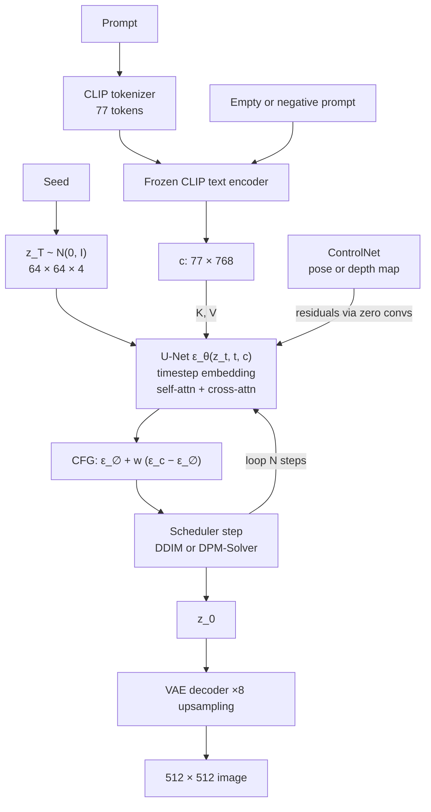

# Session 15 — Generative Computer Vision · Solutions

> Questions: [15_questions.md](15_questions.md) · Notes: [../notes/15_generative_cv.md](../notes/15_generative_cv.md)

## Section A — MCQs

### Q1 — Answer: **B**
**Why B:** The DDPM forward process is a **fixed** Gaussian Markov chain $q(x_t\mid x_{t-1})=\mathcal N(\sqrt{1-\beta_t}\,x_{t-1},\beta_tI)$ whose only "parameters" are the hand-chosen schedule $\beta_t$ (e.g. linear $10^{-4}\to0.02$, $T=1000$). Only the reverse denoiser $\epsilon_\theta$ is learned.
- **A** ✗ — this describes a VAE encoder; in diffusion nothing in $q$ is trained (classic trap).
- **C** ✗ — each step **adds random Gaussian noise**; it is stochastic, not a deterministic blur.
- **D** ✗ — the closed form $x_t=\sqrt{\bar\alpha_t}x_0+\sqrt{1-\bar\alpha_t}\epsilon$ exists, which is exactly why training can sample any $t$ in one shot.

### Q2 — Answer: **D**
**Why D:** Sampling $z\sim\mathcal N(\mu,\sigma^2)$ is a random node whose distribution depends on the encoder parameters $\phi$, so gradients cannot pass through it. Writing $z=\mu+\sigma\odot\epsilon$ makes $z$ a deterministic, differentiable function of $(\mu,\sigma)$, with all randomness in the parameter-free $\epsilon$; $\partial z/\partial\mu=1$, $\partial z/\partial\sigma=\epsilon$.
- **A** ✗ — the model stays stochastic; the noise is merely relocated into $\epsilon$.
- **B** ✗ — the KL term depends on $\mu,\sigma$, not on how $z$ is sampled; it is zero only if $\mu=0,\sigma=1$.
- **C** ✗ — the trick does not change the distribution of $z$ at all, so it cannot sharpen outputs (blur comes from the MSE likelihood).

### Q3 — Answer: **A**
**Why A:** The **non-saturating** loss: $G$ maximises $\log D(G(z))$, i.e. minimises $-\log D(G(z))$. With $D=\sigma(a)$ its gradient w.r.t. the logit is $-(1-D)\approx-1$ when $D(G(z))\approx0$ — strong learning signal exactly when $G$ is losing. It has the same fixed point as the minimax game.
- **B** ✗ — wrong sign: minimising $\log D(G(z))$ would make fakes *more* obviously fake.
- **C** ✗ — this is the original **saturating** loss; its gradient w.r.t. the logit is $-D\approx0$ when $D(G(z))\approx0$, i.e. it **vanishes** — the opposite of the stated reason.
- **D** ✗ — maximising $\log(1-D(G(z)))$ means helping the discriminator; wrong direction for $G$.

### Q4 — Answer: **C**
**Why C:** CFG trains **one** network with condition dropout (null token ∅ ~10% of the time, as in Stable Diffusion) so it learns both $\epsilon_\theta(x_t,c)$ and $\epsilon_\theta(x_t,\varnothing)$, then extrapolates $\hat\epsilon=\epsilon_\varnothing+w(\epsilon_c-\epsilon_\varnothing)$.
- **A** ✗ — that is **classifier guidance** (Dhariwal & Nichol); "classifier-free" means no classifier.
- **B** ✗ — $w=0$ is **unconditional**, $w=1$ is plain conditional; larger $w$ **reduces** diversity (increases fidelity / prompt adherence).
- **D** ✗ — CFG needs **two** evaluations per step (conditional + unconditional, usually batched), so it is about twice as expensive.

### Q5 — Answer: **B**
**Why B:** Latent diffusion runs in the VAE latent space: $f=8$, 4 channels → $512\times512\times3$ ↔ $64\times64\times4$ (48× fewer values). The VAE decoder turns the final latent into pixels once at the end.
- **A** ✗ — that would be pixel-space diffusion (e.g. DDPM, Imagen's base model), the trap "latent diffusion denoises pixels".
- **C** ✗ — the text embedding is the **condition** (keys/values of cross-attention), not the thing being denoised.
- **D** ✗ — the latent is a spatial $64\times64\times4$ tensor, not a 4-d vector.

### Q6 — Answer: **A**
**Why A:** A Gaussian decoder with fixed variance makes the reconstruction loss pixel-wise MSE. When $z$ leaves fine details uncertain, the MSE-optimal output is the **conditional mean** — the average of all plausible images — which blurs edges and textures.
- **B** ✗ — the KL term is correct as $\mathrm{KL}(q\Vert p)$; "the KL term is wrong" is the classic trap. The KL only contributes indirectly (overlapping posteriors).
- **C** ✗ — the reparameterisation noise is injected into $z$, not into output pixels, and it does not alter the distribution being modelled.
- **D** ✗ — GANs use the same transposed-conv decoders and produce sharp images; the architecture is not the cause.

### Q7 — Answer: **D**
**Why D:** CycleGAN learns $G:X\to Y$ and $F:Y\to X$ from **unpaired** sets, using adversarial losses plus cycle-consistency $\Vert F(G(x))-x\Vert_1+\Vert G(F(y))-y\Vert_1$ to stop the generators producing arbitrary realistic but unrelated images.
- **A** ✗ — pix2pix's L1 term compares $G(x)$ with the **paired** ground truth $y$, so it needs pixel-aligned pairs.
- **B** ✗ — DCGAN is an unconditional generator from noise; it does not translate a given image.
- **C** ✗ — an autoencoder trained on summer photos reconstructs summer photos; nothing teaches it about winter.

### Q8 — Answer: **C**
**Why C:** Because a zero conv outputs 0 at initialisation, ControlNet initially adds nothing to the locked U-Net, so the system starts as exactly the original Stable Diffusion; harmful random noise is not injected into the pretrained features. The gradient with respect to a zero conv's weight is its (non-zero) input, so the weights grow from zero and the control signal is learned gradually.
- **A** ✗ — only the **output** is zero at the start; the gradient $\partial(Wx+b)/\partial W=x\neq0$, so they do learn. The locked model is frozen by design, not by the zero convs.
- **B** ✗ — downsampling the condition image is done by a small separate conv encoder; 1×1 convs do not change resolution.
- **D** ✗ — the text prompt still enters through the U-Net's cross-attention; ControlNet adds spatial control on top.

## Section B — Numericals

### Q9 — DDPM forward closed form and one reverse step
**Given:** $\beta=(0.1,0.2,0.3)$, $x_0=(1.0,-0.5)$, $\epsilon=(0.4,-1.2)$, perfect $\epsilon_\theta=\epsilon$, $\sigma_3^2=\beta_3$, $z=(0.5,-1.0)$.

**Formula:**

$$
\alpha_t=1-\beta_t,\quad\bar\alpha_t=\prod_{s\le t}\alpha_s,\quad x_t=\sqrt{\bar\alpha_t}\,x_0+\sqrt{1-\bar\alpha_t}\,\epsilon,\quad\mu_\theta=\frac{1}{\sqrt{\alpha_t}}\Big(x_t-\frac{\beta_t}{\sqrt{1-\bar\alpha_t}}\epsilon_\theta\Big)
$$

**Working:**

(a) $\alpha=(0.9,\ 0.8,\ 0.7)$; $\bar\alpha_1=0.9$, $\bar\alpha_2=0.9\times0.8=0.72$, $\bar\alpha_3=0.72\times0.7=0.504$.

(b) $\sqrt{\bar\alpha_3}=\sqrt{0.504}=0.7099$, $\sqrt{1-\bar\alpha_3}=\sqrt{0.496}=0.7043$.
$x_3=0.7099\,(1.0,-0.5)+0.7043\,(0.4,-1.2)=(0.7099,-0.3550)+(0.2817,-0.8451)=(0.9916,\,-1.2001)$.

(c) $\mathrm{SNR}(3)=0.504/0.496=1.0161$ (for comparison $\mathrm{SNR}(1)=9$, $\mathrm{SNR}(2)=2.571$). Signal power ≈ noise power: about half the "energy" of $x_3$ is noise. In a real DDPM ($T=1000$) the final SNR is ≈ $4\times10^{-5}$ so $x_T$ is essentially pure $\mathcal N(0,I)$; this toy chain is far too short to reach that.

(d) $\frac{1}{\sqrt{\alpha_3}}=\frac{1}{\sqrt{0.7}}=1.1952$; $\frac{\beta_3}{\sqrt{1-\bar\alpha_3}}=\frac{0.3}{0.7043}=0.4260$.
$0.4260\,\epsilon=(0.1704,\,-0.5112)$; $x_3-0.4260\,\epsilon=(0.8213,\,-0.6889)$.
$\mu_\theta=1.1952\times(0.8213,-0.6889)=(0.9816,\,-0.8234)$.
$\hat x_0=\frac{x_3-0.7043\,\epsilon}{0.7099}=\frac{(0.9916-0.2817,\ -1.2001+0.8451)}{0.7099}=\frac{(0.7099,-0.3550)}{0.7099}=(1.0,\,-0.5)$ ✓ — a perfect noise prediction recovers $x_0$.
$\sigma_3=\sqrt{0.3}=0.5477$; $\sigma_3z=(0.2739,\,-0.5477)$; $x_2=(0.9816+0.2739,\ -0.8234-0.5477)=(1.2554,\,-1.3711)$.

**Answer:** **(a)** $\alpha=(0.9,0.8,0.7)$, $\bar\alpha=(0.9,0.72,0.504)$; **(b)** $x_3=(0.9916,-1.2001)$; **(c)** SNR ≈ 1.016; **(d)** $\mu_\theta=(0.9816,-0.8234)$, $\hat x_0=(1.0,-0.5)$, $x_2=(1.2554,-1.3711)$.
> ✔ Verified numerically (Python) — also checked that $\mu_\theta$ equals the true posterior mean $\tilde\mu_3(x_3,x_0)$ when $\epsilon_\theta=\epsilon$, and that simulating the 3-step chain by Monte Carlo gives mean $0.71x_0$ and variance 0.496.
> **Common slip:** using $\sqrt{\alpha_3}$ instead of $\sqrt{\bar\alpha_3}$ in the closed form, or $\beta_t/(1-\bar\alpha_t)$ (no square root) in the reverse mean. Rounding the intermediate $x_3$ first may give 0.8212 instead of 0.8213 — fine.

### Q10 — VAE heads, KL and reparameterisation
**Given:** feature 512-d, latent $d=32$; $\mu=(0.5,-1.0)$, $\log\sigma^2=(0,\ln0.25)$, $\epsilon=(1.2,-0.4)$.

**Formula:**

$$
\text{Params}_{FC}=(n_{in}+1)\,n_{out},\qquad\mathrm{KL}=\tfrac12\sum_j(\mu_j^2+\sigma_j^2-\log\sigma_j^2-1),\qquad z=\mu+\sigma\odot\epsilon
$$

**Working:**

(a) One head 512 → 32: $512\times32+32=16{,}416$. Two heads ($\mu$ and $\log\sigma^2$): $2\times16{,}416=$ **32,832**. A plain AE bottleneck needs just one head: **16,416** (VAE doubles it). Decoder first layer 32 → 512: $32\times512+512=$ **16,896**.

(b) $\sigma=\exp(\tfrac12\log\sigma^2)$: $\sigma_1=e^0=1$, $\sigma_2=\sqrt{0.25}=0.5$. $\ln0.25=-1.3863$.
Dim 1: $\tfrac12(0.25+1-0-1)=0.125$.
Dim 2: $\tfrac12(1+0.25-(-1.3863)-1)=\tfrac12(1.6363)=0.8181$.
Total $=0.9431$ nats. (Dim 2 costs more: its mean is further from 0 **and** its variance is shrunk.)

(c) $z_1=0.5+1\times1.2=1.7$; $z_2=-1.0+0.5\times(-0.4)=-1.2$ → $z=(1.7,\,-1.2)$.

(d) $\mathrm{KL}=\tfrac12\sum(0+1-0-1)=0$. Then $q_\phi(z\mid x)=p(z)$ for every input: the code carries **no information** about $x$ (posterior collapse), the decoder must ignore $z$ and can only output an average image. The KL must be traded off against reconstruction, not driven to 0.

**Answer:** **(a)** 32,832 (VAE heads) vs 16,416 (AE); decoder layer 16,896; **(b)** $\sigma=(1,0.5)$, KL $=0.125+0.8181=$ **0.9431 nats**; **(c)** $z=(1.7,-1.2)$; **(d)** KL = 0 → posterior collapse.
> ✔ Verified numerically (Python).
> **Common slip:** treating the second head output $\ln0.25$ as $\sigma$ or $\sigma^2$ directly; or forgetting the $\tfrac12$.

### Q11 — Optimal discriminator, JSD and the non-saturating gradient
**Given:** $p_{data}=(0.5,0.3,0.2)$, $p_g=(0.2,0.3,0.5)$; $D(G(z))=0.02$.

**Formula:**

$$
D^*(x)=\frac{p_{data}(x)}{p_{data}(x)+p_g(x)},\qquad V(D^*,G)=2\,\mathrm{JSD}-\log4,\qquad\frac{\partial}{\partial a}\log(1-\sigma(a))=-\sigma(a),\ \ \frac{\partial}{\partial a}[-\log\sigma(a)]=-(1-\sigma(a))
$$

**Working:**

(a) $D^*(a)=0.5/0.7=0.7143$; $D^*(b)=0.3/0.6=0.5$; $D^*(c)=0.2/0.7=0.2857$.

(b) $\log D^*=(-0.3365,-0.6931,-1.2528)$; $\log(1-D^*)=(-1.2528,-0.6931,-0.3365)$.
Real term: $0.5(-0.3365)+0.3(-0.6931)+0.2(-1.2528)=-0.1682-0.2079-0.2506=-0.6267$.
Fake term: $0.2(-1.2528)+0.3(-0.6931)+0.5(-0.3365)=-0.2506-0.2079-0.1682=-0.6267$.
$V(D^*,G)=-1.2535$.

(c) $\mathrm{JSD}=\frac{V+\log4}{2}=\frac{-1.2535+1.3863}{2}=0.0664$ nats (direct computation with $M=\tfrac12(p_{data}+p_g)$ gives the same). If $p_g=p_{data}$: $D^*=0.5$ everywhere, $V=\log0.5+\log0.5=-\log4=-1.3863$, JSD = 0 — the global minimum of the generator's objective. Our $V=-1.2535>-1.3863$, so $G$ still has room to improve.

(d) Saturating: $\lvert-\sigma(a)\rvert=0.02$. Non-saturating: $\lvert-(1-\sigma(a))\rvert=0.98$. The non-saturating loss gives a **49× larger** gradient when the discriminator confidently rejects the fake — this is why it is used in practice.

**Answer:** **(a)** $D^*=(0.7143,0.5,0.2857)$; **(b)** $V=-1.2535$; **(c)** JSD ≈ 0.0664 nats; at $p_g=p_{data}$: $D^*=\tfrac12$, $V=-\log4\approx-1.386$; **(d)** 0.02 vs 0.98 (49×).
> ✔ Verified numerically (Python).
> **Common slip:** forgetting that the fake term uses $p_g$ weights with $\log(1-D^*)$, or thinking the optimum has $D^*=1$ on real data.

### Q12 — Stable Diffusion: latent size, CFG and cost
**Given:** $f=8$, 4 latent channels; $\epsilon_\varnothing=(0.2,-0.4,0.1)$, $\epsilon_c=(0.5,-0.1,-0.3)$, $w=7.5$; 30 steps; img2img strength 0.6.

**Formula:**

$$
h=\frac{H}{f},\ w_{lat}=\frac{W}{f};\qquad\hat\epsilon=\epsilon_\varnothing+w(\epsilon_c-\epsilon_\varnothing);\qquad\text{img2img steps}=\lfloor sN\rfloor
$$

**Working:**

(a) $512/8=64$ → latent $64\times64\times4=16{,}384$ values; image $512\times512\times3=786{,}432$ values → $786{,}432/16{,}384=$ **48×** fewer.

(b) $\epsilon_c-\epsilon_\varnothing=(0.3,\,0.3,\,-0.4)$; $\times7.5=(2.25,\,2.25,\,-3.0)$; $\hat\epsilon=(0.2+2.25,\ -0.4+2.25,\ 0.1-3.0)=(2.45,\,1.85,\,-2.9)$.
$w=0$ → $(0.2,-0.4,0.1)$ = **unconditional** prediction; $w=1$ → $(0.5,-0.1,-0.3)$ = plain **conditional** prediction. $w=7.5$ **extrapolates** well beyond the conditional prediction in the direction "towards the prompt". (Equivalent alternative convention: $(1+w')\epsilon_c-w'\epsilon_\varnothing$ with $w'=6.5$ gives the same numbers.)

(c) Two U-Net passes per step (conditional and unconditional, batched): $30\times2=$ **60** evaluations (plus one VAE decode).

(d) Noise is added up to $t_0\approx0.6T$ (≈ timestep 600 of 1000) via $z_{t_0}=\sqrt{\bar\alpha_{t_0}}z_0+\sqrt{1-\bar\alpha_{t_0}}\epsilon$; only the last $\lfloor0.6\times30\rfloor=$ **18** steps are run → $18\times2=$ **36** U-Net evaluations (plus one VAE encode and one decode).

**Answer:** **(a)** $64\times64\times4$, 48×; **(b)** $\hat\epsilon=(2.45,1.85,-2.9)$; $w=0$ unconditional, $w=1$ conditional; **(c)** 60; **(d)** start ≈ $0.6T$, 18 steps, 36 evaluations.
> ✔ Verified numerically (Python).
> **Common slip:** computing $\epsilon_c+w(\epsilon_c-\epsilon_\varnothing)$ (wrong base term), or forgetting the factor 2 for CFG.

### Q13 — FID for toy Gaussians
**Given:** real $\mathcal N(0.5,1.0^2)$; A $\mathcal N(0.8,1.0^2)$; B $\mathcal N(0.5,0.4^2)$; 2-D: $\mu_r=(1,0)$, $\Sigma_r=\operatorname{diag}(4,1)$, $\mu_g=(0.5,0.5)$, $\Sigma_g=I$.

**Formula:** 1-D:

$$
\mathrm{FID}=(\mu_r-\mu_g)^2+\sigma_r^2+\sigma_g^2-2\sigma_r\sigma_g=(\mu_r-\mu_g)^2+(\sigma_r-\sigma_g)^2
$$

Diagonal covariances: $(\Sigma_r\Sigma_g)^{1/2}=\operatorname{diag}(\sigma_{r,i}\sigma_{g,i})$, so $\mathrm{FID}=\Vert\mu_r-\mu_g\Vert^2+\sum_i(\sigma_{r,i}-\sigma_{g,i})^2$.

**Working:**

(a) Model A: $(0.5-0.8)^2+(1.0-1.0)^2=0.09+0=$ **0.09**. Model B: $(0.5-0.5)^2+1.0+0.16-2(1.0)(0.4)=0+0.36=$ **0.36**.
Model A is better (lower FID). Model B has the right mean but a much too narrow spread — **low diversity, i.e. a mode-collapse-like failure**; FID catches it through the covariance (trace) term even though every sample looks "typical".

(b) Mean term: $(1-0.5)^2+(0-0.5)^2=0.25+0.25=0.5$.
$\Sigma_r\Sigma_g=\operatorname{diag}(4,1)$, square root $\operatorname{diag}(2,1)$.
Trace term: $(4+1-2\cdot2)+(1+1-2\cdot1)=1+0=1$.
$\mathrm{FID}=0.5+1=$ **1.5**.

(c) FID is estimated from samples: the 2048×2048 covariance needs many samples (with $N<2048$ it is rank-deficient) and the estimator is **biased upwards** at small $N$, so two models are only comparable at the same $N$. Illustration (Python, 64-d features): two samples drawn from the **same** Gaussian give FID ≈ 21.4 at $N=100$, 2.2 at $N=1000$ and 0.22 at $N=10{,}000$.

**Answer:** **(a)** FID$_A=0.09$, FID$_B=0.36$ → A better; B = low diversity / mode collapse; **(b)** **1.5**; **(c)** small-sample bias and covariance estimation.
> ✔ Verified numerically (Python, including `scipy.linalg.sqrtm` for part b).
> **Common slip:** using variances instead of standard deviations in $(\sigma_r-\sigma_g)^2$ (e.g. writing $(1-0.16)^2$), or forgetting the factor 2 in the cross term.

## Section C — Short answers

### Q14 — Autoencoders and why they are poor generators [4 marks]
**Autoencoder in one line:** learn to copy the input through a narrow **bottleneck**, so the network must discover a compact representation.

- **Encoder** $f_\phi$: conv / strided-conv layers map image $x$ to a low-dimensional **code** $z=f_\phi(x)$.
- **Bottleneck:** $\dim z\ll\dim x$ (undercomplete) forces the code to keep only the most informative structure (a linear AE with MSE learns the PCA subspace).
- **Decoder** $g_\theta$: transposed-conv / upsampling layers produce $\hat x=g_\theta(z)$.
- **Reconstruction loss:** $\Vert x-\hat x\Vert^2$ (or BCE), no labels needed. Variants: **denoising AE** (reconstruct clean $x$ from corrupted $\tilde x$), **sparse AE** (activity penalty).

**Uses (any two):** compression / dimensionality reduction; **denoising**; **anomaly detection** (train on normal data, flag high reconstruction error, e.g. industrial defects); representation learning / pre-training (MAE); latent space for latent diffusion.

**Why a plain AE is a poor generator:** the loss only asks to reconstruct training images, so codes form an **irregular, clustered set with holes**. There is no known distribution of $z$ to sample from, and a random $z$ or a point between two codes often decodes to garbage; nearby codes need not decode to similar images.

**Why a VAE works:** the encoder outputs a distribution $q_\phi(z\mid x)=\mathcal N(\mu,\operatorname{diag}\sigma^2)$ and the **KL term pulls every posterior towards $\mathcal N(0,I)$**, so codes overlap and fill the space continuously. Sampling $z\sim\mathcal N(0,I)$ then lands where the decoder was trained, and interpolations are smooth.

| | Plain AE | VAE |
|---|---|---|
| Code | Deterministic point | Distribution $\mathcal N(\mu,\sigma^2)$ |
| Latent regulariser | None | KL to $\mathcal N(0,I)$ |
| Can sample new images? | No (holes) | Yes |

*Trade-off:* the VAE pays for a sampleable latent with blurrier reconstructions.

### Q15 — ELBO derivation and reparameterisation [4 marks]
**Setup:** prior $p(z)=\mathcal N(0,I)$, decoder $p_\theta(x\mid z)$, encoder $q_\phi(z\mid x)=\mathcal N(\mu_\phi(x),\operatorname{diag}\sigma^2_\phi(x))$; $p_\theta(x)=\int p_\theta(x\mid z)p(z)dz$ is intractable.

**Derivation (Jensen, $\log$ concave):**

$$
\begin{aligned}
\log p_\theta(x)&=\log\mathbb E_{q_\phi(z\mid x)}\Big[\frac{p_\theta(x\mid z)p(z)}{q_\phi(z\mid x)}\Big]\ \ge\ \mathbb E_{q_\phi(z\mid x)}\Big[\log\frac{p_\theta(x\mid z)p(z)}{q_\phi(z\mid x)}\Big]\\
&=\underbrace{\mathbb E_{q_\phi(z\mid x)}[\log p_\theta(x\mid z)]}_{\text{reconstruction}}-\underbrace{\mathrm{KL}\big(q_\phi(z\mid x)\Vert p(z)\big)}_{\text{regulariser}}=\mathrm{ELBO}
\end{aligned}
$$

(Equivalently $\log p_\theta(x)=\mathrm{ELBO}+\mathrm{KL}(q_\phi(z\mid x)\Vert p_\theta(z\mid x))$, so the gap is the posterior-approximation error.)

**The two terms:**
- **Reconstruction:** decode a sampled $z$ and score how well it explains $x$; with a Gaussian decoder this is (scaled) **MSE**, Bernoulli → BCE.
- **KL regulariser:** closed form $\tfrac12\sum_j(\mu_j^2+\sigma_j^2-\log\sigma_j^2-1)$; keeps posteriors close to the prior so the latent space is smooth and sampleable. Weighting it by β gives β-VAE.

**Reparameterisation trick:** the reconstruction expectation is estimated by sampling $z$, but gradients cannot pass through "sample from $\mathcal N(\mu_\phi,\sigma_\phi^2)$". Write $z=\mu_\phi(x)+\sigma_\phi(x)\odot\epsilon$, $\epsilon\sim\mathcal N(0,I)$: randomness sits in the parameter-free $\epsilon$, $z$ is a differentiable function of $\mu,\sigma$, and ordinary back-propagation trains encoder and decoder jointly with low-variance gradients (vs high-variance REINFORCE).

*Trade-off line:* maximising the ELBO balances faithful reconstructions against a regular latent space.

### Q16 — Mode collapse [4 marks]
**Definition:** the generator maps many different $z$ to the **same or a few outputs**, covering only some modes of $p_{data}$ — e.g. an MNIST GAN that draws only "1"s, or near-identical faces. Individual samples can look excellent; **diversity** is missing. It may "hop" between modes during training.

**Why it happens:**
- $G$ is trained to fool the **current** $D$, not to cover the data distribution; for a fixed $D$, the best response is to put all mass on the output $D$ rates most real.
- $D$ then learns to reject that output and $G$ jumps to another mode → cycling instead of convergence (alternating gradient steps on a minimax game).
- There is no likelihood term penalising missing modes; with JSD and disjoint supports, gradients are poor.

**Not overfitting:** overfitting/memorisation = reproducing **training images**; mode collapse = **low diversity**, and the collapsed outputs need not be training images. It can happen with any dataset size.

**Remedies (three of):**
1. **WGAN / WGAN-GP:** replace JSD by the **Wasserstein-1 distance**, estimated by a 1-Lipschitz **critic** (weight clipping, or a gradient penalty $\lambda(\Vert\nabla_{\hat x}f\Vert-1)^2$). $W$ is smooth and informative even when $p_g$ and $p_{data}$ do not overlap, so $G$ gets gradients that pull mass towards **all** of the data distribution; the critic can be trained to optimality without vanishing gradients, and its loss tracks sample quality.
2. **Minibatch discrimination / minibatch std-dev:** $D$ sees cross-sample statistics, so a batch of near-identical fakes is easy to detect.
3. **Spectral normalisation** of $D$ (Lipschitz control) and **TTUR** (separate learning rates) → more stable dynamics.
4. Also: unrolled GANs, feature matching, label smoothing, larger batches.

*Detection:* low **recall** in generative precision–recall metrics, a worse FID (too-small feature covariance), visually repetitive samples across many $z$. Diffusion models largely avoid the problem because their training loss is a likelihood-based regression.

### Q17 — Classifier guidance vs classifier-free guidance [4 marks]
**Purpose of guidance:** trade diversity for **fidelity / condition adherence** by sampling from a sharpened $p(x)\,p(c\mid x)^{w}$.

| | Classifier guidance | Classifier-free guidance (CFG) |
|---|---|---|
| Extra training | Separate classifier $p_\phi(y\mid x_t,t)$ trained **on noisy images** at all $t$ | None: one diffusion model, condition replaced by ∅ ~10% of the time |
| Sampling formula | $\hat\epsilon=\epsilon_\theta(x_t)-s\sqrt{1-\bar\alpha_t}\,\nabla_{x_t}\log p_\phi(y\mid x_t)$ | $\hat\epsilon=\epsilon_\theta(x_t,\varnothing)+w(\epsilon_\theta(x_t,c)-\epsilon_\theta(x_t,\varnothing))$ |
| Cost per step | 1 U-Net + classifier forward **and backward** | 2 U-Net forwards (batched) |
| Conditions | Labels the classifier knows (hard for free text) | Anything the model is conditioned on (text, images) |
| Weakness | Extra model, noisy/adversarial gradients | Doubles inference cost |

**Guidance scale:** for CFG, $w=0$ unconditional, $w=1$ plain conditional, $w>1$ extrapolates (Stable Diffusion default 7.5). Increasing $w$ (or $s$) → better prompt adherence and cleaner, more "typical" images (**higher fidelity, often better IS/CLIP score**) but **lower diversity**; too large → over-saturated colours and artefacts, FID worsens. Negative prompts replace ∅ with an embedding to steer away from.

*Bottom line:* CFG gives the benefits of classifier guidance without a classifier, which is why every major text-to-image model uses it.

## Section D — Long answers

### Q18 — Generative models for medical data augmentation [10 marks]
**Framing.** Goal: improve a pathology classifier using synthetic X-rays of a **rare class** (2,000 real positives vs 50,000 normals). Synthetic images must be **realistic** (no artefacts the classifier can exploit), **diverse** (cover the variety of lesion size, location, severity, patient anatomy), **label-faithful** (the pathology really present), and must not **leak patient data**.

**Comparison**

| Criterion | VAE | GAN (e.g. StyleGAN2, cGAN) | Diffusion (e.g. latent diffusion) |
|---|---|---|---|
| Sample quality | Blurry: fine lung texture and small lesions smeared (MSE averaging) | Sharp, realistic at high resolution | State of the art; sharp fine detail |
| Diversity / mode coverage | Good (likelihood-based) | **Risk of mode collapse** → many near-identical lesions; rare presentations missed | Good; covers modes |
| Training stability | Stable | Unstable, needs tuning (WGAN-GP, spectral norm, augmentation for small data) | Stable regression loss |
| Data needs | Modest | 2,000 images is small for GANs; $D$ overfits without augmentation (ADA-style) | Can **pre-train on all 52k** X-rays, then condition/fine-tune on the 2k positives |
| Compute | Low; fast sampling | Moderate training, real-time sampling | Highest training cost; slow sampling (mitigated by latent space + DDIM/fast solvers — offline generation is fine here) |
| Controllability | Latent interpolation; weak | Class-conditional / latent editing | Class or text conditioning + CFG, inpainting, ControlNet-style masks |
| Likelihood / anomaly use | ELBO, useful for anomaly detection | None | ELBO bound |

**Recommended design (one sound option):**
1. **Base model:** a **latent diffusion model** (VAE autoencoder fine-tuned on X-rays, $f=4$–$8$) trained on **all 52k** images with a class label (normal / pathology), condition dropout 10% for **CFG**. Pre-training on normals teaches anatomy; the 2k positives teach the pathology.
2. **Controlled synthesis:** generate pathology images with moderate guidance ($w$ ≈ 2–5 rather than very high, to keep diversity). Optionally **inpaint** lesions into real normal X-rays using radiologist-drawn masks (mask + masked-image channels), which keeps realistic anatomy and gives free localisation labels.
3. **Alternative if compute is tight:** a StyleGAN2-style conditional GAN with adaptive discriminator augmentation and spectral norm — fast sampling but monitor for mode collapse.
4. **Not recommended as the generator:** a plain VAE (blur) — but a VAE/AE is valuable as the **latent encoder** and for **anomaly detection** as a complementary baseline.

**Evaluation — does synthetic data actually help?**
- **Task-based (most important):** train the classifier on real only vs real + synthetic (vary the ratio); evaluate on a **held-out, real, patient-level split** (no patient in both) — sensitivity at fixed specificity, AUROC, calibration, especially on the rare class and subgroups.
- **Distribution metrics:** FID/precision–recall computed with a **domain-appropriate feature extractor** (ImageNet Inception features are a poor fit for X-rays), diversity checks.
- **Expert review:** radiologist **visual Turing test** (real vs synthetic) and label-faithfulness check.
- **Memorisation audit:** nearest-neighbour search of each synthetic image against the training set (pixel and feature space); reject near-duplicates.

**Ethics & privacy risks:**
- **Memorisation / privacy:** diffusion models can regurgitate training images → patient re-identification; mitigate with de-duplication, nearest-neighbour filtering, possibly differential-privacy training; follow data-governance approvals and consent.
- **Hallucinated or wrong pathology** → label noise; keep synthetic data out of test sets; never present synthetic images as real cases.
- **Bias amplification:** if positives come mostly from one scanner/hospital/demographic, the generator copies that; check subgroup performance; shortcut learning on generator artefacts.
- **Provenance:** watermark/tag synthetic images (e.g. metadata, C2PA-style credentials) so they are never mixed into clinical records.

*Closing trade-off:* diffusion gives the best quality–diversity balance and controllability at a higher compute cost; GANs are faster but riskier for diversity; VAEs are stable but too blurry — whatever is chosen, it is justified only by measured gains on **real** held-out data.

**Marking scheme:** 2 – problem framing & requirements · 3 – comparison of VAE / GAN / diffusion on the listed criteria · 2 – justified design · 2 – evaluation plan (task-based, real test set, memorisation) · 1 – ethics/privacy.

### Q19 — From text prompt to image in Stable Diffusion (+ CFG and ControlNet) [10 marks]
**Idea:** Stable Diffusion is a **latent diffusion model**: a VAE compresses images to latents, a **text-conditioned U-Net** learns to denoise latents, and the **VAE decoder** turns the final latent into pixels.

**Step by step (text-to-image):**
1. **Tokenise** the prompt with CLIP's BPE tokenizer → 77 token ids (padded/truncated).
2. **Text encoder:** the **frozen CLIP text transformer** (ViT-L/14 text tower in v1) maps tokens to $c\in\mathbb R^{77\times768}$; CLIP's contrastive pre-training ([Session 13](../notes/13_vision_foundation_models.md)) means these embeddings are aligned with visual concepts. The empty (or negative) prompt is encoded too → $c_\varnothing$.
3. **Initial latent:** sample $z_T\sim\mathcal N(0,I)$ of shape $64\times64\times4$ from the seed ($f=8$: a $512\times512\times3$ image corresponds to 48× fewer values).
4. **Denoising loop** ($N$ ≈ 20–50 scheduler steps, e.g. DDIM — deterministic, fewer steps than DDPM's 1000):
   - **U-Net** $\epsilon_\theta(z_t,t,c)$: encoder–decoder with skip connections; **timestep** $t$ enters through a sinusoidal embedding + MLP added in every ResNet block (tells the network the noise level); **self-attention** for global layout; **cross-attention** with $Q$ from latent features and $K,V$ from the 77 text tokens, so each spatial location attends to the words relevant to it ("red" → where the car is).
   - **CFG:** run the U-Net on $c$ and on $c_\varnothing$ (batched) and combine $\hat\epsilon=\epsilon_\varnothing+w(\epsilon_c-\epsilon_\varnothing)$.
   - **Scheduler** turns $\hat\epsilon$ into $z_{t-1}$ (e.g. DDIM: predict $\hat z_0$, jump to the next noise level).
5. **Decode:** after the last step, the **VAE decoder** maps $z_0$ (rescaled) to a $512\times512\times3$ image. Optional safety checker / invisible watermark.

**Classifier-free guidance:**
- **Training:** the U-Net is trained with the ε-loss $\Vert\epsilon-\epsilon_\theta(z_t,t,c)\Vert^2$ on VAE latents of captioned images; **10% of captions are replaced by the empty string**, so the same network also learns the unconditional prediction. No classifier is needed.
- **Sampling:** $w=1$ is ordinary conditional sampling; $w\approx7.5$ extrapolates towards the prompt → stronger prompt adherence and cleaner images, at the cost of **diversity** (very high $w$ → over-saturation). Cost: 2 U-Net evaluations per step (50 steps → 100 evaluations).

**ControlNet — spatial control without damaging SD:**
- **Problem:** text cannot pin down an exact pose, layout or depth.
- **Architecture:** keep the original SD U-Net **locked** (frozen). Make a **trainable copy** of its encoder blocks + middle block, initialised from SD's weights. The condition image (OpenPose **skeleton**, **depth** map from a monocular depth estimator, Canny edges, segmentation map) is encoded by a small conv net to $64\times64$ and added (through a zero conv) to the copy's input. The copy's outputs are added to the locked U-Net's **skip connections and middle block** through **zero convolutions** (1×1, weights and biases = 0 at init).
- **Why it doesn't damage SD:** at initialisation the zero convs output 0, so the model is exactly the original SD; the locked weights never change; the zero-conv weights still receive gradients (their input features are non-zero) and grow gradually. Training uses the same ε-loss on (image, caption, condition) triplets, with half the captions dropped so the network learns to read the condition itself.
- **Inference:** run the preprocessor (pose detector / depth estimator) on a reference image, then the normal pipeline; every U-Net call adds `conditioning_scale × ControlNet residuals`. The **text** controls content and style, the **ControlNet** controls geometry (e.g. "an astronaut dancing" in exactly the given skeleton's pose).

| Component | Trained? | Role |
|---|---|---|
| CLIP text encoder | Frozen | Prompt → 77×768 embeddings |
| VAE | Frozen (trained once) | Pixels ↔ 64×64×4 latents |
| U-Net | Trained (diffusion loss) | Predicts noise; cross-attention to text |
| ControlNet copy + zero convs | Trained later; SD stays locked | Adds spatial conditioning |
| Scheduler | No parameters | Turns ε predictions into denoising steps |

*Closing trade-off:* working in latent space makes this affordable; CFG trades diversity for prompt fidelity at 2× compute; ControlNet adds precise spatial control cheaply because it reuses (and protects) the pretrained model.

**Marking scheme:** 3 – pipeline steps (tokenizer, CLIP, latent noise, U-Net with timestep embedding and cross-attention, scheduler, VAE decoder) · 2 – classifier-free guidance training and sampling · 3 – ControlNet architecture and zero-conv reasoning · 2 – diagram and clarity.
