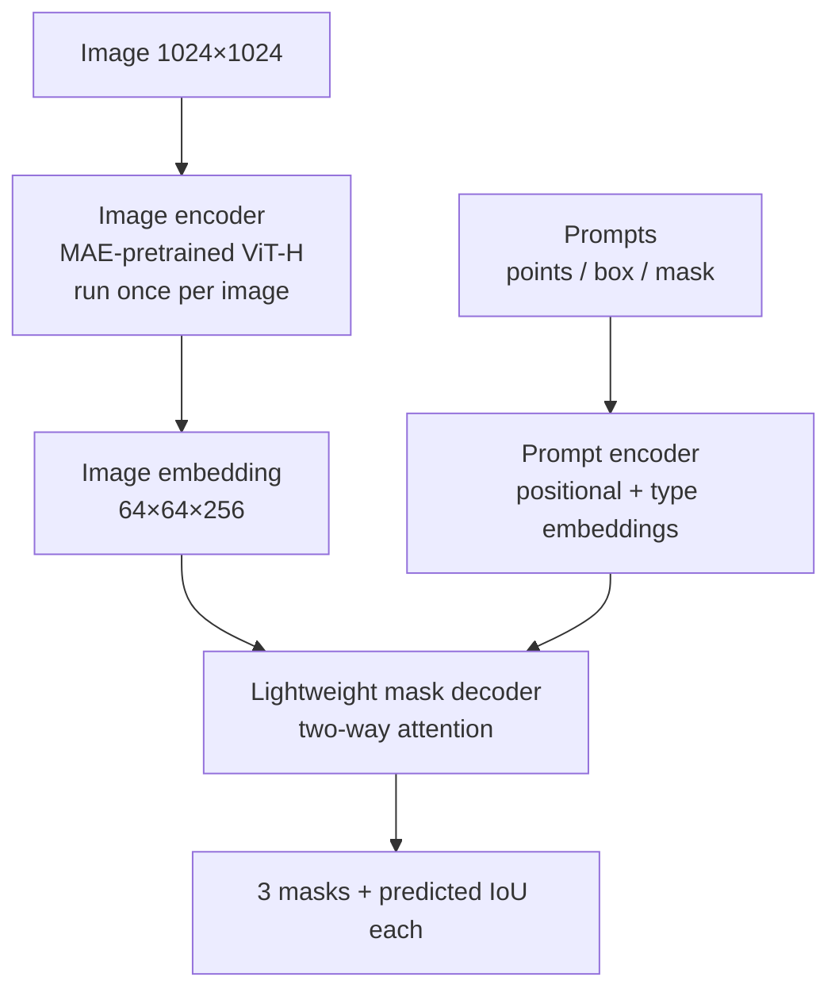
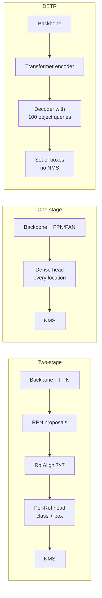
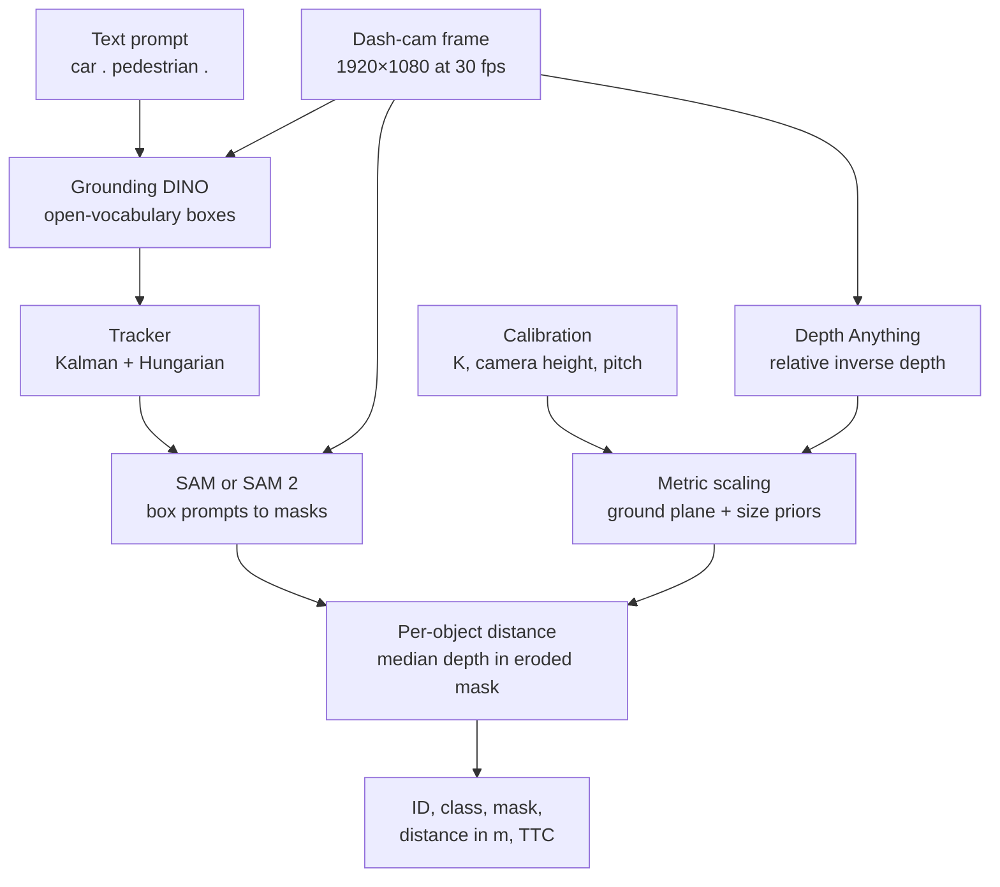
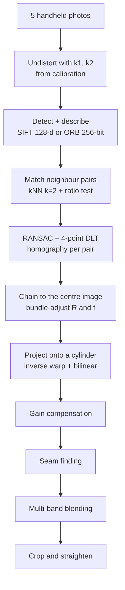
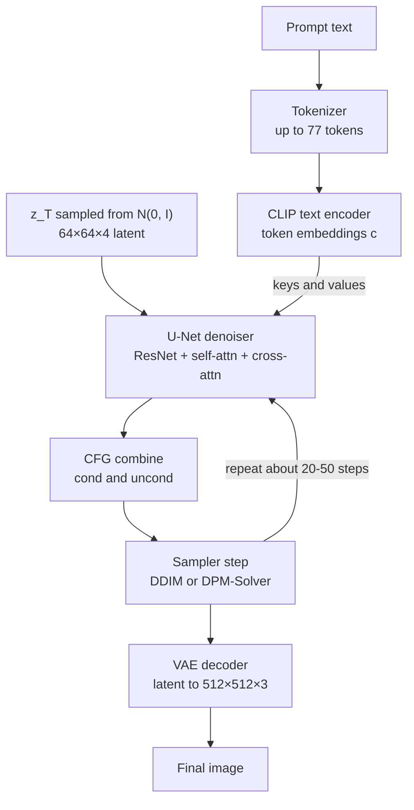
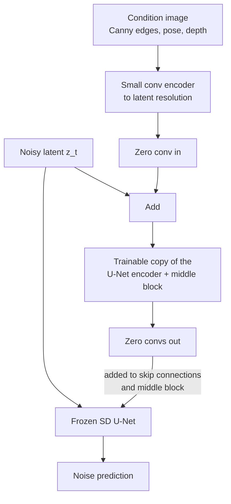

# Mock Exam 1 — Computer Vision · Solutions and Marking Scheme

> **Questions:** [mock_exam_1.md](mock_exam_1.md) · **Formula sheet:** [../00_formula_sheet.md](../00_formula_sheet.md) · **Comparison tables:** [../00_comparison_tables.md](../00_comparison_tables.md) · **Revision notes:** [../notes/09_revision_practicals.md](../notes/09_revision_practicals.md)
> How to mark yourself: Section A is 1 or 0 per question. In Section B, use the bracketed step marks, so a correct method with an arithmetic slip still earns most of the marks. In Sections C and D, use the **Marking scheme** line under each model answer. Count only your first 5 C answers and your first 3 D answers. The model answers are deliberately complete; you can still get full marks with about two-thirds of the length if all the marking points are there.

---

## Answer key at a glance

| Q | A1 | A2 | A3 | A4 | A5 | A6 | A7 | A8 | A9 | A10 |
|---|---|---|---|---|---|---|---|---|---|---|
| **Ans** | B | C | A | D | C | D | A | B | C | B |
| **Q** | **A11** | **A12** | **A13** | **A14** | **A15** | **A16** | **A17** | **A18** | **A19** | **A20** |
| **Ans** | D | A | C | D | B | A | C | D | B | A |

| Q | Final answer |
|---|---|
| B1 | $48^2\times32 \to 48^2\times64 \to 24^2\times64 \to 24^2\times128$; 94,784 params; RF $27\times27$, jump 4 |
| B2 | $N_H=34$; $N_F=272$ (8-pt), 163 (7-pt); $\mathbf x'=(283.02,\ 234.91)$ |
| B3 | 6 TP / 4 FP; AP (all-point) $=0.6631$; AP (11-pt) $=0.6379$; mAP $=0.6177$ |
| B4 | IoU $0.5517$, Dice $0.7111$; Dice 0.80 → IoU 0.6667; PA $0.885$, mIoU $0.5540$; trivial model PA 0.75, mIoU 0.25 |
| B5 | $X_c=(1.5,1.0,5.0)$; $(u,v)=(880,520)$; $(u_d,v_d)=(871.05,\ 514.03)$, barrel, 10.76 px towards the centre |
| B6 | $\bar\alpha=(0.95,0.855,0.684,0.4788)$; $x_4=(0.9145,0.4452,-0.9445)$; $\hat\epsilon=(1.225,0.925,-1.2)$ |

---

## Section A — MCQs (1 mark each)

### A1 — Answer: **B**
**Why B:** $M=\sum w\begin{bmatrix}I_x^2 & I_xI_y\\ I_xI_y & I_y^2\end{bmatrix}$ uses only derivatives. If $I'=I+40$, then $I'_x=I_x$ and $I'_y=I_y$, so $M$ and $R$ are identical. Harris is invariant to an additive intensity shift, but only partially invariant to intensity scaling. ([Harris corners](../notes/01_image_processing_features.md#harris-corners))
- **A** ✗ — $M$ holds gradient products, not raw intensities, so brightness level does not enter.
- **C** ✗ — This describes a *multiplicative* change $I\to aI$, which scales $M$ by $a^2$ and $R$ by $a^4$. A constant offset has no effect.
- **D** ✗ — Corner, edge or flat depends on the eigenvalues of $M$, which do not change.

### A2 — Answer: **C**
**Why C:** $d_1/d_2=0.30/0.36=0.833>0.8$. The best match is barely better than the runner-up, which is typical of repeated texture or a wrong match, so it is rejected. ([Session 02 notes](../notes/02_feature_matching_classical.md))
- **A** ✗ — An absolute threshold ignores ambiguity, and distances vary a lot between images. The point of the ratio test is to be relative.
- **B** ✗ — $d_1<d_2$ is always true by definition, so it cannot be a test.
- **D** ✗ — The test uses a ratio, not a difference. A difference threshold is not scale-free.

### A3 — Answer: **A**
**Why A:** The depthwise part has $3\cdot3\cdot64=576$ parameters (one $3\times3$ filter per input channel). The pointwise part has $64\cdot128=8{,}192$. The total is **8,768**, about 8.4× fewer than the standard conv. ([Session 03 notes](../notes/03_cnns_under_the_hood.md))
- **B** ✗ — $3\cdot3\cdot64\cdot128=73{,}728$ is the standard convolution.
- **C** ✗ — This counts only the pointwise $1\times1$ part and forgets the depthwise filters.
- **D** ✗ — $9\cdot128$ treats the depthwise stage as one filter per *output* channel and drops the pointwise stage.

### A4 — Answer: **D**
**Why D:** GAP turns $7\times7\times2048$ into a 2048-vector. The FC layer then has $2048\cdot1000+1000=\mathbf{2{,}049{,}000}$ parameters. This saving is why modern CNNs use GAP instead of huge FC layers. ([Session 03 notes](../notes/03_cnns_under_the_hood.md))
- **A** ✗ — $7\cdot7\cdot2048\cdot1000+1000$ is what flattening (no GAP) would give.
- **B** ✗ — This forgets the 1000 biases.
- **C** ✗ — $4096\cdot1000+1000$ assumes VGG's 4096-wide feature vector, which is the wrong width.

### A5 — Answer: **C**
**Why C:** A 28-point train/validation gap means overfitting. Doubling the width (more capacity) and training longer both *increase* overfitting. ([Session 04 notes](../notes/04_training_transfer_learning.md))
- **A** ✗ — Augmentation enlarges the effective dataset and is a standard regulariser.
- **B** ✗ — Weight decay and dropout are regularisers.
- **D** ✗ — Pretrained initialisation gives better generic features from little data, and early stopping halts training before memorisation.

### A6 — Answer: **D**
**Why D:** For $y=0$ only the second term is active: $\max(0,1.0-0.6)^2=0.4^2=0.16$. The pair is closer than the margin, so it is still pushed apart. ([Contrastive loss](../notes/05_embeddings_similarity.md#33-contrastive-pairwise-margin-loss))
- **A** ✗ — $d^2=0.36$ is the *similar-pair* term ($y=1$).
- **B** ✗ — Dissimilar pairs are penalised whenever $d<m$.
- **C** ✗ — This forgets to square the hinge.

### A7 — Answer: **A**
**Why A:** $t_x=(110-100)/50=0.2$, $t_y=(90-100)/100=-0.1$, $t_w=\ln(100/50)=\ln2=0.693$, $t_h=\ln(100/100)=0$. ([Session 06 notes](../notes/06_detection_two_stage.md))
- **B** ✗ — Raw pixel differences. Targets must be normalised by the anchor size so they are scale-invariant.
- **C** ✗ — This normalises $t_x$ by the GT width instead of the anchor width and leaves out the log.
- **D** ✗ — This leaves out the $\log$ on the width and height ratios. The log makes scale changes symmetric (×2 and ×½ give $\pm0.693$).

### A8 — Answer: **B**
**Why B:** The intersection is $(50-30)\times(60-40)=20\times20=400$. The areas are $40\times40=1600$ and $60\times40=2400$. The union is $1600+2400-400=3600$, so IoU $=400/3600=0.111$. ([Session 07 notes](../notes/07_detection_one_stage.md), [code](../code/iou_nms_ap.py))
- **A** ✗ — $400/4000$ forgets to subtract the intersection from the union.
- **C** ✗ — $400/2400$ is intersection over area($B$).
- **D** ✗ — $400/1600$ is intersection over area($A$).

### A9 — Answer: **C**
**Why C:** The modulating factor is $(1-p_t)^\gamma=(0.1)^2=0.01$. Easy, well-classified anchors (most of the ~100k background anchors) are down-weighted 100×, so the few hard examples dominate the gradient. ([Session 07 notes](../notes/07_detection_one_stage.md))
- **A** ✗ — 0.9 is $p_t$ itself, not the modulating factor.
- **B** ✗ — 0.1 is $(1-p_t)^1$, which corresponds to $\gamma=1$.
- **D** ✗ — $0.81=(1-0.1)^2$ is the factor for a *hard* example with $p_t=0.1$.

### A10 — Answer: **B**
**Why B:** Self-attention compares every token with every other token, so the cost is $O\big((HW)^2\big)$. For an $800\times1216$ image, C5 gives $25\times38=950$ tokens, while a stride-8 map would give $100\times152=15{,}200$ tokens, which is $16^2=256\times$ more attention pairs. This is also why DETR is weak on small objects. ([Why DETR needs no NMS, its drawbacks…](../notes/08_detection_transformers.md#why-detr-needs-no-nms-its-drawbacks-and-the-deformable-detr-fix))
- **A** ✗ — Full attention is not linear in the number of tokens. Linear cost is what *deformable* attention achieves.
- **C** ✗ — $O(N^2)$ is decoder self-attention among the 100 queries, which is cheap.
- **D** ✗ — $O(HW\cdot N)$ is decoder cross-attention. It is linear in $HW$ and is not the bottleneck.

### A11 — Answer: **D**
**Why D:** Panoptic segmentation = semantic labels for every pixel ("stuff" and "things") + instance IDs for the countable "things". ([Session 10 notes](../notes/10_image_segmentation.md))
- **A** ✗ — Semantic segmentation gives no instance IDs, so two touching cars merge into one blob.
- **B** ✗ — Instance segmentation covers only "things" and leaves stuff pixels (road, sky) unlabelled.
- **C** ✗ — Detection gives boxes, not per-pixel labels.

### A12 — Answer: **A**
**Why A:** Mask R-CNN **decouples** mask and class prediction. The head outputs $K\times28\times28$ masks with a per-pixel sigmoid and binary cross-entropy, and only the GT-class channel is penalised. Classes therefore do not compete in the mask head. RoIAlign is used for pixel-accurate alignment. ([Session 10 notes](../notes/10_image_segmentation.md))
- **B** ✗ — A per-pixel softmax couples the classes. The paper found this works clearly worse.
- **C** ✗ — Mask R-CNN predicts a mask per RoI, not an FCN-style full-image semantic map.
- **D** ✗ — Quantised RoI pooling misaligns masks. Mask R-CNN introduced **RoIAlign** (bilinear sampling, no rounding) for exactly this reason.

### A13 — Answer: **C**
**Why C:** The intrinsics have 5 DOF ($f_x,f_y,s,c_x,c_y$) and the extrinsics have 6 (3 rotation + 3 translation), giving **11**. Equivalently, 12 entries minus 1 for the overall scale. ([Session 11 notes](../notes/11_camera_geometry.md))
- **A** ✗ — This ignores that $P$ is only defined up to scale.
- **B** ✗ — This undercounts the intrinsics, which have 5 parameters.
- **D** ✗ — 8 is the DOF count of a $3\times3$ homography.

### A14 — Answer: **D**
**Why D:** With $\omega=K^{-\top}K^{-1}$ (symmetric, 5 DOF up to scale), each view gives $\mathbf h_1^\top\omega\mathbf h_2=0$ and $\mathbf h_1^\top\omega\mathbf h_1=\mathbf h_2^\top\omega\mathbf h_2$. That is 2 equations per view, so you need $n\ge3$ views (2 if skew $=0$ is assumed). ([Camera calibration](../notes/11_camera_geometry.md#camera-calibration))
- **A** ✗ — 6 of the homography's 8 DOF are spent on that view's pose ($R,\mathbf t$), which leaves only 2 for $K$.
- **B** ✗ — Overcount.
- **C** ✗ — Undercount.

### A15 — Answer: **B**
**Why B:** $Z=fB/d=700\cdot0.12/21=84/21=4.0$ m. The uncertainty is $\Delta Z\approx\frac{Z^2}{fB}\Delta d=\frac{16}{84}\cdot1=0.19$ m. Depth error grows with $Z^2$. ([Session 12 notes](../notes/12_3d_vision_motion.md), [code](../code/stereo_depth_and_projection.py))
- **A** ✗ — $Z/(fB)=0.048$ forgets to square $Z$.
- **C** ✗ — $d/(fB)=0.25$ inverts the formula.
- **D** ✗ — $fBd/1000=1.76$ multiplies by the disparity instead of dividing.

### A16 — Answer: **A**
**Why A:** CLIP's image and text encoders share an embedding space trained with symmetric InfoNCE on 400M image–text pairs. Class names become text prompts, and the prediction is the argmax of cosine similarity, optionally a softmax with the learned temperature. ([Session 13 notes](../notes/13_vision_foundation_models.md))
- **B** ✗ — Training a linear classifier on labelled images is few-shot linear probing, not zero-shot.
- **C** ✗ — CLIP has no text decoder. It is contrastive, not generative.
- **D** ✗ — k-means is unsupervised, and alphabetical assignment is meaningless.

### A17 — Answer: **C**
**Why C:** DINO trains a student to match the centred, sharpened output of an EMA (momentum) teacher across multi-crop views, with no labels. DINOv2 scales this up (adding a masked-token iBOT-style objective) on a large curated image set. ([Session 13 notes](../notes/13_vision_foundation_models.md))
- **A** ✗ — CLIP is supervised by natural-language captions (image–text pairs).
- **B** ✗ — SAM is trained on SA-1B masks (11M images, 1.1B masks). Only its image encoder was MAE-pretrained.
- **D** ✗ — OWL-ViT uses image–text pretraining plus detection fine-tuning with box labels.

### A18 — Answer: **D**
**Why D:** Grounding DINO maps the text to **boxes plus matched phrases**. SAM then takes each box as a **box prompt** and returns a class-agnostic mask. The label comes from Grounding DINO's phrase. ([Session 14 notes](../notes/14_vision_plus_plus.md))
- **A** ✗ — The released SAM takes points, boxes and masks. Text was only a proof of concept in the paper.
- **B** ✗ — SAM computes its own image embedding, and its prompts are geometric.
- **C** ✗ — SAM has no notion of class indices. Its masks carry no labels.

### A19 — Answer: **B**
**Why B:** You cannot backpropagate through "sample $z\sim\mathcal N(\mu,\sigma^2)$". Writing $z=\mu+\sigma\odot\epsilon$ makes $z$ a deterministic, differentiable function of $(\mu,\sigma)$, with the noise $\epsilon$ treated as an input. ([Session 15 notes](../notes/15_generative_cv.md))
- **A** ✗ — The KL term pulls $q_\phi(z\mid x)$ towards the prior. It is not set to zero.
- **C** ✗ — Sharpness is not the purpose, and VAE samples are typically blurry anyway.
- **D** ✗ — The latent size is an architectural choice, unrelated to reparameterisation.

### A20 — Answer: **A**
**Why A:** $D^*(x)=\frac{p_{data}(x)}{p_{data}(x)+p_g(x)}$. At the optimum $p_g=p_{data}$, so $D^*=\tfrac12$ and $V=\log\tfrac12+\log\tfrac12=-\log4$. This matches $2\,\mathrm{JSD}-\log4$ with $\mathrm{JSD}=0$. ([Session 15 notes](../notes/15_generative_cv.md))
- **B** ✗ — This is a perfect discriminator against a bad generator, not the equilibrium.
- **C** ✗ — $\log\tfrac12+\log\tfrac12\ne0$.
- **D** ✗ — Wrong sign and value.

---

## Section B — Numericals (5 marks each)

### B1 — CNN output sizes, parameters and receptive field
**Given:** $96\times96\times3$ input. L1 conv $5\times5$, 32 filters, $S=2,P=2$. L2 conv $3\times3$, 64 filters, $S=1,P=1$. L3 max-pool $2\times2$, $S=2$. L4 conv $3\times3$, 128 filters, $S=1,P=2,D=2$. All convs have bias.

**Formula:**

$$
W_{out}=\left\lfloor\frac{W-K_{eff}+2P}{S}\right\rfloor+1,\qquad K_{eff}=D(K-1)+1,\qquad \text{Params}=(K^2C_{in}+1)\,C_{out}
$$

$$
r_l=r_{l-1}+(K_{eff,l}-1)\,j_{l-1},\qquad j_l=j_{l-1}S_l,\qquad r_0=j_0=1
$$

**Working:**

(a) Output sizes:

| Layer | Calculation | Output |
|---|---|---|
| L1 | $\lfloor(96-5+4)/2\rfloor+1=\lfloor47.5\rfloor+1=48$ | $48\times48\times32$ |
| L2 | $(48-3+2)/1+1=48$ | $48\times48\times64$ |
| L3 | $(48-2)/2+1=24$ | $24\times24\times64$ |
| L4 | $K_{eff}=2(3-1)+1=5$; $(24-5+4)/1+1=24$ | $24\times24\times128$ |

(b) Parameters:

| Layer | Calculation | Params |
|---|---|---|
| L1 | $(5\cdot5\cdot3+1)\cdot32=76\cdot32$ | 2,432 |
| L2 | $(3\cdot3\cdot32+1)\cdot64=289\cdot64$ | 18,496 |
| L3 | pooling has no weights | 0 |
| L4 | $(3\cdot3\cdot64+1)\cdot128=577\cdot128$ (dilation adds **no** parameters) | 73,856 |
| **Total** | | **94,784** |

(c) Receptive field:

| Layer | $K_{eff}$ | $S$ | $r_l=r_{l-1}+(K_{eff}-1)j_{l-1}$ | $j_l$ |
|---|---|---|---|---|
| input | — | — | 1 | 1 |
| L1 | 5 | 2 | $1+4\cdot1=5$ | 2 |
| L2 | 3 | 1 | $5+2\cdot2=9$ | 2 |
| L3 | 2 | 2 | $9+1\cdot2=11$ | 4 |
| L4 | 5 | 1 | $11+4\cdot4=27$ | 4 |

**Answer:** Shapes are **48×48×32 → 48×48×64 → 24×24×64 → 24×24×128**. Total parameters **94,784**. Receptive field **27×27** input pixels with jump **4**.
> ✔ Verified numerically (Python). A PyTorch forward pass reproduces the shapes and parameter counts, and the RF recurrence was scripted.
> **Common slip:** using $K=3$ instead of $K_{eff}=5$ for the dilated layer gives RF $=19$. Also, dilation enlarges the RF but not the parameter count.

**Mark allocation:** (a) [0.5] per correct layer shape = [2]. (b) [1] per-layer working, including 0 for pooling and no extra parameters for dilation. [0.5] correct total. (c) [0.5] uses $K_{eff}$ and counts the pool as a layer, [0.5] RF $=27$, [0.5] jump $=4$.

---

### B2 — RANSAC iterations and mapping a point through $H$
**Given:** $p=0.99$, $e=0.4$ (so the inlier ratio is $1-e=0.6$). Homography $s=4$. Fundamental matrix $s=8$ (8-point) or $s=7$ (7-point). $H$ as given, $\mathbf x=(300,200)$.

**Formula:**

$$
N=\left\lceil\frac{\log(1-p)}{\log\big(1-(1-e)^s\big)}\right\rceil,\qquad \tilde{\mathbf x}'\sim H\tilde{\mathbf x},\quad \mathbf x'=\left(\frac{\tilde x'_1}{\tilde x'_3},\ \frac{\tilde x'_2}{\tilde x'_3}\right)
$$

**Working:**
- $\log(1-p)=\log0.01=-4.6052$.
- (a) Homography: $(0.6)^4=0.1296$, and $\log(1-0.1296)=\log0.8704=-0.13880$. So $N=4.6052/0.13880=33.18$, which rounds **up** to **34**.
- (b) F, 8-point: $(0.6)^8=0.016796$, and $\log(0.983204)=-0.016939$. So $N=271.87$, which rounds up to **272**.
- (b) F, 7-point: $(0.6)^7=0.027994$, and $\log(0.972006)=-0.028393$. So $N=162.19$, which rounds up to **163**.
- (b) Comment: the required number of iterations grows **exponentially with the sample size $s$**, because the chance of drawing an all-inlier sample is $(1-e)^s$. This is why minimal solvers matter (7-point beats 8-point, 5-point beats both for $E$). It is also why a panorama with pure rotation uses the cheaper 4-point homography.
- (c) Multiply out:

$$
H\begin{bmatrix}300\\200\\1\end{bmatrix}=\begin{bmatrix}0.9\cdot300-0.05\cdot200+40\\ 0.08\cdot300+1.05\cdot200+15\\ 0.0004\cdot300-0.0003\cdot200+1\end{bmatrix}=\begin{bmatrix}300\\249\\1.06\end{bmatrix}
$$

- Normalise: $x'=300/1.06=283.02$ and $y'=249/1.06=234.91$.
- Why divide: homogeneous coordinates are defined up to scale, and $(300,249,1.06)$ and $(283.02,234.91,1)$ are the same point. The bottom row $(h_{31},h_{32})\ne0$ is the **projective** part, which makes the scale depend on position. Skipping the division would treat $H$ as affine and put the point about 17 px too far right and 14 px too low.

**Answer:** **(a) 34 iterations. (b) 272 (8-point) and 163 (7-point). (c) $\tilde{\mathbf x}'=(300,249,1.06)$, so $\mathbf x'=(283.02,\ 234.91)$ px.**
> ✔ Verified numerically (Python). Mapping back with $H^{-1}$ recovers $(300,200)$.
> **Common slip:** rounding 33.18 *down* to 33. RANSAC counts are always rounded up.

**Mark allocation:** (a) [0.5] formula, [0.5] $(0.6)^4$ and logs, [0.5] 34 rounded up. (b) [0.5] 272, [0.5] 163, [0.5] comment on exponential growth with $s$. (c) [0.5] matrix product, [0.5] $w=1.06$, [0.5] final pixel, [0.5] why divide.

---

### B3 — AP (all-point and 11-point) and mAP
**Given:** 7 GT cars and 10 ranked detections with best-GT IoU. VOC matching at IoU $\ge0.5$, each GT matched at most once.

**Formula:**

$$
P_k=\frac{TP_k}{TP_k+FP_k},\qquad R_k=\frac{TP_k}{N_{GT}},\qquad p_{interp}(r)=\max_{r'\ge r}p(r')
$$

$$
AP_{all}=\sum_k (R_k-R_{k-1})\,p_{interp}(R_k),\qquad AP_{11}=\frac1{11}\sum_{r\in\{0,0.1,\dots,1\}}p_{interp}(r)
$$

**Working:**

(a)–(b) Labels and cumulative precision/recall:

| Rank | Best GT, IoU | Label | Reason | cum TP | cum FP | Precision | Recall |
|---|---|---|---|---|---|---|---|
| 1 | $G_1$, 0.82 | **TP** | first match of $G_1$ | 1 | 0 | 1.000 | 0.143 |
| 2 | $G_2$, 0.71 | **TP** | first match of $G_2$ | 2 | 0 | 1.000 | 0.286 |
| 3 | $G_1$, 0.64 | **FP** | duplicate ($G_1$ already matched) | 2 | 1 | 0.667 | 0.286 |
| 4 | $G_3$, 0.58 | **TP** | first match of $G_3$ | 3 | 1 | 0.750 | 0.429 |
| 5 | $G_4$, 0.43 | **FP** | IoU $<0.5$ | 3 | 2 | 0.600 | 0.429 |
| 6 | $G_5$, 0.77 | **TP** | first match of $G_5$ | 4 | 2 | 0.667 | 0.571 |
| 7 | none, 0 | **FP** | background | 4 | 3 | 0.571 | 0.571 |
| 8 | $G_4$, 0.62 | **TP** | $G_4$ still unmatched (rank 5 failed) | 5 | 3 | 0.625 | 0.714 |
| 9 | $G_2$, 0.55 | **FP** | duplicate | 5 | 4 | 0.556 | 0.714 |
| 10 | $G_6$, 0.51 | **TP** | first match of $G_6$ | 6 | 4 | 0.600 | 0.857 |

There are 6 TP and 4 FP. $G_7$ is never detected, so the maximum recall is $6/7=0.857$.

(c) All-point. Recall rises in six steps of $1/7$. The envelope (maximum precision at that recall or higher) at each step is:

| Recall step | $R_{k-1}\to R_k$ | $p_{interp}(R_k)$ |
|---|---|---|
| 1 | $0\to1/7$ | 1.000 |
| 2 | $1/7\to2/7$ | 1.000 |
| 3 | $2/7\to3/7$ | 0.750 |
| 4 | $3/7\to4/7$ | 0.667 |
| 5 | $4/7\to5/7$ | 0.625 |
| 6 | $5/7\to6/7$ | 0.600 |

$$
AP_{all}=\tfrac17(1+1+0.75+0.6667+0.625+0.6)=\tfrac{4.6417}{7}=\mathbf{0.6631}
$$

(Recall from $6/7$ to $1$ contributes 0, because $G_7$ was missed.)

(d) 11-point:

| $r$ | 0 | 0.1 | 0.2 | 0.3 | 0.4 | 0.5 | 0.6 | 0.7 | 0.8 | 0.9 | 1.0 |
|---|---|---|---|---|---|---|---|---|---|---|---|
| $p_{interp}(r)$ | 1 | 1 | 1 | 0.75 | 0.75 | 0.667 | 0.625 | 0.625 | 0.6 | 0 | 0 |

$$
AP_{11}=\frac{7.0167}{11}=\mathbf{0.6379}
$$

Why it differs: 11-point AP samples the envelope at fixed recall values instead of integrating it exactly. Here, recall never reaches 0.9, so two of the eleven samples are 0 (an area-based method only loses the final $1/7$ strip). Also, $r=0.2$ picks up precision 1.0 because $2/7=0.286\ge0.2$.

(e) mAP:

$$
\text{mAP@0.5}=\tfrac13(0.6631+0.48+0.71)=\tfrac{1.8531}{3}=\mathbf{0.6177}
$$

COCO's mAP@[.5:.95] would average this again over 10 IoU thresholds and would be lower.

**Answer:** **TP at ranks 1, 2, 4, 6, 8, 10. AP$_{all}$ = 0.6631, AP$_{11}$ = 0.6379, mAP@0.5 = 0.6177.**
> ✔ Verified numerically (Python). VOC-style matching, the all-point envelope and the 11-point sampling were scripted (see also [../code/iou_nms_ap.py](../code/iou_nms_ap.py)).
> **Common slips:** labelling rank 8 as FP ("$G_4$ was already seen"). $G_4$ was never *matched*, because rank 5 was an FP. Using 10 (the number of detections) instead of 7 as the recall denominator. Not taking the envelope max.

**Mark allocation:** (a) [1] all labels correct (−0.5 per error, max −1). (b) [1] correct P/R columns. (c) [0.5] envelope, [0.5] 0.6631. (d) [0.5] 11 values, [0.5] 0.6379 + reason. (e) [1] mAP 0.6177.

---

### B4 — Dice, IoU, confusion matrix, mIoU and imbalance
**Given:** $\lvert P\rvert=5000$, $\lvert G\rvert=4000$, $\lvert P\cap G\rvert=3200$. Dice $=0.80$. A $3\times3$ confusion matrix (rows GT, columns prediction) over 10,000 pixels.

**Formula:**

$$
\text{IoU}=\frac{\lvert P\cap G\rvert}{\lvert P\rvert+\lvert G\rvert-\lvert P\cap G\rvert},\quad \text{Dice}=\frac{2\lvert P\cap G\rvert}{\lvert P\rvert+\lvert G\rvert}=\frac{2\,\text{IoU}}{1+\text{IoU}},\quad \text{IoU}=\frac{\text{Dice}}{2-\text{Dice}}
$$

$$
\text{IoU}_c=\frac{TP_c}{TP_c+FP_c+FN_c},\qquad \text{PA}=\frac{\sum_c TP_c}{N},\qquad \text{mIoU}=\frac1C\sum_c\text{IoU}_c
$$

Here $FP_c$ is the column sum minus the diagonal entry, and $FN_c$ is the row sum minus the diagonal entry.

**Working:**
- (a) The union is $5000+4000-3200=5800$, so IoU $=3200/5800=0.5517$. Dice $=6400/9000=0.7111$. Check: $2(0.5517)/1.5517=0.7111$ ✓.
- (b) IoU $=0.80/(2-0.80)=0.80/1.20=0.6667$. (Dice ≥ IoU always, so the two numbers are not directly comparable.)
- (c) The row sums (GT) are 7500, 2250 and 250. The column sums (predictions) are 7550, 2150 and 300.

| Class | $TP$ | $FP$ (column − TP) | $FN$ (row − TP) | IoU | Recall |
|---|---|---|---|---|---|
| background | 7000 | 550 | 500 | $7000/8050=0.8696$ | 0.933 |
| road | 1800 | 350 | 450 | $1800/2600=0.6923$ | 0.800 |
| pedestrian | 50 | 250 | 200 | $50/500=0.1000$ | 0.200 |

- PA $=(7000+1800+50)/10000=\mathbf{0.885}$.
- mIoU $=(0.8696+0.6923+0.1000)/3=\mathbf{0.5540}$.
- (d) The all-background model has PA $=7500/10000=\mathbf{0.75}$. Its IoUs are background $7500/10000=0.75$, road 0 and pedestrian 0, so mIoU $=\mathbf{0.25}$.
- Interpretation: background is 75% of the pixels, so pixel accuracy is dominated by it. A useless model scores 75% PA. Our model scores 88.5% PA while finding only 20% of the pedestrian pixels (pedestrian IoU 0.10). mIoU weights every class equally, so the failure on the rare but safety-critical class shows up clearly (0.554, or 0.25 for the trivial model). Report per-class IoU and mIoU, not PA alone.

**Answer:** **(a) IoU 0.5517, Dice 0.7111. (b) IoU 0.6667. (c) PA 0.885, IoU = 0.870 / 0.692 / 0.100, mIoU 0.554. (d) Trivial model: PA 0.75, mIoU 0.25.**
> ✔ Verified numerically (Python). See also [../code/dice_iou_segmentation.py](../code/dice_iou_segmentation.py).
> **Common slip:** using row sums for $FP$. $FP_c$ comes from the **column** (predicted as $c$ but actually another class).

**Mark allocation:** (a) [0.5] IoU, [0.5] Dice, [0.5] identity check. (b) [0.5]. (c) [0.5] PA, [1] three class IoUs, [0.5] mIoU. (d) [0.5] trivial PA and mIoU, [0.5] interpretation.

---

### B5 — Projection with $K[R\mid\mathbf t]$ and radial distortion
**Given:** $f_x=f_y=800$, $(c_x,c_y)=(640,360)$, $R$ (a rotation about the $y$-axis with $\cos\theta=0.8$, $\sin\theta=0.6$), $\mathbf t=(-0.7,0.2,0.4)^\top$, $X_w=(-1.0,0.8,5.0)^\top$, $k_1=-0.30$, $k_2=0.10$.

**Formula:**

$$
X_c=RX_w+\mathbf t,\quad x=\frac{X_c}{Z_c},\ y=\frac{Y_c}{Z_c},\quad \begin{bmatrix}u\\v\\1\end{bmatrix}=K\begin{bmatrix}x\\y\\1\end{bmatrix},\quad C=-R^\top\mathbf t
$$

$$
r^2=x^2+y^2,\qquad x_d=x(1+k_1r^2+k_2r^4),\qquad y_d=y(1+k_1r^2+k_2r^4)
$$

**Working:**
- (a) The columns of $R$ are unit vectors ($0.8^2+0.6^2=1$) and orthogonal, so $RR^\top=I$. Also $\det R=0.8\cdot0.8-0.6\cdot(-0.6)=0.64+0.36=1$, so $R$ is a proper rotation (not a reflection).
- (a) $R^\top\mathbf t=(0.8(-0.7)+(-0.6)(0.4),\ 0.2,\ 0.6(-0.7)+0.8(0.4))=(-0.8,\ 0.2,\ -0.1)$, so $C=-R^\top\mathbf t=(0.8,\ -0.2,\ 0.1)$ m.
- (b) $RX_w=(0.8(-1)+0.6(5),\ 0.8,\ -0.6(-1)+0.8(5))=(2.2,\ 0.8,\ 4.6)$.
- (b) $X_c=RX_w+\mathbf t=(1.5,\ 1.0,\ 5.0)$. $Z_c=5>0$, so the point is in front of the camera.
- (b) $x=1.5/5=0.30$ and $y=1.0/5=0.20$, so $u=800(0.30)+640=880$ and $v=800(0.20)+360=520$.
- (c) $r^2=0.09+0.04=0.13$ and $r^4=0.0169$.
- (c) The factor is $1+(-0.30)(0.13)+(0.10)(0.0169)=1-0.039+0.00169=0.96269$.
- (c) $x_d=0.30\times0.96269=0.288807$ and $y_d=0.20\times0.96269=0.192538$.
- (c) $u_d=800(0.288807)+640=871.05$ and $v_d=800(0.192538)+360=514.03$.
- (c) The shift is $(-8.95,\ -5.97)$ px, of length $\sqrt{8.95^2+5.97^2}=10.76$ px. It points **towards the principal point** (radially inwards), so this is **barrel** distortion, as expected for $k_1<0$. The shift grows with $r$, which is why straight lines near the image border bow.

**Answer:** **$C=(0.8,-0.2,0.1)$ m. $X_c=(1.5,1.0,5.0)$, $(x,y)=(0.3,0.2)$, $(u,v)=(880,520)$. Distorted $(x_d,y_d)=(0.2888,0.1925)$ and $(u_d,v_d)=(871.05,\ 514.03)$ px, a barrel shift of 10.76 px towards the centre.**
> ✔ Verified numerically (Python). Hand computation and `cv2.projectPoints` (with distortion $[k_1,k_2,0,0,0]$) both give $(871.0456,\ 514.0304)$.
> **Common slips:** applying distortion to *pixel* coordinates instead of normalised ones. Forgetting $\mathbf t$ or using $R^\top$ for world→camera.

**Mark allocation:** (a) [0.5] orthonormal and $\det=1$, [0.5] camera centre. (b) [1] $X_c$, [0.5] normalised coordinates, [0.5] pixel. (c) [0.5] $r^2$ and factor, [0.5] distorted normalised coordinates, [0.5] distorted pixel, [0.5] shift direction and "barrel".

---

### B6 — DDPM forward process and classifier-free guidance
**Given:** $\beta=(0.05,0.10,0.20,0.30)$, $x_0=(0.8,-0.4,0.2)$, $\epsilon=(0.5,1.0,-1.5)$, $\epsilon_\varnothing=(0.10,-0.20,0.30)$, $\epsilon_c=(0.25,-0.05,0.10)$, $w=7.5$.

**Formula:**

$$
\alpha_t=1-\beta_t,\quad \bar\alpha_t=\prod_{s=1}^t\alpha_s,\quad x_t=\sqrt{\bar\alpha_t}\,x_0+\sqrt{1-\bar\alpha_t}\,\epsilon,\quad \hat\epsilon=\epsilon_\varnothing+w(\epsilon_c-\epsilon_\varnothing)
$$

**Working:**
- (a) $\alpha=(0.95,\ 0.90,\ 0.80,\ 0.70)$. The cumulative products are:
  - $\bar\alpha_1=0.95$
  - $\bar\alpha_2=0.95\cdot0.90=0.855$
  - $\bar\alpha_3=0.855\cdot0.80=0.684$
  - $\bar\alpha_4=0.684\cdot0.70=0.4788$
- (b) $\sqrt{\bar\alpha_4}=\sqrt{0.4788}=0.69195$ and $\sqrt{1-\bar\alpha_4}=\sqrt{0.5212}=0.72194$.
- (b) Signal part: $0.69195\,x_0=(0.55356,\ -0.27678,\ 0.13839)$.
- (b) Noise part: $0.72194\,\epsilon=(0.36097,\ 0.72194,\ -1.08291)$.
- (b) Sum: $x_4=(0.9145,\ 0.4452,\ -0.9445)$.
- (b) Variance split: for unit-variance $x_0$, $\mathrm{Var}(x_t)=\bar\alpha_t+(1-\bar\alpha_t)=1$, so the signal fraction is $\bar\alpha_4=0.4788$, about **47.9%**. (SNR $=\bar\alpha/(1-\bar\alpha)=0.919$.) The schedule is *variance-preserving*.
- (c) $\epsilon_c-\epsilon_\varnothing=(0.15,\ 0.15,\ -0.20)$. Times 7.5 this is $(1.125,\ 1.125,\ -1.5)$. Adding $\epsilon_\varnothing$ gives $\hat\epsilon=(1.225,\ 0.925,\ -1.2)$.
- (d) $w=0$ gives the **unconditional** prediction $(0.10,-0.20,0.30)$, which ignores the prompt. $w=1$ gives the **plain conditional** prediction $(0.25,-0.05,0.10)$.
- (d) $w>1$ **extrapolates** past the conditional prediction, away from the unconditional one. Prompt adherence and image "sharpness" go up, but diversity drops, and very large $w$ causes over-saturated, artefact-prone images. Each step also needs **two** U-Net evaluations (or one batched pass of size 2). Stable Diffusion typically uses $w\approx7$–8.

**Answer:** **$\bar\alpha=(0.95,\ 0.855,\ 0.684,\ 0.4788)$. $x_4=(0.9145,\ 0.4452,\ -0.9445)$ with 47.9% signal variance. $\hat\epsilon=(1.225,\ 0.925,\ -1.2)$.**
> ✔ Verified numerically (Python). Inverting the formula recovers $x_0$ exactly from $x_4$ and the true $\epsilon$.
> **Common slip:** using $\beta_t$ or $\alpha_t$ instead of the cumulative $\bar\alpha_t$ in the one-shot formula, or using $\sqrt{\beta}$ for the noise coefficient.

**Mark allocation:** (a) [1] all $\bar\alpha_t$ (0.5 if only $\alpha_t$ is right). (b) [0.5] square roots, [1] $x_4$, [0.5] variance fraction. (c) [1] $\hat\epsilon$. (d) [0.5] meaning of $w=0$ and $w=1$, [0.5] trade-off.

---

## Section C — Short answers (4 marks each; best 5 count)

### C1 — How SIFT achieves scale and rotation invariance
*Notes: [SIFT](../notes/01_image_processing_features.md#sift) · [A6. SIFT pipeline](../notes/01_image_processing_features.md#a6-sift-pipeline)*

SIFT makes the *patch* it describes canonical (normalised in scale and orientation) before describing it.

**(i) Scale invariance: detect a characteristic scale, then sample relative to it**
- Keypoints are **extrema of the DoG** $D(x,y,\sigma)=L(x,y,k\sigma)-L(x,y,\sigma)$ over space *and* scale (26 neighbours in a $3\times3\times3$ neighbourhood). DoG approximates the scale-normalised LoG $\sigma^2\nabla^2G$. Each keypoint therefore comes with its own **characteristic scale $\sigma$** ($\sigma_0=1.6$, $s=3$ intervals per octave).
- The descriptor is computed on the Gaussian image $L$ **at that scale**, and the $16\times16$ sampling window is measured **in units of $\sigma$**. If the object is twice as large in the image, $\sigma$ doubles and so does the window, so the same physical patch is described.

**(ii) Rotation invariance: assign a dominant orientation and describe relative to it**
- Gradient orientations near the keypoint (at its scale, Gaussian-weighted with $1.5\sigma$) go into a **36-bin histogram (10° per bin)**. The highest peak gives the dominant orientation $\theta$. Every other peak $\ge80\%$ of the maximum creates an **extra keypoint** with that orientation, which helps with ambiguous patches.
- The descriptor grid is **rotated by $\theta$**, and every gradient orientation is expressed **relative to $\theta$**. Rotating the image rotates $\theta$ by the same amount, so the descriptor does not change.

**The descriptor itself.** It uses $4\times4$ cells × 8 orientation bins = **128-d**. Gaussian weighting and trilinear interpolation make it robust to small shifts and to keypoint localisation error.

**Illumination robustness**
- **Additive** brightness change: gradients ignore constant offsets.
- **Multiplicative** contrast change: normalise the vector to unit length.
- **Non-linear** effects (saturation, 3D lighting) mostly change gradient *magnitudes*: **clip entries at 0.2, then renormalise**, so a few large gradients cannot dominate.

**Not invariant to:** large **affine or perspective** viewpoint changes (out-of-plane rotation). SIFT is only robust to moderate viewpoint change because its patch is circular, not affine-adapted. It is also not invariant to non-rigid deformation.

**Marking scheme:** 1.5 – scale (scale-space extrema + window ∝ σ) · 1.5 – rotation (36-bin histogram, describe relative to θ, 80% extra keypoints) · 0.5 – illumination (normalise, clip 0.2, renormalise) · 0.5 – a valid non-invariance.

---

### C2 — Feature extraction vs fine-tuning
*Notes: [Session 04](../notes/04_training_transfer_learning.md) · [code](../code/transfer_learning_skeleton.py)*

The decision depends on two things: **how much labelled data** you have, and **how similar the domain is** to ImageNet.

| | Small data | Large data |
|---|---|---|
| **Similar domain** | Feature extraction (linear head) | Fine-tune top layers or all, low LR |
| **Different domain** | Fine-tune top block(s) carefully, heavy augmentation | Fine-tune the whole network (pretrained init) |

**(i) 600 dog photos, 6 breeds: feature extraction**
- The data is **small** (100 per class), and fine-tuning all ~25.6M parameters of ResNet-50 would overfit.
- The domain is **very similar**: ImageNet contains >100 dog breeds, so the 2048-d pooled features already separate breeds.
- So freeze the backbone, cache the features, and train a 6-way linear or logistic head (or a small MLP). If accuracy plateaus, unfreeze **only the last stage (layer4)** with a small LR.

**(ii) 60,000 chest X-rays, 14 findings: full fine-tuning**
- The data is **large**, so the whole network can adapt without overfitting.
- The domain is **very different**: grayscale, medical textures, and subtle local findings. Low-level filters (edges, blobs) transfer, but high-level ImageNet features (fur, faces) do not.
- So fine-tune **all layers** from the pretrained initialisation (faster convergence than training from scratch). Replace the head with **14 sigmoid outputs + BCE**, because the task is multi-label. Use higher input resolution for small lesions, and replicate the grey channel to 3 channels (or adapt `conv1`).

**Two practical precautions (any two)**
1. **Low or discriminative learning rates:** the backbone LR should be ~10× smaller than the head's, with warm-up. Ideally train the head first with the backbone frozen and then unfreeze, so large gradients from a random head do not wreck the pretrained features.
2. Use the **same preprocessing** as in pretraining (ImageNet mean and std, input scale).
3. **BatchNorm:** with small batches, keep BN in eval mode (frozen running statistics).
4. **Domain-appropriate augmentation and early stopping:** for example, avoid horizontal flips on chest X-rays, because heart position is anatomically meaningful.

**Marking scheme:** 1.5 – scenario (i) choice + justification (data size and similarity) · 1.5 – scenario (ii) choice + justification (multi-label head) · 1 – two valid precautions.

---

### C3 — Siamese network, triplet loss and semi-hard mining
*Notes: [Siamese networks](../notes/05_embeddings_similarity.md#siamese-networks) · [3.4 Triplet loss](../notes/05_embeddings_similarity.md#34-triplet-loss) · [4.3 Online triplet mining](../notes/05_embeddings_similarity.md#43-online-triplet-mining-facenet-style)*

**Siamese network for verification**
- There are two (or three, for triplets) branches with **shared weights** $f_\theta$. Each maps a face to an **L2-normalised embedding** (for example 128-d).
- Shared weights guarantee that both images go through the *same* mapping, so the distance is symmetric and meaningful.
- Verification: accept "same person" if $d\big(f(x_1),f(x_2)\big)<\tau$, with $\tau$ tuned on a validation set for the target false-accept rate.
- It is **open-set**: new employees only need to be enrolled (store an embedding), with no retraining. A softmax classifier would need retraining.

**Triplet loss**

$$
\mathcal L=\max\big(0,\ d(a,p)-d(a,n)+m\big)
$$

The loss requires the anchor–positive distance to be smaller than the anchor–negative distance by at least the margin $m$.

**Types of negatives, with $d(a,p)=0.6$ and $m=0.2$** (the semi-hard band is $0.6<d(a,n)<0.8$):

| Negative | Condition | Example $d(a,n)$ | Loss | Effect |
|---|---|---|---|---|
| Easy | $d(a,n)>d(a,p)+m$ | 1.1 | $\max(0,0.6-1.1+0.2)=0$ | No gradient. Most random triplets are like this, so training wastes computation. |
| **Semi-hard** | $d(a,p)<d(a,n)<d(a,p)+m$ | 0.7 | $0.6-0.7+0.2=0.1$ | Informative, moderate gradient. |
| Hard | $d(a,n)<d(a,p)$ | 0.5 | $0.6-0.5+0.2=0.3$ | Largest loss, but often a label-noise outlier. |

**Why semi-hard negatives are preferred**
- **Over random negatives:** most random negatives are easy, so the loss is 0 and learning stalls.
- **Over the hardest negatives:** the very hardest negatives in a batch are often mislabelled or extreme (occlusion, bad crops). Selecting them from the start makes training unstable and can drive the model into a **collapsed solution** ($f(x)=$ constant). FaceNet reported this.
- **Semi-hard** negatives are farther than the positive but still inside the margin. They give a non-zero yet stable signal. They are mined **online** inside large mini-batches with several images per identity.

**Marking scheme:** 1 – Siamese (shared weights, embedding, threshold, open-set) · 1 – triplet loss and margin · 1 – semi-hard definition with the numerical band 0.6–0.8 · 1 – why not random and why not hardest.

---

### C4 — Why DETR needs no NMS, and its two drawbacks
*Notes: [Why DETR needs no NMS, its drawbacks and the Deformable DETR fix](../notes/08_detection_transformers.md#why-detr-needs-no-nms-its-drawbacks-and-the-deformable-detr-fix)*

**Why there is no NMS: one-to-one set prediction**
- DETR outputs a fixed set of $N=100$ predictions (class including "no object" $\varnothing$, plus a box), one per **object query**.
- During training, **Hungarian matching** finds the one-to-one assignment between predictions and GT objects (padded with $\varnothing$) that minimises the matching cost (class probability + $\lambda_{L1}$ L1 + $\lambda_{giou}$ GIoU).
- Each GT supervises **exactly one** query. Every other query is trained to predict $\varnothing$. A second query that fires on an already-matched object is therefore **penalised as a false positive**, so duplicates are trained away.
- **Decoder self-attention** among the queries lets them "see" each other's hypotheses and divide the objects between them. This is a learned, global replacement for NMS.
- Contrast this with anchor-based detectors, whose **one-to-many** assignment (many anchors positive for one object) *trains* them to produce duplicates, which NMS must remove afterwards.

**Drawback 1: slow convergence (~500 epochs on COCO)**
- *Cause:* at initialisation, attention weights are almost **uniform over all $HW$ positions**, and learning to focus on a few relevant pixels takes many epochs. The **Hungarian assignment is unstable** early on (a GT jumps between queries from epoch to epoch), and the queries have no explicit spatial prior.

**Drawback 2: poor small-object performance**
- *Cause:* encoder self-attention costs $O\big((HW)^2\big)$, so DETR uses only a **single low-resolution C5 map (stride 32)**, without a multi-scale FPN. A 20-px object covers less than one feature cell.

*Fix (beyond what was asked):* **Deformable DETR** attends to a few learned sampling points per query, head and level. The cost becomes linear, multi-scale features become affordable, and it trains in about 10× fewer epochs with much better small-object AP.

**Marking scheme:** 1 – one-to-one Hungarian matching with ∅ penalising duplicates · 1 – query self-attention / contrast with one-to-many + NMS · 1 – slow convergence and its cause · 1 – small objects and their cause.

---

### C5 — Aperture problem and Lucas–Kanade
*Notes: [Session 12](../notes/12_3d_vision_motion.md)*

**Where it comes from.** Brightness constancy says $I(x+u,y+v,t+1)=I(x,y,t)$. A first-order Taylor expansion gives the **optical-flow constraint**:

$$
I_xu+I_yv+I_t=0\quad\Longleftrightarrow\quad\nabla I\cdot(u,v)=-I_t
$$

**The aperture problem**
- At each pixel there is **one equation and two unknowns** $(u,v)$. Only the flow component **along the gradient** (normal flow) is determined:

$$
u_n=\frac{-I_t}{\Vert\nabla I\Vert}
$$

- Any motion **along the edge** (perpendicular to $\nabla I$) leaves the image unchanged locally, so it cannot be observed.
- Seen through a small window (aperture), a moving straight edge looks the same whatever its true direction. The barber-pole illusion is an example.

**How Lucas–Kanade handles it**
- LK assumes the flow is **constant over a small window** (for example $5\times5$, which gives 25 equations for 2 unknowns), then solves by **least squares**:

$$
\underbrace{\begin{bmatrix}\sum I_x^2 & \sum I_xI_y\\ \sum I_xI_y & \sum I_y^2\end{bmatrix}}_{A^\top A\ =\ \text{Harris } M}\begin{bmatrix}u\\v\end{bmatrix}=-\begin{bmatrix}\sum I_xI_t\\ \sum I_yI_t\end{bmatrix}
$$

- A unique, stable solution needs $A^\top A$ to be **invertible and well-conditioned**, meaning both eigenvalues are large. That happens when the window contains gradients in **two different directions**, as at a corner or in texture.

**Where LK still fails**
- **Edges:** $\lambda_2\approx0$, so the matrix is near-singular and the aperture problem remains (only normal flow is reliable).
- **Flat regions:** both eigenvalues are small, so there is no information.
- In practice, track only **good features** (Shi–Tomasi: $\min(\lambda_1,\lambda_2)>$ threshold).
- **Large motions** break the Taylor approximation, so use **coarse-to-fine pyramids** with iterative refinement.
- LK also fails at occlusions, motion boundaries (the window straddles two motions) and lighting changes (brightness constancy is violated).
- Dense alternatives such as **Horn–Schunck** fill edge and flat regions with a global smoothness prior.

**Marking scheme:** 1 – constraint equation, one equation and two unknowns · 1 – normal flow / unobservable tangential component · 1.5 – LK window, least squares, link to the structure tensor and eigenvalues · 0.5 – failure cases (edges, flat regions, large motion → pyramids).

---

### C6 — Segment Anything (SAM)
*Notes: [Session 13](../notes/13_vision_foundation_models.md)*

**(a) Promptable segmentation and architecture**
- **Task:** given an image and *any* prompt (foreground or background **points**, a **box**, or a rough **mask**), return a **valid mask**. If the prompt is ambiguous, at least one returned mask should be a reasonable object.
- This mirrors prompting in NLP. It allows **zero-shot transfer by composition**: for example, boxes from a detector become prompts, giving instance masks.

- The **heavy image encoder** runs once per image. The **lightweight prompt encoder and mask decoder** run per prompt in real time (tens of ms), which makes the model **interactive**.
- Training data is **SA-1B (11M images, 1.1B masks)**, produced by a model-in-the-loop **data engine** with three phases: assisted-manual, semi-automatic and fully automatic.

**(b) Ambiguity-aware output**
- A single click on a shirt could mean the button, the shirt or the whole person. SAM outputs **3 masks** (roughly subpart, part and whole), each with a **predicted IoU** (confidence) score.
- During training, only the mask with the **lowest loss** gets gradient. This stops the model from averaging incompatible answers into one blurry mask.
- When the prompt is unambiguous (several points, or a box), a single mask can be used. The predicted IoU ranks the masks.

**(c) Limitations (any three)**
- **No semantics:** masks have **no class labels**. You need CLIP, Grounding DINO or another model to know *what* was segmented.
- **Fine detail:** thin structures and precise boundaries can be missed or blobby, because the mask logits are predicted at low resolution and upsampled.
- **Compute:** the ViT-H encoder is heavy and not real-time on edge devices. Lighter variants trade off accuracy.
- **Images only:** the original SAM has no temporal consistency for video (SAM 2 later added memory for video).
- **Domain shift:** quality drops on medical, remote-sensing or microscopy images compared with natural photos.
- **"Segment everything" mode:** it depends on the density of the point grid and on thresholds, and gives over- or under-segmentation.

**Marking scheme:** 1.5 – task + three-part architecture (heavy encoder once, light decoder, SA-1B) · 1 – 3 masks + IoU score, min-loss training · 1.5 – three limitations (0.5 each).

---

## Section D — Long answers / design (10 marks each; best 3 count)

### D1 — Two-stage vs one-stage vs DETR, and a recommendation for drone video
*Notes: [Session 06](../notes/06_detection_two_stage.md) · [Session 07](../notes/07_detection_one_stage.md) · [Two-stage vs one-stage vs DETR](../notes/08_detection_transformers.md#two-stage-vs-one-stage-vs-detr-full-comparison-table) · [Revision](../notes/09_revision_practicals.md)*

**(a) Comparison**

The three families answer the same question ("which boxes contain which objects?") in different ways:
- **Two-stage:** first propose regions, then classify and refine each one.
- **One-stage:** predict densely everywhere in one pass.
- **DETR:** predict a set directly and learn to avoid duplicates.

| Aspect | Two-stage (Faster R-CNN + FPN) | One-stage (YOLO / SSD / RetinaNet) | DETR-style |
|---|---|---|---|
| **Architecture** | Backbone + FPN → **RPN** (anchors, objectness + offsets) → ~300–1000 RoIs → **RoIAlign** → per-RoI classification + class-specific box refinement | Backbone + neck → **dense head** that predicts class + box at every cell or anchor of several feature maps, in one pass | Backbone → **transformer encoder** (global context) → **decoder** with $N=100$ learned **object queries** → FFN per query (class incl. ∅ + box) |
| **Label assignment** | RPN: anchor IoU > 0.7 positive, < 0.3 negative, sampled 256 per image. Head: RoI IoU ≥ 0.5 foreground, sampled | **One-to-many, dense**: IoU-based anchor matching (SSD, RetinaNet) or centre / dynamic assignment (FCOS, modern YOLO) | **One-to-one Hungarian matching** on class + L1 + GIoU cost |
| **Losses** | CE + smooth-L1 at both stages | Focal loss or BCE (+ objectness) + IoU-family / L1 box loss. SSD uses hard-negative mining | CE (∅ down-weighted) + $5\cdot$L1 + $2\cdot$GIoU, auxiliary losses at every decoder layer |
| **Speed** | Slowest: two stages and per-RoI computation | **Fastest**, real-time, with edge-sized variants | Inference comparable to Faster R-CNN. **Training very slow** (~500 epochs). Real-time variants exist (e.g. RT-DETR) |
| **Accuracy** | High, strong localisation (two refinement steps) | Historically lower; RetinaNet (focal loss) and modern YOLOs closed the gap | Matches Faster R-CNN on COCO; best on **large** objects (global attention) |
| **Small objects** | Good with FPN + RoIAlign | Good with FPN/PAN and high-resolution heads. Weak in SSD (shallow, low-semantic layers) | **Weak** in the original (single C5, stride 32). Fixed by **Deformable DETR** (multi-scale) |
| **Anchors** | Yes (9 per location in the RPN) | Yes in SSD, RetinaNet and YOLOv2–v5. **Anchor-free** in FCOS, CenterNet, YOLOX and YOLOv8 | **No**: learned queries |
| **NMS** | Yes (on RPN proposals and on final detections per class) | **Yes**, because one-to-many assignment produces duplicates | **No**: one-to-one matching + query self-attention |

Other points worth stating:
- **Class imbalance** is handled by the *proposal stage + sampling* in two-stage detectors, by *focal loss or hard-negative mining* in one-stage detectors, and by *down-weighting the ∅ class* in DETR.
- **Data hunger:** DETR needs the most data and epochs, while YOLO-style detectors train fastest on small custom datasets.

**(b) Recommendation for the drone scenario**

The constraints that decide the choice:
- **Tiny objects:** people are 8–15 px and cars 20–40 px.
- **Large input:** 4K frames.
- **Compute:** embedded GPU at ≥ 10 fps.
- **Data:** only 4,000 labelled frames.

**Recommendation:** a **modern anchor-free one-stage detector** (YOLO-family, small or medium size) with a high-resolution detection head and tiled inference, exported to TensorRT (FP16 or INT8).

**Why not the alternatives?**
- **Faster R-CNN + FPN** is accurate on small objects but too slow for 4K at 10 fps on an embedded GPU, because of the per-RoI head and large inputs.
- **Original DETR** is weak on small objects (C5 only), needs long training and lots of data, and 4,000 frames is too few. Deformable DETR or RT-DETR are possible fallbacks if the one-stage model's accuracy plateaus, but they are heavier on embedded hardware.

**Design choices for small objects (any two, well explained)**
1. **Tiled (sliced) inference instead of downscaling.** Shrinking 4K to 640 px scales everything by $640/3840=1/6$, so a 10-px person becomes about **1.7 px** and is undetectable. Instead, cut each frame into overlapping native-resolution tiles. With 1280-px tiles and 20% overlap (stride 1024) that is $4\times2=8$ tiles per frame, or 80 tile inferences per second at 10 fps. Merge the tile detections back into frame coordinates and run NMS across tile borders. Train on tiles at the same scale.
2. **Add a stride-4 (P2) head.** At stride 8 a person covers only 1–1.9 cells, while at stride 4 it covers 2–3.75 cells, so localisation becomes possible. Cars (2.5–5 cells at stride 8) are fine at P3. If an anchor-based model is used, re-cluster the anchor sizes with **k-means on the dataset's box sizes**.
3. **Data and training:** use mosaic and copy-paste augmentation of small objects, train at native resolution, and use an assignment strategy that gives small GT boxes enough positive locations.
4. **Exploit time.** A car park changes slowly, so detect every 2nd or 3rd frame if needed and **track** (Kalman filter + Hungarian matching, ByteTrack-style). Tracking keeps the count of *unique* cars stable and avoids double counting across frames.

**Validation:** report AP$_S$ (small objects) separately, plus the count error per frame, and measure end-to-end fps on the target device rather than on a desktop GPU.

**Marking scheme:** 6 – comparison (1 each: architecture, training/assignment, speed, accuracy, small objects, anchors + NMS) · 2 – justified recommendation that rejects the alternatives for the stated constraints · 2 – two concrete small-object design choices with reasoning.

---

### D2 — Text-promptable detection, segmentation and distance for dash-cam video
*Notes: [Session 12](../notes/12_3d_vision_motion.md) · [Session 13](../notes/13_vision_foundation_models.md) · [Session 14](../notes/14_vision_plus_plus.md) · [Camera geometry](../notes/11_camera_geometry.md)*

**(a) Pipeline**

| Component | Role | Why this choice |
|---|---|---|
| **Grounding DINO** | Text → boxes + matched phrase (open vocabulary) | Promptable classes with no retraining. (Its "DINO" is a DETR-style *detector*, not self-supervised DINO.) |
| **SAM / SAM 2** | Box prompt → class-agnostic mask. SAM 2 can propagate masks through video | Pixel-accurate support for depth sampling; masks exclude the background pixels that a box contains |
| **Depth Anything** | Dense relative depth from a single image | Strong zero-shot generalisation (DINOv2 encoder + DPT decoder) |
| **Calibration** | $K$, camera height $h$ and pitch, from a one-off checkerboard calibration plus a mounting measurement | Supplies the metric scale (see b) |
| **Tracker** | IDs over time, smoothing, gap filling | Stable outputs, and lets heavy models skip frames |

**(b) Relative vs metric depth**

*The problem.*
- A single image has **scale ambiguity**: $(X,Y,Z)$ and $(kX,kY,kZ)$ project to the same pixel, so a toy car at 2 m and a real car at 20 m can look the same.
- Depth Anything therefore outputs **affine-invariant inverse depth** $d_{rel}(p)\approx a\cdot\frac1{Z(p)}+b$, with **unknown $a>0$ and $b$** for each image. The ordering is right, but metres are not, and $a$ and $b$ can change from frame to frame, so distances would flicker.

*Getting metres (combine several for robustness):*
1. **Ground-plane geometry** (the main anchor). With a calibrated camera at height $h$ and zero pitch, a road point imaged at row $v$ is at $Z=\frac{f_yh}{v-c_y}$. For an object, use the bottom of its mask (the tyre or foot contact point). Example: $f_y=1000$ px, $h=1.4$ m and a contact point 70 px below $c_y$ give $Z=1400/70=$ **20 m**.
2. **Fit the affine depth model.** Use many road pixels with known ground-plane depth to fit $(a,b)$ by least squares, then convert the whole map with $Z=a/(d_{rel}-b)$. This also covers objects whose contact point is hidden. Toy example: anchors $Z=10$ m → $d_{rel}=3.5$ and $Z=40$ m → $d_{rel}=1.25$ give $a=30$, $b=0.5$. An object with $d_{rel}=2.0$ is then at $Z=30/1.5=$ **20 m**.
3. **Size priors** as a sanity check: $Z\approx f_xW/w_{px}$. A car about 1.8 m wide imaged 90 px wide is at $1000\cdot1.8/90=20$ m. This is less reliable for pedestrians, whose heights vary (for example, children).
4. **A metric fine-tuned depth model** (for example a Depth Anything variant fine-tuned on driving data). It is simpler, but it still assumes camera intrinsics similar to its training data.
5. If the system is safety-critical, add **stereo, radar or LiDAR**. Monocular distance is only an estimate.

*Per-object distance.* Take the **median (or a low percentile) of metric depth inside the eroded mask**. Erosion removes boundary pixels that bleed into the background.

*Error growth.* Differentiating $Z=f_yh/\Delta v$ gives $\Delta Z\approx\frac{Z^2}{f_yh}\Delta v$. That is about 0.29 m per pixel at 20 m but **1.14 m per pixel at 40 m**, the same quadratic growth as stereo.

**(c) Tracking**
- Use **ByteTrack/SORT-style** tracking: a constant-velocity **Kalman filter** per object, with **Hungarian association** on IoU (plus appearance embeddings, DeepSORT-style, for crowded scenes). Low-score boxes are kept for a second association pass, which helps through occlusion.
- Alternatively, **SAM 2's memory** can propagate masks between detector keyframes.
- A Kalman filter on $(Z,\dot Z)$ per track smooths the distance and gives **time-to-collision** $\text{TTC}=Z/(-\dot Z)$.

**(d) Latency**
- At 30 fps the throughput budget is **33 ms per frame**. For a driver-assist display, the end-to-end latency should stay well under ~100 ms.
- Grounding DINO and SAM's ViT-H encoder are each far too heavy to run on every frame within that budget, especially on in-vehicle hardware.

Ways to meet the budget:
- Run **open-vocabulary detection only on keyframes** (for example every 5th–10th frame) and **track in between**.
- Once the prompt is fixed, **distil**: use Grounding DINO plus SAM outputs as pseudo-labels to train a **closed-set real-time detector/segmenter** (YOLO-style with a mask head) for "car" and "pedestrian".
- Use a **lightweight SAM variant**, run the image encoder once per frame for all boxes (batch the prompts), and run depth at reduced resolution.
- Use **TensorRT FP16**, and run the depth and detection branches concurrently on separate GPU streams.
- Measure p95 latency on the target hardware, not just the mean.

**(e) Failure modes and mitigations**

| Failure | Why | Mitigation |
|---|---|---|
| Night, rain, glare, fog | Domain shift for every model, so missed detections and wrong depth | Fine-tune on driving data with adverse conditions; exposure control; radar fusion |
| Small, distant pedestrians | Few pixels; downscaled input | Run at higher resolution on the horizon band, or tile it |
| Occlusion or truncation | Contact point hidden, so the ground-plane method fails | Fall back to the fitted depth map or size prior; let the tracker coast |
| Mask leakage | Background pixels inside the mask push the median too far | Erode the mask; use a low percentile; gate with the predicted IoU |
| Slopes, braking pitch, speed bumps | The flat-road, fixed-pitch assumption breaks | IMU pitch; horizon / vanishing-point estimation; re-fit $(a,b)$ every frame |
| Depth flicker or scale drift | Per-frame affine ambiguity | Temporal Kalman smoothing; consistent ground anchors |
| Prompt brittleness, false positives | Billboards, bus adverts showing people, reflections; "pedestrian" vs "person" | Tune box and text thresholds; use synonyms; require detections to persist for $k$ frames; check the object stands on the road plane |
| ID switches in crowds | IoU-only association | Appearance embeddings; SAM 2 memory |

**Marking scheme:** 3 – pipeline + diagram + component roles (including the Grounding DINO ≠ self-supervised DINO point) · 3 – relative vs metric depth, explained with at least two concrete scaling methods and a formula · 1 – tracking · 1 – latency budget + strategies · 2 – at least four failure modes with mitigations.

---

### D3 — Panorama stitching from 5 handheld photos
*Notes: [Session 01](../notes/01_image_processing_features.md) · [Session 02](../notes/02_feature_matching_classical.md) · [Homography revisited](../notes/11_camera_geometry.md#homography-revisited) · [code](../code/sift_orb_matching_panorama.py)*

**When is a homography exact?**
1. The scene is **planar**, or
2. The camera **rotates purely about its optical centre**. Then $\tilde{\mathbf x}'\sim KRK^{-1}\tilde{\mathbf x}$ for any scene depth, because rotation alone creates no parallax.

Turning on the spot *approximates* case 2. However, a handheld camera pivots about the wrist or body, so the optical centre moves slightly, and that small translation is the source of parallax errors.

**Pipeline with the maths**

1. **Undistort (optional but recommended).** Lens distortion makes straight lines curve, so no homography fits the image borders. Use the calibrated $k_1,k_2$: $x_d=x(1+k_1r^2+k_2r^4)$, inverted by inverse mapping.

2. **Detect and describe features.**
   - **SIFT:** DoG extrema $D=L(x,y,k\sigma)-L(x,y,\sigma)$ across scale space, a dominant orientation, and a 128-d descriptor. It is invariant to the scale and rotation changes between handheld shots.
   - **ORB** (FAST + rBRIEF, 256-bit) is a faster alternative.

3. **Match.**
   - For each descriptor in image $i$, find its 2 nearest neighbours in image $j$ (L2 distance for SIFT, **Hamming** for ORB).
   - Apply **Lowe's ratio test** $d_1/d_2<0.75$–$0.8$, optionally with a mutual (cross) check.
   - Only neighbouring pairs (1–2, 2–3, 3–4, 4–5) need matching. With an unknown order, match all pairs and keep those with enough RANSAC inliers.

4. **Robust homography: RANSAC + DLT.**
   - Write $\tilde{\mathbf x}'\sim H\tilde{\mathbf x}$, where $H$ has 8 DOF. Each correspondence $(x,y)\to(x',y')$ gives **2 rows** of $A$:

   $$
   \begin{bmatrix}x & y & 1 & 0 & 0 & 0 & -x'x & -x'y & -x'\\ 0 & 0 & 0 & x & y & 1 & -y'x & -y'y & -y'\end{bmatrix}\mathbf h=\mathbf 0
   $$

   - With 4 points (no 3 collinear), $A$ is $8\times9$. Solve $A\mathbf h=0$ by **SVD**: $\mathbf h$ is the right singular vector with the smallest singular value. Apply **Hartley normalisation** first (centre the points, scale to mean distance $\sqrt2$) for numerical stability.
   - RANSAC loop: sample 4 matches, fit $H$, and count **inliers** with $\Vert\mathbf x'_i-\pi(H\tilde{\mathbf x}_i)\Vert<\epsilon$ (about 2–3 px). Keep the best model and **refit on all inliers** (DLT, then Levenberg–Marquardt on the reprojection error).
   - Iterations: $N=\lceil\log(1-p)/\log(1-(1-e)^4)\rceil$. For $p=0.99$ and $e=0.5$, $N=\lceil71.4\rceil=72$.

5. **Reference frame and global alignment.**
   - Use the **middle image (3)** as the reference, which minimises the distortion at the ends.
   - Chain the homographies: $H_{1\to3}=H_{2\to3}H_{1\to2}$ and $H_{5\to3}=H_{4\to3}H_{5\to4}$.
   - Chaining **accumulates error**. **Bundle adjustment** fixes this: parameterise each camera by a rotation $R_i$ and focal length $f_i$, use $H_{ij}=K_iR_iR_j^\top K_j^{-1}$, and jointly minimise the reprojection error of all inlier matches.

6. **Projection surface.**
   - The total field of view is about $n\cdot\text{FOV}-(n-1)\cdot\text{overlap}$. With a 60° lens and 35% overlap this is $5\cdot60-4\cdot21=216°$.
   - A **planar** projection breaks down as the field of view approaches 180°: the edges stretch towards infinity. So project onto a **cylinder** (or sphere). For a pixel $(x,y)$ relative to the principal point:

   $$
   x_{cyl}=f\arctan\frac xf,\qquad y_{cyl}=\frac{fy}{\sqrt{x^2+f^2}}
   $$

   - On a cylinder, a pure pan becomes approximately a horizontal translation.

7. **Warping.**
   - Compute the canvas bounds by warping each image's four corners.
   - Use **inverse mapping**: for each canvas pixel $\mathbf p'$, sample the source at $H^{-1}\mathbf p'$ (or the inverse cylindrical map) with **bilinear interpolation**. Forward mapping would leave holes.

8. **Exposure compensation.** Choose a gain $g_i$ per image to minimise

$$
\sum_{i,j}\big(g_i\bar I_{ij}-g_j\bar I_{ji}\big)^2+\lambda\sum_i(1-g_i)^2
$$

   where $\bar I_{ij}$ is the mean intensity of image $i$ in its overlap with image $j$. The second term keeps the gains near 1.

9. **Seams and blending.**
   - **Seam finding** (graph cut or dynamic programming) routes the cut through regions where the overlapping images agree.
   - **Feathering** sets $I=\sum_iw_iI_i/\sum_iw_i$, with $w_i$ the distance to the image border.
   - **Multi-band blending** blends each Laplacian-pyramid level separately: $L_k^{out}=G_k(M)\,L_k(A)+(1-G_k(M))\,L_k(B)$, where $G_k(M)$ is the Gaussian pyramid of the seam mask. Low frequencies blend over a wide region (no visible exposure step), and high frequencies over a narrow one (no ghosted detail).

10. **Crop and straighten.** Use "wave correction" (a global up-vector estimate) to keep the horizon straight, then crop to a rectangle.

**Where and why it fails, and the fixes**

| Problem | Why it happens | Fix |
|---|---|---|
| **Parallax** | Handheld turning translates the optical centre by a baseline $b$. Points at different depths shift by different amounts (≈ $fb/Z$ px), so no single $H$ fits. Example: $f=1000$ px, $b=0.1$ m gives **50 px** misalignment at $Z=2$ m but only 2 px at 50 m. Near objects ghost or break | Rotate about the **no-parallax point** (tripod with a panoramic head); avoid near foreground; seam-cut around misaligned regions; **spatially varying warps** (as-projective-as-possible / content-preserving warps) |
| **Moving objects** | People and cars move between shots. RANSAC ignores them for alignment, but blending shows **ghosts** or duplicated, half-transparent people | Seam finding that routes around movers; **pick one source image per region** (deghosting); a median over images if there are many exposures |
| **Exposure / white-balance differences** | Auto-exposure and auto-WB change per shot (pointing at the sun vs shade), plus vignetting, so **visible bands at the seams** | Lock AE/AWB before shooting; **gain compensation**; vignetting correction; **multi-band blending** |
| Low texture (sky, plain walls) | Too few matches, so $H$ is poorly constrained | Larger overlap; more features; rotation-only model with known $f$ |
| Repetitive façades | Ratio test passes wrong matches, and RANSAC can lock onto a wrong $H$ | Check the inlier ratio; geometric verification; use the ordering prior (neighbours only) |
| Drift across 5 images | Errors from chained $H$ accumulate | Bundle adjustment over all images |

**Marking scheme:** 4 – complete pipeline in the right order (features, matching, RANSAC + DLT, reference/global alignment, projection, warping, blending) · 3 – maths (DLT rows + SVD, RANSAC $N$ and inlier test, $H=KRK^{-1}$ exactness, cylindrical or inverse warping, blending formula) · 3 – parallax, moving objects and exposure, each explained with a fix (1 each).

---

### D4 — AE vs VAE vs GAN vs diffusion, Stable Diffusion and ControlNet
*Notes: [Session 15](../notes/15_generative_cv.md)*

**(a) Comparison**

| Aspect | Autoencoder (AE) | VAE | GAN | Diffusion (DDPM) |
|---|---|---|---|---|
| **Objective** | Reconstruction $\Vert x-g(f(x))\Vert^2$ | Maximise the ELBO: reconstruction $-\ \mathrm{KL}(q_\phi(z\mid x)\Vert p(z))$ | Minimax $\min_G\max_D$ of the adversarial loss | Denoising: $\Vert\epsilon-\epsilon_\theta(x_t,t)\Vert^2$ (a weighted variational bound) |
| **Latent space** | Deterministic code, unstructured; random $z$ decodes to garbage | Continuous, regularised towards $\mathcal N(0,I)$; you can sample and interpolate | Input noise $z\sim p_z$; **no encoder** (cannot infer $z$ for a given $x$) | $x_T$ has the same dimension as $x_0$ (no compression, unless it is *latent* diffusion) |
| **Sample quality** | Not a generative model | Blurry (Gaussian likelihood averages modes) | **Sharp**, high fidelity | **Sharp, state of the art** |
| **Diversity / coverage** | — | Good coverage | Risk of **mode collapse** | Good coverage |
| **Training stability** | Stable | Stable | **Unstable** (non-convergence, vanishing $D$ gradients, mode collapse) | **Stable** (a simple regression loss) |
| **Sampling speed** | One pass | One decoder pass | One generator pass (**fast**) | **Slow**: many denoising steps ($T=1000$, or about 20–50 with DDIM-style samplers) |
| **Likelihood** | None | Lower bound (ELBO) | None (implicit model) | Variational bound |
| **Typical use** | Compression, denoising, anomaly detection, features | Representation learning, controllable generation; SD's latent space | Super-resolution, faces (StyleGAN), image-to-image translation | Text-to-image, editing, inpainting |

In short: GANs gave sharpness but were unstable, VAEs were stable but blurry, and diffusion is **stable and sharp at the cost of slow, iterative sampling**.

**(b) How Stable Diffusion turns a prompt into an image**

1. **Text encoding.** The prompt is tokenised (up to 77 tokens) and encoded by a frozen **CLIP text encoder** into a sequence of token embeddings $c$ (77 × 768 in SD v1). The empty prompt (or a negative prompt) is also encoded, to give $c_\varnothing$.
2. **Latent space.** A pretrained **VAE** (KL-regularised autoencoder) compresses images by a factor of 8 in each spatial dimension: $512\times512\times3$ (786,432 values) becomes $64\times64\times4$ (16,384 values), **48× fewer**. Diffusion runs in this latent space. It is much cheaper, and the decoder handles fine perceptual detail, so the diffusion model can focus on semantics and layout. Generation starts from $z_T\sim\mathcal N(0,I)$ of shape $64\times64\times4$.
3. **U-Net denoiser $\epsilon_\theta(z_t,t,c)$.** This is an encoder–decoder with skip connections. Its ResNet blocks receive a sinusoidal **timestep embedding**. At several resolutions it has self-attention and **cross-attention** layers:

$$
\text{Attn}(Q,K,V)=\mathrm{softmax}\!\left(\frac{QK^\top}{\sqrt d}\right)V,\qquad Q=W_Q\,\varphi(z_t),\ K=W_K\,c,\ V=W_V\,c
$$

   The **queries come from the image latents** and the **keys and values from the text tokens**. Each spatial location therefore pulls in information from the words that are relevant to it. This is how "a red car on the left" shapes both the content and the layout.

4. **Classifier-free guidance.** At each step the U-Net is evaluated with $c$ and with $c_\varnothing$, and the results are combined as $\hat\epsilon=\epsilon_\theta(z_t,\varnothing)+w(\epsilon_\theta(z_t,c)-\epsilon_\theta(z_t,\varnothing))$, with $w\approx7.5$.
   - One network can do both because the caption was **randomly dropped** during training (it learns conditional and unconditional prediction together).
   - A higher $w$ gives better prompt adherence and less diversity. Too high a $w$ causes over-saturation (see B6).
5. **Sampler.** A scheduler (DDIM, DPM-Solver, Euler, …) uses $\hat\epsilon$ to step from $z_t$ to a less noisy latent. Deterministic or higher-order solvers need only about **20–50 steps** instead of $T=1000$.
6. **Decode.** The VAE decoder maps $z_0$ to the $512\times512$ RGB image.

*Editing variants:*
- **img2img (SDEdit):** encode a real image, add noise up to step $t_0$ (the "strength"), then denoise with the new prompt.
- **Inpainting:** denoise only inside a mask.
- Personalisation methods such as DreamBooth and LoRA fine-tune on a few images.

**(c) ControlNet: adding spatial control**

- **Freeze** the pretrained SD U-Net, so its generation quality and knowledge are preserved.
- Make a **trainable copy** of its encoder and middle blocks. It receives the noisy latent plus the encoded **condition image** (edges, human pose skeleton, depth, segmentation, scribbles), and the text prompt as usual.
- The copy's outputs are added to the frozen U-Net's **skip connections and middle block** through **zero convolutions**: $1\times1$ convolutions whose weights and biases are **initialised to 0**.
- **Why the zero convolutions matter:**
  - At the start of training they output exactly 0, so the combined model **behaves exactly like the original SD**. No random noise is injected into the deep features, and the backbone is not damaged.
  - They still learn. The gradient of a zero conv's weights with respect to the loss is proportional to its (non-zero) input, so the weights move away from 0 after the first update and the control signal grows gradually.
  - The result is **stable training on modest paired datasets** (condition, image, caption), and the same frozen base can host several ControlNets.
- The outcome: the text says **what** to draw, and the control map says **where** and in what pose or shape.

**Marking scheme:** 4 – comparison (objective, latent space, quality/diversity, stability, speed; −1 for each missing dimension) · 4 – SD pipeline (1 latent space and VAE with the 8× / 48× argument, 1 text encoder + cross-attention with Q from latents and K,V from text, 1 CFG with formula and caption dropout, 1 sampler + decoding) · 2 – ControlNet (1 frozen base + trainable copy + where it connects, 1 zero-convolution reasoning).

---

## Self-assessment

### Total your score

$$
\text{Score}=\underbrace{A}_{/20}+\underbrace{B}_{/30}+\underbrace{\text{first 5 of C}}_{/20}+\underbrace{\text{first 3 of D}}_{/30}=\ \_\_\_/100
$$

### Score bands

| Score | Band | What it means | Next step |
|---|---|---|---|
| **85–100** | Excellent | Exam-ready across the syllabus | Sit [Mock Exam 2](mock_exam_2.md) timed; polish the structure of your design answers and your time management |
| **70–84** | Strong | Solid; a few topic gaps or slow sections | Use the table below for your weakest section; redo the questions you lost marks on without notes after 2 days |
| **55–69** | Pass | Core ideas are there, but marks leak on method or depth | Work through [numericals_drill.md](numericals_drill.md); rewrite one C and one D answer against the marking scheme |
| **40–54** | Borderline | Several sessions are weak | Re-read the notes for each session you lost marks on, do that session's practice set, then retake this mock in a week |
| **< 40** | At risk | Foundations are missing | Go session by session: notes, then the practice MCQs and numericals; start with S3, S7, S10 and S11 (most numerical marks) |

### Where to revise, by section

| Section | If you lost marks on… | Revisit |
|---|---|---|
| **A** (MCQ) | Note which sessions your wrong answers came from. Each MCQ is tagged in the syllabus-coverage table of the question paper | The matching notes file, especially **§7 Common exam traps** and **§8 cheat summary**; then the [interactive quiz](../quiz.html) |
| **B1** | Output size, params, RF | [03 notes](../notes/03_cnns_under_the_hood.md) · [03 practice](03_questions.md) · [code](../code/conv_output_and_receptive_field_calc.py) |
| **B2** | RANSAC, homography | [02 notes](../notes/02_feature_matching_classical.md) · [11 notes: homography revisited](../notes/11_camera_geometry.md#homography-revisited) · [02 practice](02_questions.md) |
| **B3** | TP/FP matching, AP, mAP | [07 notes](../notes/07_detection_one_stage.md) · [07 practice](07_questions.md) · [code](../code/iou_nms_ap.py) |
| **B4** | Dice/IoU, mIoU | [10 notes](../notes/10_image_segmentation.md) · [10 practice](10_questions.md) · [code](../code/dice_iou_segmentation.py) |
| **B5** | Projection, distortion | [11 notes](../notes/11_camera_geometry.md) · [11 practice](11_questions.md) · [code](../code/stereo_depth_and_projection.py) |
| **B6** | DDPM, CFG | [15 notes](../notes/15_generative_cv.md) · [15 practice](15_questions.md) |
| **C1** | SIFT | [01 notes: SIFT](../notes/01_image_processing_features.md#sift) · [01 practice](01_questions.md) |
| **C2** | Transfer learning | [04 notes](../notes/04_training_transfer_learning.md) · [04 practice](04_questions.md) |
| **C3** | Siamese, triplet | [05 notes](../notes/05_embeddings_similarity.md) · [05 practice](05_questions.md) |
| **C4** | DETR | [08 notes](../notes/08_detection_transformers.md) · [08 practice](08_questions.md) |
| **C5** | Optical flow | [12 notes](../notes/12_3d_vision_motion.md) · [12 practice](12_questions.md) |
| **C6** | SAM | [13 notes](../notes/13_vision_foundation_models.md) · [13 practice](13_questions.md) |
| **D1** | Detector comparison | [06](../notes/06_detection_two_stage.md) · [07](../notes/07_detection_one_stage.md) · [08](../notes/08_detection_transformers.md) notes · [comparison tables](../00_comparison_tables.md) |
| **D2** | Foundation-model pipelines, depth, tracking | [12](../notes/12_3d_vision_motion.md) · [13](../notes/13_vision_foundation_models.md) · [14](../notes/14_vision_plus_plus.md) notes · [14 practice](14_questions.md) |
| **D3** | Panorama | [01](../notes/01_image_processing_features.md) · [02](../notes/02_feature_matching_classical.md) · [11](../notes/11_camera_geometry.md) notes · [code](../code/sift_orb_matching_panorama.py) |
| **D4** | Generative models | [15 notes](../notes/15_generative_cv.md) · [15 practice](15_questions.md) |
| **Time** | Ran out of time | Re-sit with the time plan; MCQs take ≤ 75 s each; in B, write formula → substitution → answer before polishing; in D, outline (headings + diagram) for 3 min before writing |

### Exam-technique checklist (from this paper)
- [ ] Stated conventions (box format, AP method, rounding) before computing.
- [ ] Rounded RANSAC up; normalised homogeneous coordinates.
- [ ] Used $K_{eff}$ for dilation and counted pooling in the RF recurrence.
- [ ] Used column sums for FP and row sums for FN in the confusion matrix.
- [ ] Applied distortion in normalised, not pixel, coordinates.
- [ ] Used $\bar\alpha_t$ (cumulative) in the one-shot DDPM formula.
- [ ] Every long answer has: a diagram, a comparison table or trade-off, and an explicit recommendation or conclusion.
