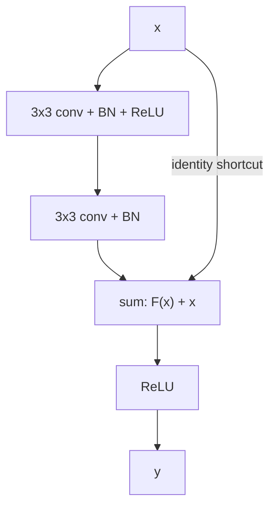
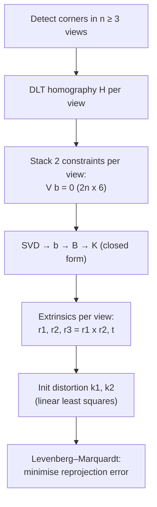
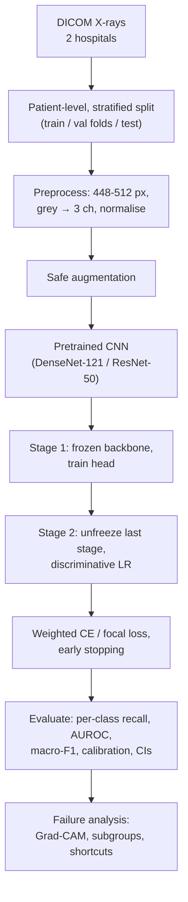
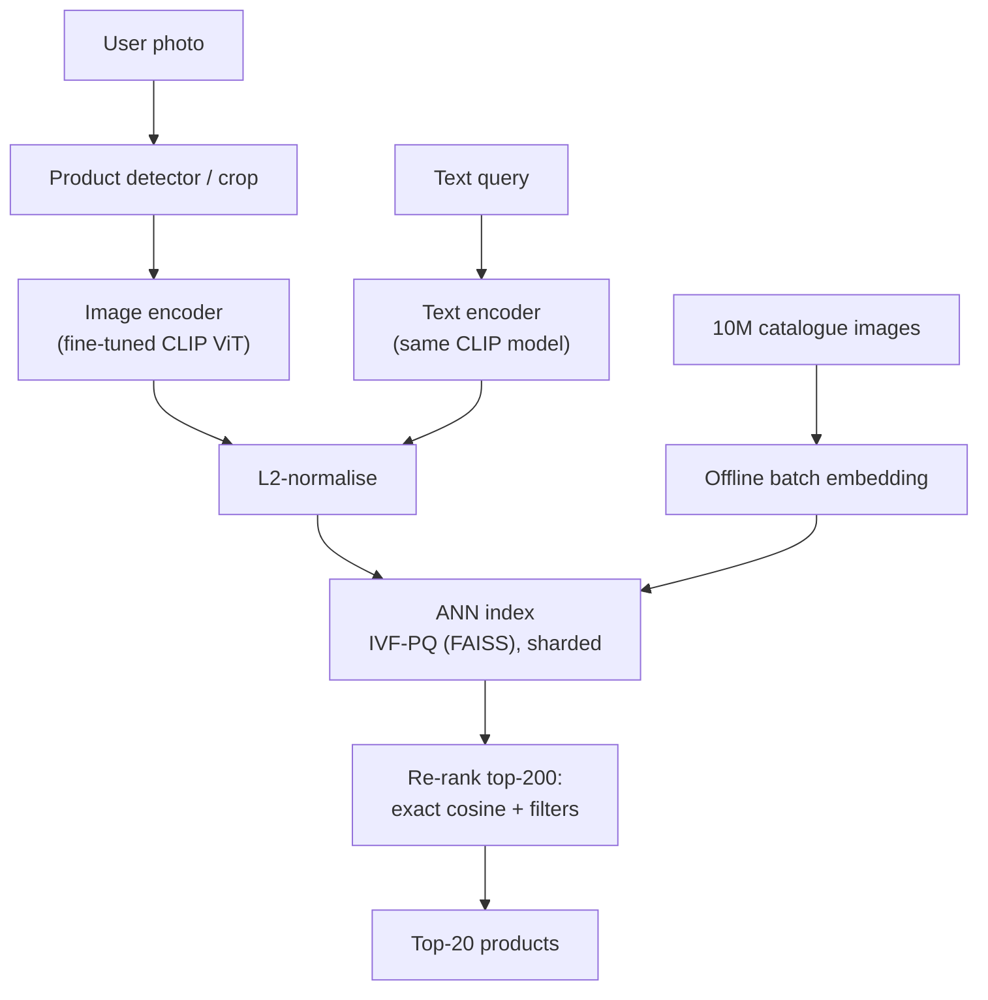

# Mock Exam 2 — Computer Vision · Solutions & Marking Scheme

> Paper: [mock_exam_2.md](mock_exam_2.md) · Formula sheet: [../00_formula_sheet.md](../00_formula_sheet.md) · Comparison tables: [../00_comparison_tables.md](../00_comparison_tables.md)
> **Marking:** A 20 + B 30 + C (5 of 6; if more are attempted, the first 5 in answer-book order) 20 + D (3 of 4; likewise the first 3) 30 = **100**. Half marks are allowed in B–D.

Conventions as on the paper: $x$ = column, $y$ = row (down); filtering = cross-correlation; boxes $(x_1,y_1,x_2,y_2)$ with area $(x_2-x_1)(y_2-y_1)$, **no +1**; natural logs.

---

## Section A — MCQs (1 mark each)

**Answer key**

| Q | A1 | A2 | A3 | A4 | A5 | A6 | A7 | A8 | A9 | A10 |
|---|---|---|---|---|---|---|---|---|---|---|
| Answer | C | A | D | B | C | A | D | B | C | A |
| Session | S1 | S1 | S2 | S2 | S3 | S4 | S4 | S5 | S6 | S6 |

| Q | A11 | A12 | A13 | A14 | A15 | A16 | A17 | A18 | A19 | A20 |
|---|---|---|---|---|---|---|---|---|---|---|
| Answer | B | D | C | D | A | B | C | D | A | B |
| Session | S7 | S8 | S8 | S10 | S11 | S12 | S12 | S13 | S14 | S15 |

### A1 — Answer: **C** · S1 · [notes 01](../notes/01_image_processing_features.md)
**Why C:** ORB = FAST-9 keypoints (Harris-ranked, image pyramid) + rBRIEF: 256 binary intensity tests = 32 bytes. Matching is a Hamming distance (XOR + popcount), which is far cheaper than the 128-float L2 distance of SIFT — this is what makes ORB the default in real-time SLAM (e.g. ORB-SLAM).
- **A** ✗ — DoG extrema are SIFT's detector; ORB gets only approximate scale handling from its pyramid.
- **B** ✗ — 128-d float descriptors are SIFT; ORB is binary (256 bits).
- **D** ✗ — neither is fully affine/perspective-invariant; both degrade under large viewpoint change.

### A2 — Answer: **A** · S1 · [notes 01](../notes/01_image_processing_features.md)
**Why A:** Lowe keeps a keypoint only if $\frac{\operatorname{tr}(H)^2}{\det H}<\frac{(r+1)^2}{r}=\frac{121}{10}=12.1$. Here $400/25=16>12.1$ → rejected. Solving $(\rho+1)^2/\rho=16$ gives a curvature ratio $\rho\approx13.9>10$: strong curvature across, weak along → an edge, poorly localised along its length.
- **B** ✗ — $\det H>0$ is necessary (same-sign curvatures), but the ratio test is the edge test.
- **C** ✗ — the threshold is $(r+1)^2/r$, not $(r+1)^2$ (missing the division by $r$).
- **D** ✗ — low contrast is tested separately with $\lvert D(\hat x)\rvert<0.03$; comparing tr with det has no meaning.

### A3 — Answer: **D** · S2 · [notes 02](../notes/02_feature_matching_classical.md)
**Why D:** $N=\left\lceil\frac{\log(1-0.99)}{\log(1-0.5^4)}\right\rceil=\left\lceil\frac{-4.6052}{-0.06454}\right\rceil=\lceil71.36\rceil=72$ (homography: $s=4$).
- **A** ✗ — 17 is the line case ($s=2$: 16.01 → 17).
- **B** ✗ — 35 is the affine case ($s=3$: 34.49 → 35).
- **C** ✗ — 71 rounds **down**; RANSAC iteration counts are always rounded **up**.

### A4 — Answer: **B** · S2 · [notes 02](../notes/02_feature_matching_classical.md) · [notes 11](../notes/11_camera_geometry.md)
**Why B:** $H$ maps two views exactly only for a **planar scene** or **pure rotation** ($H=KRK^{-1}$). A 1 m translation creates parallax that depends on depth: the far façades are almost a plane at "infinity", so one $H$ fits them, but the near cars shift by a different amount → ghosting.
- **A** ✗ — the façades align perfectly, so $H$ is correct for the dominant plane; more iterations cannot fit two depths with one $H$.
- **C** ✗ — lens distortion depends on image position, not on object depth.
- **D** ✗ — missing matches on the cars would not create doubled cars; the geometry model is the problem.

### A5 — Answer: **C** · S3 · [notes 03](../notes/03_cnns_under_the_hood.md)
**Why C:** conv: $\lfloor(224-7+6)/2\rfloor+1=111+1=112$; pool: $\lfloor(112-3+2)/2\rfloor+1=55+1=56$.
- **A** ✗ — 55 forgets the pool padding: $\lfloor(112-3)/2\rfloor+1=55$.
- **B** ✗ — 112 is the size after the conv only.
- **D** ✗ — off-by-one (adding 1 twice or ceiling instead of floor).

### A6 — Answer: **A** · S4 · [notes 04](../notes/04_training_transfer_learning.md)
**Why A:** The symptoms (train ≫ val, rising val loss) are **overfitting**. More capacity and more epochs make it worse.
- **B** ✗ — early stopping directly targets the rising validation loss.
- **C** ✗ — augmentation enlarges the effective training set → helps.
- **D** ✗ — weight decay and dropout are standard regularisers → help.

### A7 — Answer: **D** · S4 · [notes 04](../notes/04_training_transfer_learning.md)
**Why D:** A random head produces large, noisy gradients that would wreck pretrained features; so train the head first (backbone frozen), then fine-tune the backbone with a **smaller (discriminative) learning rate** than the head.
- **A** ✗ — a large LR destroys the pretrained features (catastrophic forgetting) — the whole point of transfer is to start near a good solution.
- **B** ✗ — backwards: the head is the part that *must* be trained.
- **C** ✗ — Adam is adaptive per parameter but still very sensitive to the base learning rate.

### A8 — Answer: **B** · S5 · [notes 05](../notes/05_embeddings_similarity.md)
**Why B:** $y=0$ → $\mathcal L=\max(0,m-d)^2=\max(0,1.0-0.4)^2=0.6^2=0.36$. The pair is closer than the margin, so it is pushed apart.
- **A** ✗ — it is the other way round: dissimilar pairs stop contributing once $d\ge m$.
- **C** ✗ — $0.16=d^2$ is the similar-pair term.
- **D** ✗ — forgets to square the hinge.

### A9 — Answer: **C** · S6 · [notes 06](../notes/06_detection_two_stage.md)
**Why C:** Gradient magnitudes scale with local contrast; normalising each $2\times2$-cell block (L2-Hys) makes the descriptor robust to illumination/contrast changes and shadows. Overlapping blocks mean each cell is normalised in several contexts — Dalal & Triggs found this important for accuracy.
- **A** ✗ — overlap *increases* the length (each cell appears in up to 4 blocks).
- **B** ✗ — HOG is not rotation-invariant (upright pedestrians assumed).
- **D** ✗ — scale is handled by the image pyramid, not by normalisation.

### A10 — Answer: **A** · S6/S7 · [notes 06](../notes/06_detection_two_stage.md) · [notes 07](../notes/07_detection_one_stage.md)
**Why A:** The RPN + NMS filter tens of thousands of anchors (≈20k for a 1000×600 image in Faster R-CNN) down to ~1–2k proposals, removing most *easy* negatives, and the RoI head samples mini-batches with a fixed foreground fraction (25%, i.e. 1:3). One-stage detectors classify all ~$10^4$–$10^5$ candidates densely, so easy negatives dominate the loss — hence focal loss $FL=-\alpha_t(1-p_t)^\gamma\log p_t$.
- **B** ✗ — backbone depth has nothing to do with sample imbalance.
- **C** ✗ — softmax cross-entropy is just as affected by imbalance.
- **D** ✗ — NMS acts on final detections / proposals at inference; it does not rebalance the training loss.

### A11 — Answer: **B** · S7 · [notes 07](../notes/07_detection_one_stage.md)
**Why B:** YOLOv1: $S\times S\times(5B+C)=7\times7\times(10+80)=7\times7\times90$ (each box: $x,y,w,h$, confidence; class probabilities are shared per cell).
- **A** ✗ — $B(5+C)=170$ is the per-box class layout of anchor-based YOLOv2+, not YOLOv1.
- **C** ✗ — $4+C$ omits confidence and the second box.
- **D** ✗ — 30 is for VOC ($C=20$).

### A12 — Answer: **D** · S8 · [notes 08](../notes/08_detection_transformers.md#matching-cost)
**Why D:** Matching is a training-time device that defines which query is supervised by which GT (others → $\varnothing$). At inference DETR outputs $N$ (class, box) pairs and you keep those with confidence above a threshold — no matching and no NMS.
- **A** ✗ — there are no GT boxes at inference to match against.
- **B** ✗ — that is many-to-one IoU-threshold assignment (anchor-based detectors); DETR is **one-to-one**.
- **C** ✗ — the original DETR matching cost uses $-\hat p(c)$ (probabilities); the loss uses $-\log\hat p(c)$.

### A13 — Answer: **C** · S8 · [notes 08](../notes/08_detection_transformers.md)
**Why C:** Each of the $N$ queries outputs exactly one (class, box) prediction, so $N$ is a hard upper bound on detections per image. For dense scenes $N$ must be increased (and the model retrained), e.g. $N=300$–$900$ in later DETR variants.
- **A** ✗ — $N$ is fixed by the learned query embeddings.
- **B** ✗ — one query → one box.
- **D** ✗ — DETR uses no NMS, and NMS removes boxes, it never splits them.

### A14 — Answer: **D** · S10 · [notes 10](../notes/10_image_segmentation.md)
**Why D:** $\text{Dice}=\frac{2\,\text{IoU}}{1+\text{IoU}}=\frac{1.2}{1.6}=0.75$ (Dice ≥ IoU always).
- **A** ✗ — $0.6/1.6$ forgets the factor 2.
- **B** ✗ — Dice equals IoU only at 0 or 1.
- **C** ✗ — $0.6/(2-0.6)=0.43$ applies the inverse formula (Dice → IoU).

### A15 — Answer: **A** · S11 · [notes 11](../notes/11_camera_geometry.md)
**Why A:** The centre satisfies $R\mathbf C+\mathbf t=\mathbf 0$ → $\mathbf C=-R^\top\mathbf t$. $R^\top\mathbf t=\begin{bmatrix}0&1&0\\-1&0&0\\0&0&1\end{bmatrix}\begin{bmatrix}2\\0\\4\end{bmatrix}=\begin{bmatrix}0\\-2\\4\end{bmatrix}$ → $\mathbf C=(0,\ 2,\ -4)$ m. Check: $R\mathbf C+\mathbf t=(-2,0,-4)+(2,0,4)=\mathbf 0$ ✔.
- **B** ✗ — $-\mathbf t$ is correct only when $R=I$.
- **C** ✗ — $R^\top\mathbf t$ (sign missing).
- **D** ✗ — $-R\mathbf t$ uses $R$ instead of $R^\top$.

### A16 — Answer: **B** · S12 · [notes 12](../notes/12_3d_vision_motion.md)
**Why B:** On a straight edge all gradients are parallel, so $M=\sum\nabla I\,\nabla I^\top$ has one large and one ≈0 eigenvalue; $I_xu+I_yv+I_t=0$ only constrains the flow along the gradient (normal flow). Motion along the edge is invisible — the **aperture problem**.
- **A** ✗ — the system is singular / ill-conditioned for an edge.
- **C** ✗ — it is the *tangential* component that is lost.
- **D** ✗ — brightness constancy can hold perfectly; the issue is too few independent constraints.

### A17 — Answer: **C** · S12 · [notes 12](../notes/12_3d_vision_motion.md)
**Why C:** With known $K$, images determine structure and motion up to a global **similarity**: rotation (3) + translation (3) + **scale** (1) = 7 DOF. Scaling the whole world and all translations by $s$ produces identical images.
- **A** ✗ — a projective ambiguity applies to *uncalibrated* cameras; calibration upgrades it to similarity.
- **B** ✗ — $K$ fixes angles, not absolute size.
- **D** ✗ — the global frame (rotation *and* translation) and the scale are all free.

### A18 — Answer: **D** · S13 · [notes 13](../notes/13_vision_foundation_models.md)
**Why D:** SAM is promptable and **class-agnostic**; for an ambiguous point (part / object / whole) it returns 3 masks with predicted IoU scores.
- **A** ✗ — SA-1B (11M images, 1.1B masks) has **no class labels**.
- **B** ✗ — reversed: the heavy MAE-pretrained ViT-H encoder runs once per image; the light mask decoder runs per prompt.
- **C** ✗ — the released model takes points, boxes and masks; it outputs masks, not captions.

### A19 — Answer: **A** · S14 · [notes 14](../notes/14_vision_plus_plus.md)
**Why A:** "Grounded-SAM": Grounding DINO grounds the phrase into boxes (open-vocabulary detection); SAM converts each box prompt into a mask.
- **B** ✗ — SAM produces no labels.
- **C** ✗ — the "DINO" in Grounding DINO is the DETR-style **detector** (DETR with Improved deNoising anchOr boxes), not self-supervised DINO.
- **D** ✗ — SAM has no text understanding in its released form.

### A20 — Answer: **B** · S15 · [notes 15](../notes/15_generative_cv.md)
**Why B:** $\sqrt{0.36}=0.6$, $\sqrt{1-0.36}=\sqrt{0.64}=0.8$ → $x_t=0.6x_0+0.8\epsilon$ (variance preserved: $0.6^2+0.8^2=1$).
- **A** ✗ — forgets the square roots.
- **C** ✗ — uses $1-\sqrt{\bar\alpha_t}$ for the noise coefficient.
- **D** ✗ — swaps the coefficients.

---

## Section B — Numericals (5 marks each)

### B1 — Sobel gradient and Harris response · S1 · [notes 01 — Harris corners](../notes/01_image_processing_features.md#harris-corners)

**Given:** $N=\begin{bmatrix}30&40&80\\30&60&120\\40&90&140\end{bmatrix}$, Sobel $K_x,K_y$ as cross-correlation, $y$ down; $k=0.04$.

**Formula:**

$$
I_x=\sum_{i,j}K_x(i,j)\,N(i,j),\qquad I_y=\sum_{i,j}K_y(i,j)\,N(i,j),\qquad R=\det M-k(\operatorname{tr}M)^2,\qquad \lambda_{1,2}=\frac{\operatorname{tr}M}{2}\pm\sqrt{\left(\frac{a-c}{2}\right)^2+b^2}
$$

for $M=\begin{bmatrix}a&b\\b&c\end{bmatrix}$.

**Working**

**(a)** $I_x$ = (right column − left column), middle row doubled:
$I_x=(80-30)+2(120-30)+(140-40)=50+180+100=\mathbf{330}$.
$I_y$ = (bottom row − top row), middle column doubled:
$I_y=(40-30)+2(90-40)+(140-80)=10+100+60=\mathbf{170}$.

**(b)** $\lVert\nabla I\rVert=\sqrt{330^2+170^2}=\sqrt{108{,}900+28{,}900}=\sqrt{137{,}800}=\mathbf{371.2}$ (L1 version: $330+170=500$).
$\theta=\operatorname{atan2}(170,330)=\mathbf{27.26^\circ}$ — the gradient points right and slightly down (towards the bright bottom-right corner, 140).
The edge runs **perpendicular** to the gradient: $27.26^\circ+90^\circ=\mathbf{117.26^\circ}$ (≡ $-62.74^\circ$), i.e. from the top-right of the window towards the bottom-left.

**(c)**

| | $\det M$ | $\operatorname{tr}M$ | $k(\operatorname{tr}M)^2$ | $R$ |
|---|---|---|---|---|
| $M_1$ | $900\cdot400-300^2=270{,}000$ | 1300 | 67,600 | **202,400** |
| $M_2$ | $1200\cdot100-340^2=4{,}400$ | 1300 | 67,600 | **−63,200** |
| $M_3$ | $12\cdot9-2^2=104$ | 21 | 17.64 | **86.36** |

**(d)**

| | $\sqrt{(a-c)^2+4b^2}$ | $\lambda_1$ | $\lambda_2$ | $\lambda_1/\lambda_2$ | Class (R rule) | Eigenvalue view |
|---|---|---|---|---|---|---|
| $M_1$ | $\sqrt{500^2+600^2}=781.0$ | 1040.5 | 259.5 | 4.0 | **corner** ($R>10^4$) | both large ✔ |
| $M_2$ | $\sqrt{1100^2+680^2}=1293.2$ | 1296.6 | 3.39 | 382 | **edge** ($R<0$) | one large, one ≈0 ✔ |
| $M_3$ | $\sqrt{3^2+4^2}=5$ | 13 | 8 | 1.6 | **flat** ($0<R<10^4$) | both small ✔ |

(Check: $\lambda_1\lambda_2=\det M$ and $\lambda_1+\lambda_2=\operatorname{tr}M$, e.g. $1040.5\times259.5=270{,}000$.)

**Comment:** $M_1$ and $M_2$ have the **same trace** (same total gradient energy, $\lambda_1+\lambda_2=1300$), yet one is a corner and the other an edge. Harris rewards energy in **both** directions through $\det M=\lambda_1\lambda_2$; the $-k(\operatorname{tr}M)^2$ term penalises energy concentrated in one direction.

**Answer:** **$I_x=330$, $I_y=170$, $\lVert\nabla I\rVert=371.2$, $\theta=27.3^\circ$ (edge at $117.3^\circ$); $R_1=202{,}400$ corner, $R_2=-63{,}200$ edge, $R_3=86.36$ flat.**

> ✔ Verified numerically (Python).
> **Common slip:** using convolution (flipped kernel) — that flips the signs of $I_x,I_y$ and puts $\theta$ in the opposite direction. Another: computing $\operatorname{tr}M^2$ instead of $(\operatorname{tr}M)^2$.

**Mark allocation:** (a) 0.75 $I_x$ + 0.75 $I_y$ · (b) 0.5 magnitude + 0.25 $\theta$ + 0.25 edge direction · (c) 0.5 per matrix · (d) 0.25 per matrix (eigenvalues + class) + 0.25 same-trace comment.

---

### B2 — IoU, greedy NMS, anchor encoding · S6/S7 · [notes 07](../notes/07_detection_one_stage.md) · [notes 06](../notes/06_detection_two_stage.md) · [code](../code/iou_nms_ap.py)

**Given:** six same-class boxes (table on the paper), all of area $100\times100=10{,}000$ except $B_3,B_5$ ($80\times80=6{,}400$). Suppress if IoU **> threshold**. Box convention: no +1.

**Formula:**

$$
\text{IoU}=\frac{\lvert A\cap B\rvert}{\lvert A\rvert+\lvert B\rvert-\lvert A\cap B\rvert},\quad \lvert A\cap B\rvert=\max(0,\min(x_2)-\max(x_1))\cdot\max(0,\min(y_2)-\max(y_1))
$$

$$
t_x=\frac{x-x_a}{w_a},\quad t_y=\frac{y-y_a}{h_a},\quad t_w=\log\frac{w}{w_a},\quad t_h=\log\frac{h}{h_a}
$$

**Working**

**(a)**
- $B_1\cap B_2$: $x\in[110,200]$ → 90, $y\in[110,200]$ → 90 → $8{,}100$; union $=20{,}000-8{,}100=11{,}900$ → IoU $=\mathbf{0.6807}$.
- $B_1\cap B_4$: $x\in[140,200]$ → 60, $y\in[100,200]$ → 100 → $6{,}000$; union $=14{,}000$ → IoU $=\mathbf{0.4286}$.

**(b)** Scores are already sorted: $B_1>B_2>B_3>B_4>B_5>B_6$.

| Step | Keep | Compare with remaining | IoU | Action |
|---|---|---|---|---|
| 1 | $B_1$ (0.95) | $B_2$ | 0.6807 | suppress (> 0.5) |
| | | $B_3$, $B_5$ | 0 (no overlap) | stay |
| | | $B_4$ | 0.4286 | stay |
| | | $B_6$: $x\in[150,200]$ → 50, $y\in[110,200]$ → 90 → 4,500; union 15,500 | 0.2903 | stay |
| 2 | $B_3$ (0.85) | $B_4$, $B_6$ | 0 | stay |
| | | $B_5$: $x\in[310,380]$ → 70, $y\in[300,370]$ → 70 → 4,900; union $6{,}400\cdot2-4{,}900=7{,}900$ | 0.6203 | suppress |
| 3 | $B_4$ (0.80) | $B_6$: $x\in[150,240]$ → 90, $y\in[110,200]$ → 90 → 8,100; union 11,900 | 0.6807 | suppress |

**Kept at 0.5: $\{B_1, B_3, B_4\}$** — three objects (two overlapping objects on the left, one on the right). Note that IoU($B_2,B_4$) = 0.46 is never needed: $B_2$ was already removed.

**(c)** Threshold 0.4: step 1 keeps $B_1$ and now also suppresses $B_4$ (0.4286 > 0.4); $B_6$ (0.2903) stays. Step 2 keeps $B_3$, suppresses $B_5$. Step 3 keeps $B_6$.
**Kept at 0.4: $\{B_1, B_3, B_6\}$.** Lowering the threshold did **not** simply give a subset: $B_4$ disappeared, so $B_6$, which only $B_4$ had suppressed, survived. Greedy NMS is sequential, and the second (overlapping) object is now represented by a lower-scoring, worse box. In crowded scenes a low threshold therefore removes true neighbouring objects.

**(d)** Anchor $A=(96,96,224,160)$: $w_a=128$, $h_a=64$, centre $(x_a,y_a)=(160,128)$.
GT $G=(104,92,240,164)$: $w=136$, $h=72$, centre $(x,y)=(172,128)$.
$A\cap G$: $x\in[104,224]$ → 120, $y\in[96,160]$ → 64 → $7{,}680$; $\lvert A\rvert=8{,}192$, $\lvert G\rvert=9{,}792$; union $=10{,}304$ → IoU $=\mathbf{0.7453}>0.7$ → **positive anchor**.

$$
t_x=\frac{172-160}{128}=\mathbf{0.0938},\quad t_y=\frac{128-128}{64}=\mathbf{0},\quad t_w=\ln\frac{136}{128}=\ln1.0625=\mathbf{0.0606},\quad t_h=\ln\frac{72}{64}=\ln1.125=\mathbf{0.1178}
$$

(Decoding these targets returns exactly $(104,92,240,164)$ ✔.)

**Answer:** **IoU = 0.6807 and 0.4286; NMS@0.5 keeps $B_1,B_3,B_4$; NMS@0.4 keeps $B_1,B_3,B_6$; anchor IoU 0.7453 (positive), $t=(0.0938,\ 0,\ 0.0606,\ 0.1178)$.**

> ✔ Verified numerically (Python).
> **Common slip:** comparing later boxes with *suppressed* boxes (e.g. using $B_2$ to suppress $B_4$) — only **kept** boxes suppress. Another: encoding with corner coordinates instead of centre–size.

**Mark allocation:** (a) 0.5 + 0.5 · (b) 0.5 per step (×3) + 0.5 final set · (c) 0.25 set + 0.25 comment · (d) 0.5 IoU + label, 0.25 centre–size conversion, 0.75 for the four targets.

---

### B3 — Stereo depth, depth resolution, baseline design, Lucas–Kanade · S12 · [notes 12](../notes/12_3d_vision_motion.md) · [code](../code/stereo_depth_and_projection.py)

**Given:** $f=700$ px, $B=0.12$ m → $fB=84$ px·m. LK sums as stated.

**Formula:**

$$
Z=\frac{fB}{d},\qquad \Delta Z\approx\frac{Z^2}{fB}\,\Delta d\ \Rightarrow\ B\ge\frac{Z^2\,\Delta d}{f\,\Delta Z},\qquad
\begin{bmatrix}\sum I_x^2&\sum I_xI_y\\\sum I_xI_y&\sum I_y^2\end{bmatrix}\begin{bmatrix}u\\v\end{bmatrix}=-\begin{bmatrix}\sum I_xI_t\\\sum I_yI_t\end{bmatrix}
$$

**Working**

**(a)** $Z_1=84/42=\mathbf{2.00}$ m; $Z_2=84/7=\mathbf{12.0}$ m.

**(b)** Far point: $\Delta Z\approx\frac{12^2}{84}\times1=\frac{144}{84}=\mathbf{1.714}$ m.
Exact: $d=6$ → $Z=14.0$ m (+2.0 m); $d=8$ → $Z=10.5$ m (−1.5 m). The error is **asymmetric** (larger away from the camera); the linear approximation (1.71 m) sits between the two.
Near point: $\Delta Z\approx\frac{2^2}{84}=\mathbf{0.0476}$ m ≈ 4.8 cm — 36× smaller ($=(12/2)^2$): depth error grows **quadratically** with distance.

**(c)** $B\ge\frac{12^2\times0.25}{700\times0.20}=\frac{36}{140}=0.2571$ m → choose $B\approx\mathbf{0.26}$ m (round **up**, otherwise the target is missed).
Disparity at 12 m: $d=\frac{fB}{Z}=\frac{700\times0.2571}{12}=\mathbf{15.0}$ px.
(Trade-off: a wider baseline gives more occlusions and larger disparities for near objects, so the disparity search range must grow.)

**(d)** Normal equations:

$$
\begin{bmatrix}40&10\\10&20\end{bmatrix}\begin{bmatrix}u\\v\end{bmatrix}=\begin{bmatrix}60\\50\end{bmatrix},\qquad \det=40\cdot20-10^2=700
$$

$u=\frac{20\cdot60-10\cdot50}{700}=\frac{700}{700}=\mathbf{1.0}$ px/frame, $v=\frac{40\cdot50-10\cdot60}{700}=\frac{1400}{700}=\mathbf{2.0}$ px/frame (1 px right, 2 px down).
Eigenvalues of the matrix: 44.1 and 15.9 — both clearly non-zero → well-conditioned (a "good feature to track").

**(e)** $\det=40\cdot10-20^2=0$ → the matrix is singular (eigenvalues 50 and 0). All gradients in the window are parallel to $(2,1)$ ($I_x=2I_y$ everywhere): the window sees a straight **edge**. Only the **normal flow** (component along $(2,1)/\sqrt5$) is recoverable; motion along the edge is unconstrained — the **aperture problem**. Remedies: track corners (Shi–Tomasi $\min(\lambda_1,\lambda_2)$ large), use a larger window / pyramid, or add a smoothness prior (Horn–Schunck).

**Answer:** **$Z=2.00$ m and 12.0 m; $\Delta Z\approx1.71$ m at 12 m (exact +2.0/−1.5 m) vs 4.8 cm at 2 m; $B\ge0.257$ m (use 0.26 m, $d=15$ px); $(u,v)=(1,2)$ px/frame; second window is singular → aperture problem.**

> ✔ Verified numerically (Python).
> **Common slip:** forgetting the minus sign on the right-hand side of the LK equations (gives $(u,v)=(-1,-2)$).

**Mark allocation:** (a) 0.5 + 0.5 · (b) 0.5 approximation + 0.25 exact bounds + 0.25 near point · (c) 0.75 baseline + 0.25 disparity · (d) 0.5 correct system + 1.0 solution · (e) 0.5 (singular + aperture + what is recoverable).

---

### B4 — CLIP zero-shot probabilities and InfoNCE · S13/S5 · [notes 13](../notes/13_vision_foundation_models.md) · [notes 05](../notes/05_embeddings_similarity.md)

**Given:** cosines (dog, fox, cat, car) = (0.31, 0.29, 0.28, 0.12); logit scale 100; row 1 of $S$ = (0.70, 0.62, 0.35, 0.10), $\tau=0.07$.

**Formula:**

$$
p_c=\frac{\exp(100\cos_c)}{\sum_{c'}\exp(100\cos_{c'})},\qquad
\mathcal L_1=-\log\frac{\exp(S_{11}/\tau)}{\sum_{j=1}^{4}\exp(S_{1j}/\tau)}=\log\sum_{j}\exp\!\left(\frac{S_{1j}-S_{11}}{\tau}\right)
$$

**Working**

**(a)** Logits $=100\cos$: (31, 29, 28, 12). Subtract the max (31): (0, −2, −3, −19).
$e^{0}=1$, $e^{-2}=0.135335$, $e^{-3}=0.049787$, $e^{-19}=5.6\times10^{-9}$; sum $=1.185122$.

| Prompt | logit | $p$ |
|---|---|---|
| dog | 31 | $1/1.185122=\mathbf{0.8438}$ |
| fox | 29 | $0.135335/1.185122=\mathbf{0.1142}$ |
| cat | 28 | $0.049787/1.185122=\mathbf{0.0420}$ |
| car | 12 | $\approx\mathbf{4.7\times10^{-9}}$ |

**Prediction: dog** (84.4%).

**(b)** Scale 1: logits (0.31, 0.29, 0.28, 0.12) → $p=(0.2647,\ 0.2595,\ 0.2569,\ 0.2189)$ — almost uniform. The argmax is unchanged, but CLIP's cosine similarities lie in a narrow band, so without a large learned scale ($1/\tau\approx100$) the softmax is nearly flat: the contrastive training signal would be weak and the probabilities meaningless. The learned temperature sharpens the distribution.

**(c)** $z_j=S_{1j}/0.07=(10.0000,\ 8.8571,\ 5.0000,\ 1.4286)$. Differences from the positive: $(0,\ -1.1429,\ -5.0000,\ -8.5714)$.
$e^{-1.1429}=0.318907$, $e^{-5}=0.006738$, $e^{-8.5714}=0.000189$.
$\sum=1+0.318907+0.006738+0.000189=1.325834$.
$\mathcal L_1=\ln1.325834=\mathbf{0.2820}$ (softmax probability of the correct caption $=1/1.325834=0.7542$; for comparison, chance level would be $\ln4=1.386$).

**(d)** $\frac{\partial\mathcal L_1}{\partial S_{1j}}=\frac{p_j}{\tau}$ for each negative $j$, with $p=(0.7542,\ 0.2405,\ 0.0051,\ 0.0001)$. **Caption 2** ($S_{12}=0.62$, the **hard negative**) carries ≈98% of the negative-side gradient (0.2405 of 0.2458); the easy negatives (0.35, 0.10) contribute almost nothing — a low $\tau$ focuses learning on hard negatives.
The text→image loss for caption 1 uses **column 1**: $S_{11}=0.70$ (positive), $S_{21}=0.58$, $S_{31}=0.30$, $S_{41}=0.12$ (giving 0.1686). CLIP's loss is the average of the image→text (rows) and text→image (columns) cross-entropies.

**Answer:** **$p$ = (0.844, 0.114, 0.042, ≈5×10⁻⁹) → dog; with scale 1 ≈ uniform (0.265, 0.259, 0.257, 0.219); $\mathcal L_1=0.282$; caption 2 (hard negative) dominates the gradient.**

> ✔ Verified numerically (Python).
> **Common slip:** leaving the positive term out of the denominator, or using $\log_{10}$.

**Mark allocation:** (a) 0.5 logits + 1.0 probabilities + 0.5 prediction · (b) 0.25 probabilities + 0.25 explanation · (c) 0.5 scaled logits + 1.0 sum of exponentials + 0.5 loss · (d) 0.25 hard negative + 0.25 column.

---

### B5 — Trainable parameters and confusion-matrix metrics · S4 (S9 practical) · [notes 04](../notes/04_training_transfer_learning.md) · [code](../code/transfer_learning_skeleton.py)

**Given:** ResNet-18, new head GAP → FC 512→3 (bias), total 11,178,051 params; `layer4` shapes; confusion matrix (rows = true).

**Formula:** conv params $=K_hK_wC_{in}C_{out}$ (no bias); BN $=2C$; FC $=C_{in}C_{out}+C_{out}$.

$$
P_c=\frac{TP_c}{\text{column sum}_c},\quad R_c=\frac{TP_c}{\text{row sum}_c},\quad F1_c=\frac{2P_cR_c}{P_c+R_c},\quad \text{macro-}X=\frac13\sum_c X_c
$$

**Working**

**(a)** Feature extraction: only the head trains: $512\times3+3=\mathbf{1{,}539}$ parameters.

**(b)** `layer4`:

| Layer | Params |
|---|---|
| conv $3\times3$, 256→512 | $9\times256\times512=1{,}179{,}648$ |
| 3 × conv $3\times3$, 512→512 | $3\times(9\times512\times512)=3\times2{,}359{,}296=7{,}077{,}888$ |
| downsample $1\times1$, 256→512 | $256\times512=131{,}072$ |
| 5 BN layers × 512 ch × 2 | $5{,}120$ |
| **layer4 total** | **8,393,728** |

Trainable with `layer4` unfrozen: $8{,}393{,}728+1{,}539=\mathbf{8{,}395{,}267}$, i.e. $8{,}395{,}267/11{,}178{,}051=\mathbf{75.1\%}$ of the network (≈5,455× more than feature extraction).
**Insight:** the last stage holds three-quarters of ResNet-18's weights, so "just unfreeze the last block" is a big step — on a small dataset use a low learning rate and early stopping.

**(c)** Column sums (predicted): OK 88, Scratch 40, Dent 22. Row sums (true): 90, 40, 20. $N=150$.

| Class | Precision | Recall | F1 |
|---|---|---|---|
| OK | $80/88=0.9091$ | $80/90=0.8889$ | 0.8989 |
| Scratch | $30/40=0.7500$ | $30/40=0.7500$ | 0.7500 |
| Dent | $13/22=0.5909$ | $13/20=0.6500$ | 0.6190 |
| **Macro** | **0.7500** | **0.7630** | **0.7560** |

Accuracy $=(80+30+13)/150=123/150=\mathbf{0.820}$.

**Comment:** accuracy (0.82) is inflated by the majority **OK** class (60% of the data); macro-F1 (0.756) weights every class equally and exposes the weak **Dent** class (F1 = 0.62). For inspection the costly error is a defect passed as OK: $5+3=8$ of 60 defective parts (defect recall 52/60 = 0.867). Report per-class recall and macro-F1, not accuracy alone.

**Answer:** **(a) 1,539; (b) 8,395,267 (75.1% of 11,178,051); (c) accuracy 0.820, macro-P 0.750, macro-R 0.763, macro-F1 0.756 (per-class F1 0.899 / 0.750 / 0.619).**

> ✔ Verified numerically (Python; parameter counts checked against `torchvision.models.resnet18`).
> **Common slip:** forgetting the 1×1 downsample conv or the BN parameters; swapping rows/columns when computing precision and recall.

**Mark allocation:** (a) 1 · (b) 0.5 convs + 0.25 BN + 0.5 total incl. head + 0.25 fraction · (c) 0.5 precisions + 0.5 recalls + 0.5 F1s + 0.25 accuracy + 0.5 macro averages + 0.25 comment.

---

### B6 — DETR Hungarian matching · S8 · [notes 08 — Matching cost](../notes/08_detection_transformers.md#matching-cost)

**Given:** class probabilities and L1 distances (table on the paper); $\mathcal C(q_i,g_j)=-\hat p_i(c_j)+5\,\Vert b_j-\hat b_i\Vert_1$; $w_\varnothing=0.1$.

**Formula:**

$$
\hat\sigma=\arg\min_{\sigma}\sum_{j}\mathcal C\big(q_{\sigma(j)},g_j\big),\qquad \mathcal L_{cls}(q_i)=-w_{c}\log\hat p_i(c),\ \ w_\varnothing=0.1
$$

**Working**

**(a)** Cost matrix (rows $q_1..q_3$, columns $g_1$ = cat, $g_2$ = dog):

| | $g_1$ (cat) | $g_2$ (dog) |
|---|---|---|
| $q_1$ | $-0.50+5(0.05)=\mathbf{-0.25}$ | $-0.10+5(0.16)=\mathbf{0.70}$ |
| $q_2$ | $-0.65+5(0.07)=\mathbf{-0.30}$ | $-0.30+5(0.10)=\mathbf{0.20}$ |
| $q_3$ | $-0.05+5(0.41)=\mathbf{2.00}$ | $-0.55+5(0.26)=\mathbf{0.75}$ |

**(b)** Pad the GT set with $\varnothing$: add one column with cost **0** for every query. In DETR's matching cost both terms are multiplied by $\mathbb 1_{\{c_i\neq\varnothing\}}$, so matching a query to "no object" costs nothing, and a constant column favours no query.

**(c)** Hungarian method on the padded matrix $\begin{bmatrix}-0.25&0.70&0\\-0.30&0.20&0\\2.00&0.75&0\end{bmatrix}$:
- Row reduction (row minima −0.25, −0.30, 0): $\begin{bmatrix}0&0.95&0.25\\0&0.50&0.30\\2.00&0.75&0\end{bmatrix}$.
- Column reduction (column minima 0, 0.50, 0): $\begin{bmatrix}0&0.45&0.25\\0&0&0.30\\2.00&0.25&0\end{bmatrix}$.
- Three independent zeros exist: $(q_1,g_1)$, $(q_2,g_2)$, $(q_3,\varnothing)$ → optimal. Lower bound = sum of reductions $=-0.25-0.30+0+0.50=-0.05$ = cost of this assignment ✔.

Check by enumerating all $3!=6$ assignments:

| $g_1$ ← | $g_2$ ← | $\varnothing$ ← | Total |
|---|---|---|---|
| $q_1$ | $q_2$ | $q_3$ | $-0.25+0.20=\mathbf{-0.05}$ ← min |
| $q_1$ | $q_3$ | $q_2$ | $-0.25+0.75=0.50$ |
| $q_2$ | $q_1$ | $q_3$ | $-0.30+0.70=0.40$ |
| $q_2$ | $q_3$ | $q_1$ | $-0.30+0.75=0.45$ |
| $q_3$ | $q_1$ | $q_2$ | $2.00+0.70=2.70$ |
| $q_3$ | $q_2$ | $q_1$ | $2.00+0.20=2.20$ |

**Optimal: $q_1\to$ cat, $q_2\to$ dog, $q_3\to\varnothing$; total cost $-0.05$.** $q_3$ is trained to predict "no object".

**(d)** Greedy: cheapest pair overall is $(q_2,g_1)=-0.30$; for the dog the remaining options are $q_1$ (0.70) and $q_3$ (0.75) → $(q_1,g_2)$. **Total $=0.40$** — far worse than $-0.05$. Committing $q_2$ to the cat (its locally best choice) forces the badly fitting $q_1$ onto the dog; the Hungarian algorithm optimises the **sum**.
Classification-loss terms under the optimal assignment:
- $q_1$ (cat): $-\ln0.50=\mathbf{0.693}$
- $q_2$ (dog): $-\ln0.30=\mathbf{1.204}$ — $q_2$ is pushed towards "dog" although it currently prefers "cat": the set loss is global.
- $q_3$ ($\varnothing$): $0.1\times(-\ln0.40)=0.1\times0.916=\mathbf{0.0916}$ (no box loss for $q_3$).

(Box L1 terms for the matched queries: $5\times0.05=0.25$ for $q_1$ and $5\times0.10=0.50$ for $q_2$; the full DETR loss also adds the GIoU term.)

**Answer:** **Cost matrix $\begin{bmatrix}-0.25&0.70\\-0.30&0.20\\2.00&0.75\end{bmatrix}$; optimal $q_1$→cat, $q_2$→dog, $q_3$→$\varnothing$, total −0.05; greedy gives 0.40; class losses 0.693, 1.204, 0.092.**

> ✔ Verified numerically (Python, `scipy.optimize.linear_sum_assignment`).
> **Common slip:** putting a large cost in the $\varnothing$ column (it must be constant, 0 by DETR's definition), or using $-\log\hat p$ in the matching cost instead of $-\hat p$.

**Mark allocation:** (a) 2 (≈ 0.33 per entry) · (b) 0.25 cost + 0.25 justification · (c) 0.75 method (reduction or enumeration) + 0.5 assignment and total + 0.25 $\varnothing$ query · (d) 0.5 greedy + total + 0.5 three loss terms.

---

## Section C — Short answers (4 marks each; best 5)

### C1 — Lowe's ratio test and cross-check matching · S2 · [notes 02](../notes/02_feature_matching_classical.md)

**(a) Lowe's ratio test.** For each descriptor $\mathbf a$ in image A find its nearest neighbour $\mathbf b_1$ and second-nearest $\mathbf b_2$ in B (distances $d_1\le d_2$; L2 for SIFT, Hamming for ORB). **Accept** $(\mathbf a,\mathbf b_1)$ only if

$$
\frac{d_1}{d_2}<\tau,\qquad \tau\approx0.7\text{–}0.8\ \ (\text{Lowe }0.8,\ \text{OpenCV tutorials }0.75).
$$

- **Why the second neighbour:** absolute descriptor distances vary greatly between features (texture, contrast, how distinctive the feature is), so one global threshold either rejects good matches of "weak" features or accepts bad matches of others. A correct match should be **much closer than the best incorrect candidate**, and $d_2$ estimates the distance of that best incorrect candidate. Lowe reported that $\tau=0.8$ removed about 90% of false matches while discarding under 5% of correct ones.
- **Removes:** **ambiguous** matches — repetitive texture (windows, tiles, identical doors) where two candidates are nearly equally close — and features with **no true counterpart** (occluded or outside the overlap), whose NN and second NN are both random and similar.

**(b) Cross-check (mutual nearest neighbour).** Match A→B and B→A; keep $(\mathbf a,\mathbf b)$ only if $\mathbf b=\mathrm{NN}_B(\mathbf a)$ **and** $\mathbf a=\mathrm{NN}_A(\mathbf b)$ (OpenCV `BFMatcher(crossCheck=True)`).
- **Removes:** **many-to-one** matches (several A features all snapping to the same "hub" descriptor in B) and asymmetric matches of features without a counterpart. Costs one extra NN pass.

| | Ratio test | Cross-check | RANSAC |
|---|---|---|---|
| Looks at | distinctiveness in B ($d_1/d_2$) | consistency in both directions | global geometry ($H$ / $F$ / $E$) |
| Removes | ambiguous / repeated-pattern matches | many-to-one, one-sided matches | geometrically inconsistent matches |

- **Survives both:** a match that is **unique, mutual and distinctive but geometrically wrong** — e.g. a different instance of a repeated structure when the true one is occluded, or a correct match on an independently moving object. Such matches are removed by **geometric verification**: fit a homography / fundamental matrix with **RANSAC** and keep only inliers (reprojection or Sampson error below a few pixels).

**Marking scheme:** 1 – ratio rule + threshold · 1 – why the 2nd NN + what it removes · 1 – cross-check definition + what it removes · 1 – what survives both + RANSAC.

---

### C2 — ResNet: degradation and identity shortcuts · S3 · [notes 03 — ResNet intuition](../notes/03_cnns_under_the_hood.md#resnet-intuition)

**(a) Degradation problem.** When plain (non-residual) CNNs are made deeper, accuracy saturates and then gets **worse — on the training set too**: in the ResNet paper a 56-layer plain net had higher **training** error than a 20-layer one, even with BatchNorm.
- **Not overfitting:** overfitting means low training error and high test error; here the training error itself rises.
- **Not a capacity problem:** a deeper net could copy the shallow net and set the extra layers to the **identity**, so a solution at least as good exists. SGD simply fails to find it → an **optimisation** difficulty.

**(b) Why $\mathbf y=F(\mathbf x)+\mathbf x$ fixes it.**

- **Optimisation view (residual learning):** the block learns the **residual** $F(\mathbf x)=H(\mathbf x)-\mathbf x$ instead of the full mapping $H$. If the identity (or something close to it) is optimal, it is easy to drive $F\to0$ (weights towards zero), whereas fitting an exact identity through a stack of conv + BN + ReLU layers is hard. An added block's default is "do nothing", so extra depth cannot make the network worse to begin with; each block learns a small refinement.
- **Gradient-flow view:** with identity shortcuts, $\mathbf x_L=\mathbf x_l+\sum_{i=l}^{L-1}F(\mathbf x_i)$, so

$$
\frac{\partial\mathcal L}{\partial\mathbf x_l}=\frac{\partial\mathcal L}{\partial\mathbf x_L}\left(1+\frac{\partial}{\partial\mathbf x_l}\sum_{i=l}^{L-1}F(\mathbf x_i)\right).
$$

  The "**1**" term carries the gradient from any deep layer straight to any shallow layer without passing through weight matrices, so it cannot vanish through a long product of Jacobians as in a plain net. The forward signal also propagates unchanged along the shortcut. (The equation is exact when nothing sits on the shortcut path after the addition, as in pre-activation ResNets; with the original post-addition ReLU it holds approximately.)
- **Details:** when the shape changes, use a **projection shortcut** ($1\times1$ conv, stride 2). Deep variants use **bottleneck** blocks ($1\times1\to3\times3\to1\times1$). The result: ResNet-50 (≈25.6M params) and ResNet-152 train well, and ResNets of over 1,000 layers have been trained on CIFAR.

**Marking scheme:** 1 – degradation defined (training error) · 0.5 – why not overfitting / capacity · 1.25 – residual-learning (optimisation) argument · 1.25 – gradient equation and the "1" term.

---

### C3 — RoIAlign vs RoI Pool · S6/S10 · [notes 06](../notes/06_detection_two_stage.md) · [notes 10](../notes/10_image_segmentation.md)

**(a) RoI Pool's two quantisations.**
1. **RoI boundary → feature grid:** image coordinates are divided by the stride (16) and **rounded** to whole cells. Example: $x_1=56$ px → $56/16=3.5$ → 4 → back-projects to 64 px: an **8 px** shift. With rounding the boundary moves by up to half a cell (8 px), with flooring by up to a full cell (16 px).
2. **Bins:** the quantised RoI ($h\times w$ cells) is split into $7\times7$ bins whose edges are again floored/ceiled → unequal bins. Example: a 200 px wide RoI = 12.5 cells → bins of 1 or 2 cells instead of 1.786.
- Result: the pooled features come from a region **misaligned** with the true RoI by several image pixels, differently for every RoI.

**(b) RoIAlign** removes all rounding: keep the continuous coordinates ($x/16$), divide the RoI into equal fractional bins, sample a few regular points per bin (e.g. $2\times2$), compute each by **bilinear interpolation** from the 4 nearest feature cells, then average (or max). Gradients flow back through the bilinear weights.

| | RoI Pool | RoIAlign |
|---|---|---|
| Coordinates | rounded to the feature grid | continuous |
| Bin edges | quantised, unequal bins | exact, equal bins |
| Feature value | max over the cells in the bin | bilinear samples, then average/max |
| Misalignment | up to ~½–1 cell (8–16 px at stride 16) | none (sub-pixel) |

**(c) Why masks care.** Classification is robust to small shifts (CNN features are locally translation-invariant: a cat shifted by 8 px is still a cat), and box regression is scored at IoU ≥ 0.5. The **mask head** predicts a pixel-accurate $28\times28$ mask that is pasted back into the image, so a misalignment of 8 px moves the whole mask boundary. For a 64 px object that is 12.5% of its width — a large IoU loss, worst for small objects and strict metrics (AP$_{75}$). Mask R-CNN reported large mask-AP gains from RoIAlign, biggest at high IoU thresholds.

**Marking scheme:** 2 – both quantisation steps with magnitude · 1 – RoIAlign mechanism · 1 – why masks (pixel-to-pixel alignment) vs classification.

---

### C4 — Essential vs fundamental matrix · S12 · [notes 12](../notes/12_3d_vision_motion.md) · [notes 11](../notes/11_camera_geometry.md)

| | Essential matrix $E$ | Fundamental matrix $F$ |
|---|---|---|
| Definition | $E=[\mathbf t]_\times R$ | $F=K'^{-\top}EK^{-1}=K'^{-\top}[\mathbf t]_\times RK^{-1}$ |
| Constraint | $\hat{\mathbf x}'^\top E\,\hat{\mathbf x}=0$ | $\mathbf x'^\top F\,\mathbf x=0$ |
| Coordinates | **normalised** camera coordinates $\hat{\mathbf x}=K^{-1}\mathbf x$ (needs $K$) | **pixel** coordinates (no calibration) |
| DOF | **5** = 3 (rotation) + 3 (translation) − 1 (scale of $\mathbf t$ unobservable) | **7** = 9 entries − 1 (scale) − 1 ($\det F=0$) |
| Rank | **2**, with two **equal** non-zero singular values ($[\mathbf t]_\times$ is rank 2; $R$ orthogonal keeps the singular values $(\lVert\mathbf t\rVert,\lVert\mathbf t\rVert,0)$) | **2** (rank of $E$ is preserved by multiplying with invertible $K$s); epipoles: $F\mathbf e=0$, $F^\top\mathbf e'=0$ |
| Minimal solver | **5-point** (Nistér; up to 10 solutions), RANSAC $s=5$ | **7-point** (1 or 3 real solutions via $\det F=0$); linear **8-point** with Hartley normalisation + rank-2 enforcement by SVD |
| What you get | relative pose: 4 $(R,\mathbf t)$ candidates, choose by **cheirality** (points in front of both cameras); $\mathbf t$ only up to scale | epipolar lines $\mathbf l'=F\mathbf x$ for matching, uncalibrated rectification; projective reconstruction only |

- **When to use $F$:** whenever the intrinsics are **unknown** (internet photos, unknown zoom, uncalibrated cameras). If $K, K'$ are known, use $E$ (fewer DOF → more stable, gives metric-up-to-scale pose), or convert: $E=K'^\top FK$.
- **Degeneracies (bonus):** pure rotation ($\mathbf t=0$ → $E=0$) and planar scenes defeat E/F estimation → use a homography instead.

**Marking scheme:** 1 – definitions + coordinates · 1.5 – DOF and rank with justification · 1 – minimal solvers · 0.5 – when $F$ is required.

---

### C5 — Zhang's calibration method · S11 · [notes 11](../notes/11_camera_geometry.md)

**Observed:** a **planar checkerboard** with known square size (world plane $Z=0$), imaged in $n$ different **orientations** (move board or camera); inner corners detected with sub-pixel accuracy.

**Per view — a homography.** With $Z=0$:

$$
\lambda\begin{bmatrix}u\\v\\1\end{bmatrix}=K[\mathbf r_1\ \mathbf r_2\ \mathbf r_3\ \mathbf t]\begin{bmatrix}X\\Y\\0\\1\end{bmatrix}=\underbrace{K[\mathbf r_1\ \mathbf r_2\ \mathbf t]}_{H=[\mathbf h_1\ \mathbf h_2\ \mathbf h_3]}\begin{bmatrix}X\\Y\\1\end{bmatrix}
$$

$H$ is estimated by DLT (≥ 4 corners; in practice all of them, normalised and refined).

**Two constraints per view.** $\mathbf r_1\propto K^{-1}\mathbf h_1$, $\mathbf r_2\propto K^{-1}\mathbf h_2$ are **orthonormal**:

$$
\mathbf h_1^\top B\,\mathbf h_2=0,\qquad \mathbf h_1^\top B\,\mathbf h_1=\mathbf h_2^\top B\,\mathbf h_2,\qquad B=K^{-\top}K^{-1}
$$

$B$ is symmetric (6 entries, up to scale) → 5 unknowns = the 5 intrinsics. Counting: $H$ has 8 DOF, the board pose uses 6, which leaves **2** for the intrinsics.

**Number of views:** $2n\ge5$ → **$n\ge3$** (2 if zero skew is imposed). Views must have **different tilts** — parallel board positions give dependent constraints (degenerate).

**Algorithm:**

- Extrinsics: $\lambda=1/\lVert K^{-1}\mathbf h_1\rVert$, $\mathbf r_1=\lambda K^{-1}\mathbf h_1$, $\mathbf r_2=\lambda K^{-1}\mathbf h_2$, $\mathbf r_3=\mathbf r_1\times\mathbf r_2$, $\mathbf t=\lambda K^{-1}\mathbf h_3$; re-orthonormalise $R$ via SVD.
- **Refinement:** non-linear least squares (Levenberg–Marquardt) over all intrinsics, distortion coefficients and per-view $(R_i,\mathbf t_i)$, minimising $\sum_i\sum_j\lVert\mathbf m_{ij}-\hat{\mathbf m}(K,\mathbf k,R_i,\mathbf t_i,\mathbf M_j)\rVert^2$ (the maximum-likelihood estimate under Gaussian corner noise). A good result has RMS reprojection error ≲ 0.5 px.

**Marking scheme:** 1 – observation + homography per view · 1.5 – two constraints and $B$ · 0.5 – number of views · 1 – closed form → LM refinement with distortion.

---

### C6 — Grounding DINO vs OWL-ViT · S14 · [notes 14](../notes/14_vision_plus_plus.md) · [notes 13](../notes/13_vision_foundation_models.md)

| | OWL-ViT | Grounding DINO |
|---|---|---|
| Base | CLIP-style contrastively pretrained ViT image encoder + text encoder | **DINO detector** (DETR-family) + text encoder, with grounded pre-training on detection, grounding and caption data |
| Text–image interaction | **late fusion**: each output image token predicts a box and a class embedding; class score = similarity with each query's text embedding | **deep / early fusion**: feature enhancer with image↔text cross-attention, language-guided query selection, cross-modality decoder |
| Prompts | a list of text queries (one per class); also **image-conditioned** one-shot queries (embedding of an example box) | a caption or category list, e.g. "forklift . pallet . person ."; box and text thresholds |
| Strengths | simple and fast; text embeddings can be precomputed and cached; one-shot image queries | strong zero-shot detection; handles **referring expressions** ("the man in red on the left"); natural box source for SAM (Grounded-SAM) |
| Weaknesses | weaker on long phrases and relations; token resolution limits small objects | heavier and slower (fusion must be recomputed per prompt); sensitive to prompt wording; can return boxes for prompted objects that are absent → thresholds must be tuned |

**The "DINO" trap:**
- In **Grounding DINO**, DINO = **DETR with Improved deNoising anchOr boxes**, a supervised DETR-style **detector** (denoising training, anchor-box queries).
- In Session 13, **DINO / DINOv2** = **self-DIstillation with NO labels**, a **self-supervised** student–teacher ViT (EMA teacher, centring + sharpening) used as a feature backbone (e.g. in Depth Anything).

Students conflate the two because both appear in the foundation-model sessions. Grounding DINO does *not* use self-supervised DINO features.

**Marking scheme:** 1 – OWL-ViT mechanism · 1 – Grounding DINO mechanism (fusion) · 1 – strength/weakness of each · 1 – DINO naming trap explained.

---

## Section D — Long answers / design (10 marks each; 3 of 4)

### D1 — Chest X-ray classifier with 1,000 images · S3–S4 · [notes 04](../notes/04_training_transfer_learning.md) · [notes 03](../notes/03_cnns_under_the_hood.md) · [code](../code/transfer_learning_skeleton.py)

**Framing.** 4-class single-label classification (Normal 550 / Pneumonia 250 / TB 150 / Pneumothorax 50), only 1,000 images from ~800 patients, **imbalanced** (pneumothorax = 5%), two hospitals → domain shift, and a safety-critical, assistive use. Data scarcity → **transfer learning** is mandatory.

**(i) Model choice.** A medium pretrained CNN: **DenseNet-121** (≈8M params, widely used for chest X-rays) or **ResNet-50** (≈25.6M); **EfficientNet-B0** (≈5.3M) if compute is tight. Prefer weights pretrained on **large chest-X-ray datasets** (public CXR models) or self-supervised on unlabelled hospital X-rays — domain-specific pretraining beats ImageNet. A ViT-B/16 (≈86M) is too data-hungry to fine-tune on 1,000 images, though **frozen DINOv2 features + a linear probe** make a strong baseline.

**(ii) Transfer strategy.**
- **Input:** X-rays are high-resolution and greyscale → resize to ~448–512 px (thin pleural lines in pneumothorax vanish at 224), replicate the grey channel to 3 channels (or sum the first-layer filters), normalise with the pretraining statistics.
- **Stage 1 — feature extraction:** freeze the backbone, train only the new 4-way head (fast baseline, cannot overfit much).
- **Stage 2 — fine-tuning:** unfreeze the **last stage(s)** with **discriminative learning rates** (e.g. head $10^{-3}$, backbone $10^{-4}$, AdamW, cosine schedule with warm-up). Unfreeze further only if validation improves.
- **BatchNorm:** with small batches, keep BN statistics frozen (eval mode) to avoid noisy estimates.

**(iii) Augmentation.**

| Safe (label-preserving, realistic) | Unsafe / use with care — why |
|---|---|
| small rotation (±5–10°), small translation | **horizontal flip** — puts the heart on the right (anatomically implausible) and mirrors L/R markers; avoid by default |
| mild scale / crop keeping the whole lung field (scale 0.85–1.0) | **vertical flip, large rotations** — never occur in frontal CXRs |
| brightness / contrast / gamma (different exposures, scanners) | **aggressive crops / cutout** — can remove a small apical pneumothorax or upper-lobe TB lesion → wrong label |
| mild Gaussian noise / blur | hue / saturation jitter — meaningless for greyscale; mixup/cutmix create non-anatomical images |

**(iv) Regularisation.** Weight decay, dropout (0.2–0.5) before the head, label smoothing (0.1), early stopping on validation macro-AUROC/F1, the safe augmentations above, and an ensemble of the cross-validation fold models. Prefer the smaller model if the scores tie.

**(v) Class imbalance.**
- **Weighted cross-entropy** with $w_c=\frac{N}{K\,n_c}$: Normal 0.45, Pneumonia 1.0, TB 1.67, Pneumothorax 5.0 — or **focal loss** ($\gamma=2$), or a class-balanced sampler (with augmentation, to avoid memorising the 40 training pneumothoraces).
- Tune the decision thresholds per class on validation data (high sensitivity for pneumothorax, which is urgent).
- Collect more minority data (public pneumothorax datasets, active learning).

**(vi) Evaluation.**
- **Patient-level split** (all images of a patient in one fold) — otherwise there is leakage and inflated scores. Stratify by class and hospital.
- 5-fold grouped cross-validation for model selection plus a held-out test set. Better still, **leave-one-hospital-out** to measure domain shift.
- Metrics: confusion matrix; per-class **sensitivity/specificity**; one-vs-rest **AUROC** (+ PR-AUC for the rare class); **macro-F1** / balanced accuracy (not plain accuracy, which a "predict Normal" model would push to 55%); **calibration** (reliability diagram, ECE), because clinicians read the probabilities.
- Small numbers: a validation fold holds only ~10 pneumothoraces, so one error moves recall by 10 points → report **bootstrap 95% CIs** and mean ± SD across folds.

**(vii) Failure analysis.**
- **Grad-CAM / saliency** — is the model looking at the lungs, or at shortcuts: text markers, hospital-specific borders, **chest drains** (treated pneumothoraces), portable AP vs PA view?
- Stratify errors by hospital, view, age/sex and device.
- Review the confusions (pneumonia ↔ TB both show opacities) with a radiologist, and re-check labels (label noise).
- Test out-of-distribution inputs (lateral views, children, non-CXR images) and add a reject option.
- Deploy as **decision support** with monitoring for drift.

**Trade-off:** a frozen backbone is safest with 1,000 images; deeper fine-tuning gains accuracy but needs strong regularisation and honest, patient-level evaluation.

**Marking scheme:** 1 – model choice · 2 – transfer strategy (stages, LR, input handling) · 2 – augmentation with safe/unsafe justified · 1 – regularisation · 1 – imbalance · 2 – evaluation (patient split, per-class metrics, CIs) · 1 – failure analysis / shortcuts.

---

### D2 — Visual search for 10 million product images · S5, S13 · [notes 05](../notes/05_embeddings_similarity.md) · [notes 13](../notes/13_vision_foundation_models.md)

**Framing.** Instance-level retrieval with a **domain gap** (user phone photo vs studio catalogue image), plus **cross-modal** text→image search, over $N=10^7$ items, < 150 ms, with a constantly changing catalogue. Key idea: embed everything into one normalised vector space and use approximate nearest-neighbour (ANN) search.

**(i) Embedding model — comparison and choice.**

| Option | Strength | Weakness for this task |
|---|---|---|
| Supervised ImageNet classifier (ResNet-50 penultimate, 2048-d) | cheap baseline | trained to be invariant *within* a class, so it discards the colour/pattern details that separate products; category-level, not instance-level similarity |
| Self-supervised **DINOv2** (ViT) | excellent instance-level, fine-grained retrieval features out of the box | image-only — no text search |
| **CLIP** (image + text towers, 400M pairs) | shared image–text space → text→image search and zero-shot attributes ("red", "leather") | out of the box, weaker than DINOv2 at exact-instance matching |

**Choice:** a **CLIP ViT-B/16 (512-d)** fine-tuned on our catalogue, so that one embedding space serves both photo and text queries (one index). Optionally re-rank image queries with DINOv2 features if offline tests show a gain.

**(ii) Fine-tuning and loss.**
- **Data:** positives = different images of the **same product** (catalogue shots, user review photos); text pairs = (image, title + attributes). **Hard negatives** = same category, different product (two similar black sneakers).
- **Loss:** symmetric **InfoNCE** (CLIP-style) for image–text, plus an image–image InfoNCE (or **triplet loss** with semi-hard mining) for photo→catalogue:

$$
\mathcal L=-\log\frac{\exp(\mathrm{sim}(q,k^+)/\tau)}{\sum_{i=0}^{N}\exp(\mathrm{sim}(q,k_i)/\tau)}
$$

  with large batches (many in-batch negatives) and a learned $\tau$.
- Use a small LR and partly frozen towers to avoid forgetting; augment with "phone-like" crops, perspective, lighting changes, blur and backgrounds.

**(iii) Index and ANN.**
- **Memory:** flat float32 needs $10^7\times512\times4\text{ B}=\mathbf{20.48\text{ GB}}$ (float16 10.24 GB). Brute force costs $10^7\times512=5.1\times10^9$ MACs per query — too slow on CPU at scale.
- **IVF-PQ (FAISS):** a coarse k-means quantiser with $n_{list}\approx4\sqrt N$–$16\sqrt N$ (≈13k–50k, e.g. 16,384 lists). Probe $n_{probe}\approx16$–64 lists, tuned for ANN recall@100 ≥ 0.95. Product quantisation with 64 sub-vectors × 8 bits = **64 B/vector → 0.64 GB** (32× compression).
- **Re-rank** the top ~200 candidates with exact float16 vectors, and apply metadata filters (in stock, region, category).
- **Alternative: HNSW** — higher recall at low latency, but it keeps full vectors plus graph links (≈20 GB + a few GB) → shard across machines. GPU FAISS for throughput.

**(iv) Text-to-image search.** Encode the query with CLIP's **text encoder** into the same 512-d space and search the same index; prompt template ("a photo of {query}"); a multilingual text tower if needed. Blend with keyword search (BM25 on titles) for exact brand/model names, which CLIP handles poorly; known CLIP weaknesses: negation ("not leather") and counting.

**(v) Evaluation.**
- **Offline:** a held-out set of real user photos with known product IDs → **Recall@K** (K = 1, 5, 20), **mAP@K / NDCG@20** with graded relevance (exact product > same style > same category); text queries judged by annotators. **ANN recall** vs exact search, **latency p50/p95/p99**, memory, QPS.
- **Online:** A/B test of CTR, add-to-cart, conversion and zero-result rate.

**(vi) Updates and failure modes.**
- **New products:** embed on ingestion and `add` them to the IVF lists (no retraining). Periodically retrain the coarse/PQ codebooks if the data drifts; delete via ID filters.
- **Model upgrade:** re-embed all 10M images (≈2.8 h at an assumed 1,000 images/s on one GPU) and version the index — queries and index must come from the same model.
- **Failures:** cluttered photos with several items (→ detect and let the user pick a crop); lighting / white-balance colour shifts; near-duplicate listings flooding the top-20 (dedupe by product); bias towards popular items; inappropriate uploads (content filter).

**Marking scheme:** 2 – model comparison and justified choice · 1.5 – training data, loss and mining · 2 – ANN index with memory estimate · 1.5 – text-to-image search · 2 – offline + online metrics · 1 – updates and failure modes.

---

### D3 — FCN vs U-Net vs Mask R-CNN vs SAM, and metrics · S10, S13 · [notes 10](../notes/10_image_segmentation.md) · [notes 13](../notes/13_vision_foundation_models.md) · [code](../code/dice_iou_segmentation.py)

**(a) Comparison.**

| | FCN | U-Net | Mask R-CNN | SAM |
|---|---|---|---|---|
| Task | semantic | semantic (binary / multi-class) | **instance** | promptable, **class-agnostic** masks |
| Idea | classifier's FC layers → convs; upsample (transposed conv) + skips (FCN-8s) | symmetric encoder–decoder with **skip connections (concatenation)** at every scale | Faster R-CNN + FPN + **RoIAlign** + per-RoI mask head ($28\times28$, per-class sigmoid) | heavy MAE-pretrained ViT-H encoder + prompt encoder + light mask decoder; trained on SA-1B (11M images, 1.1B masks) |
| Output | per-pixel class map | per-pixel class map, sharp boundaries | per-object (class, box, score, mask) | 3 masks + predicted IoU per prompt, no labels |
| Data needs | moderate (pixel labels) | **small** (tens–hundreds of images, heavy augmentation) | instance polygons (expensive) | none for zero-shot use; prompts at inference |
| Weakness | coarse, blobby boundaries; cannot separate touching objects | no instances | low mask resolution; NMS / max-detections limits in crowds | no semantics; natural-image bias; slow encoder; prompts needed |

**(b) Choices.**

*Client 1 — brain-tumour MRI → U-Net (3D).*
- The task is **semantic** (tumour vs background, possibly sub-regions), one region per scan, with precise boundaries, 250 volumes and volumetric context → **3D U-Net** (or a self-configuring **nnU-Net**).
- Input: multi-sequence MRI as channels.
- Loss: **Dice + cross-entropy** (the tumour is a tiny fraction of the voxels).
- Augmentation: rotations, elastic deformation, intensity scaling. Left–right flips are acceptable here (tumours occur in either hemisphere — unlike the heart in a chest X-ray).
- Post-processing: keep the largest connected component.
- **SAM:** zero-shot SAM transfers poorly to MRI (domain shift, faint boundaries, 3D), so use it (or a medically fine-tuned variant) as an **annotation assistant** — the radiologist draws a box, SAM proposes a mask, the expert corrects it — to label more data faster, not as the final model.

*Client 2 — shelf products → Mask R-CNN (instance), with a class-agnostic "product" class.*
- **Touching identical items** must be separated, and a semantic model would merge adjacent cans into one blob → instance segmentation.
- Mask R-CNN with **FPN** and high-resolution input for small items; small anchors; raise the max detections per image (100 → several hundred); a higher NMS IoU threshold or Soft-NMS so that neighbours are not suppressed.
- **New products monthly:** do not train one class per SKU. Segment a generic "product", then recognise the SKU by **embedding retrieval** of each crop against a reference gallery (adding a SKU = adding reference images, no retraining).
- **SAM:** bootstrap labels with Grounding DINO ("product") boxes → SAM masks → human correction, then train the fast Mask R-CNN. SAM's "segment everything" mode is too slow per photo and returns parts and price tags without labels.

**(c) Metrics.**

$$
\text{IoU}=\frac{\lvert A\cap B\rvert}{\lvert A\cup B\rvert},\qquad \text{Dice}=\frac{2\lvert A\cap B\rvert}{\lvert A\rvert+\lvert B\rvert}=\frac{2\,\text{IoU}}{1+\text{IoU}},\qquad \text{PQ}=\frac{\sum_{(p,g)\in TP}\text{IoU}(p,g)}{\lvert TP\rvert+\frac12\lvert FP\rvert+\frac12\lvert FN\rvert}=\text{SQ}\times\text{RQ}
$$

- **Hospital → Dice** per scan, averaged over patients — the medical standard; it ranks single masks the same as IoU (monotonic: IoU 0.5 ↔ Dice 0.667, 0.8 ↔ 0.889) but reads higher. Add a **boundary** metric, **HD95** (95th-percentile Hausdorff distance, mm), because boundaries drive treatment planning, plus the volume error.
- **Retailer → instance metrics.** Pixel IoU/Dice is wrong here: two merged cans can score a high IoU but give the wrong count. Use **mask AP@[.5:.95]** (COCO, plus AP$_{small}$) and/or **PQ**, which matches instances one-to-one at IoU > 0.5 and penalises misses and false positives. Example: 3 matches with IoU 0.9, 0.8, 0.7, 1 FP, 2 FN → SQ = 0.8, RQ = 3/4.5 = 0.667, **PQ = 0.533**. Also report **count accuracy** per shelf (the business metric).

**Marking scheme:** (a) 4 – 1 per model (task, idea, strength/weakness) · (b) 4 – 2 per client (choice + justification + SAM's role) · (c) 2 – Dice/HD95 for medical, AP/PQ for instances, with reasons.

---

### D4 — 3D map of a building with a handheld camera · S11–S12 · [notes 11](../notes/11_camera_geometry.md) · [notes 12](../notes/12_3d_vision_motion.md)

**Framing.** Large indoor scene (4 floors), weak texture (plain walls), **glass** (reflections), **repeated doors** (perceptual aliasing → wrong matches and false loop closures), and a **metric** accuracy requirement (a few cm) → scale must be observable.

**(i) Calibration.**
- Lock focus and zoom, and **disable image stabilisation** (it changes the effective intrinsics per frame); calibrate at the capture resolution.
- **Zhang's method** with a checkerboard/ChArUco board, 15–30 views with varied tilts covering the image corners → $K$ plus distortion (radial $k_1,k_2,k_3$ + tangential; a fisheye model for wide-angle cameras); target RMS reprojection error ≲ 0.5 px.
- If an IMU is used: camera–IMU extrinsics and time offset (e.g. with Kalibr). Prefer a global shutter (or model the rolling shutter) and short exposures against motion blur.

**(ii) SfM vs visual SLAM.**

```mermaid
flowchart TD
    subgraph SFM["Incremental SfM (offline)"]
        S1["SIFT features + matching<br/>+ ratio test"] --> S2["Geometric verification<br/>(E/F + RANSAC)"]
        S2 --> S3["Initial pair: 5-point E,<br/>triangulate"]
        S3 --> S4["Register next image: PnP + RANSAC"]
        S4 --> S5["Triangulate new points"]
        S5 --> S6["Bundle adjustment"]
        S6 --> S4
        S6 --> S7["Dense MVS → mesh"]
    end
    subgraph SLAM["Visual SLAM (online)"]
        T1["Tracking: features → pose per frame"] --> T2["Local mapping: keyframes,<br/>triangulation, local BA"]
        T2 --> T3["Loop closing: place recognition<br/>→ verify → pose-graph opt."]
        T3 --> T4["Global BA"]
    end
```

- **SfM** (e.g. COLMAP): unordered images, exhaustive or vocabulary-tree matching, **global** bundle adjustment → the most accurate reconstruction, followed by dense multi-view stereo. Offline (hours); can fail or "fold" on repeated doors and textureless corridors.
- **Visual SLAM** (e.g. ORB-SLAM): sequential and real-time. **Tracking** estimates each frame's pose against the local map; **local mapping** inserts keyframes, triangulates and runs local BA; **loop closing** recognises revisited places (bag-of-words), verifies them geometrically and runs **pose-graph optimisation** to spread the accumulated drift. It gives live feedback (coverage, tracking loss), but its map is sparse.
- **Bundle adjustment:** jointly refine all camera poses and 3D points (optionally $K$) by minimising the robust reprojection error

$$
\min_{\{R_j,\mathbf t_j\},\{\mathbf X_i\}}\ \sum_{i,j}\rho\!\left(\big\lVert\mathbf x_{ij}-\pi\big(K[R_j\mid\mathbf t_j]\tilde{\mathbf X}_i\big)\big\rVert^2\right)
$$

  ($\rho$ = Huber loss), solved with sparse Levenberg–Marquardt (Schur complement).
- **Loop closure:** essential over 4 floors — returning to the stairwell or the start removes drift. Repeated doors cause **false** loop closures, so require geometric verification and temporal consistency (one wrong loop can corrupt the map).
- **Scale ambiguity:** a monocular camera recovers the map only up to a **similarity** (7 DOF: global rotation, translation, **scale**), and monocular SLAM also suffers **scale drift**. Since room dimensions in cm are needed, scale must come from a known distance (scale bars / ArUco markers of known size), a stereo baseline, an IMU or a depth sensor.
- **My choice:** capture with a **stereo-inertial** camera (or a phone running visual-inertial odometry) using **VI-SLAM** live for coverage and metric scale. Then run **offline SfM / global BA** seeded with the SLAM poses, plus MVS for dense geometry, with a few surveyed markers per floor as ground control.

**(iii) When to add stereo or an IMU.**

| Problem | Stereo helps because… | IMU helps because… |
|---|---|---|
| Metric scale | baseline gives $Z=fB/d$ in metres each frame | accelerometer makes scale observable |
| Pure rotation (turning on the spot) | depth available without translation | gyro tracks rotation directly |
| Fast motion / blur, glass, blank walls | (limited — still needs texture) | bridges short visual dropouts, high-rate motion |
| Gravity / level floors | — | gravity direction fixes roll/pitch; floors stay level |
| Limits | depth error grows as $Z^2/(fB)$ — fine indoors | biases drift → still needs vision; needs calibration and time sync |

For large blank walls, even stereo fails (no texture) → add markers or texture, or use RGB-D/LiDAR.

**(iv) Evaluation.**
- **Trajectory:** **ATE** (RMSE of positions after aligning the estimated and reference trajectories — SE(3) alignment for metric systems, Sim(3) for monocular) and **RPE** (drift per metre / per 10 m). Building-wide ground truth comes from **surveyed checkpoints** (total station) or start = end loops (closure error as % of path length).
- **Map:** compare against a terrestrial laser scan (cloud-to-cloud distance, mean and 95th percentile). Check **room dimensions** against a laser distance meter (target error < a few cm), wall planarity, floor-to-floor heights, and "double walls" (a sign of failed loop closure).
- **Internal:** RMS reprojection error after BA, number of registered images, completeness (% of rooms covered).

**Marking scheme:** 2 – calibration (Zhang, distortion, fixed intrinsics, camera–IMU) · 4 – SfM vs SLAM incl. BA (1), loop closure (1), scale ambiguity (1), justified choice (1) · 2 – stereo/IMU: when and why · 2 – evaluation (ATE/RPE + map accuracy vs ground truth).

---

## Self-assessment

**Score bands** (out of 100):

| Score | Band | What it usually means | Next step |
|---|---|---|---|
| 85–100 | Distinction | exam-ready; numericals fluent, designs well structured | timed re-run of [Mock 1](mock_exam_1.md); polish D-answer structure |
| 70–84 | Strong | solid, with gaps in one area | redo the weakest section's questions from the session practice files |
| 55–69 | Pass+ | concepts known, execution slips (formula variants, rounding, conventions) | drill [numericals](numericals_drill.md) and the "Common exam traps" section of each notes file |
| 40–54 | Borderline | gaps in core sessions | revise the notes for every question below half marks, then redo those questions |
| < 40 | Not yet | broad gaps | work session by session: notes → practice questions → this mock again in a week |

**Where to revisit, by question**

| Section | Question(s) | Revisit |
|---|---|---|
| A | A1–A2 · B1 | [01 Image processing & features](../notes/01_image_processing_features.md) |
| A / C | A3–A4 · C1 | [02 Feature matching & classical CV](../notes/02_feature_matching_classical.md) |
| A / C / D | A5 · C2 · D1 | [03 CNNs under the hood](../notes/03_cnns_under_the_hood.md) |
| A / B / D | A6–A7 · B5 · D1 | [04 Training & transfer learning](../notes/04_training_transfer_learning.md) |
| A / B / D | A8 · B4(c–d) · D2 | [05 Embeddings & similarity](../notes/05_embeddings_similarity.md) |
| A / B / C | A9–A10 · B2(d) · C3 | [06 Two-stage detection](../notes/06_detection_two_stage.md) |
| A / B | A11 · B2(a–c) | [07 One-stage detection, NMS, AP](../notes/07_detection_one_stage.md) |
| A / B | A12–A13 · B6 | [08 Detection transformers](../notes/08_detection_transformers.md) |
| B / D | B5, D1–D4 (comparison) | [09 Revision & practicals](../notes/09_revision_practicals.md) |
| A / C / D | A14 · C3 · D3 | [10 Image segmentation](../notes/10_image_segmentation.md) |
| A / C / D | A15 · C5 · D4 | [11 Camera geometry](../notes/11_camera_geometry.md) |
| A / B / C / D | A16–A17 · B3 · C4 · D4 | [12 3D vision & motion](../notes/12_3d_vision_motion.md) |
| A / B / D | A18 · B4(a–b) · D2–D3 | [13 Vision foundation models](../notes/13_vision_foundation_models.md) |
| A / C | A19 · C6 | [14 Vision++ with foundation models](../notes/14_vision_plus_plus.md) |
| A | A20 | [15 Generative CV](../notes/15_generative_cv.md) |

**Section-level diagnosis**
- **A < 14/20** → definitions and traps: reread section 7 ("Common exam traps") of each notes file and do the [quiz](../quiz.html).
- **B < 20/30** → method, not concepts: always write *formula → substitution → intermediate values → answer + units*. Re-check conventions (no +1 in box areas, suppress if IoU > threshold, LK minus sign, $-\hat p$ not $-\log\hat p$ in DETR matching). Drill with [numericals_drill.md](numericals_drill.md) and the [formula sheet](../00_formula_sheet.md).
- **C < 13/20** → answers lack structure: give the definition, then the mechanism, then the "why", in 4–6 bullets, with one equation or table each.
- **D < 18/30** → design answers: frame the problem → choose and justify → train → evaluate → failure modes; always include **metrics** and one **trade-off** line. Compare approaches using [../00_comparison_tables.md](../00_comparison_tables.md).
